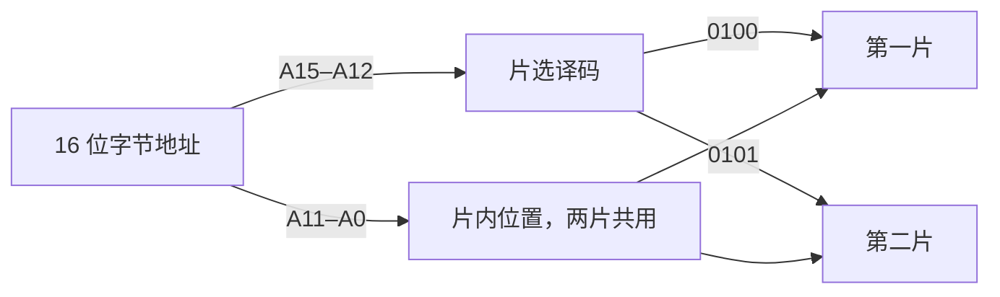

# 存储系统第 1 次课：片选与地址镜像

课件的存储组织和片选译码部分分别回答「需要多少存储单元」和「哪一片应答这个地址」。以下为据此自编的练习，不是原课件习题或图示复刻。

**补充。** 某字节编址的系统有 16 根地址线，用两片 $4\,\mathrm{Ki}\times8$ 的 SRAM 做字扩展。希望第一片映射到 `4000H` 起始的一段，第二片紧随其后。怎样划分地址？若片选译码漏掉地址位 `A15`，那么读 `C123H` 与读 `4123H` 有何关系？仅考虑地址译码，假设没有其他芯片同时应答。

**参考解答。** 每片只有 $2^{12}$ 个单元，所以低 12 位只选片内字节；地址高位送片选逻辑，决定哪片参加此次读写。总线上的位宽仍是 8 位，两片增加的是可寻址单元数，不是每个单元的位数。

| 高四位 | 芯片 | 对应闭区间 |
|---|---|---|
| `0100` | 第一片 | `4000H–4FFFH` |
| `0101` | 第二片 | `5000H–5FFFH` |

每片的最后一个地址等于首址加 `0FFFH`，整个存储块的最后地址为 `5FFFH`。若漏接 `A15`，高四位 `1100` 和 `0100` 被译码器看成一样；`C123H` 与 `4123H` 的低 12 位都是 `123H`，最后选中同一片的同一字节。这不是容量增加：写进其中一个地址，再从另一个读，会观察到同一个已更新的单元。

> [!TIP]
> 看到 ==漏接一根高地址线==，只翻转这一位做反例。若片选与片内偏移都不变，就找到了一个地址镜像；若另一设备也响应镜像区，不能再假定总线读到的是该 SRAM 的值。

参见[存储器的扩展方法](../../../topics/微机接口/cunchu-kuozhan.md)与[存储器地址译码电路设计](../../../topics/微机接口/dizhi-yima.md)。
