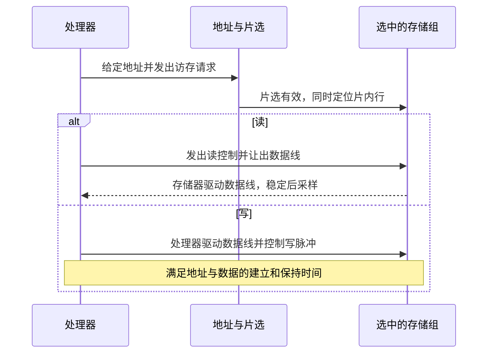
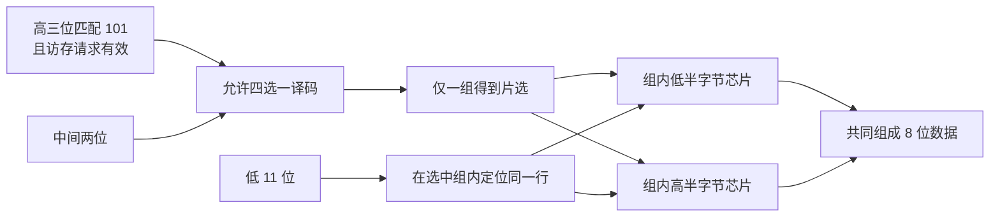

# 存储系统第 1 次课：访存、片选与地址镜像

这份伴读解释旧课件里的访存、存储层次和芯片连接，示意图及贯穿全文的算例为自编。原件扉页称「第六章」，文件名的章号不同；这里沿用原路径作来源标识，不据此推定现行课程章节号。

## 为什么同一条指令可能访存两次？

控制器得先取指令，再让运算器处理操作数。若操作数也在存储器里，取指和取数都要用访存通路。冯诺伊曼组织让程序和数据共享存储空间和通路；当两项请求争用同一总线时，只让算术电路变快不能消除等待。哈佛式组织分开指令与数据的存储和通路，使取下一条指令有机会与读写数据重叠。能否重叠仍取决于流水线、缓存命中和下游共享资源。主存统一但一级指令缓存、数据缓存分立，也是常见折中。外设则经输入输出接口与系统互通，不等同于普通存储单元。参照[微机硬件](../../../topics/微机接口/weixingji-yingjian.md)与[总线分类](../../../topics/微机接口/zongxian-gainian.md)。

## 已经知道地址，为什么还不能立刻读数据？

一个存储元承载一位，若干存储元组合成芯片的一行，许多行组成存储体。芯片还需要译码电路选行，以及读写控制来决定数据能否进出。CPU 的编址单位、芯片选中的一行和总线一次传输的位数不必相等。比如字节编址的处理器若能在一次传输中取两个字节，这两个字节仍各有自己的字节地址。

$n$ 根独立的二进制地址线可表示 $2^n$ 个地址；容量还要看一个地址代表几位，以及哪些地址实际装了存储器。20 位字节地址的空间是 1 MiB，末址 FFFFFH；32 位字节地址的空间是 4 GiB，末址 FFFFFFFFH。旧资料中的 K、M 在这类容量计算里按 2 的幂理解。对一片有 $2^{11}$ 行、每行 4 位的芯片，要区分 $2^{11}\times4$ 位的存储量、11 根片内地址线和每次传输的 4 位。可对照[存储单元](../../../topics/微机接口/cunchu-danyuan.md)、[容量](../../../topics/微机接口/cunchu-rongliang.md)与[存储组织](../../../topics/微机接口/cunchu-zuzhi.md)。

这是信号职责图，不是具体时序规格。异步 SRAM 读操作要等地址、片选和输出使能到数据有效的各项条件都满足，读到值也不意味着下一次访问已经可以开始。==存取时间==是从规定事件到数据可用或操作完成的延迟；==存储周期==是相邻两次同类访问起点之间允许的最短间隔。写入时地址、数据和写控制有建立及保持要求，不能仅凭片选判断写入已发生。

## 为什么不用一种介质包办所有需求？

判断存储器时，先问自己在区分介质、断电保持、写入方式，还是它在系统里所处的位置。这几条轴彼此独立。

| 技术或位置 | 适合做什么 | 要付出的代价 |
|---|---|---|
| SRAM | 供电时用反馈保持一位，无需刷新，常作高速缓存 | 典型存储元要用多只晶体管，面积和位成本较高；断电仍会丢失数据 |
| DRAM | 典型电容加访问晶体管存一位，密度高，适合主存 | 电荷泄漏需要定期刷新，读出还涉及恢复 |
| ROM、PROM、EPROM、EEPROM 或闪存 | 断电保留固件，处理器可从中取得启动指令 | 掩模 ROM 与一次可编程 PROM 不能反复写；EPROM 可用紫外线擦除；EEPROM 和闪存均可电擦写，常规数据 EEPROM 可按字节或小页更新，闪存通常须以较大的擦除块为单位，实际粒度看手册 |
| 辅存 | 持久保存较大量数据，可用磁盘或固态盘 | 通常经控制器按块访问，不能直接当作 CPU 普通地址的延伸 |

要从使用的介质判定磁盘与固态盘，不能由「移动硬盘」外壳或接口推出内部一定用半导体。SRAM 和 DRAM 的功耗也不能只由是否刷新来排序，还取决于容量、实现与工作状态。选器件时还要并列看存取宽度、可靠性、密度、成本和速度。

寄存器直接服务当前指令；缓存利用近期访问会重复的==时间局部性==，以及相邻位置常接着被访问的==空间局部性==；主存放运行中的程序和数据，辅存保存掉电后仍需使用的内容。小而快的层无需装下整个程序。**补充（自编）。** 缓存查一次花 2 ns，未命中额外花 80 ns，命中率 95%，平均是 $2+0.05\times80=6$ ns，但一次未命中仍可能花 82 ns。共享缓存和下游总线还有资源竞争，不能用平均速度保证实时期限。

## 哪些芯片应同时选，哪些必须互斥？

一片标成 $W\times b$，表示 $W$ 个片内地址、每地址 $b$ 位。目标为 $N\times B$，且两方向整除时，每组 $B/b$ 片同选，组成一个足够宽的存储字；共有 $N/W$ 个互斥的组。只除总容量虽能算出理想片数，却不能告诉你该并哪几根线。

| 扩展哪一维 | 一次访问使能谁 | 接线应满足什么 |
|---|---|---|
| 位扩展 | 选中组的各片同时使能 | 同片内地址、同片选及读写控制；每片占数据线的不同区段 |
| 字扩展 | 只使能一个地址组 | 各组共用低位地址、对应数据线与读写控制；高位译码产生互斥片选 |
| 字位同时扩展 | 先选组，再由组内多片合成一个字 | 组数与组内片数都要正确；不能让不同组同时驱动同一数据线 |

**参考解答（自编）。** 用 $2\,\mathrm{Ki}\times4$ SRAM，在 16 位地址、8 位数据的字节编址系统中组成 A000H–BFFFH 的 8 KiB。每两片并成 $2\,\mathrm{Ki}\times8$，分接数据总线的低四位和高四位；需要四组、共八片。低 11 位定位片内，A12 和 A11 选组。只有 A15–A13 为 101 且发生存储器访问时，才让这四组中的一组使能。

| 组号 | A12、A11 | 首址 | 末址 |
|---|---|---|---|
| 0 | 00 | A000H | A7FFH |
| 1 | 01 | A800H | AFFFH |
| 2 | 10 | B000H | B7FFH |
| 3 | 11 | B800H | BFFFH |

例如 B123H 落在第 2 组，两片都取偏移 123H；若存入 D6H，低位片收 6，高位片收 D。计算区间容量用==末址减首址再加一==；从首址 A000H 加 1FFFH 才是末址。如果另有一块从 8000H 开始的 32 KiB 存储区，最高地址为 FFFFH；把同一个容量改放到 9000H，末址就超出 16 位，不能因低位回绕而当成同一块合法区间。对照[存储器扩展](../../../topics/微机接口/cunchu-kuozhan.md)。

## 省掉一根高位线，会省出什么问题？

[地址译码](../../../topics/微机接口/dizhi-yima.md)分两步：判断哪一片或哪一组响应，再取其片内哪一行。完整译码让所有未用于片内行定位的地址位都参与判决，区间外不选中该块。部分译码省掉一部分高位条件，被省掉的位翻转时可能访问同一物理单元。直接线选更省逻辑：一根高位直接选一组，但不天然形成互斥的二进制译码。

- **补充（线选反例）。** 若两个高有效片选分别由 A11、A12 直连，01、10 可各选一片，11 却会双选，00 会全不选。只列出两片各自单选的区间，不等于其他地址都安全；低有效元件要按实际极性重列真值关系。
- **参考解答（续算）。** 上面的 SRAM 若漏掉 A15，B123H 和 3123H 的其余位相同，都指向第 2 组的偏移 123H。若另有完整译码的启动 ROM 占 0000H–3FFFH，后一个地址还命中 ROM，读时可能让两个输出争用总线。将译码器使能与访存请求相与，并恢复遗漏的位，才同时解决这两个问题。
- **补充（看电路反推区间）。** 先从片选回溯译码器的输出和使能，记录有效电平与每条输入线的位权，再固定参与比较的高位、枚举遗漏位，并令片内位全零和全一，分别求各映射块的首末地址。不能只凭「第几片」猜高位，更不能把图上引脚顺序当作地址位权。

> [!TIP]
> 题目说「某高位没接」，就把那一位翻转，同时检查片选和片内偏移。两者都不变是镜像；若又选到另一设备，才出现总线争用。先检查起址、末址和刚越界的地址，比重算一次总片数更容易发现接线错误。

### 用原件里的边界算例核对

**参考解答（第 34–37 页）。** 旧例在 64 KiB 的空间里放低端 8 KiB EPROM、其后 24 KiB SRAM 和顶端 2 KiB SRAM。先用 A15–A13 进三线八线译码器，满足访存条件时，输出 0 至 3 分别选低端四个 8 KiB 块。这四片用 A12–A0 作片内地址。顶端小片只用 A10–A0 作片内地址，还必须令 A12、A11 都为 1，不能把第 7 路译码结果直接当成有效片选。若 $Y_7$ 表示允许访存且命中第 7 个 8 KiB 块的高有效逻辑量，那么小片选中条件就是 $Y_7\land A_{12}\land A_{11}$；接到低有效片选端之前应取反。这样小片只覆盖 F800H–FFFFH，不会在 E000H–F7FFH 内出现三组镜像。程序 ROM 只应在满足读条件时驱动数据线；不能把它的低有效片选与写入使能混为一谈。8000H–F7FFH 没有分配器件，确为 30 KiB。

**参考解答（第 38 页）。** 1 KiB×8 芯片拼出 4 KiB，需四片，定位该块共 12 位，其中低 10 位作片内地址，另外两位至少用于组选择；系统还可再用更高位决定整个块的位置。128 KiB 芯片拼出 512 KiB 需要四片，从 10000H 开始的最后一字节为 8FFFFH；这里只确定总区间，起点不是 128 KiB 的整块边界，不能因此默认接线只需取固定高位前缀。A0000H–EFFFFH 包含 320 KiB，用 32 KiB×8 芯片共十片。

**参考解答（第 39 页）。** 图上第 6 片的低有效片选接译码器第 5 路。A15–A13 取二进制 101 时才选中它，A12–A0 保持自由。因此首址是 A000H，末址是 BFFFH。编号从「第 1 片」开始，译码器输出却从 0 编起；若不追连线就把第 6 片写成二进制 110，会把整个区间移错一块。
