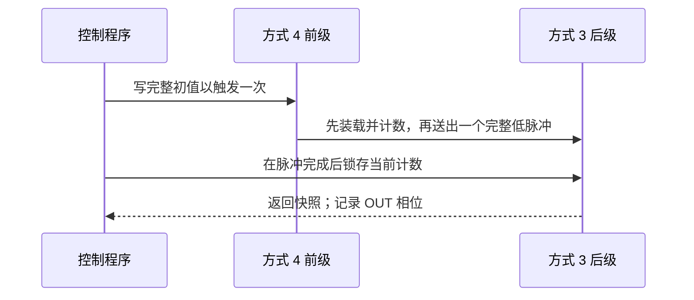

# 8254 定时计数器：从一拍的意义到可读的状态

这是第 11 章课件的独立伴读。用另设的地址、计数值与电路条件重新推导；原课件的图和程序未转载。芯片细节按 [Intel 8254 手册](https://www.scs.stanford.edu/23wi-cs212/pintos/specs/8254.pdf)核对。实际板卡还须看时钟连线、版本额定频率和端口译码。

## 要量的是事件次数，还是时间？

软件空循环占着处理器，时间还随指令执行环境变化。把事件接到硬件的 CLK，8254 则独立数边沿；输入是周期时钟时，已数过的拍数才可以折成时间。==CLK 决定一拍是什么，GATE 决定哪些拍有效或何时重启，OUT 才是外部观察结果。==

每片有三个独立的 16 位通道，各有 CLK、GATE、OUT，共用 8 位数据总线和控制字端口。写入的初值先进入初值寄存器 CR，按方式规定装入真正推进的计数单元 CE；读取快照由输出锁存器 OL 保留。不要把“已经写完”和“新数已经开始递减”当作同一步。GATE 在 CLK 上升沿采样，装载与递减发生在下降沿；在按边沿触发的方式中，合格的 GATE 上升沿会先被捕获。

两根片内选择线把四个地址分成通道 0、1、2 和控制端口。外部地址译码先选整片；只有片选有效，低地址位才有意义。数据端口可按规则读写，控制端口用于写命令，读状态要从相应通道的数据端口读，不是从控制口取回上次写入的字。参见[端口编址](../../../topics/微机接口/duankou-bianzhi.md)和[数据、状态与控制端口](../../../topics/微机接口/duankou-gainian.md)。

## 先确定 OUT 怎样变化，再挑方式

| 题目真正要求 | 方式 | 初始与典型输出 | GATE 的实际角色 |
|---|---:|---|---|
| 数够一批事件就升高，并保持通知 | 0 | 先低，减至零升高；不是稳定脉冲列 | 高允许、低暂停；不直接改 OUT |
| 外部一到，就拉低一段受计数值控制的时间 | 1 | 先高，触发后下一个装载拍拉低，持续 $N$ 拍 | 上升沿触发；再触发重开计时 |
| 重复给出一个低拍的周期标记 | 2 | 平时高，减到 1 时低一拍，然后重装 | 低停计并令 OUT 高；上升沿可同步重装 |
| 持续输出接近对称的高低电平 | 3 | 周期同样为 $N$ 拍，但高低各占约半周期 | 低停计并令 OUT 高；上升沿可同步重装 |
| 由程序预置后延迟一次，再打一个低拍 | 4 | 先高；减至零时低一拍后回高 | 高允许、低暂停；写完初值启动 |
| 外部触发后延迟一次，再打一个低拍 | 5 | 先高；减至零时低一拍后回高 | 上升沿触发；重复触发会推迟终点 |

方式 0、4 从完成初值写入起数到首次输出事件，若一直允许计数，第一 CLK 用来装载，随后才有 $N$ 个递减拍。方式 5 从触发起同样要区分装载拍和 $N$ 个有效拍；方式 1 的低电平从装载拍开始，低脉宽反而恰为 $N$ 拍。对方式 2、3 计算的是**稳态重复周期**，不是把首次装载开销加到每个周期。方式 0、1、4、5 的 CE 到零后可回绕，OUT 的一次行为不等于内部计数器就此停住。

> [!WARNING]
> 正在计数时不改方式控制字、只写新初值，结果不是“一定下一拍生效”。方式 0、4 从下一装载拍开始；方式 1、5 等触发；在持续计数且无新触发时，方式 2 等当前周期末，方式 3 等当前半周期末。方式 0 双字节写入的首字节使 OUT 立刻为低并停计，方式 4 的首字节不会这样做。若写方式控制字，控制逻辑立即复位到所选方式的初态。

**补充。** 对同一个 $N=9$，方式 2 每九拍只有最后一个低拍；方式 3 的输出高五拍、低四拍。它们的低电平比例分别为 $1/9$、$4/9$。若要求严格一半占空比，奇数分频在方式 3 仍不能满足。偶数 $N$ 时两半各 $N/2$；奇数时为 $(N+1)/2$ 和 $(N-1)/2$。方式 3 的 CE 并不是每拍减一的线性倒计时，不能直接从一次读数判定离翻转还剩几拍。

## 控制口写的是命令，数据口才承载初值

普通方式控制字从高到低为：选通道两位、读写格式两位、方式三位、数制一位。读写格式 `01` 或 `10` 分别只送低字节或高字节，另一字节置零；`11` 低字节先、高字节后。格式是每个通道自己的约定，不能在一对字节之间允许其他程序写同一通道。方式字段 `110`、`111` 分别是方式 2、3 的另一种编码；新题优先用标准的 `010`、`011`。

二进制存储的是通常的 16 位数；压缩 BCD 的每个半字节装一个十进制数字。同一个计数 $3200$，二进制为 `0C80H`，压缩 BCD 为 `3200H`。所以二进制只写高字节得不到 `0C80H`，BCD 只写高字节却可得到 `3200H`。数值零单独编码最大初值：二进制表示 $65536$，BCD 表示 $10000$，不是零拍；方式 2、3 的初值 1 不合法。

**订正。** 课件第 30 页关于大于 9999 的分界漏了 BCD 的全零特例；按 Intel 手册，恰为 10000 时可以用 BCD 全零，超过 10000 才不能用 BCD。

**参考解答（自编板卡）。** 在 8 位 I/O 总线上新增一片 8254，连续占 `2A0H` 到 `2A3H`。总线地址高位匹配且为 CPU 的 I/O 周期才选片，`A1:A0` 区分四口。给通道 0、1 都送 3.2 MHz。前者要求 8 kHz 方波，后者要求 2.5 kHz、脉宽恰为输入一拍的低脉冲列。

| 输出服务 | 所需整数分频 | 控制字写入 `2A3H` | 数据写入所选通道 |
|---|---:|---|---|
| 通道 0 的对称方波 | $3\,200\,000/8\,000=400$ | `36H`：通道 0、低后高、方式 3、二进制 | `2A0H` 先 `90H` 后 `01H` |
| 通道 1 的周期低拍 | $3\,200\,000/2\,500=1280$ | `74H`：通道 1、低后高、方式 2、二进制 | `2A1H` 先 `00H` 后 `05H` |

第一路高低各 200 拍；第二路周期 $400\,\mu\mathrm s$，低脉宽只是 $0.3125\,\mu\mathrm s$。端口超出 8 位立即数范围时，用 DX 携带端口号；见 [I/O 指令](../../../topics/微机接口/io-zhiling.md)。两路各自的 GATE 接法决定何时开始输出；地址相邻则是题给的 **8 位**总线接法，其他字节寻址协议不能直接套这四口。

## 观察正在运行的计数，不要停坏被测对象

直读只有在时钟或有效计数确实停止且读数稳定时才可依赖。盲目把 GATE 拉低有三种风险：有些方式不把低电平当暂停，方式 2、3 的 OUT 会被强制为高，重新拉高还会触发重装。用锁存读正在运行的计数，才不会改变被测过程。

| 这次想取得什么 | 写控制口 | 下一步 |
|---|---|---|
| 单通道的当前计数 | D7:D6 选通道、D5:D4 为 `00`，其余位取零 | 到该通道按原格式读 |
| 一或多通道的计数、状态或两者 | D7:D6 为 `11`；D5 为 0 锁计数，D4 为 0 锁状态；D3:D1 分别置 1 选择通道 2、1、0；D0 为 0 | 各到被选通道读；两者均锁时先读状态，再按格式读计数 |

**补充。** 对前例通道 1 同时锁计数与状态，写 `C4H` 到 `2A3H`，随后从 `2A1H` 读三个字节。若状态为 `B4H`，表示 OUT 高、新初值已装载（D6 为 0）、低后高、方式 2、二进制。若接着读到 `FEH`、`02H`，快照就是 `02FEH`，即 766。两组选择位有相反习惯：通道位写 1 选择它，计数/状态位写 0 才锁对应内容。待决锁存没读完时，重复发同一锁存不会刷新旧快照。若只锁通道 1 的计数，可用单通道命令 `40H`。

## 机上三路为何不能随便占用

传统 PC/AT 类结构把通道 0 用于主 8259 的 IRQ0 日时钟，把通道 1 用于动态存储刷新时序，把通道 2 用于扬声器。通道 2 有两道控制：一路允许计数，一路决定波形能否送到扬声器；经典实现经 `61H` 的位 0、1 控制。实际器件可由板级逻辑集成，不应把旧图当作所有 PC 的接法。`40H` 到 `43H` 是这类系统的 PIT 端口，不是外扩实验板的地址。[IBM PC/AT 技术手册](https://www.bitsavers.org/pdf/ibm/pc/at/1502494_PC_AT_Technical_Reference_Mar84.pdf)可供核对。

通道 0 以约 1.193182 MHz 工作、初值编码全零时，基本节拍是 $65536/1193182\approx54.9254\,\mathrm{ms}$。保留节拍时，可在 BIOS 的 `1CH` 回调里累计经过的时钟量，把显示或键盘工作留给前台；固定 18 拍不是严格的一秒。若教学仿真改写 IRQ0 到更短周期，在每次硬件中断加入本次实际分频，累计够 65536 才交给原有日时钟服务并扣回 65536。按整毫秒近似分组可能长期漂移。调用链明确由哪一方完成每次 PIC 确认；结束时恢复原定时配置和中断入口。不应为了显示文本就直接重编现代操作系统的系统计时器。参见 [BIOS 与 DOS 调用](../../../topics/微机接口/dos-bios-diaoyong.md)。

**补充。** 假设旧机模型中每次新中断代表 4096 个输入时钟。16 次恰好恢复一份旧节拍，17 次就多了 4096 拍。外扩板若输入为 1 MHz、要求 1 s 方波，单路最大分频 65536，不可能单路达到。可用一级方式 2 除 1000，把合格的 OUT 边沿送下一级 CLK，再由二级方式 3 除 1000，末级得到对称的 1 Hz；还要核两级连接的 CLK 最小脉宽、电平和传播延时。

## 实验台上怎样逐拍读出方式 3？

自由运行时 CPU 两次读取之间已经跳过许多拍。改用独立实验板，让前级方式 4 在程序完整写入后产生一个低脉冲，把它当成后级方式 3 的一次 CLK。后级先配置，GATE 保持允许；每次发脉冲，要等低脉冲及回高都完成后再锁存。方式 1、5 需要额外的 GATE 上升触发源，不能做到仅写入一次就自然出现下一拍。此实验不使用系统 PIT。

**参考解答（自编）。** 前级以 2 MHz 运转，用方式 4 低字节格式写入 8。先装载再经过八次递减；无暂停时第九个有效下降沿开始低脉冲，低电平维持 $0.5\,\mu\mathrm s$。实验应留充足余量并核对器件定时。后级使用通道 1 的方式 3，若只写低字节、初值为 7，方式字是 `56H`。第一下降沿用于装载；进入稳态后每周期应见高四拍、低三拍。读出的 CE 不是“还剩这么多拍”，而且不能把某个兼容实现的奇数计数器读数序列当所有器件的统一定义。

**订正。** 课件第 86 页选后级控制字 `76H`，却只送一次计数初值，按低后高格式还未写完。若保留该方式字，再送高字节 `00H`；若只送低字节，应使用 `56H`。一个字节和两个字节都能表示小初值，但必须与方式字一致。
