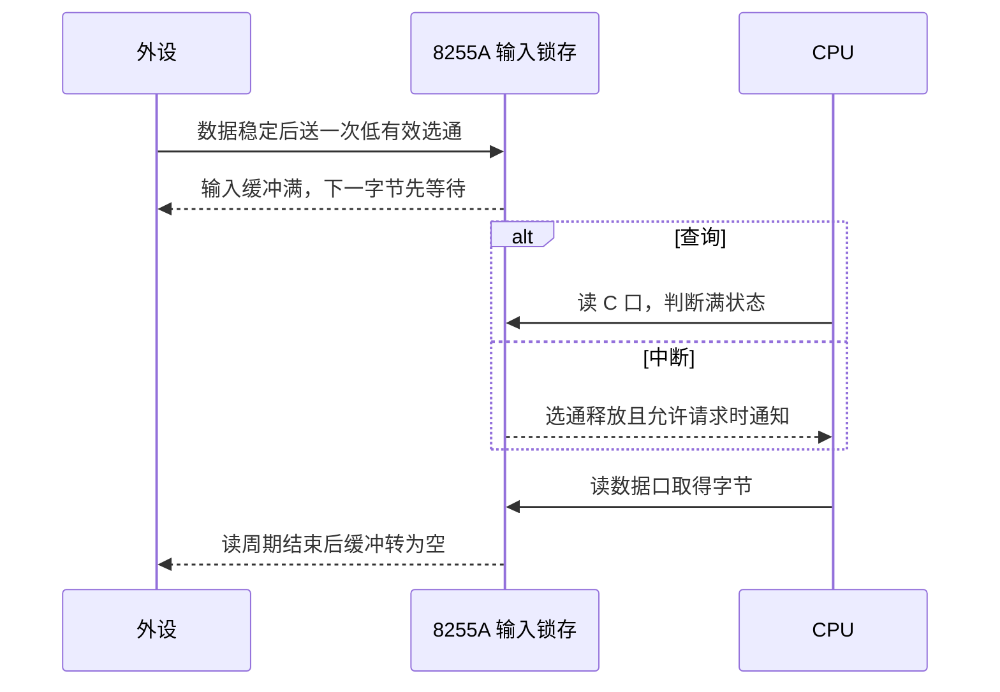
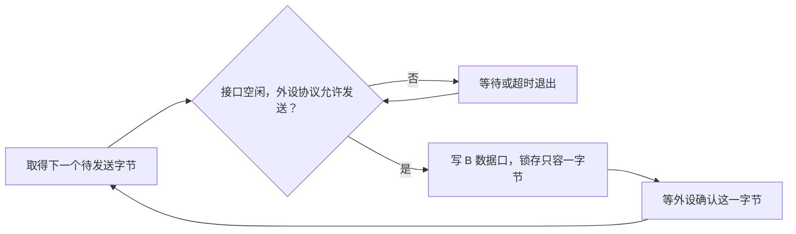

# 8255A 并行接口：从地址译码到握手交付

一个端口要回答三个不同的问题：处理器如何选中它？谁在什么时候把字节放稳？设备就绪后，是处理器主动来看，还是由接口通知处理器？把这三件事混成一个「读/写」动作，就容易错误地把地址当缓冲，或把中断当数据本身。以下以原课件涵盖的 8255A 为范围重新推导，算例和图独立构造，不是原课件程序或波形的复制。器件细节以 [Intel 8255A/8255A-5 手册](https://atta.szlcsc.com/upload/public/pdf/source/20241016/218EC54DF16C30D7667C0C377F0F65AD.pdf)为准。信号名前缀 `/` 表示低有效，例如 `/RD`。

## 一个地址并不是一根片选线

CPU 一侧的 `D0–D7` 是共享数据线，`/RD`、`/WR` 给出本次操作方向；板级译码决定 `/CS`，器件的 `A1:A0` 才从内部四个寄存器中选一路。外设一侧有 A、B、C 三个八位端口。C 口的高低半组可以参与普通 I/O，但一旦选通或双向方式借用了某些位，这些位便不再是普通 GPIO。复位把端口配置为输入，不能把上电后尚未配置的引脚当作已经驱动 LED 的输出。只在片选有效时发出相应的读或写，不把两者同时置为有效；未被选中时接口不应驱动 CPU 数据线。原版 Intel 8255A 的控制口只写；配置字应由软件保存，而不是假定可从控制口读回。看[端口编址](../../../topics/微机接口/duankou-bianzhi.md)与[地址译码](../../../topics/微机接口/dizhi-yima.md)。

| 器件的 `A1:A0` | 选中 | 读／写的含义 |
|---|---|---|
| `00` / `01` | A / B 数据口 | 按配置执行数据输入或输出 |
| `10` | C 口 | 读回普通位与握手状态；普通输出的写入要服从位的用途 |
| `11` | 控制口 | 写方式字，或写 C 口按位置位／复位字（BSR） |

**补充。** 独立 I/O 编址的一块实验板在 `2D0H–2D7H` 选中芯片；CPU 的地址低两位接器件的 `A1:A0`，`A2` 不接译码，那么 `2D5H` 访问哪个寄存器？为什么选了八个地址却没变成八个独立寄存器？

**参考解答。** `2D5H` 的低两位是 `01`，访问 B 口。`2D1H` 仅在不参与选择的 `A2` 上有别，故映射到同一处。模拟试一遍，选中窗口的前后四个地址分别形成 A、B、C、控制口。这是==不完整译码形成的地址镜像==，不是额外存储。若板上把器件端口选择脚接到 CPU 不同的地址位，端口步长也会改变；不能见到 8255A 就套固定的连续地址。

## 先确定端口承担的角色，再写控制字

方式 0 是直接 I/O：普通输入不锁存，读窗口内外设必须给出稳定数据；普通输出写入后由输出锁存器保留，但保留并不等于外设已取走。方式 1 给一个方向增加逐字节交接；A、B 可各选输入或输出。方式 2 让 A 口在同一组线上双向传送，输入与输出有不同的握手条件，不能让两端同时驱动数据线。B 口没有方式 2。

| 控制字位 | `D7=1` 时的选择 |
|---|---|
| `D6:D5` | A 组：`00` 方式 0，`01` 方式 1，`1x` 方式 2 |
| `D4` / `D3` | A 口方向 / C 高半组中尚未被握手占用的位的方向 |
| `D2` | B 组：0 为方式 0，1 为方式 1 |
| `D1` / `D0` | B 口方向 / C 低半组中尚未被握手占用的位的方向 |

例如方式 0 下的 `83H`，先看出两组都是方式 0，再读 A 输出、B 输入、C 高半输出而低半输入。方向位 1 是输入、0 是输出；方式 2 中 A 口方向由双向方式决定。若 `D7=0`，就不是重写上表：`D3:D1` 对 C 口选 0 至 7，`D0` 选择复位或置位。对已分配为 INTE 的选择，这一操作改变的是**芯片内部的中断允许触发器**，不是强行把外设驱动的引脚拉高。方式字切换会重置输出寄存器和状态触发器；切换方式时先使外设进入可安全重配的状态。用 BSR 只切换需要的允许条件，不重发方式字。

**补充。** 给上面的实验板配置 A 口方式 1 输入、B 口方式 0 输出，剩余 C 位选输出；先试查询，再开放 A 口中断。

**参考解答。** 控制口可用 `2D3H`。`D7:D0=10110000`，先写 `B0H`。这里 A 输入方式的 INTE 由 C 位号 4 的 BSR 控制：复位写 `08H`，置位写 `09H`。仅允许芯片提出请求不足以保证 CPU 接到中断，还需要接线、控制器掩码和 CPU 的中断条件成立。

## 把“收到”和“准备接下一个”分开看

| 方式／方向 | 外设送来的低有效信号 | 器件送出的状态 | 中断输出 | 开关 INTE 的 BSR 位号 |
|---|---|---|---|---|
| A 方式 1 输入 | PC4 `/STB` | PC5 `IBF`（高为满） | PC3 | 4 |
| A 方式 1 输出 | PC6 `/ACK` | PC7 `/OBF`（低为满） | PC3 | 6 |
| B 方式 1 输入 | PC2 `/STB` | PC1 `IBF`（高为满） | PC0 | 2 |
| B 方式 1 输出 | PC2 `/ACK` | PC1 `/OBF`（低为满） | PC0 | 2 |
| A 方式 2 | PC4 `/STB`、PC6 `/ACK` | PC5 `IBF`、PC7 `/OBF` | PC3 共用 | 4 输入、6 输出 |

选通输入中，外设先稳定字节，然后送低有效选通；接口锁存输入并置满，允许中断且选通释放时可通知 CPU。CPU 读数据口时，读周期的开始撤销对应请求，读周期结束清除 `IBF`。查询读取的是 C 口状态，不是把字节从 C 口取走；A 输入等 PC5、B 输入等 PC1，**都等 1**。输入端观察到上轮满状态时应先等，因为单个锁存器只保存一个未消费字节，不是队列。**补充。** 一个保留待发字节的外设分别在 $10\,\mu\mathrm{s}$、$30\,\mu\mathrm{s}$ 产生 A、B；CPU 在 $35\,\mu\mathrm{s}$、$80\,\mu\mathrm{s}$ 两次读取。遵守满状态的外设把 B 暂留在接口外，于 A 被读走后、第二次 CPU 读取前再提交，两个字节都能送达；例如可在 $36\,\mu\mathrm{s}$ 提交 B。如果设想一个不检查满状态、可直接覆写的单字节锁存器模型，B 提前覆写 A 后只剩 B；中断不可能挽回被丢的旧数据。这里两次完成靠的是外设自身能等待，不是接口突然存得下两个字节。

选通输出的因果方向相反：CPU 写数据口，数据被锁存，写周期结束后 `/OBF` 变低表示有数据；外设取走后拉低 `/ACK`，`/OBF` 随之回高。在允许中断的情况下，`/ACK` 释放后才具备通知 CPU 下一次装数的条件；CPU 开始下一次写操作时撤销相应请求。查询时查看 C 口对应的 `/OBF`，并按外设协议检查确认周期是否允许再发；勿把输出状态的 1 解释成「满」。原始信号与引脚状态时刻还须满足芯片手册的建立、保持与脉宽，不应把逻辑事件图当作电气时序图。

> [!WARNING]
> C 口读回的是逻辑状态字，不是把 C 引脚逐根采样成一个字节。例如 A 输入方式的读回位 4 反映 `INTE`，不是外设 `/STB` 的瞬时电平；B 组选通时读回位 2 反映 `INTE`，不是 `/ACK` 或 `/STB`。若把两者混用，极易写出等待永远不会如期变化的循环。

方式 2 的 A 口有输入锁存和输出锁存，接口通过 `/ACK` 控制何时驱动 A 口的数据总线，平时输出可为高阻。比方向位更重要的是==端到端总线所有权==：外设驱动并选通输入时，不能又要求接口驱动同一组线。在软件侧，A 口两个方向可经各自的 INTE 汇合成同一 PC3 请求，因此服务时根据输入满、输出确认和发送队列分别判定，不因同一根请求线而只认一个方向；两个条件都成立时两边都应有机会被服务。例如让 A 双向、B 同时做方式 1 输入，可将无关位取 0，得到 `C6H`，再分别用 `09H`、`0DH` 开放 A 输入、输出，用 `05H` 开放 B。少写 `0DH` 只少了 A 的输出通知；不是把 A 口改回单向，也不是禁止 B 发请求。

**订正。** 原课件第 33 页把 A 方式 2 时 B 组选通使用中断排除在外。作为某块板没有接 B 组请求线的限制，这可以成立；作为通用器件规则不成立。Intel 手册的方式 2 与 B 方式 1 组合图仍给出独立的 B 请求 `INTRB`（PC0）。是否让 B 组走中断取决于板级布线和配置。

## 状态位接对之后，算一遍灯和打印字节

**补充。** 用上面的 `2D0H` 实验板：A 口低三位接选择码，按钮提供选通；B 口八路 LED 以吸电流时点亮。若读取的三位选择码是 `011`，从 LED1 开始编号，怎样使其只有一盏亮？

**参考解答。** A 口的读必须在输入就绪后；若 C 口读回 `20H`，PC5 为 1，才读 A 数据口。低三位与 `07H` 相与得到编号 3，再输出 `FFH XOR (1 << 3) = F7H`，只有零起算的第 3 位为 0，点亮 LED4。验证方法不是背表项，而是逐位看电流方向：初始输出 `FFH` 全灭，清一位才使对应支路导通。查询可在前台等待并检查退出键；若采用中断，先建立服务入口，再开放请求，服务读取 A 数据口，在退出时复原入口和掩码。在原课件的板卡中，三位选择码正是字节查表的索引，低有效灯码也可按这个索引生成，不必照搬原程序。8255A 的中断请求不是 CPU 的中断向量，IBM 兼容机例由 8259A 整理并向量化；别的平台的中断控制逻辑可以不同。原课件的兼容机 IRQ9 例沿用 BIOS 对旧向量的转调，不能把从片 IR1 一律写成 `0AH`；从片到主片的确认责任也应按实际服务路径核对。

**补充。** 把 B 口改为方式 1 输出，接一台经适配逻辑对接的打印机；接口把 PC1 的 `/OBF` 转作数据有效请求，把打印机确认交给 PC2，另把打印机 BUSY 接到空闲的 PC3 输入。若需要在不开放中断时发送 `41H` 和 `42H`，能不能先后各写一次 B 口，不等待？

**参考解答。** 不行。可用 `9DH` 选 A 方式 0 输入、B 方式 1 输出、闲置 C 位输入，再写 BSR `04H` 禁用 B 的 INTE。检查打印机能接收且接口未占用，再写第一个字节。确认循环完成后才能交付第二个：在本配置中 C 口位 1 为 `/OBF` 状态，掩码 `02H`；如果协议还要求 BUSY 无效，就同时查独立的 PC3。接口中有一个输出锁存器，连续覆盖未确认字节不会排队。原图把打印机的低有效选通与确认分别接到缓冲满请求及确认端，是特定接口方案；实际打印机若有更严格的脉宽、边沿或数据保持要求，须让适配逻辑满足其协议，不能用同名信号就假定电气兼容。原课件第 53 页的 BUSY、应答关系是所设设备的时序，不保证所有设备在接受一个字节后马上准备好接收下一个。

**订正。** 第 57 页程序结束等待，只能证明接口看到外设对本字节的接收确认；它并不保证纸面上的字符已经打印。

> [!TIP]
> 题目给出==端口方向、握手事件、通知方式==时，依次回答三句：谁把数据放稳，谁确认已经取走，谁负责通知 CPU。A 查询输入应读 C 口的 PC5；B 选通输出对外使用 `/ACK` 和 `/OBF`，申请中断的内部开关通过 BSR 位号 2 控制。把原课件末尾两题从这个因果链推一遍，就不容易把 `IBF`、`INTR` 和 INTE 当成三个同名的「就绪」。

知识点：[I/O 接口的功能](../../../topics/微机接口/jiekou-gongneng.md)、[I/O 指令](../../../topics/微机接口/io-zhiling.md)、[接口的数据交换方式](../../../topics/微机接口/xinxi-jiaohuan.md)、[查询方式](../../../topics/微机接口/chaxun-fangshi.md)。
