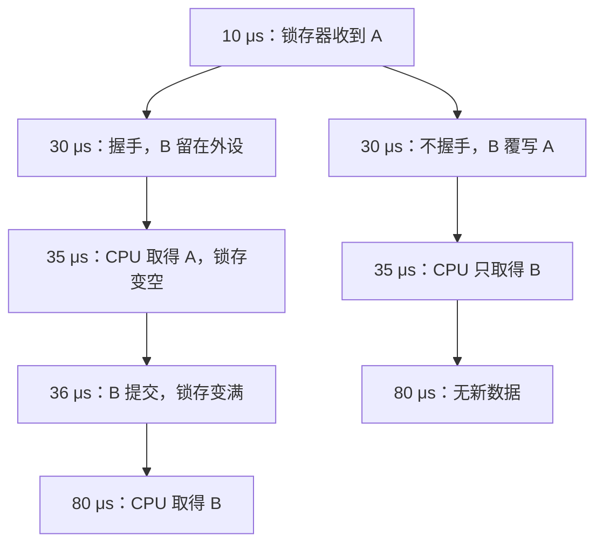

# 并行接口：握手是否等于缓冲

以下为依来源课件的并行输入主题自编的抽象时序练习。约定只描述这一例中的接口状态，不代替 8255A 数据手册，不引用课件中的图件。

### 稳住一个字节，还是排队装下两个？

设外设和 CPU 之间只有一个输入锁存器。外设提交一个字节后，锁存器置满；CPU 读取该字节后才清空。外设分别在 $t=10\,\mu\text{s}$ 与 $t=30\,\mu\text{s}$ 准备好数据 A、B，CPU 分别在 $t=35\,\mu\text{s}$ 与 $t=80\,\mu\text{s}$ 读取。若外设观察「满」状态并可保留尚未提交的数据，CPU 能否读到两个字节？若外设不看状态、每次都直接覆写锁存器，结果又怎样？

**参考解答**：发现两次生产都早于第一次读取时，不要先看总线有几位；先找哪里可以保存尚未消费的数据。遵守握手时，A 在 $10\,\mu\text{s}$ 提交，B 在 $30\,\mu\text{s}$ 只能留在外设。CPU 在 $35\,\mu\text{s}$ 读出 A 后，只要 B 在空位出现后、下次读取前提交，第二次就读到 B。下图用 $t=36\,\mu\text{s}$ 举例。不看状态时，B 在 $30\,\mu\text{s}$ 覆写 A，CPU 第一次只读到 B，第二次则没有新的有效数据。逐次盘点就能核对：两次提交、一次成功读取时，单字节锁存器绝无可能仍保住两个未消费字节。

握手让生产端知道何时应该等，不会凭空增加锁存器深度。如果外设不能保留 B，单靠置满标志仍然无法保证不丢失；应增加缓冲、改用可暂停的生产端，或让 CPU 在下一字节到达前读走第一个。若题目只把查询改成中断，却没改变 CPU 实际读取时刻或缓冲深度，结论也不变。

知识点：[微机系统与 I/O 端口的信息交换方式](../../../topics/微机接口/xinxi-jiaohuan.md)、[查询方式](../../../topics/微机接口/chaxun-fangshi.md)。
