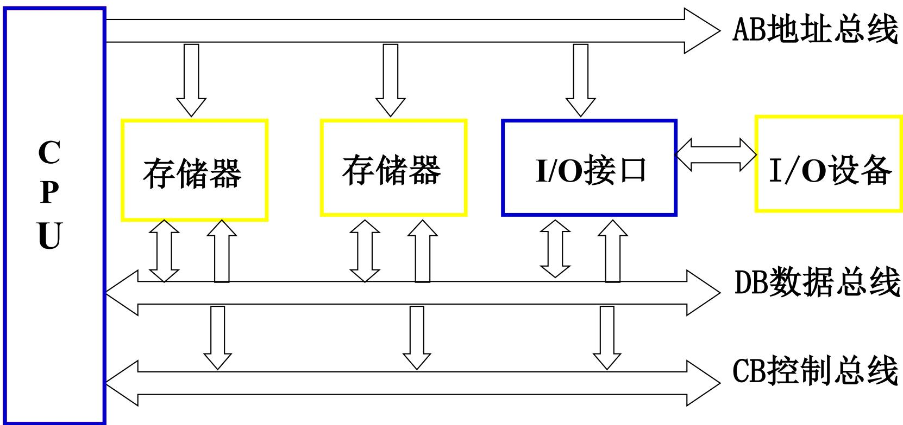
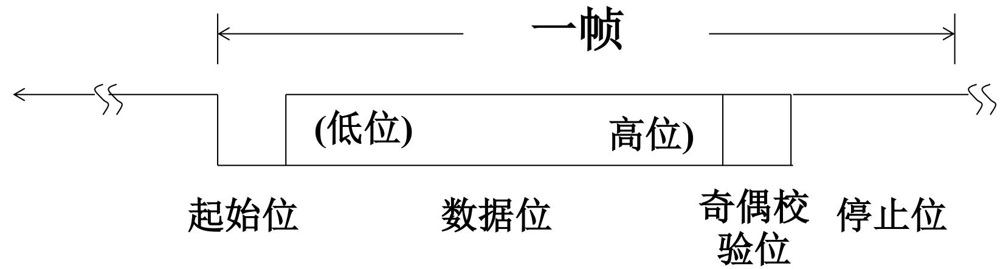
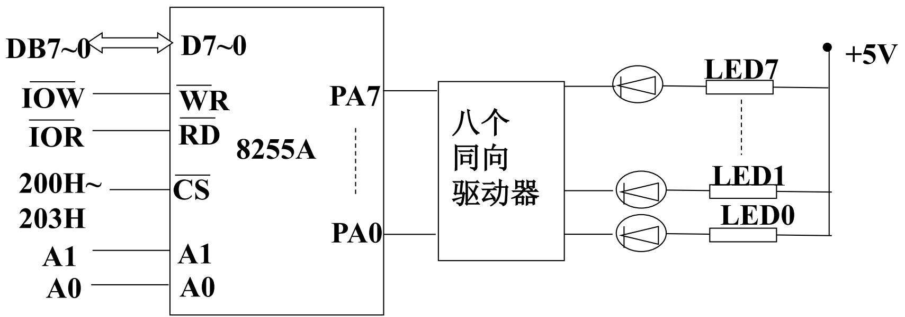
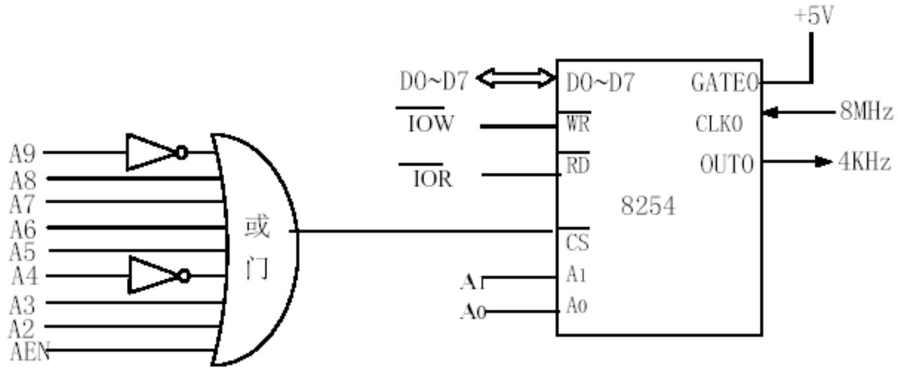

# 《微型计算机原理与接口技术》2020—2021学年第二学期期末复习课件

原件经识别和整理；“参考解答”是我们补的。

## 试卷结构

1. 单选题（10题×2分/题=20分）
2. 填空题（20空×1分/空=20分）
3. 简答题（4题，共计20分）
4. 编程与应用题（4题，共计40分）

## 第一章

### 数制转换

二进制数、十进制数、十六进制数和 BCD 码数之间的转换方法。

例：（129）$_{10}$ =（ ）$_{2}$ =（ ）$_{16}$

（10010111）$_{\mathrm{BCD}}$ =（ ）$_{10}$ =（ ）$_{2}$

知识点：[数制转换（二进制、十进制、十六进制互转）](../../../topics/微机接口/shuzhi-zhuanhuan.md)、[真值数与补码的相互转换及补码计算](../../../topics/微机接口/zhenzhi-buma.md)、[ASCII码编码规则与常用字符编码](../../../topics/微机接口/ascii-ma.md)

### 真值数与补码

真值数和补码数之间的转换方法。

例：字长 = 8 位，则 $[-6]_{\text{补}}$ =（ ）$_{16}$；若 $[\mathrm{X}]_{\text{补}} = \mathrm{E8H}$，则 $X$ =（ ）$_{16}$

知识点：[真值数与补码的相互转换及补码计算](../../../topics/微机接口/zhenzhi-buma.md)、[数制转换（二进制、十进制、十六进制互转）](../../../topics/微机接口/shuzhi-zhuanhuan.md)

### 数值范围

n 位字长的有符号数、无符号数的数值范围。设机器数字长 = n 位，则 n 位补码数其真值范围为 $-2^{n-1} \sim +2^{n-1}-1$；无符号数其数值范围为 $0 \sim 2^n-1$。

知识点：[不同字长下原码、反码、补码的数值范围](../../../topics/微机接口/shuzhi-fanwei.md)

### 补码计算

补码计算及对结果进行分析。

知识点：[真值数与补码的相互转换及补码计算](../../../topics/微机接口/zhenzhi-buma.md)

### ASCII 码

熟记 0–9、A–F、回车符、换行符的 ASCII 码。

知识点：[ASCII码编码规则与常用字符编码](../../../topics/微机接口/ascii-ma.md)

### 微型机的硬件结构



例：微处理器与 I/O 接口及存储器进行信息传送是通过三总线来完成，该三总线为（ ）、（ ）和地址总线。

知识点：[微型计算机的硬件基本结构](../../../topics/微机接口/weixingji-yingjian.md)、[总线的基本概念与分类（内部总线、系统总线、外部总线）](../../../topics/微机接口/zongxian-gainian.md)、[接口电路的作用和基本功能](../../../topics/微机接口/jiekou-gongneng.md)

### 存储单元和存储器地址

存储器由若干“存储单元”组成，每一单元存放一个“字节”的信息。

系统为每一单元编排一个地址，地址码为二进制数，习惯上写成十六进制。

存储器容量由地址线“宽度”决定。

例：1M 容量的存储器，地址范围为 00000H～FFFFFH，由 20 根地址线提供地址码。

## 第二章

知识点：[存储单元和存储器地址的概念](../../../topics/微机接口/cunchu-danyuan.md)、[存储器容量的表示方法](../../../topics/微机接口/cunchu-rongliang.md)

### 基本结构寄存器

基本结构寄存器的名称、位长和作用。

1. 通用寄存器：EAX、EBX、ECX、EDX、ESI、EDI、EBP
2. 段寄存器：CS、SS、DS、ES、FS、GS
3. 指针寄存器：EIP、ESP
4. 标志寄存器：EFLAG

标志寄存器 15 位标志分为两类：状态标志和控制标志。6 种状态标志：CF、OF、ZF、PF、AF、SF。

例：80486 CPU 中的 DX 寄存器是一个（ ）位的寄存器。

- A. 8 位
- B. 16 位
- C. 24 位
- D. 32 位

知识点：[80486/8086基本结构寄存器（通用、段、控制寄存器）](../../../topics/微机接口/jiben-jicunqi.md)、[标志寄存器中的状态标志位与控制标志位](../../../topics/微机接口/zhuangtai-biaozhi.md)

### 实地址模式下的分段管理

实地址模式下，对存储器采用分段管理模式。

物理地址计算公式：

$$
\text{物理地址} = \text{段基址} \times 16 + \text{偏移地址}
$$

例：在 80486 实地址模式下，设某存贮单元的段基址为 FEFFH，偏移地址为 1000H，则该存贮单元的物理地址为（ ）。

## 第三章、第四章

知识点：[微处理器的工作模式（实模式、保护模式、虚拟8086模式）](../../../topics/微机接口/gongzuo-moshi.md)、[实地址模式下物理地址的形成（段基址×10H+偏移量）](../../../topics/微机接口/wuli-dizhi.md)、[存储单元和存储器地址的概念](../../../topics/微机接口/cunchu-danyuan.md)

### 源程序中的语句类型

一个完整的源程序应包含 2 类语句：指令性语句（符号指令）、指示性语句（伪指令）。

知识点：[源程序中的语句类型（指令性语句与指示性语句）](../../../topics/微机接口/yuju-leixing.md)

### 80486 的寻址方式

486 有 3 类 7 种寻址方式：

- 立即寻址方式：获得立即数
- 寄存器寻址方式：获得寄存器操作数
- 存储器寻址方式：获得存储器操作数（内存操作数）

内存寻址方式 16 位寻址规定可使用的寄存器：

1. 直接寻址
2. 寄存器间接寻址 [BX]、[BP]、[SI]、[DI]；段寄存器：[间址寄存器]；某单元的物理地址 = 段寄存器内容 × 16 + 间址寄存器
3. 基址寻址 [BX+位移量]、[BP+位移量]；段寄存器:[基址寄存器+位移量]；物理地址 = 段寄存器内容 × 16 + 基址寄存器 + 位移量
4. 变址寻址 [SI+位移量]、[DI+位移量]
5. 基址+变址寻址 [BX+SI]、[BX+DI]、[BP+SI]、[BP+DI]

知识点：[80486/8086的寻址方式（立即、寄存器、直接、间接、变址等）](../../../topics/微机接口/xunzhi-fangshi.md)、[实地址模式下物理地址的形成（段基址×10H+偏移量）](../../../topics/微机接口/wuli-dizhi.md)、[80486/8086基本结构寄存器（通用、段、控制寄存器）](../../../topics/微机接口/jiben-jicunqi.md)

### 常用伪指令

1. 数据定义伪指令 DB、DW、DD
2. 等值伪指令 EQU、=

例：某程序中的数据定义如下：

```asm
DAT1 DW 1234H, 5678H, 'AB', 'CD', '2'
DAT2 DB 4 DUP(?)
DAT3 DD ?
CN   EQU $-DAT1
```

请问 CN 的值是（ ），DAT1+5 字节单元的内容是（ ）。

知识点：[常用伪指令（SEGMENT、ASSUME、DB/DW/DD、EQU、END等）](../../../topics/微机接口/changyong-weizhiling.md)、[汇编语言常用运算符（OFFSET、SEG、TYPE、LENGTH、SIZE等）](../../../topics/微机接口/changyong-yunsuanfu.md)、[数制转换（二进制、十进制、十六进制互转）](../../../topics/微机接口/shuzhi-zhuanhuan.md)

### 常用运算符

`$` 运算符、SEG 运算符、OFFSET 运算符、PTR 运算符。

知识点：[汇编语言常用运算符（OFFSET、SEG、TYPE、LENGTH、SIZE等）](../../../topics/微机接口/changyong-yunsuanfu.md)、[80486/8086基本结构寄存器（通用、段、控制寄存器）](../../../topics/微机接口/jiben-jicunqi.md)、[端口的编址方式（统一编址与独立编址）](../../../topics/微机接口/duankou-bianzhi.md)

### 目标程序的生成


知识点：[目标程序的生成过程（汇编、链接）](../../../topics/微机接口/mubiao-shengcheng.md)、[源程序中的语句类型（指令性语句与指示性语句）](../../../topics/微机接口/yuju-leixing.md)、[常用伪指令（SEGMENT、ASSUME、DB/DW/DD、EQU、END等）](../../../topics/微机接口/changyong-weizhiling.md)

### 80486 基本指令集

对于双操作数指令（如 MOV、ADD、CMP）：

- 源、目操作数不可同为内存操作数
- 源、目操作数属性一致（长度相同）
- 当目标操作数为间址、变址、基址、基+变址的内存操作数，而源操作数为单字节/双字节立即数，则目标操作数必须用 PTR 说明类型

对于单操作数指令（如 INC、DEC）：若操作数为间、变、基、基+变的内存操作数，则必须用 PTR 说明类型。

例：下列指令中，错误的指令条数为（ ）。

```asm
INC [BX]
MOV AL, [DX]
MUL 100
MOV AX, DS:[BP]
MOV BUF1, BUF2
```

知识点：[80486/8086的寻址方式（立即、寄存器、直接、间接、变址等）](../../../topics/微机接口/xunzhi-fangshi.md)、[数据传送指令（MOV、PUSH、POP、XCHG等）](../../../topics/微机接口/shuju-chuansong.md)、[算术运算与逻辑运算指令（ADD、SUB、MUL、AND、OR、NOT等）](../../../topics/微机接口/suanlu-yunsuan.md)

### 基本的汇编语言程序设计

- 顺序、分支、循环程序
- 子程序调用与宏指令调用有哪些相同点和不同点？

## 第七章 输入/输出系统

知识点：[基本的汇编语言程序设计与程序控制结构](../../../topics/微机接口/jiben-chengxu.md)、[转移指令（JMP、条件转移、CALL、RET）](../../../topics/微机接口/zhuanyi-zhiling.md)

### 一、接口电路的作用和功能

知识点：[接口电路的作用和基本功能](../../../topics/微机接口/jiekou-gongneng.md)、[端口的概念与分类（数据端口、状态端口、控制端口）](../../../topics/微机接口/duankou-gainian.md)

### 二、端口的概念、分类

知识点：[端口的概念与分类（数据端口、状态端口、控制端口）](../../../topics/微机接口/duankou-gainian.md)、[端口的编址方式（统一编址与独立编址）](../../../topics/微机接口/duankou-bianzhi.md)

### 三、端口的编址方式

端口有两种编址方式，PC 系列机采用端口独立编址。

知识点：[端口的编址方式（统一编址与独立编址）](../../../topics/微机接口/duankou-bianzhi.md)、[接口电路的作用和基本功能](../../../topics/微机接口/jiekou-gongneng.md)、[端口的概念与分类（数据端口、状态端口、控制端口）](../../../topics/微机接口/duankou-gainian.md)

### 四、最常用的 I/O 指令

1. 直接寻址 I/O 指令（8 位端口地址）
2. DX 间接寻址 I/O 指令（当端口地址 > 8 位）

知识点：[最常用的I/O指令（IN、OUT的直接寻址与DX间址）](../../../topics/微机接口/io-zhiling.md)、[端口的编址方式（统一编址与独立编址）](../../../topics/微机接口/duankou-bianzhi.md)

### 五、信息交换的四种方式

微机系统与 I/O 端口的信息交换的四种方式：

- 无条件传送
- 查询方式
- 中断方式
- DMA 方式

## 第八章 中断系统

知识点：[微机系统与I/O端口的信息交换方式（无条件、查询、中断、DMA）](../../../topics/微机接口/xinxi-jiaohuan.md)

### 一、中断概念

CPU 暂停执行现行程序，转而处理随机事件，处理完毕后再返回被中断的程序，这一全过程称为中断。

知识点：[微机系统与I/O端口的信息交换方式（无条件、查询、中断、DMA）](../../../topics/微机接口/xinxi-jiaohuan.md)、[端口的概念与分类（数据端口、状态端口、控制端口）](../../../topics/微机接口/duankou-gainian.md)

### 二、中断指令

STI、CLI、INT n、IRET。

要求掌握：中断指令在中断程序设计中何时使用；CPU 执行中断指令后完成哪些操作；STI、CLI 只对可屏蔽中断请求有效。

例：CPU 执行 IRET 指令后，从栈顶弹出（ ）字节数据，分别赋给（ ）、（ ）和（ ）。

知识点：[处理器控制指令（STI、CLI、HLT、NOP等）](../../../topics/微机接口/chuli-kongzhi.md)、[堆栈的概念及SP指针操作](../../../topics/微机接口/duizhan-caozuo.md)

### 三、中断向量

中断向量是实模式下中断服务子程序的入口地址。在实模式下，CPU 把 256 种中断向量组成一张表设置在系统的 RAM 最低端的 1K 单元（0～3FFH）。

n 型中断向量存放在内存单元地址 $4 \times n \sim 4 \times n+3$ 这四个单元：

| 地址 | 内容 |
| --- | --- |
| $4n+0$、$4n+1$ | n 型服务程序入口的偏移地址 |
| $4n+2$、$4n+3$ | n 型服务程序入口的段基址 |

中断向量表起引导作用。

例：实模式下，从内存地址 0000H:0048H 开始的连续 4 个单元中存放的内容为 00H、38H、30H、50H，则该地址所对应的中断类型码为（ ），该中断所对应的中断服务子程序的入口地址为（ ）。

知识点：[实地址模式下物理地址的形成（段基址×10H+偏移量）](../../../topics/微机接口/wuli-dizhi.md)、[存储单元和存储器地址的概念](../../../topics/微机接口/cunchu-danyuan.md)

### 四、微机系统中断分类

PC 机 256 种中断：

- 软件中断（内部中断）
- 硬件中断（外部中断）
  - 可屏蔽中断 ※
  - 非屏蔽中断

要求掌握的两种可屏蔽中断：

1. 用户中断：中断源中断向量 71H、0AH；用户可置换的中断向量 71H、0AH
2. 日时钟中断（优先级别最高）：中断源中断类型码 08H；用户可置换的中断向量 08H、1CH，重点掌握 1CH

知识点：[微机系统与I/O端口的信息交换方式（无条件、查询、中断、DMA）](../../../topics/微机接口/xinxi-jiaohuan.md)、[标志寄存器中的状态标志位与控制标志位](../../../topics/微机接口/zhuangtai-biaozhi.md)、[移位与循环移位指令（SHL、SHR、ROL、ROR等）](../../../topics/微机接口/yiwei-xunhuan.md)

### 五、CPU 响应硬件可屏蔽中断和非屏蔽中断的条件

知识点：[80486/8086基本结构寄存器（通用、段、控制寄存器）](../../../topics/微机接口/jiben-jicunqi.md)、[标志寄存器中的状态标志位与控制标志位](../../../topics/微机接口/zhuangtai-biaozhi.md)、[串处理指令（MOVS、CMPS、SCAS、LODS、STOS及REP前缀）](../../../topics/微机接口/chuanchuli-zhiling.md)

### 六、硬件中断和软件中断的区别

知识点：[DOS功能调用与BIOS中断功能调用（INT 21H、INT 10H等）](../../../topics/微机接口/dos-bios-diaoyong.md)、[80486/8086的寻址方式（立即、寄存器、直接、间接、变址等）](../../../topics/微机接口/xunzhi-fangshi.md)、[转移指令（JMP、条件转移、CALL、RET）](../../../topics/微机接口/zhuanyi-zhiling.md)

### 七、中断程序设计

1. 中断向量的置换（读中断向量和写中断向量）
2. 中断结束命令
3. 中断开放与屏蔽

## 第九章 串行通信

知识点：[标志寄存器中的状态标志位与控制标志位](../../../topics/微机接口/zhuangtai-biaozhi.md)、[堆栈的概念及SP指针操作](../../../topics/微机接口/duizhan-caozuo.md)、[80486/8086的寻址方式（立即、寄存器、直接、间接、变址等）](../../../topics/微机接口/xunzhi-fangshi.md)

### 一、基本概念

1. 通信的基本方式分为并行通信和串行通信。
2. 串行通信分为串行异步通信和串行同步通信。
3. 异步串行通信的数据传输方式：单工通信、半双工通信、全双工通信。三种传输方式的特点？

例：单工、半双工、全双工通信方式的特点是什么？

4. 异步串行通信帧格式及通信速率的计算。



例：异步通信一帧数据格式中，按照发送的次序，先传送（ ），紧接着是数据（ ）位，数据位后依次为（ ）。

5. 为实现通信，收发双方一帧数据的格式和通信速率要保持一致。
6. RS232 信号采用负逻辑：

$$
\text{“1”} = -3\,\mathrm{V} \sim -15\,\mathrm{V}, \quad \text{“0”} = +3\,\mathrm{V} \sim +15\,\mathrm{V}
$$

知识点：[微型计算机的硬件基本结构](../../../topics/微机接口/weixingji-yingjian.md)、[微机系统与I/O端口的信息交换方式（无条件、查询、中断、DMA）](../../../topics/微机接口/xinxi-jiaohuan.md)

### 二、8250 芯片

8250 内部寄存器的功能。

知识点：[接口电路的作用和基本功能](../../../topics/微机接口/jiekou-gongneng.md)、[端口的概念与分类（数据端口、状态端口、控制端口）](../../../topics/微机接口/duankou-gainian.md)、[最常用的I/O指令（IN、OUT的直接寻址与DX间址）](../../../topics/微机接口/io-zhiling.md)

### 三、8250 的编程

1. 8250 的初始化编程
2. 8250 的应用编程

知识点：[接口电路的作用和基本功能](../../../topics/微机接口/jiekou-gongneng.md)、[微机系统与I/O端口的信息交换方式（无条件、查询、中断、DMA）](../../../topics/微机接口/xinxi-jiaohuan.md)

### 8250 初始化步骤

1. 80H→线路控制寄存器，使除数寄存器访问位 = 1
2. 根据波特率计算出除数高/低 8 位→除数寄存器高/低 8 位，确定通信速率
3. D7=0 的命令字→线路控制寄存器：有 2 个目的——定义一帧数据格式，使除数寄存器访问位 = 0，从而使后继的对合用端口的访问只读写非除数寄存器
4. 设置中断允许命令字：查询方式，则中断允许命令字 = 0，禁止中断；中断方式，使中断允许命令字相应位置 1
5. 设置 MODEM 控制寄存器：中断方式 D3=1，允许 8250 送出中断请求；查询方式 D3=0；内环方式 D4=1；正常通信 D4=0；使用联络线 D1、D0 位置 1

知识点：[端口的概念与分类（数据端口、状态端口、控制端口）](../../../topics/微机接口/duankou-gainian.md)、[接口电路的作用和基本功能](../../../topics/微机接口/jiekou-gongneng.md)、[微机系统与I/O端口的信息交换方式（无条件、查询、中断、DMA）](../../../topics/微机接口/xinxi-jiaohuan.md)

### 8250 查询方式下接收和发送程序的编程

在发送数据前，读通信线状态寄存器（状态口）获取发送保持或移位寄存器（数据口）是否空闲；在接收数据前，读通信线状态寄存器（状态口）获取接收缓冲寄存器（数据口）是否已经收到 1 帧数据。

知识点：[查询方式输入输出编程模式与流程](../../../topics/微机接口/chaxun-fangshi.md)、[最常用的I/O指令（IN、OUT的直接寻址与DX间址）](../../../topics/微机接口/io-zhiling.md)、[端口的概念与分类（数据端口、状态端口、控制端口）](../../../topics/微机接口/duankou-gainian.md)

### 综合应用

A、B 两台 PC 机利用主串口进行点-点单工通信（不用联络线），发送采用查询方式，接收采用中断方式。一帧字符包含 7 个数据位，1 个停止位，1 个校验位，通信速率为 4800 波特（分频系数为 0018H）。

（1）下图是 A、B 两机的 RS-232C 接口示意图，根据题意完成连线（不可有多余连线）。

$$
\boxed{\begin{array}{c} 2 \\ 3 \\ 4 \\ 5 \\ 6 \\ 20 \\ 7 \end{array}}
\qquad
\begin{array}{c} \framebox{2} \\ 3 \\ 4 \\ 5 \\ 6 \\ 20 \\ 7 \end{array}
$$

（2）下图是从 PC 机的 RS-232C 接口引脚观察到的波形，所传送字符的 16 进制 ASCII 码是（ ）；该帧数据采用的奇偶校验方式是（ ）校验；传送该帧数据需要的时间是（ ）。

（3）用对端口直接编程的方法为接收方编写 8250 初始化程序段。

```asm
I8250   PROC
        MOV  DX, 3FBH
        MOV  AL, 80H
        OUT  DX, AL          ; 寻址位置1
        MOV  DX, 3F9H
        MOV  AL, 00H
        OUT  DX, AL          ; 写除数高8位
        MOV  DX, 3F8H
        MOV  AL, 18H
        OUT  DX, AL          ; 写除数低8位
        MOV  DX, 3FBH
        MOV  AL, 0AH
        OUT  DX, AL          ; 无校验传送，8位数据
        MOV  DX, 3F9H
        MOV  AL, 01H
        OUT  DX, AL
        MOV  DX, 3FCH
        MOV  AL, 08H
        OUT  DX, AL
        RET
I8250   ENDP
```

（4）编程实现发送方查询方式发送数据 ‘A’ 的程序段。

## 第十章 并行 I/O 接口

知识点：[最常用的I/O指令（IN、OUT的直接寻址与DX间址）](../../../topics/微机接口/io-zhiling.md)、[查询方式输入输出编程模式与流程](../../../topics/微机接口/chaxun-fangshi.md)、[微机系统与I/O端口的信息交换方式（无条件、查询、中断、DMA）](../../../topics/微机接口/xinxi-jiaohuan.md)

### 一、8255A 定时器/计数器

（1）内部结构、端口地址以及与系统总线的连接

（2）8255A 三种工作方式（方式 0～方式 2）的工作特点和 I/O 过程

| 工作方式 | 适用于端口 |
| --- | --- |
| 方式 0：基本型入/出 | A 口、B 口、C 口 |
| 方式 1：选通型入/出 | A 口、B 口 |
| 方式 2：双向传输 | A 口 |

A 口可工作在方式 0、1、2；B 口可工作在方式 0、1；C 口可工作在方式 0。

（3）在方式 1 中 C 口哪几个引脚作为信号联络线，各信号联络线的含义。

知识点：[接口电路的作用和基本功能](../../../topics/微机接口/jiekou-gongneng.md)、[端口的概念与分类（数据端口、状态端口、控制端口）](../../../topics/微机接口/duankou-gainian.md)、[微机系统与I/O端口的信息交换方式（无条件、查询、中断、DMA）](../../../topics/微机接口/xinxi-jiaohuan.md)

### 二、8255 初始化编程

工作在方式 0 时：方式选择命令字→控制口。

工作在方式 1、2 时：

1. 方式选择命令字→控制口
2. 允许中断（或禁止中断）的命令字→控制口

如果数据口（A、B 或 C）工作在方式 0，直接采用 IN/OUT 指令对其进行读写。

# 微型计算机原理与接口技术复习要点（2020—2021 学年第二学期）

本资料整理自《微型计算机原理与接口技术》2020—2021 学年第二学期期末复习课件第 34–42 页，已修正识别错误、规范表格格式及代码块，并去除无关页眉页脚。

## 一、8255A 并行接口芯片查询方式应用

知识点：[80486/8086的寻址方式（立即、寄存器、直接、间接、变址等）](../../../topics/微机接口/xunzhi-fangshi.md)、[最常用的I/O指令（IN、OUT的直接寻址与DX间址）](../../../topics/微机接口/io-zhiling.md)、[接口电路的作用和基本功能](../../../topics/微机接口/jiekou-gongneng.md)

### 选择 1
如果数据口 (A 或 B) 工作在方式 1，且采用查询方式：
- 若 A 或 B 口定义为**输入口**：先用 `IN` 指令读入 C 口的内容，查询其中的 `IBF=1` 时，表示 CPU 可以继续用 `IN` 指令从 A 或 B 口读入外设送来的数据。
- 若 A 或 B 口定义为**输出口**：先用 `IN` 指令读入 C 口的内容，查询 `OBF=1` 时，表示 CPU 可以用 `OUT` 指令向 A 或 B 口写数据以送给外设。

系统机外扩一片 8255A 及相应电路如下图所示，外扩 8255A 的端口地址为 200H~203H，现利用系统机的日时钟外扩 1CH 型中断，实现每隔 1s 使八个发光二极管同时闪烁一次，主机键盘有按键按下时结束，返回 DOS 操作系统。根据要求完成相关内容。



#### （1）端口工作模式分析
从图可以分析出，A 口工作在方式 0 的输出。

答案：输出。

#### （2）8255A 初始化子程序编写
假设 8255A 的 A 口工作在方式 1 的查询输出方式，编写 8255A 的初始化子程序 I8255。

```assembly
I8255A PROC
    MOV DX, 203H      ; 控制字端口地址
    MOV AL, 10100000B ; 方式控制字：A 口方式 1 输出，C 口高 4 位输出
    OUT DX, AL        ; 写入工作方式字
    MOV AL, 00001100B ; 置位/复位控制字：允许 A 口中断（OBF 有效）
    OUT DX, AL        ; 写入控制字
    RET
I8255A ENDP
```

答案：见上述代码。

#### （3）中断向量置换子程序编写
编写子程序 WRITE 完成中断向量的置换（将用户服务程序入口地址挂接到 1CH 号中断向量）。

```assembly
WRITE1C PROC
    PUSH DS           ; 保护现场
    MOV AX, CODE      ; 获取代码段地址
    MOV DS, AX        ; 设置 DS
    MOV DX, OFFSET SERVICE ; 获取服务程序偏移地址
    MOV AX, 251CH     ; INT 21H 功能号：设置中断向量
    INT 21H           ; 执行中断调用
    POP DS            ; 恢复现场
    RET
WRITE1C ENDP
```

答案：见上述代码。

## 二、8254 定时器/计数器

知识点：[接口电路的作用和基本功能](../../../topics/微机接口/jiekou-gongneng.md)、[最常用的I/O指令（IN、OUT的直接寻址与DX间址）](../../../topics/微机接口/io-zhiling.md)、[DOS功能调用与BIOS中断功能调用（INT 21H、INT 10H等）](../../../topics/微机接口/dos-bios-diaoyong.md)

### 第十一章 8254 定时器/计数器

#### 1. 基本结构与引脚
掌握 8254 定时器/计数器的基本结构（三个 16 位计数器、控制寄存器）和计数器的外部引脚功能（GATE, CLK, OUT）。

#### 2. 工作方式
8254 有 6 种工作方式（方式 0～方式 5）。
- **重点**：方式 2、方式 3（包括计数过程、波形、周期和启动方式）。
- **特点**：方式 2、3 初值自动重装，其余四种方式没有初值自动重装功能。

> [!TIP]
> 方式 2 为速率发生器，方式 3 为方波发生器，两者在计数结束后会自动重新加载初值，适合周期性信号产生。

**例题**：设 8254 计数器 1 工作于方式 3，输入时钟为 1000Hz，计数初值为 10H，且采用二进制计数方式，则一个周期内计数器 1 输出信号的高电平和低电平分别为 \_\_\_ 和 \_\_\_ ms。

计算过程：
- 计数初值 $N = 10H = 16$。
- 方式 3 下，当 N 为偶数时，高电平和低电平时间相等，均为 $N/2$ 个时钟周期。
- 时钟周期 $T_{clk} = 1 / 1000 \text{Hz} = 1 \text{ms}$。
- 高电平时间 = 低电平时间 = $(16 / 2) \times 1 \text{ms} = 8 \text{ms}$。

答案：8；8。

#### 3. 系统应用
掌握 8254 在微型计算机系统中的应用（外扩 8254 和 PC 机系统中 8254）。

**例题**：8254 的三个计数器在 PC 系列中是如何应用的？哪一个计数器用户不可以使用？为什么？
- 计数器 0：用于系统定时（产生 18.2Hz 时钟中断）。
- 计数器 1：用于动态 RAM 刷新。
- 计数器 2：用于扬声器发声。
- **不可用**：PC 机内部通常只有 3 个计数器，但部分扩展板或特定设计中，若需更多功能可能受限。在标准 PC 结构中，所有三个计数器均被系统占用，用户直接使用时需注意冲突，但在某些教学实验箱或扩展应用中，可分配给其他用途。*注：此题具体答案视教材版本而定，通常指标准 PC 中前三个均被 BIOS 占用，用户需通过软件重定向或特定硬件设计才能使用。*

#### 4. 初始化编程
向控制寄存器写入方式选择命令字。
- **目的**：选择一个计数器，并确定其工作方式和计数值（或计数初值）的读/写顺序。
- **操作**：向选择的计数器写入计数初值（计数初值 = $T_{out} / T_{clk}$）。

**作业 1**：设 PC 系统机外扩了一片 8254 及相应的实验电路。



**(1) 端口地址分析**
根据由门电路构成的译码电路，分析出该片 8254 的四个端口地址。其中控制口的地址是 **213H**。

答案：213H。

**(2) 初始化程序编写**
设 CLK0 已接至 8MHz 时钟，为了能从 OUT0 输出 4KHz 的方波，编写了 8254 初始化程序，其中假设 0 号定时计数器工作在二进制方式。

已知条件：
- 输入频率 $f_{in} = 8 \text{MHz} = 8,000,000 \text{Hz}$。
- 输出频率 $f_{out} = 4 \text{kHz} = 4,000 \text{Hz}$。
- 计数初值 $N = f_{in} / f_{out} = 8,000,000 / 4,000 = 2000$。
- 2000 的二进制为 `0000 0111 1101 1000` (即 7D8H)。由于 8254 计数初值分两次写入（先低后高），故需拆分为低字节 0D8H 和高字节 07H。
- 控制字：计数器 0，读写低/高字节，方式 3（方波），二进制计数 $\rightarrow$ `0011 0110 B` (36H)。

提供的程序代码分析：
```assembly
I8254 PROC
    MOV DX, 213H      ; 控制口地址
    MOV AL, 00110110B ; 控制字：计数器 0，先低后高，方式 3，二进制
    OUT DX, AL        ; 写入控制字
    
    MOV DX, 210H      ; 计数器 0 数据口地址
    MOV AX, 2000      ; 计数初值 2000 (7D8H)
    OUT DX, AL        ; 先写低字节 (D8H)
    MOV AL, AH        ; 取高字节 (07H)
    OUT DX, AL        ; 再写高字节
    RET
I8254 ENDP
```

答案：见上述代码逻辑。

---
预祝大家考出好成绩！

知识点：[接口电路的作用和基本功能](../../../topics/微机接口/jiekou-gongneng.md)、[存储器地址译码电路设计（线选法、全译码法、部分译码法）](../../../topics/微机接口/dizhi-yima.md)、[最常用的I/O指令（IN、OUT的直接寻址与DX间址）](../../../topics/微机接口/io-zhiling.md)
