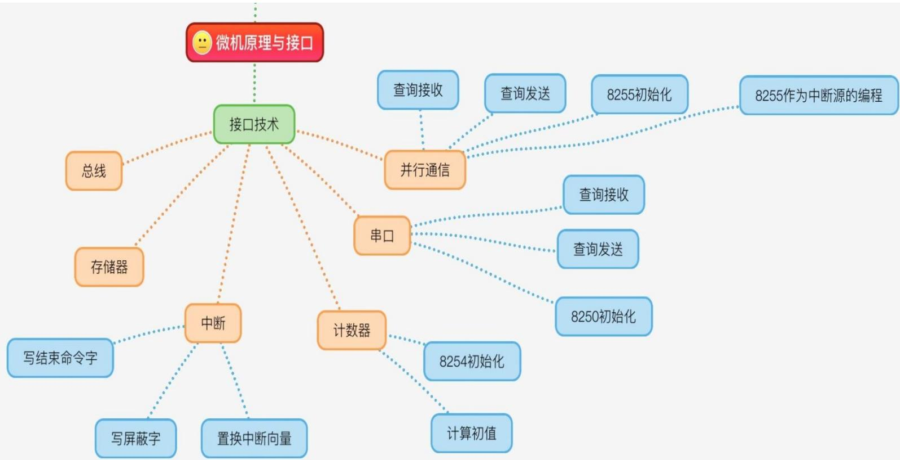
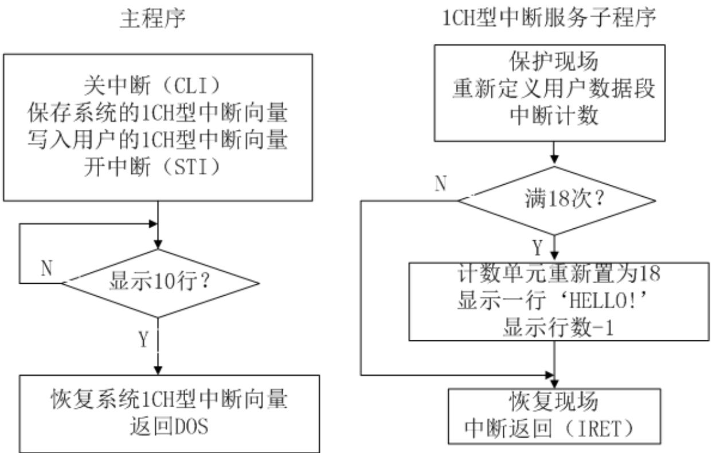
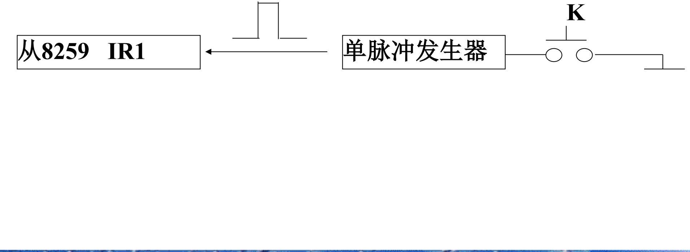
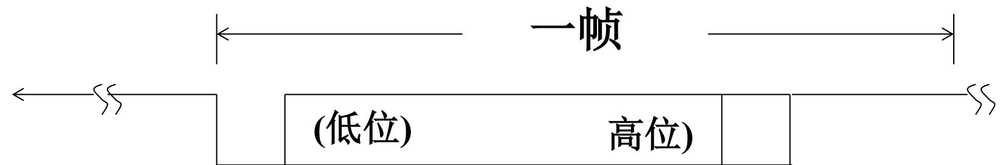
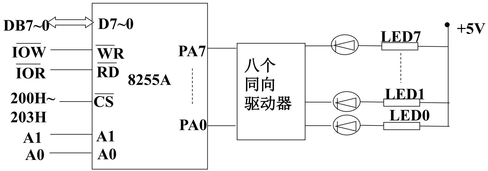

# 《微型计算机原理与接口技术》期末复习（课件）

原件经识别和整理；“参考解答”是我们补的。

## 汇编部分

### 数制转换

1. 二进制数、十进制数、十六进制数和 BCD 码数之间的转换方法。

例：（129）$_{10}$ =（\_\_\_\_）$_{2}$ =（\_\_\_\_）$_{16}$

(10010111)$_{BCD}$ = (\_\_\_\_)$_{10}$ = (\_\_\_\_)$_{2}$

知识点：[数制转换（二进制、十进制、十六进制互转）](../../../topics/微机接口/shuzhi-zhuanhuan.md)

### 真值数与补码数转换

2. 真值数和补码数之间的转换方法。

例：字长 = 8 位，则 $[-6]_{补}=(\_\_\_\_)_{16}$，$[-6]_{原}=(\_\_\_\_)_{16}$，$[-6]_{反}=(\_\_\_\_)_{16}$；若 $[X]_{补}=E8H$，则 X 的真值为 $(\_\_\_\_)_{16}$。

知识点：[真值数与补码的相互转换及补码计算](../../../topics/微机接口/zhenzhi-buma.md)、[数制转换（二进制、十进制、十六进制互转）](../../../topics/微机接口/shuzhi-zhuanhuan.md)

### 数值范围

3. n 位字长的有符号数、无符号数的数值范围。

设机器数字长 = n 位，则 n 位补码数其真值范围为 $-2^{n-1} \sim +2^{n-1}-1$，无符号数其数值范围为 $0 \sim 2^{n}-1$。

例：16 位二进制数所能表示的无符号数范围是\_\_\_\_。

知识点：[不同字长下原码、反码、补码的数值范围](../../../topics/微机接口/shuzhi-fanwei.md)

### 基本结构寄存器

4. 基本结构寄存器的名称、位长和作用。

(1) 通用寄存器：EAX、EBX、ECX、EDX、ESI、EDI、EBP

(2) 段寄存器：CS、SS、DS、ES、FS、GS

(3) 指针寄存器：EIP、ESP

(4) 标志寄存器：EFLAG

15 位标志分为两类：状态标志和控制标志

6 种状态标志：CF、OF、ZF、PF、AF、SF

例：以 $2^{16}$ 为模，将 C678H 和 6398H 相加，列表写出十六进制和数，以及 A、C、O、P、S、Z 六种状态标志的值。

知识点：[80486/8086基本结构寄存器（通用、段、控制寄存器）](../../../topics/微机接口/jiben-jicunqi.md)、[标志寄存器中的状态标志位与控制标志位](../../../topics/微机接口/zhuangtai-biaozhi.md)、[数制转换（二进制、十进制、十六进制互转）](../../../topics/微机接口/shuzhi-zhuanhuan.md)

### 80486 的寻址方式

5. 80486 的寻址方式。

486 有 3 类 7 种寻址方式：

立即寻址方式：获得立即数

寄存器寻址方式：获得寄存器操作数

存储器寻址方式：获得存储器操作数（内存操作数）

内存寻址方式：

(1) 直接寻址

16 位寻址规定可使用的寄存器

(2) 寄存器间接寻址 [BX]、[BP]、[SI]、[DI]

段寄存器：[间址寄存器]

某单元的物理地址 = 段寄存器内容 × 16 + 间址寄存器

(3) 基址寻址 [BX+位移量]、[BP+位移量]

段寄存器：[基址寄存器+位移量]

物理地址 = 段寄存器内容 × 16 + 基址寄存器 + 位移量

(4) 变址寻址 [SI+位移量]、[DI+位移量]

(5) 基址+变址寻址 [BX+SI]、[BX+DI]、[BP+SI]、[BP+DI]

例：指出下列指令源操作数的寻址方式：

ADD AX, DS: [1000H] \_\_\_\_ 直接寻址 \_\_\_\_

MOV AX, [BX+SI+6] \_\_\_\_ 基址加变址 \_\_\_\_

MOV DX, [BX] \_\_\_\_ 寄存器间接寻址 \_\_\_\_

MOV DX, BX \_\_\_\_ 寄存器寻址 \_\_\_\_

MOV AL, -1 立即寻址

知识点：[80486/8086的寻址方式（立即、寄存器、直接、间接、变址等）](../../../topics/微机接口/xunzhi-fangshi.md)、[实地址模式下物理地址的形成（段基址×10H+偏移量）](../../../topics/微机接口/wuli-dizhi.md)

### 最常用指令

6. 掌握最常用指令：MOV、PUSH、POP、LEA、CALL、RET、AND、OR、XOR、条件转移指令、LOOP 等。

知识点：[数据传送指令（MOV、PUSH、POP、XCHG等）](../../../topics/微机接口/shuju-chuansong.md)、[转移指令（JMP、条件转移、CALL、RET）](../../../topics/微机接口/zhuanyi-zhiling.md)、[算术运算与逻辑运算指令（ADD、SUB、MUL、AND、OR、NOT等）](../../../topics/微机接口/suanlu-yunsuan.md)

### 目标程序的生成

7. 目标程序的生成。


#### 画出 DATA 段的内存分配情况

| DATA | SEGMENT | USE16 | |
|---|---|---|---|
| | X1 | DB | ‘012’ |
| | X2 | DW | 34H |
| | X3 | DB | 2 DUP (32), 13, 10 |
| | X4 | EQU | $-X1 |
| DATA | ENDS | | |

知识点：[目标程序的生成过程（汇编、链接）](../../../topics/微机接口/mubiao-shengcheng.md)、[常用伪指令（SEGMENT、ASSUME、DB/DW/DD、EQU、END等）](../../../topics/微机接口/changyong-weizhiling.md)、[存储单元和存储器地址的概念](../../../topics/微机接口/cunchu-danyuan.md)

### 填空

1. 用 AL 寄存器存放有符号数，则真值的最大值和最小值分别为\_\_\_\_和\_\_\_\_。

2. 冯·诺依曼确定了计算机的 5 个基本部件：输入设备、\_\_\_\_、运算器和\_\_\_\_和控制器。

3. 用存贮容量为 $16\mathrm{K} \times 1$ 位的芯片组成容量为 $256\mathrm{K}$ 字节的存储器，需要\_\_\_\_片该类芯片，采用\_\_\_\_扩展方式进行存储器容量的扩展。

4. 80x86 汇编语言程序中，宏指令定义使用\_\_\_\_语句和\_\_\_\_语句定界。

知识点：[真值数与补码的相互转换及补码计算](../../../topics/微机接口/zhenzhi-buma.md)、[存储单元和存储器地址的概念](../../../topics/微机接口/cunchu-danyuan.md)、[微型计算机的硬件基本结构](../../../topics/微机接口/weixingji-yingjian.md)

### 指令执行结果

写出下列指令执行之后的结果（3 分）

```
MOV BL, 43H
MOV AL, OAFH
SAL AL, 2
ADD AL, BL
```

C 标=\_\_\_\_ AL=\_\_\_\_ BL=\_\_\_\_

知识点：[算术运算与逻辑运算指令（ADD、SUB、MUL、AND、OR、NOT等）](../../../topics/微机接口/suanlu-yunsuan.md)、[移位与循环移位指令（SHL、SHR、ROL、ROR等）](../../../topics/微机接口/yiwei-xunhuan.md)、[标志寄存器中的状态标志位与控制标志位](../../../topics/微机接口/zhuangtai-biaozhi.md)

### 程序段

编写程序段，完成光标在屏幕上回车换行的功能。

```
MOV AH, 2
MOV DL, 0DH
INT 21H
MOV DL, 0AH
INT 21H
```

知识点：[DOS功能调用与BIOS中断功能调用（INT 21H、INT 10H等）](../../../topics/微机接口/dos-bios-diaoyong.md)、[数制转换（二进制、十进制、十六进制互转）](../../../topics/微机接口/shuzhi-zhuanhuan.md)、[数据传送指令（MOV、PUSH、POP、XCHG等）](../../../topics/微机接口/shuju-chuansong.md)

### 简答

执行 REP MOVSB 指令之前，需要做哪些准备工作？

原串首址—DS: SI

目标串首址—ES: DI

CX：字符串长度

CLD

知识点：[串处理指令（MOVS、CMPS、SCAS、LODS、STOS及REP前缀）](../../../topics/微机接口/chuanchuli-zhiling.md)、[数据传送指令（MOV、PUSH、POP、XCHG等）](../../../topics/微机接口/shuju-chuansong.md)、[80486/8086基本结构寄存器（通用、段、控制寄存器）](../../../topics/微机接口/jiben-jicunqi.md)

### 程序填空

数据段 BUF 单元存放十个有符号数，下面的程序找出其中最小的数，并将其存放在 AL 寄存器中，填空完成下列程序。



## 第七章 输入/输出系统

知识点：[处理器控制指令（STI、CLI、HLT、NOP等）](../../../topics/微机接口/chuli-kongzhi.md)、[基本的汇编语言程序设计与程序控制结构](../../../topics/微机接口/jiben-chengxu.md)、[数据传送指令（MOV、PUSH、POP、XCHG等）](../../../topics/微机接口/shuju-chuansong.md)

### 一、接口电路的作用和功能

知识点：[接口电路的作用和基本功能](../../../topics/微机接口/jiekou-gongneng.md)、[端口的概念与分类（数据端口、状态端口、控制端口）](../../../topics/微机接口/duankou-gainian.md)

### 二、端口的概念、分类

知识点：[端口的概念与分类（数据端口、状态端口、控制端口）](../../../topics/微机接口/duankou-gainian.md)、[端口的编址方式（统一编址与独立编址）](../../../topics/微机接口/duankou-bianzhi.md)

### 三、端口的编址方式

端口有两种编址方式。PC 系列机采用端口独立编址。

知识点：[端口的编址方式（统一编址与独立编址）](../../../topics/微机接口/duankou-bianzhi.md)

### 四、最常用的 I/O 指令

1. 直接寻址 I/O 指令（8 位端口地址）

2. DX 间接寻址 I/O 指令（当端口地址 > 8 位）

知识点：[最常用的I/O指令（IN、OUT的直接寻址与DX间址）](../../../topics/微机接口/io-zhiling.md)、[80486/8086的寻址方式（立即、寄存器、直接、间接、变址等）](../../../topics/微机接口/xunzhi-fangshi.md)

### 五、微机系统与 I/O 端口的信息交换

有四种方式：无条件传送、查询方式、中断方式、DMA 方式。

知识点：[微机系统与I/O端口的信息交换方式（无条件、查询、中断、DMA）](../../../topics/微机接口/xinxi-jiaohuan.md)、[查询方式输入输出编程模式与流程](../../../topics/微机接口/chaxun-fangshi.md)、[直接存储器存取（DMA）方式及其与中断方式的比较](../../../topics/微机接口/dma-fangshi.md)

### 六、8254 定时器/计数器

#### (1) 基本结构与外部引脚

掌握 8254 定时器/计数器的基本结构（三个 16 位计数器、控制寄存器）和计数器的外部引脚功能（GATE、CLK、OUT）。

#### (2) 8254 工作方式

重点：方式 2、方式 3（包括计数过程、波形、周期和启动方式）。

#### (4) 8254 初始化编程

向控制寄存器写入方式选择命令字。

目的：选择一个计数器，并确定其工作方式和计数值（或计数初值）的读/写顺序。

向选择的计数器写入计数初值（计数初值 = Tout / Tclk）。

设 8254 计数器 1 工作于方式 3，输入时钟为 1000Hz，计数初值为 10H，采用二进制计数方式，则一个周期内计数器 1 输出信号的高电平和低电平分别为\_\_\_\_和\_\_\_\_秒。

设 PC 系统机外扩了一片 8254 及相应的实验电路。8254 口地址为 200H\~203H，设 CLK0 已接至 8MHz 时钟，为了能从 OUT0 输出 4KHz 的方波，编写了 8254 初始化程序，其中假设 0 号定时计数器工作在二进制方式。

```
I8254 PROC
MOV DX,203H
MOV AL,00110110B
OUT DX,AL
MOV DX,200H
MOV AX,2000
OUT DX,AL
MOV AL,AH
OUT DX,AL
RET
I8254 ENDP
```

## 第八章 中断系统

知识点：[80486/8086基本结构寄存器（通用、段、控制寄存器）](../../../topics/微机接口/jiben-jicunqi.md)、[处理器控制指令（STI、CLI、HLT、NOP等）](../../../topics/微机接口/chuli-kongzhi.md)、[接口电路的作用和基本功能](../../../topics/微机接口/jiekou-gongneng.md)

### 一、中断和中断源的概念

知识点：[微机系统与I/O端口的信息交换方式（无条件、查询、中断、DMA）](../../../topics/微机接口/xinxi-jiaohuan.md)、[接口电路的作用和基本功能](../../../topics/微机接口/jiekou-gongneng.md)

### 二、中断指令

STI、CLI、INT n、IRET

要求掌握。CPU 执行中断指令后，完成哪些操作。STI、CLI 只对可屏蔽中断请求有效。

例：CPU 执行 IRET 指令后，从栈顶弹出\_\_\_\_字节数据，分别赋给\_\_\_\_、\_\_\_\_和\_\_\_\_。

知识点：[串处理指令（MOVS、CMPS、SCAS、LODS、STOS及REP前缀）](../../../topics/微机接口/chuanchuli-zhiling.md)、[堆栈的概念及SP指针操作](../../../topics/微机接口/duizhan-caozuo.md)、[转移指令（JMP、条件转移、CALL、RET）](../../../topics/微机接口/zhuanyi-zhiling.md)

### 三、中断向量

中断向量是实模式下中断服务子程序的入口地址。

在实模式下，CPU 把 256 种中断向量组成一张表设置在系统的 RAM 最低端的 1K 单元（0～3FFH）。

n 型中断向量存放在内存单元地址 4\*n\~4\*n+3 这四个单元。

$$
\begin{array}{r l} & {4 n + 0 \quad \left| \begin{array}{l} {\mathbf {n} \text {型服务程序入口的偏移地址}} \\ {\mathbf {n} \text {型服务程序入口的段基址}} \end{array} \right| > \mathbf {n} \text {型中断向量}} \\ & {+ 1 \quad + 2 \quad + 3} \\ & {\text {。中断向量表的引导作用}} \end{array}
$$

例：实模式下，从内存地址 0000H:0048H 开始的连续 4 个单元中存放的内容为 00H、38H、30H、50H，则该地址所对应的中断类型码为\_\_\_\_，该中断所对应的中断服务子程序的入口地址为\_\_\_\_。

系统机主 8259A 属下的中断源，其中断服务程序结束，执行 IRET 指令之前，应向主 8259A 的口地址\_\_\_\_中写一个常规中断结束命令字\_\_\_\_。

知识点：[实地址模式下物理地址的形成（段基址×10H+偏移量）](../../../topics/微机接口/wuli-dizhi.md)、[最常用的I/O指令（IN、OUT的直接寻址与DX间址）](../../../topics/微机接口/io-zhiling.md)、[接口电路的作用和基本功能](../../../topics/微机接口/jiekou-gongneng.md)

### 四、微机系统中断分类

内部中断：软件中断、异常

PC 机 256 种中断

硬件中断：可屏蔽中断（外部中断）、非屏蔽中断

知识点：[微机系统与I/O端口的信息交换方式（无条件、查询、中断、DMA）](../../../topics/微机接口/xinxi-jiaohuan.md)

### 五、硬件中断分类

可屏蔽中断、非屏蔽中断。CPU 有 2 个接收中断请求信号的引脚。

可屏蔽中断：输入到 INTR 引脚的中断请求信号引发的中断。

非屏蔽中断：输入到 NMI 引脚的中断请求信号引发的中断。

响应可屏蔽中断的条件：

① 有可屏蔽中断请求，没有 DMA 请求，没有非屏蔽中断请求

② CPU 一条指令执行完毕

③ CPU 处于开中断状态（I 标 = 1）

响应非屏蔽中断的条件：

① 有非屏蔽中断请求，没有 DMA 请求

② 一条指令执行完

知识点：[标志寄存器中的状态标志位与控制标志位](../../../topics/微机接口/zhuangtai-biaozhi.md)、[微机系统与I/O端口的信息交换方式（无条件、查询、中断、DMA）](../../../topics/微机接口/xinxi-jiaohuan.md)、[处理器控制指令（STI、CLI、HLT、NOP等）](../../../topics/微机接口/chuli-kongzhi.md)

### 六、中断程序设计

要求掌握：

a. 中断向量的置换（读中断向量和写中断向量）

b. 硬件中断通路的开放和屏蔽。涉及到是否要对中断【例 8.6.1】要求利用 PC 系统机上的 8254 的 0 号定时计数器引发的日时钟中断，设计程序：每间隔 1 秒在 PC 终端屏幕上显示 1 行字符串“HELLO！”，显示 10 行后结束。



```
486
DATA SEGMENT USE16
MESG DB 'HELLO!',0DH,0AH,'$'
OLD1C DD ?
ICOUNT DB 18 ;中断计数初值
COUNT DB 10 ;显示行数控制
DATA ENDS
CODE SEGMENT USE16
ASSUME CS:CODE,DS:DATA
BEG: MOV AX,DATA
MOV DS,AX
CLI ;关中断
CALL READ1C
CALL WRITE1C
STI ;开中断

SCAN: CMP COUNT,0
JNZ SCAN ;是否已经显示10行，否转
CALL RESET
MOV AH,4CH
INT 21H

;

SERVICE PROC

PUSHA ;保护现场
PUSH DS ;DS=40H
MOV AX,DATA
MOV DS,AX ;重新给DS赋值
DEC ICOUNT ;中断计数
JNZ EXIT ;不满18次转
MOV ICOUNT,18
DEC COUNT ;显示行数减1
MOV AH,9 ;显示字符串
LEA DX,MESG
INT 21H
EXIT: POP DS ;恢复现场
POPA
IRET ;返回系统8型中断服务程序
SERVICE ENDP

READ1C PROC ;转移系统1CH型中断向量
MOV AX,351CH
INT 21H
MOV WORD PTR OLD1C,BX
MOV WORD PTR OLD1C+2,ES
RET
READ1C ENDP
;----

WRITE1C PROC ;写入用户1CH型中断向量
    PUSH DS
    MOV AX,CODE
    MOV DS,AX
    MOV DX,OFFSET SERVICE
    MOV AX,251CH
    INT 21H
    POP DS
    RET
WRITE1C ENDP
;----

RESET PROC ; 恢复系统1CH型中断向量
MOV DX, WORD PTR OLD1C
MOV DS, WORD PTR OLD1C+2
MOV AX, 251CH
INT 21H
RET
RESET ENDP
CODE ENDS
END BEG
```



假设微机系统外扩了如下的一个‘单脉冲发生器’，该‘单脉冲发生器’电路受一个自复开关 K 的控制，每按一次 K，该电路输出一个正脉冲，输入到系统机从 8259 的 IR1 作为外部中断请求。

要求：每按一次 K，屏幕上显示一行字符串“Welcome!”。主机键盘按任意键，程序结束，返回 DOS。

编写开放 8259 和中断向量置换程序

```
WRITE0A PROC
PUSH DS
MOV AX,CODE
MOV DS,AX
MOV DX,OFFSI
MOV AX,250AH
INT 21H
POP DS
RET
WRITE0A ENDP

I8259A PROC
IN AL,21H
AND AL,11111011B
OUT 21H,AL
CE IN AL,0A1H
AND AL,11111101B
OUT 0A1H,AL
RET
I8259A ENDP
CODE ENDS
END BEG
```

## 第九章 串行通信

知识点：[DOS功能调用与BIOS中断功能调用（INT 21H、INT 10H等）](../../../topics/微机接口/dos-bios-diaoyong.md)、[微机系统与I/O端口的信息交换方式（无条件、查询、中断、DMA）](../../../topics/微机接口/xinxi-jiaohuan.md)

### 一、基本概念

1. 异步串行通信的数据传输方式：单工通信、半双工通信、全双工通信。

三种传输方式的特点。

例：单工、半双工、全双工通信方式的特点是什么？

2. 异步串行通信一帧数据的格式及通信速率的计算。



起始位 数据位 奇偶校 停止位

例：异步通信一帧数据格式中，按照发送的次序，先传送\_\_\_\_，紧接着是数据\_\_\_\_位，数据位后依次为\_\_\_\_，\_\_\_\_。

3. 为实现通信，收发双方一帧数据的格式和通信速率要保持一致。

4. RS232 信号采用负逻辑。

$$
“1” = -3\mathrm{V} \sim -15\mathrm{V}, “0” = +3\mathrm{V} \sim +15\mathrm{V}
$$

## 二、8250芯片

知识点：[最常用的I/O指令（IN、OUT的直接寻址与DX间址）](../../../topics/微机接口/io-zhiling.md)、[微机系统与I/O端口的信息交换方式（无条件、查询、中断、DMA）](../../../topics/微机接口/xinxi-jiaohuan.md)

### 8250 内部寄存器的功能

8250 内部寄存器的功能。

## 三、8250 的编程

知识点：[端口的概念与分类（数据端口、状态端口、控制端口）](../../../topics/微机接口/duankou-gainian.md)、[接口电路的作用和基本功能](../../../topics/微机接口/jiekou-gongneng.md)

### 8250 的初始化编程

8250 的初始化编程。

知识点：[微机系统与I/O端口的信息交换方式（无条件、查询、中断、DMA）](../../../topics/微机接口/xinxi-jiaohuan.md)、[端口的概念与分类（数据端口、状态端口、控制端口）](../../../topics/微机接口/duankou-gainian.md)、[最常用的I/O指令（IN、OUT的直接寻址与DX间址）](../../../topics/微机接口/io-zhiling.md)

### 8250 初始化步骤

① 80H→线路控制寄存器，使除数寄存器访问位=1

② 根据波特率计算出除数高/低 8 位→除数寄存器高/低 8 位，确定通信速率

③ D7=0 的命令字→线路控制寄存器：有 2 个目的

- 定义一帧数据格式
- 使除数寄存器访问位=0，从而使后继的对合用端口的访问只读写非除数寄存器

④ 设置中断允许命令字

- 查询方式，则中断允许命令字=0，禁止中断
- 中断方式，使中断允许命令字相应位置 1

⑤ 设置 MODEM 控制寄存器

- 中断方式：D3=1，允许 8250 送出中断请求
- 查询方式：D3=0
- 内环方式：D4=1
- 正常通信：D4=0
- 使用联络线：D1、D0 位置 1

知识点：[端口的编址方式（统一编址与独立编址）](../../../topics/微机接口/duankou-bianzhi.md)、[80486/8086基本结构寄存器（通用、段、控制寄存器）](../../../topics/微机接口/jiben-jicunqi.md)、[最常用的I/O指令（IN、OUT的直接寻址与DX间址）](../../../topics/微机接口/io-zhiling.md)

### 8250 查询方式下接收和发送程序

在发送数据前，读通信线状态寄存器（状态口）获取发送保持或移位寄存器（数据口）是否空闲；在接收数据前，读通信线状态寄存器（状态口）获取接收缓冲寄存器（数据口）是否已经收到 1 帧数据。

EG：利用主串口查询方式发送一个 “A”

```asm
SCANT:  MOV DX, 3FDH
        IN  AL, DX
        TEST AL, 20H        ; 00100000
        JZ  SCANT           ; D5=1
        MOV DX, 3F8H
        MOV AL, 'A'
        OUT DX, AL
```

EG：利用主串口查询方式接收一个字符

```asm
SCANR:  MOV DX, 3FDH
        IN  AL, DX
        TEST AL, 01H        ; 00000001
        JZ  SCANR           ; D0=1
        MOV DX, 3F8H
        IN  AL, DX
```

A、B 两台 PC 机利用主串口进行点-点单工通信（不用联络线），发送采用查询方式，接收采用中断方式。一帧字符包含 7 个数据位，1 个停止位，1 个校验位，通信速率为 4800 波特（分频系数为 0018H）。

（1）下图是 A、B 两机的 RS—232C 接口示意图，根据题意完成连线（不可有多余连线）。

$$
\begin{array}{c} \framebox{2} \\ 3 \\ 4 \\ 5 \\ 6 \\ 20 \\ 7 \end{array}
$$

$$
\begin{array}{c} \framebox{2} \\ 3 \\ 4 \\ 5 \\ 6 \\ 20 \\ 7 \end{array}
$$

（2）下图是从 PC 机的 RS-232C 接口引脚观察到的波形，所传送字符的 16 进制 ASCII 码是________；该帧数据采用的奇偶校验方式是________校验；传送该帧数据需要的时间是________。

传送方向

| I8250 | PROC |  |
| --- | --- | --- |
| MOV | DX, 3FBH |  |
| MOV | AL, 80H |  |
| OUT | DX, AL | ;寻址位置 1 |
| MOV | DX, 3F9H |  |
| MOV | AL, 00H |  |
| OUT | DX, AL | ;写除数高 8 位 |
| MOV | DX, 3F8H |  |
| MOV | AL, 18H |  |
| OUT | DX, AL | ;写除数低 8 位 |

（3）用对端口直接编程的方法为接收方编写 8250 初始化程序段。

| MOV | DX, 3FBH |
| --- | --- |
| MOV | AL, 0AH |
| OUT | DX, AL |
| MOV | DX, 3F9H |
| MOV | AL, 01H |
| OUT | DX, AL |
| MOV | DX, 3FCH |
| MOV | AL, 08H |
| OUT | DX, AL |
| RET |  |
| I8250 | ENDP |

;无校验传送，8 位数据

## 第十章 并行 I/O 接口

知识点：[最常用的I/O指令（IN、OUT的直接寻址与DX间址）](../../../topics/微机接口/io-zhiling.md)、[查询方式输入输出编程模式与流程](../../../topics/微机接口/chaxun-fangshi.md)、[端口的概念与分类（数据端口、状态端口、控制端口）](../../../topics/微机接口/duankou-gainian.md)

### 一、8255A 定时器/计数器

（1）内部结构、端口地址以及与系统总线的连接

（2）8255A 三种工作方式（方式 0～方式 2）的工作特点和 I/O 过程

| 工作方式 | 适用于端口 |
| --- | --- |
| 方式 0：基本型入/出 | A 口、B 口、C 口 |
| 方式 1：选通型入/出 | A 口、B 口 |
| 方式 2：双向传输 | A 口 |

a. 如果数据口（A、B 或 C）工作在方式 0，直接采用 IN/OUT 指令对其进行读写。

b. 如果数据口（A 或 B）工作在方式 1：

- 如果采用查询方式，且 A 或 B 口定义为输入口，先用 IN 指令读入 C 口的内容，查询其中的 IBF=1 时，表示 CPU 可以继续用 IN 指令从 A 或 B 口读入外设送来的数据。
- 如果采用查询方式，且 A 或 B 口定义为输出口，先用 IN 指令读入 C 口的内容，查询 OBF=1 时，表示 CPU 可以用 OUT 指令向 A 或 B 口写数据以送给外设。

（3）在方式 1 中 C 口哪几个引脚作为信号联络线，各信号联络线的含义。

例：8255 的数据口中，________口可工作在双向方式。

例：8255A 的 B 口初始化定义为选通型（方式 1）输入，对 8255A 采用查询方式，必须先查询________；若采用中断方式，必须先置 PC________为‘1’，并且利用________作为中断请求信号线。

知识点：[接口电路的作用和基本功能](../../../topics/微机接口/jiekou-gongneng.md)、[端口的概念与分类（数据端口、状态端口、控制端口）](../../../topics/微机接口/duankou-gainian.md)、[最常用的I/O指令（IN、OUT的直接寻址与DX间址）](../../../topics/微机接口/io-zhiling.md)

### 二、8255 初始化编程

工作在方式 0 时：方式选择命令字→控制口

工作在方式 1、2 时：

a) 方式选择命令字 $\rightarrow$ 控制口

b) 允许中断（或禁止中断）的命令字→控制口

阅读以下程序并完成填空

```asm
(1) I8255   PROC
(2)         MOV DX, 31BH
(3)         MOV AL, 97H
(4)         OUT DX, AL
(5)         MOV AL, 05H
(6)         OUT DX, AL
(7)         RET
(8) I8255   ENDP
```

（1）这片 8255A 的 A 口地址为________H，控制口的地址为________H。程序功能是定义这片 8255A 的 A 口工作在________（填写工作方式，以及是输入还是输出），B 口工作在________（填写工作方式，以及是输入还是输出）。

（2）程序第 5 行写入 AL 中的是________命令字，其功能是使中断允许触发器置________（填 1 或 0），从而确定 CPU 将采用________方式（填查询或中断）完成数据的输入和输出。

系统机外扩一片 8255A 及相应电路如下图所示，外扩 8255A 的端口地址为 200H～203H，现利用系统机的日时钟外扩 1CH 型中断，实现每隔 1s 使八个发光二极管同时闪烁一次，主机键盘有按键按下时结束，返回 DOS 操作系统。根据要求完成相关内容。



（1）从图可以分析出，A 口工作在方式 0 的输出（入/出）。

（2）假设 8255A 的 A 口工作在方式 1 的查询输出方式，编写 8255A 的初始化子程序 I8255。

| I8255A | PROC |  |
| --- | --- | --- |
|  | MOV | DX, 203H |
|  | MOV | AL, 10100000B |
|  | OUT | DX, AL ;写入工作方式字 |
|  | MOV | AL, 00001100B |
|  | OUT | DX, AL |
|  | RET |  |
| I8255 | ENDP |  |

知识点：[典型总线标准（ISA/AT总线、PCI总线引脚与特点）](../../../topics/微机接口/dianxing-zongxian.md)、[最常用的I/O指令（IN、OUT的直接寻址与DX间址）](../../../topics/微机接口/io-zhiling.md)、[微机系统与I/O端口的信息交换方式（无条件、查询、中断、DMA）](../../../topics/微机接口/xinxi-jiaohuan.md)
