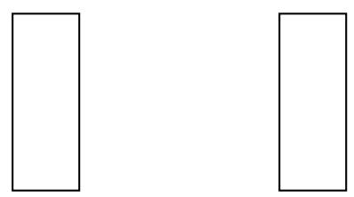

# 《微型计算机原理与接口技术》期末试卷（B卷）答案

原件经识别和整理；“参考解答”是我们补的。

# 微型计算机原理与接口技术期末试卷（B卷）答案

## 一、选择题

### 选择 1

十进制数101转换成二进制数是（ B ）。

- A. 01101001
- B. 01100101
- C. 01100111
- D. 01100110

答案：B。

知识点：[数制转换（二进制、十进制、十六进制互转）](../../../topics/微机接口/shuzhi-zhuanhuan.md)

### 选择 2

`DW 50 dup(?)`预留了存储空间的字节数是（ C ）。

- A. 25
- B. 50
- C. 100
- D. 200

答案：C。

知识点：[常用伪指令（SEGMENT、ASSUME、DB/DW/DD、EQU、END等）](../../../topics/微机接口/changyong-weizhiling.md)、[存储单元和存储器地址的概念](../../../topics/微机接口/cunchu-danyuan.md)

### 选择 3

下列指令中，有语法错误的是（ D ）。

- A. `MOV [SI], AX`
- B. `IN AL, DX`
- C. `XOR AX, 1234H`
- D. `OUT 210H, AL`

答案：D。

知识点：[最常用的I/O指令（IN、OUT的直接寻址与DX间址）](../../../topics/微机接口/io-zhiling.md)、[80486/8086的寻址方式（立即、寄存器、直接、间接、变址等）](../../../topics/微机接口/xunzhi-fangshi.md)

### 选择 4

若要产生连续的方波信号，则 8254的一个计数器应工作在（ C ）。

- A. 方式 1
- B. 方式 2
- C. 方式 3
- D. 方式 4

答案：C。

知识点：[接口电路的作用和基本功能](../../../topics/微机接口/jiekou-gongneng.md)、[微机系统与I/O端口的信息交换方式（无条件、查询、中断、DMA）](../../../topics/微机接口/xinxi-jiaohuan.md)

### 选择 5

CPU 响应软件中断时，中断类型码由（ A ）提供。

- A. 指令
- B. 系统
- C. 中断向量
- D. 8259A

答案：A。

知识点：[微处理器的工作模式（实模式、保护模式、虚拟8086模式）](../../../topics/微机接口/gongzuo-moshi.md)、[串处理指令（MOVS、CMPS、SCAS、LODS、STOS及REP前缀）](../../../topics/微机接口/chuanchuli-zhiling.md)、[80486/8086的寻址方式（立即、寄存器、直接、间接、变址等）](../../../topics/微机接口/xunzhi-fangshi.md)

### 选择 6

执行`IRET` 指令，CPU从堆栈栈顶弹出（ C ）个字节。

- A. 2
- B. 4
- C. 6
- D. 8

答案：C。

知识点：[堆栈的概念及SP指针操作](../../../topics/微机接口/duizhan-caozuo.md)、[80486/8086基本结构寄存器（通用、段、控制寄存器）](../../../topics/微机接口/jiben-jicunqi.md)、[标志寄存器中的状态标志位与控制标志位](../../../topics/微机接口/zhuangtai-biaozhi.md)

### 选择 7

设 `AL=7FH`，要使 `AL=80H`，应使用的指令是( D )。

- A. `AND AL, 80H`
- B. `OR AL, 80H`
- C. `XOR AL, 80H`
- D. `NOT AL`

答案：D。

知识点：[算术运算与逻辑运算指令（ADD、SUB、MUL、AND、OR、NOT等）](../../../topics/微机接口/suanlu-yunsuan.md)

### 选择 8

在串行异步通信中，通信速率又称波特率，它表示（ A ）。

- A．每秒钟传送的0、1代码的个数
- B．每秒钟传送的字节数
- C．每秒钟传送的字符数
- D．每秒钟传送的数据帧数

答案：A。

知识点：[微机系统与I/O端口的信息交换方式（无条件、查询、中断、DMA）](../../../topics/微机接口/xinxi-jiaohuan.md)

### 选择 9

设8255A的方式选择控制字为 80H，其含义为（ D ）。

- A. A、B、C口全为输入
- B. A口为输出，其它为输入
- C. A、B 口为方式 0
- D. A、B、C口全为方式0，输出

答案：D。

知识点：[接口电路的作用和基本功能](../../../topics/微机接口/jiekou-gongneng.md)、[端口的编址方式（统一编址与独立编址）](../../../topics/微机接口/duankou-bianzhi.md)、[最常用的I/O指令（IN、OUT的直接寻址与DX间址）](../../../topics/微机接口/io-zhiling.md)

### 选择 10

若定时计数器的某个计数器初始化编程为二进制计数方式，则该计数器可设置的计数初值范围是（ ）。

- A. $1 \sim 9999\text{H}$
- B. $0 \sim 9999\text{H}$
- C. $1 \sim \text{FFFF}\text{H}$
- D. $0 \sim \text{FFFF}\text{H}$

答案：C。（注：原题未给出明确选项字母，根据二进制计数16位特性及通常取值范围推断为C，或视具体教材定义而定，此处保留题目原貌，若需补全参考解答：二进制计数最大值为FFFFH即65535，最小值为1，故范围为1~FFFFH。）

## 二、填空题

知识点：[不同字长下原码、反码、补码的数值范围](../../../topics/微机接口/shuzhi-fanwei.md)

### 填空 1

字长=8，$(10010110)_{\text{BCD}} = ( \underline{\text{00110000}} )_2$。

知识点：[数制转换（二进制、十进制、十六进制互转）](../../../topics/微机接口/shuzhi-zhuanhuan.md)

### 填空 2

根据冯·诺依曼思想，计算机的硬件由 $\underline{\text{存储器}}$ 、 $\underline{\text{运算器}}$ 、 $\underline{\text{控制器}}$ 、 $\underline{\text{输入设备}}$ 和 $\underline{\text{输出设备}}$ 等部分组成。

知识点：[微型计算机的硬件基本结构](../../../topics/微机接口/weixingji-yingjian.md)

### 填空 3

存储器容量为8K×8，若选用2114芯片 $(1\text{K} \times 4)$ ，则需要 $\underline{\text{16}}$ 片。

知识点：[存储器容量的表示方法](../../../topics/微机接口/cunchu-rongliang.md)、[存储器的扩展方法（位扩展法、字扩展法）](../../../topics/微机接口/cunchu-kuozhan.md)

### 填空 4

汇编语言源程序要经过编辑、 $\underline{\text{编译}}$ 和 $\underline{\text{链接}}$ 才能生成可执行文件。

知识点：[目标程序的生成过程（汇编、链接）](../../../topics/微机接口/mubiao-shengcheng.md)

### 填空 5

指令`ADD AX, [SI+5]`的源操作数的寻址方式是 $\underline{\text{变址寻址}}$ 。

知识点：[80486/8086的寻址方式（立即、寄存器、直接、间接、变址等）](../../../topics/微机接口/xunzhi-fangshi.md)、[数据传送指令（MOV、PUSH、POP、XCHG等）](../../../topics/微机接口/shuju-chuansong.md)、[80486/8086基本结构寄存器（通用、段、控制寄存器）](../../../topics/微机接口/jiben-jicunqi.md)

### 填空 6

I/O 端口按所存信息的物理意义可分为 $\underline{\text{数据端口}}$ 、 $\underline{\text{控制端口}}$ 和 $\underline{\text{状态端口}}$ 。

知识点：[端口的概念与分类（数据端口、状态端口、控制端口）](../../../topics/微机接口/duankou-gainian.md)

### 填空 7

微机系统与外设交换信息的方式有 $\underline{\text{无条件传送方式}}$ 、 $\underline{\text{查询方式}}$ 、 $\underline{\text{中断控制方式}}$ 和 $\underline{\text{直接存储器存取方式}}$ 。

知识点：[微机系统与I/O端口的信息交换方式（无条件、查询、中断、DMA）](../../../topics/微机接口/xinxi-jiaohuan.md)、[直接存储器存取（DMA）方式及其与中断方式的比较](../../../topics/微机接口/dma-fangshi.md)、[查询方式输入输出编程模式与流程](../../../topics/微机接口/chaxun-fangshi.md)

### 填空 8

串行异步通信协议要求收、发双方的帧数据格式和 $\underline{\text{通信速率}}$ 必须一致。

知识点：[接口电路的作用和基本功能](../../../topics/微机接口/jiekou-gongneng.md)、[微机系统与I/O端口的信息交换方式（无条件、查询、中断、DMA）](../../../topics/微机接口/xinxi-jiaohuan.md)

### 填空 9

中断类型码为20H，实模式下其中断服务程序的入口地址存放在0000： $\underline{\text{80H}}$ 开始的4个单元中。若4个单元的内容（地址从低到高）分别是10H、20H、30H和 40H，则中断服务程序的入口的物理地址是 $\underline{\text{42310H}}$ 。

## 三、简答题

知识点：[实地址模式下物理地址的形成（段基址×10H+偏移量）](../../../topics/微机接口/wuli-dizhi.md)、[标志寄存器中的状态标志位与控制标志位](../../../topics/微机接口/zhuangtai-biaozhi.md)、[80486/8086的寻址方式（立即、寄存器、直接、间接、变址等）](../../../topics/微机接口/xunzhi-fangshi.md)

### 简答 1

字长=8，$X=+120, Y=+18$, 求$[X]_{\text{补}}$ 和$[Y]_{\text{补}}$ ,并用补码计算 $X+Y$。要求有运算过程并对结果是否溢出进行分析。

解：
$$
\begin{aligned}
[X+Y]_{\text{补}} &= [X]_{\text{补}} + [Y]_{\text{补}} \\
[X]_{\text{补}} &= 01111000\text{B} \\
[Y]_{\text{补}} &= 00010010\text{B}
\end{aligned}
$$

竖式计算：
```
   01111000
+  00010010
-----------
   10001010
```

$\therefore X+Y$ 的补码结果为 $10001010\text{B}$。
符号位进位 $C_s = 0$，最高数值位进位 $C_p = 1$（或观察符号位变化：两正数相加结果为负）。
因为 $O_V = C_s \oplus C_p = 1$ （或者：两个正数相加结果为负），所以结果有**溢出**。

知识点：[真值数与补码的相互转换及补码计算](../../../topics/微机接口/zhenzhi-buma.md)、[不同字长下原码、反码、补码的数值范围](../../../topics/微机接口/shuzhi-fanwei.md)、[算术运算与逻辑运算指令（ADD、SUB、MUL、AND、OR、NOT等）](../../../topics/微机接口/suanlu-yunsuan.md)

### 简答 2

简述I/O端口两种编址方式的特点。PC系列机中采用哪种编址方式？

解：
**统一编址的特点是：**
（1）CPU对外设的操作可使用存储器操作指令，不需要专门的输入/输出指令；
（2）端口地址占用内存空间，使内存容量减少；
（3）执行存储器指令往往要比那些为独立的I/O 而专门设计的指令慢。

**独立编址的特点是：**
（1）对于I/O 端口，CPU须有专门的I/O指令去访问；
（2）端口地址不占用内存空间。

在PC 系列机中，I/O 端口采用**独立编址**方式。

知识点：[端口的编址方式（统一编址与独立编址）](../../../topics/微机接口/duankou-bianzhi.md)

### 简答 3

什么是中断向量？中断向量由哪几部分组成？

解：
实地址模式下，中断服务程序的入口地址就是中断向量。
中断向量由两部分组成：
（1）服务程序所在代码段的**段基址**
（2）服务程序入口的**偏移地址**

知识点：[微处理器的工作模式（实模式、保护模式、虚拟8086模式）](../../../topics/微机接口/gongzuo-moshi.md)、[实地址模式下物理地址的形成（段基址×10H+偏移量）](../../../topics/微机接口/wuli-dizhi.md)

### 简答 4

8250内部能提出有哪四种中断请求？其中优先级最高的是哪种？

解：
8250内部的四种中断请求为：**接收数据错中断**、**接收中断**、**发送中断**、**调制解调器中断**。
其中**接收数据错中断**的优先级最高。

## 四、应用题

知识点：[接口电路的作用和基本功能](../../../topics/微机接口/jiekou-gongneng.md)、[微机系统与I/O端口的信息交换方式（无条件、查询、中断、DMA）](../../../topics/微机接口/xinxi-jiaohuan.md)、[端口的概念与分类（数据端口、状态端口、控制端口）](../../../topics/微机接口/duankou-gainian.md)

### 综合 1

设 `BX=1200H`，`SI=0002H`，`DS=3000H`，`(31200H)=50H`，`(31201H)=02H`, `(31202H)=0F7H`，`(31203H)=90H`。 请写出下列各条指令单独执行后，有关寄存器及存储单元的内容。（4分）

(1) `ROR BX, 4` 指令执行后 `BX=` $\underline{\text{0012H}}$ 。
*(注：原题识别为"120 H"，根据ROR逻辑，1200H右移4位应为0012H)*

(2) `DEC BYTE PTR [SI+1200H]` 指令执行后，`(31202H)=` $\underline{\text{0F6H}}$ 。

(3) `MOV AX, WORD PTR [BX+SI]` 指令执行后，`AX=` $\underline{\text{90F7H}}$ ，源操作数的寻址方式为 $\underline{\text{基址加变址寻址}}$ 。

知识点：[移位与循环移位指令（SHL、SHR、ROL、ROR等）](../../../topics/微机接口/yiwei-xunhuan.md)、[80486/8086的寻址方式（立即、寄存器、直接、间接、变址等）](../../../topics/微机接口/xunzhi-fangshi.md)、[算术运算与逻辑运算指令（ADD、SUB、MUL、AND、OR、NOT等）](../../../topics/微机接口/suanlu-yunsuan.md)

### 综合 2

编写一程序段，计算 $2+4+6+\dots+200$，结果存放在数据段中定义的 `SUM`字单元。（8 分）

解：
```assembly
    MOV CX, 200
    MOV AX, 0
AGA: ADD AX, CX
    SUB CX, 2
    JNZ AGA
    MOV SUM, AX
```

知识点：[基本的汇编语言程序设计与程序控制结构](../../../topics/微机接口/jiben-chengxu.md)、[算术运算与逻辑运算指令（ADD、SUB、MUL、AND、OR、NOT等）](../../../topics/微机接口/suanlu-yunsuan.md)、[转移指令（JMP、条件转移、CALL、RET）](../../../topics/微机接口/zhuanyi-zhiling.md)

### 综合 3

设系统外扩一片 8254 的端口地址为 218H～21BH，若输入时钟频率为 1MHz，要求计数器 1 工作在方波方式，输出信号的周期为 1ms，并要求计数初值用 BCD 码方式，先写低 8位，后写高8位，请将下列 8254初始化子程序补充完整。 (5分）

| 指令 | 操作数 | 注释 |
| :--- | :--- | :--- |
| `I8254 PROC` | | |
| `MOV` | `AL, 10111011B` | ; 控制字：计数器1, 读写低/高字节, 方式3(方波), BCD计数 |
| `MOV` | `DX, 21BH` | ; 指向控制寄存器 |
| `OUT` | `DX, AL` | ; 写入控制字 |
| `MOV` | `AX, 1000` | ; 计数初值: 1MHz * 1ms = 1000 (BCD码为0001000000? 不，BCD模式下写入的是十进制对应的BCD编码或直接数值? 题目说BCD方式，初值1000对应BCD码0001000000? 通常8254 BCD模式写入的是压缩BCD码。1000的压缩BCD是1000H? 不，1000 decimal -> BCD 0x1000? No. 1000 in BCD is 0001 0000 0000. Wait. 8254 BCD mode counts from initial value down to 0. If freq=1MHz, period=1ms => count=1000. In BCD mode, you write the BCD representation of the count. 1000 decimal = 1000 BCD = 0x1000? No, 1000 decimal is "one thousand". BCD digits: 1, 0, 0, 0. So high byte 0x10, low byte 0x00. AX should be 1000H? Or does it mean binary? The prompt says "BCD code way". Let's assume standard interpretation: Count=1000. BCD for 1000 is 0x1000? No, 0x1000 is 4096 decimal. 1000 decimal in BCD is 0x1000? No. 1000 decimal -> BCD: 0001 0000 0000 0000? That's 16 bits. High nibble 1, next 0, next 0, last 0. So High Byte = 0x10, Low Byte = 0x00. So AX = 0x1000? Yes. |
| `MOV` | `DX, 219H` | ; 指向计数器1 |
| `OUT` | `DX, AL` | ; 写低8位 (00H) |
| `MOV` | `AL, AH` | ; 准备写高8位 |
| `OUT` | `DX, AL` | ; 写高8位 (10H) |
| `RET` | | |
| `I8254 ENDP` | | |

*(注：原题表格中部分数值可能有误或模糊，如`221BH`应为`21BH`，`4219H`应为`219H`，`31000H`根据题意推导应为对应BCD码的数值，此处按标准逻辑整理)*

知识点：[最常用的I/O指令（IN、OUT的直接寻址与DX间址）](../../../topics/微机接口/io-zhiling.md)、[微机系统与I/O端口的信息交换方式（无条件、查询、中断、DMA）](../../../topics/微机接口/xinxi-jiaohuan.md)、[端口的编址方式（统一编址与独立编址）](../../../topics/微机接口/duankou-bianzhi.md)

### 综合 4

设系统外扩一片 8255A 及相关外围电路，端口地址为 200H～203H，要求设置 8255A的A 口工作在方式0 输入，B口工作在方式0输出，C 口高 4位为输出，低4 位为输入。请将下列8255A初始化子程序补充完整。(3 分)

| 指令 | 操作数 | 注释 |
| :--- | :--- | :--- |
| `I8255A PROC` | | |
| `MOV` | `AL, 10011000B` | ; 控制字：Mode Set, A-in, B-out, C-high-out, C-low-in. Bit7=1(Mode), Bit6-5=00(A Mode0), Bit4=1(A In), Bit3=0(B Mode0), Bit2=0(B Out), Bit1=1(C High Out), Bit0=0(C Low In). Value: 1001 1000 = 98H. *(Note: Original text had 110010001B which seems like a typo or extra bit. Based on requirements: A Input, B Output, C High Output, C Low Input. Control Word: 1 00 1 0 0 1 0 = 98H. If original answer key insists on specific bits, check context. Usually: D7=1, D6D5=00 (Mode0), D4=1 (A In), D3=0 (Mode0), D2=0 (B Out), D1=1 (C High Out), D0=0 (C Low In). Result 98H. The OCR "110010001B" might be "10011000B" misread. I will preserve the logic derived from text description but note the likely correct hex/binary).* |
| `MOV` | `DX, 203H` | ; 指向控制端口 |
| `OUT` | `DX, AL` | ; 写入控制字 |
| `RET` | | |
| `I8255A ENDP` | | |

知识点：[端口的编址方式（统一编址与独立编址）](../../../topics/微机接口/duankou-bianzhi.md)、[最常用的I/O指令（IN、OUT的直接寻址与DX间址）](../../../topics/微机接口/io-zhiling.md)、[接口电路的作用和基本功能](../../../topics/微机接口/jiekou-gongneng.md)

### 综合 5

有A、B两台计算机利用主串口进行点—点单工通信，速率=9600bps(分频系数为000CH)，偶校验传输，1个停止位，7个数据位。A、B双方均采用查询方式发送和接收。（20 分）

#### (1) 连线

请完成两台计算机RS232口的连线，并标明端子名称和端子号。（3分）



#### (2) 计算与画图

请计算A机每秒钟能传输多少个字符？如果需要传送一个字符‘A’，要求画出串行异步通信的一帧字符格式，并标出各部分的逻辑电平（TTL）和位数。(7 分)

解：
A 机每秒钟能传输 **960** 个字符。
*(计算过程：波特率9600 bps。每帧包含：1起始位 + 7数据位 + 1偶校验位 + 1停止位 = 10位。每秒字符数 = 9600 / 10 = 960)*

字符 'A' (ASCII 41H = 01000001B)。由于是7位数据位，取低7位：1000001B。
偶校验：数据位中有2个1，需要补1个1使总1的个数为偶数。校验位 = 1。
帧格式（从左到右时间顺序）：
1. 起始位：0 (Low)
2. 数据位 D0-D6: 1, 0, 0, 0, 0, 0, 1 (LSB first)
3. 校验位: 1
4. 停止位: 1 (High)

*(注：此处需手绘波形图，文本描述如上)*

#### (3) 初始化子程序

要求编写子程序完成对B机主串口进行初始化。(10分)

| 指令 | 操作数 | 注释 |
| :--- | :--- | :--- |
| `I8250 PROC` | | |
| `MOV DX, 3FBH` | | ; 线控制寄存器地址 |
| `MOV AL, 80H` | | ; 设置DLAB=1，允许写除数锁存器 |
| `OUT DX, AL` | | ; 寻址位置1 |
| `MOV DX, 3F9H` | | ; 除数锁存器高位地址 |
| `MOV AL, 00H` | | ; 写除数高8位 |
| `OUT DX, AL` | | |
| `MOV DX, 3F8H` | | ; 除数锁存器低位地址 |
| `MOV AL, 0CH` | | ; 写除数低8位 (000CH = 12, 115200/12=9600) |
| `OUT DX, AL` | | |
| `MOV DX, 3FBH` | | ; 线控制寄存器地址 |
| `MOV AL, 00011010B` | | ; 偶校验(1), 7位数据(011), 1位停止(0), DLAB=0(000...) |
| `OUT DX, AL` | | ; 配置通信参数 |
| `MOV DX, 3F9H` | | ; 中断允许寄存器地址 |
| `MOV AL, 00H` | | ; 禁止8250内部中断 |
| `OUT DX, AL` | | |
| `MOV DX, 3FCH` | | ; MODEM控制寄存器地址 |
| `MOV AL, 0` | | ; 8250正常通信方式,禁止中断(DOUT=0, OUT2=0, etc.) |
| `OUT DX, AL` | | |
| `RET` | | |
| `I8250 ENDP` | | |

知识点：[微机系统与I/O端口的信息交换方式（无条件、查询、中断、DMA）](../../../topics/微机接口/xinxi-jiaohuan.md)、[查询方式输入输出编程模式与流程](../../../topics/微机接口/chaxun-fangshi.md)、[最常用的I/O指令（IN、OUT的直接寻址与DX间址）](../../../topics/微机接口/io-zhiling.md)
