# 《微型计算机原理与接口技术》第7章 总线概述和输入输出系统（课件）

原件的每一页，下面附识别出的文字。

### 微型计算机原理与接口技术

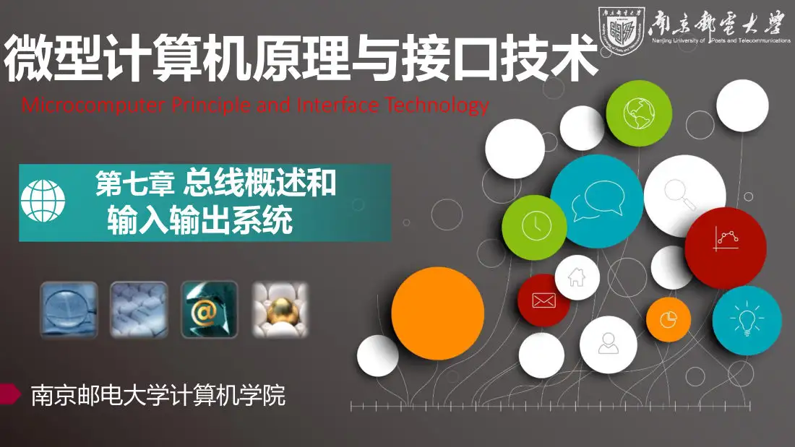

原文：

微型计算机原理与接口技术

Microcomputer Principle and Interface Technology

第七章 总线概述和输入输出系统

The image contains four distinct visual elements: a magnifying glass over a document, a keyboard with 'Close' keys, a globe with an @ symbol, and a golden egg surrounded by eggs. There is no textual content to extract. Therefore, the correct OCR output is an empty string.

南京邮电大学计算机学院

南京邮电大学
Nanjing University of Posts and Telecommunications
南京邮电大学

### 知识要点

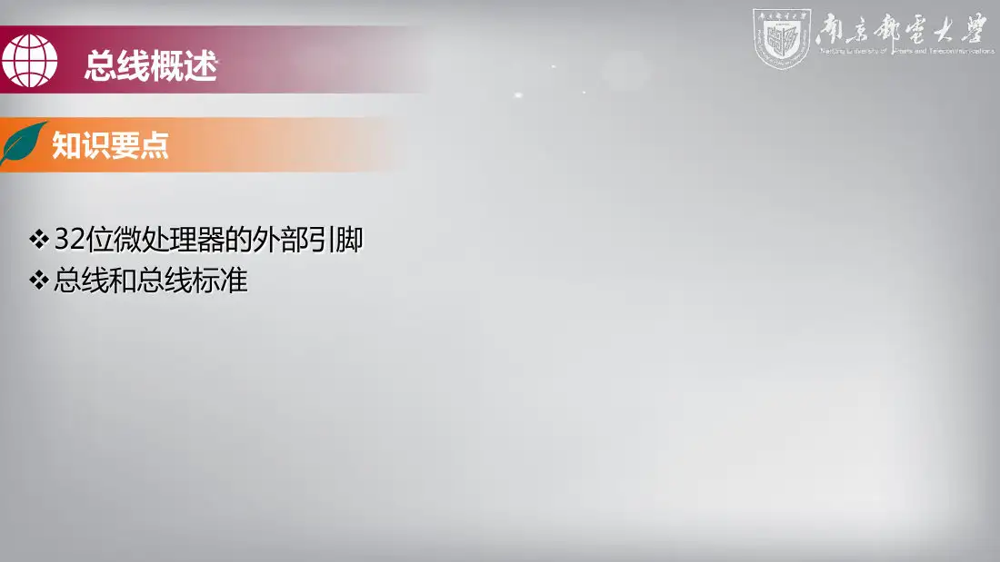

原文：

知识要点

✿ 32位微处理器的外部引脚

总线和总线标准

总线概述

南京邮电大学
Nanjing University of Posts and Telecommunications

### 一、32位微处理器的外部引脚

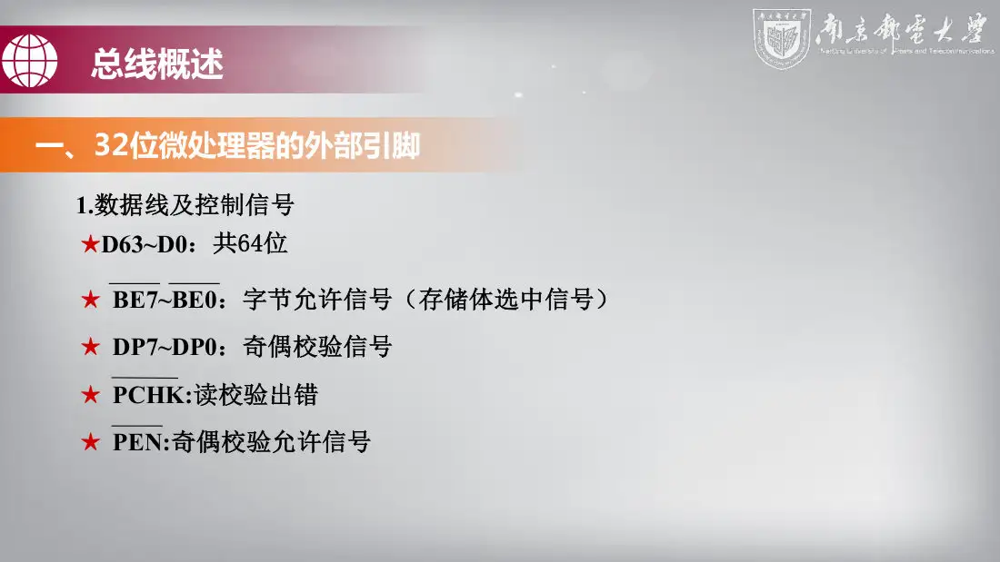

原文：

一、32位微处理器的外部引脚

1. 数据线及控制信号

★D63\~D0: 共64位

★ BE7\~BE0：字节允许信号（存储体选中信号）

★ DP7\~DP0: 奇偶校验信号

★ PCHK:读校验出错

★ PEN:奇偶校验允许信号

总线概述

南京邮电大学
Nanjing University of Posts and Telecommunications

### 一、32位微处理器的外部引脚

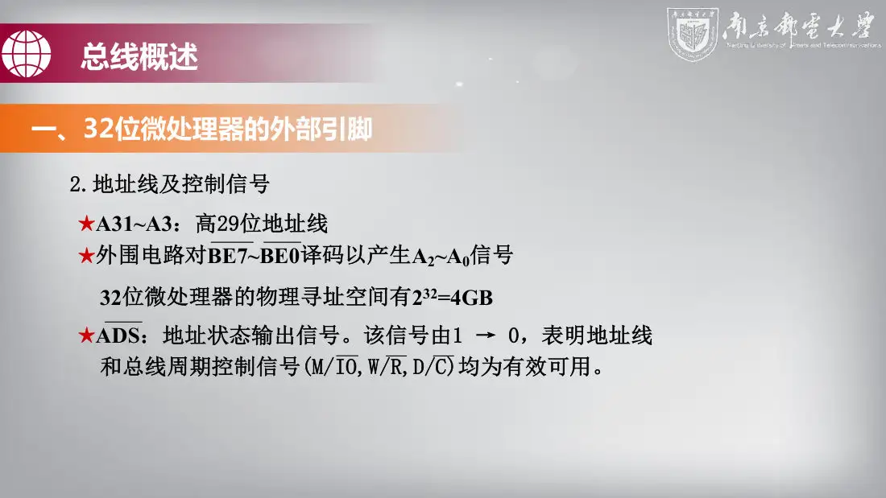

原文：

一、32位微处理器的外部引脚

2. 地址线及控制信号

★A31\~A3: 高29位地址线

★外围电路对BE7\~BE0译码以产生A₂\~A₀信号

32位微处理器的物理寻址空间有 $2^{32}=4GB$

★ADS: 地址状态输出信号。该信号由1 → 0，表明地址线和总线周期控制信号(M/IO, W/R, D/C)均为有效可用。

总线概述

南京邮电大学
Nanjing University of Posts and Telecommunications

### 一、32位微处理器的外部引脚

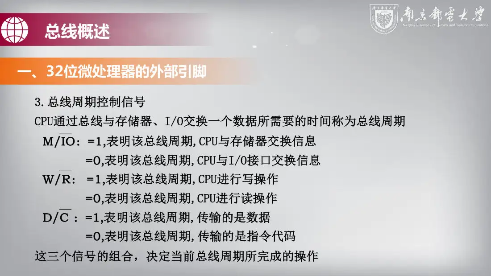

原文：

一、32位微处理器的外部引脚

3. 总线周期控制信号

CPU通过总线与存储器、I/O交换一个数据所需要的时间称为总线周期

M/IO: =1, 表明该总线周期, CPU与存储器交换信息

=0,表明该总线周期,CPU与I/O接口交换信息

W/R: =1,表明该总线周期,CPU进行写操作

=0,表明该总线周期,CPU进行读操作

D/C := 1, 表明该总线周期, 传输的是数据

=0,表明该总线周期,传输的是指令代码

这三个信号的组合，决定当前总线周期所完成的操作

总线概述

南京邮电大学
Nanjing University of Posts and Telecommunications

### 总线周期控制信号完成的操作

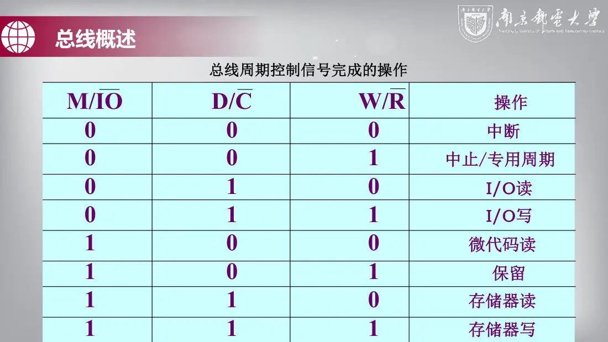

原文：

总线周期控制信号完成的操作
<table><tr><td>M/IO</td><td>D/C</td><td>W/R</td><td>操作</td></tr><tr><td>0</td><td>0</td><td>0</td><td>中断</td></tr><tr><td>0</td><td>0</td><td>1</td><td>中止/专用周期</td></tr><tr><td>0</td><td>1</td><td>0</td><td>I/O读</td></tr><tr><td>0</td><td>1</td><td>1</td><td>I/O写</td></tr><tr><td>1</td><td>0</td><td>0</td><td>微代码读</td></tr><tr><td>1</td><td>0</td><td>1</td><td>保留</td></tr><tr><td>1</td><td>1</td><td>0</td><td>存储器读</td></tr><tr><td>1</td><td>1</td><td>1</td><td>存储器写</td></tr></table>

总线概述

南京數電大學
Nanjing University of Posts and Telecommunications

### 一、32位微处理器的外部引脚

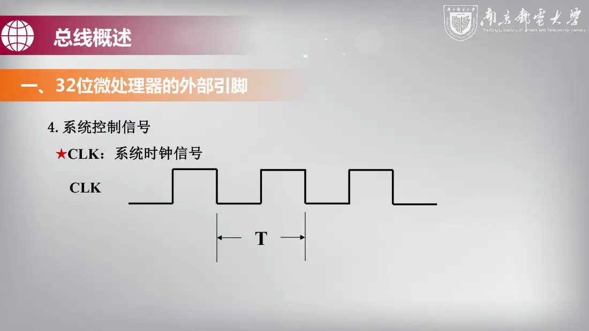

原文：

一、32位微处理器的外部引脚

4. 系统控制信号

★CLK: 系统时钟信号

CLK

总线概述

南京邮电大学
Nanjing University of Posts and Telecommunications

### 一、32位微处理器的外部引脚

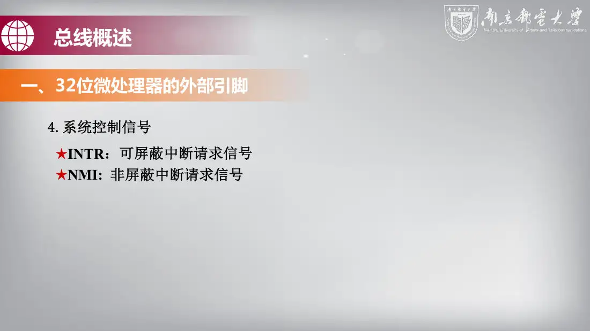

原文：

一、32位微处理器的外部引脚

4. 系统控制信号

★INTR: 可屏蔽中断请求信号

★NMI: 非屏蔽中断请求信号

总线概述

南京邮电大学
Nanjing University of Posts and Telecommunications

### 一、32位微处理器的外部引脚

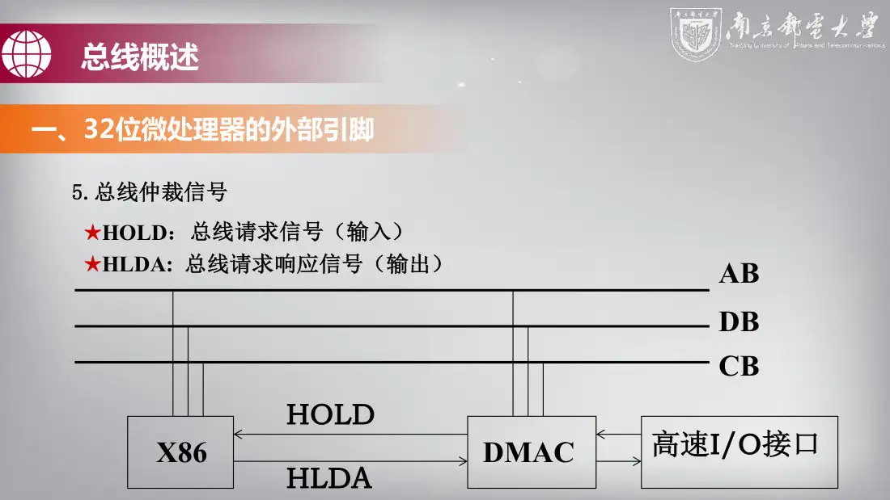

原文：

一、32位微处理器的外部引脚

5. 总线仲裁信号

★HOLD: 总线请求信号（输入）

★HLDA: 总线请求响应信号（输出）

总线概述

南京邮电大学
Nanjing University of Posts and Telecommunications

### 二、总线与总线标准

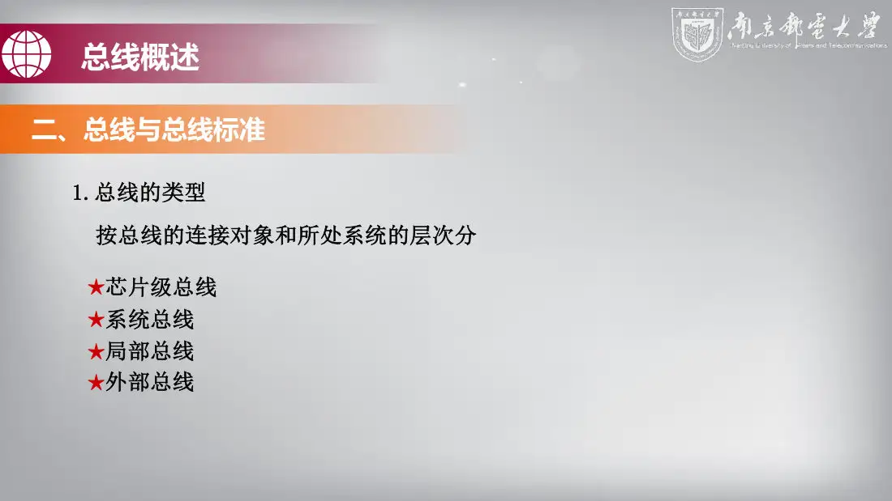

原文：

二、总线与总线标准

1. 总线的类型

按总线的连接对象和所处系统的层次分

★芯片级总线

★系统总线

★局部总线

★外部总线

总线概述

南京邮电大学
Nanjing University of Posts and Telecommunications

### 总线概述

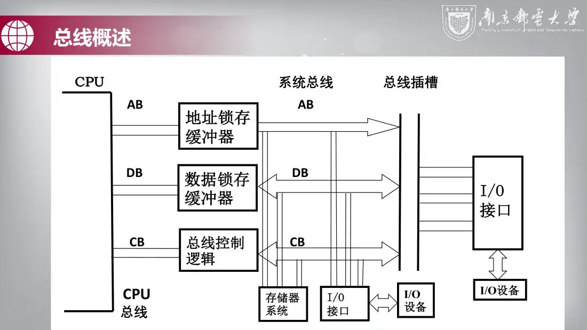

原文：

总线概述

南京邮电大学
Nanjing University of Posts and Telecommunications

### 二、总线与总线标准

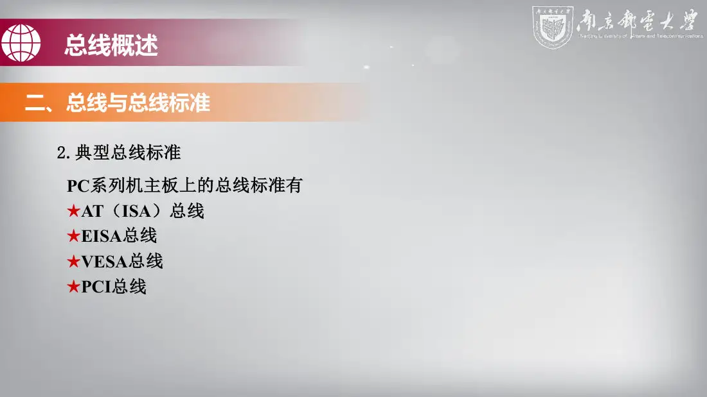

原文：

二、总线与总线标准

2. 典型总线标准

PC系列机主板上的总线标准有

★AT（ISA）总线

★EISA总线

★VESA总线

★PCI总线

南京邮电大学
Nanjing University of Posts and Telecommunications

总线概述

### 2.典型总线标准

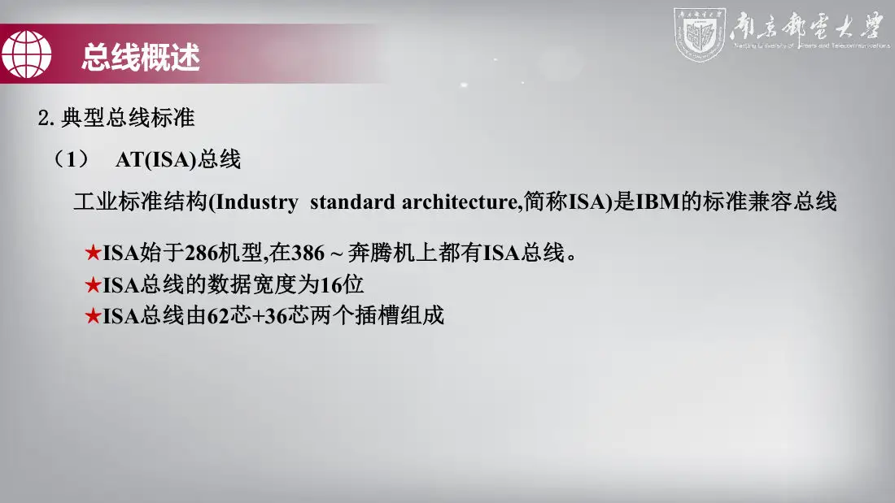

原文：

2.典型总线标准

(1) AT(ISA)总线

工业标准结构(Industry standard architecture,简称ISA)是IBM的标准兼容总线

★ISA始于286机型,在386～奔腾机上都有ISA总线。

★ISA总线的数据宽度为16位

★ISA总线由62芯+36芯两个插槽组成

总线概述

南京邮电大学
Nanjing University of Posts and Telecommunications

### (1) AT(ISA)总线

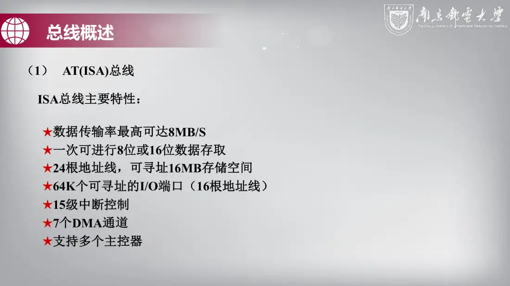

原文：

(1) AT(ISA)总线

ISA总线主要特性:

★数据传输率最高可达8MB/S

★一次可进行8位或16位数据存取

★24根地址线，可寻址16MB存储空间

★64K个可寻址的I/O端口（16根地址线）

★15级中断控制

★7个DMA通道

★支持多个主控器

总线概述

南京邮电大学
Nanjing University of Posts and Telecommunications

### AT总线插槽引脚分配

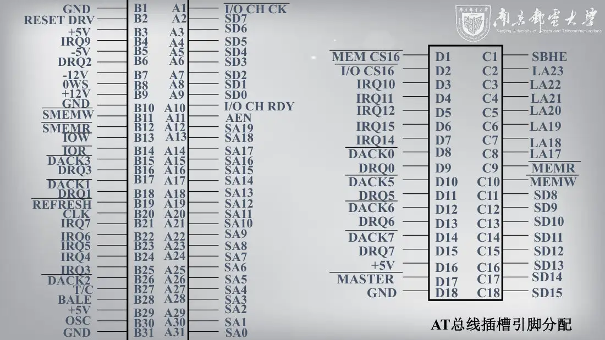

原文：

<table><tr><td>GND</td><td>B1</td><td>A1</td><td>I/O CH CK</td></tr><tr><td>RESET DRV</td><td>B2</td><td>A2</td><td>SD7</td></tr><tr><td>+5V</td><td>B3</td><td>A3</td><td>SD6</td></tr><tr><td>IRQ9</td><td>B4</td><td>A4</td><td>SD5</td></tr><tr><td>-5V</td><td>B5</td><td>A5</td><td>SD4</td></tr><tr><td>DRQ2</td><td>B6</td><td>A6</td><td>SD3</td></tr><tr><td>-12V</td><td>B7</td><td>A7</td><td>SD2</td></tr><tr><td>0WS</td><td>B8</td><td>A8</td><td>SD1</td></tr><tr><td>+12V</td><td>B9</td><td>A9</td><td>SD0</td></tr><tr><td>GND</td><td>B10</td><td>A10</td><td>I/O CH RDY</td></tr><tr><td>SMEMW</td><td>B11</td><td>A11</td><td>AEN</td></tr><tr><td>SMEMR</td><td>B12</td><td>A12</td><td>SA19</td></tr><tr><td>IOW</td><td>B13</td><td>A13</td><td>SA18</td></tr><tr><td>IOR</td><td>B14</td><td>A14</td><td>SA17</td></tr><tr><td>DACK3</td><td>B15</td><td>A15</td><td>SA16</td></tr><tr><td>DRQ3</td><td>B16</td><td>A16</td><td>SA15</td></tr><tr><td>DACK1</td><td>B17</td><td>A17</td><td>SA14</td></tr><tr><td>DRQ1</td><td>B18</td><td>A18</td><td>SA13</td></tr><tr><td>REFRESH</td><td>B19</td><td>A19</td><td>SA12</td></tr><tr><td>CLK</td><td>B20</td><td>A20</td><td>SA11</td></tr><tr><td>IRQ7</td><td>B21</td><td>A21</td><td>SA10</td></tr><tr><td>IRQ6</td><td>B22</td><td>A22</td><td>SA9</td></tr><tr><td>IRQ5</td><td>B23</td><td>A23</td><td>SA8</td></tr><tr><td>IRQ4</td><td>B24</td><td>A24</td><td>SA7</td></tr><tr><td>IRQ3</td><td>B25</td><td>A25</td><td>SA6</td></tr><tr><td>DACK2</td><td>B26</td><td>A26</td><td>SA5</td></tr><tr><td>T/C</td><td>B27</td><td>A27</td><td>SA4</td></tr><tr><td>BALE</td><td>B28</td><td>A28</td><td>SA3</td></tr><tr><td>+5V</td><td>B29</td><td>A29</td><td>SA2</td></tr><tr><td>OSC</td><td>B30</td><td>A30</td><td>SA1</td></tr><tr><td>GND</td><td>B31</td><td>A31</td><td>SA0</td></tr></table>

AT总线插槽引脚分配
<table><tr><td>MEM CS16</td><td>D1</td><td>C1</td><td>SBHE</td></tr><tr><td>I/O CS16</td><td>D2</td><td>C2</td><td>LA23</td></tr><tr><td>IRQ10</td><td>D3</td><td>C3</td><td>LA22</td></tr><tr><td>IRQ11</td><td>D4</td><td>C4</td><td>LA21</td></tr><tr><td>IRQ12</td><td>D5</td><td>C5</td><td>LA20</td></tr><tr><td>IRQ15</td><td>D6</td><td>C6</td><td>LA19</td></tr><tr><td>IRQ14</td><td>D7</td><td>C7</td><td>LA18</td></tr><tr><td>DACK0</td><td>D8</td><td>C8</td><td>LA17</td></tr><tr><td>DRQ0</td><td>D9</td><td>C9</td><td>MEMR</td></tr><tr><td>DACK5</td><td>D10</td><td>C10</td><td>MEMW</td></tr><tr><td>DRQ5</td><td>D11</td><td>C11</td><td>SD8</td></tr><tr><td>DACK6</td><td>D12</td><td>C12</td><td>SD9</td></tr><tr><td>DRQ6</td><td>D13</td><td>C13</td><td>SD10</td></tr><tr><td>DACK7</td><td>D14</td><td>C14</td><td>SD11</td></tr><tr><td>DRQ7</td><td>D15</td><td>C15</td><td>SD12</td></tr><tr><td>+5V</td><td>D16</td><td>C16</td><td>SD13</td></tr><tr><td>MASTER</td><td>D17</td><td>C17</td><td>SD14</td></tr><tr><td>GND</td><td>D18</td><td>C18</td><td>SD15</td></tr></table>

南京邮电大学
Nanjing University of Posts and Telecommunications

### 62芯插槽部分引脚

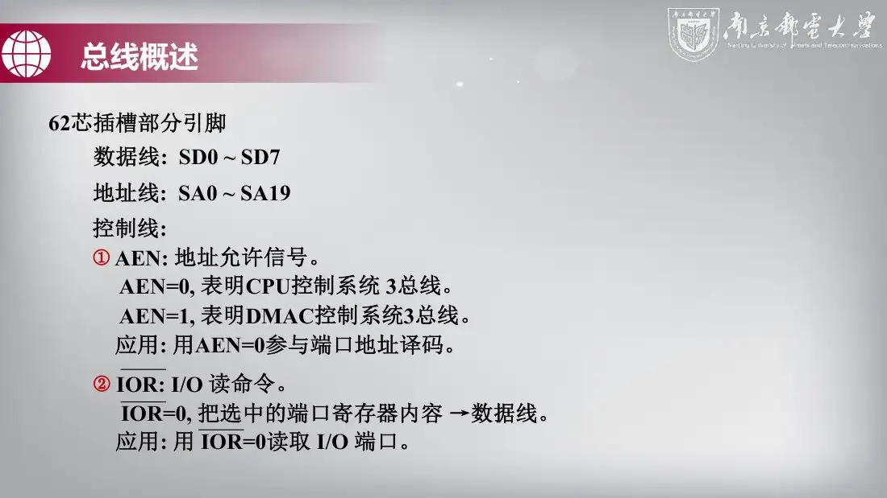

原文：

62芯插槽部分引脚

数据线: SD0 \~ SD7

地址线: SA0 \~ SA19

控制线:

① AEN: 地址允许信号。

AEN=0, 表明CPU控制系统3总线。

AEN=1, 表明DMAC控制系统3总线。

应用: 用AEN=0参与端口地址译码。

② IOR: I/O 读命令。

IOR=0, 把选中的端口寄存器内容 → 数据线。

应用: 用 $\overline{\mathrm{IOR}} = 0$ 读取 I/O 端口。

总线概述

南京邮电大学
Nanjing University of Posts and Telecommunications

### 62芯插槽部分引脚

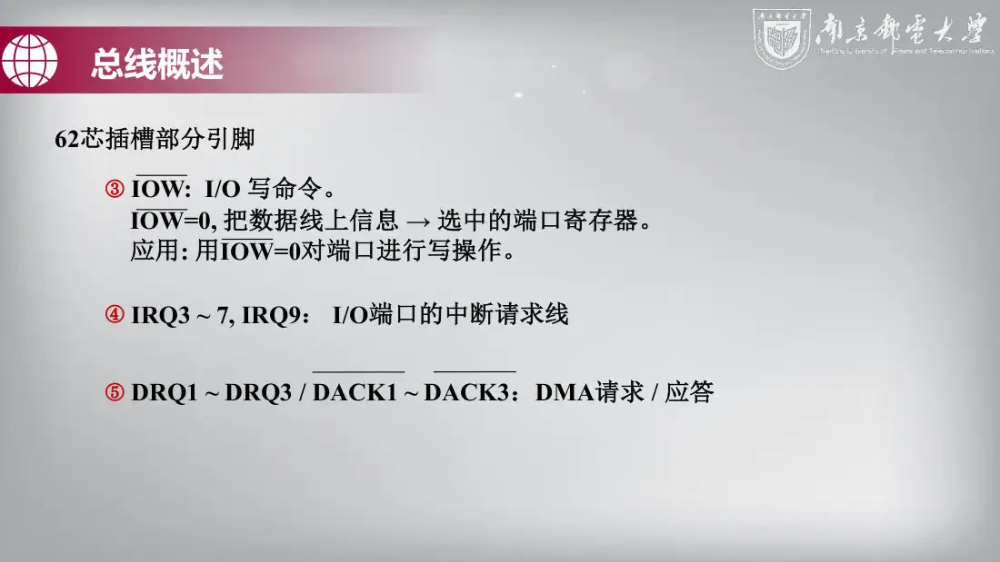

原文：

62芯插槽部分引脚

③ IOW: I/O 写命令。

$\overline{\mathrm{IOW}} = 0$ ，把数据线上信息 $\rightarrow$ 选中的端口寄存器。

应用: 用 $\overline{IOW}=0$ 对端口进行写操作。

④ IRQ3 \~ 7, IRQ9: I/O端口的中断请求线

总线概述

南京邮电大学
Nanjing University of Posts and Telecommunications

⑤ DRQ1 \~ DRQ3 / DACK1 \~ DACK3: DMA请求 / 应答

### 36芯插槽部分引脚

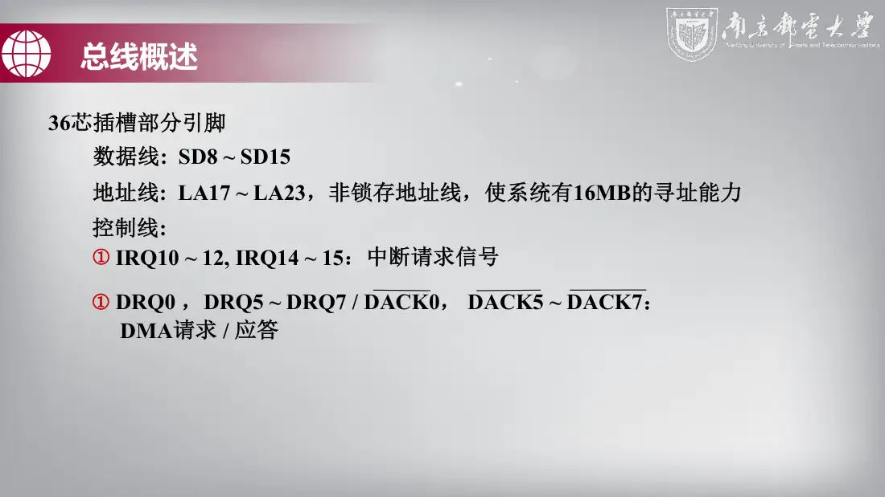

原文：

36芯插槽部分引脚

数据线: SD8 \~ SD15

地址线：LA17～LA23，非锁存地址线，使系统有16MB的寻址能力

控制线:

① IRQ10 \~ 12, IRQ14 \~ 15: 中断请求信号

① DRQ0，DRQ5～DRQ7 / DACK0，DACK5～DACK7: DMA请求 / 应答

总线概述

南京邮电大学
Nanjing University of Posts and Telecommunications

### 2.典型总线标准

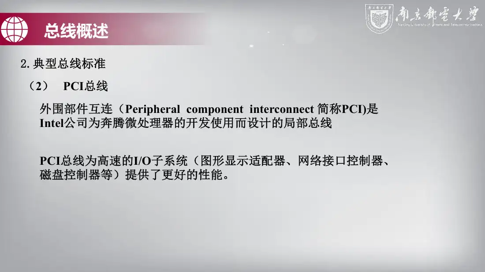

原文：

2.典型总线标准

(2) PCI总线

外围部件互连（Peripheral component interconnect 简称PCI)是Intel公司为奔腾微处理器的开发使用而设计的局部总线

PCI总线为高速的I/O子系统（图形显示适配器、网络接口控制器、磁盘控制器等）提供了更好的性能。

总线概述

南京邮电大学
Nanjing University of Posts and Telecommunications

### PCI总线主要特点:

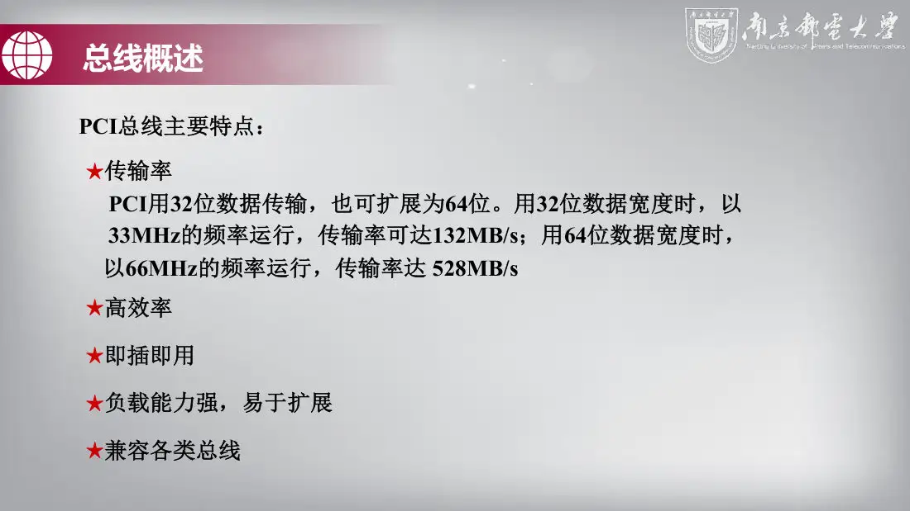

原文：

PCI总线主要特点:

★传输率

PCI用32位数据传输，也可扩展为64位。用32位数据宽度时，以33MHz的频率运行，传输率可达132MB/s；用64位数据宽度时，以66MHz的频率运行，传输率达528MB/s

★高效率

★即插即用

★负载能力强，易于扩展

★兼容各类总线

总线概述

南京邮电大学
Nanjing University of Posts and Telecommunications

### 主板上的 PCI插槽

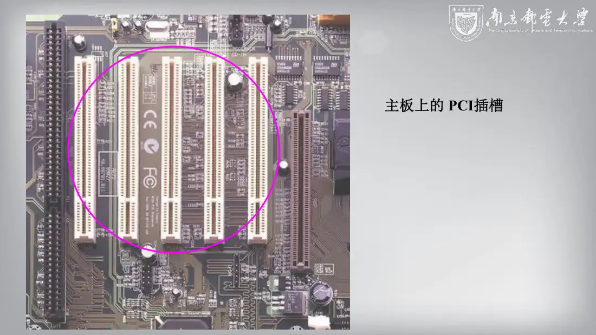

原文：

主板上的 PCI插槽

南京邮电大学
Nanjing University of Posts and Telecommunications

### 3. 通用外部总线标准

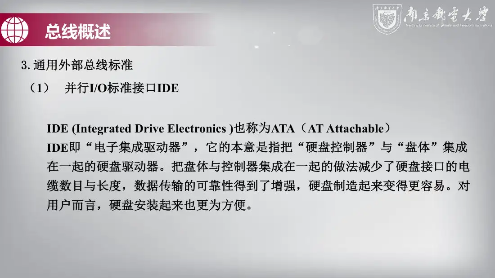

原文：

3. 通用外部总线标准

(1) 并行I/O标准接口IDE

IDE (Integrated Drive Electronics)也称为ATA（AT Attachable）

IDE即“电子集成驱动器”，它的本意是指把“硬盘控制器”与“盘体”集成在一起的硬盘驱动器。把盘体与控制器集成在一起的做法减少了硬盘接口的电缆数目与长度，数据传输的可靠性得到了增强，硬盘制造起来变得更容易。对用户而言，硬盘安装起来也更为方便。

总线概述

南京邮电大学
Nanjing University of Posts and Telecommunications

### 南京邮电大学

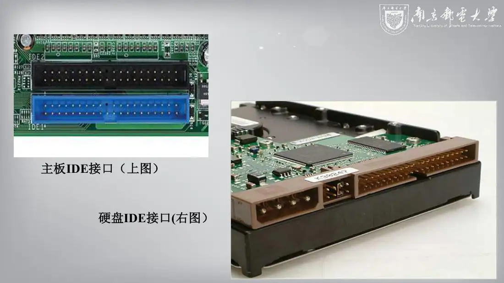

原文：

南京邮电大学
Nanjing University of Posts and Telecommunications

### 3. 通用外部总线标准

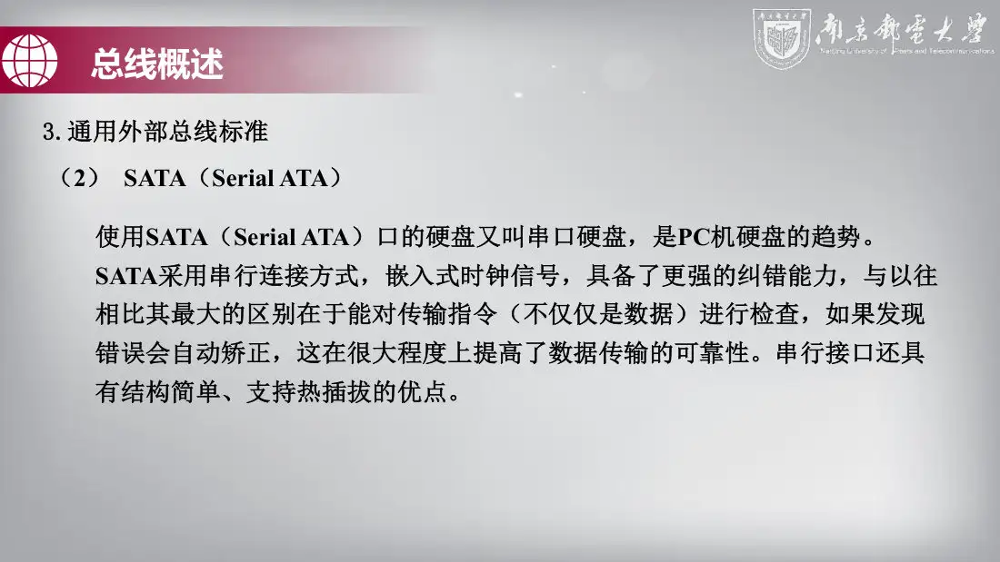

原文：

3. 通用外部总线标准

(2) SATA (Serial ATA)

使用SATA（Serial ATA）口的硬盘又叫串口硬盘，是PC机硬盘的趋势。

SATA采用串行连接方式，嵌入式时钟信号，具备了更强的纠错能力，与以往相比其最大的区别在于能对传输指令（不仅仅是数据）进行检查，如果发现错误会自动矫正，这在很大程度上提高了数据传输的可靠性。串行接口还具有结构简单、支持热插拔的优点。

总线概述

南京邮电大学
Nanjing University of Posts and Telecommunications

### 3. 通用外部总线标准

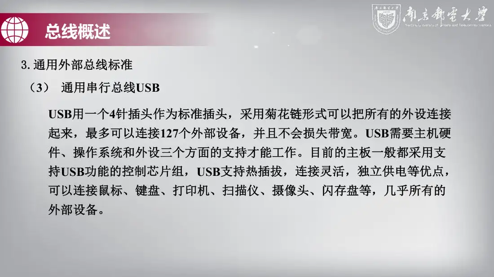

原文：

3. 通用外部总线标准

(3) 通用串行总线USB

USB用一个4针插头作为标准插头，采用菊花链形式可以把所有的外设连接起来，最多可以连接127个外部设备，并且不会损失带宽。USB需要主机硬件、操作系统和外设三个方面的支持才能工作。目前的主板一般都采用支持USB功能的控制芯片组，USB支持热插拔，连接灵活，独立供电等优点，可以连接鼠标、键盘、打印机、扫描仪、摄像头、闪存盘等，几乎所有的外部设备。

总线概述

南京邮电大学
Nanjing University of Posts and Telecommunications

### 4.32位微型计算机总线结构

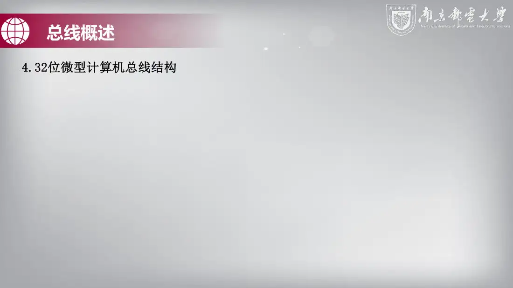

原文：

4.32位微型计算机总线结构

总线概述

南京邮电大学
Nanjing University of Posts and Telecommunications

### 总线概述

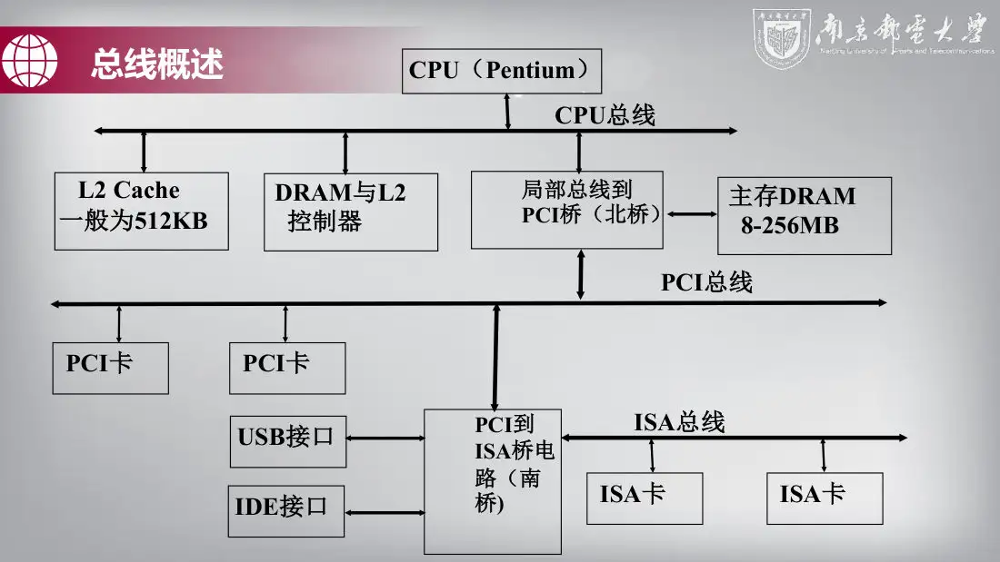

原文：

总线概述

南京邮电大学
Nanjing University of Posts and Telecommunications

### 总线概述

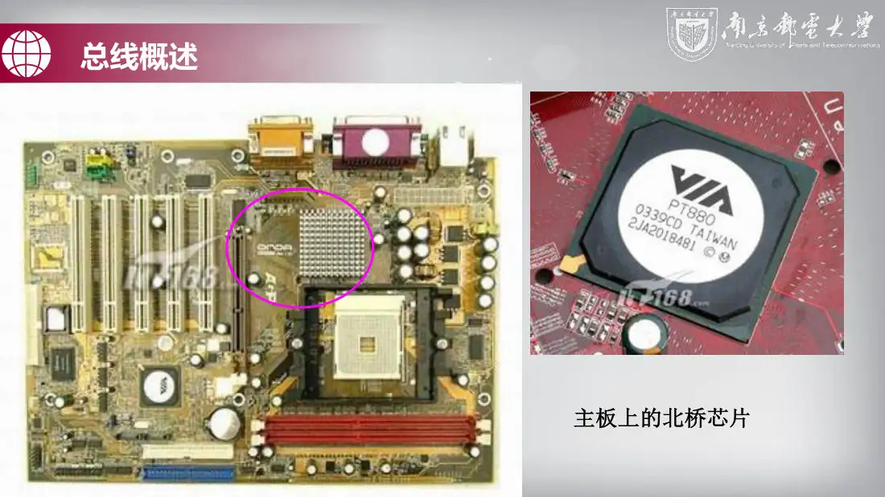

原文：

总线概述

南京邮电大学
Nanjing University of Posts and Telecommunications

### 总线概述

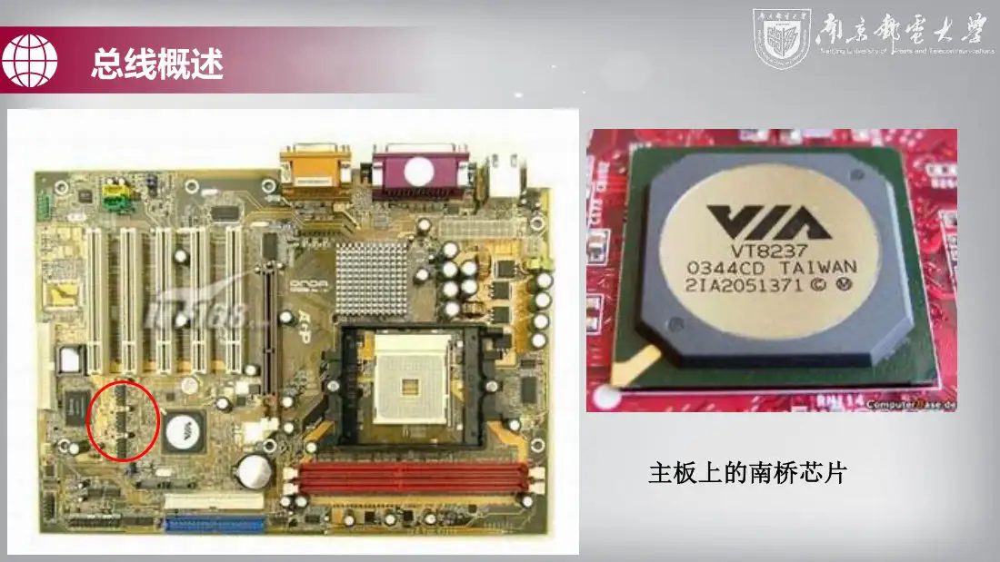

原文：

总线概述

南京數電大學
Nanjing University of Posts and Telecommunications

### 知识点小结

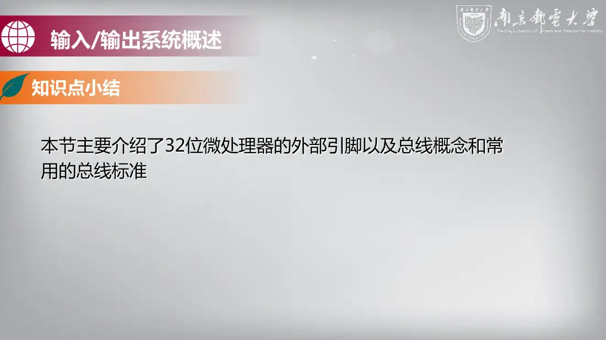

原文：

知识点小结

本节主要介绍了32位微处理器的外部引脚以及总线概念和常用的总线标准

输入/输出系统概述

南京邮电大学
Nanjing University of Posts and Telecommunications

### 微型计算机原理与接口技术

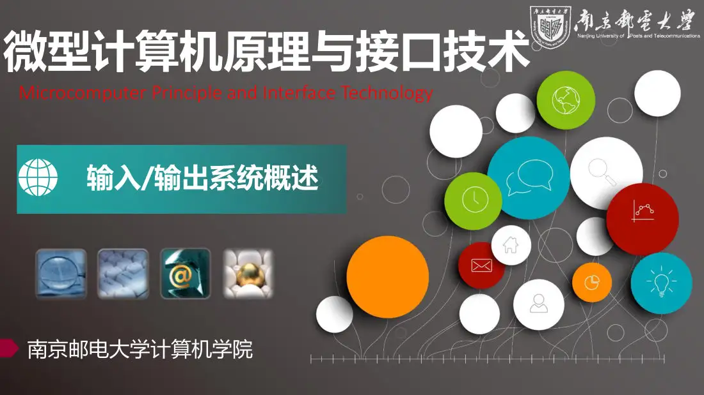

原文：

微型计算机原理与接口技术

Microcomputer Principle and Interface Technology

输入/输出系统概述

The image contains four symbolic icons: a magnifying glass over a globe, a keyboard with 'Close' text, a @ symbol in a globe, and a golden egg surrounded by eggs. There is no textual content to extract.

南京邮电大学计算机学院

南京邮电大学
Nanjing University of Posts and Telecommunications
南京邮电大学

### 知识要点

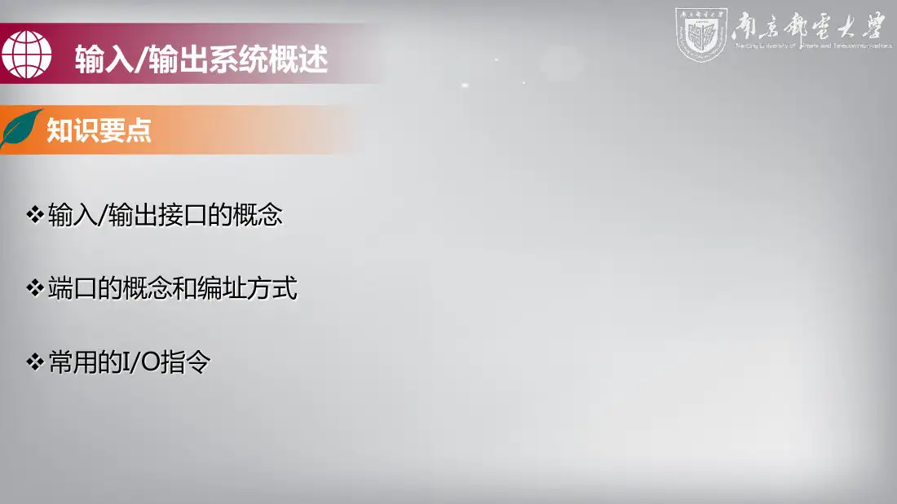

原文：

知识要点

输入/输出接口的概念

端口的概念和编址方式

常用的I/O指令

输入/输出系统概述

南京邮电大学
Nanjing University of Posts and Telecommunications

### 一、接口的概念

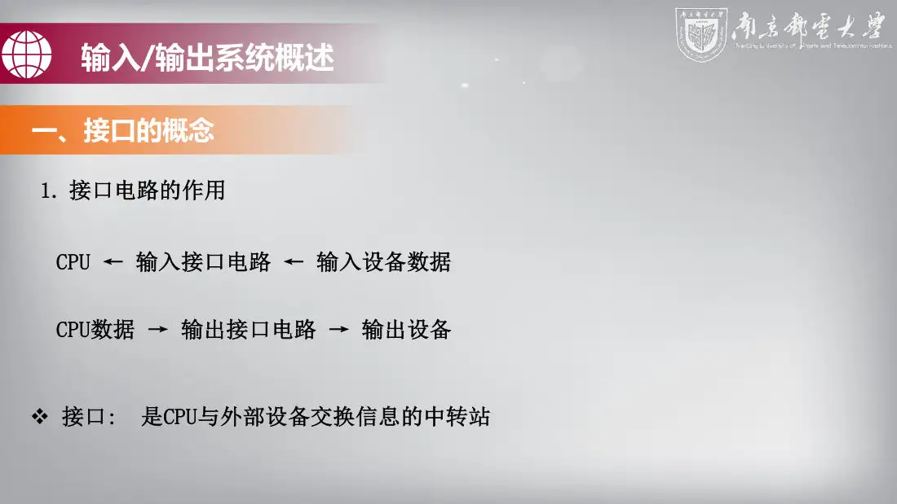

原文：

一、接口的概念

1. 接口电路的作用

CPU ← 输入接口电路 ← 输入设备数据

CPU数据 → 输出接口电路 → 输出设备

接口：是CPU与外部设备交换信息的中转站

输入/输出系统概述

南京邮电大学
Nanjing University of Posts and Telecommunications

### 2. 接口电路的功能

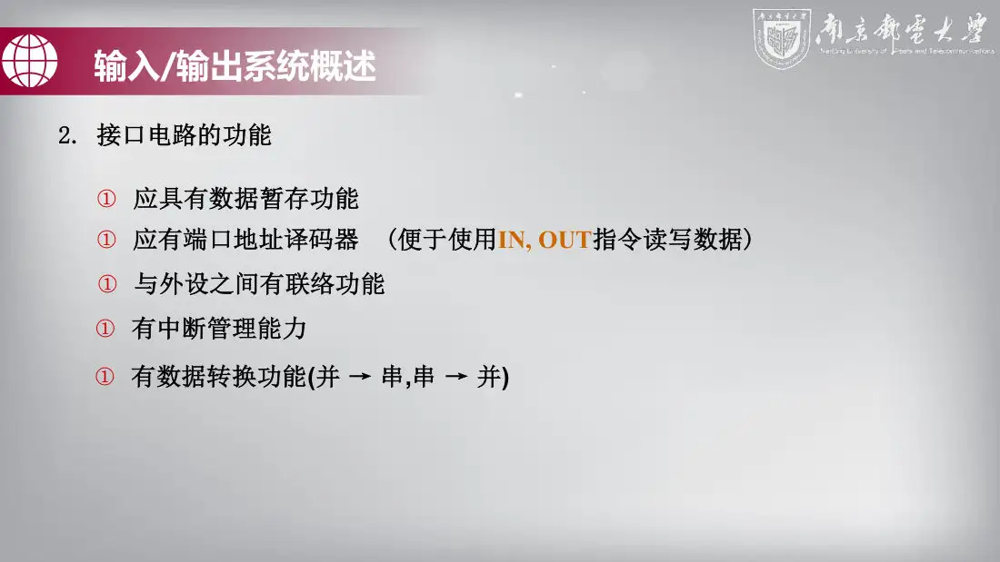

原文：

2. 接口电路的功能

① 应具有数据暂存功能

① 应有端口地址译码器 （便于使用IN, OUT指令读写数据）

① 与外设之间有联络功能

① 有中断管理能力

① 有数据转换功能(并 → 串,串 → 并)

输入/输出系统概述

南京邮电大学
Nanjing University of Posts and Telecommunications

### 二、端口的概念

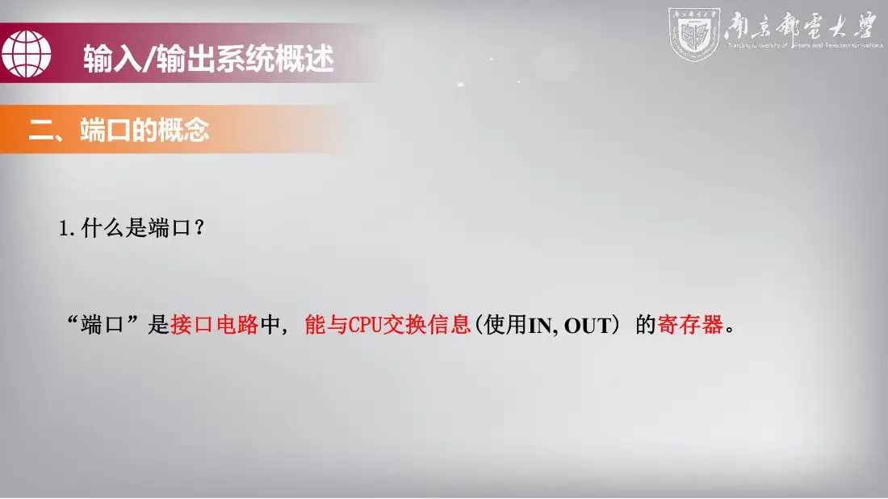

原文：

二、端口的概念

1. 什么是端口？

“端口”是接口电路中，能与CPU交换信息(使用IN, OUT)的寄存器。

输入/输出系统概述

南京邮电大学
Nanjing University of Posts and Telecommunications

### 2. 端口的分类:

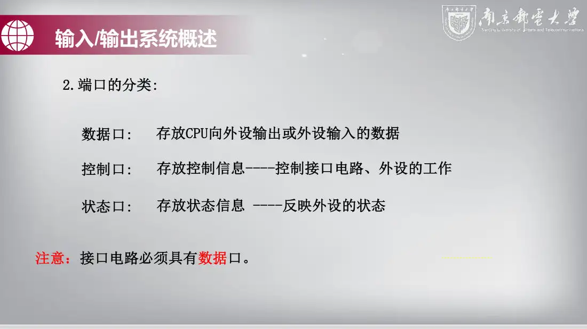

原文：

2. 端口的分类:

数据口：存放CPU向外设输出或外设输入的数据

控制口：存放控制信息----控制接口电路、外设的工作

状态口：存放状态信息 ----反映外设的状态

注意：接口电路必须具有数据口。

输入/输出系统概述

南京邮电大学
Nanjing University of Posts and Telecommunications

### 问题：系统给出的地址是内存单元地址还是I/O端口寄存器的地址？

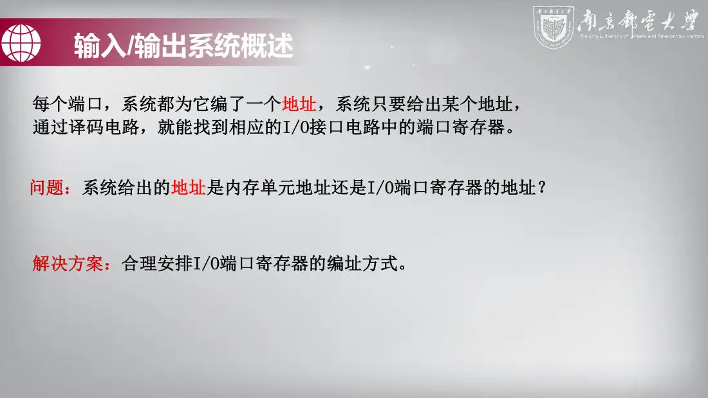

原文：

每个端口，系统都为它编了一个地址，系统只要给出某个地址，通过译码电路，就能找到相应的I/O接口电路中的端口寄存器。

问题：系统给出的地址是内存单元地址还是I/O端口寄存器的地址？

解决方案：合理安排I/O端口寄存器的编址方式。

输入/输出系统概述

南京邮电大学
Nanjing University of Posts and Telecommunications

### 3. 端口的编址方式

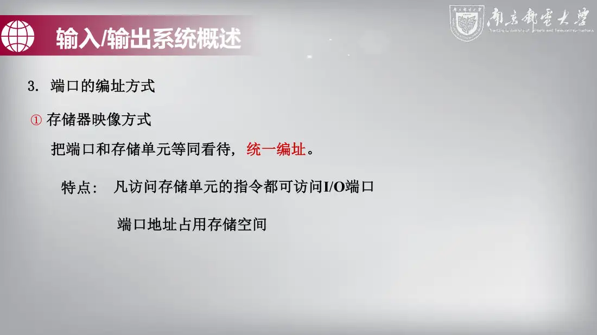

原文：

3. 端口的编址方式

① 存储器映像方式

把端口和存储单元等同看待，统一编址。

特点：凡访问存储单元的指令都可访问I/O端口

端口地址占用存储空间

输入/输出系统概述

南京邮电大学
Nanjing University of Posts and Telecommunications

### 3. 端口的编址方式

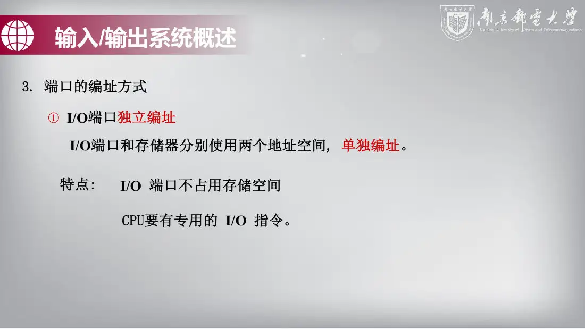

原文：

3. 端口的编址方式

① I/O端口独立编址

I/O端口和存储器分别使用两个地址空间，单独编址。

特点: I/O 端口不占用存储空间

CPU要有专用的 I/O 指令。

输入/输出系统概述

南京邮电大学
Nanjing University of Posts and Telecommunications

### 4. PC系列机的端口编址

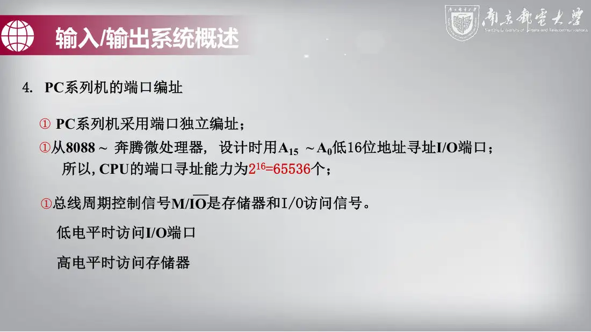

原文：

4. PC系列机的端口编址

① PC系列机采用端口独立编址;

①从8088～奔腾微处理器，设计时用 $A_{15}\sim A_{0}$ 低16位地址寻址I/O端口；所以，CPU的端口寻址能力为 $2^{16}=65536$ 个；

①总线周期控制信号M/IO是存储器和I/O访问信号。

低电平时访问I/O端口

高电平时访问存储器

输入/输出系统概述

南京邮电大学
Nanjing University of Posts and Telecommunications

### 4. PC系列机的端口编址

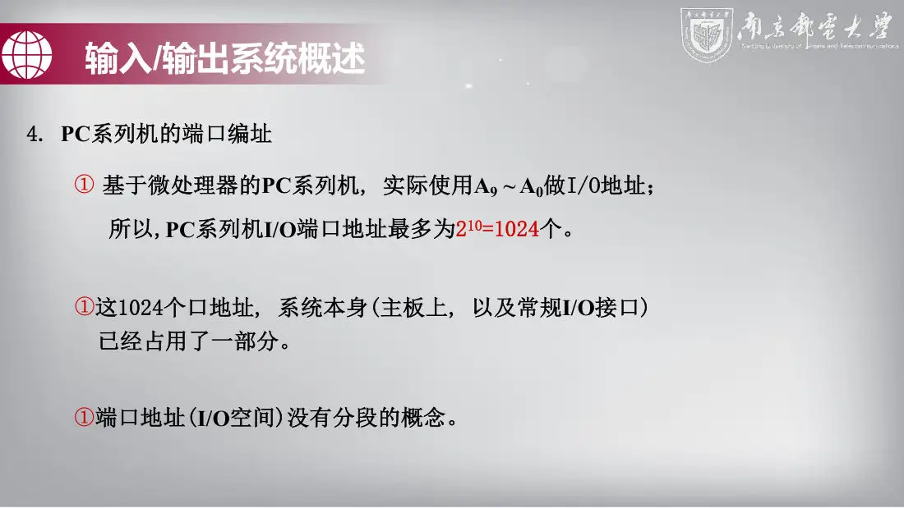

原文：

4. PC系列机的端口编址

① 基于微处理器的PC系列机，实际使用 $A_{9}\sim A_{0}$ 做I/O地址；所以，PC系列机I/O端口地址最多为 $2^{10}=1024$ 个。

①这1024个口地址，系统本身(主板上，以及常规I/O接口)已经占用了一部分。

①端口地址(I/O空间)没有分段的概念。

输入/输出系统概述

南京邮电大学
Nanjing University of Posts and Telecommunications

### 三、常用的I/O指令

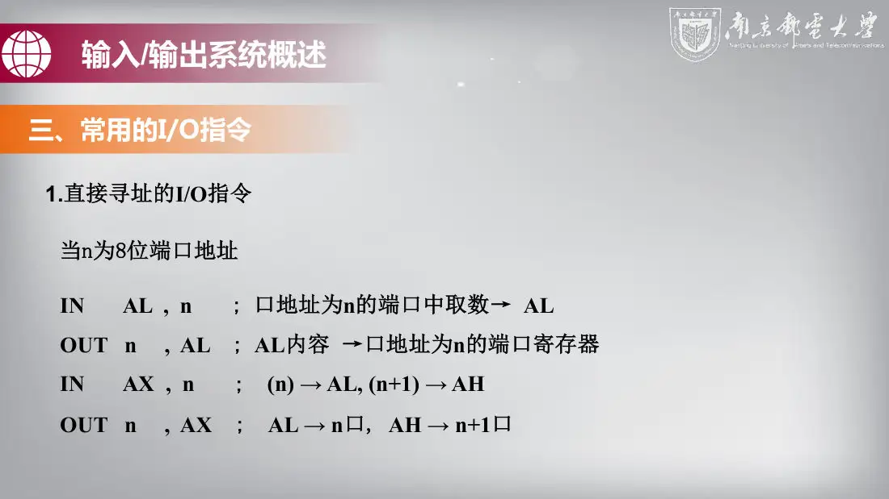

原文：

三、常用的I/O指令

1. 直接寻址的I/O指令

当n为8位端口地址

IN AL, n ; 口地址为n的端口中取数→ AL

OUT n , AL ; AL内容 →口地址为n的端口寄存器

IN AX, n ; (n) → AL, (n+1) → AH

OUT n , AX ; AL → n 口, AH → n + 1 口

输入/输出系统概述

南京邮电大学
Nanjing University of Posts and Telecommunications

### 1. 直接寻址的I/O指令

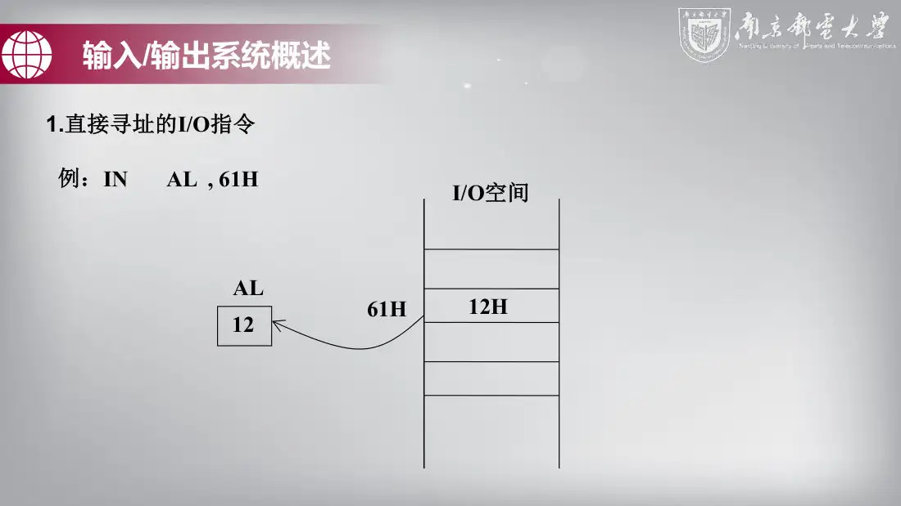

原文：

1. 直接寻址的I/O指令

例：IN AL,61H

输入/输出系统概述

南京邮电大学
Nanjing University of Posts and Telecommunications

### 1. 直接寻址的I/O指令

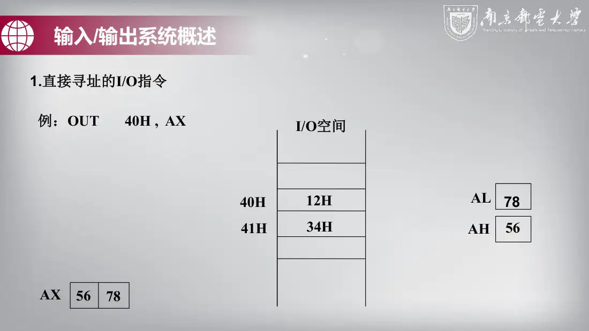

原文：

1. 直接寻址的I/O指令

例: OUT 40H, AX

<table><tr><td colspan="2">I/O空间</td></tr><tr><td></td><td></td></tr><tr><td></td><td></td></tr><tr><td>40H</td><td>12H</td></tr><tr><td>41H</td><td>34H</td></tr><tr><td></td><td></td></tr><tr><td></td><td></td></tr></table>

输入/输出系统概述

南京邮电大学
Nanjing University of Posts and Telecommunications

### 1. 直接寻址的I/O指令

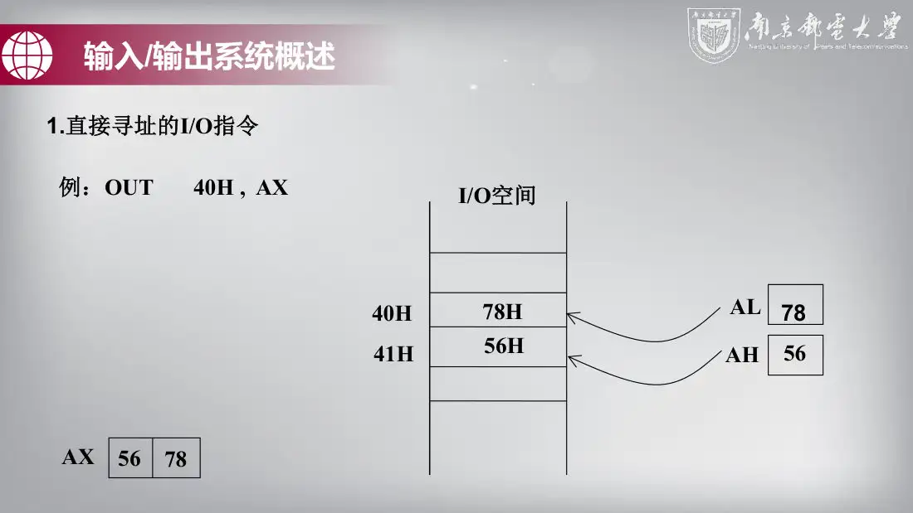

原文：

1. 直接寻址的I/O指令

例: OUT 40H, AX

输入/输出系统概述

南京邮电大学
Nanjing University of Posts and Telecommunications

### 三、常用的I/O指令

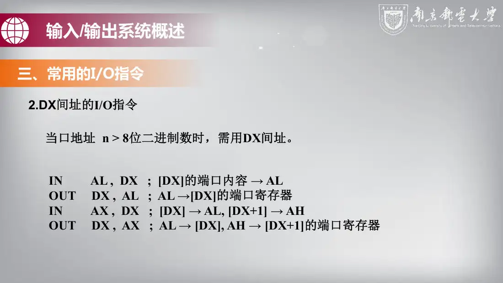

原文：

三、常用的I/O指令

2.DX间址的I/O指令

当口地址 n > 8 位二进制数时，需用 DX 间址。

IN AL, DX ; [DX]的端口内容 → AL

OUT DX, AL ; AL → [DX] 的端口寄存器

IN AX, DX ; [DX] → AL, [DX+1] → AH

OUT DX, AX ; AL → [DX], AH → [DX+1]的端口寄存器

输入/输出系统概述

南京邮电大学
Nanjing University of Posts and Telecommunications

### 2.DX间址的I/O指令

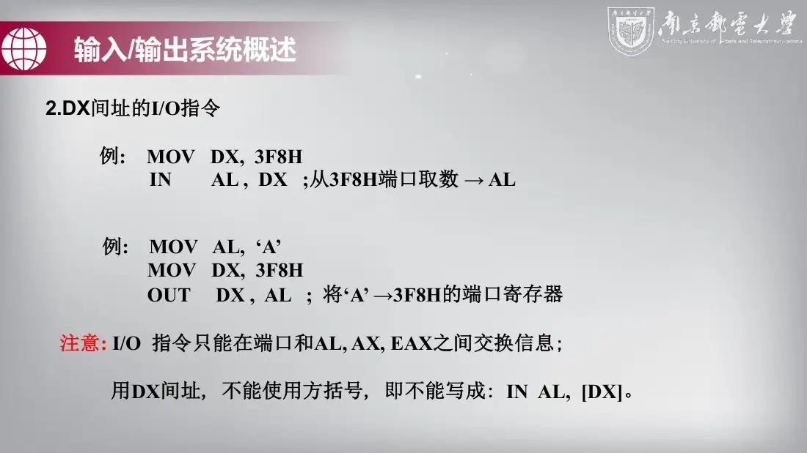

原文：

2.DX间址的I/O指令

例: MOV DX, 3F8H
IN AL, DX ;从3F8H端口取数 → AL

例: MOV AL, 'A'  
MOV DX, 3F8H  
OUT DX, AL ; 将'A'→3F8H的端口寄存器

注意: I/O 指令只能在端口和AL, AX, EAX之间交换信息;

用DX间址，不能使用方括号，即不能写成：IN AL, [DX]。

输入/输出系统概述

南京邮电大学
Nanjing University of Posts and Telecommunications

### 知识点小结

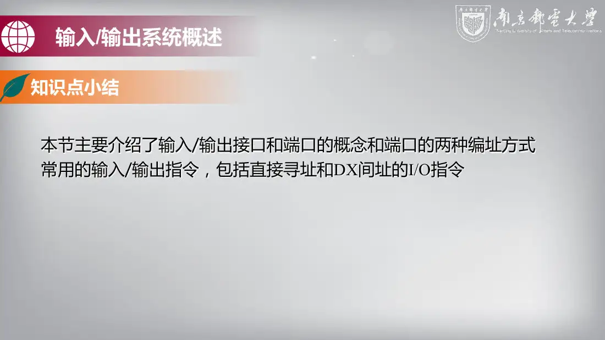

原文：

知识点小结

本节主要介绍了输入/输出接口和端口的概念和端口的两种编址方式常用的输入/输出指令，包括直接寻址和DX间址的I/O指令

输入/输出系统概述

南京邮电大学
Nanjing University of Posts and Telecommunications

### 微型计算机原理与接口技术

原文：

微型计算机原理与接口技术

Microcomputer Principle and Interface Technology

微机系统与外设交换信息的方式

The image contains four distinct visual elements: a magnifying glass over a document, a keyboard with 'Close' labels, a globe with an @ symbol, and a golden ingot on a white surface. There is no textual content to extract. Therefore, the correct OCR output is an empty string.

(No text to output)

南京邮电大学计算机学院

南京邮电大学
Nanjing University of Posts and Telecommunications
南京邮电大学

### 知识要点

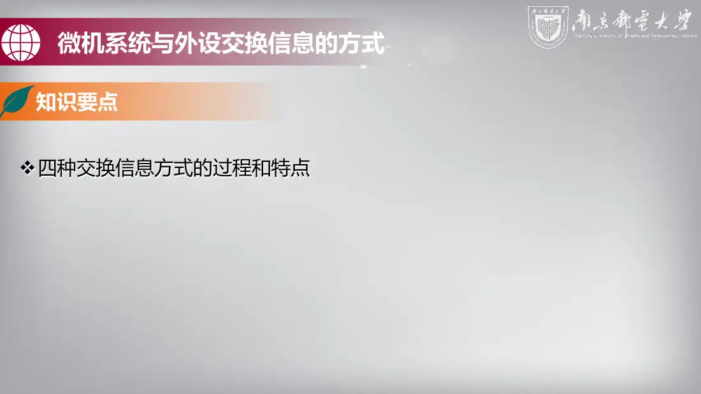

原文：

知识要点

✿ 四种交换信息方式的过程和特点微机系统与 I/O 设备的信息交换有四种方式:
无条件传送方式 查询方式
中断控制方式 DMA方式

微机系统与外设交换信息的方式

南京邮电大学
Nanjing University of Posts and Telecommunications

### 采用何种方式与接口的硬件电路有直接关系

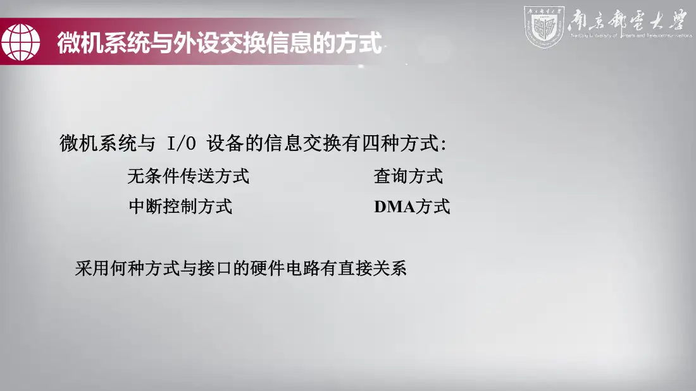

原文：

采用何种方式与接口的硬件电路有直接关系

微机系统与外设交换信息的方式

南京邮电大学
Nanjing University of Posts and Telecommunications

### 一、无条件传送方式

原文：

一、无条件传送方式

★ 输入接口:

执行IN指令之前,要求外设数据已经准备好。

微机系统与外设交换信息的方式

南京邮电大学
Nanjing University of Posts and Telecommunications

### 一、无条件传送方式

原文：

一、无条件传送方式

★ 输入接口:

控=0，出=入
控=1，出为高阻 控=1，出=入
控=0，出为高阻

微机系统与外设交换信息的方式

南京數電大學
Nanjing University of Posts and Telecommunications

### 一、无条件传送方式

原文：

一、无条件传送方式

★ 输出接口:

执行OUT指令之前，须保证输出设备空闲。

微机系统与外设交换信息的方式

南京邮电大学
Nanjing University of Posts and Telecommunications

### 一、无条件传送方式

原文：

一、无条件传送方式

★ 输出接口:

微机系统与外设交换信息的方式

南京邮电大学
Nanjing University of Posts and Telecommunications

### 一、无条件传送方式

原文：

一、无条件传送方式

★ 输出接口:

执行OUT指令时：AL内容 → 数据线，

口地址 → 地址线上,

$\overline{\mathrm{IOW}} =$ 低，把数据锁存到锁存器中。

微机系统与外设交换信息的方式

南京邮电大学
Nanjing University of Posts and Telecommunications

### 二、查询方式

原文：

二、查询方式

①用查询方式交换信息，必先了解外设的状态。

查询方式输出流程

微机系统与外设交换信息的方式

南京邮电大学
Nanjing University of Posts and Telecommunications

### 二、查询方式

原文：

二、查询方式

查询方式输入接口示意图:

微机系统与外设交换信息的方式

南京邮电大学
Nanjing University of Posts and Telecommunications

### 二、查询方式

原文：

二、查询方式

查询式输入核心程序:

设 状态口地址=200H

数据口地址=201H

RSCAN : MOV DX, 200H IN AL, DX TEST AL, 80H JZ RSCAN MOV DX, 201H IN AL, DX

微机系统与外设交换信息的方式

南京邮电大学
Nanjing University of Posts and Telecommunications

### 二、查询方式

原文：

二、查询方式

查询式输出接口示意图

微机系统与外设交换信息的方式

南京邮电大学
Nanjing University of Posts and Telecommunications

### 二、查询方式

原文：

二、查询方式

查询式输出核心程序:

设状态口地址=200H=数据口地址

<table><tr><td>TSCAN:</td><td>MOV</td><td>DX, 200H</td></tr><tr><td></td><td>IN</td><td>AL, DX</td></tr><tr><td></td><td>TEST</td><td>AL, 1</td></tr><tr><td></td><td>JNZ</td><td>TSCAN</td></tr><tr><td></td><td>MOV</td><td>DX, 200H</td></tr><tr><td></td><td>MOV</td><td>AL, 某数</td></tr><tr><td></td><td>OUT</td><td>DX, AL</td></tr></table>

微机系统与外设交换信息的方式

南京邮电大学
Nanjing University of Posts and Telecommunications

### 三、中断控制方式

原文：

三、中断控制方式

\- 在有多个外设的系统中，多个外设要求CPU为它服务是随机的

\- 若采用查询方式工作，就不能保证系统实时地对外设的请求作出响应

\- 为了提高CPU的效率，使系统有实时性能，导致了中断处理技术的产生

微机系统与外设交换信息的方式

南京邮电大学
Nanjing University of Posts and Telecommunications

### 三、中断控制方式

原文：

三、中断控制方式

特点:

·在外设没有作好数据传送准备时，CPU可执行与传送数据无关的其它指令

·当外设作好传送准备后，主动向CPU 请求中断

\- 若CPU响应这一请求，则暂停正在运行的程序，转入中断服务程序，完成数据传送

·待服务完毕后，自动返回原来运行的程序

微机系统与外设交换信息的方式

南京邮电大学
Nanjing University of Posts and Telecommunications

### 三、中断控制方式

原文：

三、中断控制方式

中断请求1

中断请求2

中断服务程序1

中断服务程序2

●被中断的原程序称为主程序;

●中断处理程序称为中断服务子程序；

\- 主程序被中止的地方，称为断点，也就是下一条指令所在内存的地址。

微机系统与外设交换信息的方式

南京邮电大学
Nanjing University of Posts and Telecommunications

### 微型计算机原理与接口技术

原文：

微型计算机原理与接口技术

Microcomputer Principle and Interface Technology

微机系统与外设交换信息的方式

The image contains four distinct visual elements: a magnifying glass over a document, a keyboard with 'Close' labels, a globe with an @ symbol, and a golden ingot on a white ball. There are no textual content to extract. Therefore, the correct OCR output is an empty string.

(No text to output)

南京邮电大学计算机学院

南京邮电大学
Nanjing University of Posts and Telecommunications
南京邮电大学

### 四、直接存储器存取（DMA）方式

原文：

四、直接存储器存取（DMA）方式

1. 什么是DMA?

DMA (Direct Memory Access): 直接存储器存取, 习惯上称DMA传送。

DMA传送：利用硬件完成高速外设与系统RAM之间的信息交换。

2. DMAC: DMA 控制器。

它是实现DMA传送的核心芯片。

微机系统与外设交换信息的方式

南京邮电大学
Nanjing University of Posts and Telecommunications

### 四、直接存储器存取（DMA）方式

原文：

四、直接存储器存取（DMA）方式

3. 专用术语:

① DMA读传送:

在DMAC控制下, 读取RAM的内容 → I/O端口。

② DMA写传送：I/O端口信息 → 系统RAM某单元。

③ 存储单元读 / 写传送:

在DMAC控制下，实现系统RAM $\leftrightarrow$ RAM。

微机系统与外设交换信息的方式

南京邮电大学
Nanjing University of Posts and Telecommunications

### 四、直接存储器存取（DMA）方式

原文：

四、直接存储器存取（DMA）方式

4. DMA传送的过程

微机系统与外设交换信息的方式

南京邮电大学
Nanjing University of Posts and Telecommunications

### AB

原文：

AB

系统的三总线分别受到CPU和DMAC的控制。

但同一时间, 三总线只能受一个器件的控制。

所以, 两者之间必须有联络信号:

微机系统与外设交换信息的方式

南京邮电大学
Nanjing University of Posts and Telecommunications

### AB

原文：

AB

① 高速外设, 通过其接口电路向DMAC发出 “DMA请求” 信号 (请求DMAC为其传送数据)。

② DMAC检测到有DMA请求之后, 即向CPU提出总线保持请求(请求CPU脱离总线)。

微机系统与外设交换信息的方式

南京邮电大学
Nanjing University of Posts and Telecommunications

### AB

原文：

AB

③ CPU执行完当前指令的当前总线周期之后脱离系统总线, 并向DMAC发出“总线保持响应”信号。

⑤ DMAC收到“总线响应”信号之后, 接管系统总线的控制权, 并向I/O接口发出DMA响应信号。

微机系统与外设交换信息的方式

南京邮电大学
Nanjing University of Posts and Telecommunications

### AB

原文：

AB

⑤ 在这之后, 由DAMC控制系统总线, 进行DMA传送。

a. 若进行DMA读传送:

DMAC把RAM地址 $\rightarrow$ 地址总线上

DMAC发出存储器读命令和I/O写命令

微机系统与外设交换信息的方式

南京邮电大学
Nanjing University of Posts and Telecommunications

### AB

原文：

AB

⑤在这之后, 由DAMC控制系统总线, 进行DMA传送。

b. 若进行DMA写传送

DMAC把RAM地址 $\rightarrow$ 地址总线上

DMAC发出I/O读命令和存储器写命令

微机系统与外设交换信息的方式

南京邮电大学
Nanjing University of Posts and Telecommunications

### AB

原文：

AB

⑥ 预定的字节数全部传送完毕，DMAC脱离系统总线，CPU再次控制系统总线，完成被中断指令的后继总线周期。

微机系统与外设交换信息的方式

南京邮电大学
Nanjing University of Posts and Telecommunications

### 四、直接存储器存取（DMA）方式

原文：

四、直接存储器存取（DMA）方式

5. DMA传送与中断方式的比较

① 响应时间：CPU接到“中断请求”后要等到当前指令执行完毕才响应，而CPU接到DMAC的“总线请求”后，只要当前指令的当前总线周期执行完毕就响应！

② 数据传送速度：DMAC传送比中断传送要快！

中断服务程序:

保护现场

( I/O 端口) → CPU

CPU → RAM

送中断结束命令

恢复现场

IRET

微机系统与外设交换信息的方式

南京邮电大学
Nanjing University of Posts and Telecommunications

### 四、直接存储器存取（DMA）方式

原文：

四、直接存储器存取（DMA）方式

5. DMA传送与中断方式的比较

由此看出，中断传送是由软件完成的，执行一次中断服务程序，就完成一字节的 I/O 传送。

而DMA传送是由硬件完成的，每传送一个字节只占用CPU的一个总线周期。

③ 中断请求分为内部中断和外部中断。

DMA请求的方式也有两种：

硬件DMA请求和软件DMA请求。

微机系统与外设交换信息的方式

南京邮电大学
Nanjing University of Posts and Telecommunications

### 四、直接存储器存取（DMA）方式

原文：

四、直接存储器存取（DMA）方式

6. 8237A DMA控制器

★ 一片8237有4个DMA通道。

★ 8237提供4种DMA传送方式:

单字节读 / 写传送

数据块读 / 写传送

请求传送

级连传送

★ 一次DMA传送的最大字节数是64KB

★ 8237每个通道只能访问64K RAM，PC系列机由于增加了“页面寄存器”，所以一个通道能访问16兆内存。

微机系统与外设交换信息的方式

南京邮电大学
Nanjing University of Posts and Telecommunications

### 四种方式的比较

原文：

四种方式的比较

<table><tr><td></td><td>优点</td><td>缺点</td></tr><tr><td>无条件传送方式</td><td>可以直接使用输入缓冲器或锁存器与数据线相连,程序设计简单</td><td>传送不能太频繁(保证每次传送设备都处在就绪状态)</td></tr><tr><td>查询方式</td><td>比无条件传送方式可靠</td><td>降低了CPU的工作效率,不具有实时性</td></tr><tr><td>中断控制方式</td><td>提高了CPU的工作效率,具备实时性,可并行工作,不用反复查询外设的工作状态。</td><td>每次进行数据传输,都要保存现场</td></tr><tr><td>DMA方式</td><td>按数据块传输,不经过CPU,不需要保护现场</td><td>硬件更复杂(DMA控制器)</td></tr></table>

微机系统与外设交换信息的方式

南京邮电大学
Nanjing University of Posts and Telecommunications

### 知识点小结

原文：

知识点小结

本节主要介绍了微机系统与外设交换信息的四种方式：

无条件传送方式、查询方式、中断控制方式和DMA方式

微机系统与外设交换信息的方式

南京邮电大学
Nanjing University of Posts and Telecommunications
