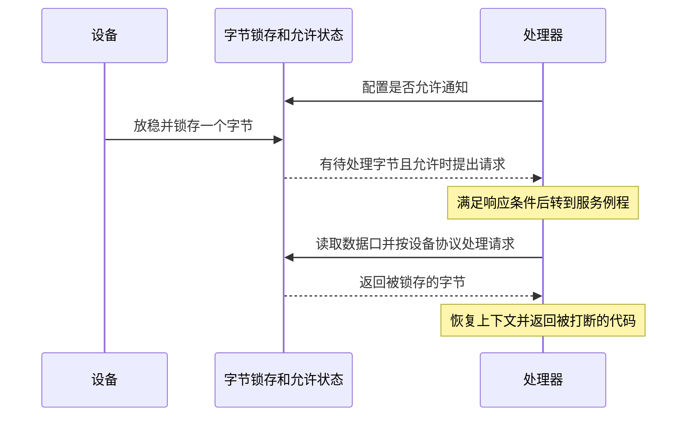

# 中断系统 8-1：请求、向量和返回为什么是三件事

这份历史课件从外设何时通知处理器讲到 8086 如何转入例程和回到原位置。下文按问题重新组织，图与补充算例为自编；原件中的四个向量练习另标为参考解答。不把历史 PC 的设备编号或本课件的范围当作现行教学要求。处理器细节以 [Intel《8086 Family User’s Manual》第二章](https://bitsavers.org/components/intel/8086/9800722-03_The_8086_Family_Users_Manual_Oct79.pdf)和 [Intel 指令手册](https://www.intel.com/content/www/us/en/developer/articles/technical/intel-sdm.html)为参照。

## 只在有事时通知，为什么仍需要状态？

查询和中断都要读设备的数据；区别是谁发起「现在来看看」。查询让 CPU 按自己的节奏读状态，适合需求规律、等待极短或程序必须严格控制检查节拍的场合。若设备不可预测，空查会消耗时间；允许设备提出中断，就能让 CPU 在等待期间运行别的代码。但是被暂停的代码必须有可恢复的断点，且请求本身不会把数据装入 CPU。中断开销包括进出例程、保存寄存器和处理请求，并非在任意事件密度下都比查询便宜。

原件输入接口把字节送入锁存器，通过三态缓冲接到共享数据线；「待服务」和「允许提出中断」是两个不同的状态。地址译码后，读数据口时才允许缓冲器驱动总线；写控制口则改变允许状态。只有待服务且允许时才向 CPU 发出请求。消费或复位设备状态和恢复 CPU 的中断允许是不同动作；触发器何时清除需按具体电路核对。==关掉通知不等于读走数据==，一个锁存器也不会随着请求次数增加而变成队列。对照[信息交换方式](../../../topics/微机接口/xinxi-jiaohuan.md)、[查询方式](../../../topics/微机接口/chaxun-fangshi.md)与[端口与地址](../../../topics/微机接口/duankou-gainian.md)。

## 先问类型号从哪来，再问编号到哪去

| 在 8086 上遇到的入口 | 类型号来自哪里 | IF=0 时怎样 |
|---|---|---|
| 外设控制器把请求送到 INTR | CPU 响应后由外部在应答周期给出 | 暂不接收这类外部可屏蔽请求 |
| 外部 NMI 引脚 | CPU 采用固定类型 02H，不走 INTR 的应答取号流程 | 不由 IF 屏蔽 |
| 执行软件中断指令 | 指令指定类型；专用 INT3 指令选择 03H | 仍可执行 |
| 执行产生的处理器事件 | 由处理器确定，例如除数为零或商超范围选 00H，单步跟踪选 01H | 不由 IF 屏蔽；单步另由 TF 控制 |

键盘、定时器和 I/O 通道可以是外部来源；电源或存储故障也可以由系统设计接入硬件请求。不能仅凭「都进中断例程」就把内部异常、指令主动调用和外部设备通知说成同一个来源。原件中的屏幕打印、BIOS 和 DOS 服务号属于历史 PC 的软件或板级约定，不是处理器永久把这些向量分配给同一设备；保留向量不可擅用。原件所列的 BIOS 和 DOS 填初值过程，指的是固件启动和 DOS 加载分别布置各自服务入口，不是 CPU 自动生成操作系统的服务代码。

> [!WARNING]
> **订正（第 13、39、47 页）。** INT 4 是不检查 OF 的软件调用；旧式 INTO 才在 OF=1 时进入类型 04H，OF=0 时继续执行。INT3 是显式指令，不是随意一条普通指令运行后自己产生断点。第 39 页的逐项排序不要解释为几种同步指令事件之间普适且彼此独立的固定级次：Intel 8086/8088 手册表 2-3 把除法错、INT n、INTO 放在首组，其后是 NMI、INTR、单步；外部多个设备之间的次序还由外部控制器决定。第 47 页所说的 6 应理解为 **6 字节**，16 位 IRET 恢复的是 IP、CS、FLAGS 三个字，而非六个字。

## 三个地址：向量表在哪，例程在哪，回去又是哪

[实模式向量与栈帧](../../../topics/微机接口/zhongduan-xiangliang-yu-zhan.md)给出三者的分工。8086 的 256 项向量表从物理地址 0 开始，每项 4 字节，因此占用 00000H–003FFH。向量表项按 IP 低、高字节再 CS 低、高字节排列；由它得到的服务入口才以 CS:IP 表示。保护模式查的是中断描述符表，不能套用这个表项布局。

| 原件练习 | 参考解答 |
|---|---|
| 第 21 页：08H 型表项 | 08H×4=20H，四个地址为 0020H–0023H。 |
| 第 22 页：9CH 型，入口 1240H:56DEH | 9CH×4=270H，地址 0270H–0273H 按序是 DEH、56H、40H、12H；首字节 DEH。完整表有 1024 个字节单元。入口的物理地址另算为 17ADEH。 |
| 第 23 页：18H 型，入口 3478H:A055H | 18H×4=60H，0060H–0063H 依次为 55H、A0H、78H、34H。入口物理地址是 3E7D5H，不在该表项的四个字节里。 |
| 第 24 页：0010H 起依次 12H、13H、56H、78H | 地址除以 4 得类型 04H。每个 16 位字段先低后高，得到 IP=1312H、CS=7856H，入口为 7856H:1312H，物理地址 79872H。 |

**补充（辨认一个常见的错法）。** 把 9CH 先乘 4 再写成入口地址，将错误跳进向量表所在区域。把四个字节颠倒成单个数也不行：小端次序是对各自的 IP、CS 字处理，而入口的线性求和另遵守[段地址规则](../../../topics/微机接口/wuli-dizhi.md)。

## 进例程前的两次交接

第一次交接选择例程：类型号决定表项，表项装入新的 CS 和 IP。第二次交接保留回去的信息：原 FLAGS、返回 CS、返回 IP 依序压栈，且进入服务时 IF 和 TF 清零；所以刚进入服务程序时，栈顶朝高地址看见 IP、CS、FLAGS。外部中断和显式 INT 指令可用下一条待执行指令说明返回过程；异常保存哪条指令的位置要看异常分类和处理器代际，不能把所有入口都写成「下一条」或「重执行本条」。例程要额外保存它会改变而调用方仍需的寄存器，处理设备、视控制器设计完成确认，然后逆序恢复并用 IRET 返回。只用普通子程序的 RET 不恢复原标志。

**补充（安装入口）。** 历史实模式环境可直接设置表项，也可用 DOS 的向量服务：INT 21H 的 35H 子功能按 AL 取旧入口（ES:BX），25H 按 AL 将 DS:DX 设为新入口。先保存旧入口，管理好新例程代码的存活期，退出时恢复旧向量。直接写两部分地址时不能让普通可屏蔽请求看见半写项；临界区退出应还原先前的 IF，而非不管原状态一律 STI。关 IF 不能挡住 NMI。DOS 例程也并非可在任意硬件 ISR 中重入，向量管理宜在普通前台路径完成。原件的 PUSHA 保存例属于后续处理器，不是原始 8086 可执行的指令。对照[BIOS 与 DOS 调用](../../../topics/微机接口/dos-bios-diaoyong.md)及[堆栈](../../../topics/微机接口/duizhan-caozuo.md)。

## 设备甲已经在服务，设备乙还能插进来吗？

让所有设备都能随时进入，会把现场保护和共享状态弄乱；一律不允许进入，则会让紧急事件被长例程阻塞。区分三层后才能改对地方：

1. 外设或接口的允许位决定是否把本设备的状态送出；
2. 中断控制器的掩码和优先规则决定哪些外部请求被提出、哪些可以超过正在服务的请求；
3. CPU 的 IF 决定是否接受这条可屏蔽入口，不管内部的软件调用或 NMI。

若服务程序已保存会被打断的现场，并能保证共享状态与栈容量，可按系统设计先保留低优先级屏蔽、再谨慎开放可屏蔽中断，使更紧急请求嵌套；内层先返回，外层才能继续。==见到「开放中断」先检查开的是哪一层==。对于 IF 从 0 改为 1 的 STI，也不要把下一条指令当作已经允许外部可屏蔽中断插入的边界；按 Intel 的指令说明存在一条指令的延迟边界。CLI 只关闭 CPU 这层的可屏蔽接收，不会清除请求或关掉所有异常。看[处理器控制指令](../../../topics/微机接口/chuli-kongzhi.md)和[直接存储器存取](../../../topics/微机接口/dma-fangshi.md)：DMA 替 CPU 搬一段数据，完成后仍可使用中断通知，选择搬运方式与通知方式是两个问题。
