# 《微型计算机原理与接口技术》第8-1章 中断系统（课件）

原件的每一页，下面附识别出的文字。

### 微型计算机原理与接口技术

原文：

微型计算机原理与接口技术

第八章 中断的基本概念

The image contains four distinct icons: a magnifying glass over a globe, a keyboard with 'Close' labels, an @ symbol, and a golden ingot of eggs. There are no text or numerical data present in the image. Therefore, the correct OCR output is an empty string.

(No text to output)

南京邮电大学计算机学院

南京邮電大學
Nanjing University of Posts and Telecommunications

### √ 8254概述：8254结构、计数器结构

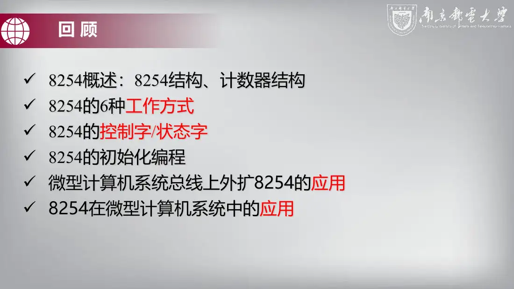

原文：

√ 8254概述：8254结构、计数器结构

√ 8254的6种工作方式

√ 8254的控制字/状态字

√ 8254的初始化编程

√ 微型计算机系统总线上外扩8254的应用

√ 8254在微型计算机系统中的应用

回顾

南京邮电大学
Nanjing University of Posts and Telecommunications

### 知识要点

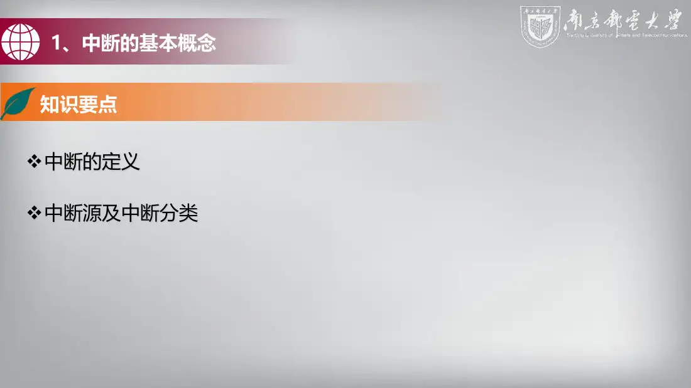

原文：

知识要点

中断的定义

中断源及中断分类

1、中断的基本概念

南京邮电大学
Nanjing University of Posts and Telecommunications

### 一、中断概念的引入

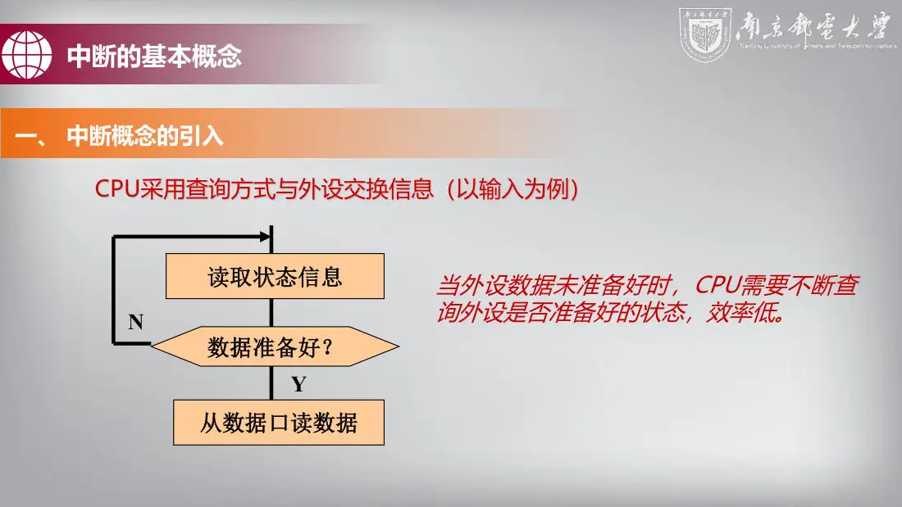

原文：

一、中断概念的引入

CPU采用查询方式与外设交换信息（以输入为例）

当外设数据未准备好时，CPU需要不断查询外设是否准备好的状态，效率低。

中断的基本概念

南京邮电大学
Nanjing University of Posts and Telecommunications

### CPU采用中断方式与外设交换信息（以输入为例）

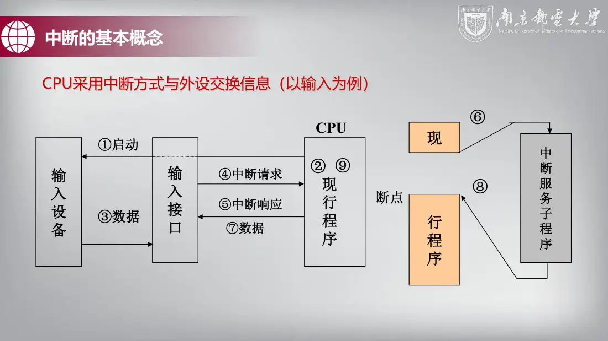

原文：

CPU采用中断方式与外设交换信息（以输入为例）

输入设备

④中断请求

中断的基本概念

南京邮电大学
Nanjing University of Posts and Telecommunications

### 二、中断

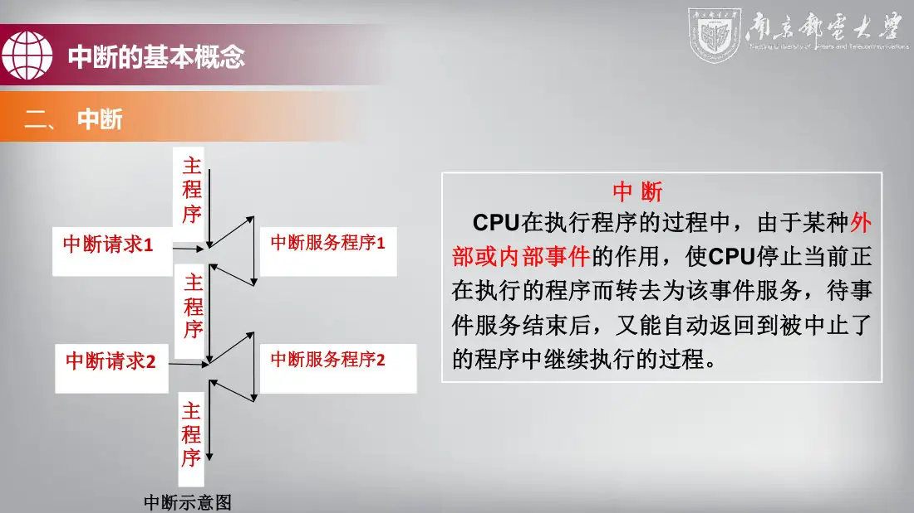

原文：

二、中断

中断请求1

中断请求2

中断服务程序1

中断服务程序2

中断示意图

中断

CPU在执行程序的过程中，由于某种外部或内部事件的作用，使CPU停止当前正在执行的程序而转去为该事件服务，待事件服务结束后，又能自动返回到被中止了的程序中继续执行的过程。

中断的基本概念

南京邮电大学
Nanjing University of Posts and Telecommunications

### 二、中断

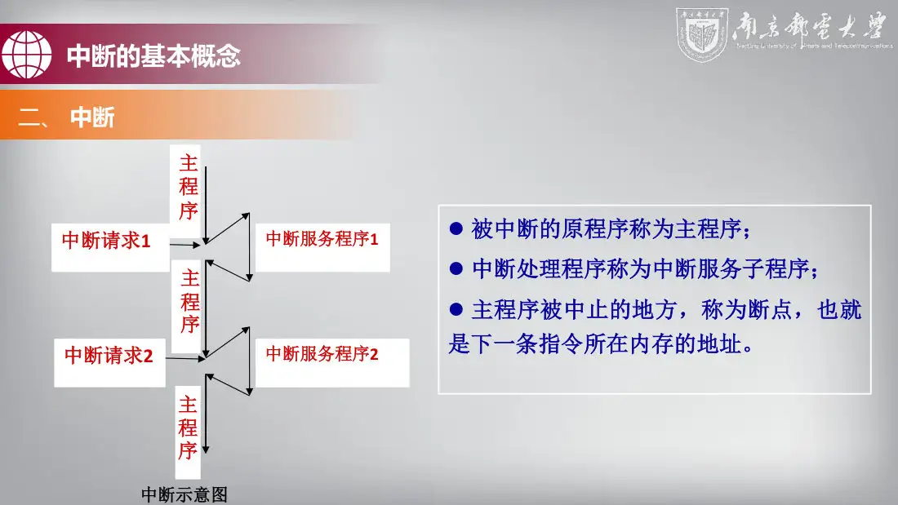

原文：

二、中断

中断请求1

中断请求2

中断服务程序1

中断服务程序2

中断示意图

\- 被中断的原程序称为主程序;

\- 中断处理程序称为中断服务子程序；

\- 主程序被中止的地方，称为断点，也就是下一条指令所在内存的地址。

中断的基本概念

南京邮电大学
Nanjing University of Posts and Telecommunications

### 二、中断

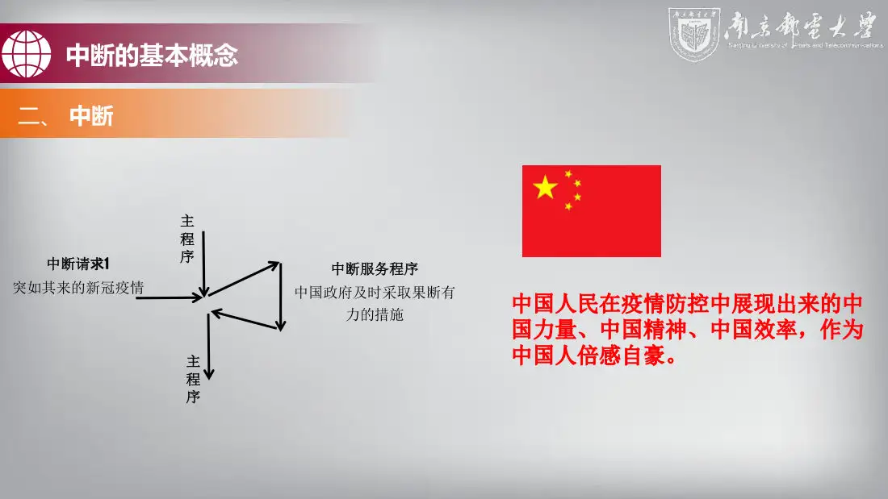

原文：

二、中断

中国人民在疫情防控中展现出来的中国力量、中国精神、中国效率，作为中国人倍感自豪。

中断的基本概念

南京邮电大学
Nanjing University of Posts and Telecommunications

### 具有中断请求功能的输入接口示意图

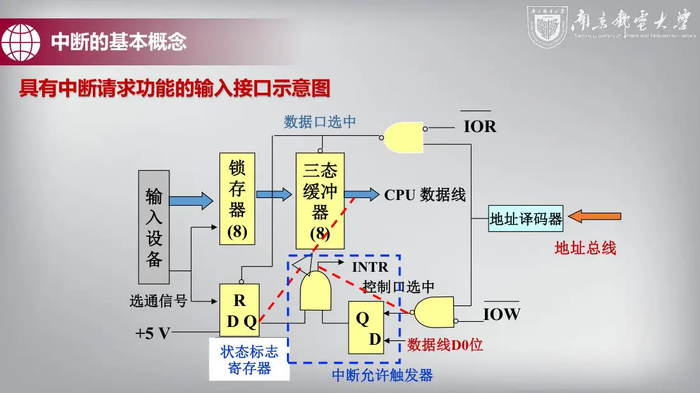

原文：

具有中断请求功能的输入接口示意图

中断的基本概念

南京邮电大学
Nanjing University of Posts and Telecommunications

### 三、中断源及中断分类

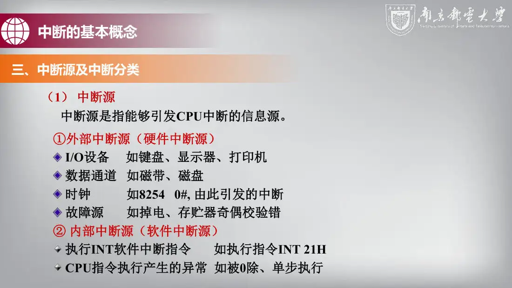

原文：

三、中断源及中断分类

(1) 中断源

中断源是指能够引发CPU中断的信息源。

①外部中断源（硬件中断源）

◆ I/O设备 如键盘、显示器、打印机

◆ 数据通道 如磁带、磁盘

时钟 如8254 0#, 由此引发的中断

故障源 如掉电、存贮器奇偶校验错

② 内部中断源（软件中断源）

执行INT软件中断指令 如执行指令INT 21H

\+ CPU指令执行产生的异常 如被0除、单步执行

中断的基本概念

南京邮电大学
Nanjing University of Posts and Telecommunications

### 三、中断源及中断分类

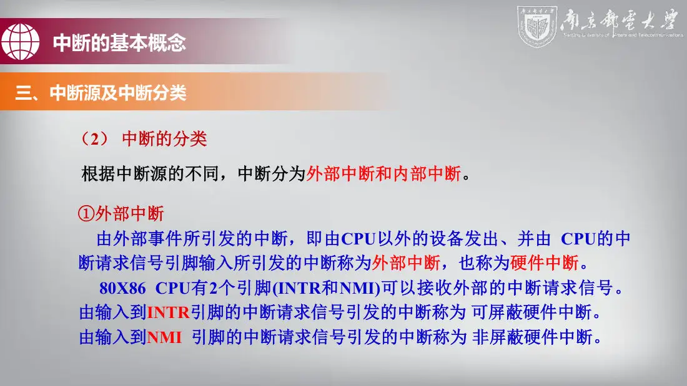

原文：

三、中断源及中断分类

(2) 中断的分类

根据中断源的不同，中断分为外部中断和内部中断。

①外部中断

由外部事件所引发的中断，即由CPU以外的设备发出、并由CPU的中断请求信号引脚输入所引发的中断称为外部中断，也称为硬件中断。

80X86 CPU有2个引脚(INTR和NMI)可以接收外部的中断请求信号。由输入到INTR引脚的中断请求信号引发的中断称为可屏蔽硬件中断。由输入到NMI 引脚的中断请求信号引发的中断称为非屏蔽硬件中断。

中断的基本概念

南京邮电大学
Nanjing University of Posts and Telecommunications

### ② 内部中断

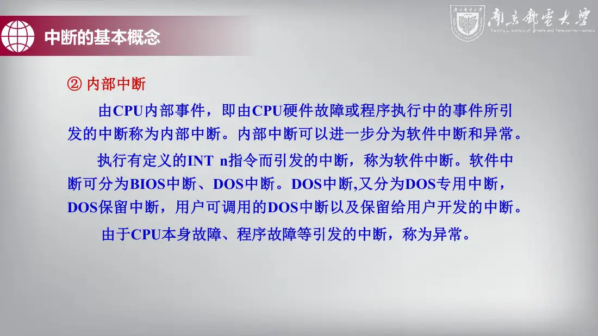

原文：

② 内部中断

由CPU内部事件，即由CPU硬件故障或程序执行中的事件所引发的中断称为内部中断。内部中断可以进一步分为软件中断和异常。

执行有定义的INT n指令而引发的中断，称为软件中断。软件中断可分为BIOS中断、DOS中断。DOS中断,又分为DOS专用中断，DOS保留中断，用户可调用的DOS中断以及保留给用户开发的中断。

由于CPU本身故障、程序故障等引发的中断，称为异常。

中断的基本概念

南京邮电大学
T105-0316
南京邮电大学
Nanjing University of Posts and Telecommunications

### 部分异常如下:

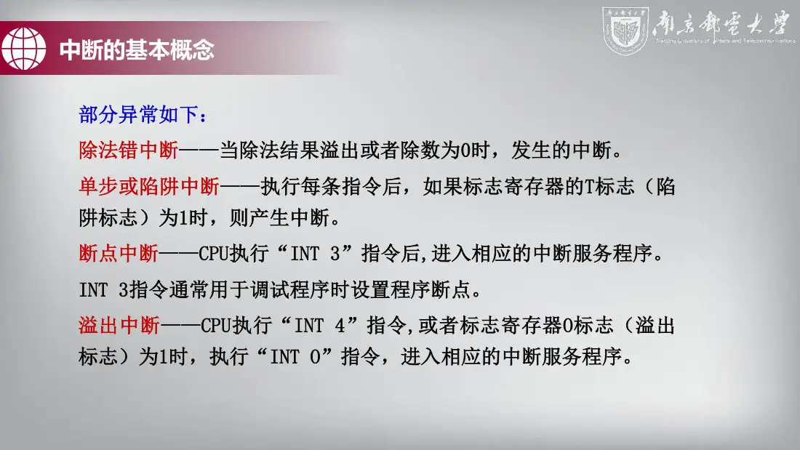

原文：

部分异常如下:

除法错中断——当除法结果溢出或者除数为0时，发生的中断。

单步或陷阱中断——执行每条指令后，如果标志寄存器的T标志（陷阱标志）为1时，则产生中断。

断点中断——CPU执行 “INT 3” 指令后, 进入相应的中断服务程序。

INT 3指令通常用于调试程序时设置程序断点。

溢出中断——CPU执行“INT 4”指令,或者标志寄存器0标志（溢出标志）为1时，执行“INT 0”指令，进入相应的中断服务程序。

中断的基本概念

南京邮电大学
150-8326
南京邮电大学
Nanjing University of Posts and Telecommunications

### 知识点小结

原文：

知识点小结

本节主要介绍了有关中断的基本概念，中断源以及中断分类。通过本节的学习，学习者能够初步了解中断的基本过程；了解内部中断源和外部中断源；掌握内部中断和外部中断的基本知识。

中断的基本概念

南京邮电大学
Nanjing University of Posts and Telecommunications

### 知识要点

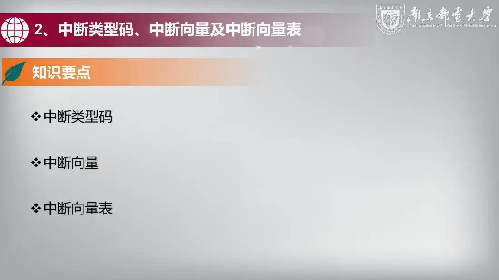

原文：

知识要点

中断类型码

中断向量

中断向量表

2、中断类型码、中断向量及中断向量表

南京邮电大学
Nanjing University of Posts and Telecommunications

### 一、中断类型码

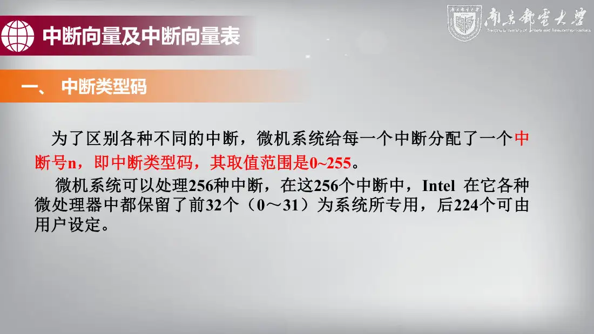

原文：

一、中断类型码

为了区别各种不同的中断，微机系统给每一个中断分配了一个中断号n，即中断类型码，其取值范围是0\~255。

微机系统可以处理256种中断，在这256个中断中，Intel 在它各种微处理器中都保留了前32个（0～31）为系统所专用，后224个可由用户设定。

中断向量及中断向量表

南京邮电大学
Nanjing University of Posts and Telecommunications

### 一、中断类型码

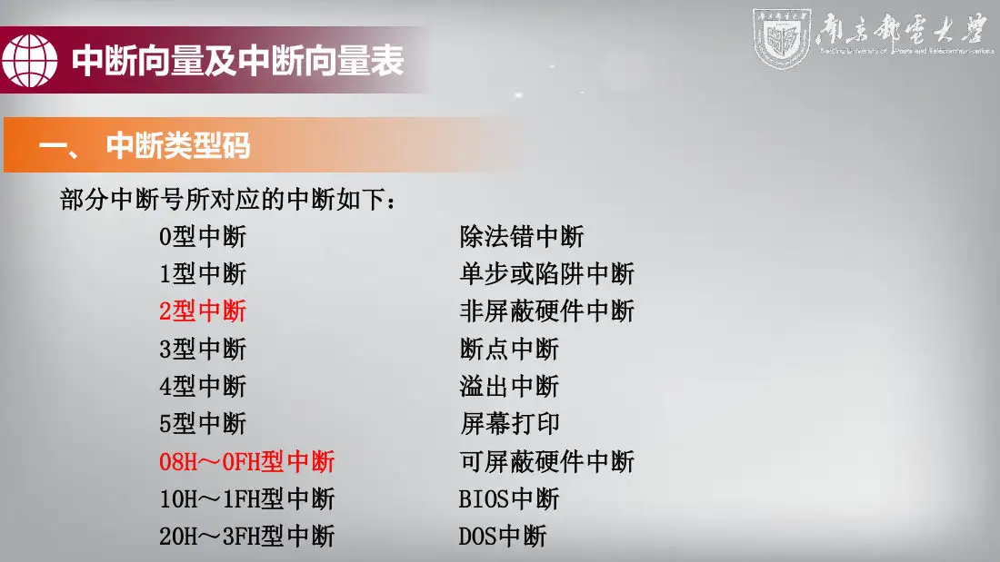

原文：

一、中断类型码

部分中断号所对应的中断如下:

0型中断

除法错中断

1型中断

单步或陷阱中断

2型中断

非屏蔽硬件中断

3型中断

断点中断

4型中断

溢出中断

5型中断

屏幕打印

08H～0FH型中断

可屏蔽硬件中断

10H～1FH型中断

BIOS中断

20H～3FH型中断

DOS中断

中断向量及中断向量表

南京邮电大学
Nanjing University of Posts and Telecommunications

### 二、中断向量

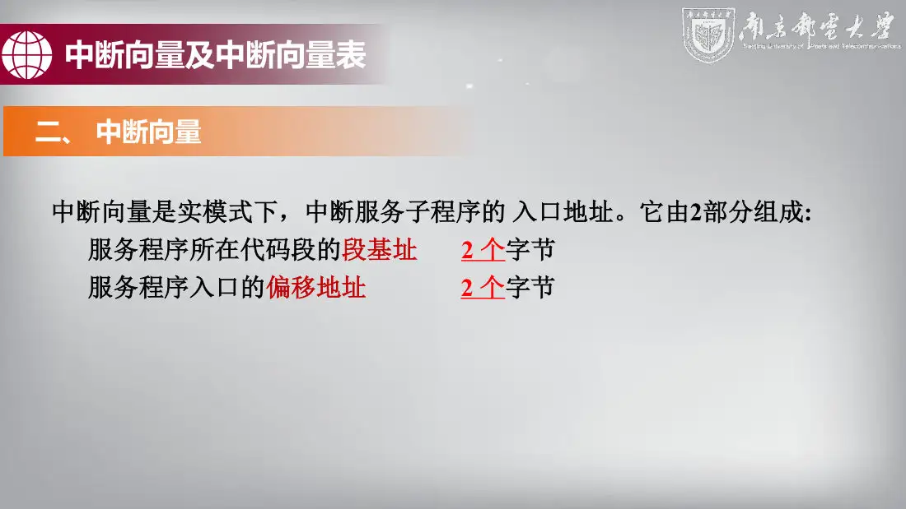

原文：

二、中断向量

中断向量是实模式下，中断服务子程序的入口地址。它由2部分组成:

服务程序所在代码段的段基址 2个字节

服务程序入口的偏移地址 2 个字节

中断向量及中断向量表

南京邮电大学
Nanjing University of Posts and Telecommunications

### 三、中断向量表

原文：

三、中断向量表

中断类型码通过一个地址指针表与中断服务程序的入口地址相联系：

实模式下：该表称为中断向量表；

保护模式下：该表称为中断描述符表。

中断向量及中断向量表

南京邮电大学
Nanjing University of Posts and Telecommunications

### 三、中断向量表

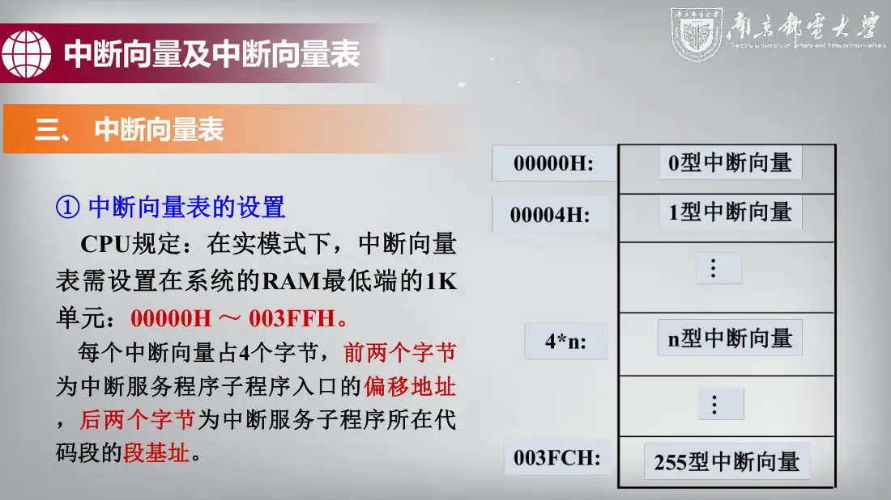

原文：

三、中断向量表

① 中断向量表的设置

CPU规定：在实模式下，中断向量表需设置在系统的RAM最低端的1K单元：00000H～003FFH。

每个中断向量占4个字节，前两个字节为中断服务程序子程序入口的偏移地址，后两个字节为中断服务子程序所在代码段的段基址。

<table><tr><td>00000H:</td><td>0型中断向量</td></tr><tr><td rowspan="2">00004H:</td><td>1型中断向量</td></tr><tr><td>⋮</td></tr><tr><td rowspan="2">4*n:</td><td>n型中断向量</td></tr><tr><td>⋮</td></tr><tr><td>003FCH:</td><td>255型中断向量</td></tr></table>

中断向量及中断向量表

南京邮电大学
Nanjing University of Posts and Telecommunications

### ②. 中断向量表的表地址与中断类型的关系

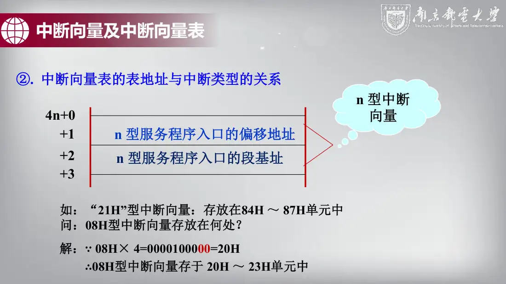

原文：

②. 中断向量表的表地址与中断类型的关系

n 型服务程序入口的偏移地址

n 型服务程序入口的段基址

n 型中断
向量

如：“21H”型中断向量：存放在84H～87H单元中

问：08H型中断向量存放在何处？

解: $\because 08 \mathrm{H} \times 4 = 0000100000 = 20 \mathrm{H}$

∴08H型中断向量存于 20H \~ 23H单元中

中断向量及中断向量表

南京邮电大学
Nanjing University of Posts and Telecommunications

### 习题

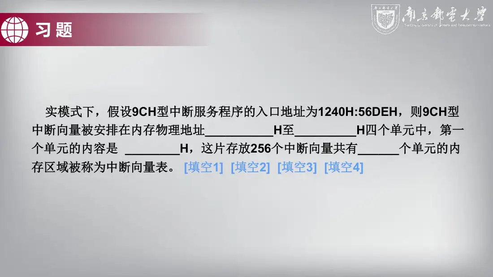

原文：

习题

实模式下, 假设9CH型中断服务程序的入口地址为1240H:56DEH, 则9CH型中断向量被安排在内存物理地址\_\_\_\_H至\_\_\_\_H四个单元中, 第一个单元的内容是\_\_\_\_H, 这片存放256个中断向量共有\_\_\_\_个单元的内存区域被称为中断向量表。[填空1] [填空2] [填空3] [填空4]

南京邮电大学
T105-0316
南京邮电大学
Nanjing University of Posts and Telecommunications

### 习题

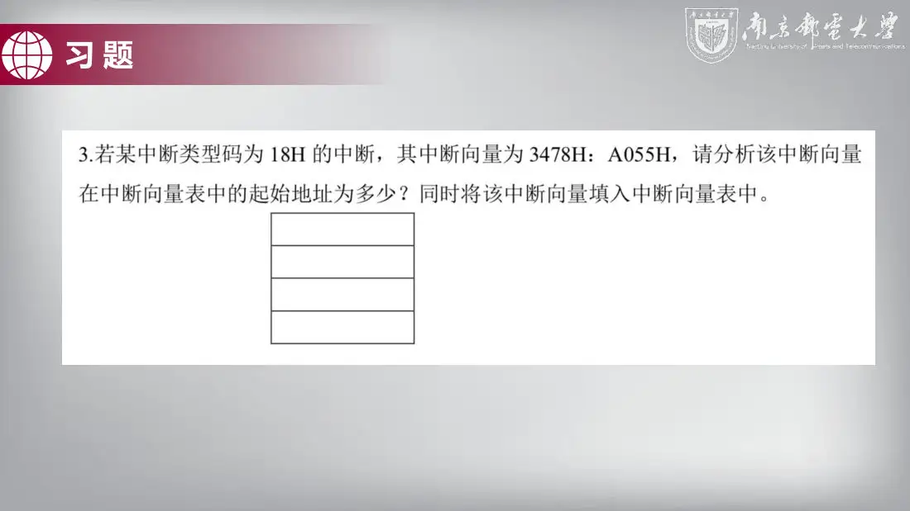

原文：

习题

3. 若某中断类型码为 $18 \mathrm{~H}$ 的中断, 其中断向量为 $3478 \mathrm{~H}: \mathrm{A} 055 \mathrm{~H}$ , 请分析该中断向量在中断向量表中的起始地址为多少? 同时将该中断向量填入中断向量表中。

$$
\begin{array}{c} \hline \\ \hline \\ \hline \\ \hline \end{array}
$$

南京邮电大学
T105-0316
南京邮电大学
Nanjing University of Posts and Telecommunications

### 南京邮电大学

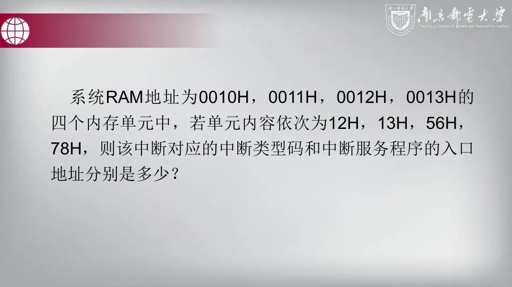

原文：

系统RAM地址为0010H，0011H，0012H，0013H的四个内存单元中，若单元内容依次为12H，13H，56H，78H，则该中断对应的中断类型码和中断服务程序的入口地址分别是多少？

南京邮电大学
T105-0316
南京邮电大学
Nanjing University of Posts and Telecommunications

### ③. 中断向量表的初始化

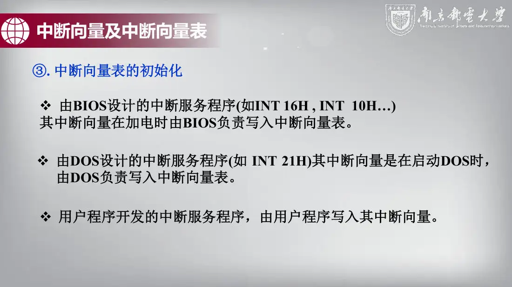

原文：

③. 中断向量表的初始化

✿ 由BIOS设计的中断服务程序(如INT 16H, INT 10H...)其中断向量在加电时由BIOS负责写入中断向量表。

✿ 由DOS设计的中断服务程序(如 INT 21H)其中断向量是在启动DOS时，由DOS负责写入中断向量表。

✿ 用户程序开发的中断服务程序，由用户程序写入其中断向量。

中断向量及中断向量表

南京邮电大学
Nanjing University of Posts and Telecommunications

### 问题：用户如何向中断向量表中写入中断向量？

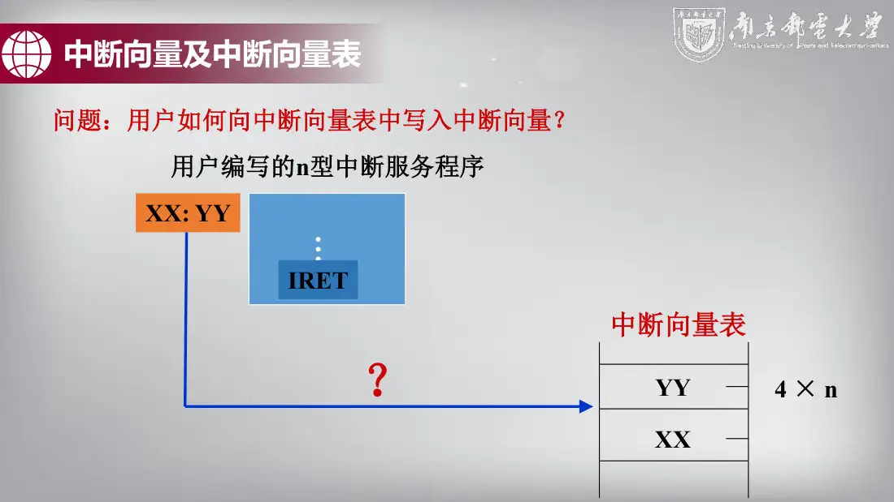

原文：

问题：用户如何向中断向量表中写入中断向量？

用户编写的n型中断服务程序

中断向量表

中断向量及中断向量表

南京邮电大学
Nanjing University of Posts and Telecommunications

### 方法一、用户自己编写程序填写中断向量

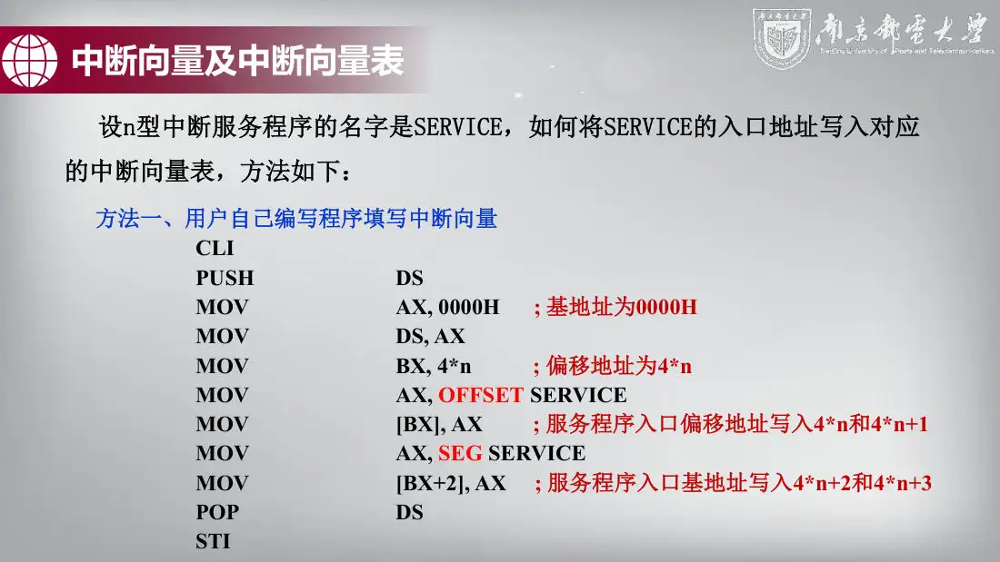

原文：

设n型中断服务程序的名字是SERVICE，如何将SERVICE的入口地址写入对应的中断向量表，方法如下：

方法一、用户自己编写程序填写中断向量

<table><tr><td colspan="2">CLI</td></tr><tr><td>PUSH</td><td>DS</td></tr><tr><td>MOV</td><td>AX, 0000H ; 基地址为0000H</td></tr><tr><td>MOV</td><td>DS, AX</td></tr><tr><td>MOV</td><td>BX, 4*n ; 偏移地址为4*n</td></tr><tr><td>MOV</td><td>AX, OFFSET SERVICE</td></tr><tr><td>MOV</td><td>[BX], AX ; 服务程序入口偏移地址写入4*n和4*n+1</td></tr><tr><td>MOV</td><td>AX, SEG SERVICE</td></tr><tr><td>MOV</td><td>[BX+2], AX ; 服务程序入口基地址写入4*n+2和4*n+3</td></tr><tr><td>POP</td><td>DS</td></tr><tr><td colspan="2">STI</td></tr></table>

中断向量及中断向量表

南京邮电大学
Nanjing University of Posts and Telecommunications

### 方法二、DOS设计2个子程序，专门用于中断向量的读出、写入

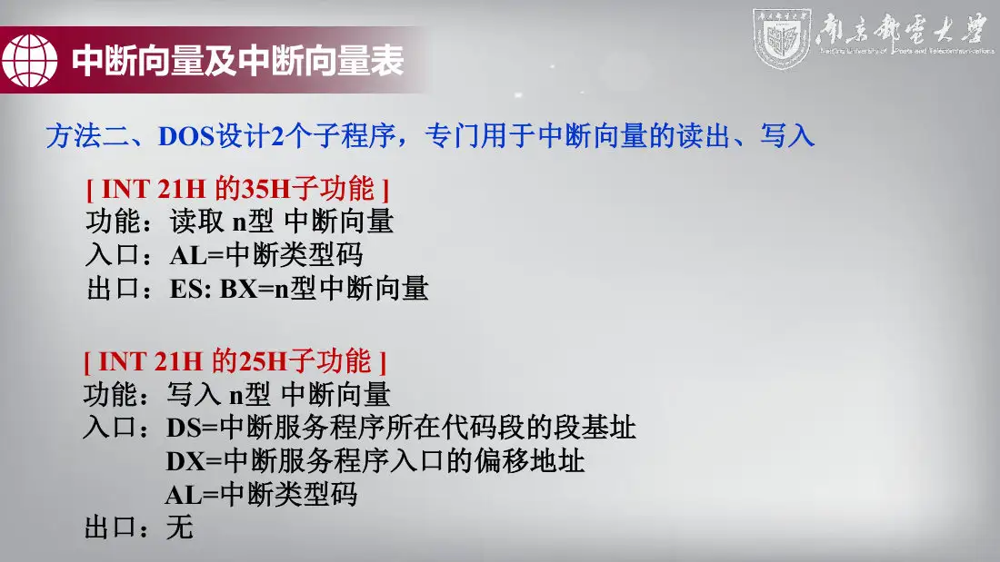

原文：

方法二、DOS设计2个子程序，专门用于中断向量的读出、写入

[ INT 21H 的35H子功能 ]

功能：读取 n 型 中断向量

入口：AL=中断类型码

出口：ES: BX=n型中断向量

[ INT 21H 的25H子功能 ]

功能：写入 n 型 中断向量

入口：DS=中断服务程序所在代码段的段基址

DX=中断服务程序入口的偏移地址

AL=中断类型码

出口：无

中断向量及中断向量表

南京邮电大学
Nanjing University of Posts and Telecommunications

### 采用方法2，对应的程序段如下：

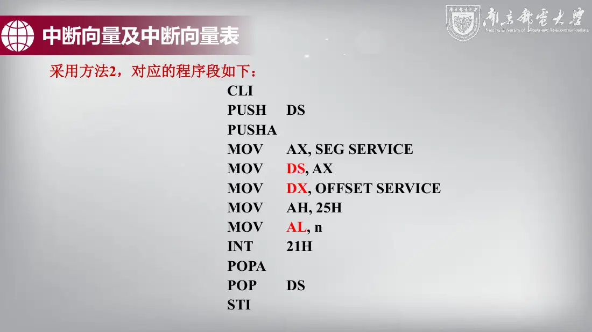

原文：

采用方法2，对应的程序段如下：

CLI
PUSH DS
PUSHA
MOV AX, SEG SERVICE
MOV DS, AX
MOV DX, OFFSET SERVICE
MOV AH, 25H
MOV AL, n
INT 21H
POPA
POP DS
STI

中断向量及中断向量表

南京邮电大学
Nanjing University of Posts and Telecommunications

### 知识点小结

原文：

知识点小结

本节主要介绍了中断类型码、中断向量和中断向量表的相关知识。通过学习，学习者应该掌握实模式下中断向量的定义、中断向量表的设置，以及中断向量表的表地址与中断类型之间的关系，同时，需要掌握中断向量表的初始化方法。

中断向量及中断向量表

南京邮电大学
Nanjing University of Posts and Telecommunications

### 知识要点

原文：

知识要点

中断响应和处理过程

中断向量的引导作用

中断服务子程序的一般结构

3、中断响应及处理

南京邮电大学
Nanjing University of Posts and Telecommunications

### 一、中断响应和处理过程

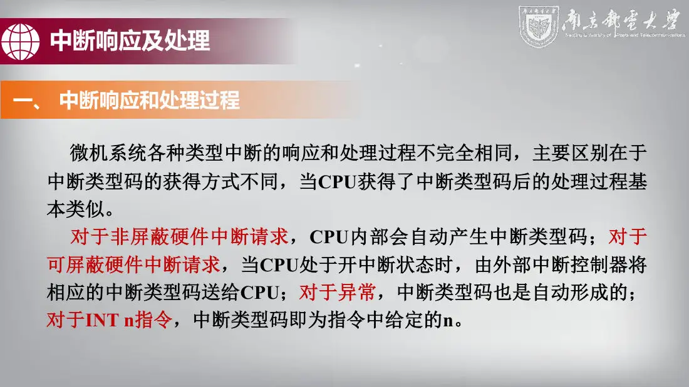

原文：

一、中断响应和处理过程

微机系统各种类型中断的响应和处理过程不完全相同，主要区别在于中断类型码的获得方式不同，当CPU获得了中断类型码后的处理过程基本类似。

对于非屏蔽硬件中断请求，CPU内部会自动产生中断类型码；对于可屏蔽硬件中断请求，当CPU处于开中断状态时，由外部中断控制器将相应的中断类型码送给CPU；对于异常，中断类型码也是自动形成的；对于INT n指令，中断类型码即为指令中给定的n。

中断响应及处理

南京邮电大学
Nanjing University of Posts and Telecommunications

### CPU获得了中断类型码n后，中断的处理过程如下：

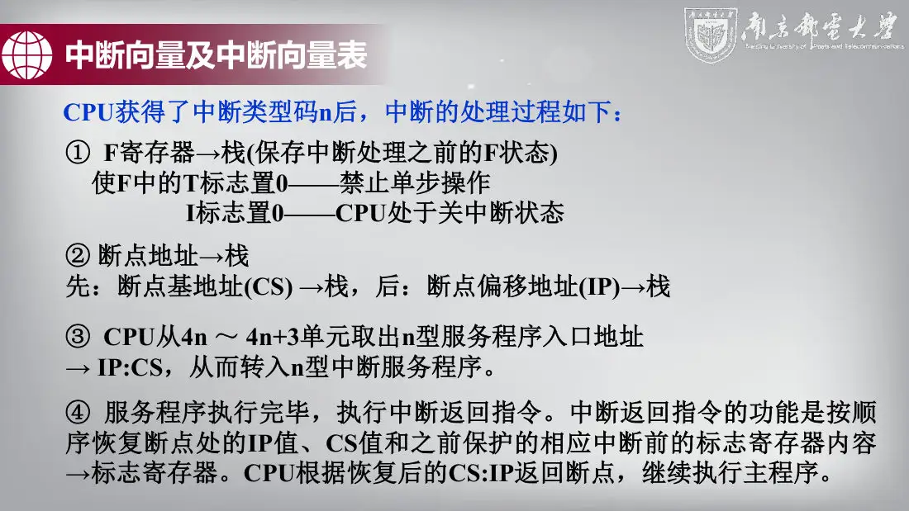

原文：

CPU获得了中断类型码n后，中断的处理过程如下：

① F寄存器→栈(保存中断处理之前的F状态)
使F中的T标志置0——禁止单步操作
I标志置0——CPU处于关中断状态

② 断点地址→栈

先: 断点基地址(CS)→栈, 后: 断点偏移地址(IP)→栈

③ CPU从4n～4n+3单元取出n型服务程序入口地址→IP:CS，从而转入n型中断服务程序。

④ 服务程序执行完毕，执行中断返回指令。中断返回指令的功能是按顺序恢复断点处的IP值、CS值和之前保护的相应中断前的标志寄存器内容→标志寄存器。CPU根据恢复后的CS:IP返回断点，继续执行主程序。

中断向量及中断向量表

南京邮电大学
Nanjing University of Posts and Telecommunications

### 二、…中断向量的引导作用

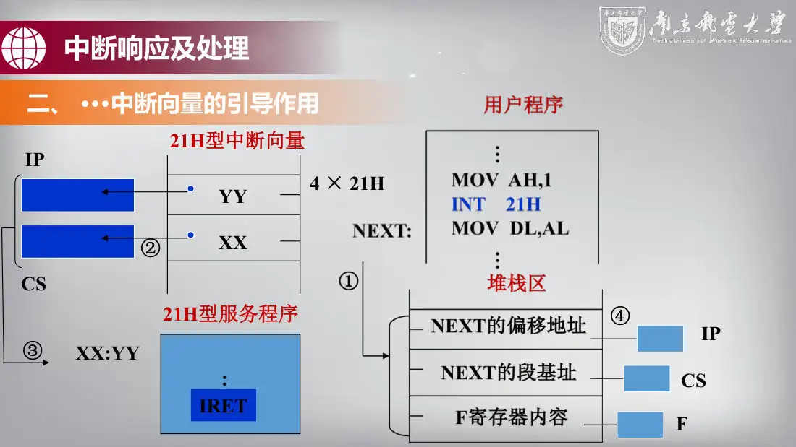

原文：

二、…中断向量的引导作用

21H型中断向量

21H型服务程序

XX:YY

$$
4 \times 2 1 \mathrm{H}
$$

NEXT:

中断响应及处理

南京邮电大学
Nanjing University of Posts and Telecommunications

### 三、中断服务子程序的结构 P286

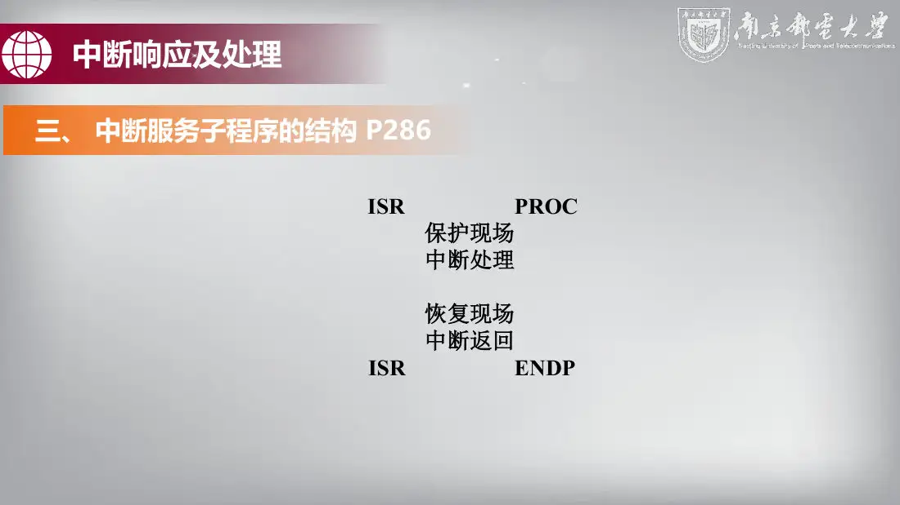

原文：

三、中断服务子程序的结构 P286

<table><tr><td>ISR</td><td>PROC</td></tr><tr><td></td><td>保护现场</td></tr><tr><td></td><td>中断处理</td></tr><tr><td></td><td>恢复现场</td></tr><tr><td></td><td>中断返回</td></tr><tr><td>ISR</td><td>ENDP</td></tr></table>

中断响应及处理

南京邮电大学
Nanjing University of Posts and Telecommunications

### 知识点小结

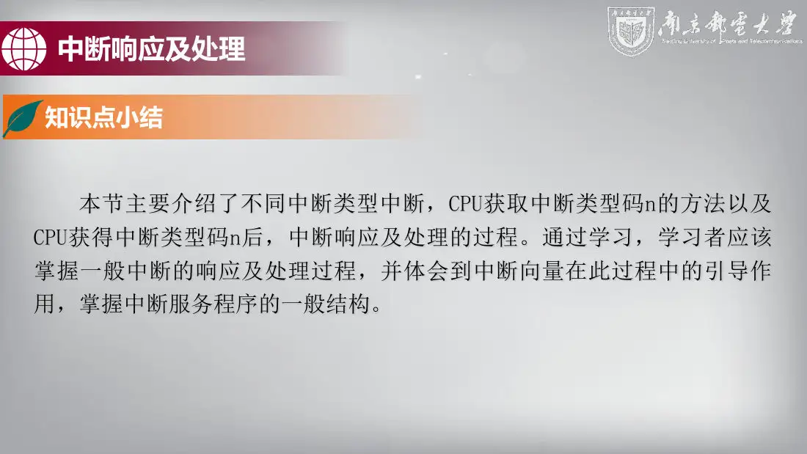

原文：

知识点小结

本节主要介绍了不同中断类型中断，CPU获取中断类型码n的方法以及CPU获得中断类型码n后，中断响应及处理的过程。通过学习，学习者应该掌握一般中断的响应及处理过程，并体会到中断向量在此过程中的引导作用，掌握中断服务程序的一般结构。

中断响应及处理

南京邮电大学
Nanjing University of Posts and Telecommunications

### 知识要点

原文：

知识要点

中断优先与中断分级

✿ 禁止中断与中断屏蔽

中断嵌套

中断系统应具备的基本功能

4、多级中断管理

南京邮电大学
Nanjing University of Posts and Telecommunications

### 一、中断优先与中断分级

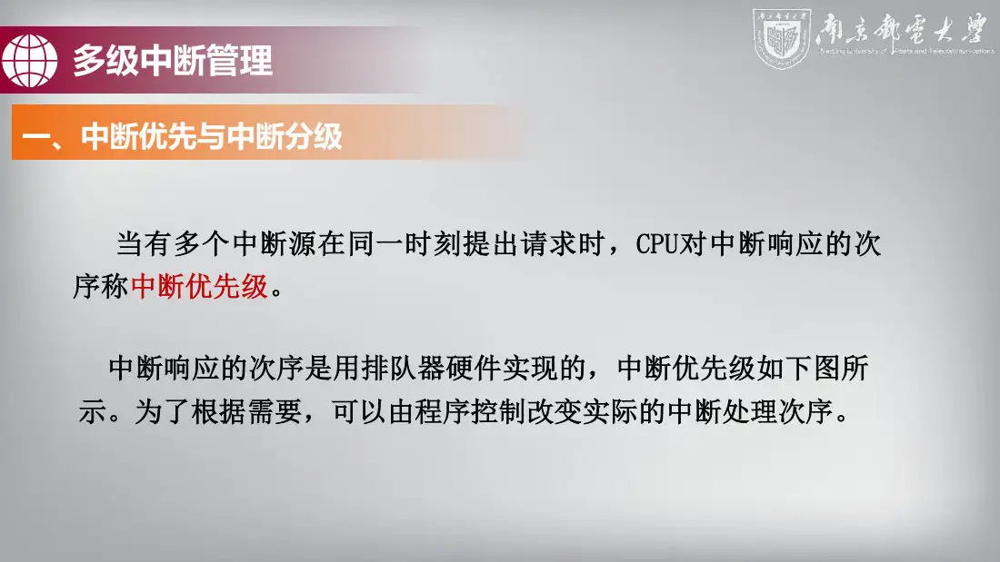

原文：

一、中断优先与中断分级

当有多个中断源在同一时刻提出请求时，CPU对中断响应的次序称中断优先级。

中断响应的次序是用排队器硬件实现的，中断优先级如下图所示。为了根据需要，可以由程序控制改变实际的中断处理次序。

多级中断管理

南京邮电大学
Nanjing University of Posts and Telecommunications

### 80X86响应中断的优先级如下:

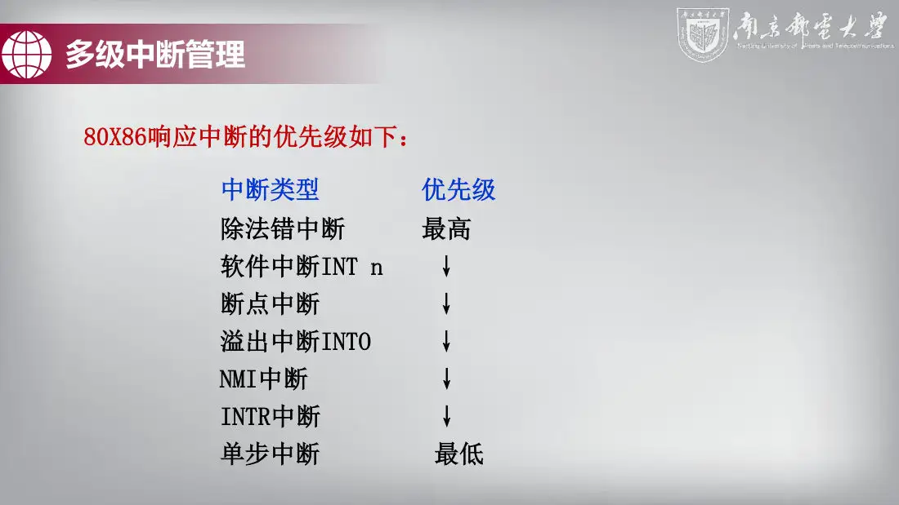

原文：

80X86响应中断的优先级如下:

<table><tr><td>中断类型</td><td>优先级</td></tr><tr><td>除法错中断</td><td>最高</td></tr><tr><td>软件中断INT n</td><td>↓</td></tr><tr><td>断点中断</td><td>↓</td></tr><tr><td>溢出中断INTO</td><td>↓</td></tr><tr><td>NMI中断</td><td>↓</td></tr><tr><td>INTR中断</td><td>↓</td></tr><tr><td>单步中断</td><td>最低</td></tr></table>

多级中断管理

南京邮电大学
T105-0316
南京邮电大学
Nanjing University of Posts and Telecommunications

### 二、禁止中断与中断屏蔽

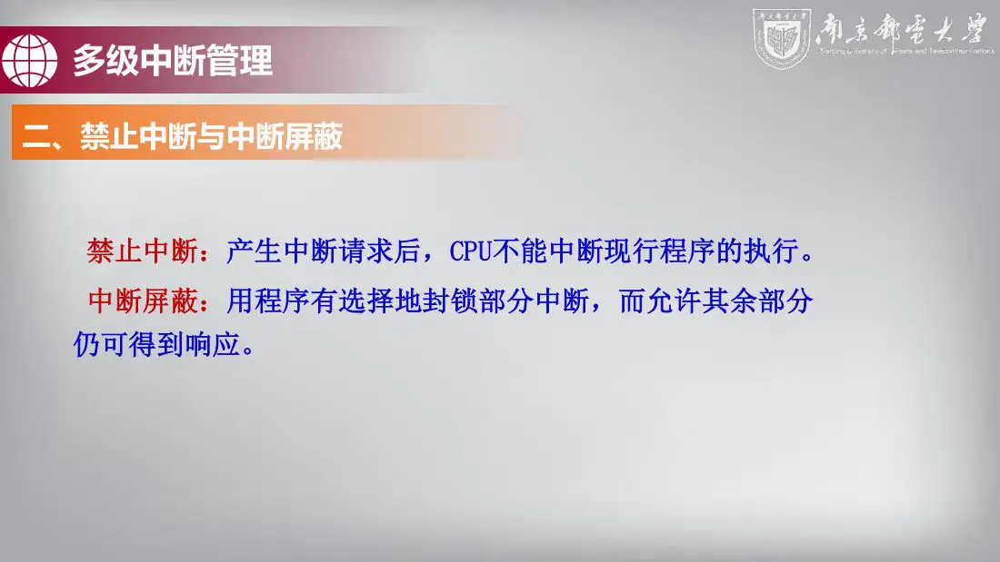

原文：

二、禁止中断与中断屏蔽

禁止中断：产生中断请求后，CPU不能中断现行程序的执行。

中断屏蔽：用程序有选择地封锁部分中断，而允许其余部分仍可得到响应。

多级中断管理

南京邮电大学
Nanjing University of Posts and Telecommunications

### 三、中断嵌套

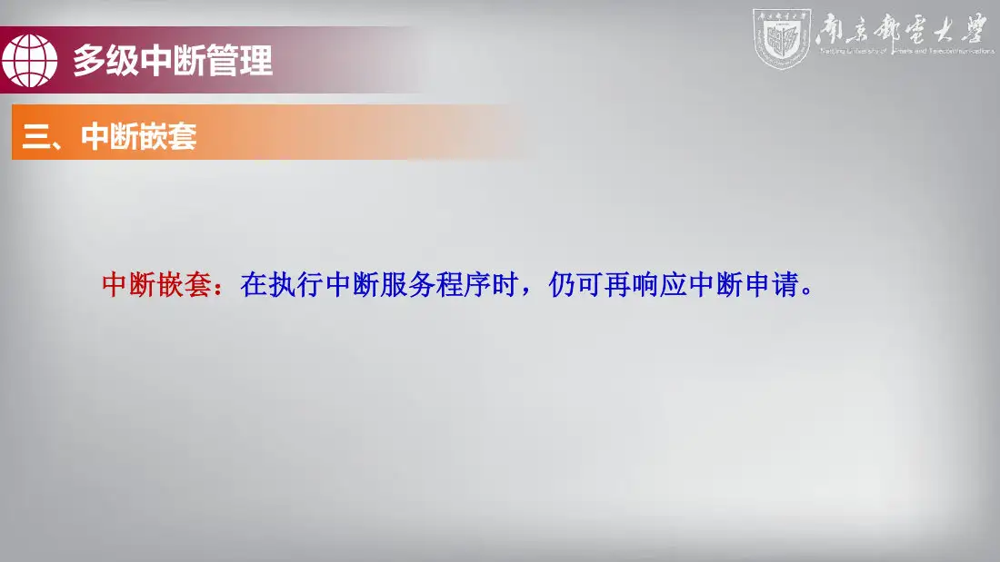

原文：

三、中断嵌套

中断嵌套：在执行中断服务程序时，仍可再响应中断申请。

多级中断管理

南京邮电大学
Nanjing University of Posts and Telecommunications

### 四、中断系统应具备的基本功能

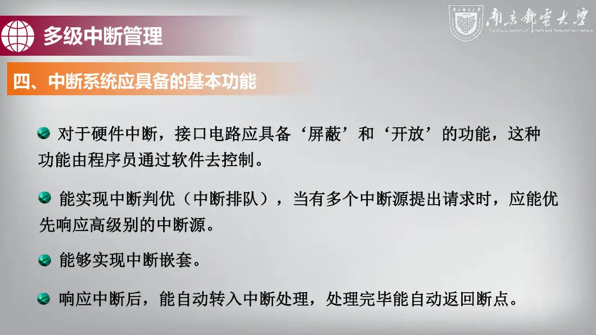

原文：

四、中断系统应具备的基本功能

对于硬件中断，接口电路应具备‘屏蔽’和‘开放’的功能，这种功能由程序员通过软件去控制。

能实现中断判优（中断排队），当有多个中断源提出请求时，应能优先响应高级别的中断源。

能够实现中断嵌套。

响应中断后，能自动转入中断处理，处理完毕能自动返回断点。

多级中断管理

南京邮电大学
Nanjing University of Posts and Telecommunications

### 知识点小结

原文：

知识点小结

本节主要介绍了多级中断管理的相关内容。通过本节的学习，学习者应了解中断优先级、中断嵌套、中断屏蔽和开放等基本概念，并对中断系统应该具备的功能有较为深入的了解。

多级中断管理

南京邮电大学
Nanjing University of Posts and Telecommunications

### 知识要点

原文：

知识要点

✿ 80x86中断指令

STI, CLI, INT n, IRET, INTO

80x86中断指令

南京邮电大学
Nanjing University of Posts and Telecommunications

### 1. 开中断指令 STI

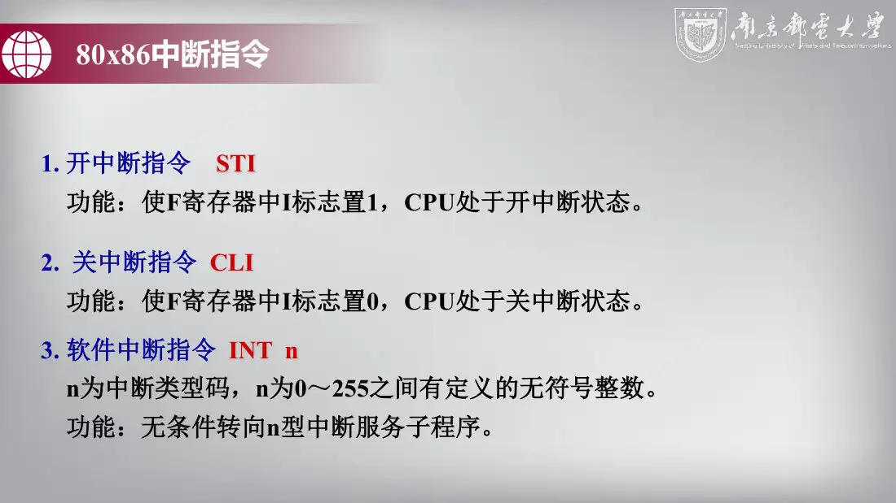

原文：

1. 开中断指令 STI

功能：使F寄存器中I标志置1，CPU处于开中断状态。

2. 关中断指令 CLI

功能：使F寄存器中I标志置0，CPU处于关中断状态。

3. 软件中断指令 INT n

n为中断类型码，n为0～255之间有定义的无符号整数。

功能：无条件转向n型中断服务子程序。

80x86中断指令

南京邮电大学
Nanjing University of Posts and Telecommunications

### INT n 指令的执行过程-CPU响应软件中断的过程

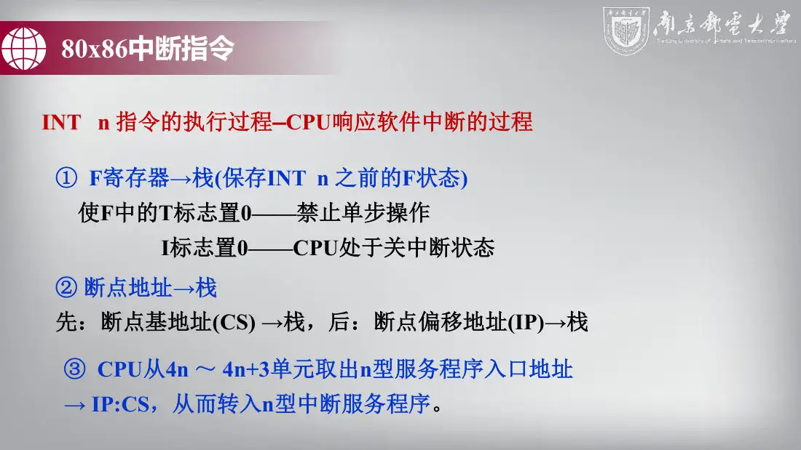

原文：

INT n 指令的执行过程-CPU响应软件中断的过程

① F寄存器→栈(保存INT n 之前的F状态)

使F中的T标志置0——禁止单步操作

I标志置0——CPU处于关中断状态

② 断点地址→栈

先：断点基地址(CS)→栈，后：断点偏移地址(IP)→栈

③ CPU从4n～4n+3单元取出n型服务程序入口地址→IP:CS，从而转入n型中断服务程序。

80x86中断指令

南京邮电大学
Nanjing University of Posts and Telecommunications

### \+ IRET 是中断服务子程序的出口指令

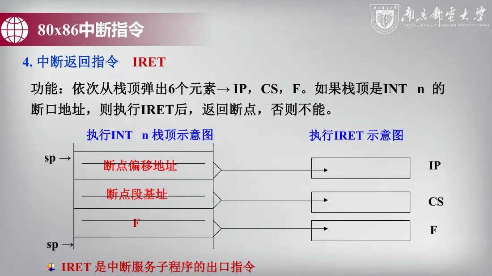

原文：

\+ IRET 是中断服务子程序的出口指令

4. 中断返回指令 IRET

功能：依次从栈顶弹出6个元素 $\rightarrow$ IP, CS, F。如果栈顶是INT n的断口地址，则执行IRET后，返回断点，否则不能。

执行INT n 栈顶示意图

执行IRET 示意图

80x86中断指令

南京邮电大学
T105-0316
南京邮电大学
Nanjing University of Posts and Telecommunications

### 5. 溢出中断指令 INTO

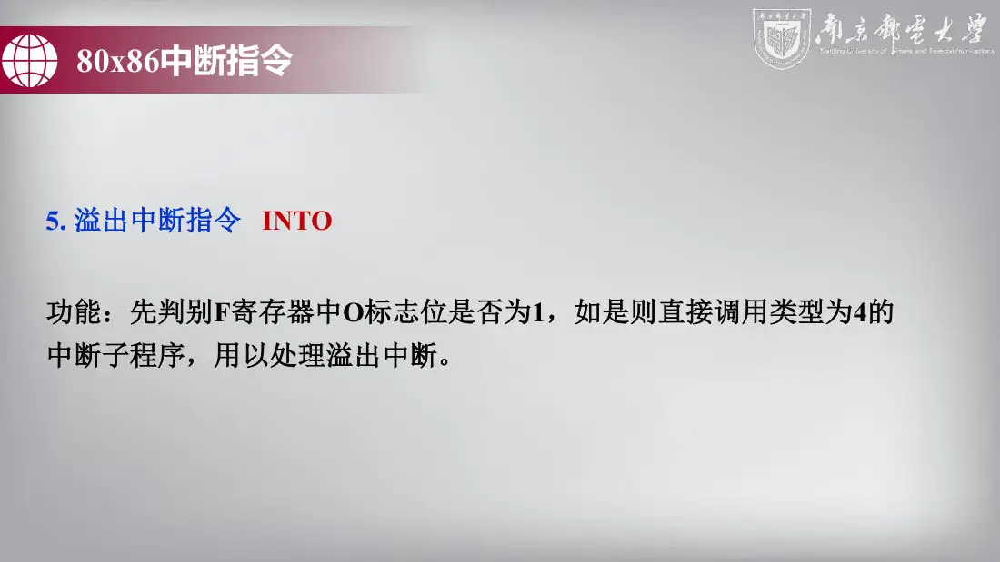

原文：

5. 溢出中断指令 INTO

功能：先判别F寄存器中O标志位是否为1，如是则直接调用类型为4的中断子程序，用以处理溢出中断。

80x86中断指令

南京邮电大学
Nanjing University of Posts and Telecommunications

### 知识点小结

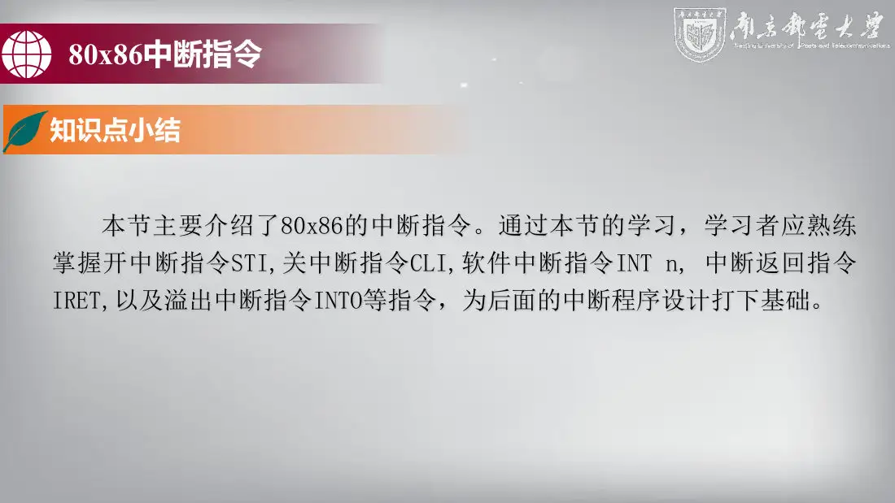

原文：

知识点小结

本节主要介绍了80x86的中断指令。通过本节的学习，学习者应熟练掌握开中断指令STI, 关中断指令CLI, 软件中断指令INT n, 中断返回指令IRET, 以及溢出中断指令INTO等指令，为后面的中断程序设计打下基础。

80x86中断指令

南京邮电大学
Nanjing University of Posts and Telecommunications

### 中断概念、内部/外部中断

原文：

中断概念、内部/外部中断

中断类型码、中断向量

中断响应过程

中断优先级、多级中断管理

✿ 80X86中断相关指令

总结

南京邮电大学
Nanjing University of Posts and Telecommunications

### ${DEH}$ ${56H}$ ${40H}$ ${12H}$

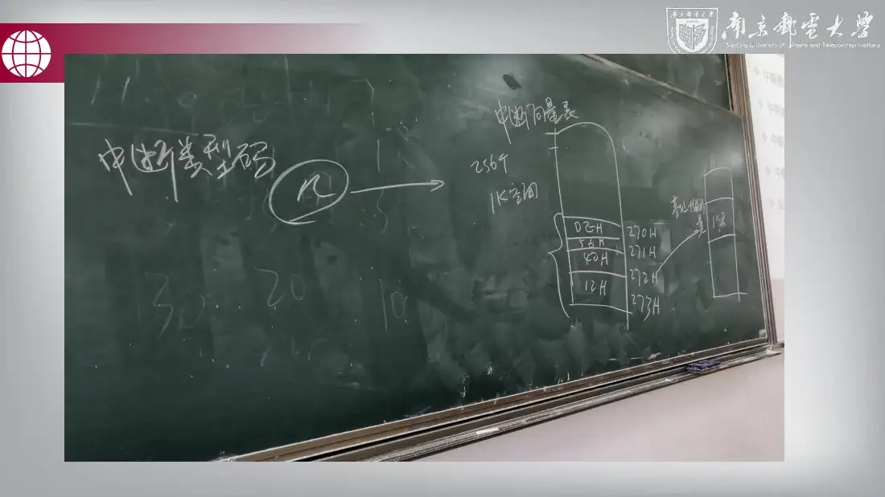

原文：

${DEH}$ ${56H}$ ${40H}$ ${12H}$

南京邮电大学
100-500
南京邮电大学
Nanjing University of Posts and Telecommunications
