# 《微型计算机原理与接口技术》第8-3章 中断系统（课件）

原件的每一页，下面附识别出的文字。

### 微型计算机原理与接口技术

原文：

微型计算机原理与接口技术

中断系统

The image contains four distinct visual elements: a magnifying glass over a globe, a keyboard with 'Close' labels, a @ symbol, and a golden egg-shaped object on white spheres. There is no textual content to extract. Therefore, the correct OCR output is an empty string.

(No text to output)

南京邮电大学计算机学院

南京邮电大学
15th-20th
Nanjing University of Posts and Telecommunications
南京邮电大学

### 回顾

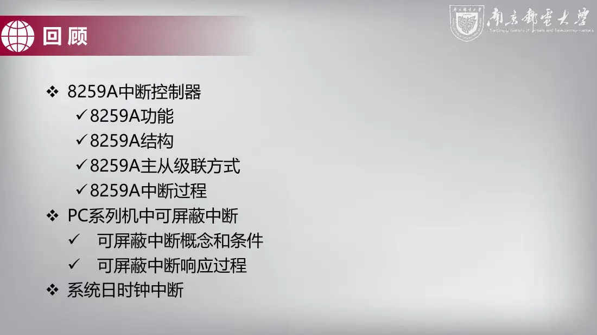

原文：

回顾

✿ 8259A中断控制器

√ 8259A功能

√ 8259A结构

√ 8259A主从级联方式

√ 8259A中断过程

PC系列机中可屏蔽中断

√ 可屏蔽中断概念和条件

√ 可屏蔽中断响应过程

系统日时钟中断

南京邮电大学
Nanjing University of Posts and Telecommunications

### 一、8259A功能

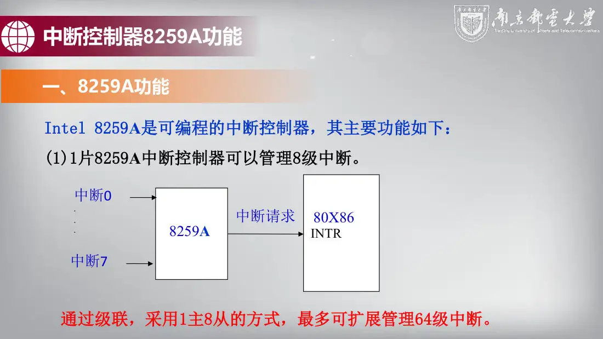

原文：

一、8259A功能

Intel 8259A是可编程的中断控制器，其主要功能如下：

(1) 1片8259A中断控制器可以管理8级中断。

通过级联，采用1主8从的方式，最多可扩展管理64级中断。

中断控制器8259A功能

南京邮电大学
Nanjing University of Posts and Telecommunications

### (2) 每一级中断都可以通过设置内部屏蔽字进行屏蔽或允许。

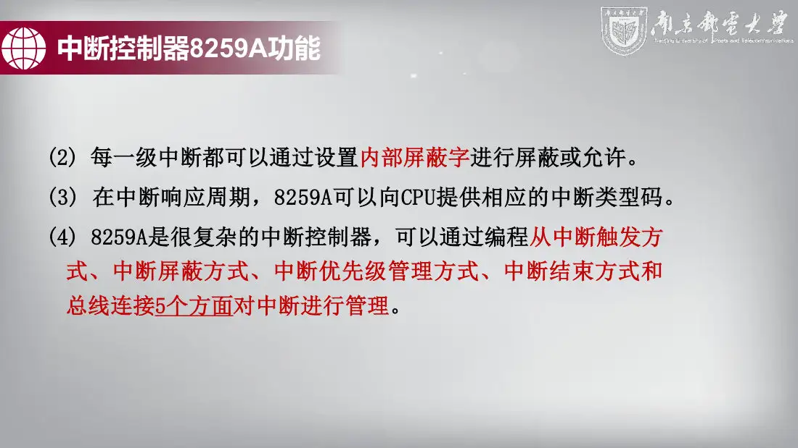

原文：

(2) 每一级中断都可以通过设置内部屏蔽字进行屏蔽或允许。

(3) 在中断响应周期，8259A可以向CPU提供相应的中断类型码。

(4) 8259A是很复杂的中断控制器, 可以通过编程从中断触发方式、中断屏蔽方式、中断优先级管理方式、中断结束方式和总线连接5个方面对中断进行管理。

中断控制器8259A功能

南京邮电大学
Nanjing University of Posts and Telecommunications

### 二、8259A主从级联

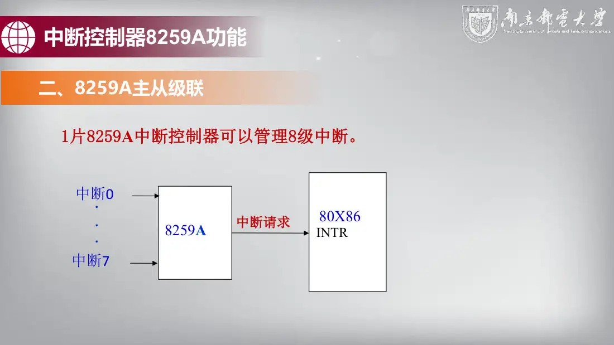

原文：

二、8259A主从级联

1片8259A中断控制器可以管理8级中断。

$$
\begin{array}{l} \text {中断0} \\ \text {中断7} \end{array} \xrightarrow {\text {中断请求}} \boxed {8 2 5 9 A} \xrightarrow {\text {中断请求}} \boxed {8 0 X 8 6} \boxed {\text {INTR}}
$$

中断控制器8259A功能

南京邮电大学
Nanjing University of Posts and Telecommunications

### 二、8259A主从级联

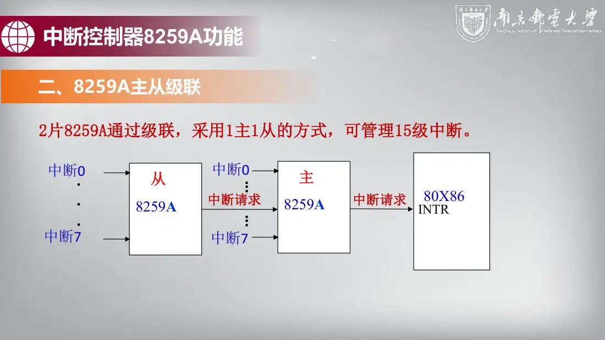

原文：

二、8259A主从级联

2片8259A通过级联，采用1主1从的方式，可管理15级中断。

$$
\begin{array}{c c c} \text {中断0} & \longrightarrow & \text {从} \\ \cdot & \longrightarrow & \text {中断请求} \\ \cdot & \longrightarrow & \text {中断请求} \\ \cdot & \longrightarrow & \text {中断请求} \\ \text {中断7} & \longrightarrow & \text {主} \\ \text {8259A} & \longrightarrow & \text {主} \\ \text {8259A} & \longrightarrow & \text {中断请求} \\ \text {80X86INTR} & \end{array}
$$

中断控制器8259A功能

南京邮电大学
Nanjing University of Posts and Telecommunications

### 二、8259A主从级联

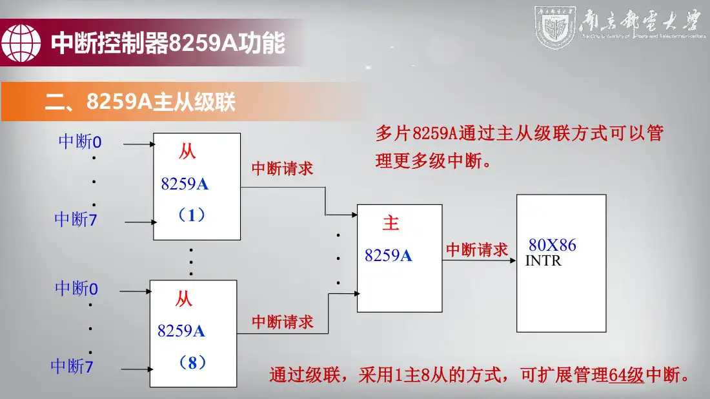

原文：

二、8259A主从级联

中断0

中断请求

中断7

中断0

中断7

中断请求

(8)

多片8259A通过主从级联方式可以管理更多级中断。

中断请求

通过级联，采用1主8从的方式，可扩展管理64级中断。

中断控制器8259A功能

南京邮电大学
Nanjing University of Posts and Telecommunications

### 中断控制器8259A内部结构

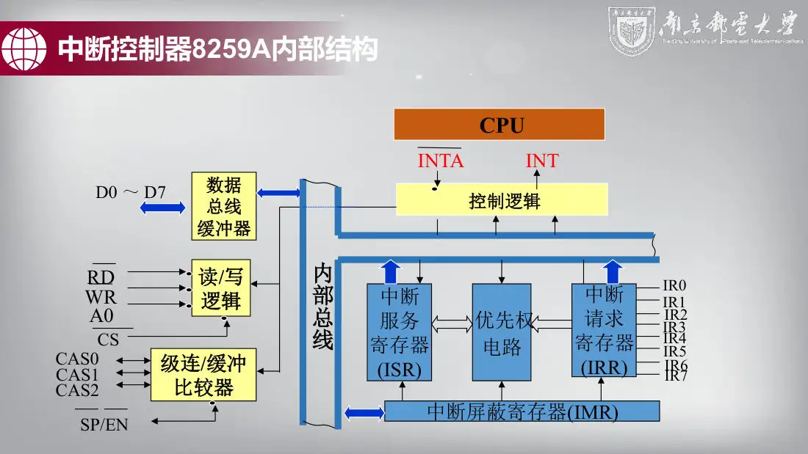

原文：

中断控制器8259A内部结构

南京邮电大学
Nanjing University of Posts and Telecommunications

### 二、8259A的中断过程-CPU响应可屏蔽硬件中断的过程

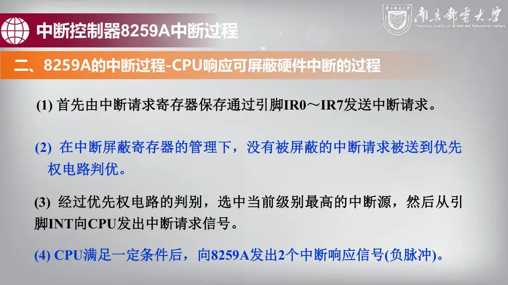

原文：

二、8259A的中断过程-CPU响应可屏蔽硬件中断的过程

(1) 首先由中断请求寄存器保存通过引脚IR0～IR7发送中断请求。

(2) 在中断屏蔽寄存器的管理下，没有被屏蔽的中断请求被送到优先权电路判优。

(3) 经过优先权电路的判别，选中当前级别最高的中断源，然后从引脚INT向CPU发出中断请求信号。

(4) CPU满足一定条件后，向8259A发出2个中断响应信号(负脉冲)。

中断控制器8259A中断过程

南京邮电大学
Nanjing University of Posts and Telecommunications

### 中断控制器8259A中断过程

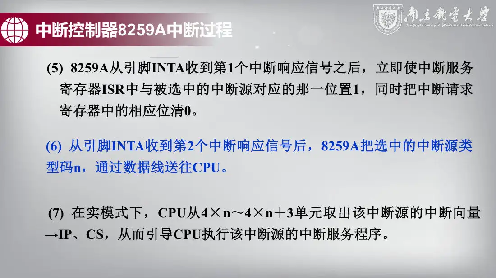

原文：

(5) 8259A从引脚INTA收到第1个中断响应信号之后，立即使中断服务寄存器ISR中与被选中的中断源对应的那一位置1，同时把中断请求寄存器中的相应位清0。

(6) 从引脚INTA收到第2个中断响应信号后，8259A把选中的中断源类型码n，通过数据线送往CPU。

(7) 在实模式下，CPU从 $4 \times n \sim 4 \times n + 3$ 单元取出该中断源的中断向量 $\rightarrow$ IP、CS，从而引导CPU执行该中断源的中断服务程序。

中断控制器8259A中断过程

南京邮电大学
Nanjing University of Posts and Telecommunications

### 三、CPU响应可屏蔽中断过程

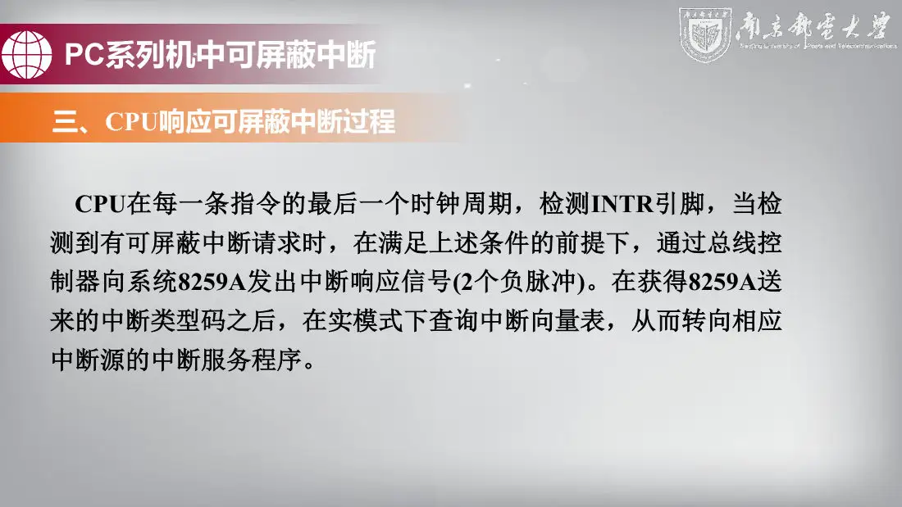

原文：

三、CPU响应可屏蔽中断过程

CPU在每一条指令的最后一个时钟周期，检测INTR引脚，当检测到有可屏蔽中断请求时，在满足上述条件的前提下，通过总线控制器向系统8259A发出中断响应信号(2个负脉冲)。在获得8259A送来的中断类型码之后，在实模式下查询中断向量表，从而转向相应中断源的中断服务程序。

PC系列机中可屏蔽中断

南京邮电大学
Nanjing University of Posts and Telecommunications

### 12

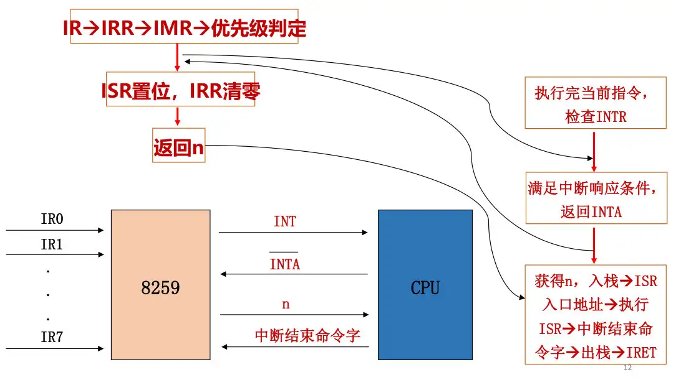

原文：

12

### 非屏蔽中断

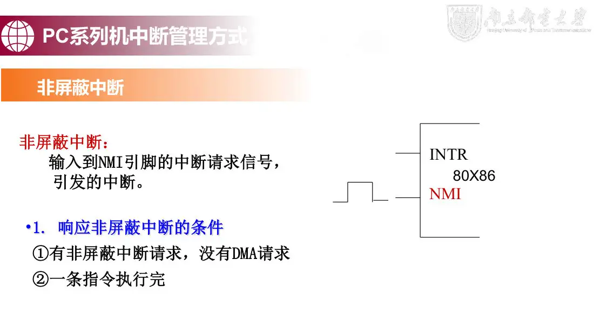

原文：

非屏蔽中断

非屏蔽中断:

输入到NMI引脚的中断请求信号，引发的中断。

•1. 响应非屏蔽中断的条件

①有非屏蔽中断请求，没有DMA请求

②一条指令执行完

PC系列机中断管理方式

南京邮电大学
Nanjing University of Posts and Telecommunications

### •2. CPU响应非屏蔽中断过程

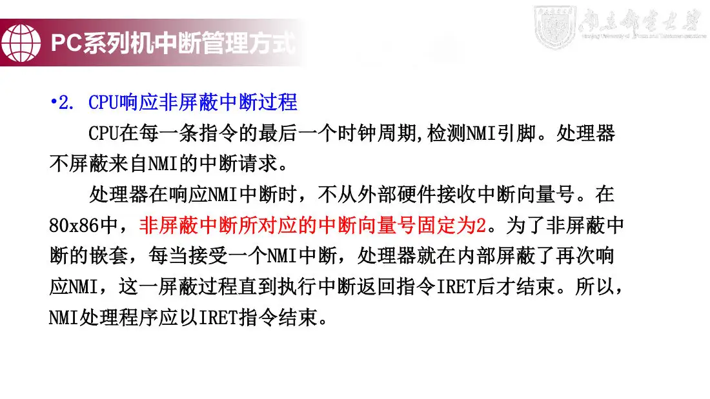

原文：

•2. CPU响应非屏蔽中断过程

CPU在每一条指令的最后一个时钟周期, 检测NMI引脚。处理器不屏蔽来自NMI的中断请求。

处理器在响应NMI中断时，不从外部硬件接收中断向量号。在80x86中，非屏蔽中断所对应的中断向量号固定为2。为了非屏蔽中断的嵌套，每当接受一个NMI中断，处理器就在内部屏蔽了再次响应NMI，这一屏蔽过程直到执行中断返回指令IRET后才结束。所以，NMI处理程序应以IRET指令结束。

PC系列机中断管理方式

南京邮电大学
Nanjing University of Posts and Telecommunications

### 二、响应可屏蔽中断的条件

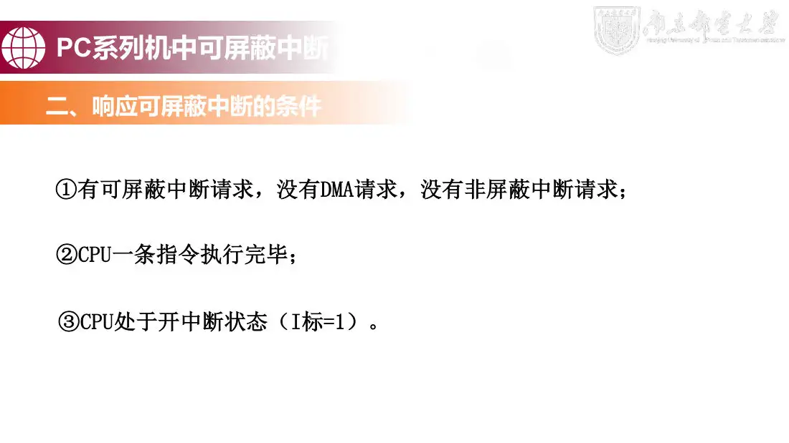

原文：

二、响应可屏蔽中断的条件

①有可屏蔽中断请求，没有DMA请求，没有非屏蔽中断请求；

②CPU一条指令执行完毕;

③CPU处于开中断状态（I标=1）。

PC系列机中可屏蔽中断

南京邮电大学
Nanjing University of Posts and Telecommunications

### 日时钟中断的中断源是：系统8254 0#计数器

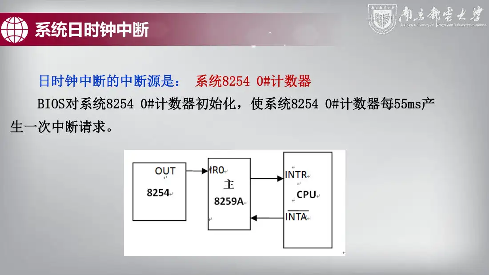

原文：

日时钟中断的中断源是：系统8254 0#计数器

BIOS对系统8254 0#计数器初始化，使系统8254 0#计数器每55ms产生一次中断请求。

系统日时钟中断

南京邮电大学
Nanjing University of Posts and Telecommunications

### ※ 什么是“日时钟计数器”

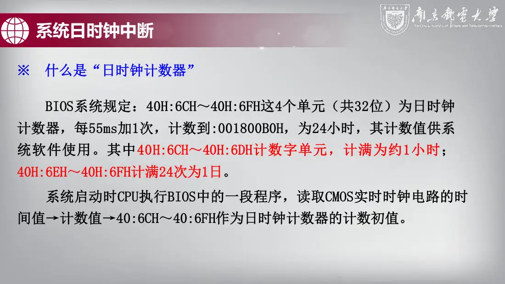

原文：

※ 什么是“日时钟计数器”

BIOS系统规定：40H:6CH～40H:6FH这4个单元（共32位）为日时钟计数器，每55ms加1次，计数到:001800B0H，为24小时，其计数值供系统软件使用。其中40H:6CH～40H:6DH计数字单元，计满为约1小时；40H:6EH～40H:6FH计满24次为1日。

系统启动时CPU执行BIOS中的一段程序，读取CMOS实时时钟电路的时间值 $\rightarrow$ 计数值 $\rightarrow 40:6\mathrm{CH}\sim 40:6\mathrm{FH}$ 作为日时钟计数器的计数初值。

系统日时钟中断

南京邮电大学
Nanjing University of Posts and Telecommunications

### ※关于1CH服务程序

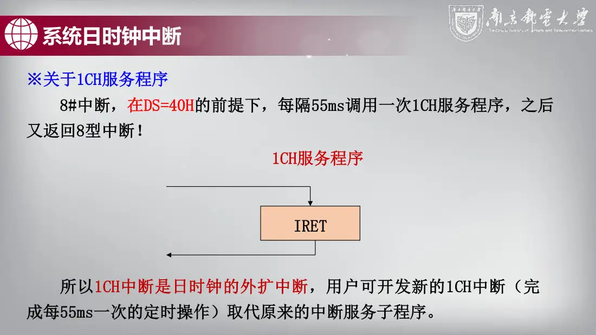

原文：

※关于1CH服务程序

8#中断，在DS=40H的前提下，每隔55ms调用一次1CH服务程序，之后又返回8型中断！

1CH服务程序

所以1CH中断是日时钟的外扩中断，用户可开发新的1CH中断（完成每55ms一次的定时操作）取代原来的中断服务子程序。

系统日时钟中断

南京邮电大学
Nanjing University of Posts and Telecommunications

### 四、系统日时钟中断开发应用

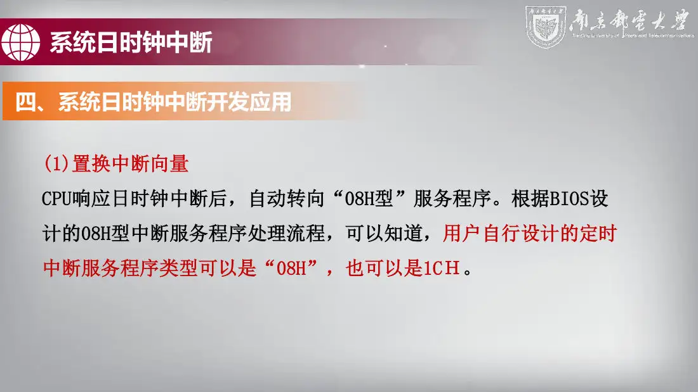

原文：

四、系统日时钟中断开发应用

(1) 置换中断向量

CPU响应日时钟中断后，自动转向“08H型”服务程序。根据BIOS设计的08H型中断服务程序处理流程，可以知道，用户自行设计的定时中断服务程序类型可以是“08H”，也可以是1CH。

系统日时钟中断

南京邮电大学
Nanjing University of Posts and Telecommunications

### 系统日时钟中断

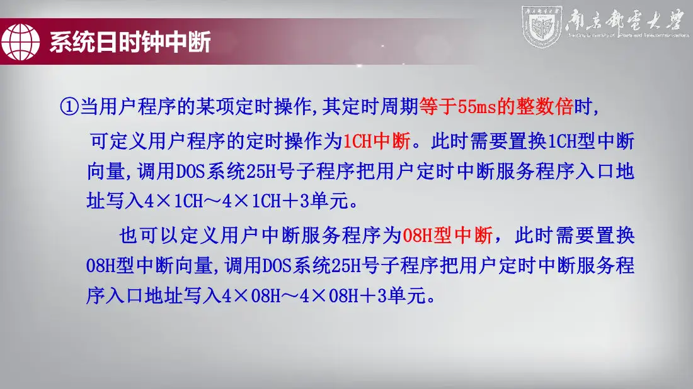

原文：

①当用户程序的某项定时操作, 其定时周期等于55ms的整数倍时, 可定义用户程序的定时操作为1CH中断。此时需要置换1CH型中断向量, 调用DOS系统25H号子程序把用户定时中断服务程序入口地址写入4×1CH～4×1CH+3单元。

也可以定义用户中断服务程序为08H型中断，此时需要置换08H型中断向量, 调用DOS系统25H号子程序把用户定时中断服务程序入口地址写入4×08H～4×08H+3单元。

系统日时钟中断

南京邮电大学
Nanjing University of Posts and Telecommunications

### 系统日时钟中断

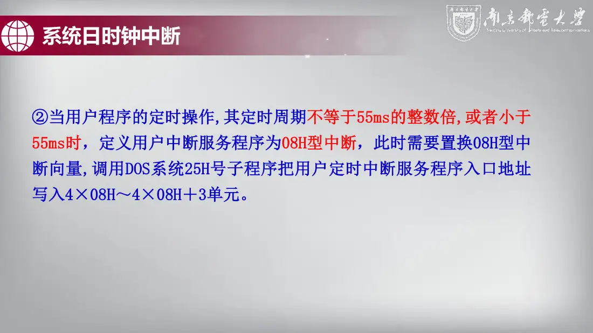

原文：

②当用户程序的定时操作, 其定时周期不等于55ms的整数倍, 或者小于55ms时, 定义用户中断服务程序为08H型中断, 此时需要置换08H型中断向量, 调用DOS系统25H号子程序把用户定时中断服务程序入口地址写入4×08H～4×08H+3单元。

系统日时钟中断

南京邮电大学
Nanjing University of Posts and Telecommunications

### 系统日时钟中断应用开发举例-ICH中断

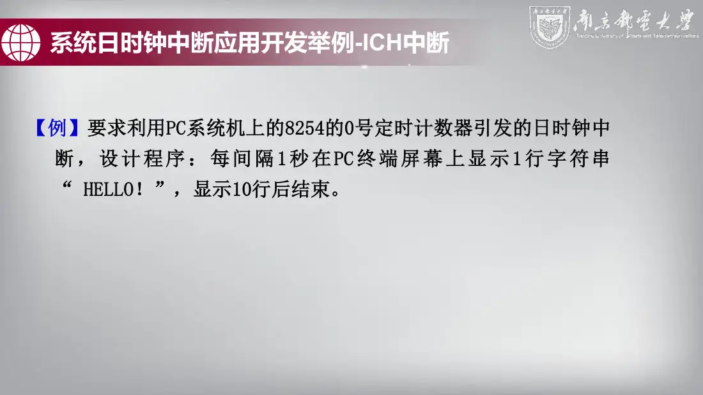

原文：

【例】要求利用PC系统机上的8254的0号定时计数器引发的日时钟中断，设计程序：每间隔1秒在PC终端屏幕上显示1行字符串“HELLO！”，显示10行后结束。

系统日时钟中断应用开发举例-ICH中断

南京邮电大学
Nanjing University of Posts and Telecommunications

### 二、程序流程图

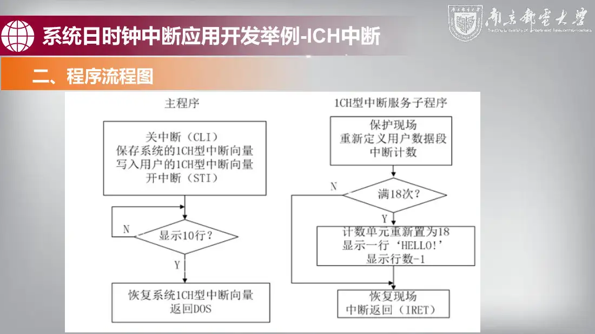

原文：

二、程序流程图

主程序

关中断（CLI）
保存系统的1CH型中断向量
写入用户的1CH型中断向量
开中断（STI）

显示10行？

恢复系统1CH型中断向量
返回DOS

1CH型中断服务子程序

保护现场
重新定义用户数据段
中断计数

满18次？

计数单元重新置为18
显示一行 ‘HELL0!’
显示行数-1

恢复现场
中断返回（IRET）

系统日时钟中断应用开发举例-ICH中断

南京邮电大学
Nanjing University of Posts and Telecommunications

### 三、程序清单 P309 \~ 310

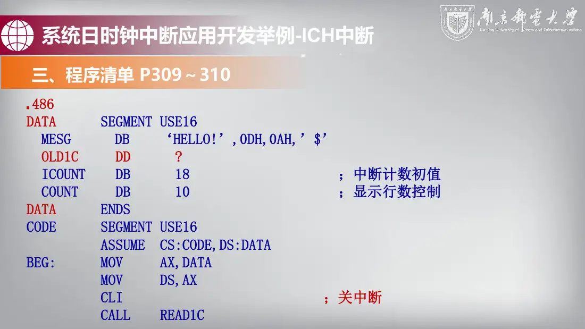

原文：

三、程序清单 P309 \~ 310

<table><tr><td colspan="4">.486</td></tr><tr><td>DATA</td><td>SEGMENT</td><td>USE16</td><td></td></tr><tr><td>MESG</td><td>DB</td><td>‘HELLO!’, ODH, OAH, ’ $’</td><td></td></tr><tr><td>OLD1C</td><td>DD</td><td>?</td><td></td></tr><tr><td>ICOUNT</td><td>DB</td><td>18</td><td>; 中断计数初值</td></tr><tr><td>COUNT</td><td>DB</td><td>10</td><td>; 显示行数控制</td></tr><tr><td>DATA</td><td>ENDS</td><td></td><td></td></tr><tr><td rowspan="2">CODE</td><td>SEGMENT</td><td>USE16</td><td></td></tr><tr><td>ASSUME</td><td>CS:CODE, DS:DATA</td><td></td></tr><tr><td rowspan="4">BEG:</td><td>MOV</td><td>AX, DATA</td><td></td></tr><tr><td>MOV</td><td>DS, AX</td><td></td></tr><tr><td>CLI</td><td></td><td>; 关中断</td></tr><tr><td>CALL</td><td>READ1C</td><td></td></tr><tr><td rowspan="7">SCAN:</td><td>CALL</td><td>WRITE1C</td><td rowspan="2">;开中断</td></tr><tr><td>STI</td><td></td></tr><tr><td>CMP</td><td>COUNT, 0</td><td rowspan="2">;是否已经显示16</td></tr><tr><td>JNZ</td><td>SCAN</td></tr><tr><td>CALL</td><td>RESET</td><td rowspan="3">;结束返回DOS</td></tr><tr><td>MOV</td><td>AH, 4CH</td></tr><tr><td>INT</td><td>21H</td></tr><tr><td rowspan="7">; SERVICE</td><td>PROC</td><td></td><td rowspan="2">;保护现场</td></tr><tr><td>PUSHA</td><td></td></tr><tr><td>PUSH</td><td>DS</td><td rowspan="2">;DS=40H</td></tr><tr><td>MOV</td><td>AX, DATA</td></tr><tr><td>MOV</td><td>DS, AX</td><td>;重新给DS赋值</td></tr><tr><td>DEC</td><td>ICOUNT</td><td>;中断计数</td></tr><tr><td>JNZ</td><td>EXIT</td><td>;不满18次转</td></tr></table>

系统日时钟中断应用开发举例-ICH中断

南京邮电大学
Nanjing University of Posts and Telecommunications

### 系统日时钟中断应用开发举例-ICH中断

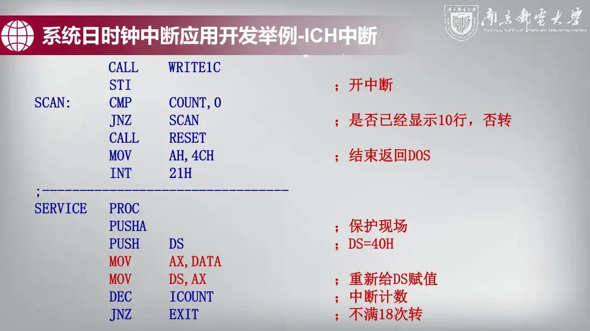

原文：

系统日时钟中断应用开发举例-ICH中断

南京邮电大学
Nanjing University of Posts and Telecommunications

### 系统日时钟中断应用开发举例-ICH中断

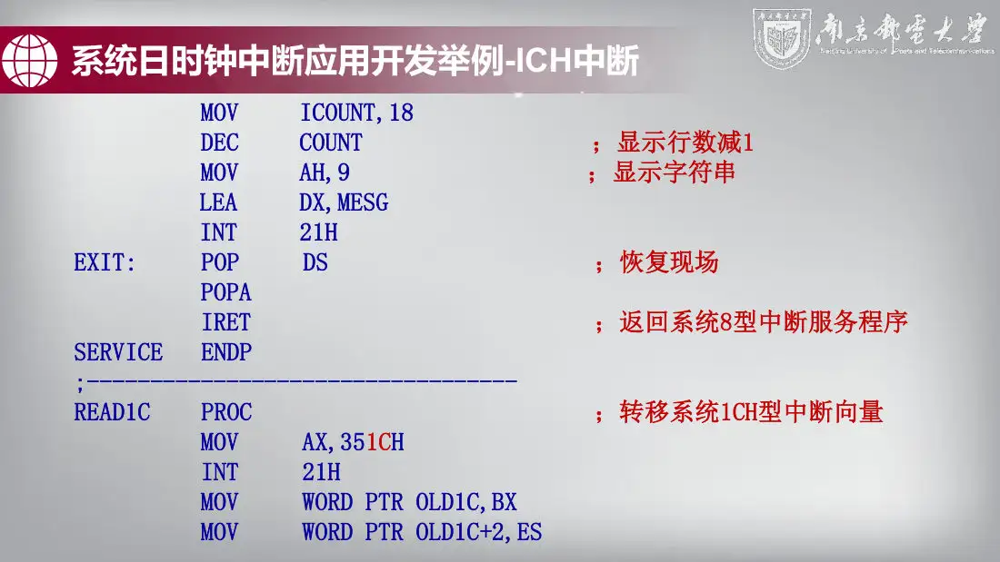

原文：

<table><tr><td></td><td>MOV</td><td>ICOUNT, 18</td><td></td></tr><tr><td></td><td>DEC</td><td>COUNT</td><td>; 显示行数减1</td></tr><tr><td></td><td>MOV</td><td>AH, 9</td><td>; 显示字符串</td></tr><tr><td></td><td>LEA</td><td>DX, MESG</td><td></td></tr><tr><td></td><td>INT</td><td>21H</td><td></td></tr><tr><td>EXIT:</td><td>POP</td><td>DS</td><td>; 恢复现场</td></tr><tr><td></td><td>POPA</td><td></td><td></td></tr><tr><td></td><td>IRET</td><td></td><td>; 返回系统8型中断服务程序</td></tr><tr><td>SERVICE</td><td>ENDP</td><td></td><td></td></tr><tr><td colspan="4">;</td></tr><tr><td>READ1C</td><td>PROC</td><td></td><td>; 转移系统1CH型中断向量</td></tr><tr><td></td><td>MOV</td><td>AX, 351CH</td><td></td></tr><tr><td></td><td>INT</td><td>21H</td><td></td></tr><tr><td></td><td>MOV</td><td>WORD PTR OLD1C, BX</td><td></td></tr><tr><td></td><td>MOV</td><td>WORD PTR OLD1C+2, ES</td><td></td></tr></table>

系统日时钟中断应用开发举例-ICH中断

南京邮电大学
Nanjing University of Posts and Telecommunications

### ；写入用户1CH型中断向量

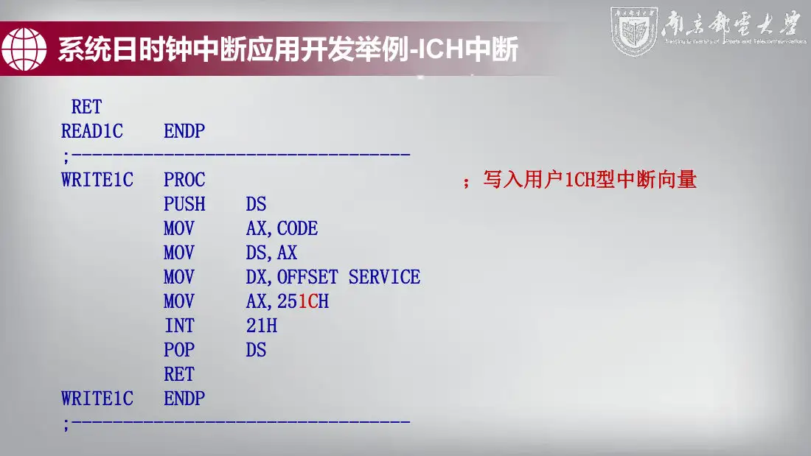

原文：

<table><tr><td colspan="3">RET</td></tr><tr><td>READ1C</td><td>ENDP</td><td></td></tr><tr><td colspan="3">;</td></tr><tr><td rowspan="9">WRITE1C</td><td>PROC</td><td></td></tr><tr><td>PUSH</td><td>DS</td></tr><tr><td>MOV</td><td>AX, CODE</td></tr><tr><td>MOV</td><td>DS, AX</td></tr><tr><td>MOV</td><td>DX, OFFSET SERVICE</td></tr><tr><td>MOV</td><td>AX, 251CH</td></tr><tr><td>INT</td><td>21H</td></tr><tr><td>POP</td><td>DS</td></tr><tr><td>RET</td><td></td></tr><tr><td>WRITE1C</td><td>ENDP</td><td></td></tr></table>

；写入用户1CH型中断向量

系统日时钟中断应用开发举例-ICH中断

南京邮电大学
Nanjing University of Posts and Telecommunications

### 系统日时钟中断应用开发举例-ICH中断

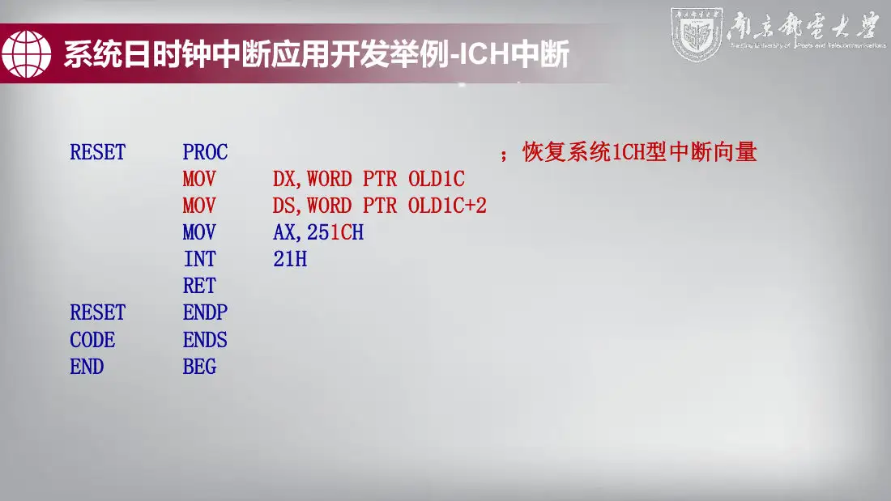

原文：

<table><tr><td>RESET</td><td>PROC</td><td></td><td>; 恢复系统1CH型中断向量</td></tr><tr><td></td><td>MOV</td><td>DX, WORD PTR OLD1C</td><td></td></tr><tr><td></td><td>MOV</td><td>DS, WORD PTR OLD1C+2</td><td></td></tr><tr><td></td><td>MOV</td><td>AX, 251CH</td><td></td></tr><tr><td></td><td>INT</td><td>21H</td><td></td></tr><tr><td></td><td>RET</td><td></td><td></td></tr><tr><td>RESET</td><td>ENDP</td><td></td><td></td></tr><tr><td>CODE</td><td>ENDS</td><td></td><td></td></tr><tr><td>END</td><td>BEG</td><td></td><td></td></tr></table>

系统日时钟中断应用开发举例-ICH中断

南京邮电大学
Nanjing University of Posts and Telecommunications

### ✿ 08H型中断的开发设计思路

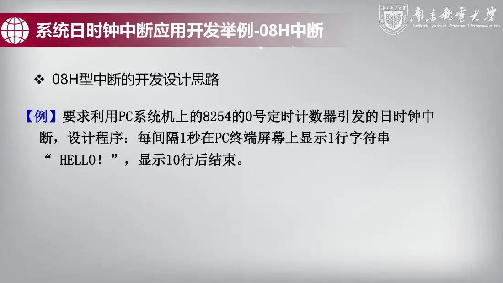

原文：

✿ 08H型中断的开发设计思路

【例】要求利用PC系统机上的8254的0号定时计数器引发的日时钟中断，设计程序：每间隔1秒在PC终端屏幕上显示1行字符串“HELLO！”，显示10行后结束。

系统日时钟中断应用开发举例-08H中断

南京邮电大学
Nanjing University of Posts and Telecommunications

### 一、设计思路

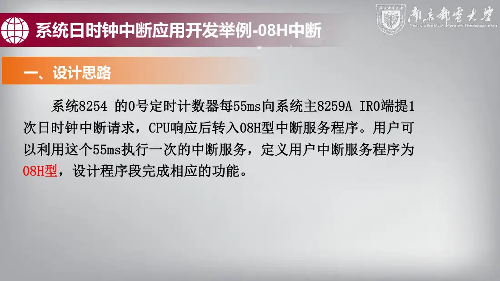

原文：

一、设计思路

系统8254 的0号定时计数器每55ms向系统主8259A IRO端提1次日时钟中断请求，CPU响应后转入08H型中断服务程序。用户可以利用这个55ms执行一次的中断服务，定义用户中断服务程序为08H型，设计程序段完成相应的功能。

系统日时钟中断应用开发举例-08H中断

南京邮电大学
Nanjing University of Posts and Telecommunications

### 为此我们需要进行的操作为：\*为与前一节的方法不同的操作。

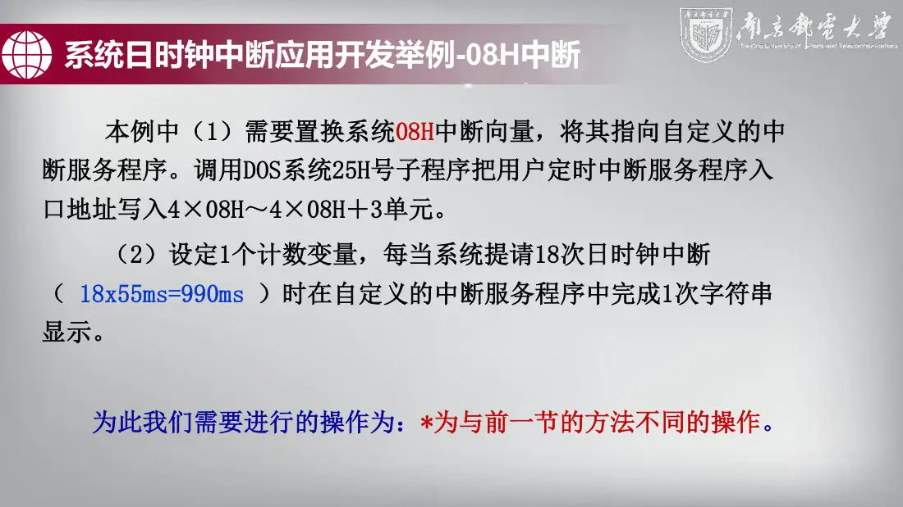

原文：

本例中（1）需要置换系统08H中断向量，将其指向自定义的中断服务程序。调用DOS系统25H号子程序把用户定时中断服务程序入口地址写入4×08H～4×08H+3单元。

(2) 设定1个计数变量, 每当系统提请18次日时钟中断 ( $18 \times 55 \mathrm{~ms} = 990 \mathrm{~ms}$ ) 时在自定义的中断服务程序中完成1次字符串显示。

为此我们需要进行的操作为：\*为与前一节的方法不同的操作。

系统日时钟中断应用开发举例-08H中断

南京邮电大学
Nanjing University of Posts and Telecommunications

### ①保存原来系统的08H中断向量到段OLD08双字单元 \

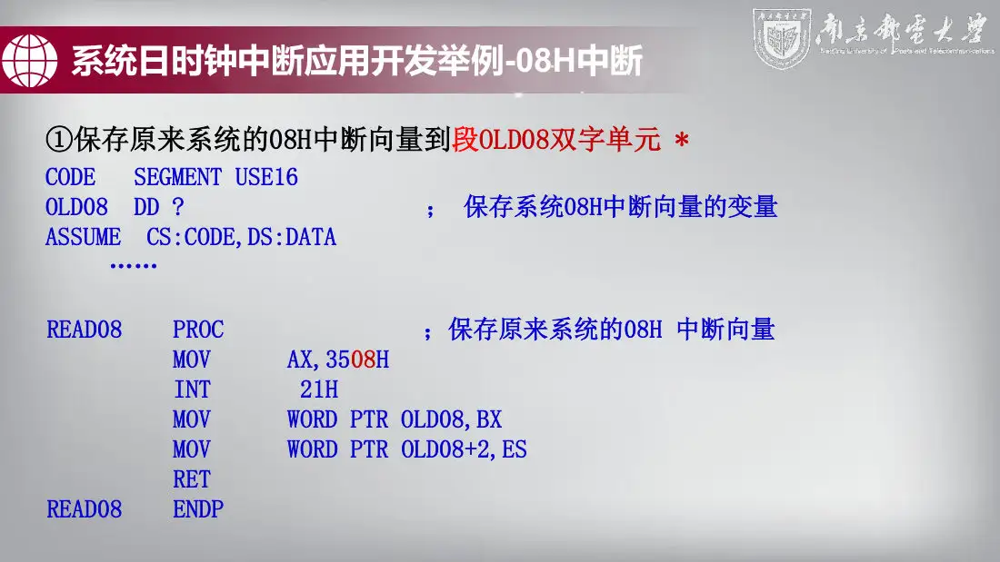

原文：

①保存原来系统的08H中断向量到段OLD08双字单元 \*

CODE SEGMENT USE16

OLD08 DD ? ; 保存系统08H中断向量的变量

ASSUME CS:CODE, DS:DATA

READ08 PROC ; 保存原来系统的08H 中断向量

MOV AX, 3508H

READ08 ENDP

系统日时钟中断应用开发举例-08H中断

南京邮电大学
Nanjing University of Posts and Telecommunications

### ②置换08H中断向量使其指向我们自己的中断服务程序

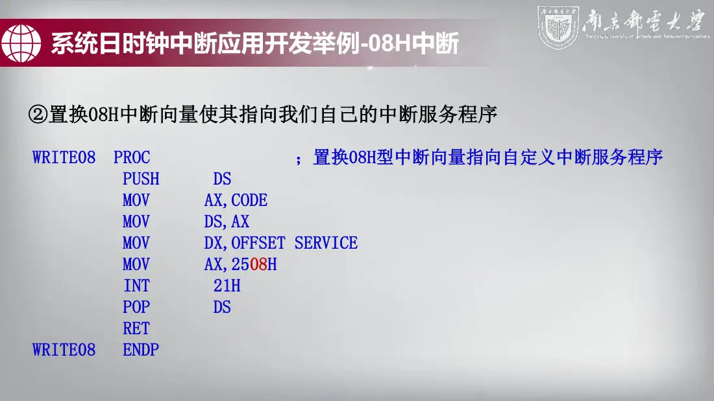

原文：

②置换08H中断向量使其指向我们自己的中断服务程序

<table><tr><td>WRITE08</td><td>PROC</td><td></td><td>;置换08H型中断向量指向自定义中断服务程序</td></tr><tr><td></td><td>PUSH</td><td>DS</td><td></td></tr><tr><td></td><td>MOV</td><td>AX, CODE</td><td></td></tr><tr><td></td><td>MOV</td><td>DS, AX</td><td></td></tr><tr><td></td><td>MOV</td><td>DX, OFFSET SERVICE</td><td></td></tr><tr><td></td><td>MOV</td><td>AX, 2508H</td><td></td></tr><tr><td></td><td>INT</td><td>21H</td><td></td></tr><tr><td></td><td>POP</td><td>DS</td><td></td></tr><tr><td></td><td>RET</td><td></td><td></td></tr><tr><td>WRITE08</td><td>ENDP</td><td></td><td></td></tr></table>

系统日时钟中断应用开发举例-08H中断

南京邮电大学
Nanjing University of Posts and Telecommunications

### 系统日时钟中断应用开发举例-08H中断

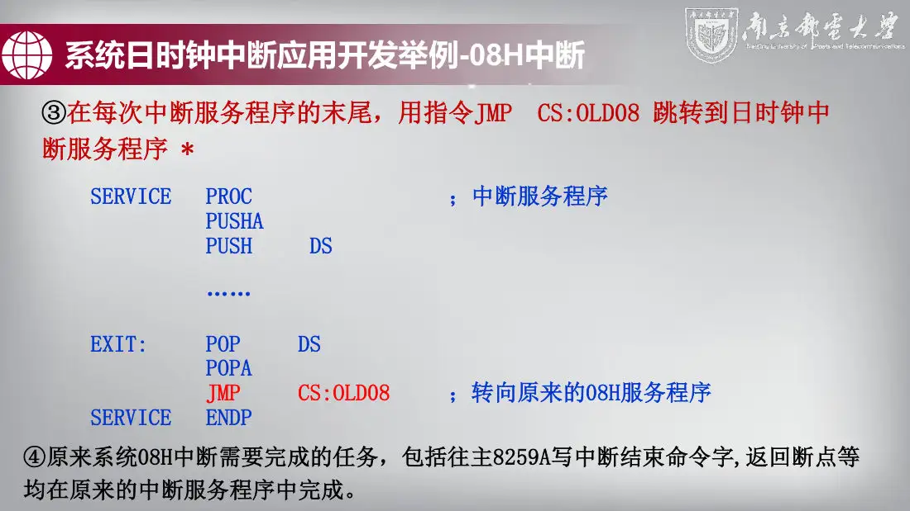

原文：

③在每次中断服务程序的末尾，用指令JMP CS:OLD08 跳转到日时钟中断服务程序 \*

<table><tr><td rowspan="4">SERVICE</td><td>PROC</td><td></td><td>;中断服务程序</td></tr><tr><td>PUSHA</td><td></td><td></td></tr><tr><td>PUSH</td><td>DS</td><td></td></tr><tr><td>......</td><td></td><td></td></tr><tr><td rowspan="3">EXIT:</td><td>POP</td><td>DS</td><td></td></tr><tr><td>POPA</td><td></td><td></td></tr><tr><td>JMP</td><td>CS:OLD08</td><td>;转向原来的08H服务程序</td></tr><tr><td>SERVICE</td><td>ENDP</td><td></td><td></td></tr></table>

④原来系统08H中断需要完成的任务，包括往主8259A写中断结束命令字,返回断点等均在原来的中断服务程序中完成。

系统日时钟中断应用开发举例-08H中断

南京邮电大学
Nanjing University of Posts and Telecommunications

### 系统日时钟中断应用开发举例-08H中断

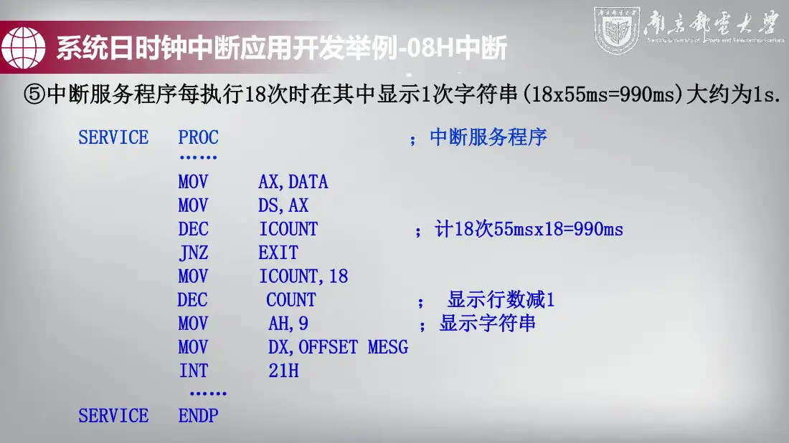

原文：

⑤中断服务程序每执行18次时在其中显示1次字符串(18x55ms=990ms)大约为1s.

<table><tr><td>SERVICE</td><td>PROC</td><td></td><td>;中断服务程序</td></tr><tr><td></td><td>......</td><td></td><td></td></tr><tr><td></td><td>MOV</td><td>AX, DATA</td><td></td></tr><tr><td></td><td>MOV</td><td>DS, AX</td><td></td></tr><tr><td></td><td>DEC</td><td>ICOUNT</td><td>;计18次55msx18=990ms</td></tr><tr><td></td><td>JNZ</td><td>EXIT</td><td></td></tr><tr><td></td><td>MOV</td><td>ICOUNT, 18</td><td></td></tr><tr><td></td><td>DEC</td><td>COUNT</td><td>;显示行数减1</td></tr><tr><td></td><td>MOV</td><td>AH, 9</td><td>;显示字符串</td></tr><tr><td></td><td>MOV</td><td>DX, OFFSET MESG</td><td></td></tr><tr><td></td><td>INT</td><td>21H</td><td></td></tr><tr><td></td><td>......</td><td></td><td></td></tr><tr><td>SERVICE</td><td>ENDP</td><td></td><td></td></tr></table>

系统日时钟中断应用开发举例-08H中断

南京邮电大学
Nanjing University of Posts and Telecommunications

### ⑥在返回操作系统前恢复原来保存的08H中断向量。

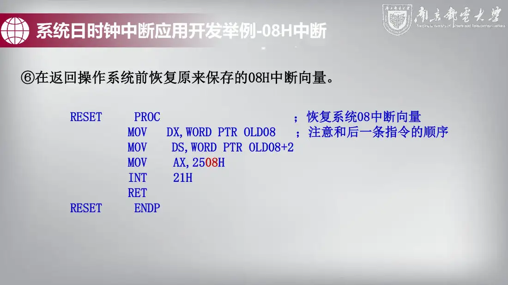

原文：

⑥在返回操作系统前恢复原来保存的08H中断向量。

<table><tr><td rowspan="6">RESET</td><td>PROC</td><td></td><td>; 恢复系统08中断向量</td></tr><tr><td>MOV</td><td>DX, WORD PTR OLD08</td><td>; 注意和后一条指令的顺序</td></tr><tr><td>MOV</td><td>DS, WORD PTR OLD08+2</td><td></td></tr><tr><td>MOV</td><td>AX, 2508H</td><td></td></tr><tr><td>INT</td><td>21H</td><td></td></tr><tr><td>RET</td><td></td><td></td></tr><tr><td>RESET</td><td>ENDP</td><td></td><td></td></tr></table>

系统日时钟中断应用开发举例-08H中断

南京邮电大学
Nanjing University of Posts and Telecommunications

### 知识点小结

原文：

知识点小结

本节通过一个具体的例子，详细讲解了系统08H型定时中断的应用开发设计思路和需要完成的操作。在下一节中，我们将讲解该08H型定时中断应用程序，并对程序做进一步的分析。

系统日时钟中断应用开发举例-08H中断

南京邮电大学
Nanjing University of Posts and Telecommunications

### 知识要点

原文：

知识要点

◆ 实时时钟中断源

◆ 实时时钟钟中断类型

◆ 实时时钟中断处理流程

系统实时时钟中断

南京邮电大学
Nanjing University of Posts and Telecommunications

### 一、中断源

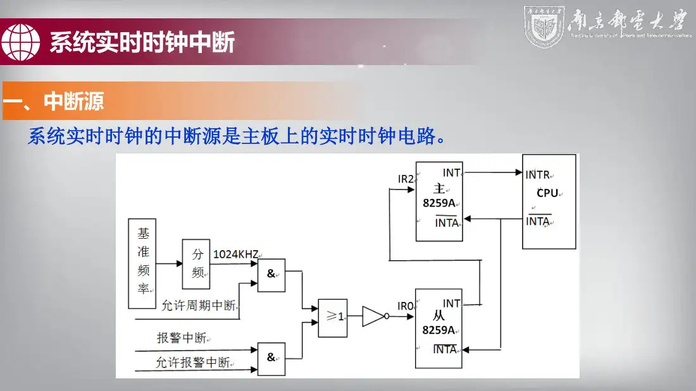

原文：

一、中断源

系统实时时钟的中断源是主板上的实时时钟电路。

系统实时时钟中断

南京邮电大学
Nanjing University of Posts and Telecommunications

### 系统实时时钟中断

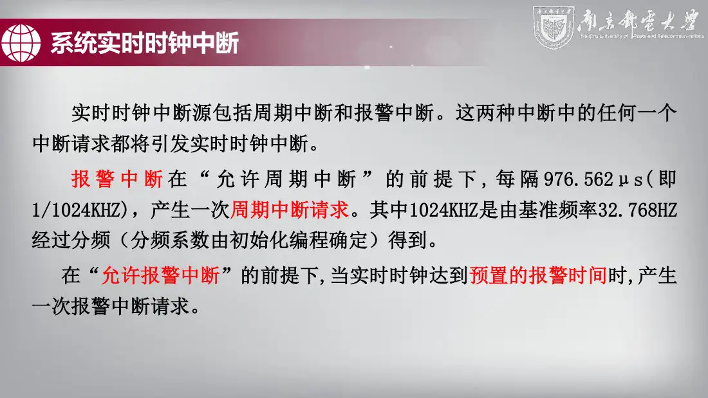

原文：

实时时钟中断源包括周期中断和报警中断。这两种中断中的任何一个中断请求都将引发实时时钟中断。

报警中断在“允许周期中断”的前提下, 每隔 $976.562 \mu \mathrm{s}$ (即 $1 / 1024 \mathrm{KHZ}$ ), 产生一次周期中断请求。其中 $1024 \mathrm{KHZ}$ 是由基准频率 $32.768 \mathrm{HZ}$ 经过分频 (分频系数由初始化编程确定) 得到。

在 “允许报警中断” 的前提下, 当实时时钟达到预置的报警时间时, 产生一次报警中断请求。

系统实时时钟中断

南京邮电大学
Nanjing University of Posts and Telecommunications

### 二、中断类型

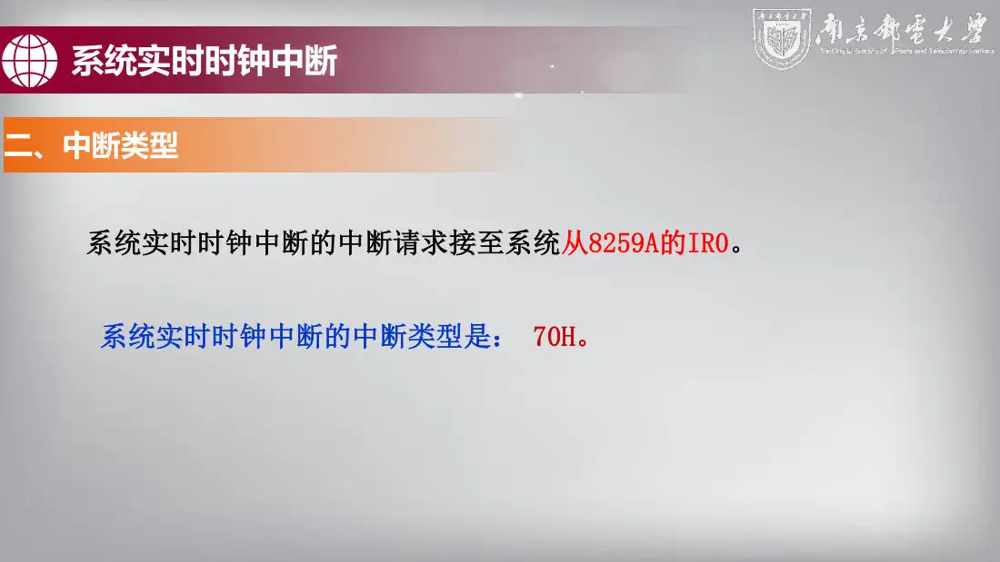

原文：

二、中断类型

系统实时时钟中断的中断请求接至系统从8259A的IRO。

系统实时时钟中断的中断类型是: 70H。

系统实时时钟中断

南京邮电大学
Nanjing University of Posts and Telecommunications

### 三、系统实时时钟中断处理流程

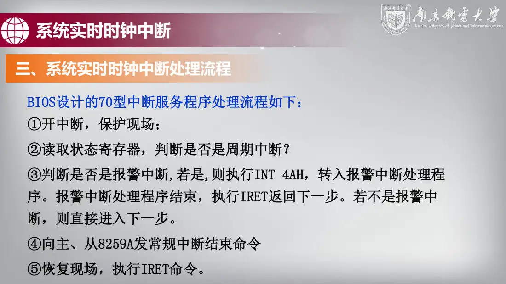

原文：

三、系统实时时钟中断处理流程

BIOS设计的70型中断服务程序处理流程如下:

①开中断，保护现场；

②读取状态寄存器，判断是否是周期中断？

③判断是否是报警中断, 若是, 则执行INT 4AH, 转入报警中断处理程序。报警中断处理程序结束, 执行IRET返回下一步。若不是报警中断, 则直接进入下一步。

④向主、从8259A发常规中断结束命令

⑤恢复现场，执行IRET命令。

系统实时时钟中断

南京邮电大学
Nanjing University of Posts and Telecommunications

### 知识点小结

原文：

知识点小结

本节主要介绍了系统实时时钟中断的相关内容。通过本节的学习，学习者应该了解系统实时时钟中断的中断源，中断类型以及系统实时时钟处理流程。

系统实时时钟中断

南京邮电大学
Nanjing University of Posts and Telecommunications

### 知识要点

原文：

知识要点

系统用户中断源

系统用户中断类型

系统用户中断处理流程

系统用户中断开发应用

系统用户中断

南京邮电大学
Nanjing University of Posts and Telecommunications

### PC系列机中可屏蔽中断

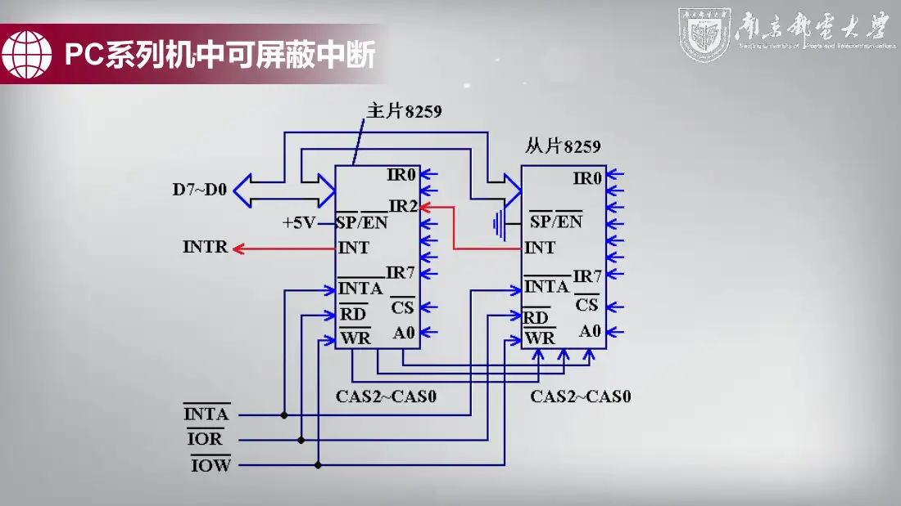

原文：

PC系列机中可屏蔽中断

南京邮电大学
Nanjing University of Posts and Telecommunications

### (1) 使用2片8259级连，管理15级中断

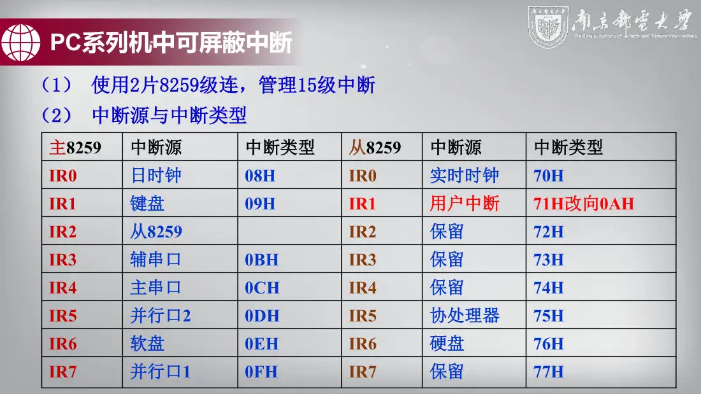

原文：

(1) 使用2片8259级连，管理15级中断

(2) 中断源与中断类型

<table><tr><td>主8259</td><td>中断源</td><td>中断类型</td><td>从8259</td><td>中断源</td><td>中断类型</td></tr><tr><td>IR0</td><td>日时钟</td><td>08H</td><td>IR0</td><td>实时时钟</td><td>70H</td></tr><tr><td>IR1</td><td>键盘</td><td>09H</td><td>IR1</td><td>用户中断</td><td>71H改向0AH</td></tr><tr><td>IR2</td><td>从8259</td><td></td><td>IR2</td><td>保留</td><td>72H</td></tr><tr><td>IR3</td><td>辅串口</td><td>0BH</td><td>IR3</td><td>保留</td><td>73H</td></tr><tr><td>IR4</td><td>主串口</td><td>0CH</td><td>IR4</td><td>保留</td><td>74H</td></tr><tr><td>IR5</td><td>并行口2</td><td>0DH</td><td>IR5</td><td>协处理器</td><td>75H</td></tr><tr><td>IR6</td><td>软盘</td><td>0EH</td><td>IR6</td><td>硬盘</td><td>76H</td></tr><tr><td>IR7</td><td>并行口1</td><td>0FH</td><td>IR7</td><td>保留</td><td>77H</td></tr></table>

PC系列机中可屏蔽中断

南京邮电大学
Nanjing University of Posts and Telecommunications

### 一、中断源

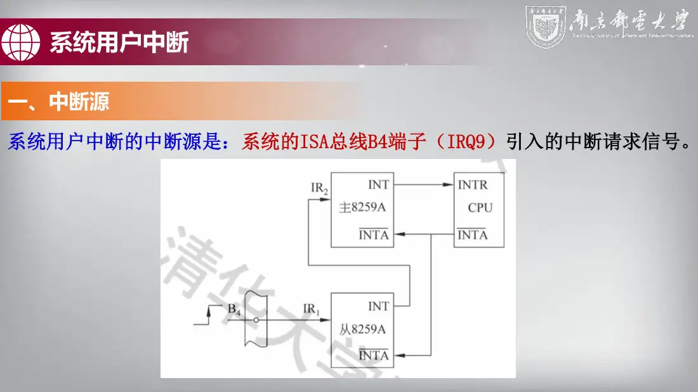

原文：

一、中断源

系统用户中断的中断源是：系统的ISA总线B4端子（IRQ9）引入的中断请求信号。

系统用户中断

南京邮电大学
Nanjing University of Posts and Telecommunications

### 二、中断类型

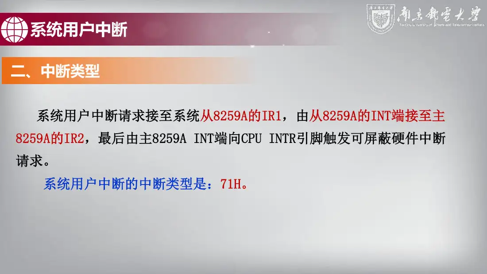

原文：

二、中断类型

系统用户中断请求接至系统从8259A的IR1，由从8259A的INT端接至主8259A的IR2，最后由主8259A INT端向CPU INTR引脚触发可屏蔽硬件中断请求。

系统用户中断的中断类型是：71H。

系统用户中断

南京邮电大学
Nanjing University of Posts and Telecommunications

### 三、用户中断处理流程

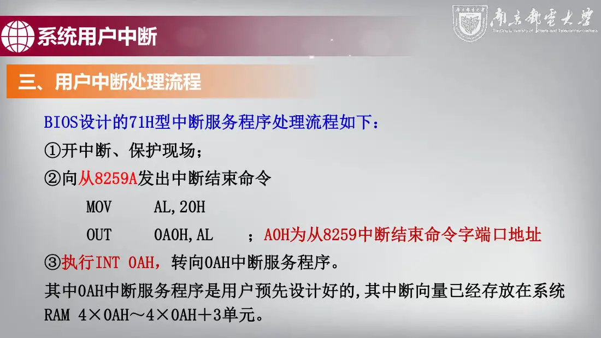

原文：

三、用户中断处理流程

BIOS设计的71H型中断服务程序处理流程如下:

①开中断、保护现场;

②向从8259A发出中断结束命令

MOV AL, 20H

OUT OAOH, AL ; AOH为从8259中断结束命令字端口地址
③执行INT OAH，转向OAH中断服务程序。

其中0AH中断服务程序是用户预先设计好的, 其中断向量已经存放在系统 RAM 4×0AH～4×0AH+3单元。

系统用户中断

南京邮电大学
Nanjing University of Posts and Telecommunications

### 四、系统用户中断开发应用

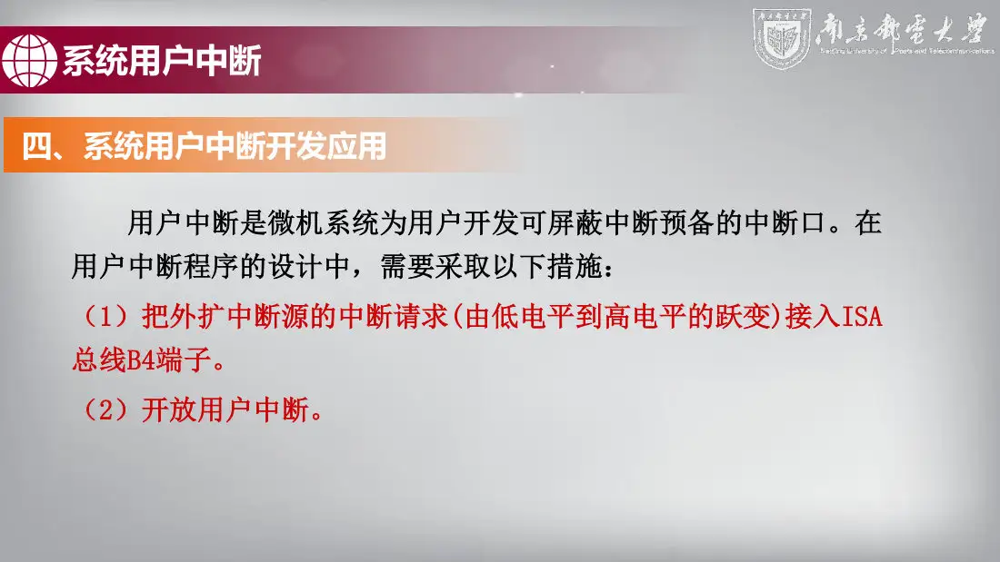

原文：

四、系统用户中断开发应用

用户中断是微机系统为用户开发可屏蔽中断预备的中断口。在用户中断程序的设计中，需要采取以下措施：

(1) 把外扩中断源的中断请求(由低电平到高电平的跃变)接入ISA总线B4端子。

(2) 开放用户中断。

系统用户中断

南京邮电大学
Nanjing University of Posts and Telecommunications

### ※用户中断请求的途径

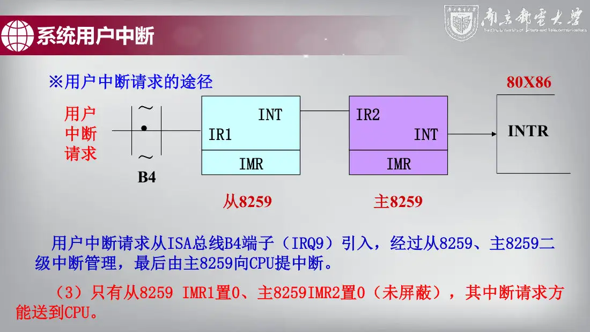

原文：

※用户中断请求的途径

用户中断请求

80X86

用户中断请求从ISA总线B4端子（IRQ9）引入，经过从8259、主8259二级中断管理，最后由主8259向CPU提中断。

(3) 只有从8259 IMR1置0、主8259IMR2置0（未屏蔽），其中断请求方能送到CPU。

系统用户中断

南京邮电大学
Nanjing University of Posts and Telecommunications

### IN AL, 0A1H

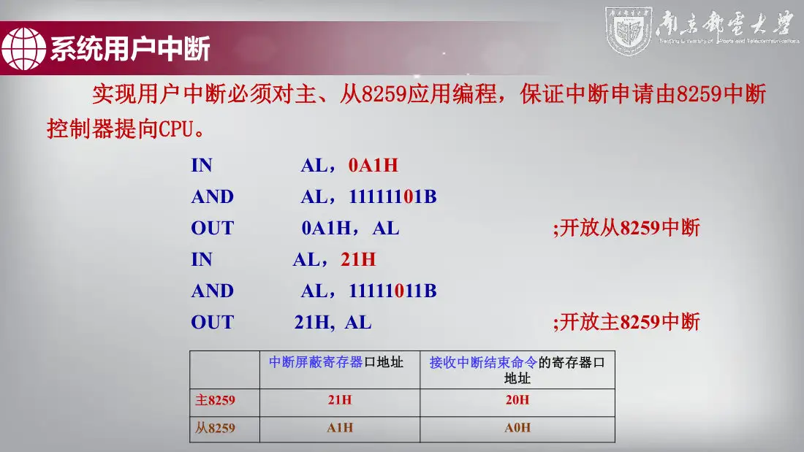

原文：

实现用户中断必须对主、从8259应用编程，保证中断申请由8259中断控制器提向CPU。

IN AL, 0A1H

AND AL, 11111101B

OUT 0A1H, AL

;开放从8259中断

IN AL, 21H

AND AL, 11111011B

OUT 21H, AL

;开放主8259中断

<table><tr><td></td><td>中断屏蔽寄存器口地址</td><td>接收中断结束命令的寄存器口地址</td></tr><tr><td>主8259</td><td>21H</td><td>20H</td></tr><tr><td>从8259</td><td>A1H</td><td>A0H</td></tr></table>

系统用户中断

南京邮电大学
Nanjing University of Posts and Telecommunications

### (3) 置换中断向量

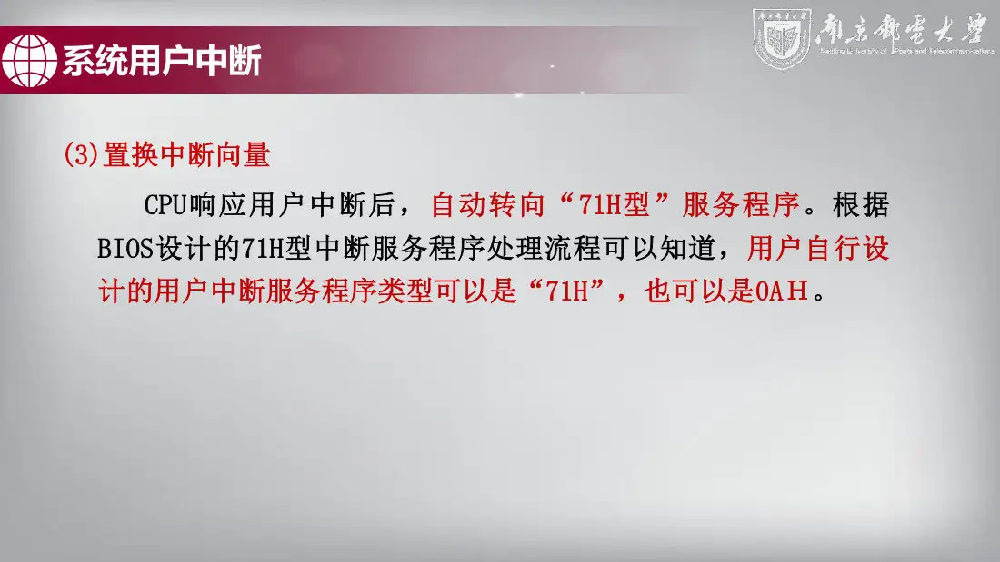

原文：

(3) 置换中断向量

CPU响应用户中断后，自动转向“71H型”服务程序。根据BIOS设计的71H型中断服务程序处理流程可以知道，用户自行设计的用户中断服务程序类型可以是“71H”，也可以是0AH。

系统用户中断

南京邮电大学
Nanjing University of Posts and Telecommunications

### 系统用户中断

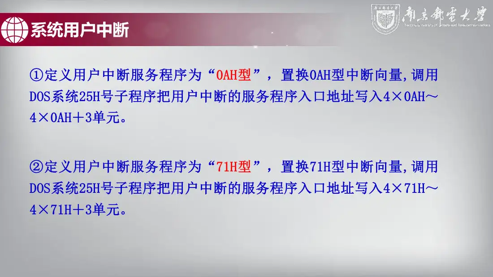

原文：

①定义用户中断服务程序为 “OAH型”，置换OAH型中断向量，调用DOS系统25H号子程序把用户中断的服务程序入口地址写入4×OAH～4×OAH+3单元。

②定义用户中断服务程序为 “71H型”，置换71H型中断向量，调用DOS系统25H号子程序把用户中断的服务程序入口地址写入4×71H～4×71H+3单元。

系统用户中断

南京邮电大学
Nanjing University of Posts and Telecommunications

### （4）用户中断服务程序结束，向8259A写结束字。

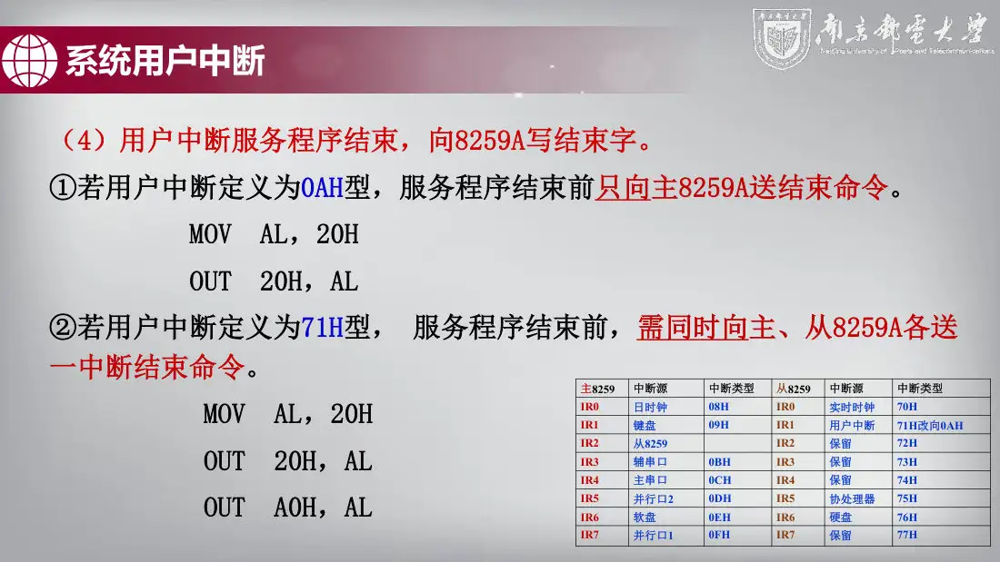

原文：

（4）用户中断服务程序结束，向8259A写结束字。

①若用户中断定义为0AH型，服务程序结束前只向主8259A送结束命令。

MOV AL, 20H

OUT 20H, AL

②若用户中断定义为71H型，服务程序结束前，需同时向主、从8259A各送一中断结束命令。

MOV AL, 20H

OUT 20H, AL

OUT AOH, AL

<table><tr><td>主8259</td><td>中断源</td><td>中断类型</td><td>从8259</td><td>中断源</td><td>中断类型</td></tr><tr><td>IR0</td><td>日时钟</td><td>08H</td><td>IR0</td><td>实时时钟</td><td>70H</td></tr><tr><td>IR1</td><td>键盘</td><td>09H</td><td>IR1</td><td>用户中断</td><td>71H改向0AH</td></tr><tr><td>IR2</td><td>从8259</td><td></td><td>IR2</td><td>保留</td><td>72H</td></tr><tr><td>IR3</td><td>辅串口</td><td>0BH</td><td>IR3</td><td>保留</td><td>73H</td></tr><tr><td>IR4</td><td>主串口</td><td>0CH</td><td>IR4</td><td>保留</td><td>74H</td></tr><tr><td>IR5</td><td>并行口2</td><td>0DH</td><td>IR5</td><td>协处理器</td><td>75H</td></tr><tr><td>IR6</td><td>软盘</td><td>0EH</td><td>IR6</td><td>硬盘</td><td>76H</td></tr><tr><td>IR7</td><td>并行口1</td><td>0FH</td><td>IR7</td><td>保留</td><td>77H</td></tr></table>

系统用户中断

南京邮电大学
Nanjing University of Posts and Telecommunications

### 知识点小结

原文：

知识点小结

本节主要介绍了系统用户中断的相关内容。通过本节的学习，学习者应该了解系统用户中断的中断源，中断类型以及系统用户处理流程，掌握系统用户中断的开发应用。

系统用户中断

南京邮电大学
Nanjing University of Posts and Telecommunications

### 知识要点

原文：

知识要点

✿ 0AH型中断的开发设计思路

✿ 0AH型中断的应用程序流程图

✿ 0AH型中断的应用程序清单

✿ 0AH型中断的应用程序分析

用户中断应用开发举例

南京邮电大学
Nanjing University of Posts and Telecommunications

### 用户中断应用开发举例

原文：

【例】一外扩8254 0号计数器输出是周期为100ms的方波，将该8254的OUTO接至系统总线插槽B4端子，如下图所示。利用该8254的OUTO输出作为定时中断源，编程实现每隔1秒在屏幕上显示字符串‘HELLO’，主机有按键时显示结束。

用户中断应用开发举例

南京邮电大学
Nanjing University of Posts and Telecommunications

### 一、设计思路

原文：

一、设计思路

该中断请求是经B4端子接入的，CPU响应后转入71H型中断服务程序，并在其中执行软件中断INT OAH。

BIOS设计的71H型中断服务程序处理流程如下:

①开中断、保护现场；

②向从8259A发出中断结束命令

MOV AL, 20H

OUT AOH, AL

③执行INT OAH，转向OAH服务程序。

用户中断应用开发举例

南京邮电大学
Nanjing University of Posts and Telecommunications

### 为此，需要进行的操作为：

原文：

所以，本例中可以定义用户服务程序的类型为OAH。并且设定1个计数变量，每当B4端子接收到第10次（100ms\*10=1s）用户中断，在自定义的中断服务程序中完成1次字符串显示。

为此，需要进行的操作为：

用户中断应用开发举例

南京邮电大学
Nanjing University of Posts and Telecommunications

### ① 保存原来系统OAH中断向量到数据段OLDOA双字单元；

原文：

① 保存原来系统OAH中断向量到数据段OLDOA双字单元；

<table><tr><td rowspan="6">READOA</td><td>PROC</td><td></td><td>;转移系统0AH型中断向量</td></tr><tr><td>MOV</td><td>AX, 350AH</td><td></td></tr><tr><td>INT</td><td>21H</td><td></td></tr><tr><td>MOV</td><td>WORD PTR OLDOA, BX</td><td></td></tr><tr><td>MOV</td><td>WORD PTR OLDOA+2, ES</td><td></td></tr><tr><td>RET</td><td></td><td></td></tr><tr><td>READOA</td><td>ENDP</td><td></td><td></td></tr></table>

用户中断应用开发举例

南京邮电大学
Nanjing University of Posts and Telecommunications

### ②置换0AH中断向量使其指向用户自行设计的中断服务程序；

原文：

②置换0AH中断向量使其指向用户自行设计的中断服务程序；

<table><tr><td>WRITEOA</td><td>PROC</td><td>;写入用户0AH型中断向量</td></tr><tr><td></td><td>PUSH</td><td>DS</td></tr><tr><td></td><td>MOV</td><td>AX, CODE</td></tr><tr><td></td><td>MOV</td><td>DS, AX</td></tr><tr><td></td><td>MOV</td><td>DX, OFFSET SERVICE</td></tr><tr><td></td><td>MOV</td><td>AX, 250AH</td></tr><tr><td></td><td>INT</td><td>21H</td></tr><tr><td></td><td>POP</td><td>DS</td></tr><tr><td></td><td>RET</td><td></td></tr><tr><td>WRITEOA</td><td>ENDP</td><td></td></tr></table>

用户中断应用开发举例

南京邮电大学
Nanjing University of Posts and Telecommunications

### ③打开用户中断;

原文：

③打开用户中断;

I8259A PROC IN AL, A1H AND AL, 11111101B OUT OA1H, AL IN AL, 21H AND AL, 11111011B OUT 21H, AL RET I8259A ENDP

; 从8259A IMR1置0

; 主8259A IMR2置0

用户中断应用开发举例

南京邮电大学
Nanjing University of Posts and Telecommunications

### ④ 中断服务程序每执行10次时在其中显示1次字符串(10x100ms=1s);

原文：

④ 中断服务程序每执行10次时在其中显示1次字符串(10x100ms=1s);

⑤ 服务程序结束前向主8259A送结束命令；

<table><tr><td rowspan="11">SERVICE</td><td>PROC</td><td></td><td></td></tr><tr><td>PUSHA</td><td></td><td>;保护现场</td></tr><tr><td>PUSH</td><td>DS</td><td>;DS=40H</td></tr><tr><td>MOV</td><td>AX, DATA</td><td></td></tr><tr><td>MOV</td><td>DS, AX</td><td>;重新给DS赋值</td></tr><tr><td>DEC</td><td>ICOUNT</td><td>;中断计数</td></tr><tr><td>JNZ</td><td>EXIT</td><td>;不满10次转</td></tr><tr><td>MOV</td><td>ICOUNT, 10</td><td></td></tr><tr><td>MOV</td><td>AH, 9</td><td>;显示字符串</td></tr><tr><td>LEA</td><td>DX, MESG</td><td></td></tr><tr><td>INT</td><td>21H</td><td></td></tr></table>

用户中断应用开发举例

南京邮电大学
Nanjing University of Posts and Telecommunications

### 用户中断应用开发举例

原文：

<table><tr><td rowspan="5">EXIT:</td><td>MOV</td><td>AL, 20H</td><td></td></tr><tr><td>OUT</td><td>20H, AL</td><td>;给主8259A写结束字</td></tr><tr><td>POP</td><td>DS</td><td>;恢复现场</td></tr><tr><td>POPA</td><td></td><td></td></tr><tr><td>IRET</td><td></td><td>;返回系统71型中断服务程序</td></tr><tr><td>SERVICE</td><td>ENDP</td><td></td><td></td></tr></table>

用户中断应用开发举例

南京邮电大学
Nanjing University of Posts and Telecommunications

### ⑥ 在返回操作系统前恢复原来保存的OAH中断向量。

原文：

⑥ 在返回操作系统前恢复原来保存的OAH中断向量。

<table><tr><td>RESET</td><td>PROC</td><td></td><td>;恢复系统0AH型中断向量</td></tr><tr><td></td><td>MOV</td><td>DX, WORD PTR OLDOA</td><td></td></tr><tr><td></td><td>MOV</td><td>DS, WORD PTR OLDOA+2</td><td></td></tr><tr><td></td><td>MOV</td><td>AX, 250AH</td><td></td></tr><tr><td></td><td>INT</td><td>21H</td><td></td></tr><tr><td></td><td>RET</td><td></td><td></td></tr><tr><td>RESET</td><td>ENDP</td><td></td><td></td></tr></table>

用户中断应用开发举例

南京邮电大学
Nanjing University of Posts and Telecommunications

### 二、程序流程图

原文：

二、程序流程图

主程序

关中断（CLI）  
保存系统的OAH型中断向量  
写入用户的OAH型中断向量  
开放用户中断  
开中断（STI）

有键入？

恢复系统OAH型中断向量
返回DOS

OAH型中断服务子程序

保护现场  
重新定义用户数据段  
中断计数

满10次？

计数单元重新置为10显示一行‘HELLO!’

恢复现场
给主8259写结束字
中断返回（IRET）

用户中断应用开发举例

南京邮电大学
Nanjing University of Posts and Telecommunications

### 三、程序清单

原文：

三、程序清单

<table><tr><td>DATA</td><td>SEGMENT</td><td>USE16</td><td></td></tr><tr><td>MESG</td><td>DB</td><td>‘HELLO!’,ODH,OAH,&#x27;$’</td><td></td></tr><tr><td>OLDOA</td><td>DD</td><td>?</td><td></td></tr><tr><td>ICOUNT</td><td>DB</td><td>10</td><td>;中断计数初值</td></tr><tr><td>DATA</td><td>ENDS</td><td></td><td></td></tr><tr><td>CODE</td><td>SEGMENT</td><td>USE16</td><td></td></tr><tr><td></td><td>ASSUME</td><td>CS:CODE,DS:DATA</td><td></td></tr><tr><td>BEG:</td><td>MOV</td><td>AX,DATA</td><td></td></tr><tr><td></td><td>MOV</td><td>DS,AX</td><td></td></tr><tr><td></td><td>CLI</td><td></td><td>;关中断</td></tr><tr><td></td><td>CALL</td><td>READOA</td><td>;保存OAH醒中断向量</td></tr><tr><td></td><td>CALL</td><td>WRITEOA</td><td>;更新OAH醒中断向量</td></tr></table>

用户中断应用开发举例

南京邮电大学
Nanjing University of Posts and Telecommunications

### 用户中断应用开发举例

原文：

<table><tr><td></td><td>CALL</td><td>I8259A</td><td>; 8259中断屏蔽设置</td></tr><tr><td></td><td>STI</td><td></td><td>; 开中断</td></tr><tr><td rowspan="6">SCAN:</td><td>MOV</td><td>AH, 1</td><td></td></tr><tr><td>INT</td><td>16H</td><td>; 是否有键入</td></tr><tr><td>JZ</td><td>SCAN</td><td>; 无键入,转</td></tr><tr><td>CALL</td><td>RESET</td><td>; 有键入,结束</td></tr><tr><td>MOV</td><td>AH, 4CH</td><td></td></tr><tr><td>INT</td><td>21H</td><td></td></tr><tr><td rowspan="7">; SERVICE</td><td>PROC</td><td></td><td></td></tr><tr><td>PUSHA</td><td></td><td>; 保护现场</td></tr><tr><td>PUSH</td><td>DS</td><td>; DS=40H</td></tr><tr><td>MOV</td><td>AX, DATA</td><td></td></tr><tr><td>MOV</td><td>DS, AX</td><td>; 重新给DS赋值</td></tr><tr><td>DEC</td><td>ICOUNT</td><td>; 中断计数</td></tr><tr><td>JNZ</td><td>EXIT</td><td>; 不满10次转</td></tr></table>

用户中断应用开发举例

南京邮电大学
Nanjing University of Posts and Telecommunications

### 用户中断应用开发举例

原文：

<table><tr><td></td><td>MOV</td><td>ICOUNT, 10</td><td></td></tr><tr><td></td><td>MOV</td><td>AH, 9</td><td>; 显示字符串</td></tr><tr><td></td><td>LEA</td><td>DX, MESG</td><td></td></tr><tr><td></td><td>INT</td><td>21H</td><td></td></tr><tr><td>EXIT:</td><td>MOV</td><td>AL, 20H</td><td></td></tr><tr><td></td><td>OUT</td><td>20H, AL</td><td>; 给主8259A写结束字</td></tr><tr><td></td><td>POP</td><td>DS</td><td>; 恢复现场</td></tr><tr><td></td><td>POPA</td><td></td><td></td></tr><tr><td></td><td>IRET</td><td></td><td>; 返回系统71型中断服务程序</td></tr><tr><td>SERVICEREADOA</td><td>ENDPPROC</td><td></td><td>;转移系统OAH型中断向量</td></tr><tr><td rowspan="5"></td><td>MOV</td><td>AX, 350AH</td><td rowspan="6"></td></tr><tr><td>INT</td><td>21H</td></tr><tr><td>MOV</td><td>WORD PTR OLDOA, BX</td></tr><tr><td>MOV</td><td>WORD PTR OLDOA+2, ES</td></tr><tr><td>RET</td><td></td></tr><tr><td>READOA</td><td>ENDP</td><td></td></tr></table>

用户中断应用开发举例

南京邮电大学
Nanjing University of Posts and Telecommunications

### 用户中断应用开发举例

原文：

用户中断应用开发举例

南京邮电大学
Nanjing University of Posts and Telecommunications

### ;写入用户OAH型中断向量

原文：

<table><tr><td rowspan="9">WRITEOA</td><td>PROC</td><td></td></tr><tr><td>PUSH</td><td>DS</td></tr><tr><td>MOV</td><td>AX, CODE</td></tr><tr><td>MOV</td><td>DS, AX</td></tr><tr><td>MOV</td><td>DX, OFFSET SERVICE</td></tr><tr><td>MOV</td><td>AX, 250AH</td></tr><tr><td>INT</td><td>21H</td></tr><tr><td>POP</td><td>DS</td></tr><tr><td>RET</td><td></td></tr><tr><td>WRITEOA</td><td>ENDP</td><td></td></tr></table>

;写入用户OAH型中断向量

用户中断应用开发举例

南京邮电大学
Nanjing University of Posts and Telecommunications

### 用户中断应用开发举例

原文：

<table><tr><td>I8259A</td><td>PROC</td><td></td><td></td></tr><tr><td></td><td>IN</td><td>AL, 0A1H</td><td></td></tr><tr><td></td><td>AND</td><td>AL, 11111101B</td><td></td></tr><tr><td></td><td>OUT</td><td>0A1H, AL</td><td>;从8259A IMR1置0</td></tr><tr><td></td><td>IN</td><td>AL, 21H</td><td></td></tr><tr><td></td><td>AND</td><td>AL, 11111011B</td><td></td></tr><tr><td></td><td>OUT</td><td>21H, AL</td><td>;主8259A IMR2置0</td></tr><tr><td></td><td>RET</td><td></td><td></td></tr><tr><td>I8259A</td><td>ENDP</td><td></td><td></td></tr></table>

用户中断应用开发举例

南京邮电大学
Nanjing University of Posts and Telecommunications

### 用户中断应用开发举例

原文：

<table><tr><td rowspan="6">RESET</td><td>PROC</td><td></td><td>; 恢复系统OAH型中断向量</td></tr><tr><td>MOV</td><td>DX, WORD PTR OLDOA</td><td></td></tr><tr><td>MOV</td><td>DS, WORD PTR OLDOA+2</td><td></td></tr><tr><td>MOV</td><td>AX, 250AH</td><td></td></tr><tr><td>INT</td><td>21H</td><td></td></tr><tr><td>RET</td><td></td><td></td></tr><tr><td>RESET</td><td>ENDP</td><td></td><td></td></tr><tr><td rowspan="2">CODE</td><td>ENDS</td><td></td><td></td></tr><tr><td>END</td><td>BEG</td><td></td></tr></table>

用户中断应用开发举例

南京邮电大学
Nanjing University of Posts and Telecommunications

### 四、程序分析

原文：

四、程序分析

①程序的执行过程如下图所示。

用户中断应用开发举例

南京邮电大学
Nanjing University of Posts and Telecommunications

### ③RESET子程序中

原文：

②在进入用户定义的中断服务程序后，需要保存DS并重新对DS进行赋值。在中断返回前，需要恢复DS。

③RESET子程序中

MOV DX, WORD PTR OLDOA和

MOV DS, WORD PTR OLDOA+2

两条指令先后顺序不可颠倒。

④用户定义的中断服务程序中需要对系统主8259A写中断结束命令字。

用户中断应用开发举例

南京邮电大学
Nanjing University of Posts and Telecommunications

### 知识点小结

原文：

知识点小结

本节通过一个具体的例子，介绍了系统用户0AH型中断的应用开发方法。通过本节的学习，学习者应该掌握0AH型中断应用开发的设计思路，并能熟练针对用户中断源，设计0AH型用户中断程序。

用户中断应用开发举例

南京邮电大学
Nanjing University of Posts and Telecommunications

### (1) 中断申请信号是从哪儿来的?

原文：

(1) 中断申请信号是从哪儿来的?

(2) 中断申请信号接到哪儿去?

(3) 分析中断类型码

(4) 中断程序设计: 主程序的设计, 中断服务子程序的设计

中断程序设计思路总结

南京邮电大学
Nanjing University of Posts and Telecommunications

### 主程序

原文：

主程序

关中断  
\*开放8259  
置换中断向量  
其他准备工作  
开中断

等待中断

程序结束前

屏蔽8259恢复中断向量返回DOS

\* 表示视具体情况而定

中断服务程序

保护现场

执行中断操作

\*向8259A送结束命令
恢复现场
IRET

避免DOS
重入

中断程序结构

南京邮電大學
Nanjing University of Posts and Telecommunications

### 知识要点

原文：

知识要点

键盘中断源

键盘中断类型

◆ 键盘中断处理流程

系统键盘中断

南京邮电大学
Nanjing University of Posts and Telecommunications

### PC系列机中可屏蔽中断

原文：

PC系列机中可屏蔽中断

南京邮电大学
Nanjing University of Posts and Telecommunications

### 一、中断源

原文：

一、中断源

系统键盘中断源是主板键盘接口电路。

键盘电路

主板键盘接口电路

系统键盘中断

南京邮电大学
Nanjing University of Posts and Telecommunications

### 二、中断类型

原文：

二、中断类型

键盘中断的中断请求接至系统主8259A的IR1。

键盘中断的中断类型是：09H。

系统键盘中断

南京邮电大学
Nanjing University of Posts and Telecommunications

### ※ 键盘中断全过程:

原文：

※ 键盘中断全过程:

键盘中断

主板
键盘接口电路

IR1 主8259A

并行扫描码

CPU

INTR
DB7\~0

串行扫描码

键盘电路

键盘接口分2部分:

一部分装在键盘盒内——键盘电路

另一部分装在主机板——键盘接口电路，2 部分之间通过5芯电源连接。

系统键盘中断

南京邮电大学
Nanjing University of Posts and Telecommunications

### 键盘中断

原文：

键盘中断

主板
键盘接口电路

IR1 主8259A

并行扫描码

INTR
DB7\~0

串行扫描码

键盘电路

键盘电路以单片机为核心，加电后固化在单片机内部的键盘扫描程序，不断扫描每一个按键，一旦有键闭合，就把闭合键的扫描码（位置码）→ 键盘接口电路。

系统键盘中断

南京邮电大学
Nanjing University of Posts and Telecommunications

CPU

### 键盘中断

原文：

键盘中断

主板
键盘接口电路

IR1 主8259A

CPU

并行扫描码

INTR
DB7\~0

串行扫描码

键盘电路

键盘接口电路:

① 把串行扫描码通过移位寄存器转换成并行扫描码 $\rightarrow$ 口地址为60H的端口寄存器

② 串并转换完毕，向主8259提中断请求

③ CPU响应后，转9型服务程序

系统键盘中断

南京邮电大学
Nanjing University of Posts and Telecommunications

### 三、键盘中断处理流程

原文：

三、键盘中断处理流程

BIOS设计的09H型中断服务程序处理流程如下:

①开中断、保护现场;

②从键盘接口电路（口地址60H）读取按键扫描码；

③分析、处理按键扫描码,生成相应的键代码存入键盘缓冲区。

④向主8259A发常规中断结束命令

MOV AL, 20H

OUT 20H, AL

⑤恢复现场，执行IRET命令。

系统键盘中断

南京邮电大学
Nanjing University of Posts and Telecommunications

### 键盘缓冲区

原文：

键盘缓冲区

BIOS规定：系统RAM 40:1EH～40:3DH为键盘缓冲区共32个单元，实际使用30个单元，存放15个键的键代码。键盘缓冲区是以“先进先出”的规则存取。

由9型中断服务程序写入键代码，用户用INT 16H访问键盘缓冲区，∴键盘缓冲区是9型硬中断和INT 16H软中断之间交换信息的缓冲区。

系统键盘中断

南京邮电大学
Nanjing University of Posts and Telecommunications

### 由键盘中断处理程序写入键代码

原文：

由键盘中断处理程序写入键代码

$$
\begin{array}{c c} \times & \times \\ \times & \times \\ \times & \times \\ \times & \times \end{array}
$$

键盘缓冲区
40:1E～40:3D

由INT 16H读取键代码

系统键盘中断

南京邮电大学
Nanjing University of Posts and Telecommunications

### 知识要点

原文：

知识要点

硬件中断和软件中断的相同点

硬件中断和软件中断的区别

硬件中断和软件中断的区别

南京邮电大学
Nanjing University of Posts and Telecommunications

### 一、硬件中断和软件中断的相同点

原文：

一、硬件中断和软件中断的相同点

(1) 都会引起程序中止。

(2) CPU获得中断类型码n后, 自动从 $4 \times n \sim 4 \times n + 3$ 单元取出该中断源的中断向量 $\rightarrow$ IP、CS, 从而执行该中断源的中断服务程序。

硬件中断和软件中断的区别

南京邮电大学
Nanjing University of Posts and Telecommunications

### 二、硬件中断和软件中断的区别

原文：

二、硬件中断和软件中断的区别

(1) 中断的引发方式不同

硬件中断是由CPU以外的设备发出的接到引脚INTR和NMI上的中断请求信号而引发的，而软件中断是由于CPU执行INT n指令而引发的。

硬件中断和软件中断的区别

南京邮电大学
Nanjing University of Posts and Telecommunications

### 二、硬件中断和软件中断的区别

原文：

二、硬件中断和软件中断的区别

(2) CPU获取中断类型码的方式不同

可屏蔽硬件中断, 中断类型码是由中断控制器8259A提供; 非屏蔽硬件中断类型码（编号2）自动产生;

软件中断, 中断类型码是由软件中断指令INT n本身提供的。

硬件中断和软件中断的区别

南京邮电大学
Nanjing University of Posts and Telecommunications

### 二、硬件中断和软件中断的区别

原文：

二、硬件中断和软件中断的区别

(3) CPU响应的条件不同

可屏蔽硬件中断是可以被屏蔽的，只有在CPU开中断时,才能响应；非屏蔽硬件中断和软件中断不能被屏蔽。

硬件中断和软件中断的区别

南京邮电大学
Nanjing University of Posts and Telecommunications

### 二、硬件中断和软件中断的区别

原文：

二、硬件中断和软件中断的区别

(4) 中断处理程序的结束方式不同

在硬件可屏蔽中断服务程序中, 中断处理结束后, 首先需要向8259A发出中断结束命令, 然后执行IRET指令, 中断返回。

在软件中断服务程序中，中断处理结束后只需执行IRET指令。

硬件中断和软件中断的区别

南京邮电大学
Nanjing University of Posts and Telecommunications

### 知识点小结

原文：

知识点小结

本节主要介绍了硬件中断和软件中断的相同点和不同点。希望同学们在理解中断系统所学的硬件中断和软件中断原理的基础上掌握两者的相同点和不同点。

硬件中断和软件中断的区别

南京邮电大学
Nanjing University of Posts and Telecommunications

### ◆ 实时时钟中断

原文：

◆ 实时时钟中断

系统用户中断源

系统用户中断类型

系统用户中断处理流程

系统用户中断开发应用

硬件中断和软件中断的区别

✿ 0AH型中断的开发设计思路

✿ 0AH型中断的应用程序流程图

✿ 0AH型中断的应用程序清单

✿ 0AH型中断的应用程序分析

总结

南京邮电大学
Nanjing University of Posts and Telecommunications

### 课后作

原文：

课后作

4. 在某微机系统中，拟采用 8254、8259A 芯片实现每隔 1000ms 在屏幕上显示“NJUPT2021”的应用。该微机系统外扩了一个 8254 芯片，该 8254 芯片每隔 1000ms 向电路输出一个方波，输入到 B4 端子，接入微机系统的从 8259A 芯片的 IR1 作为外部中断请求源。具体电路图如下所示。要求：分析应用需求及以下电路图，编写以下程序（共 14 分）。

（1）若采用 BCD 码的初值写入方式，编写程序段实现 8254 芯片的初始化。（6 分）

（2）编写子程序，对主从 8259A 编写程序段以开放用户中断。（8 分）

南京邮電大學
Beijing University of Posts and Telecommunications
