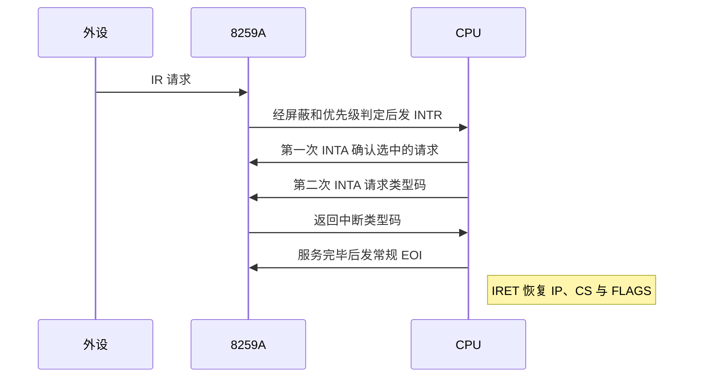

# 《微型计算机原理与接口技术》第8-3章 中断系统（课件）

**补充：** 以下是按原课件页码整理的导读、订正和课后题参考解答。代码清单、板级接线及原课件每一页均可在文末逐页核对。这里讨论的是课件采用的早期 PC/AT 兼容机、实模式和传统 8259A 级联，不把其中的 IRQ 路由或向量号推广到现代机器。

## 一次中断要经过三道门

原课件第 3–15 页从 8259A 的内部结构一直讲到 CPU 响应。不妨先问：外设已经举手，为什么 CPU 还可能没有进服务程序？因为==设备有待处理事件、控制器允许并选中请求、CPU 受理==是三件不同的事。

| 位置 | 保存或判断什么 | 常见误读 |
| --- | --- | --- |
| IRR（中断请求寄存器） | 哪些线路有尚待确认的请求 | 有请求不等于有权被选中 |
| IMR（中断屏蔽寄存器） | 每路是否参与判优；位为 1 表示屏蔽 | 清零才是开放，且不替代 CPU 开中断 |
| ISR（中断服务寄存器） | 哪些请求已经确认、尚在服务；参与优先级判断 | 这是控制器里的寄存器，不是 CPU 正在执行的服务程序本身 |
| CPU 的 IF | CPU 在允许受理的指令边界上是否接受 INTR | 不能用它屏蔽 NMI，也不能用它阻止当前指令执行 `INT n` |

以 8086 模式下正常受理的可屏蔽请求为例，第一拍 INTA 让控制器确认胜出的请求，第二拍取得类型码。实模式 CPU 在 [中断向量表](../../../topics/微机接口/zhongduan-xiangliang-yu-zhan.md) 中以 $4n$ 为表项起点，读出 IP 和 CS。INTR 受理、用类型码定位表项、保存返回现场是 CPU 侧的工作；常规 EOI 清控制器的服务状态，`IRET` 恢复 CPU 侧现场，不能互相替代。



一片有 8 条外部请求线；每接一片从片就把主片一条直连线换成八条从片线。接 $s$ 片从片时，可接 $8-s+8s$ 路外设请求，所以一从为 15 路、八从为 64 路；不能把已用于接从片的主片输入再算一遍。PC/AT 用主片 IR2 承接从片；因此要接通从片 IR1，必须==两个 IMR 位都清零==，而不是任选其中一片。这和 [数据交换方式](../../../topics/微机接口/xinxi-jiaohuan.md) 中“设备就绪不等于处理器正在服务”的区分相通。

## 同样叫时钟，为什么处理方式不一样

| 原页 | 硬件入口 | 由谁处理、怎样扩展 |
| --- | --- | --- |
| 16–37：日时钟 | 主板 PIT 通道 0 → 主片 IR0 → 08H | BIOS 更新 `0040H:006CH` 起始的四字节计数并调用 `INT 1CH`。做普通周期通知优先用 1CH 钩子；直接替换 08H 则要按约定接回旧处理程序，保留 BIOS 的计时和 EOI。 |
| 38–43：实时时钟 | RTC → 从片 IR0 → 主片 IR2 → 70H | 周期事件按配置的频率重复；闹钟按预置时间触发。处理程序读 RTC 状态 C 确认来源并清除相应标志，BIOS 报警处理可调用 `INT 4AH`；常规级联结束要清两片的服务状态。 |
| 44–79：外接用户中断 | ISA B4（IRQ9）→ 从片 IR1 → 主片 IR2 → 71H | 本课件的兼容处理程序从 71H 转到 `INT 0AH`；选 0AH 钩子还是接管 71H 会改变 EOI 分工。 |
| 80–89：键盘 | 键盘接口 → 主片 IR1 → 09H | 硬件服务从 [端口](../../../topics/微机接口/duankou-gainian.md) 60H 读扫描码，处理后把键码放进 BIOS 环形队列；`INT 16H` 是读队列的软件接口，不是让键盘重新打一遍中断。 |

**订正（第 21、31、40、55 页）：**

- 把钩子从 1CH 换到 08H 并不会改变 PIT 产生事件的频率。原例按 55 ms 近似，18 次是 990 ms；用典型 PC 名义时钟 1.193182 MHz、分频数 65536 计算，每次约 54.925 ms，18 次约 988.66 ms，10 个这样的间隔共约 9.887 秒，不是精确的十秒。平均周期可用带余数的节拍累加减小漂移，但分辨率仍以节拍为限。要得到更短的硬件周期，需要另配定时源，或改变 PIT 分频并补偿 BIOS 的时基，不能只换向量。
- 第 40 页分频基准与输出频率的单位误植；此处是 32.768 kHz 晶振分频后得到 **1024 Hz**（此处配置的周期频率），每次约 **976.5625 微秒**，不是 1024 kHz。周期中断与报警允许位是两路不同条件。
- 第 55 页给出了直接接管 71H 时向两片都发 EOI 的例子；通常采用==先从片、再主片==的顺序，使子级服务状态先清除，再释放主片上的级联入口。若保留第 49 页所示的 BIOS 兼容程序、只替换 0AH，从片已经由 71H 兼容程序结束，0AH 钩子只按该约定结束主片。不能在调回承担 EOI 的旧处理程序之前再重复发同一 EOI。

> [!WARNING]
> 第 22–37、58–77 页的计次数方法可独立验证；例程在硬件中断路径里直接用 `INT 21H` 显示则不宜照搬，第 79 页本身也提醒避免 DOS 重入。更稳妥的是让短服务程序更新计数或待显示事件数；由前台安全取走事件并输出，恢复旧向量和原屏蔽位后再退出。被打断时的 DS 未必是自己的数据段，保存、装入、恢复要成对。

## 两个“每秒显示”例子与课后题

**补充（第 22 页例题核算）：** 1CH 和 08H 方案都可每 18 个 BIOS 节拍登记一个事件；初值 18，每个节拍递减一次，归零登记并重装，前台处理满 10 个事件停止。用 1CH 时，由 BIOS 原 08H 路径负责 EOI。若钩住 08H 且尾跳转到原处理程序，要先恢复自己动过的现场，原处理程序将使用 CPU 当初压入的现场返回。

**补充（第 58 页例题核算）：** 外接通道 0 已提供 100 ms 的方波，B4 上升沿间隔为 100 ms。每 10 次登记一个显示事件；前台还负责检查按键决定退出。与日时钟例题相比，计数仍是“目标时间除以事件周期”，但请求走 IRQ9，不再由 BIOS 的 08H 或 1CH 提供节拍。


**参考解答（第 98 页第 4 题）：**

1. 题面的线索是==CLK1 为 1 kHz、OUT1 输出周期 1000 ms 的方波、采用 BCD==。一个周期需要 $1000\text{ Hz}\times 1\text{ s}=1000$ 个输入脉冲。方波用方式 3；偶数初值 1000 的高、低各为 500 个输入脉冲，每周期只有一次上升沿。控制字按“通道 1（01）、先低后高（11）、方式 3（011）、BCD（1）”拼成 77H。计数初值 1000 的压缩 BCD 为 1000H，==不是== 1000 的二进制值 03E8H。图中 A1/A0 直连，对应端口 208H、209H、20AH、20BH；通道 1 用 209H，控制口用 20BH。大于 FFH 的端口地址通过 DX 指定：

   ```asm
   MOV DX, 20BH
   MOV AL, 77H
   OUT DX, AL
   MOV DX, 209H
   MOV AL, 00H
   OUT DX, AL
   MOV AL, 10H
   OUT DX, AL
   ```

2. 顺着图读线：OUT1 → B4 → 从片 IR1 → 主片 IR2。系统 PIC 已初始化，只需修改各自屏蔽位，读改写可保留其他 IRQ 的状态，不能重写整字节或重发初始化字。子程序保留 AX 和调用者的 IF；应在处理入口和外设就绪后才开放。若要临时占用该线路，调用端还应保存并在退出时恢复原 IMR 位。

   ```asm
   OpenUserIRQ PROC
       PUSHF
       CLI
       PUSH AX
       IN   AL, 0A1H
       AND  AL, 0FDH       ; 从片 IR1：只清位 1
       OUT  0A1H, AL
       IN   AL, 21H
       AND  AL, 0FBH       ; 主片 IR2：只清位 2
       OUT  21H, AL
       POP  AX
       POPF
       RET
   OpenUserIRQ ENDP
   ```

   每一个稳态上升沿已是一秒，无需再除以十；前台每取走一个事件便显示一次 `NJUPT2021`。若走课件的 71H 兼容转接，EOI 按上面的两段分工；若直接接管 71H，才由自己的服务程序处理两片。配置 PIT 期间可能形成初始电平转换，首个完整一秒与稳态间隔要区分，启用前需按板级约定处理旧请求。第 98 页只要求初始化和开放中断，并未给出这两段参考代码。

> [!TIP]
> 看到三处数字先分清它们是哪一类：209H 是 [独立编址](../../../topics/微机接口/duankou-bianzhi.md) 的端口，IR1 是从片输入，71H 是 CPU 从控制器取得的类型码。设备的接线、向量表地址、发 EOI 用的端口不能用同一个数字替代。

## 最后对比三种入口

原课件第 90–96 页对比硬件、软件中断。INTR 要经过 PIC、受 IF 约束；NMI 不受 IF 控制，采用固定类型码 02H，不由 PIC 提供；`INT n` 的编号来自指令，不产生新的 PIC 服务位。三者的返回仍要保护并恢复 [栈现场](../../../topics/微机接口/duizhan-caozuo.md)。说“软件中断不发 EOI”的前提是它本身没有认领硬件服务责任；第 49 页的 0AH 钩子是沿 71H 硬件链承接主片 EOI 的具体反例，不能脱离来路背口诀。

## 原课件逐页

- 响应与级联：[1](微型计算机原理与接口技术第8-3章-中断系统课件.assets/第1页.webp)、[2](微型计算机原理与接口技术第8-3章-中断系统课件.assets/第2页.webp)、[3](微型计算机原理与接口技术第8-3章-中断系统课件.assets/第3页.webp)、[4](微型计算机原理与接口技术第8-3章-中断系统课件.assets/第4页.webp)、[5](微型计算机原理与接口技术第8-3章-中断系统课件.assets/第5页.webp)、[6](微型计算机原理与接口技术第8-3章-中断系统课件.assets/第6页.webp)、[7](微型计算机原理与接口技术第8-3章-中断系统课件.assets/第7页.webp)、[8](微型计算机原理与接口技术第8-3章-中断系统课件.assets/第8页.webp)、[9](微型计算机原理与接口技术第8-3章-中断系统课件.assets/第9页.webp)、[10](微型计算机原理与接口技术第8-3章-中断系统课件.assets/第10页.webp)、[11](微型计算机原理与接口技术第8-3章-中断系统课件.assets/第11页.webp)、[12](微型计算机原理与接口技术第8-3章-中断系统课件.assets/第12页.webp)、[13](微型计算机原理与接口技术第8-3章-中断系统课件.assets/第13页.webp)、[14](微型计算机原理与接口技术第8-3章-中断系统课件.assets/第14页.webp)、[15](微型计算机原理与接口技术第8-3章-中断系统课件.assets/第15页.webp)
- 日时钟与两种钩法：[16](微型计算机原理与接口技术第8-3章-中断系统课件.assets/第16页.webp)、[17](微型计算机原理与接口技术第8-3章-中断系统课件.assets/第17页.webp)、[18](微型计算机原理与接口技术第8-3章-中断系统课件.assets/第18页.webp)、[19](微型计算机原理与接口技术第8-3章-中断系统课件.assets/第19页.webp)、[20](微型计算机原理与接口技术第8-3章-中断系统课件.assets/第20页.webp)、[21](微型计算机原理与接口技术第8-3章-中断系统课件.assets/第21页.webp)、[22](微型计算机原理与接口技术第8-3章-中断系统课件.assets/第22页.webp)、[23](微型计算机原理与接口技术第8-3章-中断系统课件.assets/第23页.webp)、[24](微型计算机原理与接口技术第8-3章-中断系统课件.assets/第24页.webp)、[25](微型计算机原理与接口技术第8-3章-中断系统课件.assets/第25页.webp)、[26](微型计算机原理与接口技术第8-3章-中断系统课件.assets/第26页.webp)、[27](微型计算机原理与接口技术第8-3章-中断系统课件.assets/第27页.webp)、[28](微型计算机原理与接口技术第8-3章-中断系统课件.assets/第28页.webp)、[29](微型计算机原理与接口技术第8-3章-中断系统课件.assets/第29页.webp)、[30](微型计算机原理与接口技术第8-3章-中断系统课件.assets/第30页.webp)、[31](微型计算机原理与接口技术第8-3章-中断系统课件.assets/第31页.webp)、[32](微型计算机原理与接口技术第8-3章-中断系统课件.assets/第32页.webp)、[33](微型计算机原理与接口技术第8-3章-中断系统课件.assets/第33页.webp)、[34](微型计算机原理与接口技术第8-3章-中断系统课件.assets/第34页.webp)、[35](微型计算机原理与接口技术第8-3章-中断系统课件.assets/第35页.webp)、[36](微型计算机原理与接口技术第8-3章-中断系统课件.assets/第36页.webp)、[37](微型计算机原理与接口技术第8-3章-中断系统课件.assets/第37页.webp)
- 实时时钟：[38](微型计算机原理与接口技术第8-3章-中断系统课件.assets/第38页.webp)、[39](微型计算机原理与接口技术第8-3章-中断系统课件.assets/第39页.webp)、[40](微型计算机原理与接口技术第8-3章-中断系统课件.assets/第40页.webp)、[41](微型计算机原理与接口技术第8-3章-中断系统课件.assets/第41页.webp)、[42](微型计算机原理与接口技术第8-3章-中断系统课件.assets/第42页.webp)、[43](微型计算机原理与接口技术第8-3章-中断系统课件.assets/第43页.webp)
- 用户中断、例程与程序布局：[44](微型计算机原理与接口技术第8-3章-中断系统课件.assets/第44页.webp)、[45](微型计算机原理与接口技术第8-3章-中断系统课件.assets/第45页.webp)、[46](微型计算机原理与接口技术第8-3章-中断系统课件.assets/第46页.webp)、[47](微型计算机原理与接口技术第8-3章-中断系统课件.assets/第47页.webp)、[48](微型计算机原理与接口技术第8-3章-中断系统课件.assets/第48页.webp)、[49](微型计算机原理与接口技术第8-3章-中断系统课件.assets/第49页.webp)、[50](微型计算机原理与接口技术第8-3章-中断系统课件.assets/第50页.webp)、[51](微型计算机原理与接口技术第8-3章-中断系统课件.assets/第51页.webp)、[52](微型计算机原理与接口技术第8-3章-中断系统课件.assets/第52页.webp)、[53](微型计算机原理与接口技术第8-3章-中断系统课件.assets/第53页.webp)、[54](微型计算机原理与接口技术第8-3章-中断系统课件.assets/第54页.webp)、[55](微型计算机原理与接口技术第8-3章-中断系统课件.assets/第55页.webp)、[56](微型计算机原理与接口技术第8-3章-中断系统课件.assets/第56页.webp)、[57](微型计算机原理与接口技术第8-3章-中断系统课件.assets/第57页.webp)、[58](微型计算机原理与接口技术第8-3章-中断系统课件.assets/第58页.webp)、[59](微型计算机原理与接口技术第8-3章-中断系统课件.assets/第59页.webp)、[60](微型计算机原理与接口技术第8-3章-中断系统课件.assets/第60页.webp)、[61](微型计算机原理与接口技术第8-3章-中断系统课件.assets/第61页.webp)、[62](微型计算机原理与接口技术第8-3章-中断系统课件.assets/第62页.webp)、[63](微型计算机原理与接口技术第8-3章-中断系统课件.assets/第63页.webp)、[64](微型计算机原理与接口技术第8-3章-中断系统课件.assets/第64页.webp)、[65](微型计算机原理与接口技术第8-3章-中断系统课件.assets/第65页.webp)、[66](微型计算机原理与接口技术第8-3章-中断系统课件.assets/第66页.webp)、[67](微型计算机原理与接口技术第8-3章-中断系统课件.assets/第67页.webp)、[68](微型计算机原理与接口技术第8-3章-中断系统课件.assets/第68页.webp)、[69](微型计算机原理与接口技术第8-3章-中断系统课件.assets/第69页.webp)、[70](微型计算机原理与接口技术第8-3章-中断系统课件.assets/第70页.webp)、[71](微型计算机原理与接口技术第8-3章-中断系统课件.assets/第71页.webp)、[72](微型计算机原理与接口技术第8-3章-中断系统课件.assets/第72页.webp)、[73](微型计算机原理与接口技术第8-3章-中断系统课件.assets/第73页.webp)、[74](微型计算机原理与接口技术第8-3章-中断系统课件.assets/第74页.webp)、[75](微型计算机原理与接口技术第8-3章-中断系统课件.assets/第75页.webp)、[76](微型计算机原理与接口技术第8-3章-中断系统课件.assets/第76页.webp)、[77](微型计算机原理与接口技术第8-3章-中断系统课件.assets/第77页.webp)、[78](微型计算机原理与接口技术第8-3章-中断系统课件.assets/第78页.webp)、[79](微型计算机原理与接口技术第8-3章-中断系统课件.assets/第79页.webp)
- 键盘与硬件/软件中断：[80](微型计算机原理与接口技术第8-3章-中断系统课件.assets/第80页.webp)、[81](微型计算机原理与接口技术第8-3章-中断系统课件.assets/第81页.webp)、[82](微型计算机原理与接口技术第8-3章-中断系统课件.assets/第82页.webp)、[83](微型计算机原理与接口技术第8-3章-中断系统课件.assets/第83页.webp)、[84](微型计算机原理与接口技术第8-3章-中断系统课件.assets/第84页.webp)、[85](微型计算机原理与接口技术第8-3章-中断系统课件.assets/第85页.webp)、[86](微型计算机原理与接口技术第8-3章-中断系统课件.assets/第86页.webp)、[87](微型计算机原理与接口技术第8-3章-中断系统课件.assets/第87页.webp)、[88](微型计算机原理与接口技术第8-3章-中断系统课件.assets/第88页.webp)、[89](微型计算机原理与接口技术第8-3章-中断系统课件.assets/第89页.webp)、[90](微型计算机原理与接口技术第8-3章-中断系统课件.assets/第90页.webp)、[91](微型计算机原理与接口技术第8-3章-中断系统课件.assets/第91页.webp)、[92](微型计算机原理与接口技术第8-3章-中断系统课件.assets/第92页.webp)、[93](微型计算机原理与接口技术第8-3章-中断系统课件.assets/第93页.webp)、[94](微型计算机原理与接口技术第8-3章-中断系统课件.assets/第94页.webp)、[95](微型计算机原理与接口技术第8-3章-中断系统课件.assets/第95页.webp)、[96](微型计算机原理与接口技术第8-3章-中断系统课件.assets/第96页.webp)、[97](微型计算机原理与接口技术第8-3章-中断系统课件.assets/第97页.webp)
- 课后作业：[98](微型计算机原理与接口技术第8-3章-中断系统课件.assets/第98页.webp)
