# 《微型计算机接口技术》2017—2018学年第一学期期末复习课件

原件经识别和整理；“参考解答”是我们补的。

---
title: 微型计算机接口技术2017—2018学年第一学期期末复习课件（第1部分）
kind: 复习要点
course: 微型计算机接口技术
term: 2017-2018-1
source: 《微型计算机接口技术》2017—2018学年第一学期期末复习课件
---

# 微型计算机接口技术

2017-2018-1学期 期末复习。南京邮电大学南本部整理。

试卷题型结构：
1. 单项选择题
2. 填空题
3. 简答题
4. 简单应用题
5. 综合应用题

## 第1章 输入/输出系统

### 1. 接口电路的作用和基本功能

接口电路是CPU与外设交换信息的中转站。

知识点：[接口电路的作用和基本功能](../../../topics/微机接口/jiekou-gongneng.md)

### 2. 端口的概念和分类

端口是接口电路中能与CPU直接进行信息交换的寄存器。
分为数据口、控制口和状态口。

知识点：[端口的概念与分类（数据端口、状态端口、控制端口）](../../../topics/微机接口/duankou-gainian.md)、[接口电路的作用和基本功能](../../../topics/微机接口/jiekou-gongneng.md)

### 3. 端口的编址方式

统一编址和独立编址。

知识点：[端口的编址方式（统一编址与独立编址）](../../../topics/微机接口/duankou-bianzhi.md)、[端口的概念与分类（数据端口、状态端口、控制端口）](../../../topics/微机接口/duankou-gainian.md)

### 4. 最常用的IO指令

IN和OUT指令。

知识点：[最常用的I/O指令（IN、OUT的直接寻址与DX间址）](../../../topics/微机接口/io-zhiling.md)

### 5. 微机系统与外部设备之间交换信息的方式

无条件传送、查询方式、中断方式、DMA方式。

知识点：[微机系统与I/O端口的信息交换方式（无条件、查询、中断、DMA）](../../../topics/微机接口/xinxi-jiaohuan.md)

### 查询方式输入/输出编程模式


设：
状态口地址=200H
数据口地址=201H

查询方式输入核心程序：

```assembly
RSCAN:  MOV DX, 200H
        IN  AL, DX
        TEST AL, 80H
        JZ  RSCAN
        MOV DX, 201H
        IN  AL, DX
```

设：
状态口地址 = 200H
数据口地址 = 201H

查询式数据输出核心程序：

```assembly
TSCAN:  MOV DX, 200H
        IN  AL, DX
        TEST AL, 1
        JNZ TSCAN
        MOV DX, 201H
        MOV AL, 'A'
        OUT DX, AL
```

知识点：[80486/8086的寻址方式（立即、寄存器、直接、间接、变址等）](../../../topics/微机接口/xunzhi-fangshi.md)、[最常用的I/O指令（IN、OUT的直接寻址与DX间址）](../../../topics/微机接口/io-zhiling.md)、[查询方式输入输出编程模式与流程](../../../topics/微机接口/chaxun-fangshi.md)

### 6. 8254定时器/计数器

① 掌握8254定时器/计数器的基本结构（三个16位计数器、控制寄存器）和计数器的外部引脚功能（GATE、CLK和OUT）。

8254内部集成了3个16位的计数器，每个计数器有6种工作方式，计数初值可设定为二进制或BCD码。最高工作频率10兆。


**8254内部寄存器读/写操作**

| $\overline{CS}$ | $\overline{RD}$ | $\overline{WR}$ | A1 | A0 | 操作 |
| :---: | :---: | :---: | :---: | :---: | :--- |
| 0 | 1 | 0 | 0 | 0 | 计数初值写入计数器#0 |
| 0 | 1 | 0 | 0 | 1 | 计数初值写入计数器#1 |
| 0 | 1 | 0 | 1 | 0 | 计数初值写入计数器#2 |
| 0 | 1 | 0 | 1 | 1 | 向控制字寄存器写控制字 |
| 0 | 0 | 1 | 0 | 0 | 读计数器#0当前计数值 |
| 0 | 0 | 1 | 0 | 1 | 读计数器#1当前计数值 |
| 0 | 0 | 1 | 1 | 0 | 读计数器#2当前计数值 |
| 0 | 0 | 1 | 1 | 1 | 无操作 |
| 1 | X | X | X | X | 禁止 |
| 0 | 1 | 1 | X | X | 无操作 |

#### 8254与系统总线的连接


I/O端口地址分2段，$A_9 \sim A_2$ 参加译码，译码输出负脉冲。使 $\overline{CS} = 0$ 选中8254。$A_1, A_0$ 直接与芯片的 $A_1, A_0$ 相连，选择片内寄存器。执行IN时从选中的内部寄存器读，执行OUT时向选中的内部寄存器写。

#### 计数器内部结构

当GATE=1时，CLK的下降沿使计数器减1，当计数值减到0（或某个值—由工作方式确定）时，OUT有输出。


② 8254有6种工作方式。
重点：方式2和方式3（启动方式、计数过程以及输出信号的波形和周期）。


$$
\text{周期} = N \times T_{\mathrm{CLK}}
$$

1. 软件启动。
2. 减1计数，减到1时OUT从1 → 0，下一CLK初值自动重装。所以，OUT为周期性波形，输出负脉冲的宽度为一个 $T_{CLK}$，周期 $\tau = N \times T_{CLK}$。

**方式3说明：**
1. 软件启动，减2计数，有初值自动重装功能。
2. N=偶数时，计数值减到0时初值重装，输出1:1连续波形。
3. N=奇数时：
    a) 装入的及重新装入的初值均为写入的初值减1。
    b) 输出正脉冲期间，减到-2时重新装初值。
    c) 输出负脉冲期间，减到0时重新装初值。
    d) 输出正脉冲宽度 $= T_{CLK} \times (N+1)/2$。
    e) 输出负脉冲宽度 $= T_{CLK} \times (N-1)/2$。

例：设8254计数器1工作于方式3，输入时钟为1000Hz，计数初值为10H，采用二进制计数方式，则一个周期内计数器1输出信号的高电平和低电平分别为 \_\_\_\_ 和 \_\_\_\_ 秒。

③ 8254初始化编程

第1步：向控制寄存器写入方式选择命令字。
第2步：向选择的计数器写入计数初值（计数初值 $= T_{out} / T_{clk}$）。

设PC系统机外扩了一片8254及相应的实验电路。8254口地址为200H~203H，设CLK0已接至8MHz时钟，为了能从OUT0输出4KHz的方波，编写了8254初始化程序，其中假设0号定时计数器工作在二进制方式。

```assembly
I8254 PROC
    MOV DX, 203H
    MOV AL, 00110110B
    OUT DX, AL
    MOV DX, 200H
    MOV AX, 2000
    OUT DX, AL
    MOV AL, AH
    OUT DX, AL
RET
I8254 ENDP
```

知识点：[接口电路的作用和基本功能](../../../topics/微机接口/jiekou-gongneng.md)、[最常用的I/O指令（IN、OUT的直接寻址与DX间址）](../../../topics/微机接口/io-zhiling.md)、[典型总线标准（ISA/AT总线、PCI总线引脚与特点）](../../../topics/微机接口/dianxing-zongxian.md)

### 7. 8254在PC机中的应用

1）电路：


端口地址61H。
① 3个计数器的时钟端都为1.193182 MHz。
② GATE0, GATE1固定接+5V。
③ GATE2, OUT2输出受8255的PB0、PB1控制。

2）注意：
① 用户程序禁止使用1#计数器。
② 用户程序可以使用0#、2#计数器。

3）各计数器的使用情况如下：

*   **0#计数器：**
    *   工作在方式3，计数初值=0，$OUT_0$ = 周期为55ms的方波信号。
    *   作用：每隔55ms通过中断系统提出一次日时钟中断请求。
*   **1#计数器：**
    *   工作在方式2，计数初值=18，$OUT_1$ = 周期为15.1μs连续脉冲。
    *   作用：每隔15.1μs提出一次动态存储器刷新请求。
*   **2#计数器：**
    *   工作在方式3，初值=533H，$OUT_2$ 为900Hz的方波信号。
    *   作用：为音响系统提供900Hz方波。

4）外扩8254的应用。

## 第2章 中断系统

知识点：[接口电路的作用和基本功能](../../../topics/微机接口/jiekou-gongneng.md)、[端口的编址方式（统一编址与独立编址）](../../../topics/微机接口/duankou-bianzhi.md)

### 1. 中断、中断源、中断系统的概念

知识点：[微机系统与I/O端口的信息交换方式（无条件、查询、中断、DMA）](../../../topics/微机接口/xinxi-jiaohuan.md)、[接口电路的作用和基本功能](../../../topics/微机接口/jiekou-gongneng.md)

### 2. 中断指令

STI、CLI、INT n和IRET。

要求掌握：
① 中断指令在中断程序设计中何时使用。
② CPU执行中断指令后，完成哪些操作。
③ STI、CLI只对可屏蔽中断请求有效。

例：CPU执行IRET指令后，从栈顶弹出 \_\_\_\_ 字节数据，分别赋给 \_\_\_\_ 和 \_\_\_\_ 。

知识点：[处理器控制指令（STI、CLI、HLT、NOP等）](../../../topics/微机接口/chuli-kongzhi.md)、[堆栈的概念及SP指针操作](../../../topics/微机接口/duizhan-caozuo.md)、[微处理器的工作模式（实模式、保护模式、虚拟8086模式）](../../../topics/微机接口/gongzuo-moshi.md)

### 3. 中断向量、中断向量表

中断向量是实模式下中断服务子程序的入口地址，由两部分组成：
*   服务程序所在代码段的段基址（2个字节）。
*   服务程序入口的偏移地址（2个字节）。

**实模式下中断向量表的概念及其在存储器中的存放位置与结构：**
① 实模式下中断向量表是一个将中断类型码与中断服务程序的入口地址相联系的地址指针表。
② 中断向量表存储在系统RAM最低端的1024个单元。
③ 若中断类型码为N，则对应中断向量存储在 $4N \sim 4N+3$ 单元。
④ 其中，前两个字节为偏移地址部分，后两个字节为段基址部分。

例：实模式下，从内存地址0000H:0048H开始的连续4个单元中存放的内容为00H, 38H, 30H, 50H，则该地址所对应的中断类型码为 \_\_\_\_ ，该中断所对应的中断服务子程序的入口地址为 \_\_\_\_ 。

**中断向量的引导作用——CPU响应软件中断的过程**


**问题：用户如何向中断向量表中写入中断向量？**

**方法二：DOS系统功能调用**

例：把用户程序中以“TIMER”命名的中断服务子程序的入口地址 → $4 \times 1CH \sim 4 \times 1CH+3$ 单元。

```assembly
PUSH DS
MOV AX, SEG TIMER
MOV DS, AX
MOV DX, OFFSET TIMER
MOV AH, 25H
MOV AL, 1CH
INT 21H
POP DS
```

知识点：[实地址模式下物理地址的形成（段基址×10H+偏移量）](../../../topics/微机接口/wuli-dizhi.md)、[DOS功能调用与BIOS中断功能调用（INT 21H、INT 10H等）](../../../topics/微机接口/dos-bios-diaoyong.md)

### 4. 微机系统中断的分类

PC机共有256种中断。
*   软件中断（内部中断）
*   硬件中断（外部中断）
    *   可屏蔽中断
    *   非屏蔽中断

**CPU响应可屏蔽中断的条件：**
*   INTR引脚有中断请求，NMI引脚没有中断请求，系统没有DMA请求。
*   CPU当前指令执行完毕。
*   CPU处于开中断状态，即标志寄存器的中断允许标志置1。

**CPU响应非屏蔽中断的条件：**
*   NMI引脚有中断请求，系统没有DMA请求。
*   CPU当前指令执行完毕。

**硬件中断与软件中断的区别：**
① 中断引发的方式不同。
② CPU获取中断类型码的方式不同。
③ CPU响应的条件不同。
④ 中断处理程序的结束方式不同。


知识点：[标志寄存器中的状态标志位与控制标志位](../../../topics/微机接口/zhuangtai-biaozhi.md)、[微机系统与I/O端口的信息交换方式（无条件、查询、中断、DMA）](../../../topics/微机接口/xinxi-jiaohuan.md)、[80486/8086基本结构寄存器（通用、段、控制寄存器）](../../../topics/微机接口/jiben-jicunqi.md)

### 5. 8259A的内部结构


**中断屏蔽字的修改**

例：
```assembly
IN AL, 屏蔽寄存器口地址
AND AL, 11110111B
OUT 屏蔽寄存器口地址, AL ;开放IRR3的请求 ; 对其它位的请求不改变屏蔽/开放的状态
```

**中断响应信号**


使与被选中的中断源对应的 $ISR_i$ 位置1，$IRR_i$ 位置0。

---
title: 《微型计算机接口技术》2017—2018学年第一学期期末复习课件（第2部分）
kind: 复习要点
course: 微型计算机接口技术
term: 2017-2018-1
source: 识别工具读出的内容（第 36–59 页）
---

# 《微型计算机接口技术》2017—2018学年第一学期期末复习课件（第2部分）

本资料整理自《微型计算机接口技术》2017—2018学年第一学期期末复习课件的第2部分（第36–59页），主要涵盖8259A中断控制器和串行通信接口相关内容。

## 一、8259A中断控制器

知识点：[微机系统与I/O端口的信息交换方式（无条件、查询、中断、DMA）](../../../topics/微机接口/xinxi-jiaohuan.md)、[最常用的I/O指令（IN、OUT的直接寻址与DX间址）](../../../topics/微机接口/io-zhiling.md)、[接口电路的作用和基本功能](../../../topics/微机接口/jiekou-gongneng.md)

### 1. 8259A的中断过程

CPU响应硬件中断的过程如下：

① 首先由中断请求寄存器寄存加到引脚IR0～IR7上的中断请求

② 在中断屏蔽寄存器的管理下，没有被屏蔽的中断请求被送到优先权电路判优

③ 经过优先权电路的判别，选中当前级别最高的中断源，然后从引脚INT向CPU发出中断请求信号

④ CPU满足一定条件后，向8259A发出中断响应信号（2个负脉冲）

⑤ 8259A从引脚INTA收到第1个中断响应信号之后，立即使中断服务寄存器中与被选中的中断源对应的那一位置1，同时把中断请求寄存器中的相应位清0

⑥ 从引脚INTA收到第2个中断响应信号后，8259A把选中的中断源类型码n，通过数据线送往CPU

⑦ 在实模式下，CPU从4×n～4×n＋3单元取出该中断源的中断向量→IP、CS，从而引导CPU执行该中断源的中断服务程序

知识点：[微机系统与I/O端口的信息交换方式（无条件、查询、中断、DMA）](../../../topics/微机接口/xinxi-jiaohuan.md)、[接口电路的作用和基本功能](../../../topics/微机接口/jiekou-gongneng.md)、[实地址模式下物理地址的形成（段基址×10H+偏移量）](../../../topics/微机接口/wuli-dizhi.md)

### 2. 286以上微机的8259A中断管理方式

系统加电后由BIOS对8259A初始化编程，设定中断管理方式：

① 系统8259A，中断触发方式为边沿触发

② 中断屏蔽方式采用常规屏蔽方式，即应用时，向8259A中断屏蔽寄存器写入适当屏蔽字即可屏蔽/开放某一级中断

③ 中断源为固定优先级，即IR0中断请求级别最高，IR7中断请求级别最低

④ 采用常规中断结束方式，即在中断服务子程序结束之前向8259送中断结束命令

知识点：[微机系统与I/O端口的信息交换方式（无条件、查询、中断、DMA）](../../../topics/微机接口/xinxi-jiaohuan.md)

### 3. 8259A的编程

对8259A编程分二步进行：

1. 对8259A进行初始化编程——系统加电后，由BIOS完成

2. 对8259A进行应用编程——编写中断程序时完成，有2项内容：

① 需要时，向8259A中断屏蔽寄存器写入屏蔽字

② 每一个硬件中断服务程序结束前必须向8259A送中断结束命令字，通知8259A本次中断结束，否则8259A不能响应同一中断源的下次中断

8259A收到中断结束命令后，把ISR中的置1位清0！

知识点：[微机系统与I/O端口的信息交换方式（无条件、查询、中断、DMA）](../../../topics/微机接口/xinxi-jiaohuan.md)、[转移指令（JMP、条件转移、CALL、RET）](../../../topics/微机接口/zhuanyi-zhiling.md)、[端口的编址方式（统一编址与独立编址）](../../../topics/微机接口/duankou-bianzhi.md)

### 4. 要求掌握的可屏蔽中断

#### （1）日时钟中断

- 中断源：日时钟
- 中断类型：08H、1CH
- 用户可置换的中断向量：08H、1CH
- 重点掌握1CH

**日时钟中断的处理流程：**

CPU转入8型中断后，完成下列工作：

① 开中断，保护现场（DS…压栈）

② 40H →DS，对“日时钟计数器”加1

③ 测算软驱马达关闭时间

④ 执行INT 1CH

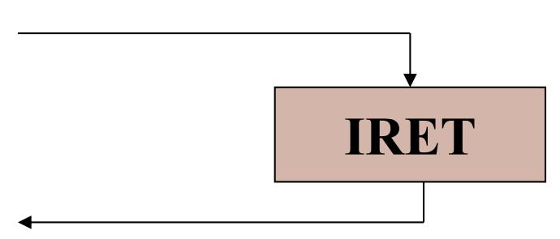

⑤ 向主8259送中断结束命令

⑥ 恢复现场，IRET

#### （2）用户中断

- 中断源：系统总线插槽B4端引入的用户设计的硬件中断请求信号

**用户中断请求的途径：**

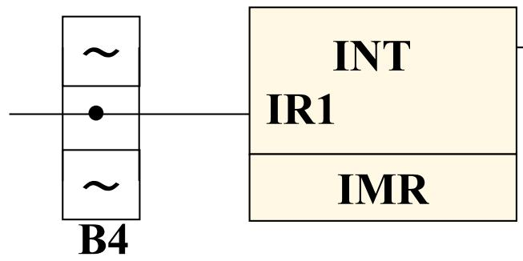

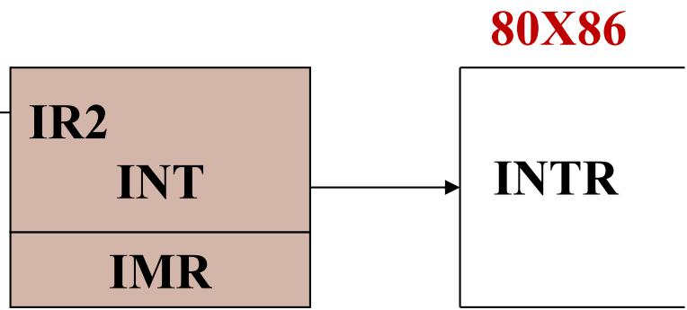

> ✓ 用户中断请求从ISA总线B4端子（IRQ9）引入，经过主8259，从8259二求方能送到CPU
> ✓ 只有从8259A的IMR1置0，主8259A的IMR2置0，其中断请求方能送到CPU

实现用户中断必须对主、从8259A应用编程，保证中断请求由8259A中断控制器提向CPU。代码如下：

```assembly
IN AL, 0AIH
AND AL, IIIIIIIIOIB
OUT 0AIH,AL    ;开放用户中断

IN AL, 2IH
AND AL, IIIIIIIIOIIB
OUT 2IH, AL    ;开放从8259中断
```

**用户中断的服务程序：**

CPU响应用户中断后自动转向71H型服务程序。BIOS为“71H型”设计的服务程序如下：

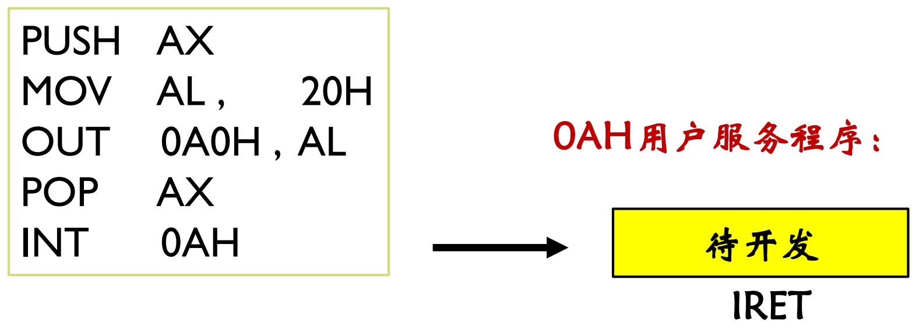

知识点：[标志寄存器中的状态标志位与控制标志位](../../../topics/微机接口/zhuangtai-biaozhi.md)、[数据传送指令（MOV、PUSH、POP、XCHG等）](../../../topics/微机接口/shuju-chuansong.md)、[最常用的I/O指令（IN、OUT的直接寻址与DX间址）](../../../topics/微机接口/io-zhiling.md)

### 5. 中断程序设计

#### （1）主程序的编写主要包括

- 中断向量的置换（DOS系统功能35H和25H）
- 硬件中断通路的开放和屏蔽

对于日时钟 08H（或其中的1CH），默认下主8259A已经打开，无需再进行开放操作。

#### （2）中断服务程序的编写

- 根据置换的中断类型不同，需要解决是否要对中断管理器8259A写中断结束命令字的问题
- 对于日时钟 08H（或其中的1CH），不需要写中断结束命令字

## 二、微机系统串行通信

知识点：[最常用的I/O指令（IN、OUT的直接寻址与DX间址）](../../../topics/微机接口/io-zhiling.md)、[微机系统与I/O端口的信息交换方式（无条件、查询、中断、DMA）](../../../topics/微机接口/xinxi-jiaohuan.md)、[DOS功能调用与BIOS中断功能调用（INT 21H、INT 10H等）](../../../topics/微机接口/dos-bios-diaoyong.md)

### 1. 基本概念

**通信的基本方式：**

① 通信的基本方式分为并行通信和串行通信

② 串行通信分为串行同步通信和串行异步通信

**数据的传输方式：**

① 单工方式：只允许数据按照一个固定的方向传送

② 半双工方式：要求收发双方均具备接收和发送数据的能力，但数据不能同时在两个方向上传送

③ 全双工方式：收发双方可同时进行数据传送

知识点：[微机系统与I/O端口的信息交换方式（无条件、查询、中断、DMA）](../../../topics/微机接口/xinxi-jiaohuan.md)、[接口电路的作用和基本功能](../../../topics/微机接口/jiekou-gongneng.md)

### 2. 串行异步通信——标准数据格式

**四部分：**

① 起始位 ： 1位逻辑‘0’

② 数据位： 5\~8位 0/1代码

③ 奇偶校验位： 0\~1位‘0’或‘1’

④ 停止位： 1、1.5、2位逻辑‘1’

**例：** 异步通信一帧数据格式中，按照发送的次序，先传送起始位，紧接着是数据位，数据位后依次为奇偶校验位和停止位。

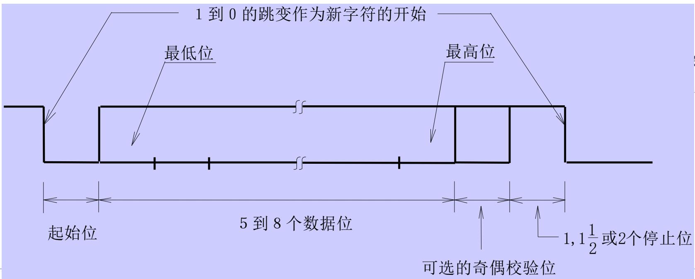

知识点：[微机系统与I/O端口的信息交换方式（无条件、查询、中断、DMA）](../../../topics/微机接口/xinxi-jiaohuan.md)

### 3. 串行通信接口标准——RS-232C

**功能特性：**

标准定义了25针连接器中的20 条连接线（常用的信号线）。

| DTE(数据终端设备)计算机或终端 | 信号名称 | 缩写 | DCE(数据通信设备)调制解调器或其他通信设备 |
| :--- | :--- | :--- | :--- |
| DTE 准备就绪 | | DTR | |
| DCE 准备就绪 | | DSR | |
| 清除已传送(允许发送) | | CTS | |
| 请求发送 | | RTS | |
| 接收数据 | | RxD | |
| 发送数据 | | TxD | |
| 载波检测 | | DCD | |
| 振铃检测 | | RI | |
| 信号地 | | SGND | |

**信号电平标准（电气特性）：**

RS-232C标准规定：

① 逻辑“1”信号，电平在 –3V \~ -15V之间

② 逻辑“0”信号，电平在 +3V \~ +15V之间

因此，使用RS-232C与微机接口时，需要将TTL电平（0 \~5V）与RS-232C电平进行转换。

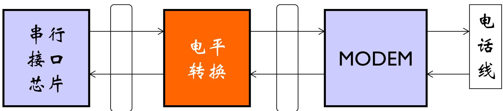

知识点：[接口电路的作用和基本功能](../../../topics/微机接口/jiekou-gongneng.md)

### 4. 可编程串行异步通信接口芯片8250

8250内部寄存器从使用角度来说有10个，分成3类：

| 类别 | 数量 | 寄存器名称 | 端口地址 |
| :--- | :--- | :--- | :--- |
| 一类 | 2个数据寄存器 | 发送保持寄存器 | 3F8H/2F8H写入 |
| | | 接收缓冲寄存器 | 3F8H/2F8H读出 |
| 二类 | 5个命令字寄存器 | 通信线控制寄存器 | 3FBH/2FBH |
| | | 除数锁存器(低位) | 3F8H/2F8H |
| | | 除数锁存器(高位) | 3F9H/2F9H |
| | | 中断允许寄存器 | 3F9H/2F9H |
| | | MODEM控制寄存器 | 3FCH/2FCH |
| 三类 | 3个状态寄存器 | 通信线状态寄存器 | 3FDH/2FDH |
| | | 中断识别寄存器 | 3FAH/2FAH |
| | | MODEM状态寄存器 | 3FEH/2FEH |

**例：利用主串口查询方式发送一个“A”**

```assembly
SCANT: MOV DX, 3FDH
       IN AL, DX
       TEST AL, 20H ;00100000
       JZ SCANT   ;D5=1
       MOV DX, 3F8H
       MOV AL, 'A'
       OUT DX, AL
```

**例：利用辅串口查询方式接收一个字符**

```assembly
SCANR: MOV DX, 2FDH
       IN AL, DX
       TEST AL, 01H ;00000001
       JZ SCANR   ;D0=1
       MOV DX, 2F8H
       IN AL, DX
```

**例：利用辅串口查询方式接收一个字符（带错误检查）**

```assembly
SSCANR: MOV DX, 2FDH
        IN AL, DX
        TEST AL, 00011110B
        JNZ ERROR
        TEST AL, 01H ;00000001
        JZ SCANR   ;D0=1
        MOV DX, 2F8H
        IN AL, DX
```

**8250的中断请求：**

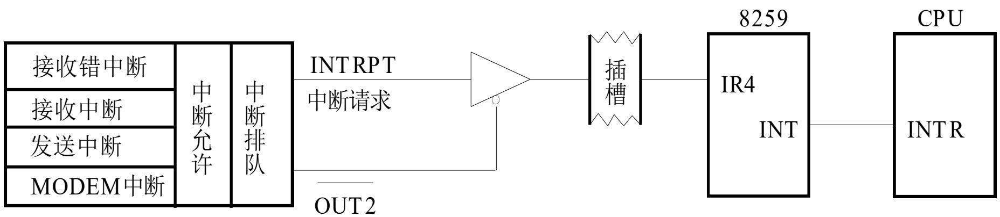

**8250的自发自收：**

① 内环：自动将发送移位寄存器和接收移位寄存器短接

② 外环：人为将RS-232接口芯片端子2和端子3用线连接起来，属正常通信

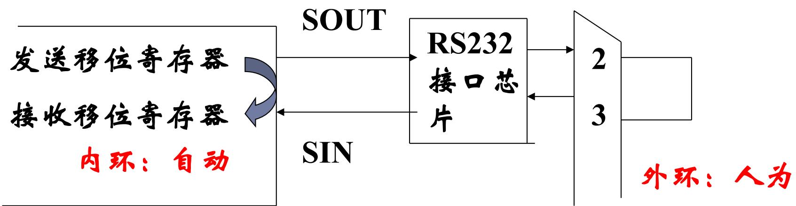

**直接对8250端口进行初始化编程的步骤：**

① 设置寻址位：80H→通信线控制寄存器，使寻址位为1

② 将除数高8位/低8位→除数寄存器高8位/低8位，确定通信速率

③ 将D7=0的控制字写入通信线控制寄存器，规定一帧数据的格式

④ 设置中断允许控制字：
   - 若采用查询方式，置中断允许控制字为0
   - 若采用中断方式，置中断允许控制器的相应位为1

⑤ 设置MODEM控制寄存器：
   - 中断方式：D3=1，允许8250送出中断请求信号
   - 查询方式：D3=0
   - 内环自检：D4=1
   - 正常通信：D4=0
   - 使用联络线：D1、D0位置1

知识点：[端口的编址方式（统一编址与独立编址）](../../../topics/微机接口/duankou-bianzhi.md)、[查询方式输入输出编程模式与流程](../../../topics/微机接口/chaxun-fangshi.md)、[最常用的I/O指令（IN、OUT的直接寻址与DX间址）](../../../topics/微机接口/io-zhiling.md)

### 5. 串行通信的外部环境

外部环境：就是串口连接器RS-232C引脚的连线方式。

连线方式与串口的通信方式有关，与编程时使用的编程手段（对端口直接操作，或调用BIOS通信软件）有关。

#### （1）短距离（无MODEM）点—点全双工通信

$$
\begin{array}{c c} \text {TXD} \\ 2 & \text {RXD} \\ 3 & \text {RXD} \\ 7 & \text {RXD} \\ \hline \end{array} \quad \begin{array}{c c} \text {TXD} \\ 2 \\ 3 \\ 7 \\ \text {RXD} \\ \text {RXD} \\ \text {RXD} \\ \text {RXD} \\ \text {RXD} \\ \text {RXD} \\ \text {RXD} \\ \text {RXD} \\ \text {RXD} \\ \text {RXD} \\ \text {RXD} \\ \text {RXD} \\ \text {RXD} \\ \text {RXD} \\ 7 \end{array}
$$

无联络线：3线方式仅能用对端口直接操作发送/接收数据。

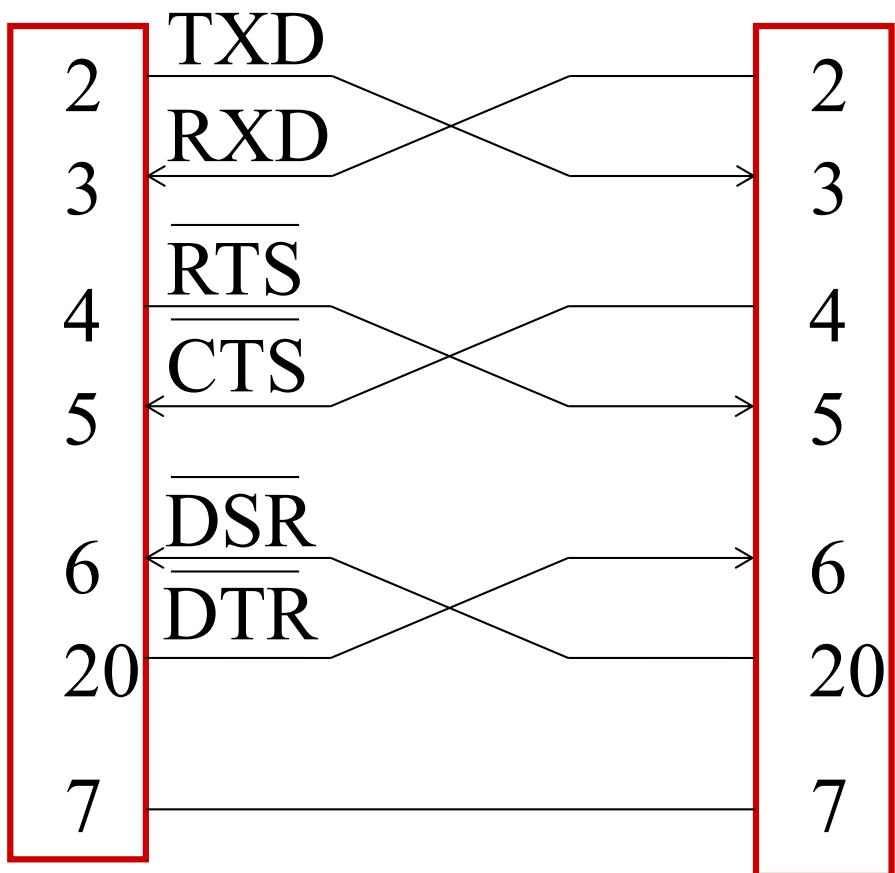

有联络线：7线方式

① 对端口直接操作

② 调用BIOS通信软件

③ 调用INT 21H的4#、3#，但只能用主串口

## 第3章 串行通信接口（续）

知识点：[微机系统与I/O端口的信息交换方式（无条件、查询、中断、DMA）](../../../topics/微机接口/xinxi-jiaohuan.md)

### 2）短距离（无 MODEM）点—点单工通信

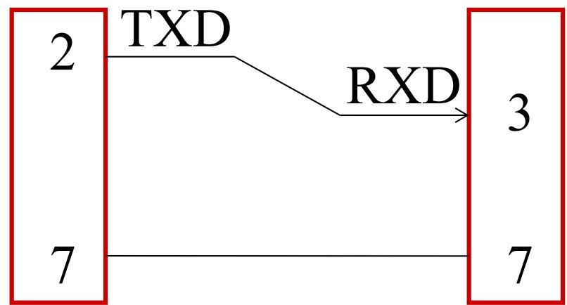

无联络线。

适用：对端口直接操作编程。

知识点：[最常用的I/O指令（IN、OUT的直接寻址与DX间址）](../../../topics/微机接口/io-zhiling.md)、[端口的编址方式（统一编址与独立编址）](../../../topics/微机接口/duankou-bianzhi.md)、[DOS功能调用与BIOS中断功能调用（INT 21H、INT 10H等）](../../../topics/微机接口/dos-bios-diaoyong.md)

### 2）短距离（无 MODEM）点—点单工通信

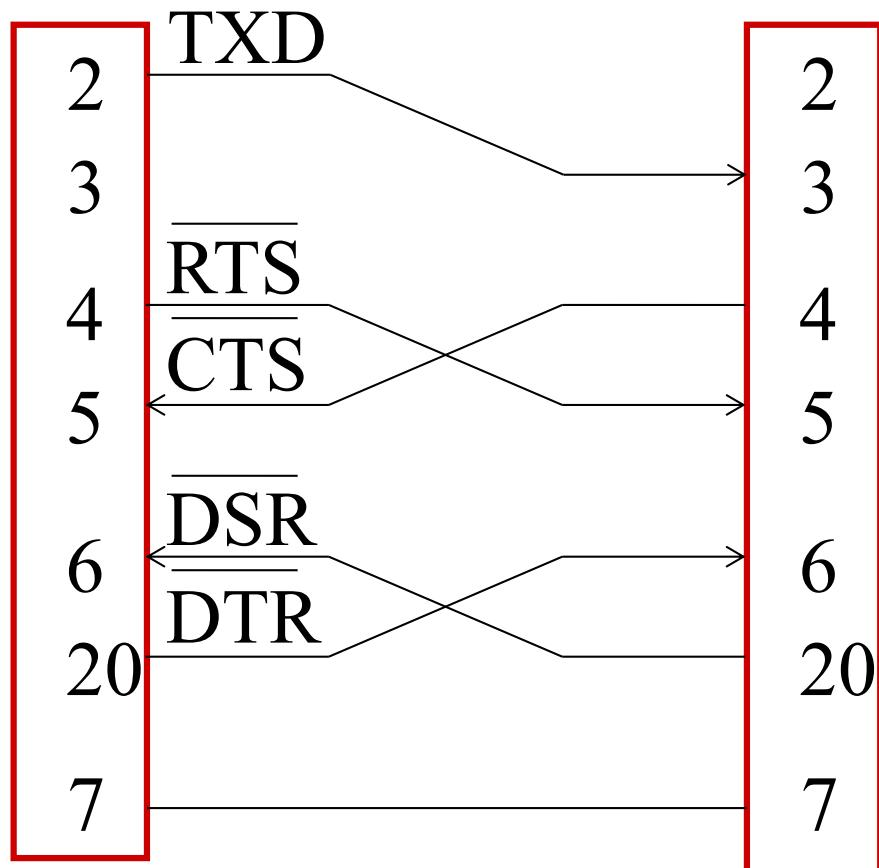

有联络线：

① 对端口直接操作；

② 调用 BIOS 通信软件；

③ 调用 INT 21H 的 4<sup>#</sup>、3<sup>#</sup>，但只能用主串口。

注意：调用 DOS、BIOS 通信软件实现单工通信时，在初始化阶段应使收方的 RTS=DTR=0，发方的 DTR=0。

知识点：[最常用的I/O指令（IN、OUT的直接寻址与DX间址）](../../../topics/微机接口/io-zhiling.md)、[端口的编址方式（统一编址与独立编址）](../../../topics/微机接口/duankou-bianzhi.md)、[DOS功能调用与BIOS中断功能调用（INT 21H、INT 10H等）](../../../topics/微机接口/dos-bios-diaoyong.md)

### 3）外环自发自收

适用：对端口直接操作编程。

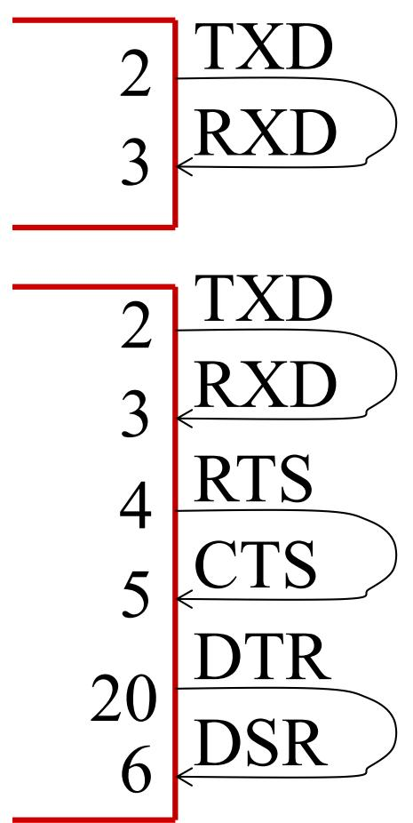

① 对端口直接操作适用；

② 调用 BIOS 通信软件；

③ 调用 INT 21H 的 4<sup>#</sup>、3<sup>#</sup>（发/收）。

知识点：[微机系统与I/O端口的信息交换方式（无条件、查询、中断、DMA）](../../../topics/微机接口/xinxi-jiaohuan.md)、[最常用的I/O指令（IN、OUT的直接寻址与DX间址）](../../../topics/微机接口/io-zhiling.md)

### 6. 8250 的应用编程

设计考虑：

① 题型：单端自发自收、点—点通信（全双工、单工）；

② CPU 与串口交换信息的方式：查询或者中断；

③ 编程手段：对端口直接编程、调用 BIOS 通信软件；

④ 根据题目要求组织相应的外部环境。

8250 查询方式下接收和发送程序的编程：

- 在发送数据前，读通信线状态寄存器（状态口）获取发送保持或移位寄存器（数据口）是否空闲；
- 在接收数据前，读通信线状态寄存器（状态口）获取接收缓冲寄存器（数据口）是否已经收到 1 帧数据。

如果希望 8250 采用中断控制方式发送和接收数据，编程时应该采取哪些措施？

例：A、B 两台 PC 机利用主串口进行点—点单工通信（不用联络线），发送采用查询方式，接收采用中断方式。一帧字符包含 7 个数据位，1 个停止位，1 个校验位，通信速率为 4800 波特（分频系数为 0018H）。

（1）下图是 A、B 两机的 RS—232C 接口示意图，根据题意完成连线（不可有多余连线）。

$$
\begin{array}{c} \framebox {2} \\ 3 \\ 4 \\ 5 \\ 6 \\ 2 0 \\ 7 \end{array}
$$

$$
\begin{array}{c} \framebox {2} \\ 3 \\ 4 \\ 5 \\ 6 \\ 2 0 \\ 7 \end{array}
$$

（2）下图是从 PC 机的 RS-232C 接口引脚观察到的波形，所传送字符的 16 进制 ASCII 码是 \_\_\_\_；该帧数据采用的奇偶校验方式是\_\_\_\_校验；传送该帧数据需要的时间是\_\_\_\_。

（3）用对端口直接编程的方法为接收方编写 8250 初始化程序段。

```asm
; 寻址位置1
MOV DX, 3FBH
MOV AL, 80H
OUT DX, AL
; 写除数高8位
MOV DX, 3F9H
MOV AL, 00H
OUT DX, AL
; 写除数低8位
MOV DX, 3F8H
MOV AL, 18H
OUT DX, AL
; 无校验传送，8位数据
MOV DX, 3FBH
MOV AL, 0AH
OUT DX, AL
; 写中断允许控制字
MOV DX, 3F9H
MOV AL, 01H
OUT DX, AL
; MODEM控制寄存器
MOV DX, 3FCH
MOV AL, 08H
OUT DX, AL
```

（4）编程实现发送方查询方式发送数据 'A' 的程序段。

## 第4章 并行 I/O 接口

知识点：[端口的编址方式（统一编址与独立编址）](../../../topics/微机接口/duankou-bianzhi.md)、[最常用的I/O指令（IN、OUT的直接寻址与DX间址）](../../../topics/微机接口/io-zhiling.md)、[微机系统与I/O端口的信息交换方式（无条件、查询、中断、DMA）](../../../topics/微机接口/xinxi-jiaohuan.md)

### 1. 8255A 的内部结构和工作方式

（1）内部结构、端口地址以及与系统总线的连接。

（2）8255A 三种工作方式（方式 0～方式 2）的工作特点和 I/O 过程。

| 工作方式 | 适用的端口 |
| --- | --- |
| 方式 0：基本型输入/输出 | A 口、B 口、C 口 |
| 方式 1：选通型输入/输出 | A 口、B 口 |
| 方式 2：双向数据传送型 | A 口 |

知识点：[端口的编址方式（统一编址与独立编址）](../../../topics/微机接口/duankou-bianzhi.md)

### 2. 8255A 初始化编程

工作在方式 0 时：方式选择控制字→控制口。

工作在方式 1、2 时：

a) 方式选择控制字→控制口；

b) C 口按位置 0/1 控制字→控制口。

（3）在方式 1 中 C 口哪几个引脚作为信号联络线，各信号联络线的含义。

例：8255 的数据口中，\_\_\_\_\_\_ 口可工作在双向方式。

例：8255A 的 B 口初始化定义为选通型（方式 1）输入，对 8255A 采用查询方式，必须先查询 \_\_\_\_；若采用中断方式，必须先置 PC\_\_\_\_ 为 '1'，并且利用\_\_\_\_作为中断请求信号线。

知识点：[接口电路的作用和基本功能](../../../topics/微机接口/jiekou-gongneng.md)、[端口的编址方式（统一编址与独立编址）](../../../topics/微机接口/duankou-bianzhi.md)、[微机系统与I/O端口的信息交换方式（无条件、查询、中断、DMA）](../../../topics/微机接口/xinxi-jiaohuan.md)

### 3. 8255A 应用编程

1）当数据口（A、B 或 C）工作在方式 0 时：

直接采用 IN/OUT 指令对其进行读写。

2）当数据口（A 或 B）工作在方式 1 时：

- 如果采用查询方式，且 A 或 B 口定义为输入口，先用 IN 指令读入 C 口的内容，查询其中的 IBF=1 时，表示 CPU 可以继续用 IN 指令从 A 或 B 口读入外设送来的数据；
- 如果采用查询方式，且 A 或 B 口定义为输出口，先用 IN 指令读入 C 口的内容，查询 OBF=1 时，表示 CPU 可以用 OUT 指令向 A 或 B 口写数据以送给外设。

系统机外扩一片 8255A 及相应电路如下图所示，外扩 8255A 的端口地址为 200H～203H，现利用系统机的日时钟外扩 1CH 型中断，实现每隔 1s 使八个发光二极管同时闪烁一次，主机键盘有按键按下时结束，返回 DOS 操作系统。根据要求完成相关内容。

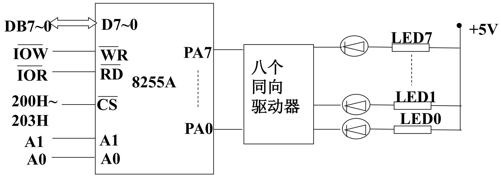

（1）从图可以分析出，A 口工作在方式 0 的输出（入/出）。

（2）假设 8255A 的 A 口工作在方式 1 的查询输出方式，编写 8255A 的初始化子程序 I8255。

```asm
I8255A  PROC
        MOV     DX, 203H
        MOV     AL, 10100000B
        OUT     DX, AL      ; 写入工作方式字
        MOV     AL, 00001100B
        OUT     DX, AL
        RET
I8255   ENDP
```

掌握作业、实验。

知识点：[最常用的I/O指令（IN、OUT的直接寻址与DX间址）](../../../topics/微机接口/io-zhiling.md)、[端口的概念与分类（数据端口、状态端口、控制端口）](../../../topics/微机接口/duankou-gainian.md)、[接口电路的作用和基本功能](../../../topics/微机接口/jiekou-gongneng.md)
