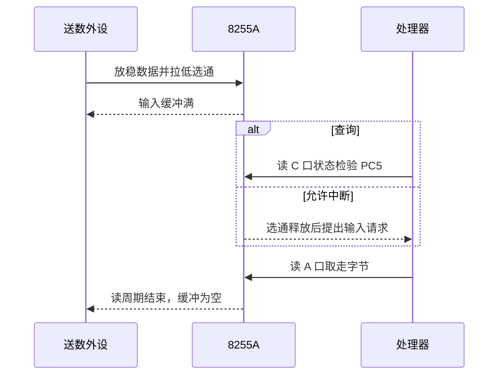

# 8255A 随堂练习：从握手方向判断端口和控制线

手里的字节要写进外设，还是写进配置寄存器？外设已稳住数据，还是接口已经收到数据？这份历史随堂练习用三道短题区分这些动作。下面按 [Intel 8255A 手册](https://atta.szlcsc.com/upload/public/pdf/source/20241016/218EC54DF16C30D7667C0C377F0F65AD.pdf)重新说明。记号 `/信号名` 表示该信号低有效。

## 为什么方式 2 不给 B 口？

**参考解答（第 1 题）。** 只有 **A 口**能配置为方式 2。方式 1 给一个方向加握手，而方式 2 让 A 口的八根数据线在两个方向复用。芯片用 C 口的 PC3 至 PC7 分担两个方向的选通、状态和共同的中断请求。B 口只能选方式 0 或方式 1；即便把两根线接出板外，也不会让芯片产生一个未实现的 B 口双向模式。C 口承载握手信号，并不因此成为方式 2 的八位数据口。

## 选通和缓冲满是谁告诉谁的？

**参考解答（第 2 题）。** A 口方式 1 输入时，外设把字节放稳，再经 PC4 送入低有效的选通 `/STB`；芯片锁存字节，经 PC5 输出高有效的输入缓冲满信号 `IBF`，通知外设当前字节还没被处理器读走。两根线方向相反。若采用中断，从 PC3 发出的 `INTR` 是接口通知处理器的第三根线，==不是外设送入的选通，也不是外设看到的缓冲满==；只有满足请求条件并且已允许中断时才会发请求。

读 C 口看到满状态只是查询；真正取数要读 A 口。[接口的数据交换方式](../../../topics/微机接口/xinxi-jiaohuan.md)和[查询方式](../../../topics/微机接口/chaxun-fangshi.md)都用得到这个区分。

## 初始化时怎样选到控制口？

**参考解答（第 3 题）。** 把「初始化」拆成==先选寄存器，再选传输方向==。8255A 在器件侧的地址脚 `A1:A0=11` 才指向控制口。让片选与写有效而读无效，即 `/CS=0、/WR=0、/RD=1`。这三项描述有效写阶段，不是说整段总线周期恒为这些电平。要配置端口的方式与方向，还要在数据线上放最高位为 1 的方式选择字；最高位为 0 的控制口写入是 C 口按位置位或复位（BSR），不是重设整片。参见[端口的编址方式](../../../topics/微机接口/duankou-bianzhi.md)与 [I/O 指令](../../../topics/微机接口/io-zhiling.md)。

**补充（自编）。** 一块板在偶数 I/O 地址 `2A0H–2A6H` 选中 8255A，用处理器的 A2、A1 驱动芯片的 A1、A0。要设 A 方式 1 输入、B 方式 0 输入，未借作握手的 C 位也作输入，应写哪一地址和字节？控制口是 `2A6H`，其两根芯片地址脚均为 1。方式字是 `BBH`：最高位为 1，D6:D5 为 `01`，D4 为 1，D2 为 0，D1、D3、D0 均为 1。随后若用查询接收，从 `2A4H` 读 C 口并检测掩码 `20H`，满时才从 `2A0H` 读字节。

> [!WARNING]
> 原题给的是**芯片的地址脚**，本例给的是**板上处理器的地址**。看到两根地址脚都为高，不等于按任意一块板的基地址加 3。先顺着连线找对应的处理器位，再算端口地址。
