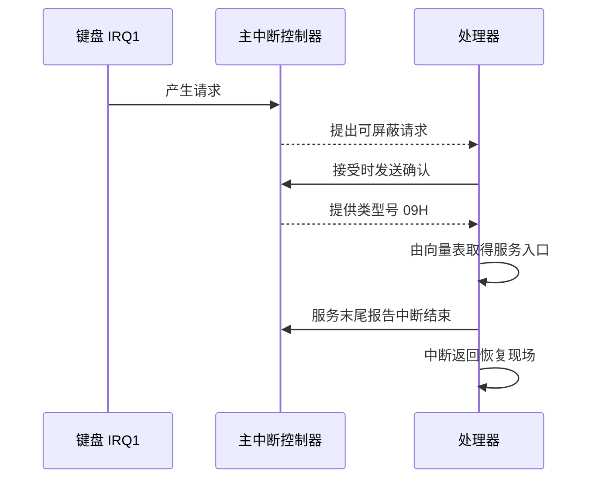

# 《微型计算机接口技术》中断随堂练习（2020—2021 学年第一学期）

键盘按下一键之后，先发生的是电路发请求，不是应用程序执行了一条 `INT` 指令。再往后，CPU 取得中断编号，用编号定位一张表，最后才从表内取得服务入口。本卷四道技术题正好分别检查请求的分类、接收请求的引脚、表项的地址和表项的内容。第五项是学号姓名栏。

## 哪根线在申请，哪根线在确认

**参考解答（第 1 题，核对原件答案 D）。** 在题设传统 PC 实模式的默认配置下，键盘请求走 IRQ1，经主 8259A，CPU 得到类型号 `09H`，故是==可屏蔽硬件中断==。用程序主动执行 `INT 09H` 虽然也按同一编号索引向量表，却不会让键盘产生硬件请求，更不能代替硬件中断的确认。键盘 BIOS 调用 `INT 16H` 是又一回事：由程序主动调用既有服务，而非报告新按键到达。参见 [BIOS 功能调用](../../../topics/微机接口/dos-bios-diaoyong.md)。

**参考解答（第 2 题，核对原件答案 B）。** 非屏蔽外部硬件请求进 CPU 的 NMI；把 IF 清零能阻止 CPU 接收可屏蔽的 INTR，不能遮住 NMI。INTR 是可屏蔽请求进来的路，`/INTA` 则是 CPU 接受请求后对控制器的确认方向，题中的 AEN 也不是非屏蔽请求引脚。见[接口的信息交换方式](../../../topics/微机接口/xinxi-jiaohuan.md)及[标志寄存器](../../../topics/微机接口/zhuangtai-biaozhi.md)。

**补充。** 假设只有一片 8259A，处于普通全嵌套、固定优先级，IR0 最高，IR7 最低；不自动结束中断，不屏蔽 IR1、IR4，也没有别的在服务请求。若 IR1 和 IR4 在同一次裁决前都已挂起，且 CPU 允许外部可屏蔽中断，先服务 IR1。IR1 处于服务状态时，较低的 IR4 仍须等；IR1 的 EOI 解除控制器这一层的阻挡，CPU 还要处于允许接收的状态，才能受理 IR4。反过来，若已在服务 IR4，IR1 比它优先，但仍不能越过 CPU 的 IF。题目一旦说“高优先级嵌套”，就要分别问控制器和处理器是否都放行。

| 刚变化的条件 | 8259A 按固定优先级判断 | CPU 的下一步 |
| --- | --- | --- |
| IR1、IR4 都待服务，无在服务项 | 选择 IR1 | IF 允许时接受 IR1 |
| 正在服务 IR1，IR4 仍待 | IR4 不得抢占 | 即便 IF 允许，也不能因此接受 IR4 |
| 正在服务 IR4，IR1 新到 | IR1 比在服务项优先 | IF 仍为零则不接受；允许时才可嵌套 |

> [!WARNING]
> ==EOI 不等于 IRET。== 前者通知中断控制器当前服务已完成，后者让 CPU 从堆栈恢复返回位置和标志。只做其中之一，另一边的状态不会因此自动恢复。

## 表项在哪，与例程在哪，是两道不同的算术题

**参考解答（第 3 题，核对原件填空）。** 题设 8086 兼容的传统实模式向量表以物理地址零开始，共 256 项，每项 4 字节，总长 $256\times4=1024$ 字节。起始地址为 `00000H`，最后一个字节是 `003FFH`，不是 `00400H`。类型号为 $n$ 的表项占从 $4n$ 到 $4n+3$ 的四个字节。看到题目给的是==表项首地址== `270H`，应当倒除：$\mathtt{270H}/4=\mathtt{9CH}$，故它是类型 `9CH` 的表项，末地址确为 `273H`。这不说明服务代码从 `270H` 开始。这里不把传统实模式零基址的假设推广到可重新定位中断表的情形。

**参考解答（第 4 题，原件未附解答）。** 中断向量是服务程序的入口逻辑地址 `CS:IP`。若表项从地址 $a$ 开始，把 $a$ 与 $a+1$ 的两个字节按小端组成 IP；再将 $a+2$ 与 $a+3$ 的两个字节按小端组成 CS。书写入口时是 CS 在前，内存中却是 IP 两字节在前。因此只知道编号或表项位置，不能推出例程地址；还要读四字节内容。参见[表项与中断现场](../../../topics/微机接口/zhongduan-xiangliang-yu-zhan.md)和[实模式物理地址](../../../topics/微机接口/wuli-dizhi.md)。

**补充算例。** 假设 `270H–273H` 按低到高存放 `34H、12H、78H、56H`，则表项仍属于 `9CH`，入口却是 `5678H:1234H`；其物理地址是 $\mathtt{56780H}+\mathtt{1234H}=\mathtt{579B4H}$。把内存顺序误当成书写顺序会把段与偏移颠倒；把 `9CH` 当作入口地址则会跳进完全不同的位置。
