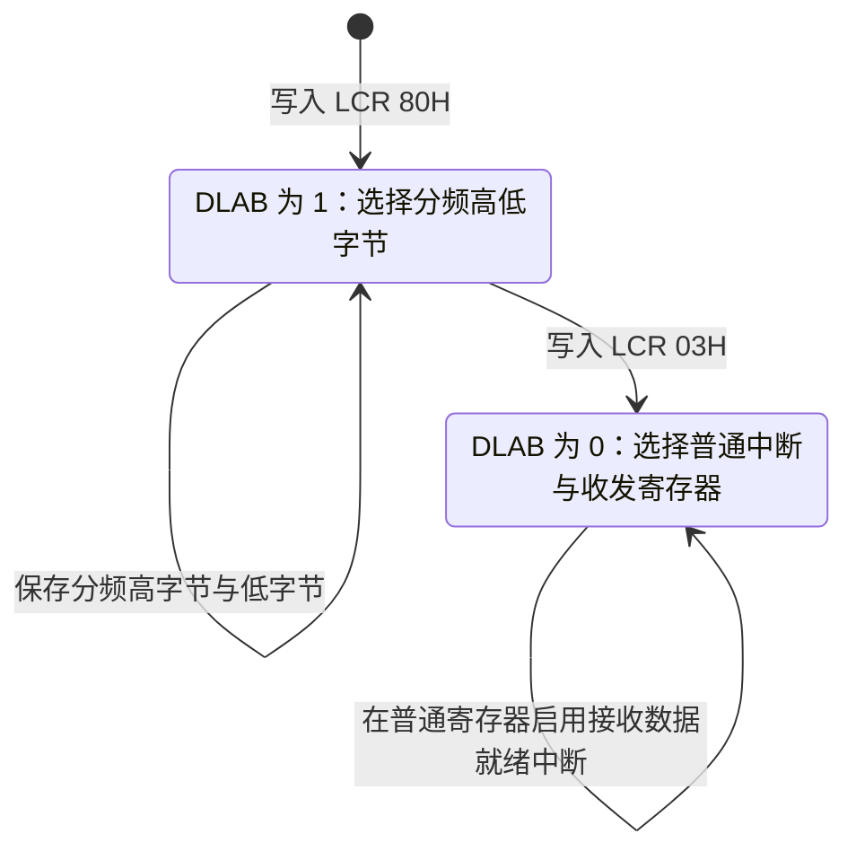

# 《微型计算机接口技术》串口随堂练习（20-21-1）

原卷有 4 道技术题和 1 个学号姓名栏。做这份练习要分清四件事：线路一次能传几个方向、帧在电线上占多长、CPU 当前写到了哪一个寄存器、芯片内部事件是否真的能引起 CPU 中断。以下重新验算原卷，并区分原件答案与按 [National Semiconductor INS8250 手册](https://datasheet4u.com/pdf/1529856/INS8250-B.pdf) 推导的订正。

## 中断优先级不是串行数据传送方向

**参考解答（第 1 题，核对原件 C）。** 在传统 8250 四种条件中，从高到低依次为接收线路状态、接收数据就绪、发送保持寄存器空、MODEM 状态。多个**已允许**的事件同时待处理时，中断标识显示优先级最高者；如果该项没启用，不能因为它在表里排第一就认为一定会报告。线路状态包括接收错误，不等同于“已经收到了可交付的正常字节”。发送保持器空也不表示最后一个停止位已离开发送线。参见[串口状态](../../../topics/微机接口/uart-zhuangtai-yu-jiucuo.md)。

**参考解答（第 2 题，核对原件）。** 单工只允许一个方向；半双工可双向但要轮流；全双工允许两个方向同一时刻进行。题目的“双工”是“全双工”的简称，因此可双向的是半双工和全双工。==能不能双向与能不能同时双向是不同问题==，并和是否用中断无关。

## 程序题先逐行跟踪 DLAB，再算帧和速率

同一端口号可能访问不同寄存器。8250 把 LCR 的最高位用作 DLAB，供软件在“分频锁存”和“普通收发/中断”两个解释之间切换。原件程序的操作顺序如下：

| 步骤 | 写入 | 当时的实际作用 |
| --- | --- | --- |
| 1 | 3FBH ← 80H | LCR 的 DLAB 置 1，开放分频锁存 |
| 2–3 | 3F9H ← 00H；3F8H ← 60H | 写分频高、低字节，不能读成关中断和发字符 |
| 4 | 3FBH ← 03H | DLAB 清零，同时选 8 数据位、无校验、1 停止位 |
| 5 | 3F9H ← 01H | 这一次才是 IER 位 0 置一，设备内允许接收数据就绪中断；发送保持器空中断未开 |
| 6 | 3FCH ← 01H | 写 MCR，设置 DTR；这不是 IER，也不是数据帧长度 |

两次写 3F9H 的解释不同，变化发生在中间那次对 LCR 的写，不在 3F9H 自己。参见[端口分类](../../../topics/微机接口/duankou-gainian.md)和 [I/O 指令](../../../topics/微机接口/io-zhiling.md)。

**参考解答（第 3 题，第 1 问）。** 分频系数为 `0060H`，即 96，这是锁存值而不是 96 bit/s。在该常见 16 倍分频模型下，若题给 1200 bit/s，所需时钟为 $1200\times16\times96=1\,843\,200$ Hz。8N1 的一帧有起始位 1、数据位 8、停止位 1，共 10 位。连续发送没有额外帧间等待时，$1200/10=120$ 帧每秒；对应实际负载为 $120\times8=960$ bit/s，不能把线路位速率全算作数据位。

**参考解答（第 3 题，第 2 问）。** 在题目给的“查询或中断”两项中，预期为发送查询、接收中断：IER 只开接收数据就绪，因此发送侧如需等待，可以查询发送保持器空。**补充边界**：初始化只能证明片内所选中断条件，不证明已经装好接收服务程序或中断真的送达 CPU。还需板级传送路径和 CPU 中断控制等条件；若某板以 OUT2 作 IRQ 门控，本例的 MCR=01H 没把相应位打开。不要把这条板级约定当成 8250 所有电路的共性。见[查询方式](../../../topics/微机接口/chaxun-fangshi.md)和[信息交换方式](../../../topics/微机接口/xinxi-jiaohuan.md)。

> [!TIP]
> ==同一端口写了两次却效果不同==，先回溯控制位所处状态。==每秒帧数==要除以包含起始、校验和停止在内的整帧占用，不除以有效数据位数。

## 最短帧由最小配置决定，不由“习惯用 8 位”决定

**订正（第 4 题）。** 原件标 D（8–12 位）。按同一试卷所用 8250 的标准可编程范围，并未规定必须有校验位或至少 6 个数据位；最短可用 5 个数据位、无校验、1 个停止位，再加 1 个起始位，共 7 个位时间。最长为 8 个数据位、1 个校验位、2 个停止位和 1 个起始位，共 12 个位时间。因此在 8250 这个硬件范围内，题面所列选项应取 **C（7–12）**。如果另有明确条件排除 5N1，才可能把下限抬到 8；题面没有该条件。有些 5 位格式可用 1.5 个停止位，说明这里比的是帧的持续时间，并不是说所有配置都恰好占整数个位时间。

> [!WARNING]
> 如果选项与寄存器位域推导冲突，写出能被芯片配置的最小反例：5N1 不仅纸面能加成 7，还可以由该 UART 的 5 数据位、无校验和一停止位组合得到。不能把某个具体通信协议的偏好当作芯片下限。
