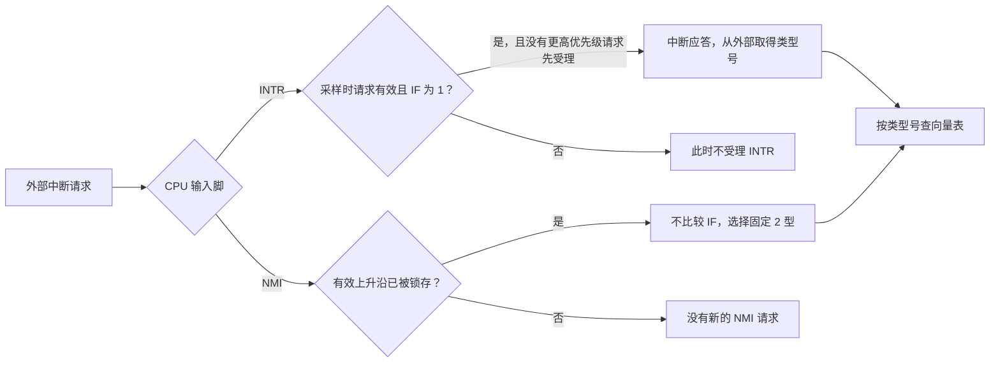

# 《微型计算机接口技术》作业1

核对原卷两页，共五道简答题，未附答案。下列解答按原题顺序组织，算例为补充。中断部分限定在课程所用的 **8086 实地址模型**。

## 1. 为什么要有接口，怎样找到端口？

**参考解答：** CPU 总线和外设的速度、时序与信号约定可能不同。接口电路通过地址译码选中设备寄存器，通过缓冲和状态或握手信号在合适的时刻交换信息。**端口**是程序可读写的接口位置，不等于整块接口或物理连接器。一块接口可有多个端口，也可按读写方向复用同一地址。

| 端口类别 | 程序借它做什么 | 接收接口中的例子 |
| --- | --- | --- |
| 数据端口 | 读写传输内容 | 取出收到的字节 |
| 状态端口 | 了解接口当前情况 | 判断缓冲中是否已有数据 |
| 控制端口 | 设置接口行为 | 设置接收方式或允许接口请求中断 |

**统一编址（存储器映射 I/O）**让端口占用部分存储器地址空间，用适用的存储器访存指令访问。如果硬件把某物理地址译码到状态端口，读这个地址就是从接口取状态，而不是读 RAM。**独立编址**则把存储器与 I/O 设成不同地址空间。例如，8086 的独立端口号 20H 和存储器物理地址 00020H 可以同时存在；前者用 IN 或 OUT，后者由存储器访问指令读写。==地址数值相同不表示目标相同==，还要看总线访问类型与译码。

延伸：[接口电路的基本功能](../../../topics/微机接口/jiekou-gongneng.md)、[端口分类](../../../topics/微机接口/duankou-gainian.md)、[端口编址](../../../topics/微机接口/duankou-bianzhi.md)。

## 2. 外设何时就绪，数据又由谁搬运？

**参考解答：** 无条件、查询和中断方式都由 CPU 执行数据搬运，区别在于怎样知道可以传输；DMA 改变了数据的搬运者。

| 方式 | 怎样知道可以传输 | 谁实际搬运 | 代价和限制 |
| --- | --- | --- | --- |
| 无条件传送 | 硬件或题设保证已就绪，程序不另查状态 | CPU | 简单；若就绪保证不成立，可能读到旧值或写得过早 |
| 查询 | CPU 检查状态，达到条件再访问数据端口 | CPU | 容易控制，但密集轮询会消耗 CPU 时间 |
| 中断 | 外设就绪后发请求，由 CPU 接受后执行服务程序 | CPU | 等待时可做别的事，但响应需要保存和切换开销 |
| DMA | CPU 初始化传输，由外设与 DMA 控制器握手 | DMA 控制器 | 适合块传输，仍有初始化和总线仲裁成本 |

例如，低速设备不定期到一个字节时，中断可减少空转；换成连续大块数据，要再问让 CPU 处理每个字节是否值得。DMA 完成也可以通过中断通知 CPU，==谁搬运和谁通知完成不是同一个问题==。详见[微机系统与 I/O 端口的信息交换](../../../topics/微机接口/xinxi-jiaohuan.md)。

## 3. 类型号、表项地址和程序入口是三件事

**参考解答：** 中断类型号是索引；中断向量是服务程序的入口，在 8086 中用 16 位段值和 16 位偏移表示；中断向量表则按类型号排列入口指针。其地址范围是物理低端 00000H—003FFH，256 项，每项 4 字节。类型号为 $n$ 时，用 $4n$ 找到表项起始位置：低地址的字是 IP，高地址的字是 CS，两个字内部都按低字节在前存放。

**补充算例：** 类型号 3AH 的表项起址为 00E8H。假定其四个字节按地址递增是 `68 24 00 30`，可读出 IP=2468H、CS=3000H，程序入口是 $3000\mathrm{H}\times16+2468\mathrm{H}=32468\mathrm{H}$。最大类型号 FFH 的表项占 003FCH—003FFH，验证了整个表区的上界。

> [!TIP]
> 问表项“存在哪里”先算索引乘 4；问服务程序“从哪条指令执行”才把表内的 CS、IP 换成物理地址。

延伸：[中断向量与中断响应](../../../topics/微机接口/zhongduan-xiangliang-yu-zhan.md)。

## 4. 外部中断能不能被接受？

**参考解答：** 先看输入脚，再看触发方式与 CPU 受理时机。以下分支以正常可受理的指令边界为前提。

- **可屏蔽硬件中断 INTR** 是电平请求。请求必须在 CPU 采样时有效，IF 必须为 1，并且到达可受理的执行边界；如有更高优先级事件则先处理它。接受 INTR 后，8086 发出两次 INTA 总线周期，第二次读取外部提供的类型号。
- **非屏蔽硬件中断 NMI** 由符合硬件时序的上升沿触发，CPU 锁存请求并在允许受理的边界处理，不以 IF 为开关；与 INTR 同时待处理时，NMI 优先。NMI 的类型号固定为 2，不需要外部送类型号，故不执行 INTA 周期。

> [!WARNING]
> “非屏蔽”指不能用 IF 禁止，不是说可在任一个时钟打断一条普通指令。反过来，IF=1 也不保证 INTR 必被受理：请求若在采样前撤去，就不能仅凭 IF 判断。

指令级的 IF 控制见[处理器控制指令](../../../topics/微机接口/chuli-kongzhi.md)。

## 5. 硬件中断与软件中断如何区分？

**参考解答：** 硬件中断由外部电路向 INTR 或 NMI 提出，相对正在运行的程序是异步事件。程序执行 INT n 则同步请求第 $n$ 型服务，类型号来自指令，不在外部总线上应答取号，也不受 IF 对 INTR 的屏蔽。以这两类入口为例，转入服务程序时均使用向量表确定入口，在栈上保存返回所需的 FLAGS、CS 和 IP；IRET 恢复 IP、CS 和 FLAGS。内部异常也不能一律叫作软件显式中断，例如除法错误并非程序执行了 INT n。

**边界检查：** 在 IF=0 时，外部 INTR 不被接受，一条已经执行的 INT n 却仍照其语义转入相应服务。==先判断触发来源，再决定是否检查 IF 或发 INTA==，不能只凭“使用向量表”来判类别。

中断机制按 [Intel《8086 Family User's Manual》](https://www.inf.pucrs.br/~calazans/undergrad/orgcomp_EC/mat_microproc/intel-8086_family_Users_Manual.pdf) 第 2 章 Interrupts 与第 4 章 External Interrupts 核对。
