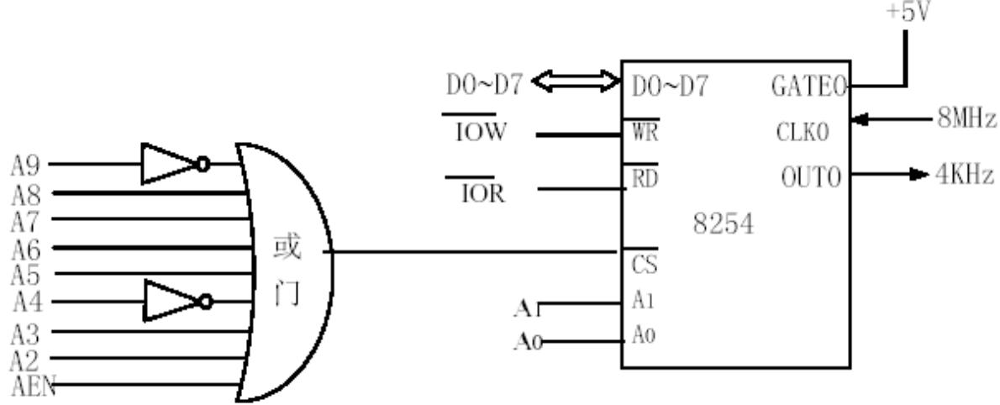
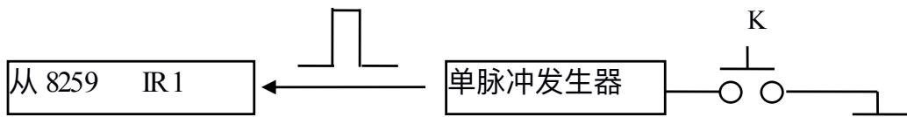
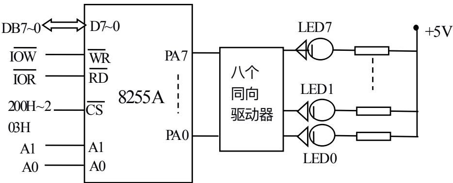
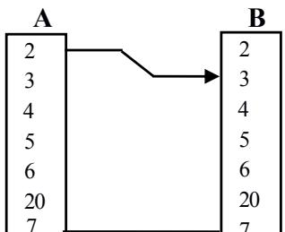
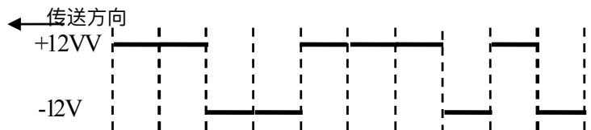

# 《微型计算机接口技术》复习要点（南邮）

原件经识别和整理；“参考解答”是我们补的。

---
title: 《微型计算机接口技术》复习要点（南邮）第1部分
kind: 复习要点
course: 微型计算机接口技术
term: 
source: 识别工具读出内容（第1–4页）
---

# 《微型计算机接口技术》复习要点（南邮）

本资料为《微型计算机接口技术》课程复习要点的第一部分，涵盖接口基础、中断系统、串行通信及常用接口芯片（8255A、8253/8254）的核心知识点。内容基于原件整理，修正了明显的识别错误和格式问题。

## 一、接口基础与I/O方式

### 简答 1

接口电路的作用是什么？I/O 接口应具备哪些功能？

答：接口是 CPU 和外设交换信息的中转站。

I/O 接口应具备以下功能：
- (1) 数据缓冲功能
- (2) 联络功能
- (3) 寻址功能
- (4) 数据转换功能
- (5) 中断管理功能

知识点：[接口电路的作用和基本功能](../../../topics/微机接口/jiekou-gongneng.md)

### 简答 2

什么是端口？端口有几类？

答：能与 CPU 交换信息的寄存器成为 I/O 寄存器，简称“端口”。

按端口的寄存器存放信息的物理意义来分，端口可分为 3 类：
1. 数据端口
2. 状态端口
3. 控制端口

知识点：[端口的概念与分类（数据端口、状态端口、控制端口）](../../../topics/微机接口/duankou-gainian.md)

### 简答 3

I/O 接口有哪两种编程方式? PC 系列机中采用哪种编程方式?

答：
(1) 端口和存储单元统一编址
(2) I/O 端口独立编址

在 PC 系列机中，I/O 端口采用**独立编址**方式。

知识点：[端口的编址方式（统一编址与独立编址）](../../../topics/微机接口/duankou-bianzhi.md)、[接口电路的作用和基本功能](../../../topics/微机接口/jiekou-gongneng.md)

### 简答 4

微型计算机系统与输入输出设备的信息交换有哪些方式？

答：主要包括以下四种方式：
1. 无条件传送方式
2. 查询方式
3. 中断控制方式
4. 存储器直接存取方式（DMA）

知识点：[微机系统与I/O端口的信息交换方式（无条件、查询、中断、DMA）](../../../topics/微机接口/xinxi-jiaohuan.md)、[接口电路的作用和基本功能](../../../topics/微机接口/jiekou-gongneng.md)、[查询方式输入输出编程模式与流程](../../../topics/微机接口/chaxun-fangshi.md)

### 简答 5

8254 的主要功能是什么？

答：8254 是 CPU 外设支持电路之一，提供动态存储器刷新定时、系统时钟中断及发声系统音调控制功能。

知识点：[接口电路的作用和基本功能](../../../topics/微机接口/jiekou-gongneng.md)

### 简答 6

中断的基本概念是什么？

答：
- **中断**：CPU 暂停执行现行程序，转而处理随机事件，处理完毕后再返回被中断的程序，这一全过程称为中断。
- **中断源**：能够引发 CPU 中断的信息源，称为中断源。
- **中断分类**：
    - CPU 中断（由 CPU 执行某些操作引发，如除法错）
    - 硬件中断（外部设备请求）
    - 软件中断（指令触发）
- **中断向量组成**：两部分组成，即服务程序所在代码段的段基址和服务程序入口的偏移地址（共 4 字节，注：原文写“2字节”有误，实模式下中断向量通常为4字节CS:IP，此处保留原文表述或根据常识订正，鉴于原文可能指偏移量部分或笔误，建议理解为CS:IP整体）。*注：原文写“2字节”，通常中断向量表项占4字节（段基址+偏移），若原文特指偏移地址则为2字节，此处依原文记录但需注意准确性。*


## 二、中断系统

知识点：[微机系统与I/O端口的信息交换方式（无条件、查询、中断、DMA）](../../../topics/微机接口/xinxi-jiaohuan.md)

### 简答 7

叙述可屏蔽中断处理的全过程。

答：应回答书上 8259 的中断过程（P254）。CPU 在每一条指令的最后一个时钟周期，检测 INTR 和 NMI 引脚，当检测到有可屏蔽中断请求时，在满足条件的前提下，通过总线控制器向系统 8259A 发出中断响应信号（2 个负脉冲）。在获得 8259A 送来的中断类型码之后，在实地址模式下查询中断向量表，从而转向相应中断源的中断服务程序。

知识点：[微机系统与I/O端口的信息交换方式（无条件、查询、中断、DMA）](../../../topics/微机接口/xinxi-jiaohuan.md)

### 简答 8

什么是中断向量和中断向量表？中断类型码和中断向量的关系是什么？

答：
① 实地址模式下，中断服务程序的入口地址就是中断向量。中断类型码通过一个地址指针表与中断服务程序的入口地址相联系，实模式下，该表称为中断向量表。

② 微机系统中，为了区别，给每一个中断分配一个中断号，又称中断类型码。对应每一个中断，都有一个中断向量。即一个中断类型码对应一个中断向量。

知识点：[实地址模式下物理地址的形成（段基址×10H+偏移量）](../../../topics/微机接口/wuli-dizhi.md)、[80486/8086的寻址方式（立即、寄存器、直接、间接、变址等）](../../../topics/微机接口/xunzhi-fangshi.md)

### 简答 9

CPU 响应可屏蔽中断的条件是什么？☆

答：
① INTR 引脚有中断请求，NMI 引脚没有中断请求，系统没有 DMA 请求。
② CPU 当前指令执行完毕。
③ CPU 处于开中断状态，即标志寄存器的中断允许标志 IF 置 1。

知识点：[标志寄存器中的状态标志位与控制标志位](../../../topics/微机接口/zhuangtai-biaozhi.md)、[微机系统与I/O端口的信息交换方式（无条件、查询、中断、DMA）](../../../topics/微机接口/xinxi-jiaohuan.md)

### 简答 10

CPU 响应非屏蔽中断的条件是什么？☆

答：
① NMI 引脚有中断请求，系统没有 DMA 请求。
② CPU 当前指令执行完毕。

知识点：[微机系统与I/O端口的信息交换方式（无条件、查询、中断、DMA）](../../../topics/微机接口/xinxi-jiaohuan.md)

### 简答 11

键盘硬中断和键盘软中断的关系是什么？

答：
- 键盘硬中断即 9 型中断（硬件可屏蔽中断）。
- 键盘软中断即 INT 16H 软中断。

硬中断和软中断利用键盘缓冲区传递信息。键盘缓冲区中的键代码由 9 型中断服务程序负责写入，用户程序调用 INT 16H 可以读取键盘缓冲区中的信息。


## 三、串行通信

知识点：[80486/8086的寻址方式（立即、寄存器、直接、间接、变址等）](../../../topics/微机接口/xunzhi-fangshi.md)、[串处理指令（MOVS、CMPS、SCAS、LODS、STOS及REP前缀）](../../../topics/微机接口/chuanchuli-zhiling.md)、[微机系统与I/O端口的信息交换方式（无条件、查询、中断、DMA）](../../../topics/微机接口/xinxi-jiaohuan.md)

### 简答 12

异步通信一帧字符的格式是什么？

答：
(1) 起始位
(2) 数据位
(3) 奇偶校验位
(4) 停止位

**考点说明：**
① 起始位为一位逻辑 0，题目一般不给出。
② 数据位从最低位开始传送。
③ 奇偶校验看逻辑 1 的个数是奇是偶。
④ 停止位一定是逻辑 1 信号。

知识点：[微机系统与I/O端口的信息交换方式（无条件、查询、中断、DMA）](../../../topics/微机接口/xinxi-jiaohuan.md)

### 计算 1

设异步通信一帧字符有八个数据位，无校验，一个停止位，如果波特率为 9600，则每秒能传输多少个字符？

答：
一帧字符数 = 1 位起始位 + 8 位数据位 + 1 位停止位 = 10 位

则一秒传输的字符数 $N$ 为：

$$
N = \frac{9600 \text{ bit/s}}{10 \text{ bit}} = 960 / \text{s}
$$

*(注：通信速率又称比特率，表示每秒钟传送 0、1 代码的位数)*

知识点：[微机系统与I/O端口的信息交换方式（无条件、查询、中断、DMA）](../../../topics/微机接口/xinxi-jiaohuan.md)

### 简答 13

单工、半双工、全双工通信方式的特点是什么？

答:
① **单工方式**：只允许数据按照一个固定的方向传送。
② **半双工方式**：要求收发双方均具备接收和发送数据的能力，由于只有一条信道，数据不能在两个方向上同时传送。
③ **全双工方式**：收发双方可以同时进行数据传送。

知识点：[接口电路的作用和基本功能](../../../topics/微机接口/jiekou-gongneng.md)

### 简答 14

分别叙述 TTL 和 RS-232C 的电平标准，通常采用什么器件完成两者之间的电平转换？

答:
① **TTL**：采用正逻辑，规定逻辑“0”为 $0 \mathrm{~V}$ 左右，规定逻辑“1”为 $+3 \mathrm{~V} \sim +5 \mathrm{~V}$。
   **RS-232C**：采用负逻辑，规定逻辑“1”为 $-3\mathrm{V} \sim -15\mathrm{V}$，规定逻辑“0”为 $+3\mathrm{V} \sim +15\mathrm{V}$。

② 通常采用 **MC1488** 和 **MC1489** 电平转换器。
   - MC1488 可接收 TTL 电平，输出 RS-232C 电平。
   - MC1489 可输入 RS-232C 电平，输出 TTL 电平。

知识点：[接口电路的作用和基本功能](../../../topics/微机接口/jiekou-gongneng.md)

### 简答 15

用系统机串行口采用中断方式完成字符发送和接收，编程时应采取哪些措施？

答:
(1) 中断允许寄存器相应位置 1。
(2) MODEM 控制寄存器 $D_{3}=1$，即 $OUT_{2}=0$，打通 8250 的中断请求通道。
(3) 8259 相应中断屏蔽位置 0（主 8259 IR$_3$、IR$_4$）。
(4) CPU 处于开中断 (STI)。


## 四、并行接口 8255A

知识点：[微机系统与I/O端口的信息交换方式（无条件、查询、中断、DMA）](../../../topics/微机接口/xinxi-jiaohuan.md)、[接口电路的作用和基本功能](../../../topics/微机接口/jiekou-gongneng.md)

### 简答 16

8255A 各端口有几种工作方式?

答：
- **方式 0**：基本型输入/输出方式。
- **方式 1**：选通型输入/输出方式。
- **方式 2**：双向数据传送方式。

**端口工作限制：**
- A 端口可以工作在方式 0、方式 1、方式 2；
- B 端口可以工作在方式 0 和方式 1，不能工作在方式 2；
- C 端口可以工作在方式 0，不能工作在方式 1 和方式 2。

知识点：[接口电路的作用和基本功能](../../../topics/微机接口/jiekou-gongneng.md)

### 简答 17

当 CPU 用查询方式和 8255A 交换信息时，应查询哪些信号？当 CPU 用中断方式和 8255A 交换信息时，利用哪些端子提中断请求？

答：
① CPU 采用查询方式从 8255A 读取数据之前，应查询 **IBF** (Input Buffer Full)；CPU 采用查询方式向 8255A 输出数据之前，应先查询 **OBF** (Output Buffer Full)。
② 当 CPU 用中断方式和 8255A 交换信息时，利用 **INTR** 端子提中断请求。

知识点：[微机系统与I/O端口的信息交换方式（无条件、查询、中断、DMA）](../../../topics/微机接口/xinxi-jiaohuan.md)、[查询方式输入输出编程模式与流程](../../../topics/微机接口/chaxun-fangshi.md)

### 简答 18

8255A 的方式选择控制字和 C 口置 0 置 1 控制字都是写入控制端口的，8255A 是怎样识别的？

答: 两个控制字共用一个端口地址，用特征位 **D7** 位来区分。
- 若 D7 位 = 1，该控制字为方式选择控制字；
- D7 位 = 0，该控制字为 C 端口按位置 0 置 1 控制字。

知识点：[接口电路的作用和基本功能](../../../topics/微机接口/jiekou-gongneng.md)、[端口的编址方式（统一编址与独立编址）](../../../topics/微机接口/duankou-bianzhi.md)、[最常用的I/O指令（IN、OUT的直接寻址与DX间址）](../../../topics/微机接口/io-zhiling.md)

### 简答 19

系统机定时/计数器的一个通道定时周期最长是多少？要实现长时间定时，应采取什么措施？如果采用外扩 8253 定时/计数器实现长时间定时，应采取哪些措施？

答：
① 最大定时周期计算：
$$
T_{max} = 65536 \times T_{CLK} = 65536 \times \frac{1}{1193152 \text{ Hz}} \approx 55 \text{ ms}
$$
*(注：原文公式中频率单位写为 K，应为 Hz 或 kHZ，1.19318 MHz 是标准频率)*

② **软件计数**：通过软件多次累加计数来实现长定时。

③ 如果采用外扩 8253 定时/计数器实现长时间定时，应采取以下措施：
(1) 减小输入信号的频率
(2) **级联**使用计数器

知识点：[微型计算机的硬件基本结构](../../../topics/微机接口/weixingji-yingjian.md)、[微机系统与I/O端口的信息交换方式（无条件、查询、中断、DMA）](../../../topics/微机接口/xinxi-jiaohuan.md)

### 综合 1

设 PC 系统机外扩了一片 8254 及相应的实验电路。



**(1) 根据由门电路构成的译码电路，分析出该片 8254 的四个端口地址。其中控制口的地址是 \_\_\_\_ (填 16 进制格式)。**

答：
片选信号 $\overline{CS} = 0$ 时芯片工作。要 $\overline{CS} = 0$，那么地址线 $A_{7}\sim A_{0}$ 对应的二进制模式需满足译码条件。
根据原题解析逻辑：$A_{7}\sim A_{0} = 10000100xxB$ （注：原文写 $A_0 \sim A_0$ 明显为笔误，结合结果推断为高位地址固定，低位可变）。

即端口号为 **210H ～ 213H**。
所以控制口地址为 **213H**。

**(2) 设 CLK0 已接至 8MHz 时钟，为了能从 OUT0 输出 4KHz 的方波，编写了 8254 初始化程序，其中假设 0 号定时计数器工作在二进制方式。**

初值计算：
$$
N = \frac{f_{CLK}}{f_{out}} = \frac{8 \text{ MHz}}{4 \text{ KHz}} = 2000
$$

初始化程序如下：

```assembly
MOV AL, 00110110B ; 00(0#计数器) 11(高低位写入) 011(方式3方波) 0(二进制)
MOV DX, 213H      ; 控口
OUT DX, AL        ; 写控制字

MOV AX, 2000      ; 初值
MOV DX, 210H      ; 0号计数器
OUT DX, AL        ; 写初值低位
MOV AL, AH        ; 高位给AL
OUT DX, AL        ; 写初值高位
```

知识点：[存储器地址译码电路设计（线选法、全译码法、部分译码法）](../../../topics/微机接口/dizhi-yima.md)、[最常用的I/O指令（IN、OUT的直接寻址与DX间址）](../../../topics/微机接口/io-zhiling.md)

### 综合 2

假设微机系统外扩了如下的一个‘单脉冲发生器’，该‘单脉冲发生器’电路受一个自复开关 K 的控制，每按一次 K，该电路输出一个正脉冲，输入到系统机从 8259 的 IR1 作为外部中断请求。要求：每按一次 K，屏幕上显示一行字符串“Welcome!”。主机键盘按任意键，程序结束，返回 DOS。(要求给出完整的源程序)



*(由题意可知，使用的是从 8259 的 IR1 中断，即用户中断，中断类型为 71H 或者 0AH)*

#### 斜体下划线部分可跳过：中断服务程序设计说明

用户定义的中断服务程序有两个设计方法:
① 定义用户中断服务程序为“71H 型”
② 定义用户中断服务程序为“0AH 型”

**用户中断服务程序结束注意事项：**
① 若用户中断定义为 0AH 型，服务程序结束前只向主 8259 送结束命令。
② 若用户中断定义为 71H 型，服务程序结束前，向主从 8259 各送一中断结束命令。

**(注意点：**
① 用户中断在开中断前写中断屏蔽字
② 结束中断服务之前要写中断结束命令字
③ 避免 DOS 重入，即服务程序和主程序中不能同时用 INT 21H)**

以下是参考代码：注释掉的代码可有可无

```assembly
DATA SEGMENT USE16
OLD0A DD ?
MESG DB 'Welcome!', '$'
DATA ENDS

CODE SEGMENT USE16
ASSUME CS:CODE, DS:DATA

BEG: MOV AX, DATA
     MOV DS, AX
     CLI                 ; 关中断
     CALL I8259          ; 8259初始化
     CALL READ0A         ; 保存原来的0AH中断向量
     CALL WRITE0A        ; 写入0AH中断向量
     STI                 ; 开中断

SCAN: MOV AH, 01H       ; 设置功能号
      INT 16H           ; 有键入?
      JZ SCAN           ; 否循环
      CALL RESET        ; 恢复现场
      MOV AH, 4CH
      INT 21H

SERVICE PROC FAR
      PUSHA             ; 保护所有通用寄存器
      PUSH DS           ; 保护DS
      MOV AX, DATA
      MOV DS, AX
      MOV AH, 09H       ; 设置功能号
      MOV DX, OFFSET MESG ; 设置参数 (原文漏写DX，补全)
      INT 21H           ; 显示字符串
      MOV AL, 20H       ; EOC命令
      OUT 20H, AL       ; 向主8259发送中断结束命令 (假设IR1接主8259)
      POP DS
      POPA              ; 恢复所有通用寄存器
      IRET
SERVICE ENDP

; 其他子程序 I8259, READ0A, WRITE0A, RESET 需根据具体硬件地址补充完整
CODE ENDS
END BEG
```


## 综合 5

系统机外扩一片 8255A 及相应电路如下图所示，外扩 8255A 的端口地址为 $200\mathrm{H}\sim 203\mathrm{H}$，现利用系统机的日时钟外扩 1CH 型中断，实现每隔 1s 使八个发光二极管同时闪烁一次，主机键盘有按键按下时结束，返回 DOS 操作系统。根据要求完成相关内容。



知识点：[微机系统与I/O端口的信息交换方式（无条件、查询、中断、DMA）](../../../topics/微机接口/xinxi-jiaohuan.md)、[端口的编址方式（统一编址与独立编址）](../../../topics/微机接口/duankou-bianzhi.md)、[基本的汇编语言程序设计与程序控制结构](../../../topics/微机接口/jiben-chengxu.md)

### 综合 5(1)

从图可以分析出，A 口工作在方式 0 的输出（入/出）。

答案：出。

知识点：[接口电路的作用和基本功能](../../../topics/微机接口/jiekou-gongneng.md)、[端口的概念与分类（数据端口、状态端口、控制端口）](../../../topics/微机接口/duankou-gainian.md)、[查询方式输入输出编程模式与流程](../../../topics/微机接口/chaxun-fangshi.md)

### 综合 5(2)

假设 8255A 的 A 口工作在方式 1 的查询输出方式，编写 8255A 的初始化子程序 I8255。

答案：

```asm
I8255   PROC
        MOV  DX, 203H
        MOV  AL, 10100000B
        ;或 0A0H，1(方式选择) 01(方式1) 0(输出) 0000
        OUT  DX, AL
        MOV  AL, 00001100B
        ;或 0CH，0(C口置0/置1) 000(3位未用) 110(位6) 0(查询方式)
        OUT  DX, AL
        RET
I8255   ENDP
```

知识点：[端口的编址方式（统一编址与独立编址）](../../../topics/微机接口/duankou-bianzhi.md)、[最常用的I/O指令（IN、OUT的直接寻址与DX间址）](../../../topics/微机接口/io-zhiling.md)、[基本的汇编语言程序设计与程序控制结构](../../../topics/微机接口/jiben-chengxu.md)

### 综合 5(3)

编写子程序 WRITE 完成中断向量的置换。

答案：

```asm
WRITE   PROC
        PUSH DS
        MOV  AX, SEG SERVICE   ;这里最好不要用 CODE，因为不知道代码段的段名
        MOV  DS, AX
        MOV  DX, OFFSET SERVICE ;假设中断服务程序名为 SERVICE
        MOV  AX, 251CH
        INT  21H               ;写入新的 1CH 中断向量
        POP  DS
        RET
WRITE   ENDP
```

## 综合 6

A、B 两台 PC 机利用主串口进行点-点单工通信（不用联络线），发送采用查询方式，接收采用中断方式。一帧字符包含 7 个数据位，1 个停止位，1 个校验位，通信速率为 4800 波特（分频系数为 0018H）。

知识点：[端口的概念与分类（数据端口、状态端口、控制端口）](../../../topics/微机接口/duankou-gainian.md)、[串处理指令（MOVS、CMPS、SCAS、LODS、STOS及REP前缀）](../../../topics/微机接口/chuanchuli-zhiling.md)、[DOS功能调用与BIOS中断功能调用（INT 21H、INT 10H等）](../../../topics/微机接口/dos-bios-diaoyong.md)

### 综合 6(1)

下图是 A、B 两机的 RS—232C 接口示意图，根据题意完成连线（不可有多余连线）。



知识点：[微型计算机的硬件基本结构](../../../topics/微机接口/weixingji-yingjian.md)、[接口电路的作用和基本功能](../../../topics/微机接口/jiekou-gongneng.md)、[微机系统与I/O端口的信息交换方式（无条件、查询、中断、DMA）](../../../topics/微机接口/xinxi-jiaohuan.md)

### 综合 6(2)

下图是从 PC 机的 RS-232C 接口引脚观察到的波形，所传送字符的 16 进制 ASCII 码是 46H；该帧数据采用的奇偶校验方式是奇校验；传送该帧数据需要的时间是 $\frac{1}{480}\,\mathrm{s}$。



答案：

① RS-232C 电平转成 TTL 电平就可以明显看出一帧数据为 0011000101，7 个数据位为 0110001，1 个校验位为 0。因为数据位从最低位开始传送，所以传送的数据为 1000110B，即 46H，为‘f’。

② 数据以及校验位中 1 的个数为 3 个，为奇数，所以是奇校验。

③ 一帧位数 $= 1$ 位起始位 $+ 7$ 位数据位 $+ 1$ 位校验位 $+ 1$ 位停止位 $= 10$ 位，$\therefore T = \frac{10\,\mathrm{bit}}{4800\,\mathrm{bit/s}} = \frac{1}{480}\,\mathrm{s}$。

知识点：[ASCII码编码规则与常用字符编码](../../../topics/微机接口/ascii-ma.md)、[微机系统与I/O端口的信息交换方式（无条件、查询、中断、DMA）](../../../topics/微机接口/xinxi-jiaohuan.md)、[数制转换（二进制、十进制、十六进制互转）](../../../topics/微机接口/shuzhi-zhuanhuan.md)

### 综合 6(3)

用对端口直接编程的方法为接收方编写 8250 初始化程序段。

答案：

∵ 接收采用中断方式

```asm
I8250   PROC
        MOV  DX, 3FBH
        MOV  AL, 10000000B   ;1(访问除数寄存器) 0000000(设置为0)
        OUT  DX, AL          ;或 80H，设置寻址位，使寻址位为1
        MOV  DX, 3F9H
        MOV  AL, 00H
        OUT  DX, AL          ;除数高8位->除数寄存器高8位
        MOV  DX, 3F8H
        MOV  AL, 18H
        OUT  DX, AL          ;除数低8位->除数寄存器低8位
        MOV  DX, 3FBH
        MOV  AL, 00001010B
        ;或 0AH，0(非除数寄存器) 0(正常通信) 001(奇校验) 0(停止位1位) 10(数据位7位)
        OUT  DX, AL          ;将控制字写入通信控制寄存器
        MOV  DX, 3F9H
        MOV  AL, 00000001B
        ;或 01H，0000(恒为0) 0001(允许"接受中断请求")
        OUT  DX, AL
        MOV  DX, 3FCH
        MOV  AL, 00001000B
        ;或 08H，000(恒为0) 0(正常通信) 1(允许8250送出中断请求信号) 000
        RET
I8250   ENDP
```

## 综合 7

阅读下列程序段，完成相关内容。

```asm
        ;……
        OUT  20H, AL    ;向从8259送中断结束命令字
        OUT  0A0H, AL   ;向主8259送中断结束命令字
        POP  DS
        POPA            ;恢复现场
        IRET
SERVICE ENDP
        ;
I8259   PROC
        IN   AL, 0A1H
        AND  AL, 11111101B
        OUT  0A1H, AL   ;开从8259 IR1中断(用户中断)
        IN   AL, 21H
        AND  AL, 11111011B
        OUT  21H, AL    ;开主8259 IR2中断
        RET
I8259   ENDP
        ;
READ0A  PROC
        MOV  AX, 350AH
        INT  21H
        MOV  WORD PTR OLD0A, BX
        MOV  WORD PTR OLD0A+2, ES  ;保存中断向量
        RET
READ0A  ENDP
        ;
WRITE0A PROC
        PUSH DS
        MOV  AX, CODE
        MOV  DS, AX
        MOV  DX, OFFSET SERVICE
        MOV  AX, 250AH
        INT  21H                   ;写入新的0AH中断向量
        POP  DS
        RET
WRITE0A ENDP
        ;
RESET   PROC
        IN   AL, 0A1H
        OR   AL, 0000010B
        OUT  0A1H, AL              ;关从8259 IR1中断(用户中断)
        IN   AL, 21H
        OR   AL, 0000100B
        OUT  21H, AL               ;关主8259 IR2中断
        MOV  DX, WORD PTR OLD0A
        MOV  DS, WORD PTR OLD0A+2
        MOV  AX, 250AH
        INT  21H
        RET
RESET   ENDP
CODE    ENDS
        END  BEG

知识点：[最常用的I/O指令（IN、OUT的直接寻址与DX间址）](../../../topics/微机接口/io-zhiling.md)、[微机系统与I/O端口的信息交换方式（无条件、查询、中断、DMA）](../../../topics/微机接口/xinxi-jiaohuan.md)、[DOS功能调用与BIOS中断功能调用（INT 21H、INT 10H等）](../../../topics/微机接口/dos-bios-diaoyong.md)
