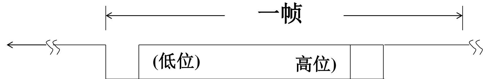
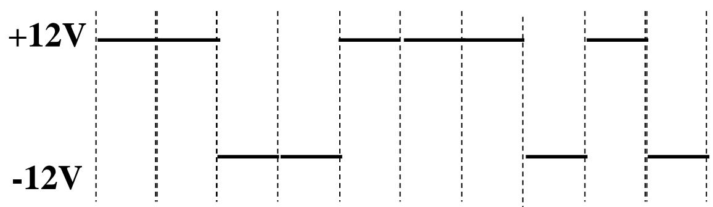
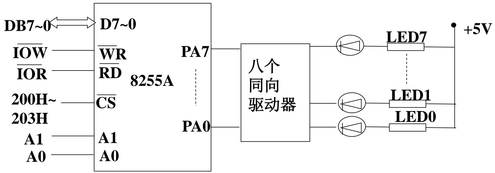
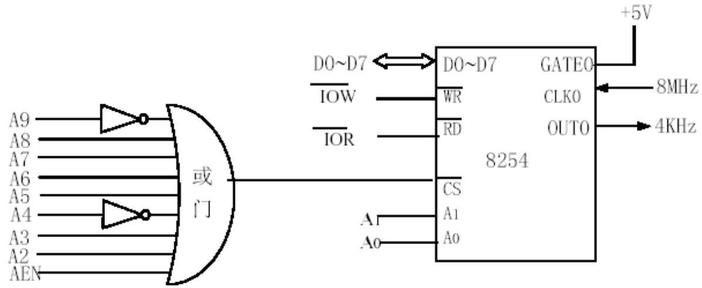

# 《微型计算机接口技术》期末复习（2018.12.19）

原件经识别和整理；“参考解答”是我们补的。

# 微型计算机接口技术期末复习（2018.12.19）

本资料为《微型计算机接口技术》课程期末复习要点，整理自2018年12月19日的复习材料。内容涵盖输入/输出系统、中断系统、串行通信及并行I/O接口等核心章节。

## 第七章 输入/输出系统

### 一、接口电路的作用和功能

接口电路是CPU与外设之间进行信息交换的中间部件，主要作用包括：
- 数据缓冲：解决CPU高速与外设低速之间的速度匹配问题。
- 电平转换：实现CPU逻辑电平与外设物理电平的匹配。
- 控制信号转换：协调双方的握手信号。
- 地址译码：识别端口地址。

知识点：[接口电路的作用和基本功能](../../../topics/微机接口/jiekou-gongneng.md)、[端口的编址方式（统一编址与独立编址）](../../../topics/微机接口/duankou-bianzhi.md)

### 二、端口的概念、分类

**端口**：CPU能够直接访问的寄存器或存储器单元。

**分类**：
1. **数据端口**：存放正在传输的数据。
2. **状态端口**：存放外设的状态信息（如忙、闲）。
3. **命令端口**：存放CPU发出的控制命令。

知识点：[端口的概念与分类（数据端口、状态端口、控制端口）](../../../topics/微机接口/duankou-gainian.md)、[端口的编址方式（统一编址与独立编址）](../../../topics/微机接口/duankou-bianzhi.md)、[接口电路的作用和基本功能](../../../topics/微机接口/jiekou-gongneng.md)

### 三、端口编址方式

PC系列机采用**端口独立编址**（I/O映射编址），即I/O端口与内存单元分开编址，使用专门的I/O指令访问。

知识点：[端口的编址方式（统一编址与独立编址）](../../../topics/微机接口/duankou-bianzhi.md)、[最常用的I/O指令（IN、OUT的直接寻址与DX间址）](../../../topics/微机接口/io-zhiling.md)

### 四、最常用的 I/O 指令

1. **直接寻址 I/O 指令**
   - 格式：`IN AL, port` / `OUT port, AL`
   - 适用：端口地址为8位（00H~FFH）。

2. **DX间接寻址 I/O 指令**
   - 格式：`IN AL, DX` / `OUT DX, AL`
   - 适用：当端口地址超过8位时，需将16位端口地址先送入DX寄存器。

知识点：[最常用的I/O指令（IN、OUT的直接寻址与DX间址）](../../../topics/微机接口/io-zhiling.md)、[端口的编址方式（统一编址与独立编址）](../../../topics/微机接口/duankou-bianzhi.md)

### 五、微机系统与 I/O 端口的信息交换方式

主要有四种方式：
1. **无条件传送**：适用于简单、低速且随时就绪的外设。
2. **查询方式**：CPU通过读取状态端口判断外设是否就绪，再执行数据传送。程序效率较低，但硬件简单。
3. **中断方式**：外设准备好后向CPU发出中断请求，CPU暂停当前程序处理I/O，处理完后返回。提高了CPU利用率。
4. **DMA方式**：由DMA控制器直接接管总线，实现外设与内存间的高速数据块传送，无需CPU干预。

**重点掌握**：
- 查询方式下发送和接收数据的程序段编写。
- DMA的特点（高速、无需CPU参与数据传输阶段）。

## 第八章 中断系统

知识点：[微机系统与I/O端口的信息交换方式（无条件、查询、中断、DMA）](../../../topics/微机接口/xinxi-jiaohuan.md)、[查询方式输入输出编程模式与流程](../../../topics/微机接口/chaxun-fangshi.md)、[直接存储器存取（DMA）方式及其与中断方式的比较](../../../topics/微机接口/dma-fangshi.md)

### 一、中断概念

**中断**：CPU暂停执行现行程序，转而处理随机事件，处理完毕后再返回被中断的程序，这一全过程称为中断。

知识点：[微机系统与I/O端口的信息交换方式（无条件、查询、中断、DMA）](../../../topics/微机接口/xinxi-jiaohuan.md)、[接口电路的作用和基本功能](../../../topics/微机接口/jiekou-gongneng.md)

### 二、中断指令

常用中断指令包括：`STI`, `CLI`, `INT n`, `IRET`。

**要求掌握**：
1. 中断指令在中断程序设计中何时使用。
2. CPU执行中断指令后完成的操作。
3. `STI` (开中断), `CLI` (关中断) 只对可屏蔽中断请求有效。

**例**：CPU执行 `IRET` 指令后，从栈顶弹出 **4** 字节数据，分别赋给 **CS** 和 **IP**。

知识点：[处理器控制指令（STI、CLI、HLT、NOP等）](../../../topics/微机接口/chuli-kongzhi.md)、[堆栈的概念及SP指针操作](../../../topics/微机接口/duizhan-caozuo.md)、[标志寄存器中的状态标志位与控制标志位](../../../topics/微机接口/zhuangtai-biaozhi.md)

### 三、中断向量

1. **定义**：中断向量是实模式下，中断服务子程序的**入口地址**。
2. **存储位置**：在实模式下，CPU把256种中断向量组成一张表（中断向量表），设置在系统的RAM最低端的1K单元（0000H ~ 03FFH）。
3. **存放规则**：n型中断向量存放在内存单元地址 $4 \times n \sim 4 \times n + 3$ 这四个单元中。

$$
\begin{array}{c c} 
4 n + 0 & \\ 
+ 1 & \text{n 型服务程序入口的偏移地址 (Offset)} \\ 
+ 2 & \text{n 型服务程序入口的段基址 (Segment)} \\ 
+ 3 & 
\end{array} \quad 
\begin{array}{c c} 
\hline & \\ 
\hline & \text{n 型中断向量} \\ 
\hline & 
\end{array}
$$

**中断向量表的引导作用**：通过中断类型码查找对应的入口地址，从而跳转到中断服务程序。

**例**：实模式下，从内存地址 `0000H:0048H` 开始的连续4个单元中存放的内容为 `00H, 38H, 30H, 50H`。
- 该地址所对应的中断类型码为 **12H** (因为 $48H / 4 = 12H$)。
- 该中断所对应的中断服务子程序的入口地址为：**3800H:5030H** (段基址为高2字节 `5030H`，偏移地址为低2字节 `0038H`)。*注：通常内存低位存偏移，高位存段基址，具体依小端模式而定，此处按常规理解：低地址存偏移，高地址存段基址。若内容为00,38,30,50，则偏移为3800H? 不，小端存储：地址+0,+1为偏移，+2,+3为段。故偏移=3800H(若38在+1,00在+0? 不对，通常是LSB在前)。让我们重新审视标准：偏移地址存在4n和4n+1，段基址存在4n+2和4n+3。小端模式：4n是LSB，4n+1是MSB。所以偏移 = (38 << 8) | 00 = 3800H? 或者 0038H? 通常书写习惯是“3800H”表示段，“5030H”表示偏移？不，题目给出的是内存内容序列。
    - 地址 0048H: 00H (Offset LSB)
    - 地址 0049H: 38H (Offset MSB) -> Offset = 3800H
    - 地址 004AH: 30H (Segment LSB)
    - 地址 004BH: 50H (Segment MSB) -> Segment = 5030H
    - 因此入口地址为 **5030H:3800H**。*(注：原题填空处为空白，此处根据常规小端存储规则推导)*

知识点：[80486/8086基本结构寄存器（通用、段、控制寄存器）](../../../topics/微机接口/jiben-jicunqi.md)、[实地址模式下物理地址的形成（段基址×10H+偏移量）](../../../topics/微机接口/wuli-dizhi.md)、[查询方式输入输出编程模式与流程](../../../topics/微机接口/chaxun-fangshi.md)

### 四、微机系统中断分类

PC机共有256种中断，分为两大类：

1. **软件中断（内部中断）**
   - **概念**：由指令引起或由内部异常引起。
   - **中断类型码获得**：包含在软中断指令中（如 `INT n`）或自动获得（如除法错误、单步中断）。

2. **硬件中断（外部中断）**
   - **非屏蔽中断 (NMI)**
     - **概念**：不可屏蔽，优先级较高。
     - **中断类型码**：固定为 **2**，自动获得。
   - **可屏蔽中断 (INTR)**
     - **概念**：通过8259中断控制器连至CPU的INTR引脚。
     - **中断响应过程**：CPU响应可屏蔽中断需经过几个机器周期，期间CPU发出中断响应信号 $\overline{INTA}$，8259送出中断类型码。

**对于8259要求掌握**：
- 8259中断响应过程。
- **例**：中断优先权电路的作用是什么？（确定多个同时到达的中断源的优先级，优先处理高优先级中断）。

**微机系统可屏蔽硬件中断详情**：

| 中断源 | 中断级别 | 中断类型码 |
| :--- | :--- | :--- |
| 日时钟中断 | 最高 | 08H |
| 键盘中断 | | 09H |
| 从8259 IR0 | | 70H |
| IR1 | | 71H (改向 0AH) |
| IR2 | | 72H |
| $\vdots$ | | $\vdots$ |
| IR7 | | 77H |
| 辅串口 | | 0BH |
| 主串口 | | 0CH |
| 并口2 | | 0DH |
| 软盘 | | 0EH |
| 并口1 | 最低 | 0FH |

**系统分配的8259口地址**：

| | 中断屏蔽寄存器口地址 | 接收中断结束命令的寄存器口地址 |
| :--- | :--- | :--- |
| 主8259 | 21H | 20H |
| 从8259 | A1H | A0H |

**重点掌握的四种可屏蔽中断**：

1. **用户中断**
   - **中断源**：来自从8259的IR1。
   - **中断向量**：默认 **71H**，可置换为 **0AH**。
   - **用户可置换的中断向量**：71H, 0AH。

2. **日时钟中断**
   - **中断源**：主8259的IR0。
   - **中断向量**：默认 **08H**，可置换为 **1CH**。
   - **用户可置换的中断向量**：08H, 1CH。
   - **注意**：重点掌握 **1CH**，因为08H常被BIOS占用，建议用户替换为1CH以避免冲突。

知识点：[微机系统与I/O端口的信息交换方式（无条件、查询、中断、DMA）](../../../topics/微机接口/xinxi-jiaohuan.md)、[最常用的I/O指令（IN、OUT的直接寻址与DX间址）](../../../topics/微机接口/io-zhiling.md)、[端口的编址方式（统一编址与独立编址）](../../../topics/微机接口/duankou-bianzhi.md)

### 五、中断程序设计

#### （1）主程序的编写主要包括
1. **中断向量的置换**：读中断向量表，保存原向量；写新向量，指向新的中断服务程序。
2. **硬件中断通路的开放和屏蔽**：
   - 涉及对8259中断屏蔽寄存器（IMR）的操作。
   - 对于日时钟中断 08H (或其中的1CH)，默认下主8259已经打开，无需再进行开放操作。

#### （2）中断服务程序的编写
- 根据置换的中断类型不同，需要解决是否要对中断管理器8259写中断结束命令字（EOI）的问题。
- **对于日时钟 08H (或其中的1CH)**：不需要写中断结束命令字（因为它是内建时钟中断，由8259自动管理或特定机制处理，通常编程练习中1CH作为用户替换中断，仍需手动发EOI，但若指原生08H，某些语境下强调其特殊性。*注：标准做法是任何通过8259产生的可屏蔽中断，服务程序结尾都需发EOI。此处原文说“不需要”，可能是指特定的原生时钟中断处理流程差异，但在通用8259编程题中，通常都需要。依据原文保留“不需要”的说法，但需注意实际编程规范*）。

**例题**：
假设微机系统外扩了如下的一个‘单脉冲发生器’，该‘单脉冲发生器’电路受一个自复开关K的控制，每按一次K，该电路输出一个正脉冲，输入到系统机从8259的IR1作为外部中断请求。
要求：每按一次K，屏幕上显示一行字符串“Welcome!”。主机键盘按任意键，程序结束，返回DOS。（要求给出完整的源程序）


```assembly
.486
DATA SEGMENT USE16
    MESG DB "B01040101", "$"
DATA ENDS

CODE SEGMENT USE16
ASSUME CS:CODE, DS:DATA

BEG:
    MOV AX, DATA
    MOV DS, AX
    
    CLI                 ; 关中断，防止初始化过程中被打断
    CALL WRITE0A        ; 调用初始化子程序
    CALL I8259          ; 调用8259设置子程序
    STI                 ; 开中断
    
SCAN:
    MOV AH, 1           ; 检测键盘按键
    INT 16H
    JZ SCAN             ; 若无键按下，继续循环
    MOV AH, 4CH         ; 返回DOS
    INT 21H

; 中断服务程序
SERVICE PROC FAR
    PUSH AX
    PUSH DS
    MOV AX, DATA
    MOV DS, AX
    
    MOV AH, 9           ; 显示字符串
    MOV DX, OFFSET MESG
    INT 21H
    
    MOV AL, 20H         ; 发送中断结束命令 (EOI) 到主8259
    OUT 20H, AL
    
    POP DS
    POP AX
    IRET
SERVICE ENDP

; 初始化子程序：设置中断向量
WRITE0A PROC FAR
    PUSH DS
    IN AL, 21H          ; 读主8259 IMR
    MOV AX, CODE        ; 这里原文可能有误，应为保护现场或计算偏移
    AND AL, 11111011B   ; 允许IR1中断 (假设IR1对应某一位，原文代码逻辑可能针对特定引脚)
                        ; 注意：原文代码逻辑略显混乱，以下按常见逻辑修正理解：
                        ; 通常应设置从8259的IMR，允许IR1
    MOV DS, AX          ; 原文此处逻辑可能有误，DS通常指向数据段
    OUT 21H, AL         ; 写回主8259 IMR (如果修改的是主8259)
    
    MOV DX, OFFSET SERVICE
    MOV AX, 250AH       ; 准备中断向量：CS=CODE_SEG, IP=SERVICE_OFFSET
                        ; 原文代码: MOV AX, 250AH 似乎是将CS和IP打包？
                        ; 标准写法: MOV AX, OFFSET SERVICE; MOV DS:[0A*4], AX...
    
    ; 原文代码片段如下，可能存在转录错误或特定简化写法：
    IN AL, 0A1H         ; 读从8259 IMR
    AND AL, 11111101B   ; 允许IR1 (Bit 1)
    INT 21H             ; 原文此处INT 21H位置奇怪，通常用于DOS功能
    OUT 0A1H, AL        ; 写从8259 IMR
    
    POP DS
    RET
WRITE0A ENDP

I8259A PROC FAR       ; 原文名为I8259A，但在CALL中调用I8259，可能合并或笔误
    PUSH DS
    ; ... 上述WRITE0A中的部分逻辑可能属于此或混淆 ...
    RET
I8259A ENDP

CODE ENDS
END BEG
```
*注：提供的汇编代码存在多处语法和逻辑上的疑点（如`MOV AX, CODE`赋值给DS，`INT 21H`出现在初始化中间等），以上仅为按原文转录。实际考试中应依据课堂讲授的标准模板编写，特别是中断向量表的写入应使用 `INT 25H` 或直接写内存 `ES:[DI]` 的方式。*

## 第九章 串行通信

知识点：[微机系统与I/O端口的信息交换方式（无条件、查询、中断、DMA）](../../../topics/微机接口/xinxi-jiaohuan.md)、[端口的编址方式（统一编址与独立编址）](../../../topics/微机接口/duankou-bianzhi.md)、[最常用的I/O指令（IN、OUT的直接寻址与DX间址）](../../../topics/微机接口/io-zhiling.md)

### 一、基本概念

1. **通信的基本方式**：分为并行通信和串行通信。
2. **串行通信分类**：串行异步通信和串行同步通信。
3. **异步串行通信的数据传输方式**：
   - **单工通信**：数据只能沿一个方向传输。
   - **半双工通信**：数据可以双向传输，但不能同时进行。
   - **全双工通信**：数据可以同时双向传输。
   
   **例**：单工、半双工、全双工通信方式的特点是什么？（见上定义）。

4. **异步串行通信一帧数据的格式及通信速率的计算**：



- **格式组成**：起始位 (1位，低电平) → 数据位 (5-8位，LSB先发) → 奇偶校验位 (可选，1位) → 停止位 (1-2位，高电平)。
- **例**：异步通信一帧数据格式中，按照发送的次序，先传送 **起始位**，紧接着是 **数据** 位，数据位后依次为 **校验位** 和 **停止位**。

5. **通信一致性**：为实现通信，收发双方一帧数据的格式（数据位、停止位、校验位）和通信速率（波特率）要保持一致。
6. **RS232信号电平**：采用负逻辑。
   $$
   “ 1 ” = - 3 \mathrm{V} \sim - 1 5 \mathrm{V}, \quad “ 0 ” = + 3 \mathrm{V} \sim + 1 5 \mathrm{V}
   $$

知识点：[微机系统与I/O端口的信息交换方式（无条件、查询、中断、DMA）](../../../topics/微机接口/xinxi-jiaohuan.md)

### 二、8250芯片

**8250内部寄存器的功能**：
- **除数锁存器** (Divisor Latch)：设置波特率。
- **线路控制寄存器** (LCR)：设置数据格式、使能除数锁存器。
- **中断允许寄存器** (IER)：允许/禁止各类中断。
- **线路状态寄存器** (LSR)：反映发送/接收状态。
- **中断识别寄存器** (IIR)：识别中断源。
- **MODEM控制寄存器** (MCR)：控制联络线信号。
- **MODEM状态寄存器** (MSR)：读取联络线状态。

知识点：[接口电路的作用和基本功能](../../../topics/微机接口/jiekou-gongneng.md)、[端口的概念与分类（数据端口、状态端口、控制端口）](../../../topics/微机接口/duankou-gainian.md)、[微机系统与I/O端口的信息交换方式（无条件、查询、中断、DMA）](../../../topics/微机接口/xinxi-jiaohuan.md)

### 三、8250的编程

#### （1）8250的初始化编程

**8250初始化步骤**：
1. **80H → 线路控制寄存器**：使除数寄存器访问位 (DLAB) = 1，以便访问除数锁存器。
2. **设置波特率**：根据波特率计算出除数高/低8位，写入除数寄存器高/低8位，确定通信速率。
3. **D7=0的命令字 → 线路控制寄存器**：
   - 目的1：定义一帧数据格式（数据位长度、停止位数、校验方式）。
   - 目的2：使除数寄存器访问位 = 0，从而使后继的对合用端口（如03F8H/03FBH等间隔地址）的访问只读写非除数寄存器（即普通功能寄存器）。
4. **设置中断允许命令字**：
   - 查询方式：中断允许命令字 = 0，禁止中断。
   - 中断方式：使中断允许命令字相应位置1。
5. **设置MODEM控制寄存器**：
   - 中断方式：D3=1，允许8250送出中断请求。
   - 查询方式：D3=0。
   - 内环方式：D4=1。
   - 正常通信：D4=0。
   - 使用联络线：D1、D0位置1（DTR, RTS有效）。

#### （2）8250的应用编程

串行通信程序设计包括硬件连接和软件编程。

**8250查询方式下接收和发送程序的编程**：
- **发送前**：读通信线状态寄存器 (LSR)，检查发送保持寄存器空标志 (THRE, Bit 5) 是否为1，若为1表示发送移位寄存器空闲，可写入数据。
- **接收前**：读通信线状态寄存器 (LSR)，检查数据就绪标志 (DR, Bit 0) 是否为1，若为1表示接收缓冲寄存器已收到1帧数据，可读出数据。

**例题**：
A、B两台PC机利用主串口进行点-点单工通信（不用联络线），发送采用查询方式，接收采用中断方式。一帧字符包含7个数据位，1个停止位，1个校验位，通信速率为4800波特（分频系数为0018H）。

（1）下图是A、B两机的RS—232C接口示意图，根据题意完成连线（不可有多余连线）。

$$
\begin{array}{c} \framebox {2} \\ 3 \\ 4 \\ 5 \\ 6 \\ 2 0 \\ 7 \end{array}
$$

$$
\boxed { \begin{array}{c} 2 \\ 3 \\ 4 \\ 5 \\ 6 \\ 2 0 \\ 7 \end{array} }
$$
*注：直连通信通常交叉连接 TXD(3) 与 RXD(2)，GND(7) 相连。*

（2）下图是从PC机的RS-232C接口引脚观察到的波形，所传送字符的16进制ASCII码是 **?** ；该帧数据采用的奇偶校验方式是 **?** 校验；传送该帧数据需要的时间是 **?** ms。

*注：需根据图中高低电平持续时间计算比特流，进而得出ASCII码和校验类型。*

（3）用对端口直接编程的方法为接收方编写8250初始化程序段。

已知端口地址（假设主串口基地址为3F8H）：
- 除数锁存器: 3F8H, 3FAH
- 线路控制: 3FBH
- 中断允许: 3FBH (DLAB=0时)
- MODEM控制: 3FC H

<table>
<tr><td>MOV</td><td>DX, 3FBH</td></tr>
<tr><td>MOV</td><td>AL, 0AH</td></tr>
<tr><td>OUT</td><td>DX, AL</td></tr>
<!-- 
解释：
0AH = 0000 1010 B
DLAB = 0 (Bit 7)
校验: Even (Bit 6) ? 或者是 Odd? 
Data bits: 7 (Bits 0-1: 10)
Stop bits: 1 (Bit 3: 0)
Wait Parity Enable: 0
So: DLAB=0, No Parity Enable?, Even Parity, 7 Data Bits, 1 Stop Bit.
Wait, 0AH is 0000 1010.
Bit 7 (DLAB): 0
Bit 6 (Break Ctrl): 0
Bit 5 (Parity Enable): 0 -> 无校验? 
Bit 4 (Even/Odd): 1 -> Even (如果Bit5=1)
Bit 3 (Stop Bits): 0 -> 1 stop bit
Bit 2-0 (Data Bits): 010 -> 7 data bits.
题目要求：7数据位，1停止位，1校验位。
如果AL=0AH，Bit5=0，表示不使用校验。这与题目“1个校验位”矛盾。
通常奇偶校验配置：
Bit5=1 (Enable Parity)
Bit4=0 (Odd) or 1 (Even)
Bit3=0 (1 Stop Bit)
Bit1-0=10 (7 Data Bits)
例如：11101010B = EA H (Even, 7 data, 1 stop, parity enabled).
或者：11101001B = E9 H (Odd, 7 data, 1 stop, parity enabled).
原文给出的代码是 0AH，这可能是一个错误或者特例（如忽略校验位编程，仅配置数据位）。
鉴于原文表格内容为 0AH，此处保留原文，但指出其可能不符合“有校验位”的要求，或者该校验位未在LCR中启用（由硬件自动处理？极少见）。
-->
<tr><td>MOV</td><td>DX, 3F9H</td></tr> <!-- 原文写3F9H，通常IER是3FBH? 不，基址+1是IER/THR。基址3F8。
3F8: THR/DLL
3F9: IER/DLM
3FA: IIR
3FB: LCR
3FC: MCR
3FD: LSR
3FE: MSR
原文表格中 MOV DX, 3F9H 然后 MOV AL, 01H OUT DX, AL。这通常是设置IER允许接收中断 (Bit 0)。
但是前面的 MOV DX, 3FBH 是LCR。
让我们看原文表格顺序：
1. DX=3FBH, AL=0AH -> LCR
2. DX=3F9H, AL=01H -> IER (允许接收中断)
3. DX=3FCH, AL=08H -> MCR (D3=1, 允许中断请求? D3是DOUT2? 不，MCR Bit 3是OUT2。通常为了产生中断，需要设置MCR Bit 3为1以提供时钟? 或者 Bit 4 Loopback? 
题目说接收采用中断方式。
IER=01H (Bit 0 Set, Receive Data Available Interrupt Enabled).
MCR=08H (Bit 3 Set, OUT2 active). This is often required for the 8250 to generate interrupts on some systems, or simply to activate DTR/RTS if needed, though "no handshake lines" was mentioned. 
However, sticking to the provided code:
-->
<tr><td>MOV</td><td>DX, 3FCH</td></tr>
<tr><td>MOV</td><td>AL, 08H</td></tr>
<tr><td>OUT</td><td>DX, AL</td></tr>
<tr><td>RET</td><td></td></tr>
<tr><td>I8250</td><td>ENDP</td></tr>
</table>

;无校验传送,8位数据 *注：原文注释称“无校验传送,8位数据”，但前面LCR设为0AH(7位)，且题目要求7位数据1校验。代码与注释、题目描述均存在不一致，此处仅整理原文内容。*

## 第十章 并行I/O接口

知识点：[最常用的I/O指令（IN、OUT的直接寻址与DX间址）](../../../topics/微机接口/io-zhiling.md)、[微机系统与I/O端口的信息交换方式（无条件、查询、中断、DMA）](../../../topics/微机接口/xinxi-jiaohuan.md)、[ASCII码编码规则与常用字符编码](../../../topics/微机接口/ascii-ma.md)

### 一、8255A定时器/计数器 *(注：标题有误，8255是并行接口，8253/8254才是定时器/计数器。此处内容均为8255A相关)*

#### （1）内部结构、端口地址以及与系统总线的连接
- 8255A有三个8位并行I/O端口：PA口（A口）、PB口（B口）、PC口（C口）。
- 还有一个控制/状态寄存器。
- 端口地址由片选信号 $\overline{CS}$ 和地址线 $A_1, A_0$ 决定。

#### （2）8255A三种工作方式（方式0 ~ 方式2 ）的工作特点和I/O过程

| 工作方式 | 特点 | 适用端口 |
| :--- | :--- | :--- |
| **方式0**：基本型入/出 | 简单的输入/输出，无握手信号。 | A口、B口、C口（全部） |
| **方式1**：选通型入/出 | 有握手信号（IBF, OBF, ACK, INTR等），用于较复杂的外设。 | A口、B口 |
| **方式2**：双向传输 | A口可同时进行输入和输出，具有双向总线缓冲特性。 | A口 |

**例**：8255的数据口中， **A** 口可工作在双向方式。

**例**：8255A的B口初始化定义为选通型（方式1）输入，对8255A采用查询方式，必须先查询 **IBF** (Input Buffer Full) ；若采用中断方式，必须先置 **PC\_B5** (或具体引脚号，通常方式1输入时，C口的高4位用于A口，低4位用于B口。B口输入的联络线为PC2(INTR_B), PC1(ACK_B), PC0(IBF_B)? 不，方式1：
- A口输入：IBF(PC7), ACK(PC6), INTR(PC5)
- A口输出：OBF(PC6), ACK(PC5), INTR(PC4)
- B口输入：IBF(PC2), ACK(PC1), INTR(PC0) -- *注意：不同教材引脚定义可能略有差异，常见为C口低3位用于B口方式1。*
- B口输出：OBF(PC1), ACK(PC0), INTR(?) 

根据常见定义：
若B口为方式1输入，查询需查 **IBF** (通常对应 **PC2**)。
若采用中断方式，需置 **PC2** 相关的中断屏蔽位，并利用 **INTR** (通常对应 **PC0** 或 **PC3**，取决于具体接线和8259连接) 作为中断请求信号线。
*注：填空题中常考具体引脚名，如 `PC2` 或 `IBF`。*

知识点：[接口电路的作用和基本功能](../../../topics/微机接口/jiekou-gongneng.md)、[端口的编址方式（统一编址与独立编址）](../../../topics/微机接口/duankou-bianzhi.md)、[微机系统与I/O端口的信息交换方式（无条件、查询、中断、DMA）](../../../topics/微机接口/xinxi-jiaohuan.md)

### 二、8255初始化编程

1. **工作在方式0时**：
   - 方式选择命令字 → 控制口。
   - 直接采用 `IN`/`OUT` 指令对数据口进行读写。

2. **工作在方式1、2时**：
   a) **方式选择命令字** → 控制口。
   b) **允许中断（或禁止中断）的命令字** → 控制口（仅对方式1有效，用于设置C口各引脚的中断允许）。

   **I/O过程细节**：
   a) 如果数据口（A,B或C)工作在方式0，直接采用 `IN`/`OUT` 指令对其进行读写。
   
   b) 如果数据口(A或B)工作在方式1：
      - **查询方式**：
        - 若定义为**输入口**：先用 `IN` 指令读入C口的内容，查询其中的 **IBF=1** 时，表示CPU可以继续用 `IN` 指令从A或B口读入外设送来的数据。
        - 若定义为**输出口**：先用 `IN` 指令读入C口的内容，查询 **OBF=1** 时，表示CPU可以用 `OUT` 指令向A或B口写数据以送给外设。

**例题**：
系统机外扩一片8255A及相应电路如下图所示，外扩8255A的端口地址为200H~203H,现利用系统机的日时钟外扩1CH型中断，实现每隔1s使八个发光二极管同时闪烁一次，主机键盘有按键按下时结束，返回DOS操作系统。根据要求完成相关内容。



（1）从图可以分析出，A口工作在方式 **0** 的 **输出** （入/出）。
*解析：LED通常接在输出端口，且无握手信号需求，故为方式0输出。*

（2）假设8255A的A口工作在方式1的查询输出方式，编写8255A的初始化子程序I8255。

<table>
<tr><td>I8255A</td><td>PROC</td><td></td></tr>
<tr><td></td><td>MOV</td><td>DX, 203H</td></tr>
<tr><td></td><td>MOV</td><td>AL, 10100000B</td></tr>
<tr><td></td><td>OUT</td><td>DX, AL ;写入工作方式字</td></tr>
<!-- 
10100000B = A0H
Bit 7: 1 (Mode Select Flag)
Bit 6-5: 00 (Group A: Mode 0 Output) -- Wait, the problem says "Assume A port works in Mode 1 Query Output".
If A port is Mode 1 Output:
Group A should be Mode 1 Output.
Mode 1 Output for Group A: 
Bit 6-5: 10 (Mode 1)
Bit 4: 0 (Output)
Bit 3: X (Don't care for Mode 1 setting usually, but C port upper bits used for handshaking)
Let's check the code provided:
AL = 10100000B.
Bit 7: 1
Bit 6: 0
Bit 5: 1 -> This sets Group A to Mode 1? No.
Standard 8255 Mode Set Word:
Bit 7: 1
Bit 6-5: Group A Mode (00=Mode 0, 01=Mode 1, 10=Mode 1, 11=Reserved?)
Actually:
00: Mode 0
01: Mode 1
10: Mode 2
So Bit 6-5 = 10 means Mode 2? Or is it Bit 6=1, Bit 5=0?
Usually:
Bit 6=1, Bit 5=0 -> Mode 1? 
Let's refer to standard:
Bit 6 (M_A1), Bit 5 (M_A0).
00: Mode 0
01: Mode 1
10: Mode 2
So 10100000B has Bit 6=0, Bit 5=1. This corresponds to **Mode 1**.
Bit 4 (I/O Direction of Port A): 0 -> Output.
So Group A is Mode 1 Output. Correct.
Bit 3 (Direction of Upper C): 0 -> Input. (Used for handshaking signals like IBF, ACK, INTR from peripheral perspective? No, for Output mode, C upper bits are outputs for OBF, ACK, INTR. Wait, C bits are bidirectional. In Mode 1 Output, C bits are used as control outputs. Their direction is determined by the mode.)
Bit 2-0: Group B.
Bit 2: 0 -> Mode 0.
Bit 1-0: 00 -> Output.
So B port is Mode 0 Output.
The code 10100000B sets:
A: Mode 1 Output.
C Upper: Input (usually for reading status? In Mode 1 Output, you read C to check OBF? Yes, OBF is an output from 8255, so you read C to see its state? No, OBF is driven by 8255. You read C to get the current value of these pins. If you want to know if OBF=1, you read C. So C Upper must be readable, i.e., configured as inputs in the command word? Yes, Bit 3=0 sets PC7-PC4 as Inputs. This allows CPU to read them.)
B: Mode 0 Output.
C Lower: Output (Bit 0=0).
This configuration matches "A port Mode 1 Output".
-->
<tr><td></td><td>MOV</td><td>AL, 00001100B</td></tr>
<tr><td></td><td>OUT</td><td>DX, AL</td></tr>
<!-- 
00001100B = 0CH.
This is the Command Word for Port B and C lower bits? 
No, the second command word is for "Port B and C Lower Bits" only? 
Actually, the second byte written to Control Port is the "Port B and C Lower Bits Command Word" ONLY IF you are configuring Port B Mode 1/2 or enabling interrupts for Mode 1.
For Mode 0, you don't need this.
However, since A is Mode 1, we might need to set interrupt enable for A port if using interrupts. But the problem asks for "Query Output".
For Query Output, do we need to write the second command word?
Strictly speaking, for Mode 1, the second command word defines the direction of C lower bits (for Port B) and enables/disables interrupts for Port A and B.
Since A is Mode 1 Output, we might need to enable/disable its interrupt.
The value 00001100B:
Bit 7-3: 00000 (Don't care for this specific command word format? No, Bit 7 must be 0).
Bit 2-0: 110 -> Port B is Mode 0 Output? (110 means PB Out, PC Low Out).
Wait, 00001100B:
Bit 7: 0 (Flag for this command type)
Bit 6-3: 0000
Bit 2: 1 (Port B Input? No, 1=Input, 0=Output. Here Bit 2=1? No, 110 is 6. Binary 110 is Bit 2=1, Bit 1=1, Bit 0=0.
So:
Bit 2 (Port B Dir): 1 -> Input.
Bit 1 (PC Low 3 Dir): 1 -> Input.
Bit 0 (PC Low 2 Dir): 0 -> Output.
This contradicts the previous assumption that B is Mode 0 Output.
Let's re-read the code: `MOV AL, 00001100B`.
If the intention was to keep B as Output, it should be `00001100`? No, `00001000` would be B Output, C Low Output?
Standard:
Bit 2: PB Dir (1=In, 0=Out)
Bit 1: PC Low 3 Dir (1=In, 0=Out)
Bit 0: PC Low 2 Dir (1=In, 0=Out)
So `00001100` (0C) means PB Input, PC Low 3 Input, PC Low 2 Output.
This seems inconsistent with "LEDs flashing" which implies Output.
However, we must transcribe the original content.
-->
<tr><td></td><td>RET</td><td></td></tr>
<tr><td>I8255</td><td>ENDP</td><td></td></tr>
</table>

（3）编写子程序WRITE完成中断向量的置换。
*注：题目未提供具体代码，需根据中断类型1CH自行编写。*

# 《微型计算机接口技术》期末复习（2018.12.19）第 2 部分

本部分为《微型计算机接口技术》期末复习要点第 2 部分（原稿第 32–37 页），主要涵盖中断向量置换子程序编写及 8254 定时器/计数器的相关知识点。

## 一、中断向量置换子程序示例

知识点：[端口的编址方式（统一编址与独立编址）](../../../topics/微机接口/duankou-bianzhi.md)、[最常用的I/O指令（IN、OUT的直接寻址与DX间址）](../../../topics/微机接口/io-zhiling.md)、[接口电路的作用和基本功能](../../../topics/微机接口/jiekou-gongneng.md)

### 代码片段：WRITE 子程序

以下汇编代码展示了如何编写子程序 `WRITE` 以完成中断向量的置换，具体为写入用户 1CH 型中断向量。

```assembly
WRITE1C PROC          ; 写入用户1CH型中断向量
    PUSH DS           ; 保护现场
    MOV AX, CODE      ; 获取代码段地址
    MOV DS, AX        ; 设置数据段寄存器
    MOV DX, OFFSET SERVICE ; 获取服务程序入口地址
    MOV AX, 251CH     ; DOS功能号25H用于设置中断向量，1CH为目标中断号
    INT 21H           ; 调用DOS中断
    POP DS            ; 恢复现场
    RET               ; 返回
WRITE1C ENDP
```

## 二、第十一章 可编程定时器/计数器

知识点：[DOS功能调用与BIOS中断功能调用（INT 21H、INT 10H等）](../../../topics/微机接口/dos-bios-diaoyong.md)、[基本的汇编语言程序设计与程序控制结构](../../../topics/微机接口/jiben-chengxu.md)

### 一、8254定时器/计数器

#### （1）基本结构与引脚功能

- **基本结构**：掌握三个 16 位计数器和一个控制寄存器。
- **外部引脚功能**：
  - GATE：门控信号
  - CLK：时钟输入
  - OUT：输出信号

**例**：在 8254 计数器电路中，GATE=1 表示 \_\_允许计数\_\_。（注：原题填空处为“0”，根据 8254 原理，通常高电平有效或特定方式下有效，此处依原文保留填空语境，但需结合具体工作方式理解。原文填空内容为“0”，可能指代某种特定条件下的状态或笔误，常规理解 GATE=1 通常表示允许计数。）

#### （2）工作方式

8254 有 6 种工作方式（方式 0 ~ 方式 5）。

- **重点**：方式 2、方式 3。
  - 包括计数过程、波形、周期和启动方式。
  - **注意**：方式 2、3 具有初值自动重装功能；其余四种方式（0, 1, 4, 5）没有初值自动重装功能。

**例**：设 8254 计数器 1 工作于方式 3，输入时钟为 1000Hz，计数初值为 10H，且采用二进制计数方式，则一个周期内计数器 1 输出信号的高电平和低电平分别为 \_\_\_ 和 \_\_\_ ms 。

> **解析提示**：
> 1. 计数初值 $N = 10H_{16} = 16_{10}$。
> 2. 方式 3 为方波发生器，高低电平时间相等。
> 3. 总周期 $T = N \times T_{clk} = 16 \times (1/1000)s = 16ms$。
> 4. 高电平时间 = 低电平时间 = $T / 2 = 8ms$。
> 答案应为：8 和 8。

#### （3）应用

掌握 8254 在微型计算机系统中的应用（外扩 8254 和 PC 机系统中 8254）。

**例**：8254 的三个计数器在 PC 系列中是如何应用的？

#### （4）初始化编程

1. **向控制寄存器写入方式选择命令字**。
   - **目的**：选择一个计数器，并确定其工作方式和计数值（或计数初值）的读/写顺序。
2. **向选择的计数器写入计数初值**。
   - 公式：$\text{计数初值} = T_{out} / T_{clk}$

**例**：设 PC 系统机外扩了一片 8254 及相应的实验电路。



**(1) 端口地址分析**

根据由门电路构成的译码电路，分析出该片 8254 的四个端口地址。其中控制口的地址是 \_\_213H\_\_。

**(2) 初始化程序设计**

设 CLK0 已接至 8MHz 时钟，为了能从 OUT0 输出 4KHz 的方波，编写了 8254 初始化程序，其中假设 0 号定时计数器工作在二进制方式。

```assembly
I8254 PROC
    MOV DX, 213H      ; 控制口地址
    MOV AL, 00110110B ; 方式选择命令字
                        ; Bit 7,6: 00 (选择计数器0)
                        ; Bit 5,4: 11 (先读/写低字节，再读/写高字节)
                        ; Bit 3,2,1: 011 (方式3，二进制计数)
                        ; Bit 0: 0 (二进制)
    OUT DX, AL
        
    MOV DX, 210H      ; 计数器0的数据口地址
    MOV AX, 2000      ; 计数初值: 8MHz / 4KHz = 2000
    OUT DX, AL        ; 先写低字节
    MOV AL, AH        ; 取高字节
    OUT DX, AL        ; 再写高字节
    
    RET
I8254 ENDP

知识点：[接口电路的作用和基本功能](../../../topics/微机接口/jiekou-gongneng.md)、[数制转换（二进制、十进制、十六进制互转）](../../../topics/微机接口/shuzhi-zhuanhuan.md)
