# 《微型计算机接口技术》期末复习小抄（16-17学年第二学期）

原件经识别和整理；“参考解答”是我们补的。

$2^{16}=64\text{KB}=65535$，$2^{20}=1\text{MB}$，$2^{24}=16\text{MB}$，$2^{32}=4\text{GB}$，$2^{46}=64\text{TB}$。数字 ASCII 码：48（30H）～57（39H）；大写字母：65（41H）～90（5AH）；小写字母：97（61H）～122（7AH）。ASCII 转 BCD：`AND AL,0FH`。

## 第一章 微机系统导论

### 1.1 微型计算机系统

微型计算机系统（MCS）由硬件微型计算机（MC）、外围设备和电源组成；微型计算机（MC）由微处理器（MP）、存储器、I/O 设备和系统总线组成；微处理器（MP）由算术逻辑单元（ALU）、控制单元（CU）和寄存器阵列（RA）组成。系统总线是实现 CPU、I/O 设备和存储器之间相互连接的总线，分为地址总线（AB）、数据总线（DB）和控制总线（CB）。

READY=1 表示准备好；RESET 高电平有效，复位后 IP=0000H，CS=FFFFH，DS、SS、ES 为 0。

字节（byte）：通常将 8 位二进制码作为一个字节。

字长：表示计算机数据总线上一次能处理的信息的位数，即位长，并由此定义多少位的计算机，如 16 位机、32 位机等。

微处理器性能指标：字长、地址位长度、运算速度。

总线性能指标：总线带宽 =（总线位宽/8）× 总线工作频率（MB/s）。

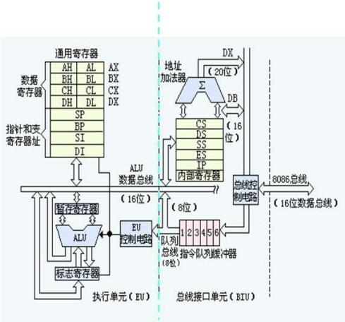

## 第三章 8086/8088 微处理器及系统

8086：16 位数据线，20 位地址线，寻址 1MB 空间；8088 只有 8 位外部数据线。

知识点：[微型计算机的硬件基本结构](../../../topics/微机接口/weixingji-yingjian.md)、[总线的基本概念与分类（内部总线、系统总线、外部总线）](../../../topics/微机接口/zongxian-gainian.md)、[80486/8086基本结构寄存器（通用、段、控制寄存器）](../../../topics/微机接口/jiben-jicunqi.md)

### 3.1.1 内部结构组成

总线接口单元（BIU）和执行单元（EU）。

BIU：4 个 16 位的段寄存器（CS、DS、SS、ES）和 16 位指令指针 IP，6 字节指令队列缓冲器，20 位地址加法器，总线控制电路。

EU：16 位 ALU、16 位标志寄存器 F、数据暂存寄存器、16 位通用寄存器。

数据寄存器：AX、BX、CX、DX；指针寄存器 SP 堆栈、BP 基址；变址寄存器 SI 源变址、DI 目的变址。

知识点：[微型计算机的硬件基本结构](../../../topics/微机接口/weixingji-yingjian.md)、[80486/8086基本结构寄存器（通用、段、控制寄存器）](../../../topics/微机接口/jiben-jicunqi.md)、[堆栈的概念及SP指针操作](../../../topics/微机接口/duizhan-caozuo.md)

### 状态标志位

CF：产生进位或者借位时为 1。

PF：结果低 8 位中含有偶数个 1 时为 1。

AF：D3 向 D4 进位或者借位时为 1。

ZF：结果为 0 时为 1。

SF：与结果的最高位相同。

OF：次高位向最高位进位时为 1。

DF：为 1 时数据串操作地址自动递减，为 0 相反。

IF：中断允许标志，为 1 允许接收可屏蔽中断。

TF：跟踪标志，为 1 单步工作。

总线周期：4 个周期组成。T1 为地址周期，CPU 通过地址/数据（或地址/状态）复用总线发出地址信息，指示要寻址的存储器单元或者 I/O 的地址；T2 为缓冲周期；T3 为数据周期，数据出现在复用总线的低 16 位上，在 T3 后可插入 1 个或多个等待状态 TW，CPU 发出 READY 信号后进入 T4，T4 总线周期结束。

规则字：存放字的低字节从偶地址开始存放，可一个周期完成。存储中低位库与数据总线 D7～D0 相连，该库中每个地址为偶地址；高位库与 D15～D8 相连，该库中每个地址为奇地址。

知识点：[标志寄存器中的状态标志位与控制标志位](../../../topics/微机接口/zhuangtai-biaozhi.md)、[微型计算机的硬件基本结构](../../../topics/微机接口/weixingji-yingjian.md)

### 3.3.1 逻辑地址与物理地址

逻辑地址：段地址:偏移地址，例如：2000H:0080H。

物理地址 PA：段寄存器十六进制后添 0 + 偏移量（EA）。

有效地址 EA = 基地址（BX/BP）+ 变地址（SI/DI）+ 位移量 D（0/8/16）。

知识点：[实地址模式下物理地址的形成（段基址×10H+偏移量）](../../../topics/微机接口/wuli-dizhi.md)、[80486/8086的寻址方式（立即、寄存器、直接、间接、变址等）](../../../topics/微机接口/xunzhi-fangshi.md)

### 3.3.3 堆栈

SS 堆栈段的段基址，SP 栈顶偏移地址：压栈时放入 SP-1 和 SP-2 两个地址，出栈时弹出 SP 和 SP+1 两个地址。先进后出，以 WORD 为单位操作，栈底地址高。

知识点：[堆栈的概念及SP指针操作](../../../topics/微机接口/duizhan-caozuo.md)、[80486/8086基本结构寄存器（通用、段、控制寄存器）](../../../topics/微机接口/jiben-jicunqi.md)

### 3.4.2 寻址方式

CS:IP、SS:SP、ES:DI。

定址、立数、址、寄存、址。

存储器寻址：不允许两个操作数都在存储器中。

#### 直接寻址

可用段跨越前缀，如 `MOV AX, 56:[3000H]`，赋两个字变量。

#### 变址寻址

操作数的有效地址 EA 由变址寄存器（SI/DI）和指令中的偏移量给出，数据段 DS。

偏移地址 =（SI）/（DI）+ 8 位/16 位偏移量。

#### 基址加变址寻址

必须用 `BYTE PTR`、`WORD PTR` 或 `DWORD PTR` 伪指令以确定类型。

$$
\mathrm{地址} = \left\{ \begin{array}{l l} (\mathrm{BX}) \\ (\mathrm{BP}) \end{array} + \left\{ \begin{array}{l l} (S I) \\ (D I) \end{array} + \left\{ \begin{array}{l l} 8 \text {位移量 } \\ 1 6 \text {位移量 } \end{array} \right. \right. \right.
$$

例如：`MOV AX,[BP][DI]`，BX 与 BP、SI 与 DI 不能同时出现。

#### 串操作指令寻址（数据串）

源串：段地址 DS，偏移地址 SI。

目标串：段地址 ES，偏移地址 DI。

#### I/O 端口寻址

IN/OUT 直接端口寻址：8 位立即数 00～FFH；间接端口寻址：0000～FFFFH（256），先存入 DX 寄存器。

知识点：[80486/8086的寻址方式（立即、寄存器、直接、间接、变址等）](../../../topics/微机接口/xunzhi-fangshi.md)、[数据传送指令（MOV、PUSH、POP、XCHG等）](../../../topics/微机接口/shuju-chuansong.md)、[最常用的I/O指令（IN、OUT的直接寻址与DX间址）](../../../topics/微机接口/io-zhiling.md)

### 数据传送指令

#### （1）通用数据传送指令

MOV：

- 目标和源不能同时用存储器寻址方式或同为段寄存器；
- 字长一致；
- 目标操作数不能是 CS，不能用立即数；
- 立即数不能直接送到段寄存器；
- 不影响标志位；
- 指令指针 IP 不能传送。

PUSH s/POP d：低到低，高到高，栈底最高；PUSH 为 SP-2；不能使立即数、址方式、指令允许的寄存器。

#### （2）目标地址传送指令

`LEA reg, src`：有效地址送寄存器，执行操作 `(reg) ← offset of src`。

`LDS`：指针送寄存器和 DS，执行操作 `(reg) ← (src)`；`(DS) ← (src+2)`。

`LES`：同上，`(ES) ← (src+2)`。

#### （4）I/O 数据传送

`IN 累加器, 端口号(port)`：port ≤ 0FFH，`(AL) ← (port)` 传送字节，或 `(AX) ← (port+1, port)` 传送字。

`IN 累加器, DX`：DX 中的 port 在 0 和 0FFFFH 之间，`(AL) ← ((DX))` 传送字节，或 `(AX) ← ((DX)+1, (DX))` 传送字。

`OUT 端口, 累加器`：其余与 IN 相同。

#### （5）算术运算指令

加法 `ADD d, s`；`INC d` 自己+1。减法 `SUB d, s`；`DEC d` 减 1；`NEG d` 求补，将目标操作数当作有符号数处理。比较：比较结果为前面的数字减后面的数字。

乘法指令 `MUL s`：无符号数乘法，字节操作 `(AX) ← (AL)×(src)`，字操作 `(DX, AX) ← (AX)×(src)`，src 不能为立即数，它影响状态标志位。

除法指令 `DIV src`：字节操作 `(AL) ← (AX)/src` 的商，`(AH) ← (AX)/src` 的余数，被除数 16 位，除数 8 位，商和余数 8 位；字操作 `(AX) ← (DX,AX)/src` 的商，`(DX) ← (DX,AX)/src` 的余数。

十进制调整指令：将 ASCII 码表示的数转换成 BCD 码，只要把 ASCII 码的高 4 位清零。压缩的 BCD 码调整：`DAA` 加法的十进制调整，`DAS` 减法的十进制调整（在 AX 中操作，不必写操作数）。非压缩 BCD 码调整：`AAA` 加法的 ASCII 调整，`AAS` 减法（影响 AF、CF），`AAM` 乘法，`AAD` 除法的 ASCII 调整（AX，影响或乘除后调整，不必写操作数）。

#### （6）逻辑运算和移位循环指令

逻辑运算指令：`AND d, s` 按位与；`OR d, s` 按位或；`NOT d` 按位取反；`XOR d, s` 按位异或；`TEST d, s` 测试，按位“与”操作，不返回结果，多用来确定操作数的指定位。

移位指令和循环移位指令：算术移位带符号数，保持符号不变；逻辑移位对无符号数移位，用 0 来填补。移位 1 位，且最高位变化，OF=1，否则无效。循环移位指令是将操作数首尾相接进行移位，它分为不带进位位和带进位位循环移位，OF 变化同上。

目标操作数允许是 8/16 位通用寄存器或存储器，移 1 位写 1，n 位事先装入 CL。

`SHL dst, cnt`：逻辑左移，执行操作：最低位用 0 来补充，最高位移入 CF。

`SHR dst, cnt`：逻辑右移，执行操作：最高位用 0 来补充，最低位移入 CF。

`SAR dst, cnt`：算术右移，执行操作：符号位值补充最高位，最低位移入 CF。

`ROL dst, cnt`：循环左移，执行操作：最高位移入 CF 和最低位。

`ROR dst, cnt`：循环右移，执行操作：最低位移入 CF 和最高位。

`RCL dst, cnt`：带进位循环左移，执行操作：CF 移入最低位，最高位移入 CF。

`RCR dst, cnt`：带进位循环右移，执行操作：CF 移入最高位。

知识点：[数据传送指令（MOV、PUSH、POP、XCHG等）](../../../topics/微机接口/shuju-chuansong.md)、[最常用的I/O指令（IN、OUT的直接寻址与DX间址）](../../../topics/微机接口/io-zhiling.md)、[算术运算与逻辑运算指令（ADD、SUB、MUL、AND、OR、NOT等）](../../../topics/微机接口/suanlu-yunsuan.md)

### 串处理指令

`MOVS/CMPS`：源串首元素偏移地址放在 SI 中，目标串首元素偏移地址放在 DI 中，自动修改 SI/DI。

`SCAS` 目标串：搜索目标串在 AX 或 AL 中，需搜索串首元素的偏移地址在 DI 中，ZF=1 则找到。

`LODS` 源串：源串首元素偏移地址在 SI 中，将其放入 AX/AL 中，SI 自动加 1。

`STOS` 目标串：目标串首元素偏移地址在 DI 中，将 AX/AL 中内容存入目标串中，DI 自动加 1。

串重复前缀。

知识点：[串处理指令（MOVS、CMPS、SCAS、LODS、STOS及REP前缀）](../../../topics/微机接口/chuanchuli-zhiling.md)、[80486/8086的寻址方式（立即、寄存器、直接、间接、变址等）](../../../topics/微机接口/xunzhi-fangshi.md)、[微处理器的工作模式（实模式、保护模式、虚拟8086模式）](../../../topics/微机接口/gongzuo-moshi.md)

### 转移指令

`LABLE:` 段内间接 `JMP reg` / `JMP WORD PTR OPR`；段间直接 `JMP FAR PTR label`；段间间接 `JMP DWORD PTR [SI]`；所有条件转移都是短转移。

| 指令名称 | 助记符 | 测试条件 |
|---|---|---|
| 无符号数 高于 | JA/JNBE | |
| 无符号数 高于等于 | JAE/JNB | |
| 无符号数 低于 | JB/JNAE | |
| 无符号数 低于等于 | JBE/JNA | |
| 带符号数 大于 | JG/JNLE | |
| 带符号数 大于等于 | JGE/JNL | |
| 带符号数 小于 | JL/JNGE | |
| 带符号数 小于等于 | JLE/JNG | |
| 单标志 等于/结果为 0 | JE/JZ | ZF=1 |
| 单标志 不等于/结果不为 0 | JNE/JNZ | ZF=0 |
| 单标志 有进位/错位 | JC | CF=1 |
| 单标志 无进位/错误 | JNC | CF=0 |

知识点：[转移指令（JMP、条件转移、CALL、RET）](../../../topics/微机接口/zhuanyi-zhiling.md)、[标志寄存器中的状态标志位与控制标志位](../../../topics/微机接口/zhuangtai-biaozhi.md)

### 6. 处理器控制指令

`CLD`：DF=0 正向，地址递增；`STD`；`CLI` 禁止可屏蔽中断 IF=0；`STI`；`HLT` 暂停；`NOP` 空操作（3 周期）。

| 标志位处理指令 | 说明 | 同步控制指令 | 说明 |
|---|---|---|---|
| CLC | CF 置 0 | WAIT | 等待 |
| STC | CF 置 1 | ESC | 交权 |
| CMC | CF 求反 | LOCK | 封锁 |
| CLD | DF 置 0 | | |
| STD | DF 置 1 | | |
| CLI | IF 置 0 | NOP | 空操作 |
| STI | IF 置 1 | HLT | 暂停 |

## 第四章 汇编语言程序设计

DB：1 字节；DW：2 字节；DD：4 字节；DQ：8 字节；DT：10 字节。

段名 `SEGMENT` 作为段的开始，以 `ENDS` 作为段的结束，这两者（伪指令）前面都要冠以相同的名字。分类：代码段、堆栈段、数据段和附加段。但代码段与堆栈段是不可少的，数据段与附加段可根据需要设置。

知识点：[处理器控制指令（STI、CLI、HLT、NOP等）](../../../topics/微机接口/chuli-kongzhi.md)、[常用伪指令（SEGMENT、ASSUME、DB/DW/DD、EQU、END等）](../../../topics/微机接口/changyong-weizhiling.md)、[源程序中的语句类型（指令性语句与指示性语句）](../../../topics/微机接口/yuju-leixing.md)

### 4.2.2 操作数

- 当基址寄存器为 BP 时，相对应的段寄存器为 SS（堆栈段寄存器）。
- 对串操作，源串起始地址为 DS:SI，允许使用段超越前缀修改源串段地址。目的串起始地址为 ES:DI，禁止用段超越前缀修改目的串地址。
- 可以采用“段超越”前缀，来改变段寄存器。如 `ADD AL, SS:[DI+3]`。

1. 字符串：DB 定义，用 ‘’ 括起来，每个字符占用一个字节，在存储器内用相应的 ASCII 码表示。
2. 当 `$` 用在伪指令的参数字段时，它所表示的是地址计数器的当前值。

`ASSUME` 伪指令：就是建立段和段寄存器关系的伪指令。

格式：段寄存器名 段名。

例：`ASSUME CS:SEGA, DS:SEGB, SS:NOTHING`。

`ASSUME CS:SEGA` 表示 CS 被设定为以 SEGA 为段名的代码段的段地址寄存器。

注意：其中段寄存器名必须是 CS、DS、SS、ES 中的一个，而段名必须是由 `SEGMENT` 定义的段名。

`ORG` 伪指令：用来表示起始的偏移地址，紧接着 ORG 的数值就是偏移地址的起始值。

`SEG`：段地址；`OFFSET`：偏移地址；`SIZE`：数据字节总数；`LENGTH`：数据项总数。

| 功能 | 矢量号 | 功能号 | 备注 |
|---|---|---|---|
| 返回 DOS | 21H | 4CH | |
| 设置中断向量 | 21H | 25H | DS=段地址；DX=偏移地址；AL=中断类型码 |
| 键盘输入一字符并显示 | 21H | 01H | AL=输入字符的 ASCII 码 |

## 5. 程序控制

- `JMP a`（目标标号）：无条件转移
- `CALL a`：无条件调用（间接调用存入 BX）
- `RET`：弹出值，从过程返回
- `LOOP a`：循环，CX 减 1 后判断
- `INT a`：中断调用
- `IRET`：中断返回
- 段内短转移 `JMP SHORT LABEL`；段内近转移（缺省）`JMP`

知识点：[常用伪指令（SEGMENT、ASSUME、DB/DW/DD、EQU、END等）](../../../topics/微机接口/changyong-weizhiling.md)、[80486/8086的寻址方式（立即、寄存器、直接、间接、变址等）](../../../topics/微机接口/xunzhi-fangshi.md)、[串处理指令（MOVS、CMPS、SCAS、LODS、STOS及REP前缀）](../../../topics/微机接口/chuanchuli-zhiling.md)

### DOS 与 BIOS 中断功能调用

| 功能 | 中断号 | 功能号 | 说明 |
|---|---|---|---|
| 字符串输入 | 21H | 0AH | DS:DX 指向输入缓冲区；输入缓冲区第一个单元设置字符串最大输入长度；输入缓冲区第二个单元为实际输入字符串长度 |
| 显示字符 | 21H | 02H | DL=显示字符的 ASCII 码 |
| 显示以‘$’结尾的字符串 | 21H | 09H | DS:DX 指向字符串的首地址 |

调用 DOS 或 BIOS 中断功能时，有以下几个基本步骤：

1. 将调用参数装入指定的寄存器中；
2. 如需功能号，把它装入 AH；
3. 按中断号调用 DOS 或 BIOS 中断；
4. 检查返回参数是否正确。

知识点：[DOS功能调用与BIOS中断功能调用（INT 21H、INT 10H等）](../../../topics/微机接口/dos-bios-diaoyong.md)、[ASCII码编码规则与常用字符编码](../../../topics/微机接口/ascii-ma.md)、[80486/8086基本结构寄存器（通用、段、控制寄存器）](../../../topics/微机接口/jiben-jicunqi.md)

### 注：中断向量分配情况

- 0～1FH，80H～F0H 为 BIOS 中断向量号
- 20H～3FH 为 DOS 中断向量号
- 40H～7FH 为用户备用

## 第六章 输入输出与中断

8086 中有 256 种中断，每个在中断向量表中占 4 个字节，前两个存放中断入口的偏移地址（IP），后 2 个存段地址（CS）。关中断 `CLI`，开中断 `STI`，编程时单独成语句。

知识点：[微机系统与I/O端口的信息交换方式（无条件、查询、中断、DMA）](../../../topics/微机接口/xinxi-jiaohuan.md)、[处理器控制指令（STI、CLI、HLT、NOP等）](../../../topics/微机接口/chuli-kongzhi.md)

### 输入输出与中断

1. CPU 与外设之间数据传送的方式：程序传送（效率低），包括无条件（同步）传送（IN/OUT 指令控制）和条件（异步）传送（先查询接口状态寄存器的状态）；中断传送（多个外设，效率高）；直接存储器存取（DMA）传送（无需 CPU 控制，快速传送大批量数据）。

DMA 传送过程：

1. 接口准备就绪发出 DMA 请求
2. CPU 通过 HOLD 接收 DMA 发出的总线请求
3. HLDA 送回总线允许信号，使 DMA 接管总线控制权
4. DMA 把地址送地址总线
5. DMA 请求被接口接收
6. 内存把数据送数据总线
7. 接口锁存数据
8. DMA 传送结束，将 HOLD 变低电平，撤销总线请求，让出总线权
9. CPU 将 HLDA 变为低电平，恢复对总线的控制

知识点：[微机系统与I/O端口的信息交换方式（无条件、查询、中断、DMA）](../../../topics/微机接口/xinxi-jiaohuan.md)、[直接存储器存取（DMA）方式及其与中断方式的比较](../../../topics/微机接口/dma-fangshi.md)

### 中断技术

中断源：外设、实时时钟、故障源、调试程序设置的中断源。

优先级：实际优先级最高为 NMI，类型 n 中各个 n 为各个数字时优先级相同。

8086/8088 的中断：

| 优先级 | 中断名 | 中断类型 | 说明 |
|---|---|---|---|
| 高 ↑ | 除法错 | 类型 0 | 商大于被除数（软件中断） |
| | INT n | 类型 n | 用户定义软中断（软件中断） |
| | INTO | 类型 4 | 溢出用（软件中断） |
| | NMI | 类型 2 | 非屏蔽中断（硬件中断） |
| | INTR | 由外设送入 | 可屏蔽中断（硬件中断） |
| 低 ↓ | 单步 | 类型 1 | 调试用（软件中断） |

知识点：[微机系统与I/O端口的信息交换方式（无条件、查询、中断、DMA）](../../../topics/微机接口/xinxi-jiaohuan.md)、[处理器控制指令（STI、CLI、HLT、NOP等）](../../../topics/微机接口/chuli-kongzhi.md)

### 中断向量表

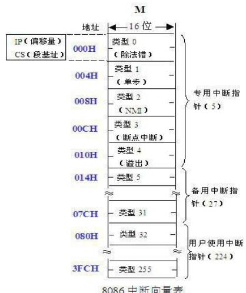

中断处理过程：中断请求 → 中断响应 → 中断处理 → 中断返回。中断响应占用时钟。

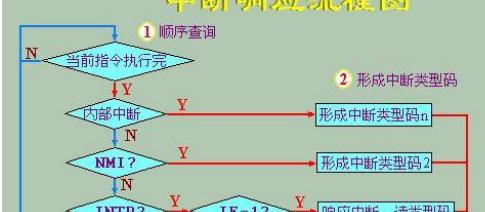

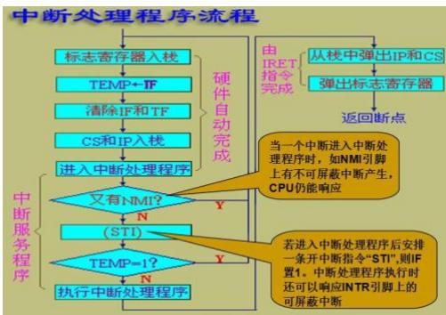

知识点：[微机系统与I/O端口的信息交换方式（无条件、查询、中断、DMA）](../../../topics/微机接口/xinxi-jiaohuan.md)

### 中断服务程序的设计

采用 DOS 置新中断向量的中断功能（25H 功能）：

- 向量号 21H；功能号 25H；
- 入口参数：DS=中断服务子程序入口段地址（SEG）；DX=中断服务子程序入口相对地址（OFFSET）；AL=新增的向量号

采用 DOS 的中断调用使程序驻留内存（31H 功能）：

- 向量号 21H；功能号 31H
- 入口参数：DX＝驻留程序字节数；该功能使当前程序的 DX 个字节驻留内存并返回 DOS。

例：增加一中断服务子程序，向量号 50H，功能是 BX 增 1。

```asm
C SEGMENT
    ASSUME CS:C
    ORG 100H            ; 设定程序的入口地址为 100H
B:  MOV AX, SEG SUBP
    MOV DS, AX          ; 中断服务程序入口段地址写入 DS
    MOV DX, OFFSET SUBP ; 中断服务程序入口偏移（相对）地址写入 DX
    MOV AL, 50H         ; 新增的中断向量号写入 AL
    MOV AH, 25H
    INT 21H             ; 将段地址、偏移地址置中断向量表相应表项
    MOV DX, N           ; 驻留内存程序字节数
    MOV AH, 31H
    INT 21H             ; 使中断服务程序驻留内存并返回 DOS
SUBP PROC FAR
    INC BX
    IRET
SUBP ENDP
N EQU $-SUBP
C ENDS
END B
```

中断响应时序：第一个总线周期通知 8259 响应成功，第二个读取中断类型码。

## 第七章 可编程接口芯片及应用

知识点：[DOS功能调用与BIOS中断功能调用（INT 21H、INT 10H等）](../../../topics/微机接口/dos-bios-diaoyong.md)、[处理器控制指令（STI、CLI、HLT、NOP等）](../../../topics/微机接口/chuli-kongzhi.md)、[汇编语言常用运算符（OFFSET、SEG、TYPE、LENGTH、SIZE等）](../../../topics/微机接口/changyong-yunsuanfu.md)

### 1. 可编程中断控制器 8259

级联：最多扩展为 64 级中断，主片的 IR0-IR7 端分别与各从片的 INT 端相连；CAS0～CAS2 互相连接，发出选择信号作为主片时向外发信号。

优先级：IR0 最高。IRR：中断请求寄存器（接收到中断请求相应位置 1）；ISR：中断服务寄存器；IMR：中断屏蔽寄存器。

ICW1：定义 8259A 的基本操作，注意 A0=0。

| A0 | D7 | D6 | D5 | D4 | D3 | D2 | D1 | D0 |
|---|---|---|---|---|---|---|---|---|
| 0 | X | X | X | 1 | X | 1:电平触发 0:边沿触发 | 0:单片 1:级联 | 0:不需要 ICW4 1:需要 |

可屏蔽中断（INTR）过程：

1. 中断请求（INTR）
2. 中断响应 INTR
3. 取中断类型号
4. 把 PSW、CS、IP 压入堆栈，保存断点
5. 清 IF 与 TF 标志
6. 从中断向量表中取新的 IP 值，转入中断服务程序
7. 开放中断
8. IRET 使旧 IP、CS、PSW 从堆栈中弹出
9. 返回被中断程序

知识点：[堆栈的概念及SP指针操作](../../../topics/微机接口/duizhan-caozuo.md)、[最常用的I/O指令（IN、OUT的直接寻址与DX间址）](../../../topics/微机接口/io-zhiling.md)、[端口的概念与分类（数据端口、状态端口、控制端口）](../../../topics/微机接口/duankou-gainian.md)

### OCW3

特殊全嵌套：允许主片在某级从片进行中断服务的期间响应同一级从片来的由另一级中断发出的更高优先权中断请求的申请。这同一从片来的不同级别的中断请求，对于主片来说是同一级的，对于从片来说，新的中断请求必须比正在服务的中断优先级高。一般全嵌套：在 ISR 对应位没有被复位之前，只有当更高级的中断请求来到时，才会进行嵌套。

例：在 IBM PC/XT 机中，只用一片 8259A 中断控制器，用来提供 8 级中断请求，其中 IR0 优先级最高，IR7 优先级最低。它们分别用于日历时钟中断、键盘中断、保留、网络通信、异步通信中断、硬盘中断、软盘中断及打印机中断。8259A 片选地址为 20H、21H。

8259A 使用步骤如下：

1. 初始化

```asm
MOV AL, 13H     ; 写 ICW1，单片，边沿触发，要设置 ICW4
OUT 20H, AL
MOV AL, 8       ; 写 ICW2，中断类型号从 8 开始
OUT 21H, AL
MOV AL, 0DH     ; 写 ICW4，缓冲工作方式，8088/8086 配置
OUT 21H, AL
MOV AL, 0       ; 写 OCW1，允许 IR0～IR7 全部 8 级中断请求
OUT 21H, AL
```

2. 送中断向量入口地址

例如，异步通信中断 IR4，其中断向量类型号为 8+4=12（0CH），则中断入口地址的偏移量（IP 值）与段地址（CS）在入口地址表中的存放地址为 12×4=48（30H），49（31H），50（32H），51（33H）。其中 30H、31H 存放指令指针 IP；32H、33H 存放指令段码 CS。

3. 中断子程序结束

由于 8259A 采用中断工作方式，且 ICW4 中的 D1 位（即 AEOI）为 0，这意味着采用正常结束中断，因此，在中断子程序结束前必须发 EOI 命令和 IRET 命令。

```asm
MOV AL, 20H
OUT 20H, AL     ; 写 OCW2 命令，使 ISR 相应位复位（即发 EOI 命令）
IRET            ; 开放中断允许，并从中断返回
```

知识点：[典型总线标准（ISA/AT总线、PCI总线引脚与特点）](../../../topics/微机接口/dianxing-zongxian.md)、[微机系统与I/O端口的信息交换方式（无条件、查询、中断、DMA）](../../../topics/微机接口/xinxi-jiaohuan.md)、[最常用的I/O指令（IN、OUT的直接寻址与DX间址）](../../../topics/微机接口/io-zhiling.md)

### 2. 可编程计数器/定时器 8253

| D7 | D6 | D5 | D4 | D3 | D2 | D1 | D0 |
|---|---|---|---|---|---|---|---|
| 00:计数器 0；01:计数器 1；10:计数器 2 | | 00:计数器锁存；01:对低字节读写；10:对高字节读写；11:先低后高 | | 000:方式 0；001:方式 1；X10:方式 2；X11:方式 3；100:方式 4；101:方式 5 | | | 0:二进制 1:BCD 码 |

计数初值：BCD 码装入 0000H，最多计数 10^4 次；二进制装入 0000H，最多计数 2^16 次。

方式 0：（计数结束产生中断）GATE=1 时写入控制字，OUT 起始电平低电平，下降沿装入计数初值 n 开始计数；每经过一个 CLK，在 CLK 下降沿，计数器减 1；n=0 时，计数结束，OUT 由低变为高电平（可利用该电平变化向 CPU 发出中断请求），并保持，不开始重新计数。只有写入另一个计数值时，即刻触发按新值计数。GATE=0 时，停止计数。只能用于无条件传送或者……

ICW2：编程 8259A 中断请求的类型号。

| A0 | D7 | D6 | D5 | D4 | D3 | D2 | D1 | D0 |
|---|---|---|---|---|---|---|---|---|
| 1 | 中断向量类型号的高 5 位 | | | | | 0 | 0 | 0 |

| | A0 | D7 | D6 | D5 | D4 | D3 | D2 | D1 | D0 |
|---|---|---|---|---|---|---|---|---|---|
| 主 | 1 | 与 IR0 到 IR7 对应，某位=1 表示与从片级联 | | | | | | | |
| 从 | 1 | 0 | 0 | 0 | 0 | 0 | 二进制 n 表示连接主片 IRn | | |

主片：00000100B；从片：00000010B

ICW4：中断结束方式初始化命令字。

| A0 | 7 | 6 | 5 | 4 | 3 | 2 | 1 | 0 |
|---|---|---|---|---|---|---|---|---|
| 1 | 0 | 0 | 0 | 1:特殊全嵌套 0:一般全嵌套 | 1:缓冲方式 0:非缓冲 | 缓冲方式时 1:主片 0:从片 | 0:正常结束 1:自动结束 | 1 |

OCW1：根据 OCW1 判断开放哪些中断。

知识点：[接口电路的作用和基本功能](../../../topics/微机接口/jiekou-gongneng.md)、[微机系统与I/O端口的信息交换方式（无条件、查询、中断、DMA）](../../../topics/微机接口/xinxi-jiaohuan.md)、[最常用的I/O指令（IN、OUT的直接寻址与DX间址）](../../../topics/微机接口/io-zhiling.md)

### 8259A 中断控制

`IN AL,21H; AND AL,11110111B; 开放 IR3 OUT 21H,AL`

| A0 | D7 | D6 | D5 | D4 | D3 | D2 | D1 | D0 |
|---|---|---|---|---|---|---|---|---|
| 1 | 对应 IMR 中各位，为 0 表示该位允许中断 |  |  |  |  |  |  |  |

OCW2（优先级循环方式和中断结束方式操作命令字）A0=0，D7–D0 为 00100XXX，XXX 代表 IRn。001 定义普通 EOI 方式，清除 ISR 中某一位。

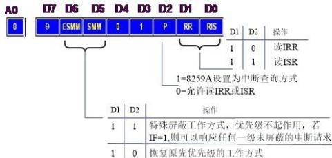

知识点：[端口的概念与分类（数据端口、状态端口、控制端口）](../../../topics/微机接口/duankou-gainian.md)、[端口的编址方式（统一编址与独立编址）](../../../topics/微机接口/duankou-bianzhi.md)、[最常用的I/O指令（IN、OUT的直接寻址与DX间址）](../../../topics/微机接口/io-zhiling.md)

### 8253 定时/计数器

#### 查询方式传送

方式 1（可编程单稳态触发器）：起始 OUT 为高，GATE 上升沿才开始计数，OUT 变低，下降沿计数。计数期间 GATE 变低无影响；若再次产生 GATE 的上升沿触发，则要重新装入 n 值计数。负脉冲宽度 = t×n。利用 C 端口所提供的选通信号和应答信号控制输入/输出操作。

方式 2（分频器）：单时钟脉冲波，OUT 端输出高电平为起始电平，装入计数初值 n，每一个计数脉冲下降沿 n 减 1，当 n 减至 1 时，OUT 变低，n 减为 0 时，OUT 变高，产生一个与时钟脉冲周期一样宽的负脉冲；接着自动装入 n 连续计数，输出频率为 fclk/n。计数过程中，允许重新装入新的 n 值，下一个计数周期按新的 n 值计数。

停止计数：计数过程中，若 GATE=0，停止计数，并强迫 OUT 输出高电平；在 GATE 变为高电平后，重新装入 n 值，开始计数。正脉冲宽度 (n−1)，负脉冲宽度 1 个时钟周期。

方式 3（方波频率发生）：GATE=1 时，每个脉冲减 1。当 n 为偶数时，输出的是 n/2 分频；n 为偶数，每个时钟脉冲下降沿 n 值减 1，至 n/2 后电平变为低电平，并继续减 1 计数至 0，然后改变 OUT 电平，重新装入 n，开始计数。n 为奇数，输出高电平宽度为 (n+1)/2、低电平宽度为 (n−1)/2 的方波。GATE=0 停止计数，并强迫 OUT 输出高电平；在 GATE 变高后，重新将 n 装入，开始计数。

方式 4：软件触发选通脉冲；方式 5：硬件触发选通脉冲。

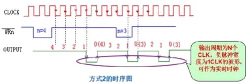

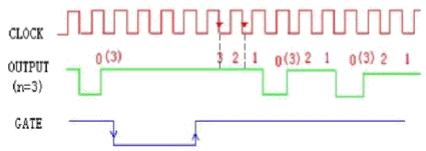

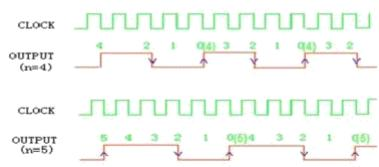

注意：计数器预置的二进制最大值为 0（65536）。三个计数器端口地址为 40H、41H、42H，控制寄存器端口地址为 43H。

#### 计数器 0：电子时钟基准

工作于方式 3，计数器值预置为 0（即 65536），即输出的方波频率为 1.19 MHz/65536=18.21 Hz，即每隔 55 ms 产生一次中断请求。

```asm
MOV AL,36H      ; 36H=00110110B
OUT 43H,AL      ; 写控制字
MOV AL,0        ; 预置计数值
OUT 40H,AL      ; 先写低字节
OUT 40H,AL      ; 再写高字节
```

#### 计数器 1：动态 RAM 定时刷新

工作于方式 2，计数器值预置为 18，即输出的频率为 1.19 MHz/18=66.1 kHz，即每隔 15.1 µs 产生一次动态刷新请求信号。

```asm
MOV AL,54H      ; 54H=01010100B
OUT 43H,AL      ; 写控制字
MOV AL,12H      ; 预置计数值（BCD 码计数可直接写 18H）
OUT 41H,AL      ; 写低字节
```

#### 计数器 2：扬声器音调

工作于方式 3，计数器值预置为 1331（533H），即输出的频率为 1.19 MHz/1331=894 Hz。

```asm
MOV AL,0B6H     ; B6H=10110110B
OUT 43H,AL      ; 写控制字
MOV AL,33H      ; 预置计数值
OUT 42H,AL      ; 先写低字节
MOV AL,05H      ; 预置计数值
OUT 42H,AL      ; 再写高字节
```

知识点：[端口的编址方式（统一编址与独立编址）](../../../topics/微机接口/duankou-bianzhi.md)、[最常用的I/O指令（IN、OUT的直接寻址与DX间址）](../../../topics/微机接口/io-zhiling.md)、[微机系统与I/O端口的信息交换方式（无条件、查询、中断、DMA）](../../../topics/微机接口/xinxi-jiaohuan.md)

### 可编程并行通信接口芯片 8255A

A1–A0 决定端口：00 为 A 口、01 为 B 口、10 为 C 口、11 为控制字寄存器。

方式选择控制字（D7=1）——确定 3 个端口的工作方式；C 端口置位复位控制字（D7=0）——确定 C 口某一位的初始状态（方式 0），或用于设置 INTE 位（方式 1、2）。

#### C 端口置位复位控制字

| 7 | 6 | 5 | 4 | 3 | 2 | 1 | 0 |
|---|---|---|---|---|---|---|---|
| 0 | 0 | 0 | 0 | 000 至 111 分别代表第 0 至第 7 位 |  |  | 1：置位 0：清零 |

#### 方式选择控制字

| 7 | 6 | 5 | 4 | 3 | 2 | 1 | 0 |
|---|---|---|---|---|---|---|---|
| 1 | 0 | 0 | A 口 | C 口高四位 | 0 | B 口 | C 口低四位 |

方式 1：C 口 6 根 I/O 线作为联络信号，剩下 2 根输入输出。

A 端口方式 1 输入、B 端口方式 1 输出、PC6、PC7 作输入，给出方式控制字。

A 端口方式 1 输出、B 端口方式 1 输入、PC4、PC5 作输出，给出方式控制字。

| 1 | 0 | 1 | 0 | 0 | 1 | 1 | X |
|---|---|---|---|---|---|---|---|

方式 2：仅 A 端口具有双向数据传送功能，C 口有 5 根引脚作 A 口联络信号。

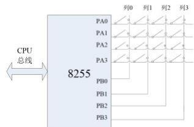

#### 8255A 用作矩阵键盘接口

用一片 8255A 构成 4 行 4 列的非编码键盘电路，用 8255A 的 A 口作输出，端口地址为 80H，B 口作为输入，端口地址为 81H，控制口地址为 83H。

程序：

判别是否有键按下。

```asm
MOV AL,82H      ; 初始化 8255A：A 口输出，B 口输入，方式 0
OUT 83H,AL
MOV AL,00H
OUT 80H,AL      ; 使 A 口输出全为低电平

; 此段程序为第一次扫描，判断是否有低电平，并排除抖动
LOOA:
IN AL,81H
AND AL,0FH
CMP AL,0FH
JZ LOOA
CALL D20MS
IN AL,81H
AND AL,0FH
CMP AL,0FH
JZ LOOA         ; 如果不为 0，则确认有键按下，转入 START
```

判哪个键按下（确定行号）。

```asm
START:
MOV BL,4        ; 行数
MOV BH,4        ; 列数
MOV AL,0FEH     ; 先扫描 0 行
MOV CL,0FH      ; 键盘屏蔽码
MOV CH,0FFH     ; 起始键号
LOP1:
OUT 80H,AL      ; 扫描一行
ROL AL,1        ; 修改得到下一行扫描码
MOV AH,AL       ; 保存该扫描码
IN AL,81H       ; 读列值
AND AL,CL       ; 屏蔽高四位
CMP AL,CL       ; 比较
JNZ LOP2        ; 有列线为 0，转 LOP2，找列线
ADD CH,BH       ; 无键按下，修改键号
MOV AL,AH       ; 恢复扫描码
```

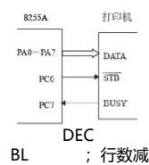

```asm
; 根据键号，转向相应的处理程序
ROR AL,1
JC LOP2
MOV AL,CH
CMP AL,0
JZ KEY0
CMP AL,1
JZ KEY1
CMP AL,0EH
JZ KEY14
JMP KEY15
```

知识点：[接口电路的作用和基本功能](../../../topics/微机接口/jiekou-gongneng.md)、[最常用的I/O指令（IN、OUT的直接寻址与DX间址）](../../../topics/微机接口/io-zhiling.md)、[80486/8086的寻址方式（立即、寄存器、直接、间接、变址等）](../../../topics/微机接口/xunzhi-fangshi.md)

### 可编程串行异步通信接口芯片 8250

RS-232 适应于数据终端设备 DTE 和数据通信设备 DCE 间的接口，电平：高位 0 为 +5V～+15V，低位 1 为 −5V～−15V。

数据传输格式说明：

1. 无信息传输时，输出必须为“1”状态。
2. 起始位为 0。
3. 起始位后为 5～8 位的数据位，低位在前，高位在后。
4. 奇偶校验位可有可无。奇校验：校验位加数据位有奇数个 1。
5. 最后有 1、1.5、2 位停止位，都为 1。

传输率（比特数）：每秒钟传输二进制数的位数，单位为位/秒（bps），等于每秒传送的字符数和每个字符位数的乘积，如 120 字符/秒×10 位/字符=1200 bps。

波特率：一个符号传输时间的倒数，每次传送 1 位时，波特率大小和传输率相等。

寄存器端口地址分配：BASE=3F8H。

#### 线路控制寄存器（LCR）3FBH

#### 线路状态寄存器（LSR）3FDH

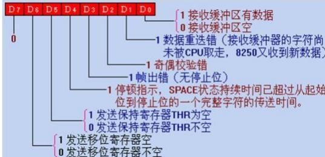

#### 波特率因子寄存器（除数寄存器）BASE+0,1

当线路控制寄存器写入 D7=1 时，接着对口地址 3F8H、3F9H 可分别写入波特率因子的低字节和高字节，即写入波特率因子寄存器（L）和（H）中。

波特率因子＝1843200/(16×波特率)

#### 中断允许寄存器（3F9H）

优先级高：D2、D0、D1、D3 低。


#### Modem 控制寄存器（MCR）3FCH

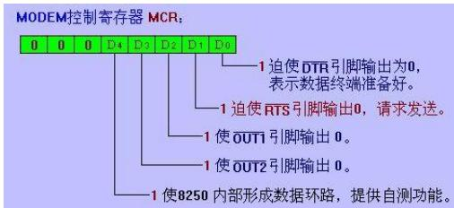

D4：循环（自诊断用）=1，由 TSR 发送数据立即被 RSR 接收，可用于自检。D1=1 准备发送数据。D0=1 准备接收数据。

#### 编程应用

（1）设置波特率。例如，设波特率为 9600，则波特率因子 N=12。

```asm
MOV AL,80H      ; 通过线路控制寄存器 D7=1，设置波特率
OUT DX,AL
MOV DX,3F8H
MOV AL,12
OUT DX,AL       ; 写波特率因子寄存器低字节
INC DX
MOV AL,0
OUT DX,AL       ; 写波特率因子寄存器高字节，3F9H 送 0
```

（2）设置串行通信数据格式。例如，数据格式为 8 位，1 位停止位，奇校验。

```asm
MOV AL,0BH
MOV DX,3FBH
```

（3）设置工作方式。

无中断：

```asm
MOV AL,3        ; DTR、RTS 有效，OUT1/2、LOOP 位无效
MOV DX,3FCH
OUT DX,AL
```

有中断：

```asm
MOV AL,0BH      ; OUT2=0，开中断
MOV DX,3FCH
OUT DX,AL
```

循环测试：

```asm
MOV AL,13H      ; 自发自收
MOV DX,3FCH
OUT DX,AL
```

#### 程序查询方式通信程序

发送程序：读 LSR（3FDH）中 D5 位，检查发送保持器是否空（D5=1）。

```asm
TR:
MOV DX,3FDH
IN AL,DX
TEST AL,20H
JZ TR           ; 发送保持器不空，转 TR
MOV AL,[SI]     ; 发送保持器空，发下一数据
MOV DX,3F8H
OUT DX,AL
```

接收程序：读 LSR（3FDH）中 D0 位，检查接收数据寄存器是否就绪（D0=1）。

## 第八章 80386 微处理器

知识点：[最常用的I/O指令（IN、OUT的直接寻址与DX间址）](../../../topics/微机接口/io-zhiling.md)、[80486/8086的寻址方式（立即、寄存器、直接、间接、变址等）](../../../topics/微机接口/xunzhi-fangshi.md)、[直接存储器存取（DMA）方式及其与中断方式的比较](../../../topics/微机接口/dma-fangshi.md)

### 32 位地址总线

知识点：[总线的基本概念与分类（内部总线、系统总线、外部总线）](../../../topics/微机接口/zongxian-gainian.md)

### 内部结构

2. 6 个段寄存器：CS、SS、DS、ES、FS 和 GS

3. 4 个 32 位的控制寄存器 CR0、CR1、CR2 和 CR3

CR0 的 PG 和 PE 位：00 实模式，01 不分页保护；11 分页保护。CR1：保留。CR2：页面故障线性地址寄存器，存放引起页异常的 32 位线性地址。CR3：页目录表基址寄存器，存放页目录表（本身为一个页）的物理基地址（由于 80386 中每页固定为 4K，所以低 12 位为 0）。

4. 系统地址寄存器和段寄存器

| | 47~16 | 15~0 |
|---|---|---|
| LDTR | 32 位线性基地址 | 16 位界限值 |
| TR | 32 位线性基地址 | 16 位界限值 |

| | 63~52 | 51~20 |
|---|---|---|
| | 16 位选择子 | 12 位属性 |

| | 63~52 | 51~20 |
|---|---|---|
| | 32 位线性基地址 | 20 位界限值 |

| | 16 位选择子 | 12 位属性 | 32 位线性基地址 | 20 位界限值 |
|---|---|---|---|---|

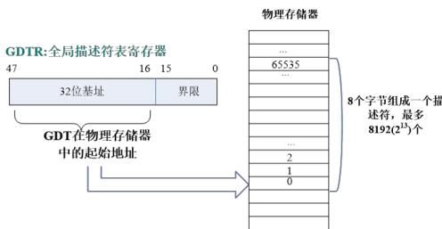

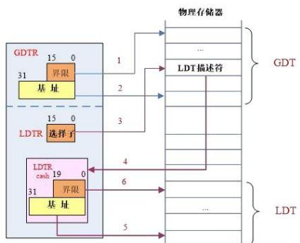

知识点：[80486/8086基本结构寄存器（通用、段、控制寄存器）](../../../topics/微机接口/jiben-jicunqi.md)、[微处理器的工作模式（实模式、保护模式、虚拟8086模式）](../../../topics/微机接口/gongzuo-moshi.md)

### 三种方式：实模式、保护模式、虚拟 8086 模式

实模式：初始加电或复位后，进入实模式。物理地址由 16 位偏移与段寄存器内容左移 4 位相加得到，20 位的物理地址；偏移量由 IP 提供，20 位的物理地址可用 CS：IP 表示；存储器地址空间为 1MB（从 00000H 到 FFFFFH），I/O 地址范围为 64K（从 0000H 到 FFFFH）；程序运行在特权级的最高级 0 级。

知识点：[微处理器的工作模式（实模式、保护模式、虚拟8086模式）](../../../topics/微机接口/gongzuo-moshi.md)、[实地址模式下物理地址的形成（段基址×10H+偏移量）](../../../topics/微机接口/wuli-dizhi.md)、[存储单元和存储器地址的概念](../../../topics/微机接口/cunchu-danyuan.md)

### 保护模式：最常用，最具特色

一个查表的过程。不同的保护等级（特权），不同程序允许在不同的特权等级上，以实现程序间的保密。（所谓保护，主要是指对存储器程序和数据结构的保护。）

虚拟地址方式的存储器寻址方式，虚拟地址空间达到 64TB（2^46），通过映射关系映射到 4GB 的物理地址空间。

段页式的内存管理方法。

虚拟 86 模式：模拟 1MB 空间的寻址环境，通过使用分页可以转换到 4GB 线性地址空间的任何位置。采用分页机制。

知识点：[微处理器的工作模式（实模式、保护模式、虚拟8086模式）](../../../topics/微机接口/gongzuo-moshi.md)、[实地址模式下物理地址的形成（段基址×10H+偏移量）](../../../topics/微机接口/wuli-dizhi.md)、[微型计算机系统中的存储器组织与地址空间分配表](../../../topics/微机接口/cunchu-zuzhi.md)

### 80386 存储器管理

保护方式下存储管理和地址变换

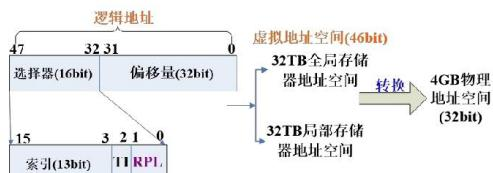

知识点：[微处理器的工作模式（实模式、保护模式、虚拟8086模式）](../../../topics/微机接口/gongzuo-moshi.md)、[实地址模式下物理地址的形成（段基址×10H+偏移量）](../../../topics/微机接口/wuli-dizhi.md)、[80486/8086基本结构寄存器（通用、段、控制寄存器）](../../../topics/微机接口/jiben-jicunqi.md)

### 不分页情况

（1）逻辑（虚拟）地址装入指示器

（2）根据指示器的段选择寄存器部分指向段描述符地址

（4）从 Cache 中读出数据段基址、段界限值

（5）从指示器中读出偏移量（EBX）

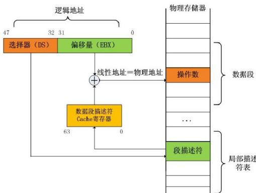

| 界限(15~0) |
|---|
| 基地址(15~0) |
| P | DPL | S | E | X | RW | A | 基地址(23~16) |
| 基地址(31~24) | X | X | X | X | 界限(19~16) |

| 界限(15~0) |
|---|
| 基地址(15~0) |
| P | DPL | O | TYPE | 基地址(23~16) |
| 基地址(31~24) | X | X | X | X | 界限(19~16) |

P：在内存；DPL：2 位特权级；TYPE：0010 为 386LDT 描述符。分页情况下：E：0 为数据（堆栈）段，写，1 为代码段，读；RW=1，允许读。后 3 位补 0，加 GDTR/LDTR 基地址，长度为 8 字节。

知识点：[微处理器的工作模式（实模式、保护模式、虚拟8086模式）](../../../topics/微机接口/gongzuo-moshi.md)、[实地址模式下物理地址的形成（段基址×10H+偏移量）](../../../topics/微机接口/wuli-dizhi.md)、[微型计算机系统中的存储器组织与地址空间分配表](../../../topics/微机接口/cunchu-zuzhi.md)

### 分页情况下

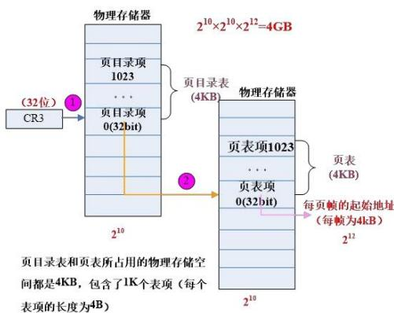

线性地址：

| 页目录表(10bit) | 页表(10bit) | 偏移量(12bit) |
|---|---|---|

页转换与 CR3 密切相关，首先要由 CR3（高 20bits）确定页目录表项的地址，再由线性地址中各项得到最后的地址，实际就是……

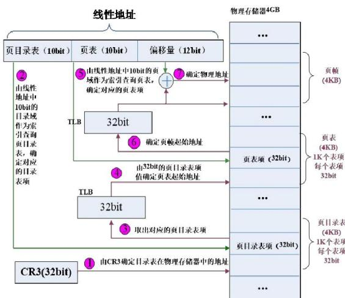

知识点：[微处理器的工作模式（实模式、保护模式、虚拟8086模式）](../../../topics/微机接口/gongzuo-moshi.md)、[实地址模式下物理地址的形成（段基址×10H+偏移量）](../../../topics/微机接口/wuli-dizhi.md)、[80486/8086基本结构寄存器（通用、段、控制寄存器）](../../../topics/微机接口/jiben-jicunqi.md)

### 页目录和页表项的格式

| 31~12 | 11~9 | 8 | 7 | 6 | 5 | 4 | 3 | 2 | 1 | 0 |
|---|---|---|---|---|---|---|---|---|---|---|
| 基地址31~12 | AVL | 00 | D | A | 00 | U | W | P |
| | | | | | | | | | | |

P：存在位，P=1 表示该页表或帧在物理存储器中，P=0 不存在。W：写允许位，W=1 表示该页/页表可以写，W=0 表示不可以写。U：用户位，U=1 表示用户使用，U=0 表示管理员使用。A：访问位，A=1 表示该页/页表已访问过，A=0 表示未访问。D：出错位，D=1 表示出错，D=0 表示未出错。AVL：程序员可使用的位。

例 1 80386 中，若 GDTR=0080 0000 7FFFH，LDTR=5002H，DS=2002H

LDT 描述符为：0000 8260 0000 F0FFH

数据段描述符为：0000 D220 0000 0FFFH

求：

1. GDT 表的起始地址、结束地址：0080 0000H~0080 7FFFH。GDTR=0080 0000 7FFFH，基地址（起始）界限。

2. LDT 表的起始地址、结束地址：0060 0000H~0060 F0FFH。LDT 描述符为：0000 8260 0000 F0FFH，基地址、界限。

3. LDT 描述符的地址范围：0080 5000H~0080 5007H。LDTR=5002H=0101 0000 0000 0010，取前 13 位后 3 位补 0，加 GDT 表的基地址，界限为 8 字节（一个描述符长度）。

4. 数据段描述符的地址范围：0080 2000H~0080 2007H。DS=2002H=0010 0000 0000 0010，倒数第 3 位为 TI，TI=0。

5. 数据段描述符 0000 D220 0000 0FFFH 基地址、界限。

6. 若指令为 MOV AX,[80H]，源操作数的线性地址是多少：0020 0080H。

例 2 在 80386 系统中，寄存器 CR3 的值为 2000 0000H，页表起始地址为 4000 0000H，页目录表内容如下图中所示，线性地址为 1999 0118H，转换后的物理地址为 8000 0118H。线性地址：0001 1001 10 01 1001 0000 0001 0001 1000。

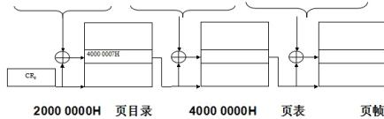

求：页目录表的起始地址 = 20000000H（CR3 中物理地址取高 20 位，低 20 位补 0）

页表偏移地址 = 011001000000B（取线性地址中间 10 位，补 2 个 0；页目录项的偏移地址：线性地址前 10 位补两个 0）

页帧起始地址 = 80000000H = 物理地址

线性地址的偏移量（后 12 位）

存放整个页目录表的内存地址 = 20000000H~20000FFFH

页目录表长度为 4KB。如果页表项所描述的页帧用户方式是只读，则该页表项的内容为 80000005H（是否可写由页表项决定）。

（6）线性地址 = 物理地址 = 段基址（4）+ 偏移量（5）

1. 8 个 32 位的通用寄存器，支持 8、16、32 位数据操作，在 8086 寄存器的名称前面加 E。

IN AL, DX
TEST AL, 1
JZ RE
MOV DX, 3F8H ;接收缓冲器不满，转 RE
IN AL, DX
MOV [DI], AL

ASCII 码字符发送出去，并显示在 CRT 上，同时能把接收到的每一个字符也以 ASCII 码形式显示出来。

设：数据传输速率为 9600 波特，通信格式为 8 位数据位，1 位停止位，奇校验。

KEY: MOV DX, 3FBH ;写 LCR
MOV AL, 80H
OUT DX, AL
MOV DX, 3F8H ;送波特率常数
MOV AL, 12
OUT DX, AL ;低 8 位
INC DX
MOV AL, 0
OUT DX, AL ;高 8 位
MOV AL, 0BH
MOV DX, 3FBH
OUT DX, AL ;写 LCR，设通信格式
MOV AL, 13H ;自发自收，RTS=1，DTR=1
MOV DX, 3FCH
OUT DX, AL ;写 MCR，设置工作方式
CHECK: MOV DX, 3FDH ;读 LSR
IN AL, DX
TEST AL, 1 ;查接收缓冲器是否满？
JNZ REV ;若满，转 REV
TEST AL, 20H ;查发送保持器是否空？
JZ CHECK ;若不空，继续查
TR: MOV AH, 1 ;读键盘
INT 16H
JZ CHECK ;无键按下，转 CHECK
MOV DX, 3F8H
OUT DX, AL ;有键入，发送 ASCII 码
JMP CHECK
REV: MOV DX, 3F8H
IN AL, DX ;读入接收字符
AND AL, 7FH ;屏蔽 D7 位
MOV BX, 0041H ;第 0 页，红底蓝字
MOV AH, 14
INT 10H ;显示字符
JMP CHECK

同步通信：数据发送和接收同步，没有信息传输时填空白符。异步通信：接收和发送的时钟频率不完全一样。

（写），0 不允许；A：访问过；X=0 向上扩展，X=1 向下扩展。

5. 数据段的起始地址、结束地址：0020 0000H~0020 0FFFH

系统段描述符（任务状态 TSS、门和 LDT，即 S=0）

RE:
MOV DX, 3FDH

知识点：[最常用的I/O指令（IN、OUT的直接寻址与DX间址）](../../../topics/微机接口/io-zhiling.md)、[微机系统与I/O端口的信息交换方式（无条件、查询、中断、DMA）](../../../topics/微机接口/xinxi-jiaohuan.md)
