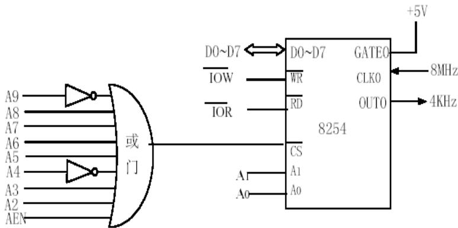
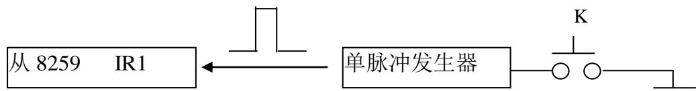
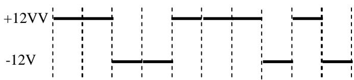
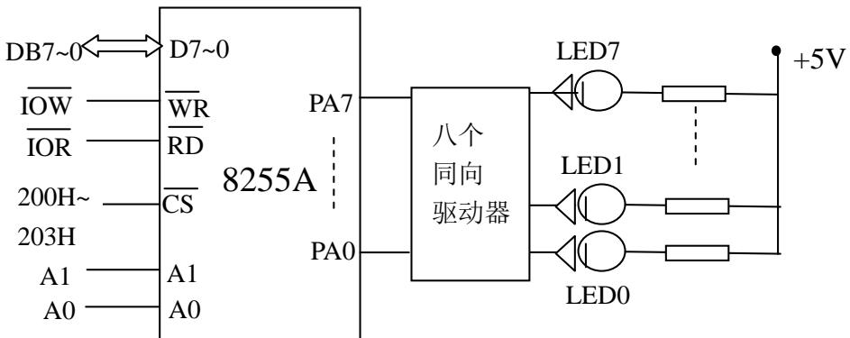

# 《微型计算机接口技术》期末复习要点&例题

原件经识别和整理；“参考解答”是我们补的。

# 存储器和总线

## 一、存储器扩展与总线概念

### 1. 存储器的扩展

**知识点：存储器容量扩展（字扩展、位扩展、字位同时扩展）**

例：现有 $16\text{K} \times 1$ 的静态 RAM 芯片，欲组成 $128\text{K} \times 8$ 位的存储器。

- **所需芯片数量**：
  $$ \frac{128\text{K} \times 8}{16\text{K} \times 1} = 8 \times 8 = 64 \text{ 片} $$
- **组数**：需组成 8 个芯片组（每组 8 片并联以扩展数据位宽至 8 位）。
- **扩展类型**：属于 **字位同时** 扩展。
- **地址线需求**：
  - 片内地址选择：$16\text{K} = 2^{14}$，故每片芯片内部需要 **14 根** 地址线（A0-A13）。
  - 芯片组选择：共 8 个芯片组，需要 $\log_2 8 = 3$ 根地址线进行译码。故至少需用 **3 根** 高位地址线（如 A14-A16）通过 3-8 译码器来实现不同芯片组的选择。

知识点：[存储器的扩展方法（位扩展法、字扩展法）](../../../topics/微机接口/cunchu-kuozhan.md)、[存储器容量的表示方法](../../../topics/微机接口/cunchu-rongliang.md)、[存储器地址译码电路设计（线选法、全译码法、部分译码法）](../../../topics/微机接口/dizhi-yima.md)

### 2. 总线的基本概念与分类

- **地址总线 (Address Bus)**：单向，用于传送 CPU 要访问的内存或 I/O 端口的地址。
- **数据总线 (Data Bus)**：双向，用于在 CPU、内存和 I/O 设备之间传输数据。
- **控制总线 (Control Bus)**：传输控制信号和时序信号，协调各部件的工作。

---

# I/O 接口概念

## 一、I/O 接口基础

知识点：[总线的基本概念与分类（内部总线、系统总线、外部总线）](../../../topics/微机接口/zongxian-gainian.md)

### 1. 接口电路的作用与功能

**作用**：解决 CPU 与外设之间在速度、电平、格式、时序等方面的不匹配问题，实现信息交换。

**应具备的功能**：
- 数据缓冲
- 状态监测
- 控制命令接收
- 电平转换
- 时序协调

知识点：[接口电路的作用和基本功能](../../../topics/微机接口/jiekou-gongneng.md)

### 2. 端口及其分类

**定义**：端口是接口电路中可被 CPU 直接寻址的寄存器单元。

**分类**：
- **数据端口**：存放输入/输出的数据。
- **状态端口**：存放外设的状态信息（如忙/闲、错误标志等）。
- **控制端口**：存放 CPU 发给外设的控制命令。

知识点：[端口的概念与分类（数据端口、状态端口、控制端口）](../../../topics/微机接口/duankou-gainian.md)、[接口电路的作用和基本功能](../../../topics/微机接口/jiekou-gongneng.md)

### 3. CPU 对外设的寻址方式

两种主要方式：
1. **统一编址 (Memory Mapped I/O)**：I/O 端口地址与内存地址空间合并，使用相同的指令（MOV 等）访问。
2. **独立编址 (Isolated I/O / Port Mapped I/O)**：I/O 端口有独立的地址空间，需使用专用指令（IN, OUT）访问。

**PC 系列机采用**：**独立编址**。

知识点：[端口的编址方式（统一编址与独立编址）](../../../topics/微机接口/duankou-bianzhi.md)、[最常用的I/O指令（IN、OUT的直接寻址与DX间址）](../../../topics/微机接口/io-zhiling.md)

### 4. CPU 的输入输出指令

- **IN**：从端口读取数据到累加器（AL/AX）。
- **OUT**：将累加器（AL/AX）中的数据写入端口。

知识点：[最常用的I/O指令（IN、OUT的直接寻址与DX间址）](../../../topics/微机接口/io-zhiling.md)、[端口的编址方式（统一编址与独立编址）](../../../topics/微机接口/duankou-bianzhi.md)

### 5. 微机系统与 I/O 之间的传送方式

1. **无条件传送**：适用于简单、慢速外设，CPU 假设外设已准备好。
2. **查询传送 (Programmed I/O)**：CPU 不断读取状态端口，等待外设就绪后再进行数据传输。
3. **中断传送**：外设准备好后向 CPU 发中断请求，CPU 暂停当前任务处理 I/O，效率高。
4. **DMA 传送 (Direct Memory Access)**：由 DMA 控制器接管总线，直接在内存和外设间传输数据。**不需要 CPU 参与**数据搬运过程，仅在初始化和结束时介入。

---

# 计数器/定时器 8254

## 一、8254 结构与工作原理

知识点：[微机系统与I/O端口的信息交换方式（无条件、查询、中断、DMA）](../../../topics/微机接口/xinxi-jiaohuan.md)、[最常用的I/O指令（IN、OUT的直接寻址与DX间址）](../../../topics/微机接口/io-zhiling.md)、[端口的概念与分类（数据端口、状态端口、控制端口）](../../../topics/微机接口/duankou-gainian.md)

### 1. 基本结构

- 包含 **三个** 独立的 16 位计数器通道。
- 每个计数器有 **6 种** 工作方式（Mode 0~5）。
- 计数初值可设置为二进制或 BCD 码。
- **外部引脚功能**：
  - **CLK**：时钟输入端。
  - **OUT**：输出端。
  - **GATE**：门控输入端，控制计数的启动、停止或复位。

知识点：[微型计算机的硬件基本结构](../../../topics/微机接口/weixingji-yingjian.md)、[接口电路的作用和基本功能](../../../topics/微机接口/jiekou-gongneng.md)、[端口的概念与分类（数据端口、状态端口、控制端口）](../../../topics/微机接口/duankou-gainian.md)

### 2. 工作方式与时钟关系

重点掌握 **方式 2 (Rate Generator)** 和 **方式 3 (Square Wave Generator)**：
- **方式 2**：分频器模式。每隔 N 个时钟周期输出一个负脉冲。常用于产生周期性中断或定时。
- **方式 3**：方波发生器模式。输出占空比接近 1:1 的方波（若 N 为偶数则严格 1:1，奇数则高电平多一个周期）。常用于驱动扬声器或作为时钟源。

知识点：[接口电路的作用和基本功能](../../../topics/微机接口/jiekou-gongneng.md)、[微机系统与I/O端口的信息交换方式（无条件、查询、中断、DMA）](../../../topics/微机接口/xinxi-jiaohuan.md)

### 3. PC 系统中的 8254

- **端口地址**：通常为 `40H` ~ `43H`。
  - `40H`: Counter 0
  - `41H`: Counter 1
  - `42H`: Counter 2
  - `43H`: Control Register
- **三个计数器的作用**：
  - **Counter 0**：系统日时钟中断源（通常工作在方式 3，频率约 1.19MHz，经分频后每秒产生约 18.2 次中断，即 IRQ0）。
  - **Counter 1**：DRAM 刷新定时（通常工作在方式 2，用于定期刷新动态内存）。
  - **Counter 2**：扬声器音频生成（通常工作在方式 3，用于产生蜂鸣声）。

知识点：[端口的编址方式（统一编址与独立编址）](../../../topics/微机接口/duankou-bianzhi.md)、[接口电路的作用和基本功能](../../../topics/微机接口/jiekou-gongneng.md)

### 4. 初始化编程步骤

1. 确定端口地址。
2. 根据工作要求设置 **控制字** (写入 `43H`)：
   - SC (Select Counter): 选择哪个计数器。
   - RW (Read/Write Mode): 读写顺序（先低后高、仅低、仅高、先高后低）。
   - M2-M0 (Mode): 选择工作方式。
   - BCD: 选择二进制或 BCD 码。
3. 计算并写入 **计数初值** (写入对应计数器端口)。

知识点：[最常用的I/O指令（IN、OUT的直接寻址与DX间址）](../../../topics/微机接口/io-zhiling.md)、[端口的概念与分类（数据端口、状态端口、控制端口）](../../../topics/微机接口/duankou-gainian.md)、[接口电路的作用和基本功能](../../../topics/微机接口/jiekou-gongneng.md)

### 5. 定时周期与长定时措施

- **最长定时周期**：取决于计数初值和时钟频率。对于 16 位计数器，最大初值为 $65536$（或 $0$ 表示 $65536$）。若时钟频率固定，则最长时间为 $T_{max} = 65536 \times T_{clk}$。
- **实现长时间定时的措施**：
  - **软件计数**：利用短周期的硬件中断（如日时钟），在中断服务程序中维护一个软件计数器，累计达到设定次数后才执行真正的任务。
  - **级联计数**：将一个计数器的输出作为下一个计数器的时钟输入（较少见，受限于引脚连接）。

## 二、例题解析

知识点：[查询方式输入输出编程模式与流程](../../../topics/微机接口/chaxun-fangshi.md)、[微机系统与I/O端口的信息交换方式（无条件、查询、中断、DMA）](../../../topics/微机接口/xinxi-jiaohuan.md)、[接口电路的作用和基本功能](../../../topics/微机接口/jiekou-gongneng.md)

### 例 1：8254 初始化程序段

**题目**：设系统 8254 的计数器 2 工作在方式 3，计数初值为 2000，采用二进制计数。口地址为 `40H`~`43H`。完成初始化。

**分析**：
- 目标：Counter 2 (`SC=10B`)
- 读写顺序：先低字节后高字节 (`RW=11B`)
- 方式：方式 3 (`M=011B`)
- 计数制：二进制 (`BCD=0`)
- 控制字：`10110110B` = `B6H`
- 初值：2000 = `07D0H` (低字节 `D0H`, 高字节 `07H`)

**代码**：
```assembly
MOV DX, 43H      ; 指向控制寄存器
MOV AL, 0B6H     ; 控制字：Counter 2, 先低后高, 方式3, 二进制
OUT DX, AL       ; 写入控制字

MOV DX, 42H      ; 指向 Counter 2 数据寄存器
MOV AX, 2000     ; 计数初值
OUT DX, AL       ; 写低字节 D0H
MOV AL, AH       ; 取高字节
OUT DX, AL       ; 写高字节 07H
```

知识点：[最常用的I/O指令（IN、OUT的直接寻址与DX间址）](../../../topics/微机接口/io-zhiling.md)、[数制转换（二进制、十进制、十六进制互转）](../../../topics/微机接口/shuzhi-zhuanhuan.md)、[典型总线标准（ISA/AT总线、PCI总线引脚与特点）](../../../topics/微机接口/dianxing-zongxian.md)

### 例 2：外扩 8254 分析与编程

**题目背景**：PC 系统机外扩一片 8254 及相应实验电路。


**(1) 端口地址分析**
根据门电路构成的译码电路分析（具体需看图中连线逻辑，通常涉及地址线 A0-A7 及高位地址线）。
*注：由于图片未提供具体连线细节，此处仅给出通用分析方法。若已知某根地址线接 CS，其他低位接 A0/A1，则可推导。假设典型情况，控制口地址通常是基地址+3。*
*(此处无法给出确切数值，需依据原题图示连线判断。常见考题答案可能为例如 `280H`~`283H` 或其他范围)*

**(2) 初始化程序编写**
**条件**：CLK0 接 8MHz，要求 OUT0 输出 4KHz 方波。
- **计算初值**：
  $$ N = \frac{f_{in}}{f_{out}} = \frac{8 \times 10^6}{4 \times 10^3} = 2000 $$
- **工作模式**：方波 -> **方式 3**。
- **控制字设置**：
  - Counter 0 (`SC=00B`)
  - 先低后高 (`RW=11B`)
  - 方式 3 (`M=011B`)
  - 二进制 (`BCD=0`)
  - 控制字：`00110110B` = `36H`
- **端口地址**：假设该片 8254 基地址为 `PORT_BASE`，则控制口为 `PORT_BASE+3`，Counter 0 数据口为 `PORT_BASE+0`。

**代码示例**（假设控制口地址为 `CTRL_PORT`，Counter0 地址为 `CNT0_PORT`）：
```assembly
; 初始化 Counter 0
MOV DX, CTRL_PORT    ; 指向控制寄存器
MOV AL, 36H          ; 控制字：C0, 先低后高, Mode 3, Binary
OUT DX, AL           ; 写入控制字

MOV DX, CNT0_PORT    ; 指向 Counter 0 数据寄存器
MOV AX, 2000         ; 计数初值 2000 (07D0H)
OUT DX, AL           ; 写低字节 D0H
MOV AL, AH           ; 取高字节
OUT DX, AL           ; 写高字节 07H
```

---

# 中断与 8259 控制器

## 一、中断基本概念

知识点：[存储器地址译码电路设计（线选法、全译码法、部分译码法）](../../../topics/微机接口/dizhi-yima.md)、[最常用的I/O指令（IN、OUT的直接寻址与DX间址）](../../../topics/微机接口/io-zhiling.md)、[端口的编址方式（统一编址与独立编址）](../../../topics/微机接口/duankou-bianzhi.md)

### 1. 什么是中断？
CPU 在执行程序过程中，遇到异常情况或特殊请求时，暂时中止现行程序的运行，转去处理这些异常或请求，处理完毕后自动返回原程序继续执行的过程。

知识点：[微机系统与I/O端口的信息交换方式（无条件、查询、中断、DMA）](../../../topics/微机接口/xinxi-jiaohuan.md)

### 2. 中断向量与中断向量表
- **中断向量**：中断服务程序的入口地址（CS:IP）。
- **中断类型码**：标识中断源的编号（0~255）。
- **关系**：在 80X86 系统中，中断向量表位于内存最低端的 1KB 区域（物理地址 `00000H` ~ `003FFH`）。
  - 每个中断向量占 4 个字节：前 2 字节存 IP（偏移量），后 2 字节存 CS（段基址）。
  - 中断类型码 `N` 对应的向量地址计算公式：
    $$ \text{Vector Address} = N \times 4 $$
    $$ \text{IP} = \text{Mem}[N \times 4] + \text{Mem}[N \times 4 + 1] \ll 8 $$
    $$ \text{CS} = \text{Mem}[N \times 4 + 2] + \text{Mem}[N \times 4 + 3] \ll 8 $$

**例题解析**：
已知 `(00180H)=44H`, `(00181H)=55H`, `(00182H)=66H`, `(00183H)=77H`。
1. **求中断类型码**：
   $$ \text{Type Code} = \frac{\text{Address}}{4} = \frac{00180H}{4} = 00060H $$
   所以，这是 **中断类型 60H** 的中断向量。
2. **求中断向量 (CS:IP)**：
   - IP = `5544H` (小端序：低地址 `44H` 为低字节，高地址 `55H` 为高字节)
   - CS = `7766H` (小端序：低地址 `66H` 为低字节，高地址 `77H` 为高字节)
   - 中断向量为 **`7766H:5544H`**。
3. **求对应物理地址**：
   $$ \text{Physical Address} = \text{CS} \times 16 + \text{IP} $$
   $$ = 7766H \times 10H + 5544H $$
   $$ = 77660H + 5544H $$
   $$ = 7CBAAH $$
   *(注：原题给出的答案是 7CBA4H，这里可能存在计算误差或原题数据印刷差异。按标准小端序计算应为 7CBAAH。若原题意为大端或其他特殊情况请核对教材。通常 x86 为小端。让我们重新检查原题给出的答案逻辑：如果原题答案是 7CBA4H，反推 IP+CS*16... 可能是题目数据或答案有误，或者我读错了十六进制加法。
   $77660 + 5544$:
   $0+4=4$
   $6+4=A$
   $6+5=B$
   $7+5=C$
   $7+0=7$
   结果确实是 **7CBAAH**。原题标注的 7CBA4H 疑似笔误，正确应为 7CBAAH。但在整理资料时，保留“参考答案”并指出可能的订正。)*

   **订正说明**：根据 x86 小端存储规则，计算结果应为 `7CBAAH`。原题提供的 `7CBA4H` 可能有误。

知识点：[实地址模式下物理地址的形成（段基址×10H+偏移量）](../../../topics/微机接口/wuli-dizhi.md)、[存储单元和存储器地址的概念](../../../topics/微机接口/cunchu-danyuan.md)、[真值数与补码的相互转换及补码计算](../../../topics/微机接口/zhenzhi-buma.md)

### 3. 中断指令
- **INT n**：软件中断指令。CPU 根据操作数 `n` 查中断向量表，跳转到相应的中断服务程序。
- **IRET**：中断返回指令。从堆栈中弹出 IP, CS 和 FLAGS，恢复现场，返回主程序。

知识点：[转移指令（JMP、条件转移、CALL、RET）](../../../topics/微机接口/zhuanyi-zhiling.md)

### 4. CPU 响应中断的条件
- **可屏蔽中断 (INTR)**：
  1. 中断允许标志 IF = 1 (开中断)。
  2. 无更高级别的非屏蔽中断或内部异常正在处理。
  3. 当前指令执行完毕。
  4. 收到 INTR 引脚有效信号。
- **非屏蔽中断 (NMI)**：
  1. 不受 IF 标志影响。
  2. 优先级高于可屏蔽中断。
  3. 收到 NMI 引脚上升沿触发信号。
  4. 当前指令执行完毕。

知识点：[标志寄存器中的状态标志位与控制标志位](../../../topics/微机接口/zhuangtai-biaozhi.md)、[80486/8086的寻址方式（立即、寄存器、直接、间接、变址等）](../../../topics/微机接口/xunzhi-fangshi.md)、[堆栈的概念及SP指针操作](../../../topics/微机接口/duizhan-caozuo.md)

### 5. 8259A 芯片的作用
可编程中断控制器 (PIC)，用于管理多个中断源，实现中断优先级排队、中断屏蔽、中断嵌套等功能。

**选择题例**：
PC/AT 系统使用两片 8259 级联，可管理多少级中断？
- 主片 8 个输入，从片 8 个输入。
- 主片的一个输入（通常 IR2）连接从片的 INT 输出。
- 可用中断源总数 = $8 (\text{主}) - 1 (\text{占用}) + 8 (\text{从}) = 15$ 级。
- **答案：C. 15**

知识点：[微机系统与I/O端口的信息交换方式（无条件、查询、中断、DMA）](../../../topics/微机接口/xinxi-jiaohuan.md)、[接口电路的作用和基本功能](../../../topics/微机接口/jiekou-gongneng.md)、[端口的概念与分类（数据端口、状态端口、控制端口）](../../../topics/微机接口/duankou-gainian.md)

### 6. CPU 响应可屏蔽中断的全过程
1. CPU 检测到 INTR 有效且 IF=1。
2. 在当前指令结束后，发出两个连续的 INTA (Interrupt Acknowledge) 脉冲。
3. 第一个 INTA 期间，8259 锁定最高优先级的中断请求。
4. 第二个 INTA 期间，8259 将中断类型码送上数据总线。
5. CPU 读取中断类型码，计算向量地址，压栈保护现场 (FLAGS, CS, IP)，跳转到 ISR。
6. ISR 执行完毕，通过 EOI (End of Interrupt) 通知 8259 清除中断服务寄存器 (ISR) 中的位。
7. 执行 IRET 返回。

知识点：[微机系统与I/O端口的信息交换方式（无条件、查询、中断、DMA）](../../../topics/微机接口/xinxi-jiaohuan.md)、[标志寄存器中的状态标志位与控制标志位](../../../topics/微机接口/zhuangtai-biaozhi.md)、[堆栈的概念及SP指针操作](../../../topics/微机接口/duizhan-caozuo.md)

### 7. 软件中断与硬件中断的区别
- **相同点**：都导致程序流转移，都需要保存现场，都有中断向量表支持。
- **不同点**：
  - **触发源**：软件中断由指令 `INT n` 触发；硬件中断由外部设备电信号触发。
  - **可控性**：软件中断随时可由程序调用；硬件中断取决于外设状态和 CPU 中断允许标志。
  - **优先级**：通常硬件中断优先级更高（特别是 NMI）。
  - **响应时机**：软件中断在执行该指令时立即响应；硬件中断通常在指令边界响应。

## 二、应用实例

知识点：[DOS功能调用与BIOS中断功能调用（INT 21H、INT 10H等）](../../../topics/微机接口/dos-bios-diaoyong.md)、[标志寄存器中的状态标志位与控制标志位](../../../topics/微机接口/zhuangtai-biaozhi.md)、[微机系统与I/O端口的信息交换方式（无条件、查询、中断、DMA）](../../../topics/微机接口/xinxi-jiaohuan.md)

### 例 1：利用系统定时中断显示字符串

**题目**：利用系统定时中断，每隔 $18 \times 55\text{ms}$ (约 1 秒，因 18.2Hz 中断周期约为 55ms)，显示一行 "hello"，主机按任意键停止。

**思路**：
1. 修改中断向量表，将 INT 8H (Timer Tick) 的处理程序替换为用户自定义程序。
2. 用户程序中包含一个计数器，每次中断减 1，归零时显示 "hello" 并重置计数器。
3. 主程序循环检测键盘输入。

*(注：此题主要考察中断向量置换技术，具体代码略长，核心在于 `SET INTERRUPT VECTOR` 部分)*

知识点：[DOS功能调用与BIOS中断功能调用（INT 21H、INT 10H等）](../../../topics/微机接口/dos-bios-diaoyong.md)、[基本的汇编语言程序设计与程序控制结构](../../../topics/微机接口/jiben-chengxu.md)

### 例 2：单脉冲发生器外部中断设计

**题目**：外扩 '单脉冲发生器'，按 K 键产生正脉冲送入 8259 的 IR1。要求每按一次 K，屏幕显示 "Welcome!"。按任意键退出。

**电路图**：


**关键点**：
1. **中断向量置换**：IR1 对应的外中断类型码通常是 `08H + 1 = 09H` (PC/XT 标准，若级联则需确认是从片还是主片，图中若接主片 IR1 则为 09H)。
2. **8259 初始化**：需开放 IR1 中断屏蔽位。
3. **服务程序**：打印字符串，发送 EOI 给 8259。

**参考代码片段**：
```assembly
DATA SEGMENT USE16
    MESG DB "WELCOME", '$'
DATA ENDS

CODE SEGMENT USE16
    ASSUME CS:CODE, DS:DATA

BEG:
    MOV AX, DATA
    MOV DS, AX
    
    CLI                     ; 关中断，准备修改向量表
    
    ; 1. 置换中断向量 (假设 IR1 对应 INT 09H)
    CALL WRITE_VECTOR       ; 子程序：将 SERVICE 的地址写入 IVT[09H]
    
    ; 2. 初始化 8259 (开放 IR1)
    CALL INIT_8259          ; 子程序：设置 IMR，使 IR1 不被屏蔽
    
    STI                     ; 开中断

SCAN:
    MOV AH, 1               ; 键盘检测
    INT 16H
    JZ SCAN                 ; 若无按键，继续扫描
    
    ; 退出程序前恢复中断向量（可选，但良好实践）
    ; ...
    
    MOV AH, 4CH             ; 返回 DOS
    INT 21H

; --- 中断服务程序 ---
SERVICE PROC
    PUSHA                   ; 保护所有寄存器
    PUSH DS
    MOV AX, DATA            ; 设置 DS 指向数据段
    MOV DS, AX
    
    MOV AH, 9               ; 显示字符串功能
    LEA DX, MESG
    INT 21H
    
    MOV AL, 20H             ; EOI 命令
    OUT 20H, AL             ; 发送给主 8259 (若 IR1 在主片)
                            ; 若在从片，需分别发送 EOI 给从片和主片
    
    POP DS
    POPA                    ; 恢复寄存器
    IRET                    ; 中断返回
SERVICE ENDP

; --- 辅助子程序 ---
WRITE_VECTOR PROC
    ; 将 SERVICE 的 CS:IP 写入中断向量表 09H 处
    ; 详细代码省略，通常使用 INT 21H AH=25H 功能
    RET
WRITE_VECTOR ENDP

INIT_8259 PROC
    ; 读取原 IMR，置位 IR1 允许中断，写回
    IN AL, 21H              ; 读主片 IMR
    AND AL, 11111011B       ; 清除 bit 1 (开放 IR1)
    OUT 21H, AL             ; 写回主片 IMR
    RET
INIT_8259 ENDP

CODE ENDS
END BEG
```

---

# 串行接口 8250

## 一、异步通信基础

知识点：[接口电路的作用和基本功能](../../../topics/微机接口/jiekou-gongneng.md)、[微机系统与I/O端口的信息交换方式（无条件、查询、中断、DMA）](../../../topics/微机接口/xinxi-jiaohuan.md)、[端口的概念与分类（数据端口、状态端口、控制端口）](../../../topics/微机接口/duankou-gainian.md)

### 1. 特点与帧格式
- **特点**：“两个一致”——波特率一致、数据格式一致。字符间传输时间间隔不定，靠起始位同步。
- **数据帧格式**：
  - 起始位 (Start Bit): 1 位，低电平。
  - 数据位 (Data Bits): 5~8 位。
  - 校验位 (Parity Bit): 0 或 1 位 (None, Odd, Even)。
  - 停止位 (Stop Bits): 1, 1.5, 或 2 位，高电平。
- **最短帧**：1(起)+5(数)+0(校)+1(停) = 7 位? 题目说最短 7.5 位，通常指 5 数据位+1.5 停止位的情况，或者特定配置。一般标准最短为 1+5+1=7 位（若无校验）。题目给定范围 7.5~12 位。
- **波特率 (Baud Rate)**：每秒传输的二进制位数 (bps)。

**例题**：
设一帧字符：8 数据位，无校验，1 停止位。波特率 9600 bps。
- **总位数/帧**：$1 (\text{Start}) + 8 (\text{Data}) + 0 (\text{Parity}) + 1 (\text{Stop}) = 10 \text{ bits}$。
- **每秒传输帧数**：
  $$ \frac{9600 \text{ bps}}{10 \text{ bits/frame}} = 960 \text{ frames/s} $$
- **传输一帧所需时间**：
  $$ \frac{1}{960} \text{ s} \approx 1.04 \text{ ms} $$

知识点：[微机系统与I/O端口的信息交换方式（无条件、查询、中断、DMA）](../../../topics/微机接口/xinxi-jiaohuan.md)

### 2. 通信方式含义
- **单工 (Simplex)**：数据只能单向传输。
- **半双工 (Half-Duplex)**：数据可双向传输，但不能同时进行。
- **全双工 (Full-Duplex)**：数据可同时双向传输。

知识点：[微机系统与I/O端口的信息交换方式（无条件、查询、中断、DMA）](../../../topics/微机接口/xinxi-jiaohuan.md)

### 3. RS-232C 接口标准
- **电平**：负逻辑。
  - 逻辑 1 (MARK): -3V ~ -15V
  - 逻辑 0 (SPACE): +3V ~ +15V
- **主要引脚**：
  - Pin 2: TXD (发送数据)
  - Pin 3: RXD (接收数据)
  - Pin 4: RTS (请求发送)
  - Pin 5: CTS (清除发送)
  - Pin 6: DSR (数据装置就绪)
  - Pin 7: GND (信号地)
  - Pin 8: DCD (数据载波检测)
  - Pin 20: DTR (数据终端就绪)

知识点：[接口电路的作用和基本功能](../../../topics/微机接口/jiekou-gongneng.md)、[端口的概念与分类（数据端口、状态端口、控制端口）](../../../topics/微机接口/duankou-gainian.md)、[微机系统与I/O端口的信息交换方式（无条件、查询、中断、DMA）](../../../topics/微机接口/xinxi-jiaohuan.md)

### 4. 中断方式收发编程措施
- 初始化 8250 中断使能寄存器 (IER)，开启接收数据可用中断 (ERDA) 或发送保持寄存器空中断 (ETBE)。
- 确保 CPU 开中断 (STI)。
- 编写中断服务程序 (ISR)，在 ISR 中读取/写入数据寄存器，并发送 EOI 给 8259。

知识点：[微机系统与I/O端口的信息交换方式（无条件、查询、中断、DMA）](../../../topics/微机接口/xinxi-jiaohuan.md)、[最常用的I/O指令（IN、OUT的直接寻址与DX间址）](../../../topics/微机接口/io-zhiling.md)、[处理器控制指令（STI、CLI、HLT、NOP等）](../../../topics/微机接口/chuli-kongzhi.md)

### 5. 8250 初始化与查询编程

#### 例 1：补充初始化程序段

**题目**：甲乙两台计算机直连单工通信。甲发送，乙接收。约定：7 位数据，1 位停止，偶校验，速率 2400bps。双方查询方式。

**参数分析**：
- **波特率因子**：2400 bps。
  - 8250 默认基准时钟 1.8432 MHz。
  - 分频系数 Divisor = $\frac{1.8432 \times 10^6}{16 \times \text{Baud}} = \frac{115200}{2400} = 48 = 30H$。
  - 所以 DLL = 30H, DLH = 00H。
- **线路控制寄存器 (LCR, 3FBH)**：
  - 7 位数据 (`WLS=11B`? No, 5=00, 6=01, 7=10, 8=11. So 7 is `10B`).
  - 1 位停止 (`STB=0`).
  - 偶校验 (`PEN=1`, `EPS=1`).
  - 启用波特率除数锁存 (`DLAB=1`)。
  - LCR Value: `11110110B` = `F6H` (Set DLAB=1 first to write baud rate).
  - After writing baud rate, set DLAB=0 for data format.
  - Final LCR for config: `01110110B` = `76H` (No parity? Wait. Even Parity enabled. DLAB=0. Data=7, Stop=1, Parity=Even. Bits: [DLAB][Break][PARITY TYPE][STOP BITS][WORD LENGTH].
    - Word Length 7: `10`
    - Stop 1: `0`
    - Parity Enable (Even): `11` (PEN=1, EPS=1)
    - Break: `0`
    - DLAB: `0`
    - Value: `01110110B` = `76H`.
- **调制解调器控制寄存器 (MCR, 3FCH)**：
  - 需激活 DTR, RTS 以便对方识别。
  - Value typically `0BH` or similar depending on handshake. Since it's direct connect single duplex, maybe just enable loopback or standard outputs. Let's assume standard setup enabling DTR/RTS.

**填空解答**：
1. **MOV DX, 3FBH**; **MOV AL, (1)** -> 设置 DLAB=1 以写入波特率。
   - (1) = `80H` (Only DLAB bit set, others don't matter much yet, but usually preserve other bits or set specific mode. Simplest is `80H`).
2. **MOV DX, 3F8H**; **MOV AL, (2)** -> 写入波特率低字节 (DLL)。
   - (2) = `30H` (Decimal 48).
3. **MOV DX, 3FBH**; **MOV AL, (3)** -> 设置 DLAB=0 并配置数据格式 (7E1)。
   - (3) = `76H` (As calculated above: 7 bits, even parity, 1 stop).
4. **MOV DX, 3F9H**; **MOV AL, (4)** -> 中断使能寄存器 (IER)。查询方式通常关闭中断，即 `00H`。
   - (4) = `00H`.
5. **MOV DX, 3FCH**; **MOV AL, (5)** -> 调制解调器控制 (MCR)。开启 DTR 和 RTS。
   - (5) = `0BH` (Bit 0=DTR, Bit 1=RTS, Bit 3=Out1. Common value `0BH` or `03H` depending on needs. For simple send/receive, enabling DTR/RTS is good practice).

**完整代码段**：
```assembly
MOV DX, 3FBH
MOV AL, 80H        ; (1) Set DLAB=1
OUT DX, AL
MOV DX, 3F8H
MOV AL, 30H        ; (2) Write LSB of divisor (48)
OUT DX, AL
MOV DX, 3F9H
MOV AL, 0          ; (Implicitly high byte of divisor if needed, but code shows next step is 3FBH again? 
                   ; Actually, the provided code structure in prompt has a gap. 
                   ; Standard sequence:
                   ; 1. Set DLAB=1 (3FBH <- 80H)
                   ; 2. Write DLL (3F8H <- 30H)
                   ; 3. Write DLH (3F9H <- 00H) -- Prompt code has "MOV DX,3F9H MOV AL,0 OUT DX,AL" before setting LCR back? 
                   ; Let's re-read prompt code carefully.
                   
                   ; Prompt Code:
                   ; MOV DX,3FBH MOV AL,(1) OUT DX,AL  -> Set DLAB=1
                   ; MOV DX,3F8H MOV AL,(2) OUT DX,AL  -> Write DLL
                   ; MOV DX,3F9H MOV AL,0 OUT DX,AL    -> Write DLH (High byte of divisor)
                   ; MOV DX,3FBH MOV AL,(3) OUT DX,AL  -> Set DLAB=0 and Format (7E1)
                   ; MOV DX,3F9H MOV AL,(4) OUT DX,AL  -> IER (Disable interrupts for polling)
                   ; MOV DX,3FCH MOV AL,(5) OUT DX,AL  -> MCR (Enable DTR/RTS)

                   ; So:
                   ; (1) = 80H
                   ; (2) = 30H
                   ; (3) = 76H
                   ; (4) = 00H
                   ; (5) = 0BH (or 03H)
```

**(2) 查询方式发送程序段**
```assembly
RSCAN:
    MOV DX, 3FDH      ; Line Status Register (LSR)
    IN AL, DX
    TEST AL, 20H      ; Check THRE (Transmitter Holding Register Empty) bit
    JZ RSCAN          ; If not empty, wait
    MOV AL, 待发送的数据
    MOV DX, 3F8H      ; Transmit Buffer Register (THR)
    OUT DX, AL
```

**(3) 查询方式接收程序段**
```assembly
TSCAN:
    MOV DX, 3FDH      ; LSR
    IN AL, DX
    TEST AL, 01H      ; Check DR (Data Ready) bit
    JZ TSCAN          ; If no data, wait
    MOV DX, 3F8H      ; Receive Buffer Register (RBR)
    IN AL, DX         ; Read character
```

#### 例 2：RS-232C 波形与校验分析

**题目**：A、B 两机点-点单工。7 数据位，1 停止位，1 校验位。速率 4800 bps (Divisor 18H=24)。


**(1) 连线**
单工通信，只需连接发送数据线 (TXD) 到接收数据线 (RXD)，以及公共地 (GND)。
- A 的 TXD (Pin 2) 接 B 的 RXD (Pin 3)。
- A 的 GND (Pin 7) 接 B 的 GND (Pin 7)。
- 无需连接握手信号线。

**(2) 波形分析**
观察波形图（假设图为典型的 UART 波形）：
- **起始位**：低电平。
- **数据位**：7 位。需从波形读出高低电平序列。
- **校验位**：第 8 位。
- **停止位**：第 9 位，高电平。

*由于无法直接看到波形图的像素，以下是通用解题方法：*
1. **读取数据位**：从起始位后的第一个高/低电平开始，连续读取 7 个位的电平值。将其转换为二进制，再转为十六进制 ASCII 码。
2. **判断校验方式**：
   - 统计 7 个数据位中 `1` 的个数。
   - 若校验位为 `1`，且数据位 `1` 的个数为偶数，则为 **奇校验** (Odd Parity) —— 因为总 `1` 的个数（数据+校验）为奇数。
   - 若校验位为 `1`，且数据位 `1` 的个数为奇数，则为 **偶校验** (Even Parity) —— 因为总 `1` 的个数为偶数。
   - *注意*：有些定义中，奇校验保证数据+校验中 1 的总数为奇数。
3. **计算时间**：
   - 总位数 = 1(Start) + 7(Data) + 1(Parity) + 1(Stop) = 10 bits。
   - 波特率 = 4800 bps。
   - 时间 $t = \frac{10}{4800} \text{ s} = \frac{1}{480} \text{ s} \approx 2.08 \text{ ms}$。

*(注：具体 ASCII 码和校验类型需根据实际波形图的高低电平判定。若图中数据位为 `0100001` ('A'), 1 的个数为 2 (偶)。若校验位为 1，则总数 3 (奇)，为奇校验。若校验位为 0，则总数 2 (偶)，为偶校验。)*

---

# 并行接口 8255A

## 一、8255A 结构与编程

知识点：[80486/8086的寻址方式（立即、寄存器、直接、间接、变址等）](../../../topics/微机接口/xunzhi-fangshi.md)、[最常用的I/O指令（IN、OUT的直接寻址与DX间址）](../../../topics/微机接口/io-zhiling.md)、[常用伪指令（SEGMENT、ASSUME、DB/DW/DD、EQU、END等）](../../../topics/微机接口/changyong-weizhiling.md)

### 1. 组成结构
- 三个 8 位并行端口：Port A, Port B, Port C。
- Port C 可分为两个 4 位端口 (PC Upper/Lower)，常用于控制/状态信号。
- 一个控制寄存器。

知识点：[接口电路的作用和基本功能](../../../topics/微机接口/jiekou-gongneng.md)、[端口的概念与分类（数据端口、状态端口、控制端口）](../../../topics/微机接口/duankou-gainian.md)、[微型计算机的硬件基本结构](../../../topics/微机接口/weixingji-yingjian.md)

### 2. 端口地址与控制字
- **地址分配**：通常连续 4 个地址。
  - Base+0: Port A
  - Base+1: Port B
  - Base+2: Port C
  - Base+3: Control Register
- **控制字格式** (写入 Base+3)：
  - Bit 7: 1 (Mode Set Flag)
  - Bit 6-5: Group A Mode (00=Mode 0, 01=Mode 1, 1x=Mode 2)
  - Bit 4: Port A Direction (1=In, 0=Out)
  - Bit 3: Port C Upper Direction (1=In, 0=Out)
  - Bit 2: Group B Mode (0=Mode 0, 1=Mode 1)
  - Bit 1: Port B Direction (1=In, 0=Out)
  - Bit 0: Port C Lower Direction (1=In, 0=Out)

知识点：[端口的概念与分类（数据端口、状态端口、控制端口）](../../../topics/微机接口/duankou-gainian.md)、[端口的编址方式（统一编址与独立编址）](../../../topics/微机接口/duankou-bianzhi.md)、[最常用的I/O指令（IN、OUT的直接寻址与DX间址）](../../../topics/微机接口/io-zhiling.md)

### 3. 三种工作方式
- **方式 0 (Basic Input/Output)**：无条件传送，无联络信号。
- **方式 1 (Strobed Input/Output)**：选通输入/输出。使用 Port C 的部分引脚作为握手信号 (STB, IBF, ACK, OBF, INTR)。
- **方式 2 (Bidirectional Strobed I/O)**：双向选通传输。仅 Port A 支持。

## 二、例题解析

知识点：[微机系统与I/O端口的信息交换方式（无条件、查询、中断、DMA）](../../../topics/微机接口/xinxi-jiaohuan.md)、[查询方式输入输出编程模式与流程](../../../topics/微机接口/chaxun-fangshi.md)、[接口电路的作用和基本功能](../../../topics/微机接口/jiekou-gongneng.md)

### 例 1：8255A 初始化 (Mode 1 Input)

**题目**：端口地址 `200H`~`203H`。A 口、B 口工作在 **选通型输入 (Mode 1 Input)**。允许 B 口中断，禁止 A 口中断。无关项设 0。

**分析**：
- **Group A (Port A & PC Upper)**:
  - Mode: 1 (`10B`? No, Bits 6-5 are for Group A. Mode 1 is `01B`).
  - Port A Dir: Input (`1`).
  - PC Upper Dir: In Mode 1 Input, PC3, PC4, PC5 are control signals. Their direction is fixed by mode. But in Control Word, Bit 3 controls PC Upper general direction if not used for handshaking? Actually, in Mode 1, specific bits are assigned. The control word bit 3 sets the remaining upper bits or the group's behavior?
  - Let's look at standard Mode 1 Input Control Word construction.
  - Bit 7: 1
  - Bit 6-5: 01 (Mode 1 for Group A)
  - Bit 4: 1 (Port A Input)
  - Bit 3: 0 (Port C Upper Output? Or Input? In Mode 1 Input, PC4 is STB_A (Input), PC3 is INTR_A (Output), PC5 is IBF_A (Output). The "Direction" bit in control word usually refers to the non-handshake pins or overrides? Standard practice: Set based on remaining pins or default. However, often this bit is ignored or set to match the dominant flow. Let's check typical examples. Usually, for Mode 1 Input, we don't strictly define PC upper direction via this bit as they are dedicated. But let's assume standard setting.)
  
- **Group B (Port B & PC Lower)**:
  - Mode: 1 (`1` for Bit 2).
  - Port B Dir: Input (`1`).
  - PC Lower Dir: In Mode 1 Input, PC2 is STB_B (Input), PC1 is IBF_B (Output), PC0 is INTR_B (Output).

- **Interrupt Masking**:
  - This is done via **Bit Set/Reset Mode** of Port C, NOT the main Control Word.
  - Main Control Word only sets modes and directions.
  - To enable/disable interrupts, we must write a BSRR command to Port C address (`202H`).

**Step 1: Main Control Word**
- Bit 7: 1
- Bit 6-5: 01 (Mode 1, Grp A)
- Bit 4: 1 (Port A In)
- Bit 3: 0 (Assume PC Upper Out/Default, doesn't affect dedicated pins)
- Bit 2: 1 (Mode 1, Grp B)
- Bit 1: 1 (Port B In)
- Bit 0: 0 (Assume PC Lower Out/Default)
- Value: `10110110B` = `B6H`

**Step 2: Enable B Interrupt, Disable A Interrupt (BSRR)**
- We need to manipulate the INTE flip-flops.
- INTE_A is controlled by PC4? No, in Mode 1 Input, INTE_A is associated with STB_A pin action or internal bit. Actually, for Mode 1, interrupt enable is controlled by writing to Port C using BSRR.
- **PC4** corresponds to INTE_A (for Mode 1 Input? Wait. In Mode 1 Input, STB is PC4, IBF is PC5, INTR is PC3. The INTE bit is internal. Writing to PC4 with BSRR sets/resets INTE_A? Yes, typically the STB pin's corresponding bit in the BSRR operation controls the interrupt enable latch).
  - Correction: In Mode 1 Input, **PC4** is STB_A. Writing to PC4 via BSRR controls **INTE_A**.
  - In Mode 1 Input, **PC2** is STB_B. Writing to PC2 via BSRR controls **INTE_B**.
- **To Enable B Interrupt**: Set INTE_B = 1.
  - Command: Set Bit 2 (PC2) to 1.
  - BSRR Word: `00000101B` (Bit 0=1 for Set, Bits 1-3 select bit 2). Value `05H`.
- **To Disable A Interrupt**: Reset INTE_A = 0.
  - Command: Set Bit 4 (PC4) to 0.
  - BSRR Word: `00001000B` (Bit 0=0 for Reset, Bits 1-3 select bit 4). Value `08H`.

**Initialization Code**:
```assembly
MOV DX, 203H      ; Control Register
MOV AL, 0B6H      ; Mode 1 Input for A and B
OUT DX, AL        ; Write Control Word

MOV DX, 202H      ; Port C (for BSRR)
MOV AL, 05H       ; Set INTE_B (Enable B Interrupt)
OUT DX, AL

MOV AL, 08H       ; Reset INTE_A (Disable A Interrupt)
OUT DX, AL
```

知识点：[端口的编址方式（统一编址与独立编址）](../../../topics/微机接口/duankou-bianzhi.md)、[最常用的I/O指令（IN、OUT的直接寻址与DX间址）](../../../topics/微机接口/io-zhiling.md)

### 例 2：8255A 方式 1 联络信号

**A 口 (Mode 1)**:
- **Input**:
  - STB_A (Strobe Input): PC4
  - IBF_A (Input Buffer Full): PC5
  - INTR_A (Interrupt Request): PC3
- **Output**:
  - OBF_A (Output Buffer Full): PC7
  - ACK_A (Acknowledge Input): PC6
  - INTR_A (Interrupt Request): PC3

**B 口 (Mode 1)**:
- **Input**:
  - STB_B: PC2
  - IBF_B: PC1
  - INTR_B: PC0
- **Output**:
  - OBF_B: PC1
  - ACK_B: PC2
  - INTR_B: PC0

知识点：[端口的概念与分类（数据端口、状态端口、控制端口）](../../../topics/微机接口/duankou-gainian.md)、[最常用的I/O指令（IN、OUT的直接寻址与DX间址）](../../../topics/微机接口/io-zhiling.md)、[微机系统与I/O端口的信息交换方式（无条件、查询、中断、DMA）](../../../topics/微机接口/xinxi-jiaohuan.md)

### 例 3：8255A 应用综合

**题目**：外扩 8255A，地址 `200H`~`203H`。利用日时钟 (INT 1CH type?) 实现每隔 1s 闪烁 LED。键盘结束。


**(1) A 口工作状态分析**
从图中看，LED 连接在 PA 口。若要控制 LED 亮灭，PA 口应作为 **输出 (Output)**。
若电路中有握手信号连接到 PC 口，则可能是方式 1。若只是简单驱动 LED，通常是 **方式 0 输出**。
*注：题目问“从图可以分析出...”，需看图。通常此类闪烁题，若无复杂握手，为方式 0。若有 STB/ACK 连线，则为方式 1。假设图中 PC 口有线连接到控制逻辑，则为方式 1 输出。若仅 PA 接 LED，PC 悬空或作他用，则方式 0。鉴于后续问题提到“假设 A 口工作在方式 1”，第一问可能基于图示判断。若图示有 PC 相关连线，答案为“方式 1 输出”。*

**(2) 初始化子程序 I8255 (Mode 1 Output)**
- Port A: Mode 1 Output.
- Control Word:
  - Bit 7: 1
  - Bit 6-5: 01 (Mode 1 Grp A)
  - Bit 4: 0 (Port A Output)
  - Bit 3: 0 (PC Upper Out - OBF/ACK are outputs/inputs fixed, but direction bit for remaining?)
  - Bit 2: 0 (Mode 0 Grp B - assuming B unused or mode 0)
  - Bit 1: 0 (Port B Output)
  - Bit 0: 0 (PC Lower Out)
  - Value: `10000000B` = `80H` (Example, depends on B/C settings).

```assembly
I8255 PROC
    MOV DX, 203H
    MOV AL, 80H       ; Example Control Word for Mode 1 Output A
    OUT DX, AL
    RET
I8255 ENDP
```

**(3) 中断向量置换子程序 WRITE**
置换 INT 1CH (假设为日时钟相关的某个中断，或者题目特指的 1CH 型中断) 的向量。
```assembly
WRITE PROC
    PUSH DS
    MOV AX, CODE
    MOV DS, AX
    MOV DX, OFFSET SERVICE ; New ISR offset
    MOV AX, 251CHH         ; Function 25H (Set Vector), Type 1CHH
    INT 21H                ; DOS call to set vector
    POP DS
    RET
WRITE ENDP

知识点：[最常用的I/O指令（IN、OUT的直接寻址与DX间址）](../../../topics/微机接口/io-zhiling.md)、[接口电路的作用和基本功能](../../../topics/微机接口/jiekou-gongneng.md)、[查询方式输入输出编程模式与流程](../../../topics/微机接口/chaxun-fangshi.md)
