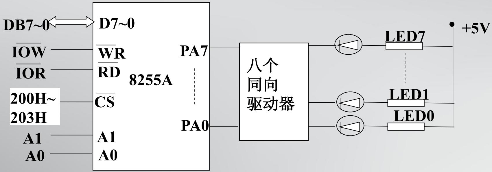

# 《微型计算机接口技术》期末复习资料

原件经识别和整理；“参考解答”是我们补的。

## 考试基本信息

考试时间：2021年1月5日（10:25–12:15）

- 选择题（每空 2 分，共 20 分）
- 填空题（每空 1 分，共 20 分）
- 简答题（4 题，共 20 分）
- 综合应用题（3 题，共 40 分）

涵盖第五章到第十一章的基础知识点，考察重点为 8250、8254、8255、8259。

## 基础知识点分布

### 第五、六章

- 系统的三大总线
- 存储器扩展技术

知识点：[总线的基本概念与分类（内部总线、系统总线、外部总线）](../../../topics/微机接口/zongxian-gainian.md)、[典型总线标准（ISA/AT总线、PCI总线引脚与特点）](../../../topics/微机接口/dianxing-zongxian.md)、[存储器的扩展方法（位扩展法、字扩展法）](../../../topics/微机接口/cunchu-kuozhan.md)

### 第七章

- 端口的定义、分类、编址方式
- IO 指令、端口的寻址方法
- 微机系统与外设的信息交换方式

知识点：[端口的概念与分类（数据端口、状态端口、控制端口）](../../../topics/微机接口/duankou-gainian.md)、[端口的编址方式（统一编址与独立编址）](../../../topics/微机接口/duankou-bianzhi.md)、[最常用的I/O指令（IN、OUT的直接寻址与DX间址）](../../../topics/微机接口/io-zhiling.md)

### 中断（8259）

- 中断的定义、中断源、中断分类
- 中断类型码、中断向量
- 中断指令（CLI、STI、INT、IRET）
- CPU 响应中断的过程、条件
- 软件中断和硬件中断的区别
- 8259A 中断控制器处理中断的过程
- 日时钟中断、用户中断

知识点：[处理器控制指令（STI、CLI、HLT、NOP等）](../../../topics/微机接口/chuli-kongzhi.md)、[微机系统与I/O端口的信息交换方式（无条件、查询、中断、DMA）](../../../topics/微机接口/xinxi-jiaohuan.md)、[接口电路的作用和基本功能](../../../topics/微机接口/jiekou-gongneng.md)

### 8250

- 串行通信的数据传输方式和特点
- RS232C 电平与 TTL 电平
- 查询接收与查询发送过程
- 串行异步通信标准数据帧格式
- 数据传输速率
- 中断类型与优先级

知识点：[微机系统与I/O端口的信息交换方式（无条件、查询、中断、DMA）](../../../topics/微机接口/xinxi-jiaohuan.md)、[查询方式输入输出编程模式与流程](../../../topics/微机接口/chaxun-fangshi.md)、[端口的概念与分类（数据端口、状态端口、控制端口）](../../../topics/微机接口/duankou-gainian.md)

### 8255

- 3 个数据口与 3 种工作方式
- 基本型输入输出
- 选通型输入输出（查询和中断两种方式）

知识点：[接口电路的作用和基本功能](../../../topics/微机接口/jiekou-gongneng.md)、[微机系统与I/O端口的信息交换方式（无条件、查询、中断、DMA）](../../../topics/微机接口/xinxi-jiaohuan.md)、[端口的编址方式（统一编址与独立编址）](../../../topics/微机接口/duankou-bianzhi.md)

### 8254

- 计数器（3、16、6）
- 初值的计算方法、设置方法
- 方式二和方式三
- 启动方式
- PC 机中三个计数器的作用

## 选择题

知识点：[接口电路的作用和基本功能](../../../topics/微机接口/jiekou-gongneng.md)、[端口的编址方式（统一编址与独立编址）](../../../topics/微机接口/duankou-bianzhi.md)、[最常用的I/O指令（IN、OUT的直接寻址与DX间址）](../../../topics/微机接口/io-zhiling.md)

### 选择 1

设 8254 计数器 1 工作于方式 3，输入时钟为 1000Hz，计数初值为 10H，采用二进制计数方式，则一个周期内计数器 1 输出信号的高电平和低电平分别为 1/125 和 1/125 秒。

知识点：[接口电路的作用和基本功能](../../../topics/微机接口/jiekou-gongneng.md)、[典型总线标准（ISA/AT总线、PCI总线引脚与特点）](../../../topics/微机接口/dianxing-zongxian.md)、[微机系统与I/O端口的信息交换方式（无条件、查询、中断、DMA）](../../../topics/微机接口/xinxi-jiaohuan.md)

### 选择 2

CPU 执行 IRET 指令后，从栈顶弹出 6 字节数据，分别赋给 IP、CS 和 FLAGS。

知识点：[堆栈的概念及SP指针操作](../../../topics/微机接口/duizhan-caozuo.md)、[80486/8086基本结构寄存器（通用、段、控制寄存器）](../../../topics/微机接口/jiben-jicunqi.md)、[转移指令（JMP、条件转移、CALL、RET）](../../../topics/微机接口/zhuanyi-zhiling.md)

### 选择 3

实模式下，从内存地址 0000H:0048H 开始的连续 4 个单元中存放的内容为 00H、38H、30H、50H，则该地址所对应的中断类型码为 12H，该中断所对应的中断服务子程序的入口地址为 53B00H。

知识点：[实地址模式下物理地址的形成（段基址×10H+偏移量）](../../../topics/微机接口/wuli-dizhi.md)、[存储单元和存储器地址的概念](../../../topics/微机接口/cunchu-danyuan.md)、[真值数与补码的相互转换及补码计算](../../../topics/微机接口/zhenzhi-buma.md)

### 选择 4

主 8259A 的中断源，其中断服务程序结束，执行 IRET 指令之前，应向主 8259A 的口地址 20H 中写一个常规中断结束命令字 20H。

知识点：[接口电路的作用和基本功能](../../../topics/微机接口/jiekou-gongneng.md)、[微机系统与I/O端口的信息交换方式（无条件、查询、中断、DMA）](../../../topics/微机接口/xinxi-jiaohuan.md)、[处理器控制指令（STI、CLI、HLT、NOP等）](../../../topics/微机接口/chuli-kongzhi.md)

### 选择 5

8255A 的 B 口初始化定义为选通型（方式 1）输入，对 8255A 采用查询方式，必须先查询 IBF；若采用中断方式，必须先置 PC2 为“1”，并且利用 PC0 作为中断请求信号线。

知识点：[接口电路的作用和基本功能](../../../topics/微机接口/jiekou-gongneng.md)、[端口的编址方式（统一编址与独立编址）](../../../topics/微机接口/duankou-bianzhi.md)

### 选择 6

有若干片 1K×8 位的 SRAM 芯片，采用字扩展方法构成 4KB 存储器，问：需要 4 片 SRAM？该存储器需要 12 根地址线？参与片选的地址位至少需要 2 位？

## 综合应用程序

知识点：[存储器的扩展方法（位扩展法、字扩展法）](../../../topics/微机接口/cunchu-kuozhan.md)、[存储器容量的表示方法](../../../topics/微机接口/cunchu-rongliang.md)、[存储器地址译码电路设计（线选法、全译码法、部分译码法）](../../../topics/微机接口/dizhi-yima.md)

### 综合 1（8250）

- 8250 初始化
- 8250 的查询发送与接收

知识点：[端口的概念与分类（数据端口、状态端口、控制端口）](../../../topics/微机接口/duankou-gainian.md)、[80486/8086的寻址方式（立即、寄存器、直接、间接、变址等）](../../../topics/微机接口/xunzhi-fangshi.md)、[最常用的I/O指令（IN、OUT的直接寻址与DX间址）](../../../topics/微机接口/io-zhiling.md)

### 综合 2（8254）

- 8254 初始化程序

知识点：[接口电路的作用和基本功能](../../../topics/微机接口/jiekou-gongneng.md)、[端口的编址方式（统一编址与独立编址）](../../../topics/微机接口/duankou-bianzhi.md)、[最常用的I/O指令（IN、OUT的直接寻址与DX间址）](../../../topics/微机接口/io-zhiling.md)

### 综合 3（8255）

- 8255 初始化程序

知识点：[接口电路的作用和基本功能](../../../topics/微机接口/jiekou-gongneng.md)、[端口的编址方式（统一编址与独立编址）](../../../topics/微机接口/duankou-bianzhi.md)、[最常用的I/O指令（IN、OUT的直接寻址与DX间址）](../../../topics/微机接口/io-zhiling.md)

### 综合 4（8259）

- 开放用户中断
- 给 8259 写结束命令字
- 中断向量的置换（读出、写入、恢复）
- 熟悉日时钟中断与用户中断的中断向量

知识点：[标志寄存器中的状态标志位与控制标志位](../../../topics/微机接口/zhuangtai-biaozhi.md)、[DOS功能调用与BIOS中断功能调用（INT 21H、INT 10H等）](../../../topics/微机接口/dos-bios-diaoyong.md)、[80486/8086的寻址方式（立即、寄存器、直接、间接、变址等）](../../../topics/微机接口/xunzhi-fangshi.md)

### 综合 5

系统机外扩一片 8255A 及相应电路如下图所示，外扩 8255A 的端口地址为 200H~203H，现利用系统机的日时钟外扩 1CH 型中断，实现每隔 1s 使八个发光二极管同时闪烁一次，主机键盘有按键按下时结束，返回 DOS 操作系统。根据要求完成相关内容。



#### 问题 (1)

从图可以分析出，A 口工作在方式 0 的输出（入/出）。

#### 问题 (2)

假设 8255A 的 A 口工作在方式 1 的查询输出方式，编写 8255A 的初始化子程序 I8255。

```asm
I8255A  PROC
        MOV     DX, 203H
        MOV     AL, 10100000B
        OUT     DX, AL          ; 写入工作方式字
        MOV     AL, 00001100B
        OUT     DX, AL
        RET
I8255   ENDP
```

知识点：[接口电路的作用和基本功能](../../../topics/微机接口/jiekou-gongneng.md)、[端口的编址方式（统一编址与独立编址）](../../../topics/微机接口/duankou-bianzhi.md)、[最常用的I/O指令（IN、OUT的直接寻址与DX间址）](../../../topics/微机接口/io-zhiling.md)

### 综合 6

阅读以下程序并完成填空。

```asm
I8255   PROC
        MOV     DX, 31BH
        MOV     AL, 97H
        OUT     DX, AL
        MOV     AL, 05H
        OUT     DX, AL
        RET
I8255   ENDP
```

#### 问题 (1)

这片 8255A 的 A 口地址为 318H，控制口的地址为 31BH。程序功能是定义这片 8255A 的 A 口工作在方式 0 输入（填写工作方式，以及是输入还是输出），B 口工作在方式 1 输入（填写工作方式，以及是输入还是输出）。

#### 问题 (2)

程序第 5 行写入 AL 中的是置 PC2 口为 1 命令字，其功能是使中断允许触发器置 1（填 1 或 0），从而确定 CPU 将采用中断方式（填查询或中断）完成数据的输入和输出。

知识点：[端口的编址方式（统一编址与独立编址）](../../../topics/微机接口/duankou-bianzhi.md)、[最常用的I/O指令（IN、OUT的直接寻址与DX间址）](../../../topics/微机接口/io-zhiling.md)、[接口电路的作用和基本功能](../../../topics/微机接口/jiekou-gongneng.md)

### 综合 7

A、B 两台 PC 机利用主串口进行点-点单工通信（不用联络线），发送采用查询方式，接收采用中断方式。一帧字符包含 7 个数据位，1 个停止位，1 个校验位，通信速率为 4800 波特（分频系数为 0018H）。

#### 问题 (1)

下图是 A、B 两机的 RS-232C 接口示意图，根据题意完成连线（不可有多余连线）。

$$
\begin{array}{c} \framebox{2} \\ 3 \\ 4 \\ 5 \\ 6 \\ 20 \\ 7 \end{array}
$$

$$
\begin{array}{c} \framebox{2} \\ 3 \\ 4 \\ 5 \\ 6 \\ 20 \\ 7 \end{array}
$$

#### 问题 (2)

下图是从 PC 机的 RS-232C 接口引脚观察到的波形，所传送字符的 16 进制 ASCII 码是 46H；该帧数据采用的奇偶校验方式是奇校验；传送该帧数据需要的时间是 1/480。

传送方向

#### 问题 (3)

用对端口直接编程的方法为接收方编写 8250 初始化子程序。

```asm
I8250   PROC
        MOV     DX, 3FBH
        MOV     AL, 80H
        OUT     DX, AL          ; 寻址位置 1
        MOV     DX, 3F9H
        MOV     AL, 00H
        OUT     DX, AL          ; 写除数高 8 位
        MOV     DX, 3F8H
        MOV     AL, 18H
        OUT     DX, AL          ; 写除数低 8 位
```

```asm
        MOV     DX, 3FBH
        MOV     AL, 0AH
        OUT     DX, AL
        MOV     DX, 3F9H
        MOV     AL, 01H
        OUT     DX, AL
        MOV     DX, 3FCH
        MOV     AL, 08H
        OUT     DX, AL
        RET
        ENDP
```

知识点：[最常用的I/O指令（IN、OUT的直接寻址与DX间址）](../../../topics/微机接口/io-zhiling.md)、[微机系统与I/O端口的信息交换方式（无条件、查询、中断、DMA）](../../../topics/微机接口/xinxi-jiaohuan.md)、[端口的编址方式（统一编址与独立编址）](../../../topics/微机接口/duankou-bianzhi.md)

### 综合 8

假设微机系统外扩了如下的一个“单脉冲发生器”，该“单脉冲发生器”电路受一个自复开关 K 的控制，每按一次 K，该电路输出一个正脉冲，输入到系统机从 8259A 的 IR1 作为外部中断请求。

要求：每按一次 K，屏幕上显示一行字符串“Welcome!”。主机键盘按任意键，程序结束，返回 DOS。

编写开放 8259A 和中断向量置换程序。


```asm
WRITE0A PROC
        PUSH    DS
        MOV     AX, CODE
        MOV     DS, AX
        MOV     DX, OFFSET SERVICE
        MOV     AX, 250AH
        INT     21H
        POP     DS
        RET
WRITE0A ENDP

I8259A  PROC
        IN      AL, 21H
        AND     AL, 11111011B
        OUT     21H, AL
        IN      AL, 0A1H
        AND     AL, 11111101B
        OUT     0A1H, AL
        RET
I8259A  ENDP
CODE    ENDS
        END     BEG
```

知识点：[实地址模式下物理地址的形成（段基址×10H+偏移量）](../../../topics/微机接口/wuli-dizhi.md)、[最常用的I/O指令（IN、OUT的直接寻址与DX间址）](../../../topics/微机接口/io-zhiling.md)

### 综合 9

设 PC 系统机外扩了一片 8254 及相应的实验电路。8254 口地址为 200H~203H，设 CLK0 已接至 8MHz 时钟，为了能从 OUT0 输出 4KHz 的方波，编写了 8254 初始化程序，其中假设 0 号定时计数器工作在二进制方式。

```asm
I8254   PROC
        MOV     DX, 203H
        MOV     AL, 00110110B
        OUT     DX, AL
        MOV     DX, 200H
        MOV     AX, 2000
        OUT     DX, AL
        MOV     AL, AH
        OUT     DX, AL
        RET
I8254   ENDP
```

祝同学们心想事成、寒假愉快！

知识点：[80486/8086的寻址方式（立即、寄存器、直接、间接、变址等）](../../../topics/微机接口/xunzhi-fangshi.md)、[数据传送指令（MOV、PUSH、POP、XCHG等）](../../../topics/微机接口/shuju-chuansong.md)、[最常用的I/O指令（IN、OUT的直接寻址与DX间址）](../../../topics/微机接口/io-zhiling.md)
