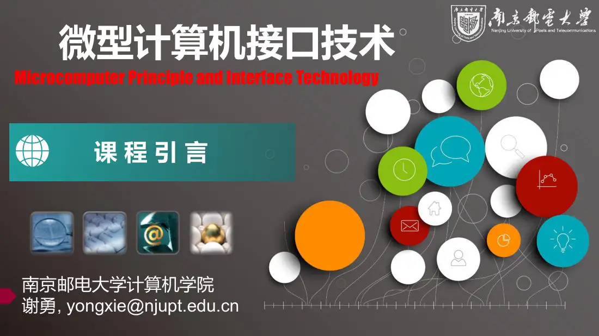
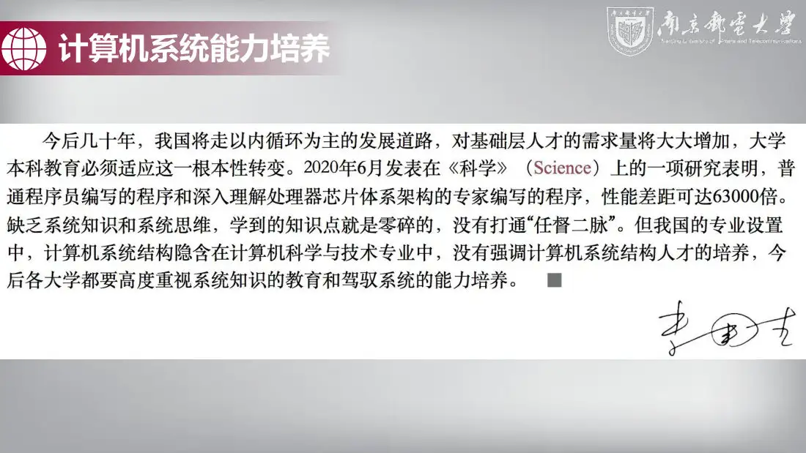
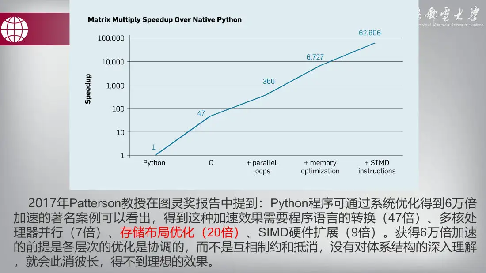
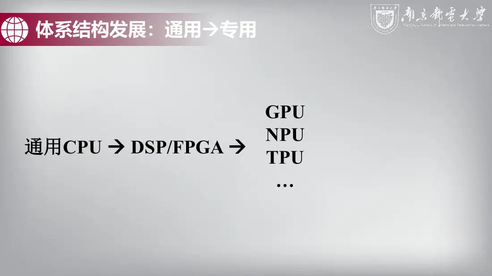
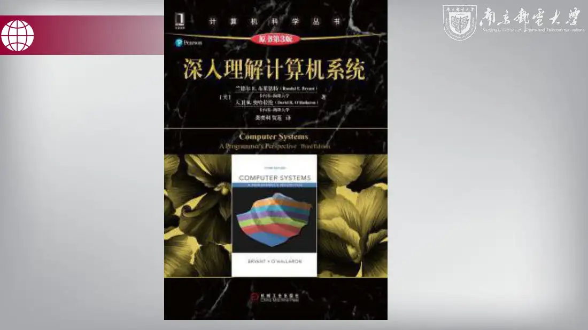
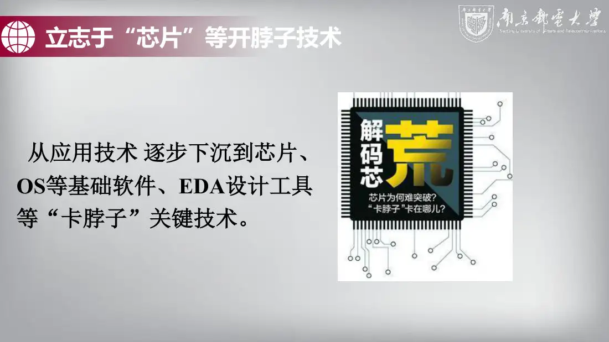
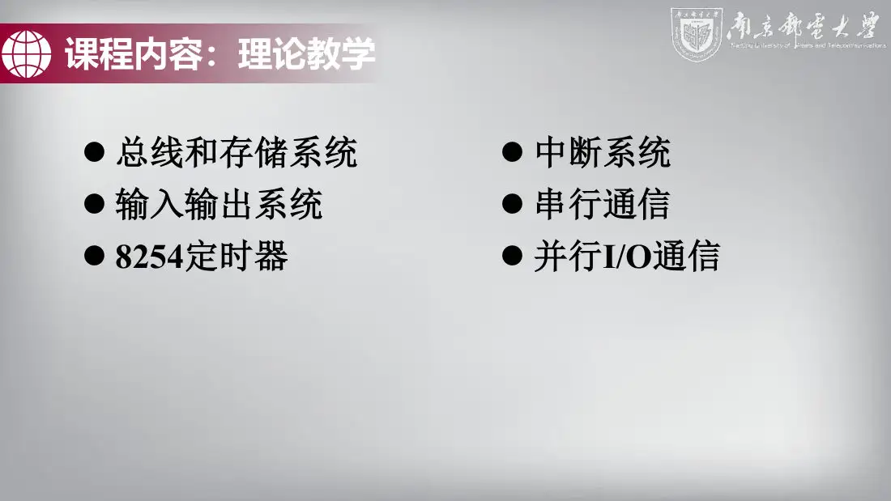
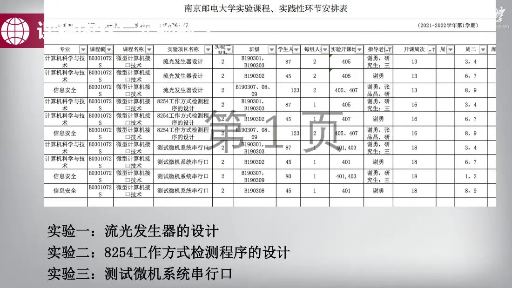
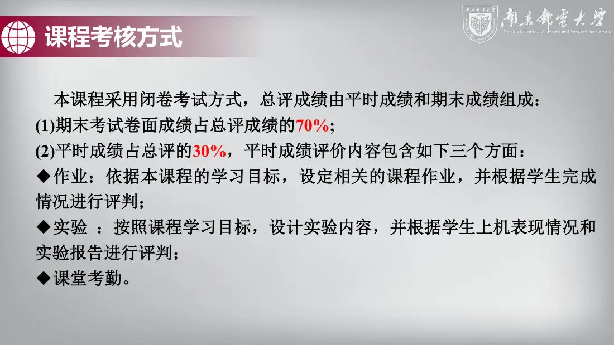

# 《微型计算机接口技术》第0章 课程介绍（课件）

原件的每一页，下面附识别出的文字。

### 课程引言

原文：

微型计算机接口技术 Microcomputer Principle and Interface Technology

课程引言

The image contains four distinct icons: a magnifying glass over a globe, a keyboard with 'i' and 'e', an @ symbol, and a golden coin-shaped object. There are no text or numerical data present. Therefore, the correct OCR output is an empty string.

(No text to output)

南京邮电大学计算机学院
谢勇, yongxie@njupt.edu.cn

南京邮电大学
1500-039
Nanjing University of Posts and Telecommunications
南京邮电大学
Nanjing University of Posts and Telecommunications

### 李志

原文：

今后几十年, 我国将走以内循环为主的发展道路, 对基础层人才的需求量将大大增加, 大学本科教育必须适应这一根本性转变。2020年6月发表在《科学》（Science）上的一项研究表明, 普通程序员编写的程序和深入理解处理器芯片体系架构的专家编写的程序, 性能差距可达63000倍。缺乏系统知识和系统思维, 学到的知识点就是零碎的, 没有打通“任督二脉”。但我国的专业设置中, 计算机系统结构隐含在计算机科学与技术专业中, 没有强调计算机系统结构人才的培养, 今后各大学都要高度重视系统知识的教育和驾驭系统的能力培养。

李志

计算机系统能力培养

南京邮电大学
Nanjing University of Posts and Telecommunications

### 郵電大學

原文：

2017年Patterson教授在图灵奖报告中提到：Python程序可通过系统优化得到6万倍加速的著名案例可以看出，得到这种加速效果需要程序语言的转换（47倍）、多核处理器并行（7倍）、存储布局优化（20倍）、SIMD硬件扩展（9倍）。获得6万倍加速的前提是各层次的优化是协调的，而不是互相制约和抵消，没有对体系结构的深入理解，就会此消彼长，得不到理想的效果。

郵電大學
University of Posts and Telecommunications

Matrix Multiply Speedup Over Native Python

### 通用CPU → DSP/FPGA → GPU NPU TPU

原文：

通用CPU → DSP/FPGA → GPU NPU TPU

体系结构发展：通用→专用

南京邮电大学
150-8326
南京邮电大学
Nanjing University of Posts and Telecommunications

### 南京邮电大学

原文：

南京邮电大学
Nanjing University of Posts and Telecommunications

### 立志于“芯片”等开脖子技术

原文：

立志于“芯片”等开脖子技术

从应用技术逐步下沉到芯片、OS等基础软件、EDA设计工具等“卡脖子”关键技术。

南京邮电大学
150-8326
Nanjing University of Posts and Telecommunications
南京邮電大學

### \- 总线和存储系统

原文：

\- 总线和存储系统

\- 输入输出系统

● 8254定时器

\- 中断系统

\- 串行通信

\- 并行I/O通信

课程内容：理论教学

南京邮电大学
Nanjing University of Posts and Telecommunications

### 实验一：流光发生器的设计

原文：

<table><tr><td>专业</td><td>课程编</td><td>课程名称</td><td>实验项目名称</td><td>实验时数</td><td>班级</td><td>学生人</td><td>每组人</td><td>实验开课地</td><td>指导老师</td><td>开课周次</td><td>周</td><td>周二</td><td>周</td></tr><tr><td>计算机科学与技术</td><td>B0301072S</td><td>微型计算机接口技术</td><td>流光发生器设计</td><td>2</td><td>B190301,B190303</td><td>87</td><td>2</td><td>405</td><td>谢勇,研究生:王</td><td>13</td><td></td><td>3,4</td><td></td></tr><tr><td>计算机科学与技术</td><td>B0301072S</td><td>微型计算机接口技术</td><td>流光发生器设计</td><td>2</td><td>B190302</td><td>45</td><td>2</td><td>405</td><td>谢勇</td><td>13</td><td></td><td>6,7</td><td></td></tr><tr><td>信息安全</td><td>B0301072S</td><td>微型计算机接口技术</td><td>流光发生器设计</td><td>2</td><td>B190307、08、09</td><td>123</td><td>2</td><td>405、407</td><td>谢勇,张品昌,研</td><td>13</td><td></td><td>8,9</td><td></td></tr><tr><td>计算机科学与技术</td><td>B0301072S</td><td>微型计算机接口技术</td><td>8254工作方式检测程序的设计</td><td>2</td><td>B190301,B190303</td><td>87</td><td>1</td><td>405</td><td>谢勇,研究生:王</td><td>16</td><td></td><td>3,4</td><td></td></tr><tr><td>计算机科学与技术</td><td>B0301072S</td><td>微型计算机接口技术</td><td>8254工作方式检测程序的设计</td><td>2</td><td>B190302</td><td>45</td><td>1</td><td>407</td><td>谢勇</td><td>16</td><td></td><td>6,7</td><td></td></tr><tr><td>信息安全</td><td>B0301072S</td><td>微型计算机接口技术</td><td>8254工作方式检测程序的设计</td><td>2</td><td>B190307、08、09</td><td>123</td><td>2</td><td>405、407</td><td>谢勇,张品昌,研</td><td>16</td><td></td><td>8,9</td><td></td></tr><tr><td>计算机科学与技术</td><td>B0301072S</td><td>微型计算机接口技术</td><td>测试微机系统串行口</td><td>2</td><td>B190301,B190303</td><td>87</td><td>1</td><td>401,403</td><td>谢勇,研究生:王</td><td>18</td><td></td><td>3,4</td><td></td></tr><tr><td>计算机科学与技术</td><td>B0301072S</td><td>微型计算机接口技术</td><td>测试微机系统串行口</td><td>2</td><td>B190302</td><td>45</td><td>1</td><td>401</td><td>谢勇</td><td>18</td><td></td><td>6,7</td><td></td></tr><tr><td>信息安全</td><td>B0301072S</td><td>微型计算机接口技术</td><td>测试微机系统串行口</td><td>2</td><td>B190307,B190309</td><td>80</td><td>1</td><td>401,403</td><td>谢勇,研究生:王</td><td>18</td><td></td><td>1,2</td><td></td></tr><tr><td>信息安全</td><td>B0301072S</td><td>微型计算机接口技术</td><td>测试微机系统串行口</td><td>2</td><td>B190308</td><td>45</td><td>1</td><td>401</td><td>谢勇</td><td>18</td><td></td><td>8,9</td><td></td></tr><tr><td></td><td></td><td></td><td></td><td></td><td></td><td></td><td></td><td></td><td></td><td></td><td></td><td></td><td></td></tr></table>

实验一：流光发生器的设计

实验二：8254工作方式检测程序的设计

实验三：测试微机系统串行口

设

南京邮电大学实验课程、实践性环节安排表

(2021-2022学年第1学期)

### 本课程采用闭卷考试方式，总评成绩由平时成绩和期末成绩组成：

原文：

本课程采用闭卷考试方式，总评成绩由平时成绩和期末成绩组成：

(1)期末考试卷面成绩占总评成绩的70%;

(2)平时成绩占总评的 $30\%$ ，平时成绩评价内容包含如下三个方面：

◆作业：依据本课程的学习目标，设定相关的课程作业，并根据学生完成情况进行评判；

◆实验：按照课程学习目标，设计实验内容，并根据学生上机表现情况和实验报告进行评判；

◆课堂考勤。

课程考核方式

南京邮电大学
T105-0316
南京邮电大学
Nanjing University of Posts and Telecommunications
