# 《微型计算机接口技术》第10章 并行I/O接口（课件）

原件的每一页，下面附识别出的文字。

### 第10章 并行I/O接口

原文：

第10章 并行I/O接口

### 1、串行通信基础：

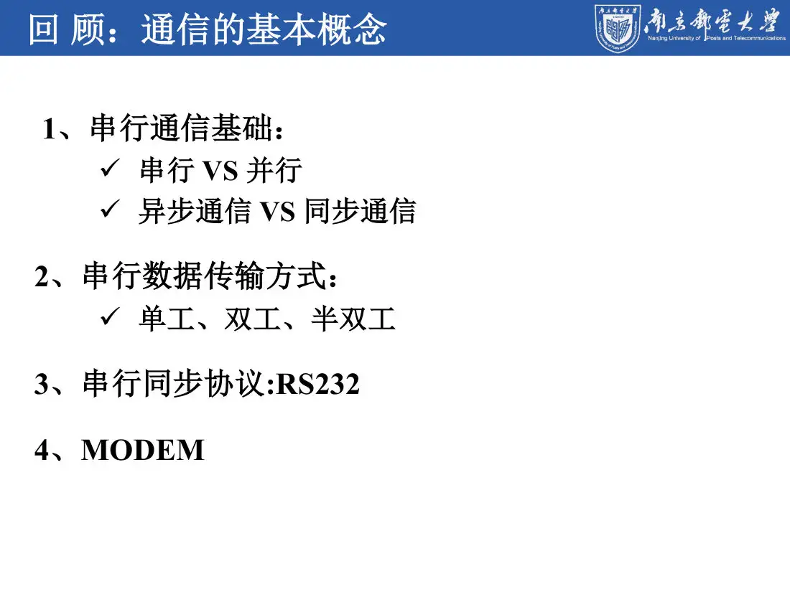

原文：

1、串行通信基础：

✓ 串行 VS 并行

✓ 异步通信 VS 同步通信

2、串行数据传输方式：

✓ 单工、双工、半双工

3、串行同步协议:RS232

4、MODEM

9.1 回串行通信基础顾： 的基本概念

南立都電大学 南京郵電大学 G Nanjing University of Posts and Telecommunications

### 1、8250内部结构和引脚

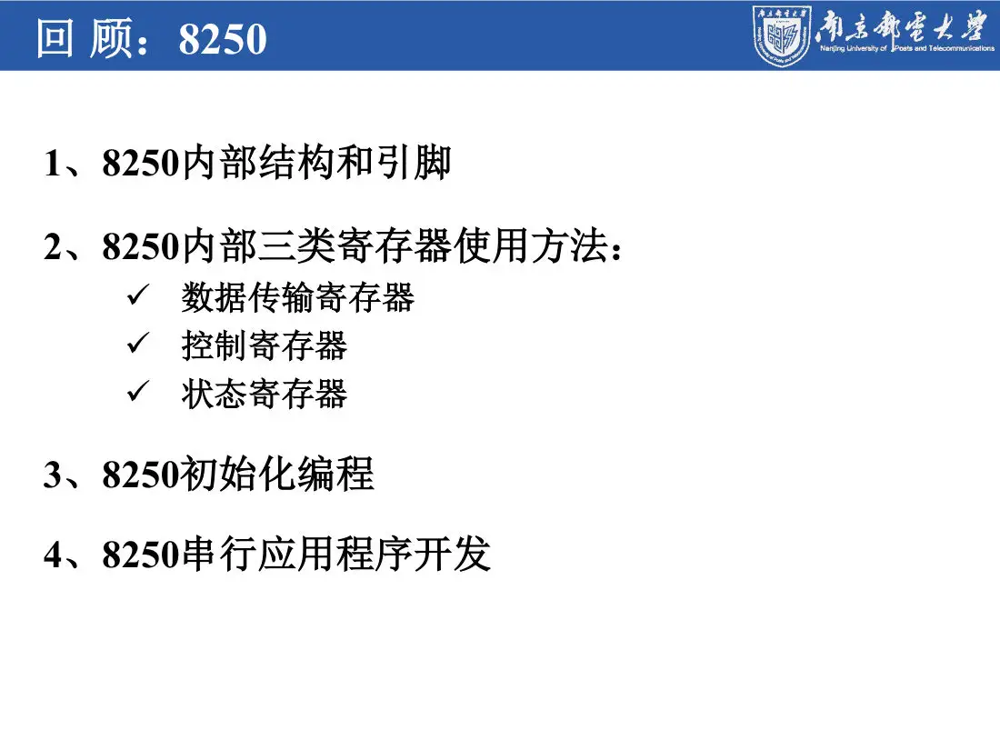

原文：

1、8250内部结构和引脚

2、8250内部三类寄存器使用方法：

✓ 数据传输寄存器

✓ 控制寄存器

✓ 状态寄存器

3、8250初始化编程

4、8250串行应用程序开发

回 顾：8250

南立部電大学 南京郵電大学 Nanjing University of Posts and Telecommunications

### 并行通信：构成一个字符或数据的所有位同时被传输

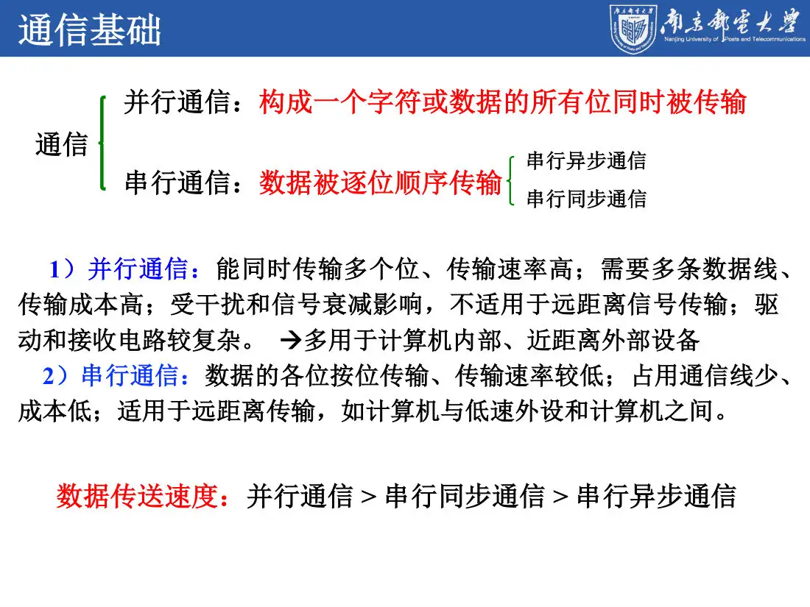

原文：

并行通信：构成一个字符或数据的所有位同时被传输

通信

串行通信：数据被逐位顺序传输

串行异步通信

串行同步通信

1）并行通信：能同时传输多个位、传输速率高；需要多条数据线、传输成本高；受干扰和信号衰减影响，不适用于远距离信号传输；驱动和接收电路较复杂。 →多用于计算机内部、近距离外部设备

2）串行通信：数据的各位按位传输、传输速率较低；占用通信线少、成本低；适用于远距离传输，如计算机与低速外设和计算机之间。

数据传送速度：并行通信 > 串行同步通信 > 串行异步通信

通信基础

南立都電大学 南京郵電大学 NaringU Nanjing University of Posts and Telecommunications

### 并行通信接口应具有如下几个功能：

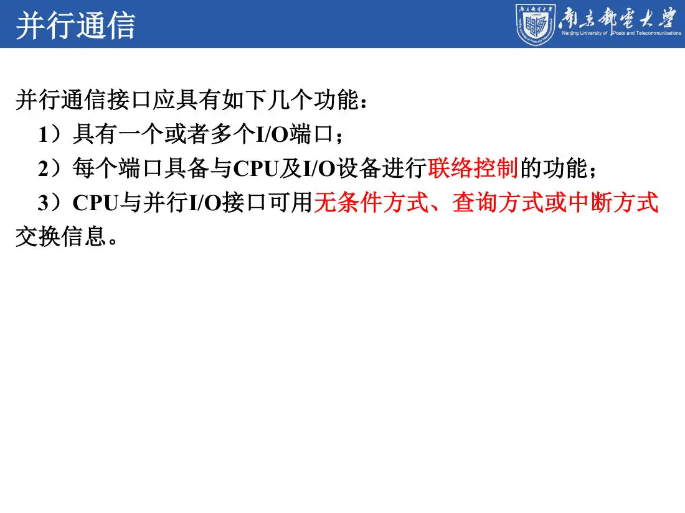

原文：

并行通信接口应具有如下几个功能：

1）具有一个或者多个I/O端口；

2）每个端口具备与CPU及I/O设备进行联络控制的功能；

3）CPU与并行I/O接口可用无条件方式、查询方式或中断方式交换信息。

并行通信

南立都電大学 南京郵電大学 Nanjing University of Posts and Telecommunications

### 可编程并行I/O接口芯片8255A

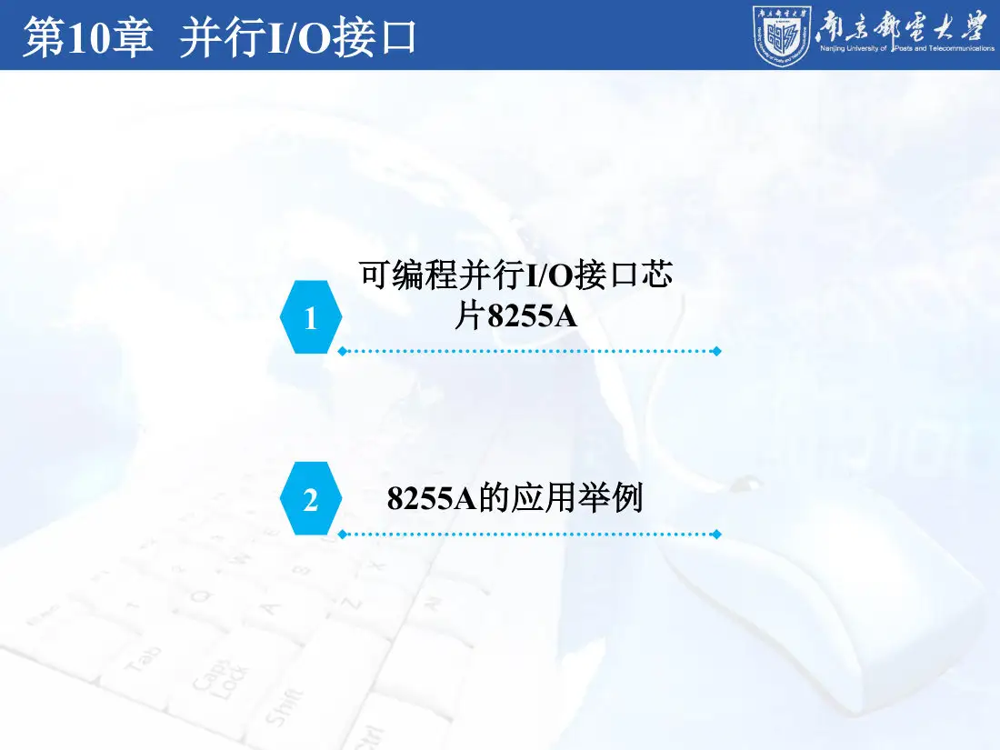

原文：

1

可编程并行I/O接口芯片8255A

2 8255A的应用举例

第10章 并行I/O接口

南立郵電大學 南京郵電大学 Nargng Ur GQ Nanjing University ofPosts and Telecommunication

### 一、8255A的内部结构及外部引脚

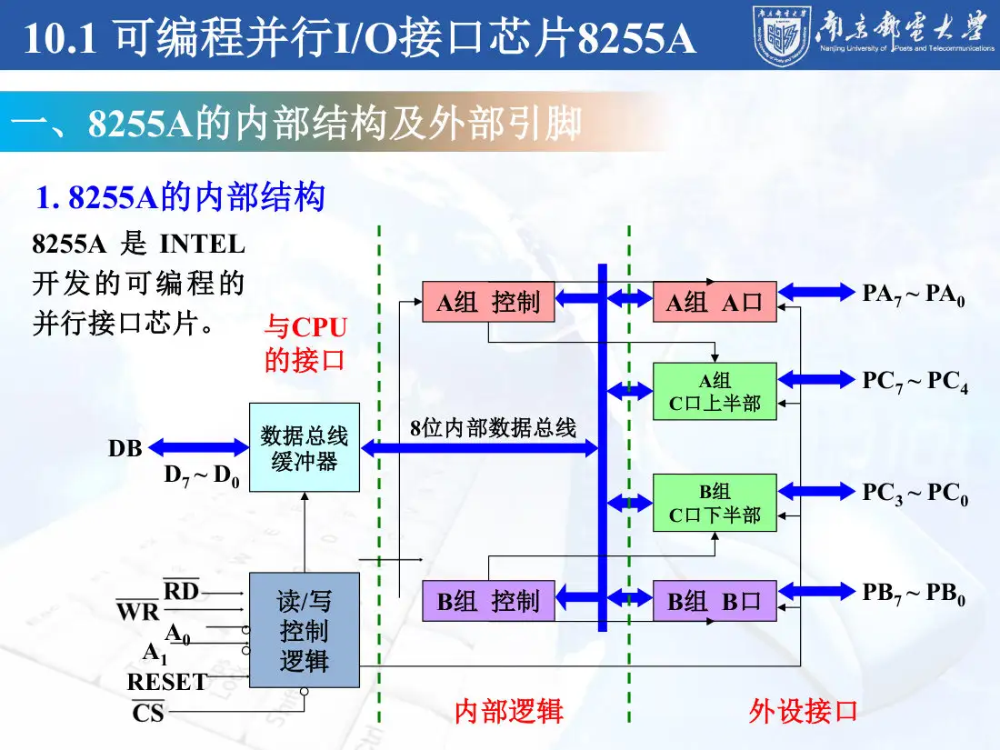

原文：

一、8255A的内部结构及外部引脚

1. 8255A的内部结构

8255A 是 INTEL开发的可编程的并行接口芯片。

10.1 可编程并行I/O接口芯片8255A

南立郵電大學 南京郵電大学 Nargng Ur GQ Nanjing University ofPosts and Telecommunication

### 一、8255A的内部结构及外部引脚

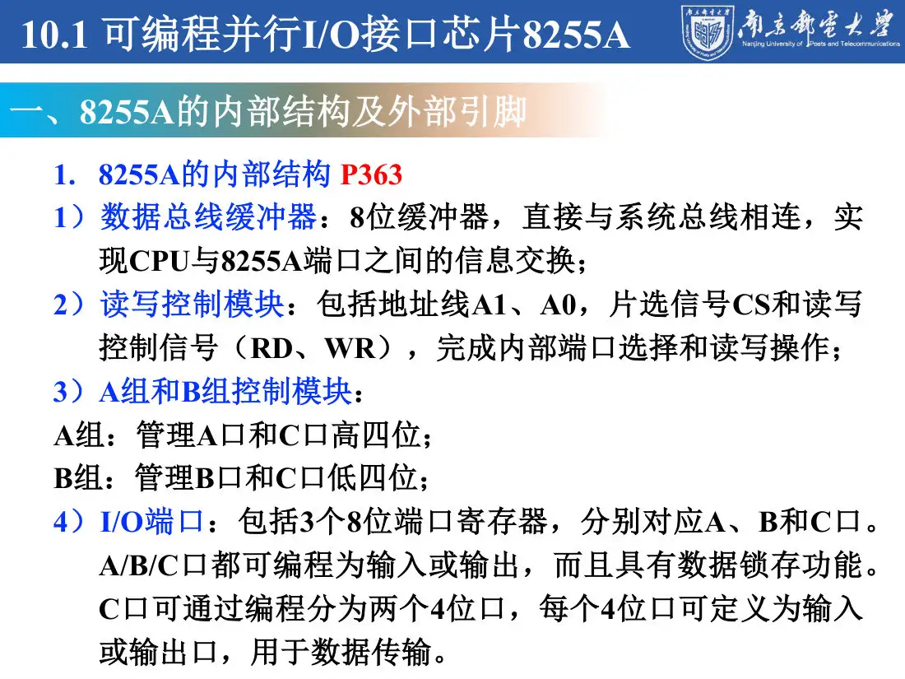

原文：

一、8255A的内部结构及外部引脚

1. 8255A的内部结构 P363

1）数据总线缓冲器：8位缓冲器，直接与系统总线相连，实现CPU与8255A端口之间的信息交换；

2）读写控制模块：包括地址线A1、A0，片选信号CS和读写控制信号（RD、WR），完成内部端口选择和读写操作；

3）A组和B组控制模块：

A组：管理A口和C口高四位；

B组：管理B口和C口低四位；

4）I/O端口：包括3个8位端口寄存器，分别对应A、B和C口。A/B/C口都可编程为输入或输出，而且具有数据锁存功能。C口可通过编程分为两个4位口，每个4位口可定义为输入或输出口，用于数据传输。

10.1 可编程并行I/O接口芯片8255A

南立郵電大學 南京郵電大学 Naring Un Nanjing University of Posts and Telecommunications

### 2. 8255A的外部引脚

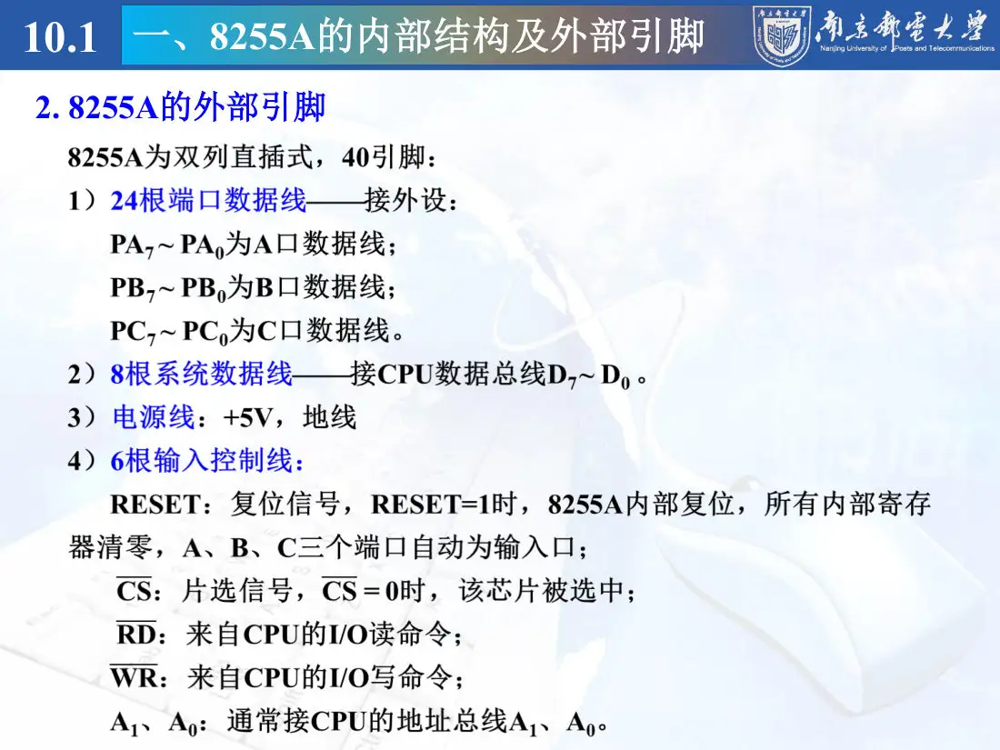

原文：

2. 8255A的外部引脚

8255A为双列直插式，40引脚：

1）24根端口数据线—接外设：

$\mathbf { P A _ { 7 } } \sim \mathbf { P A _ { 0 } }$ 为A口数据线；

$\mathbf { P B _ { 7 } } \sim \mathbf { P B _ { 0 } }$ 为B口数据线；

$\mathbf { P C _ { 7 } } \sim \mathbf { P C _ { 0 } }$ 为C口数据线。

2）8根系统数据线——接CPU数据总线 $\mathbf { D } _ { 7 } \sim \mathbf { D } _ { 0 }$ o

3）电源线：+5V，地线

4）6根输入控制线：

RESET：复位信号，RESET=1时，8255A内部复位，所有内部寄存器清零，A、B、C三个端口自动为输入口；

CS：片选信号， $\mathbf { \overline { { { C S } } } = 0 }$ 时，该芯片被选中；

RD：来自CPU的I/O读命令；

WR：来自CPU的I/O写命令；

$\mathbf { A _ { 1 } } \mathbf { \setminus } \mathbf { A _ { 0 } }$ ：通常接CPU的地址总线 $\mathbf { A _ { 1 } } \mathbf { \setminus } \mathbf { A _ { 0 } }$ o

10.1 一、8255A的内部结构及外部引脚

南志郵電大學 南京郵電大学 Naring Un G Nanjing University ofPosts and Telecommunication

### 3. 8255A的端口编址与读/写操作

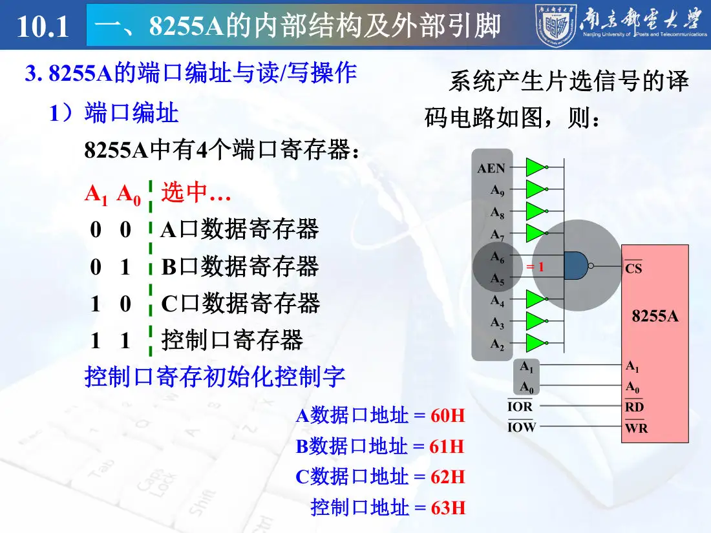

原文：

3. 8255A的端口编址与读/写操作

1）端口编址

8255A中有4个端口寄存器：

$\mathbf { A _ { 1 } } \mathbf { A _ { 0 } } \mathbf { \Sigma _ {  l } ^ { l } }$ 选中…

0 0 A口数据寄存器

0 1 B口数据寄存器

1 0 C口数据寄存器

1 1 控制口寄存器

控制口寄存初始化控制字

系统产生片选信号的译码电路如图，则：

A数据口地址 = 60H

B数据口地址 = 61H

C数据口地址 = 62H

控制口地址= 63H

10.1 一、8255A的内部结构及外部引脚

南志都電大学 南京郵電大学 Nanjing University ofPosts and Telecommunication

### 2）读/写操作

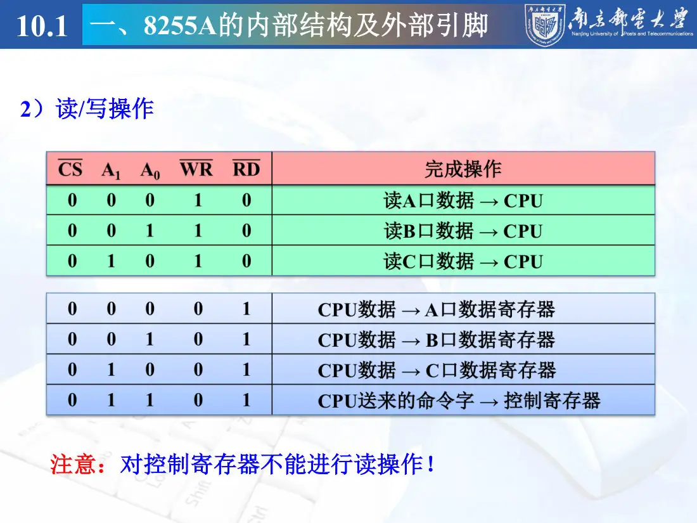

原文：

2）读/写操作

<table><tr><td> $\overline{CS}$ </td><td> $A_1$ </td><td> $A_0$ </td><td> $\overline{WR}$ </td><td> $\overline{RD}$ </td><td>完成操作</td></tr><tr><td>0</td><td>0</td><td>0</td><td>1</td><td>0</td><td>读A口数据 → CPU</td></tr><tr><td>0</td><td>0</td><td>1</td><td>1</td><td>0</td><td>读B口数据 → CPU</td></tr><tr><td>0</td><td>1</td><td>0</td><td>1</td><td>0</td><td>读C口数据 → CPU</td></tr><tr><td colspan="6"></td></tr><tr><td>0</td><td>0</td><td>0</td><td>0</td><td>1</td><td>CPU数据 → A口数据寄存器</td></tr><tr><td>0</td><td>0</td><td>1</td><td>0</td><td>1</td><td>CPU数据 → B口数据寄存器</td></tr><tr><td>0</td><td>1</td><td>0</td><td>0</td><td>1</td><td>CPU数据 → C口数据寄存器</td></tr><tr><td>0</td><td>1</td><td>1</td><td>0</td><td>1</td><td>CPU送来的命令字 → 控制寄存器</td></tr></table>

注意：对控制寄存器不能进行读操作！

10.1 一、8255A的内部结构及外部引脚

南志郵電大學 南京郵電大学 Naring Un G Nanjing University ofPosts and Telecommunication

### 二、8255A的工作方式简介

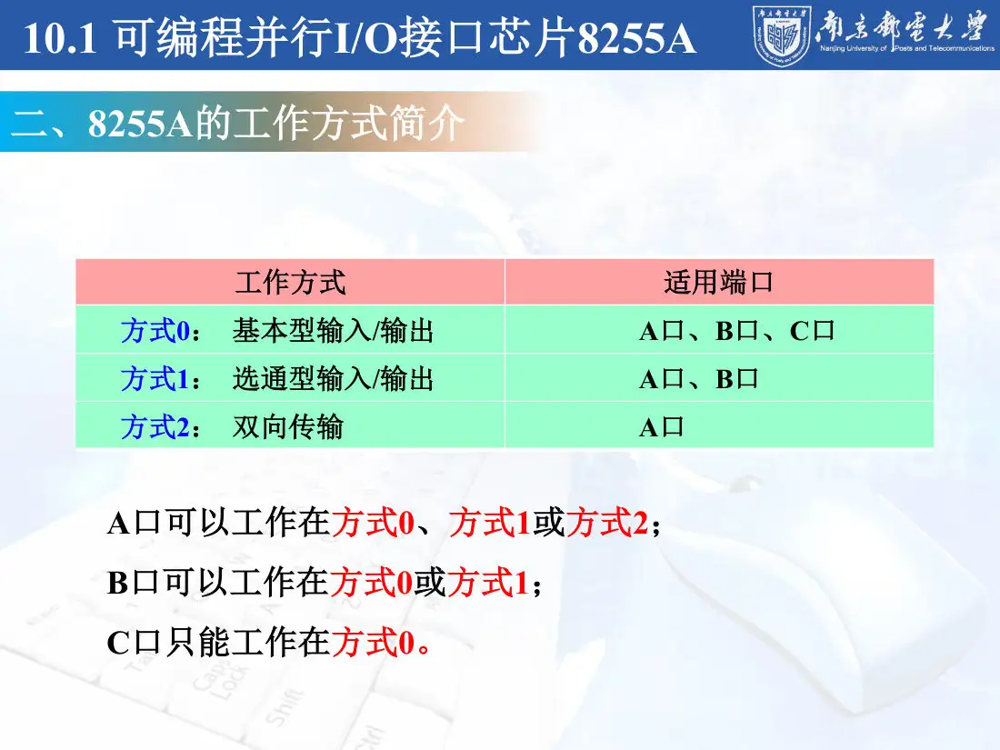

原文：

二、8255A的工作方式简介

<table><tr><td>工作方式</td><td>适用端口</td></tr><tr><td>方式0: 基本型输入/输出</td><td>A口、B口、C口</td></tr><tr><td>方式1: 选通型输入/输出</td><td>A口、B口</td></tr><tr><td>方式2: 双向传输</td><td>A口</td></tr></table>

A口可以工作在方式0、方式1或方式2；

B口可以工作在方式0或方式1；

C口只能工作在方式0。

10.1 可编程并行I/O接口芯片8255A

南立郵電大學 南京郵電大学 Nargng Ur GQ Nanjing University ofPosts and Telecommunication

### 什么是基本型输入？（以B口为例）

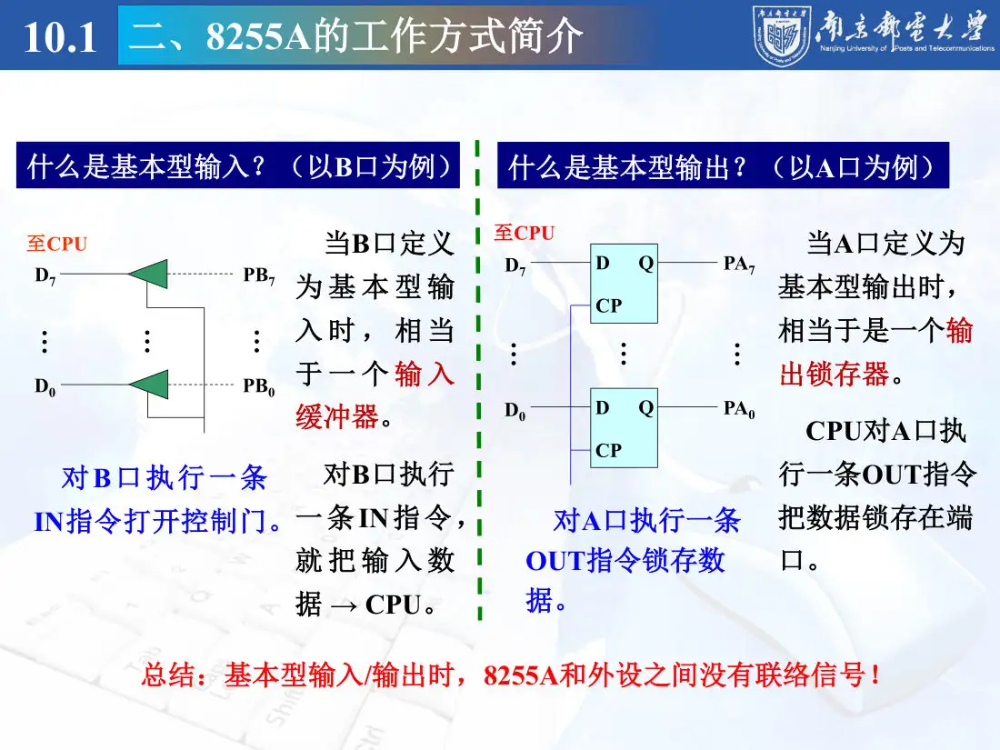

原文：

什么是基本型输入？（以B口为例）

当B口定义为 基 本 型 输入时，相当于一个输入缓冲器。

对B口执行一条 对B口执行一条IN指令，IN指令打开控制门。就 把 输 入 数据 → CPU。

什么是基本型输出？（以A口为例）

对A口执行一条OUT指令锁存数据。

当A口定义为基本型输出时，相当于是一个输出锁存器。

CPU对A口执行一条OUT指令把数据锁存在端口。

总结：基本型输入/输出时，8255A和外设之间没有联络信号！

10.1 二、8255A的工作方式简介

南立都電大学 南京郵電大学 Rarung Nanjing University ofPosts and Telecommunication

### 什么是选通型输入？（以A口为例）

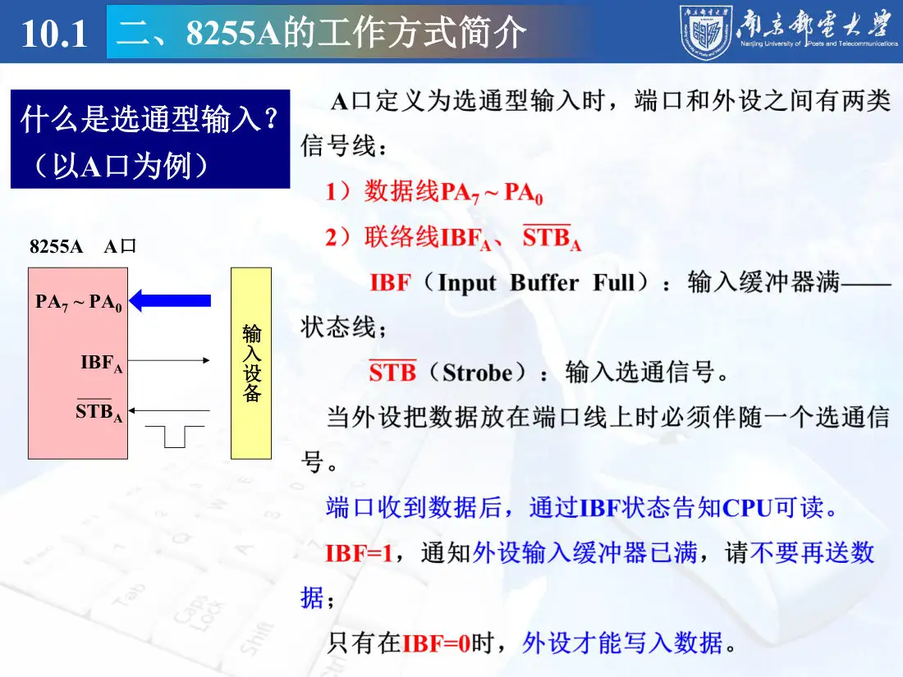

原文：

什么是选通型输入？（以A口为例）

A口定义为选通型输入时，端口和外设之间有两类信号线：

1）数据线 $\mathbf { P A } _ { 7 } \sim \mathbf { P A } _ { 0 }$

2）联络线 $\mathbf { I B F _ { A } } \cdot \mathbf { \sigma } \overline { { \mathbf { S T B } } } _ { \mathrm { A } }$

IBF（Input Buffer Full）：输入缓冲器满状态线；

STB（Strobe）：输入选通信号。

当外设把数据放在端口线上时必须伴随一个选通信号。

端口收到数据后，通过IBF状态告知CPU可读。

$\mathbf { I B F { = } 1 }$ ，通知外设输入缓冲器已满，请不要再送数据；

只有在 $\mathbf { I B F { = } 0 }$ 时，外设才能写入数据。

10.1 二、8255A的工作方式简介

南立都電大学 南京郵電大学 Rarung Nanjing University ofPosts and Telecommunication

### 什么是选通型输出？（以B口为例）

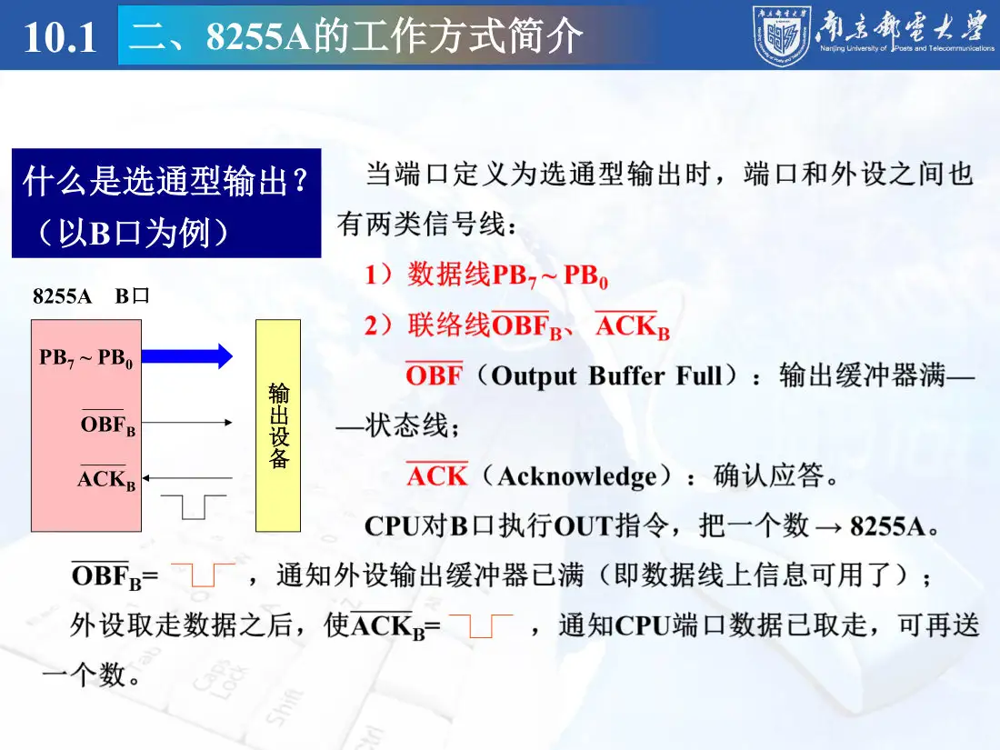

原文：

什么是选通型输出？（以B口为例）

8255A B口

当端口定义为选通型输出时，端口和外设之间也有两类信号线：

1）数据线 $\mathbf { P B } _ { 7 } \sim \mathbf { P B } _ { 0 }$

2）联络线 $\overline { { \mathbf { O B F _ { B } } } } , \overline { { \mathbf { A C K _ { B } } } }$

OBF（Output Buffer Full）：输出缓冲器满—一状态线；

ACK（Acknowledge）：确认应答。

CPU对B口执行OUT指令，把一个数→ 8255A。

$\overline { { { \bf O B F _ { B } } } } = \overline { { { \bf \Lambda } } }$ ，通知外设输出缓冲器已满（即数据线上信息可用了）；外设取走数据之后，使 $\overline { { \mathbf { A C K } } } _ { \ B { \ B } } = \overline { { \mathbf { \Lambda } } } \sqrt { \mathbf { \Lambda } }$ ，通知CPU端口数据已取走，可再送一个数。

10.1 二、8255A的工作方式简介

南立郵電大學 南京郵電大学 Nargng Ur GQ Nanjing University ofPosts and Telecommunication

### 三、8255A控制字与初始化编程

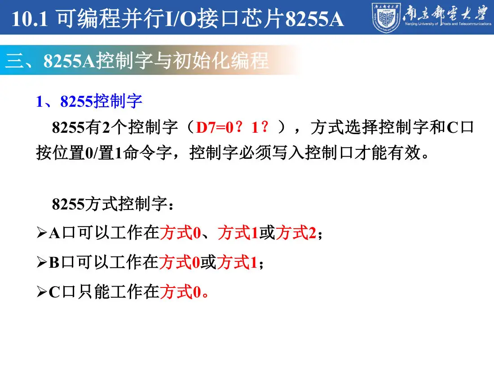

原文：

三、8255A控制字与初始化编程

1、8255控制字

8255有2个控制字（D7=0？1？），方式选择控制字和C口按位置0/置1命令字，控制字必须写入控制口才能有效。

8255方式控制字：

➢A口可以工作在方式0、方式1或方式2；

➢B口可以工作在方式0或方式1；

➢C口只能工作在方式0。

10.1 可编程并行I/O接口芯片8255A

南立郵電大學 南京郵電大学 Naring Un Nanjing University of Posts and Telecommunications

### 三、8255A控制字与初始化编程

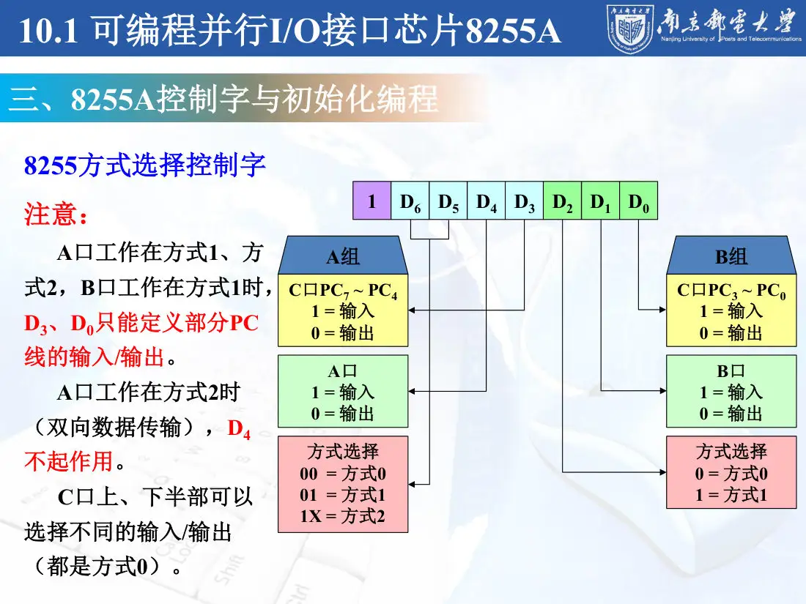

原文：

三、8255A控制字与初始化编程

8255方式选择控制字

注意：

A口工作在方式1、方式2，B口工作在方式1时，${ \bf D } _ { 3 }$ $\mathbf { D _ { 0 } }$ 只能定义部分PC线的输入/输出。

A口工作在方式2时（双向数据传输）， ${ \bf D } _ { 4 }$ 不起作用。

C口上、下半部可以选择不同的输入/输出（都是方式0）。

10.1 可编程并行I/O接口芯片8255A

南立郵電大學 南京郵電大学 Nargng Ur GQ Nanjing University ofPosts and Telecommunication

### 2）C口按位置0/置1控制字

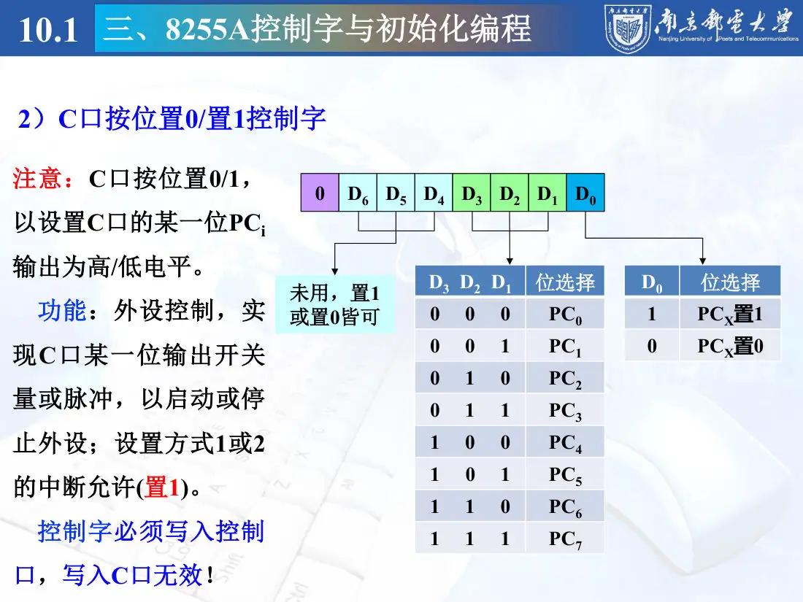

原文：

2）C口按位置0/置1控制字

注意：C口按位置0/1，以设置C口的某一位 $\mathbf { P C _ { i } }$ 输出为高/低电平。

功能：外设控制，实现C口某一位输出开关量或脉冲，以启动或停止外设；设置方式1或2的中断允许(置1)。

未用，置1或置0皆可

控制字必须写入控制口，写入C口无效！

$$
\mathbf {D} _ {6}
$$

$$
\mathbf {D _ {5}}
$$

$$
\mathbf {D} _ {4}
$$

$$
\mathbf {D} _ {3}
$$

$$
\mathbf {D} _ {2}
$$

$$
\mathbf {D} _ {1}
$$

$$
\mathbf {D _ {0}}
$$

<table><tr><td>D3</td><td>D2</td><td>D1</td><td>位选择</td></tr><tr><td>0</td><td>0</td><td>0</td><td>PC0</td></tr><tr><td>0</td><td>0</td><td>1</td><td>PC1</td></tr><tr><td>0</td><td>1</td><td>0</td><td>PC2</td></tr><tr><td>0</td><td>1</td><td>1</td><td>PC3</td></tr><tr><td>1</td><td>0</td><td>0</td><td>PC4</td></tr><tr><td>1</td><td>0</td><td>1</td><td>PC5</td></tr><tr><td>1</td><td>1</td><td>0</td><td>PC6</td></tr><tr><td>1</td><td>1</td><td>1</td><td>PC7</td></tr></table>

<table><tr><td>D0</td><td>位选择</td></tr><tr><td>1</td><td>PCx置1</td></tr><tr><td>0</td><td>PCx置0</td></tr></table>

10.1 三、8255A控制字与初始化编程

南立郵電大學 南京郵電大学 Nargng Ur GQ Nanjing University ofPosts and Telecommunication

### 2）C口按位置0/置1控制字

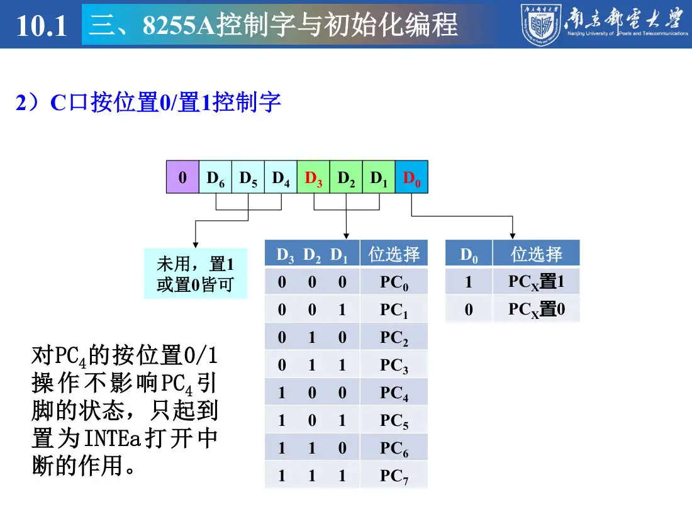

原文：

2）C口按位置0/置1控制字

对 $\mathrm { P C } _ { 4 }$ 的按位置 $0 / 1$ 操作不影响 $\mathrm { P C } _ { 4 }$ 引脚的状态，只起到置为INTEa打开中断的作用。

$$
\mathrm{D} _ {0}
$$

$$
\mathbf {P C _ {0}}
$$

$$
\mathbf {P C} _ {\mathbf {X}}
$$

$$
\mathbf {P C} _ {1}
$$

$$
\mathbf {P C} _ {\mathbf {X}}
$$

$$
\mathbf {P C} _ {2}
$$

$$
\mathbf {P C} _ {3}
$$

$$
\mathbf {P C} _ {4}
$$

$$
\mathrm{PC} _ {5}
$$

$$
\mathbf {P C} _ {6}
$$

$$
\mathbf {P C} _ {7}
$$

10.1 三、8255A控制字与初始化编程

南立郵電大學 南京郵電大学 Naring Un GG Nanjing University ofPosts and Telecommunication

### 2） C口按位置0/置1控制字→中断允许触发器

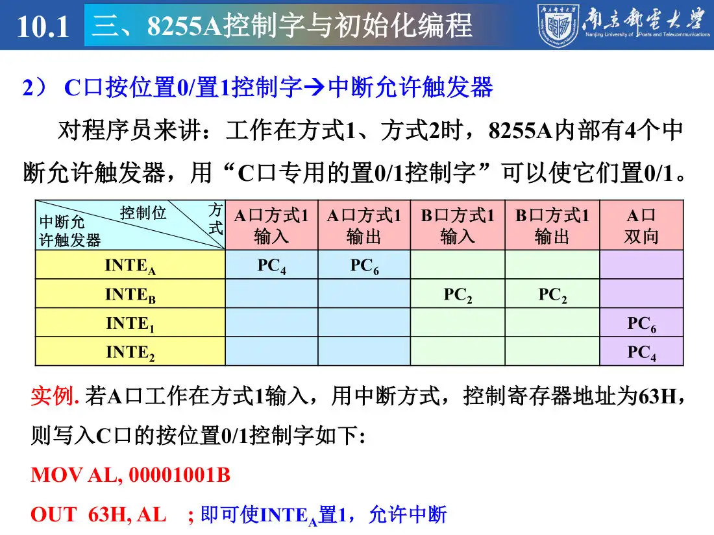

原文：

2） C口按位置0/置1控制字→中断允许触发器

对程序员来讲：工作在方式1、方式2时，8255A内部有4个中断允许触发器，用“C口专用的置0/1控制字”可以使它们置0/1。

<table><tr><td>中断允许触发器\控制位方式</td><td>A口方式1输入</td><td>A口方式1输出</td><td>B口方式1输入</td><td>B口方式1输出</td><td>A口双向</td></tr><tr><td>INTE $_A$ </td><td>PC $_4$ </td><td>PC $_6$ </td><td></td><td></td><td></td></tr><tr><td>INTE $_B$ </td><td></td><td></td><td>PC $_2$ </td><td>PC $_2$ </td><td></td></tr><tr><td>INTE $_1$ </td><td></td><td></td><td></td><td></td><td>PC $_6$ </td></tr><tr><td>INTE $_2$ </td><td></td><td></td><td></td><td></td><td>PC $_4$ </td></tr></table>

实例. 若A口工作在方式1输入，用中断方式，控制寄存器地址为63H，则写入C口的按位置0/1控制字如下:

MOV AL, 00001001B

OUT 63H, AL ; 即可使 $\mathbf { I N T E _ { A } }$ 置1，允许中断

10.1 三、8255A控制字与初始化编程

南立都電大学 南京郵電大学 Nargng Ur 吧 Nanjing University of Posts and Telecommunications

### 2. 8255A的初始化编程

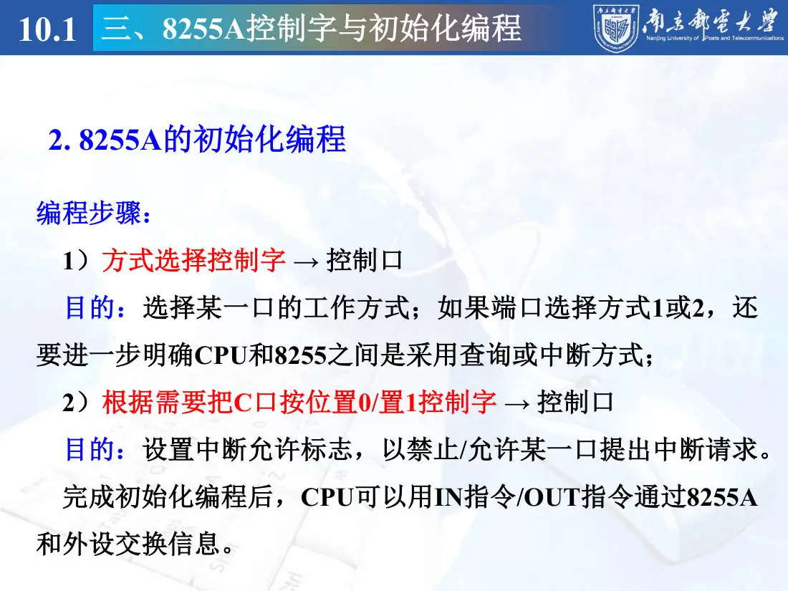

原文：

2. 8255A的初始化编程

编程步骤：

1）方式选择控制字 →控制口

目的：选择某一口的工作方式；如果端口选择方式1或2，还要进一步明确CPU和8255之间是采用查询或中断方式；

2）根据需要把C口按位置0/置1控制字 →控制口

目的：设置中断允许标志，以禁止/允许某一口提出中断请求。完成初始化编程后，CPU可以用IN指令/OUT指令通过8255A和外设交换信息。

10.1 三、8255A控制字与初始化编程

南立郵電大學 南京郵電大学 Nargng Ur GQ Nanjing University ofPosts and Telecommunication

### 可以写出方式选择控制字：

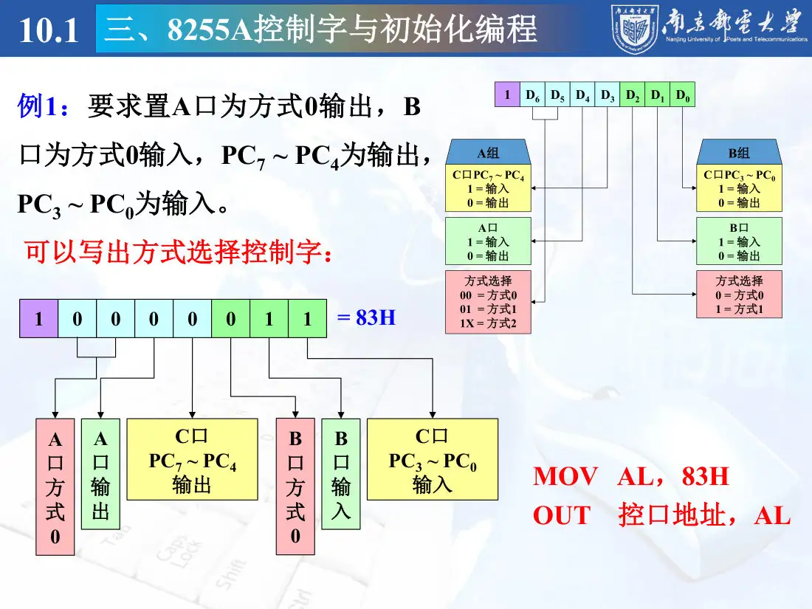

原文：

例1：要求置A口为方式0输出，B口为方式0输入， $\mathbf { P C } _ { 7 } \sim \mathbf { P C } _ { 4 }$ 为输出，$\bf { P C } _ { 3 } \sim \bf { P C } _ { 0 }$ 为输入。

可以写出方式选择控制字：

MOV AL，83H OUT 控口地址，AL

10.1 三、8255A控制字与初始化编程

南立郵電大學 南京郵電大学 Naring Un Nanjing University of Posts and Telecommunications

### 10.1 三、8255A控制字与初始化编程

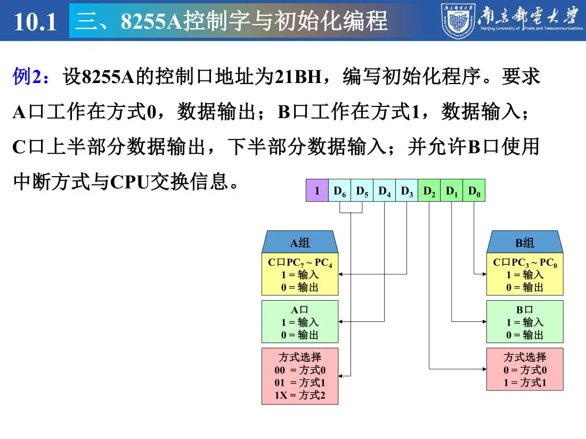

原文：

例2：设8255A的控制口地址为21BH，编写初始化程序。要求A口工作在方式0，数据输出；B口工作在方式1，数据输入；C口上半部分数据输出，下半部分数据输入；并允许B口使用中断方式与CPU交换信息。 1 D D D D3 D, D, D

10.1 三、8255A控制字与初始化编程

南立郵電大學 南京郵電大学 Naring Un Nanjing University of Posts and Telecommunications

### 10.1 三、8255A控制字与初始化编程

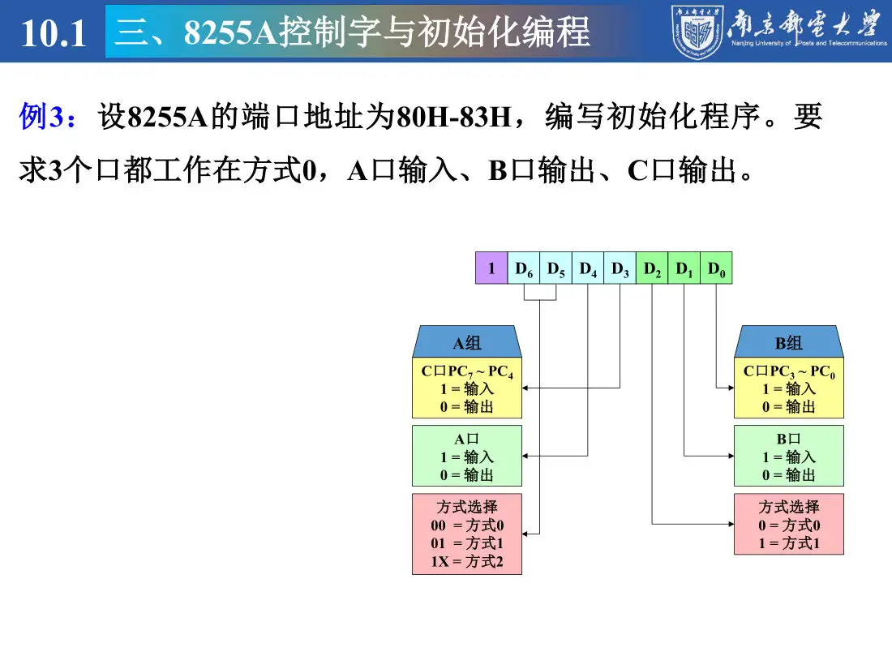

原文：

例3：设8255A的端口地址为80H-83H，编写初始化程序。要求3个口都工作在方式0，A口输入、B口输出、C口输出。

10.1 三、8255A控制字与初始化编程

南立郵電大學 南京郵電大学 Naring Un Nanjing University of Posts and Telecommunications

### 四、8255A工作方式与时序

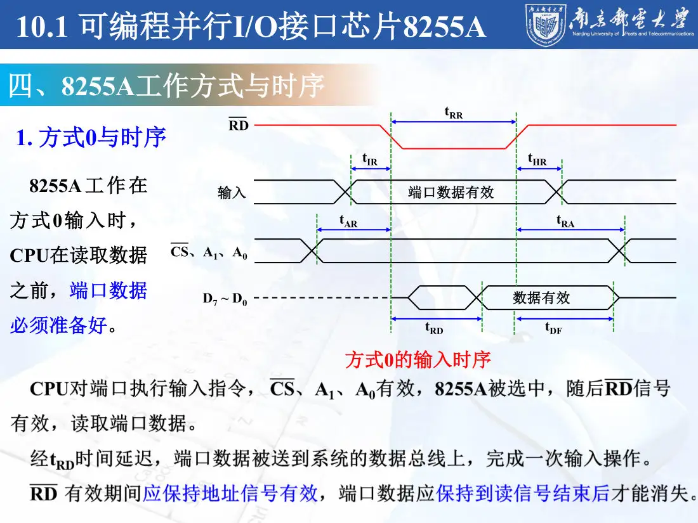

原文：

四、8255A工作方式与时序

1. 方式0与时序

8255A工作在方式0输入时，CPU在读取数据之前，端口数据必须准备好。

CPU对端口执行输入指令， $\overline { { \mathbf { C S } } } , ~ \mathbf { A _ { 1 } } , ~ \mathbf { A _ { 0 } }$ 有效，8255A被选中，随后RD信号有效，读取端口数据。

经 $\mathbf { t _ { R D } }$ 时间延迟，端口数据被送到系统的数据总线上，完成一次输入操作。

RD有效期间应保持地址信号有效，端口数据应保持到读信号结束后才能消失。

10.1 可编程并行I/O接口芯片8255A

南立都電大学 南京郵電大学 Nanjing University of Posts and Telecommunication

### CPU 将 数 据经 数 据 总 线 ，传送到8255A的端口数据线上。

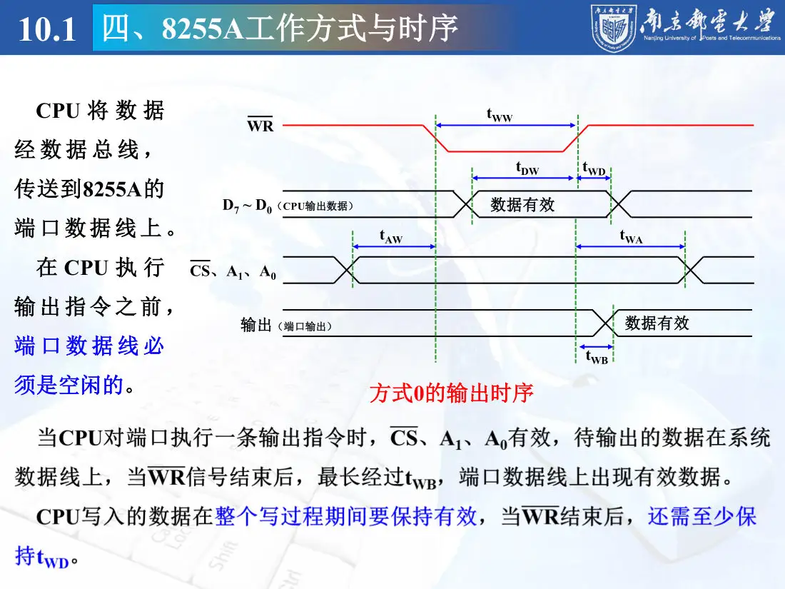

原文：

CPU 将 数 据经 数 据 总 线 ，传送到8255A的端口数据线上。

在 CPU 执 行输出指令之前，端 口 数 据 线 必须是空闲的。

当CPU对端口执行一条输出指令时， $\overline { { \mathbf { C S } } } , ~ \mathbf { A _ { 1 } } , ~ \mathbf { A _ { 0 } }$ 有效，待输出的数据在系统数据线上，当WR信号结束后，最长经过 $\mathbf { t _ { W B } }$ ，端口数据线上出现有效数据。

CPU写入的数据在整个写过程期间要保持有效，当WR结束后，还需至少保持 $\mathbf { t _ { W D } }$

10.1 四、8255A工作方式与时序

南立郵電大學 南京郵電大学 Nargng Ur GQ Nanjing University ofPosts and Telecommunications

### 2. 方式1输入（选通型输入）及时序

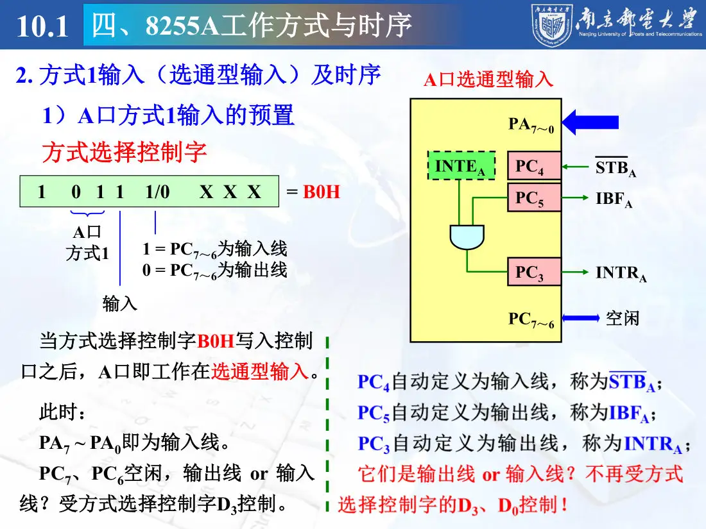

原文：

2. 方式1输入（选通型输入）及时序

1）A口方式1输入的预置方式选择控制字

$$
1 = \mathrm{PC} _ {7 \sim 6}
$$

$$
\mathbf {0} = \mathrm{PC} _ {7 \sim 6}
$$

输入

当方式选择控制字B0H写入控制口之后，A口即工作在选通型输入。

此时：

$\mathbf { P A } _ { 7 } \sim \mathbf { P A _ { 0 } }$ 即为输入线。

$\mathbf { P C } _ { 7 } . \mathbf { \ P C } _ { 6 }$ 空闲，输出线 or 输入线？受方式选择控制字 $\mathbf { D } _ { 3 } \mathbf { ; }$ 控制。

A口选通型输入

$\mathbf { P C _ { 4 } }$ 自动定义为输入线，称为 $\overline { { \mathbf { S } \mathbf { T } \mathbf { B } } } _ { \mathbf { A } }$ $\mathbf { P C _ { 5 } }$ 自动定义为输出线，称为 $\mathbf { I B F _ { A } }$ $\mathbf { P C } _ { 3 }$ 自动定义为输出线，称为 $\mathbf { I N T R _ { A } }$ 它们是输出线or输入线？不再受方式选择控制字的 ${ \bf D } _ { 3 }$ $\mathbf { D _ { 0 } }$ 控制！

10.1 四、8255A工作方式与时序

南立都電大学 南京郵電大学 Nargng o Nanjing University of Posts and Telecommunications

### 2）方式1输入时A口的中断管理

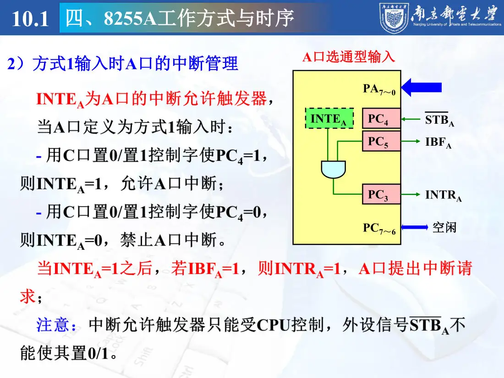

原文：

2）方式1输入时A口的中断管理

$\mathbf { I N T E _ { A } }$ 为A口的中断允许触发器，当A口定义为方式1输入时：

\- 用C口置0/置1控制字使 $\bf P C _ { 4 } { = } 1$ 则 $\mathbf { I N T E _ { A } { = } 1 }$ ，允许A口中断；

\- 用C口置0/置1控制字使 $\mathbf { P C _ { 4 } } \mathbf { = 0 }$ 9则 $\mathbf { I N T E _ { A } } { = } \mathbf { 0 }$ ，禁止A口中断。

A口选通型输入

当 $\mathbf { I N T E _ { A } } { = } 1$ 之后，若 $\mathbf { I B F _ { A } = 1 }$ ，则 $\mathbf { I N T R _ { A } } { = } \mathbf { 1 }$ ，A口提出中断请求；

注意：中断允许触发器只能受CPU控制，外设信号 $\overline { { \mathbf { S } \mathbf { T } \mathbf { B } } } _ { \mathbf { A } }$ 不能使其置0/1。

10.1 四、8255A工作方式与时序

南立都電大学 南京郵電大学 Nanjing University of Posts and Telecommunications

### 3）B口方式1输入的预置方式选择控制字

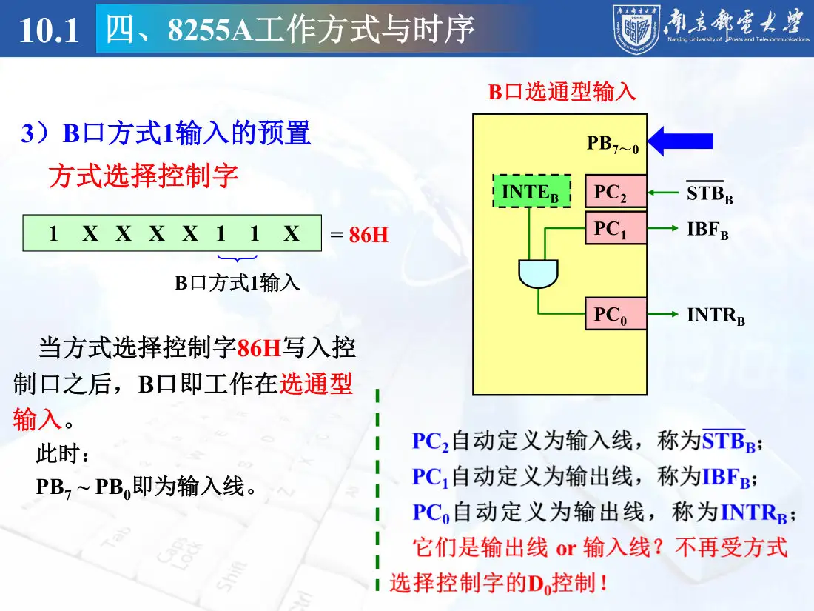

原文：

3）B口方式1输入的预置方式选择控制字

B口方式1输入

当方式选择控制字86H写入控制口之后，B口即工作在选通型输入。

此时：

$\mathbf { P B _ { 7 } } \sim \mathbf { P B _ { 0 } }$ 即为输入线。

B口选通型输入

$\mathbf { P C } _ { 2 }$ 自动定义为输入线，称为 $\overline { { \mathbf { S } \mathbf { T } \mathbf { B } } } _ { \mathbf { B } }$ $\mathbf { P C _ { 1 } }$ 自动定义为输出线，称为 $\mathbf { I B F _ { B } }$ $\bf { P C _ { 0 } }$ 自动定义为输出线，称为 $\bf { I N T R } _ { \bf { B } }$ 它们是输出线or输入线？不再受方式选择控制字的 $\mathbf { D _ { 0 } }$ 控制！

10.1 四、8255A工作方式与时序

南立都電大学 南京郵電大学 Nanjing University of Posts and Telecommunications

### 4）方式1输入时B口的中断管理

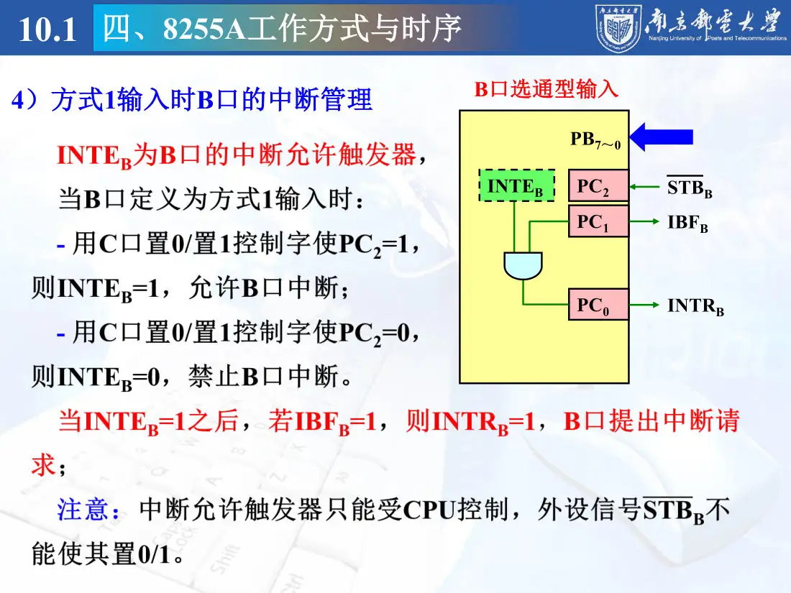

原文：

4）方式1输入时B口的中断管理

$\bf { I N T E _ { B } }$ 为B口的中断允许触发器，当B口定义为方式1输入时：

\- 用C口置0/置1控制字使 $\mathbf { P C } _ { 2 } { = } 1$ 则 $\mathbf { I N T E _ { B } { = } 1 }$ ，允许B口中断；

\- 用C口置0/置1控制字使 $\mathbf { P C } _ { 2 } { = } \mathbf { 0 }$ 则 $\bf { I N T E _ { B } } \mathrm { = } \bf { 0 }$ ，禁止B口中断。

B口选通型输入

当 $\mathrm { I N T E _ { B } { = } 1 }$ 之后，若 $\mathbf { I B F _ { B } } mathbf { = } \mathbf { 1 }$ ，则 $\mathbf { I N T R _ { B } { = } 1 }$ ，B口提出中断请求；

注意：中断允许触发器只能受CPU控制，外设信号 $\overline { { \mathbf { S } \mathbf { T } \mathbf { B } } } _ { \mathbf { B } }$ 不能使其置0/1。

10.1 四、8255A工作方式与时序

南立都電大学 南京郵電大学 Nanjing University of Posts and Telecommunications

### 5）方式1输入的时序图

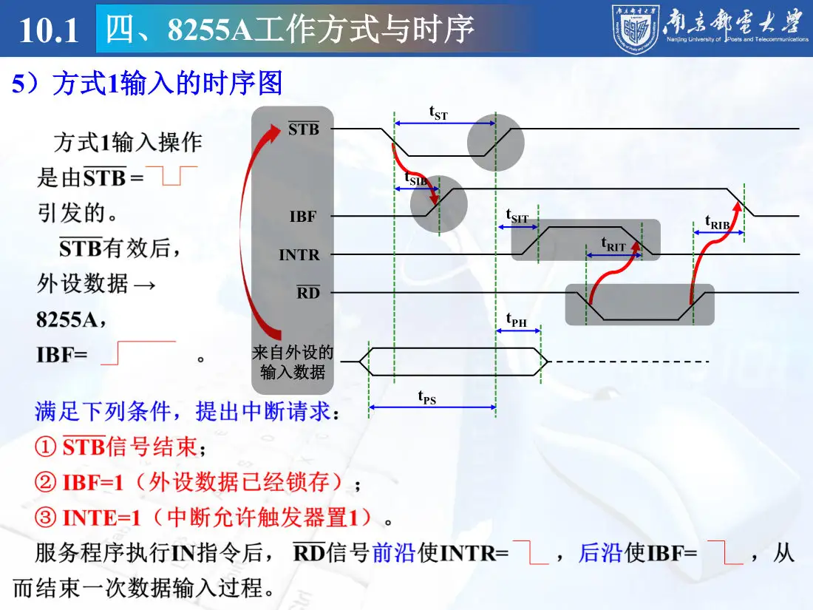

原文：

5）方式1输入的时序图

方式1输入操作是由 $\overline { { \mathbf { S } \mathbf { T } \mathbf { B } } } = \overline { { \mathbf { \Lambda } } }$ 引发的。

STB有效后，外设数据→8255A,IBF=

满足下列条件，提出中断请求：

①STB信号结束；

②IBF=1（外设数据已经锁存）；

③INTE=1（中断允许触发器置1）。

服务程序执行IN指令后，RD信号前沿使INTR=，后沿使IBF= L，从而结束一次数据输入过程。

10.1 四、8255A工作方式与时序

南立都電大学 南京郵電大学 Nanjing University of Posts and Telecommunications

### 6）方式1输入时，CPU与8255A交换信息的方式

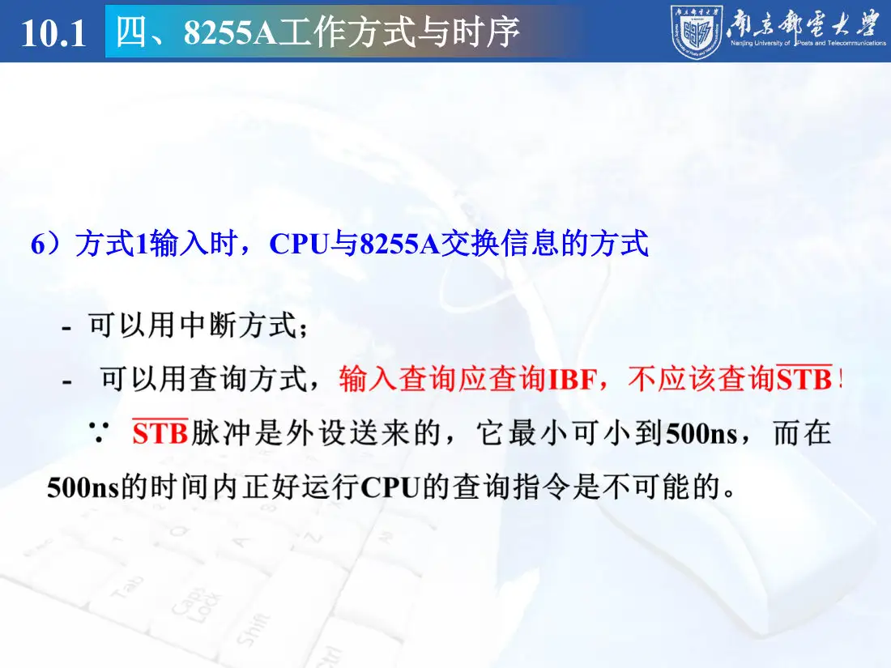

原文：

6）方式1输入时，CPU与8255A交换信息的方式

\- 可以用中断方式；

\- 可以用查询方式，输入查询应查询IBF，不应该查询STB！

∵STB脉冲是外设送来的，它最小可小到500ns，而在500ns的时间内正好运行CPU的查询指令是不可能的。

10.1 四、8255A工作方式与时序

南立郵電大學 南京郵電大学 Nargng Ur GQ Nanjing University ofPosts and Telecommunication

### 3. 方式1输出（选通型输出）及时序

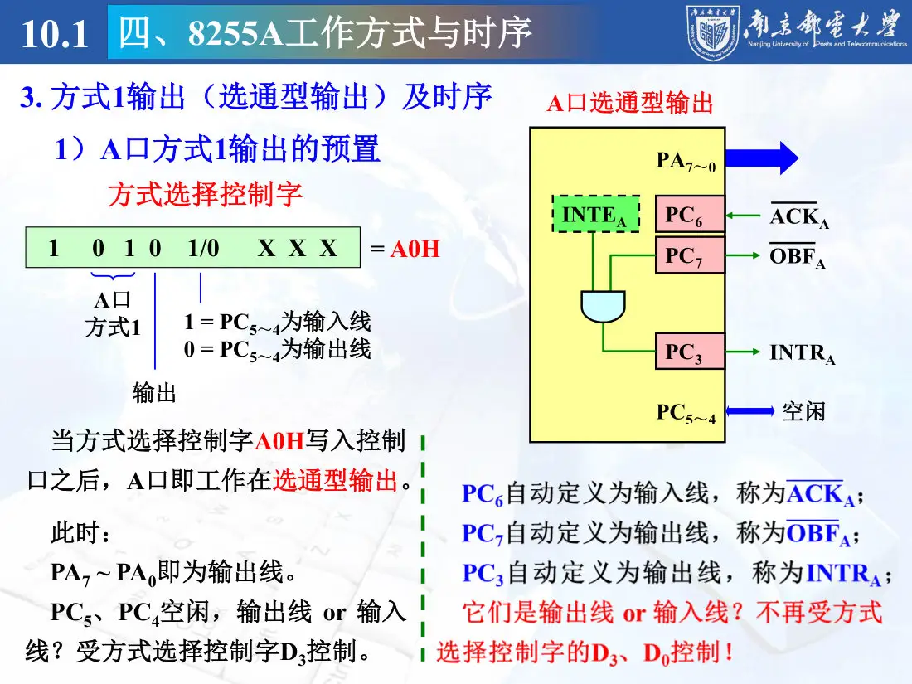

原文：

3. 方式1输出（选通型输出）及时序

1）A口方式1输出的预置方式选择控制字

输出

当方式选择控制字A0H写入控制口之后，A口即工作在选通型输出。

此时：

$\mathbf { P A } _ { 7 } \sim \mathbf { P A _ { 0 } }$ 即为输出线。

$\mathbf { P C _ { 5 } } \setminus \mathbf { P C _ { 4 } }$ 空闲，输出线 or 输入线？受方式选择控制字 $\mathbf { D } _ { 3 } \mathbf { ; }$ 控制。

A口选通型输出

$\mathbf { P C } _ { 6 }$ 自动定义为输入线，称为 $\overline { { \mathbf { A C K } } } _ { \mathbf { A } }$ $\mathbf { P C } _ { 7 }$ 自动定义为输出线，称为 $\mathbf { \overline { { O B F } } _ { A } }$ $\mathbf { P C } _ { 3 }$ 自动定义为输出线，称为 $\mathbf { I N T R _ { A } }$ 它们是输出线or输入线？不再受方式选择控制字的 ${ \bf D } _ { 3 }$ ${ \bf D } _ { 0 }$ 控制！

10.1 四、8255A工作方式与时序

南立郵電大學 南京郵電大学 Nanjing University ofPosts and Telecommunications

### 2）方式1输出时A口的中断管理

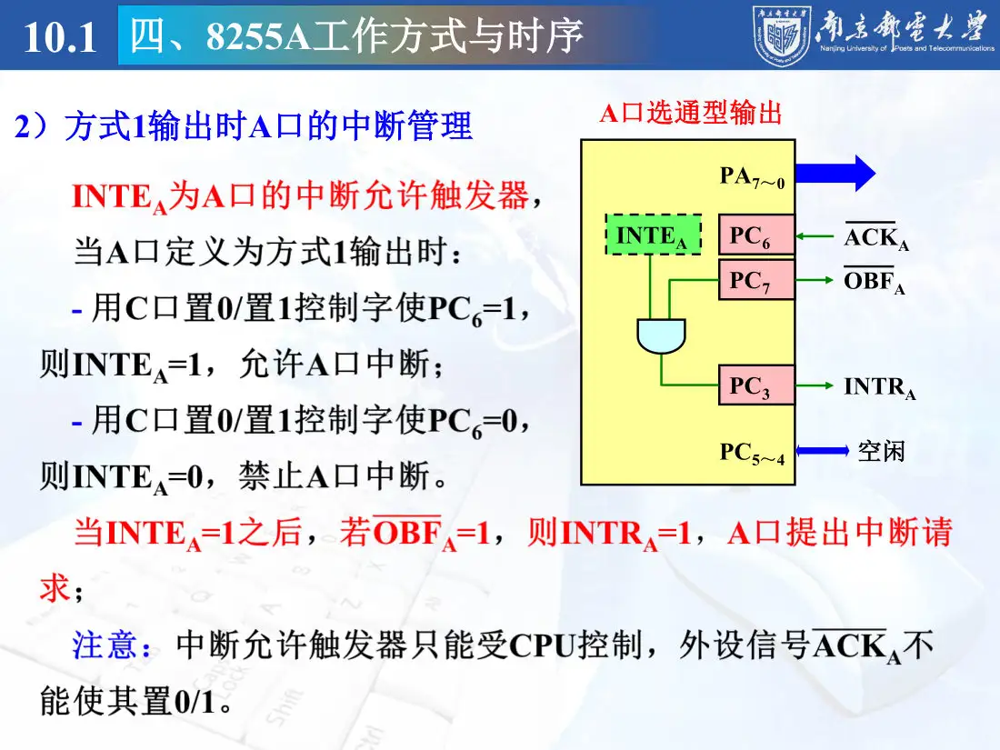

原文：

2）方式1输出时A口的中断管理

$\mathbf { I N T E _ { A } }$ 为A口的中断允许触发器，当A口定义为方式1输出时：

\- 用C口置0/置1控制字使 $\bf P C _ { 6 } { = } 1$ 则 $\mathbf { I N T E _ { A } { = } 1 }$ ，允许A口中断；

\- 用C口置0/置1控制字使 $\bf P C _ { 6 } { = } 0$ 则 $\mathbf { I N T E _ { A } { = } 0 }$ ，禁止A口中断。

A口选通型输出

当 $\mathrm { I N T E _ { A } } { = } 1$ 之后，若 $\overline { { \mathbf { O B F } } } _ { \mathbf { A } } { = } \mathbf { 1 }$ ，则 $\mathbf { I N T R _ { A } } { = } \mathbf { 1 }$ ，A口提出中断请求；

注意：中断允许触发器只能受CPU控制，外设信号 $\overline { { \mathbf { A C K } } } _ { \mathbf { A } }$ 不能使其置0/1。

10.1 四、8255A工作方式与时序

南立都電大学 南京郵電大学 Nanjing University of Posts and Telecommunications

### 3）B口方式1输出的预置方式选择控制字

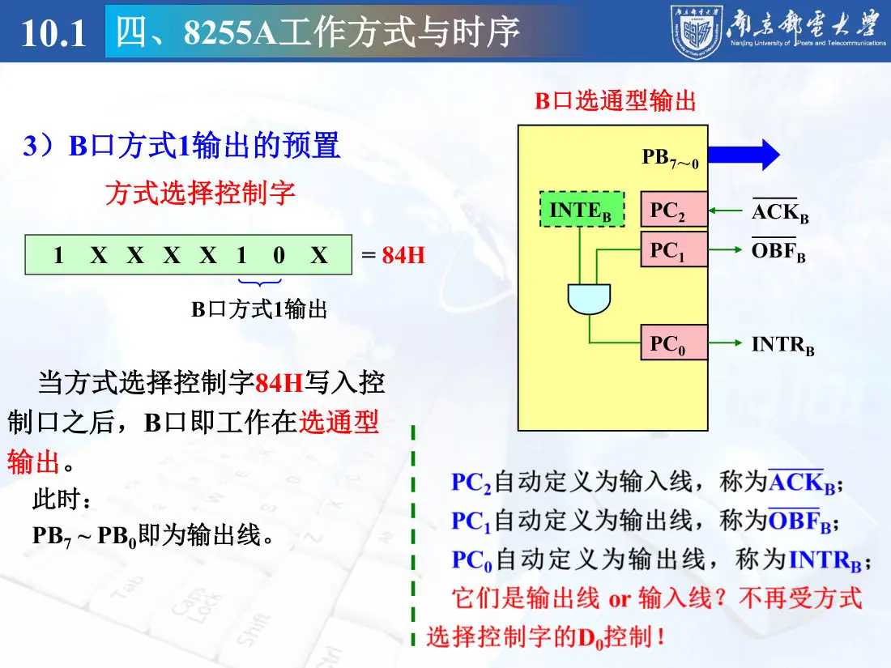

原文：

3）B口方式1输出的预置方式选择控制字

B口方式1输出

当方式选择控制字84H写入控制口之后，B口即工作在选通型输出。

此时：

$\mathbf { P B _ { 7 } } \sim \mathbf { P B _ { 0 } }$ 即为输出线。

B口选通型输出

$\mathbf { P C } _ { 2 }$ 自动定义为输入线，称为 $\overline { { \mathbf { A C K } } } _ { \mathbf { B } }$ $\mathbf { P C _ { 1 } }$ 自动定义为输出线，称为 $\mathbf { \overline { { O B F } _ { B } } }$ $\bf { P C _ { 0 } }$ 自动定义为输出线，称为 $\bf { I N T R } _ { \bf { B } }$ 它们是输出线or输入线？不再受方式选择控制字的 $\mathbf { D _ { 0 } } \mathrm { i }$ 控制！

10.1 四、8255A工作方式与时序

南立都電大学 南京郵電大学 Nanjing University of Posts and Telecommunications

### 4）方式1输出时B口的中断管理

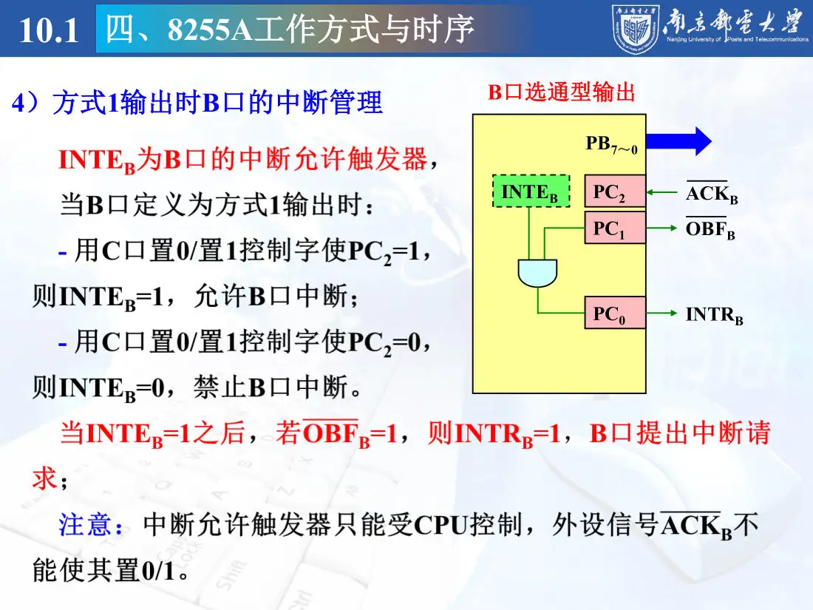

原文：

4）方式1输出时B口的中断管理

$\bf { I N T E _ { B } }$ 为B口的中断允许触发器当B口定义为方式1输出时：

\- 用C口置0/置1控制字使 $\mathbf { P C } _ { 2 } { = } 1$ 则 $\mathbf { I N T E _ { B } { = } 1 }$ ，允许B口中断；

\- 用C口置0/置1控制字使 $\mathbf { P C } _ { 2 } { = } \mathbf { 0 }$ 则 $\bf { I N T E _ { B } } \mathrm { = } \bf { 0 }$ ，禁止B口中断。

B口选通型输出

当 $\mathrm { I N T E _ { B } { = } 1 }$ 之后，若 $\overline { { \mathbf { O B F _ { B } } } } = 1$ ，则 $\mathbf { I N T R _ { B } { = } 1 }$ ，B口提出中断请求；

注意：中断允许触发器只能受CPU控制，外设信号 $\overline { { \mathbf { A C K } } } _ { \mathbf { B } }$ 不能使其置0/1。

10.1 四、8255A工作方式与时序

南立都電大学 南京郵電大学 Nanjing University of Posts and Telecommunications

### 5）方式1输出的时序图（从中断开始）

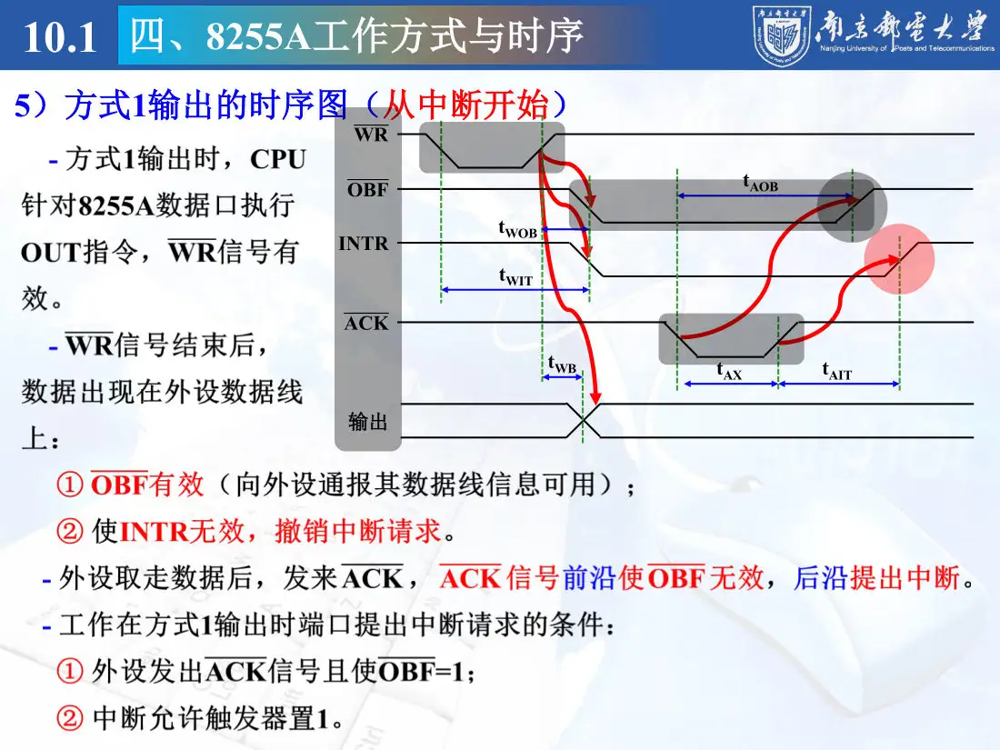

原文：

5）方式1输出的时序图（从中断开始）

-方式1输出时，CPU针对8255A数据口执行OUT指令，WR信号有效。

-WR信号结束后，数据出现在外设数据线上：

①OBF有效（向外设通报其数据线信息可用）；

②使INTR无效，撤销中断请求。

-外设取走数据后，发来ACK，ACK信号前沿使OBF无效，后沿提出中断。

-工作在方式1输出时端口提出中断请求的条件：

①外设发出ACK信号且使 $\overline { { \mathbf { O B F } } } { = } \mathbf { 1 }$

②中断允许触发器置1。

10.1 四、8255A工作方式与时序

南立都電大学 南京郵電大学 Nargng Nanjing University of Posts and Telecommunications

### 6）方式1输出时，CPU与8255A交换信息的方式

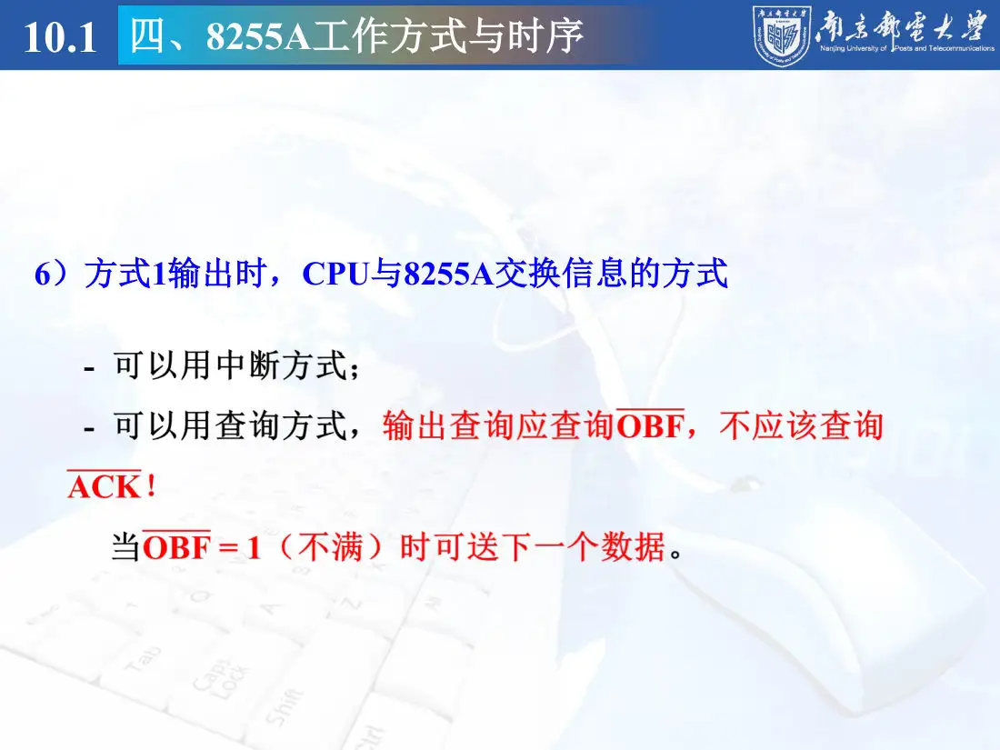

原文：

6）方式1输出时，CPU与8255A交换信息的方式

\- 可以用中断方式；

\- 可以用查询方式，输出查询应查询OBF，不应该查询ACK!

当 $\overline { { \mathbf { O B F } } } = 1$ （不满）时可送下一个数据。

10.1 四、8255A工作方式与时序

南立郵電大學 南京郵電大学 Nargng Ur GQ Nanjing University ofPosts and Telecommunication

### 4. 方式2：双向传输

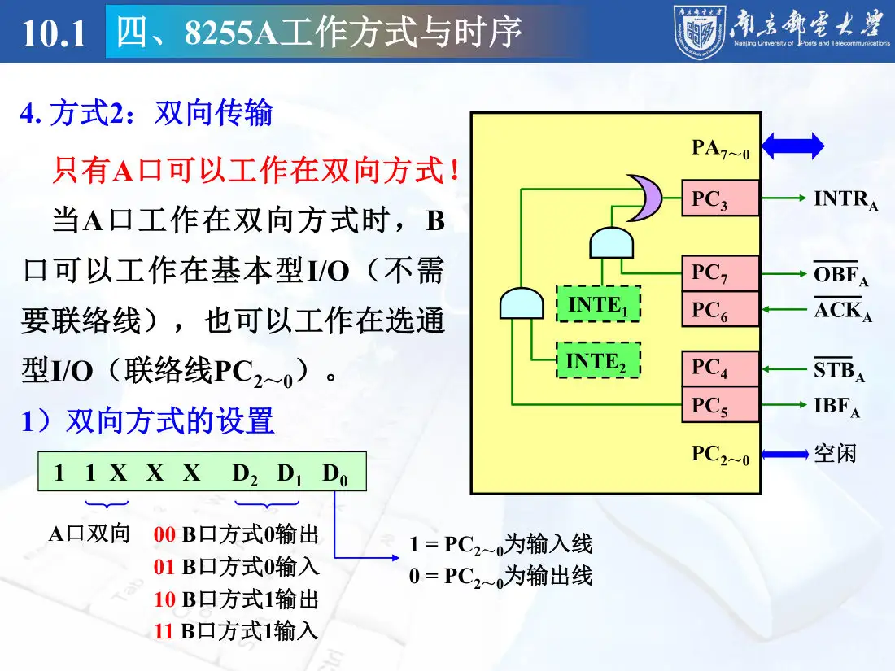

原文：

4. 方式2：双向传输

只有A口可以工作在双向方式！当A口工作在双向方式时，B口可以工作在基本型I/O（不需要联络线），也可以工作在选通型I/O（联络线 $\mathbf { P C } _ { 2 \sim \mathbf { 0 } } )$ o

1）双向方式的设置

00 B口方式0输出A口双向

01 B口方式0输入

10 B口方式1输出

11 B口方式1输入$\mathbf { 1 } = \mathbf { P } \mathbf { C } _ { 2 \sim \mathbf { 0 } } .$ 为输入线$\mathbf { 0 } = \mathbf { P } \mathbf { C } _ { 2 \sim \mathbf { 0 } } .$ 为输出线

10.1 四、8255A工作方式与时序

南立郵電大學 南京郵電大学 Naring Un Nanjing University of Posts and Telecommunications

### A口定义为双向方式之后：

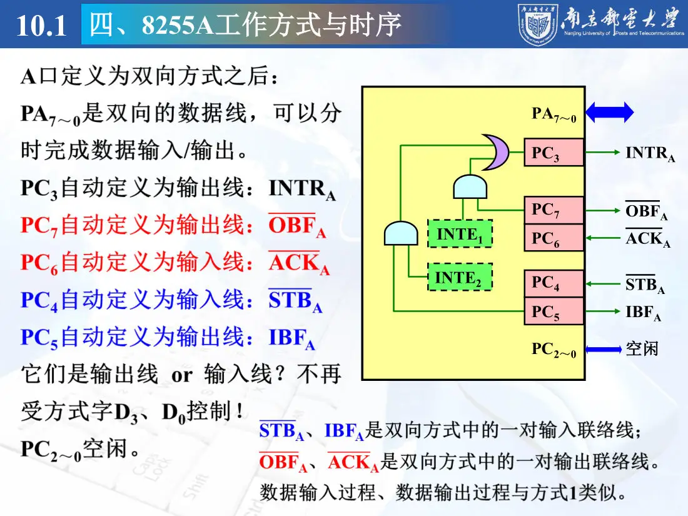

原文：

A口定义为双向方式之后：

$\mathbf { P A _ { 7 \sim 0 } }$ 是双向的数据线，可以分时完成数据输入/输出。

$\mathbf { P C } _ { 3 }$ 自动定义为输出线： $\mathbf { I N T R } _ { \mathbf { A } }$

$\mathbf { P C } _ { 7 }$ 自动定义为输出线： $\mathbf { \overline { { O B F } } _ { A } }$

$\mathbf { P C } _ { 6 }$ 自动定义为输入线： $\overline { { \mathbf { A C K } } } _ { \mathbf { A } }$

$\bf { P C _ { 4 } }$ 自动定义为输入线： $\overline { { \mathbf { S } \mathbf { T } \mathbf { B } } } _ { \mathbf { A } }$

$\mathbf { P C _ { 5 } }$ 自动定义为输出线： $\mathbf { I B F _ { A } }$

它们是输出线 or 输入线？不再

受方式字 $\mathbf { D _ { 3 } } \setminus \mathbf { D _ { 0 } }$ 控制！$\mathbf { P C } _ { 2 \sim \mathbf { 0 } }$ 空闲。

$\overline { { \mathbf { S } \mathbf { T } \mathbf { B } } } _ { \mathbf { A } } , \ \mathbf { I B } \mathbf { F _ { A } }$ 是双向方式中的一对输入联络线；

$\overline { { \mathbf { O B F } } } _ { \mathbf { A } } , \overline { { \mathbf { A C K } } } _ { \mathbf { A } }$ 是双向方式中的一对输出联络线。

数据输入过程、数据输出过程与方式1类似。

10.1 四、8255A工作方式与时序

南立郵電大學 南京郵電大学 Nanjing University ofPosts and Telecommunications

### 10.1 四、8255A工作方式与时序

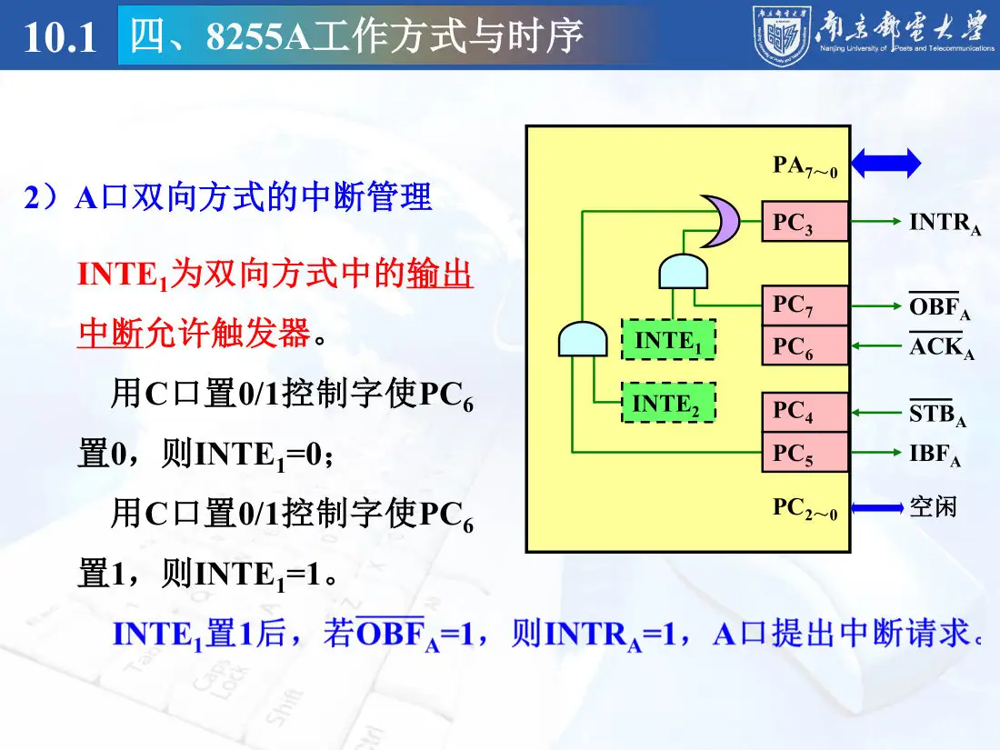

原文：

2）A口双向方式的中断管理$\bf { I N T E } _ { 1 }$ 为双向方式中的输出中断允许触发器。

用C口置0/1控制字使 $\mathbf { P C _ { 6 } }$ 置0，则 $\bf { I N T E _ { 1 } { = } 0 }$ ；

用C口置0/1控制字使 $\mathbf { P C _ { 6 } }$ 置1，则 $\mathbf { I N T E _ { 1 } { = } 1 }$ 。

$\bf { I N T E _ { 1 } }$ 置1后，若 $\overline { { \mathbf { O B F } } } _ { \mathbf { A } } { = } \mathbf { 1 }$ ，则 $\mathbf { I N T R _ { A } { = } 1 }$ ，A口提出中断请求。

10.1 四、8255A工作方式与时序

南立郵電大學 南京郵電大学 Naring Un Nanjing University of Posts and Telecommunications

### 10.1 四、8255A工作方式与时序

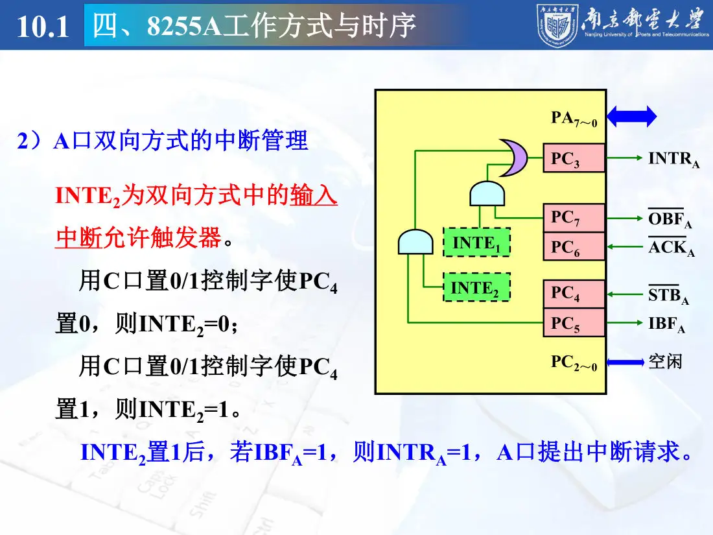

原文：

2）A口双向方式的中断管理$\mathbf { I N T E } _ { 2 }$ 为双向方式中的输入中断允许触发器。

用C口置0/1控制字使 $\bf { P C _ { 4 } }$ 置0，则 $\mathbf { I N T E } _ { 2 } { \bf = 0 }$ ；

用C口置0/1控制字使 $\bf { P C _ { 4 } }$ 置1，则 $\mathbf { I N T E } _ { 2 } { = } 1$ 。

$\mathbf { I N T E } _ { 2 }$ 置1后，若 $\mathbf { I B F _ { A } = 1 }$ ，则 $\mathbf { I N T R _ { A } } { = } 1$ ，A口提出中断请求。

10.1 四、8255A工作方式与时序

南立郵電大學 南京郵電大学 Naring Un Nanjing University of Posts and Telecommunications

### 2）A口双向方式的时序

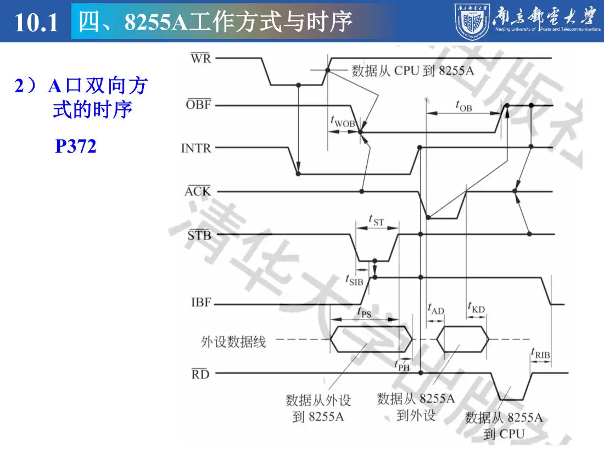

原文：

2）A口双向方式的时序

P372

10.1 四、8255A工作方式与时序

南立都電大学 南京郵電大学 Nanjing University of Posts and Telecommunications

### 5. 8255A小结

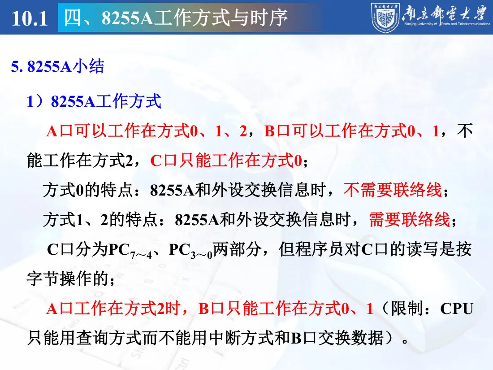

原文：

5. 8255A小结

1）8255A工作方式

A口可以工作在方式0、1、2，B口可以工作在方式0、1，不能工作在方式2，C口只能工作在方式0；

方式0的特点：8255A和外设交换信息时，不需要联络线；

方式1、2的特点：8255A和外设交换信息时，需要联络线；

C口分为 $\mathbf { P C } _ { 7 \sim 4 } , \mathbf { P C } _ { 3 \sim 0 }$ 两部分，但程序员对C口的读写是按字节操作的；

A口工作在方式2时，B口只能工作在方式0、1（限制：CPU只能用查询方式而不能用中断方式和B口交换数据）。

10.1 四、8255A工作方式与时序

南立郵電大學 南京郵電大学 Nargng Ur GQ Nanjing University ofPosts and Telecommunication

### 2）CPU与8255A交换信息的方式

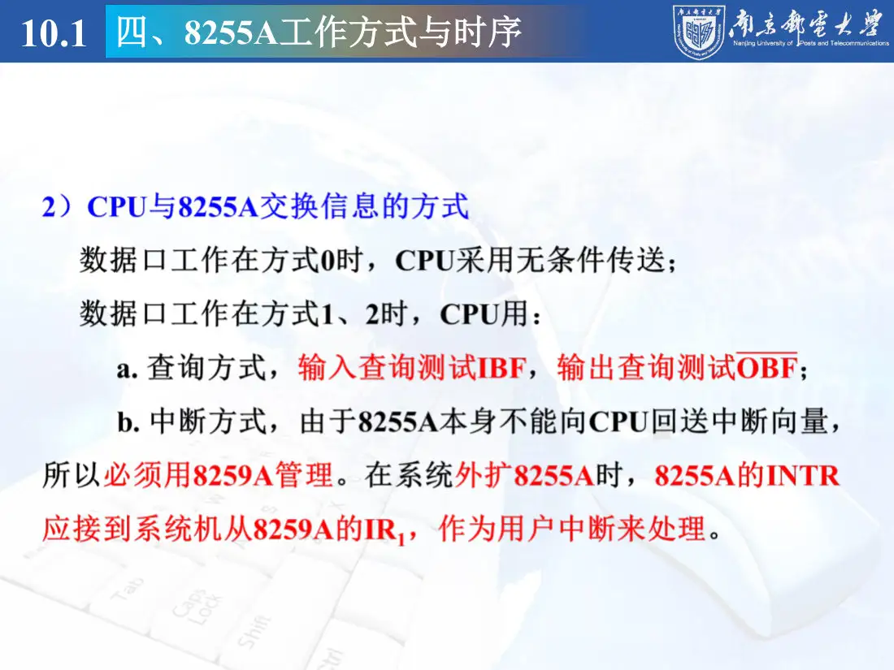

原文：

2）CPU与8255A交换信息的方式

数据口工作在方式0时，CPU采用无条件传送；

数据口工作在方式1、2时，CPU用：

a. 查询方式，输入查询测试IBF，输出查询测试OBF;

b. 中断方式，由于8255A本身不能向CPU回送中断向量，所以必须用8259A管理。在系统外扩8255A时，8255A的INTR应接到系统机从8259A的 $\mathbf { I R } _ { 1 }$ ，作为用户中断来处理。

10.1 四、8255A工作方式与时序

南立郵電大學 南京郵電大学 Nargng Ur GQ Nanjing University ofPosts and Telecommunication

### 3）中断允许触发器的置0、置1

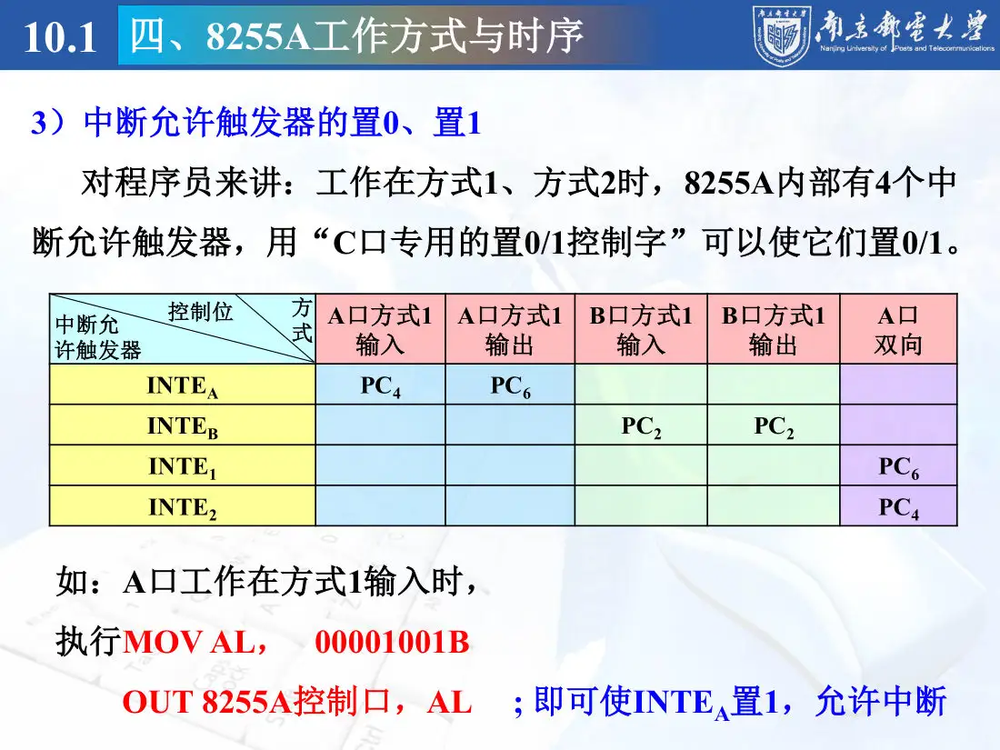

原文：

3）中断允许触发器的置0、置1

对程序员来讲：工作在方式1、方式2时，8255A内部有4个中断允许触发器，用“C口专用的置0/1控制字”可以使它们置0/1。

<table><tr><td>中断允许触发器\控制位方式</td><td>A口方式1输入</td><td>A口方式1输出</td><td>B口方式1输入</td><td>B口方式1输出</td><td>A口双向</td></tr><tr><td>INTE $_A$ </td><td>PC $_4$ </td><td>PC $_6$ </td><td></td><td></td><td></td></tr><tr><td>INTE $_B$ </td><td></td><td></td><td>PC $_2$ </td><td>PC $_2$ </td><td></td></tr><tr><td>INTE $_1$ </td><td></td><td></td><td></td><td></td><td>PC $_6$ </td></tr><tr><td>INTE $_2$ </td><td></td><td></td><td></td><td></td><td>PC $_4$ </td></tr></table>

如：A口工作在方式1输入时，执行MOV AL， 00001001B

OUT 8255A控制口，AL ; 即可使 $\mathbf { I N T E _ { A } }$ 置1，允许中断

10.1 四、8255A工作方式与时序

南立都電大学 南京郵電大学 Nanjing University of Posts and Telecommunications

### 4）8255A的初始化编程

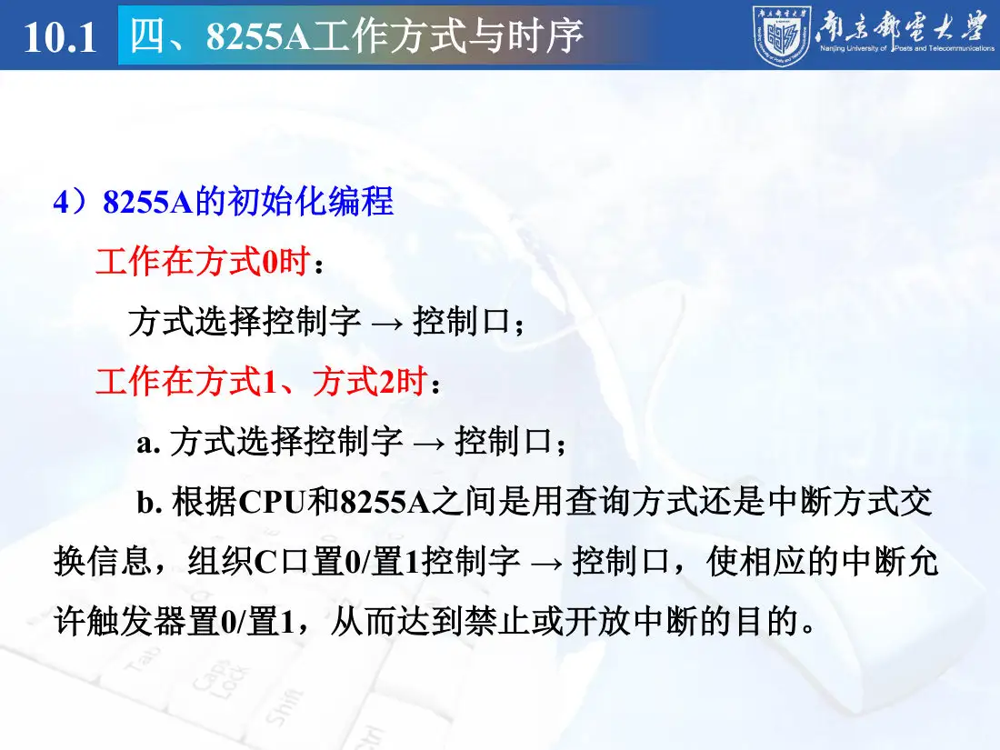

原文：

4）8255A的初始化编程

工作在方式0时：

方式选择控制字 → 控制口；

工作在方式1、方式2时：

a. 方式选择控制字 → 控制口；

b. 根据CPU和8255A之间是用查询方式还是中断方式交换信息，组织C口置0/置1控制字 → 控制口，使相应的中断允许触发器置0/置1，从而达到禁止或开放中断的目的。

10.1 四、8255A工作方式与时序

南立郵電大學 南京郵電大学 Nargng Ur GQ Nanjing University ofPosts and Telecommunication

### 随堂习题

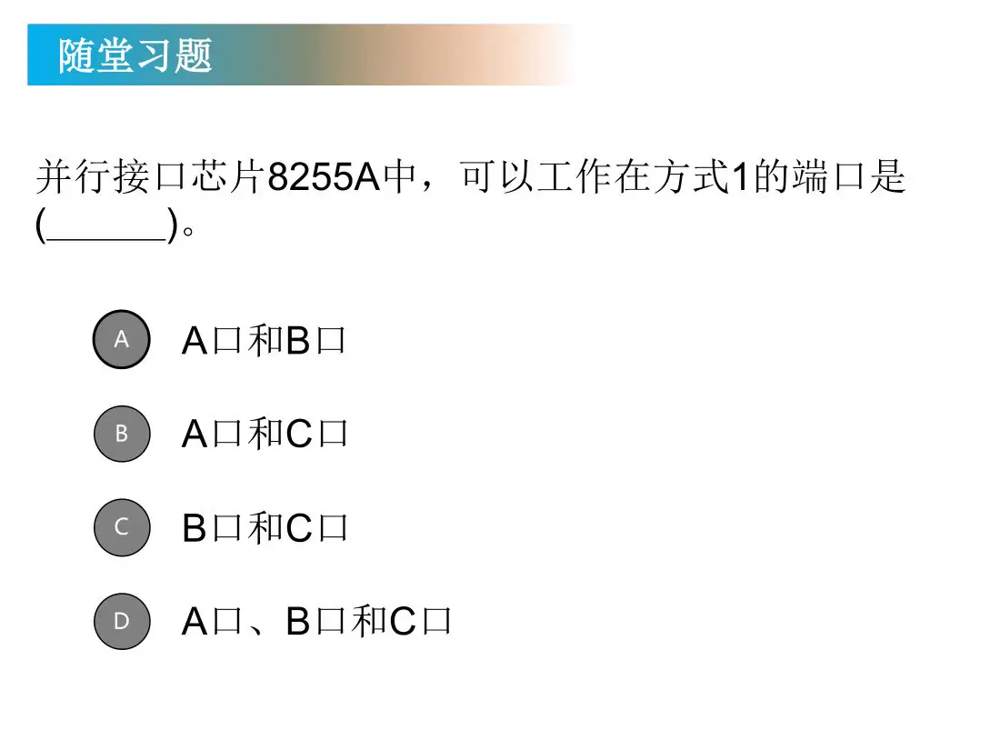

原文：

随堂习题

并行接口芯片8255A中，可以工作在方式1的端口是)。A口和B口BA口和C口B口和C口A口、B口和C口

### 随堂习题

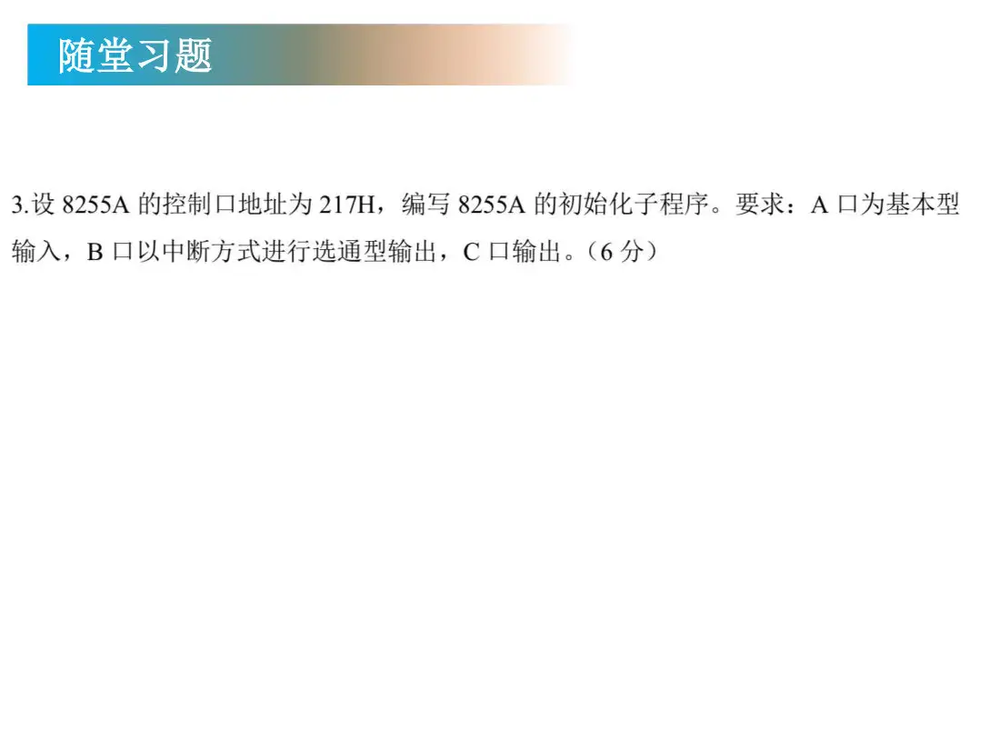

原文：

随堂习题

3.设8255A的控制口地址为217H，编写8255A的初始化子程序。要求：A口为基本型输入，B口以中断方式进行选通型输出，C口输出。（6分)

### 随堂习题

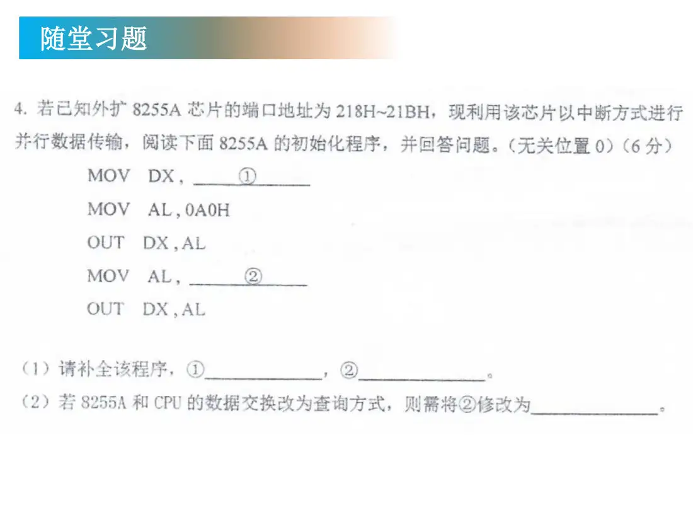

原文：

随堂习题

4. 若已知外扩8255A芯片的端口地址为218H\~21BH，现利用该芯片以中断方式进行并行数据传输，阅读下面8255A的初始化程序，并回答问题。(无关位置0)(6分)

### 1、8255A的内部结构和外部引脚

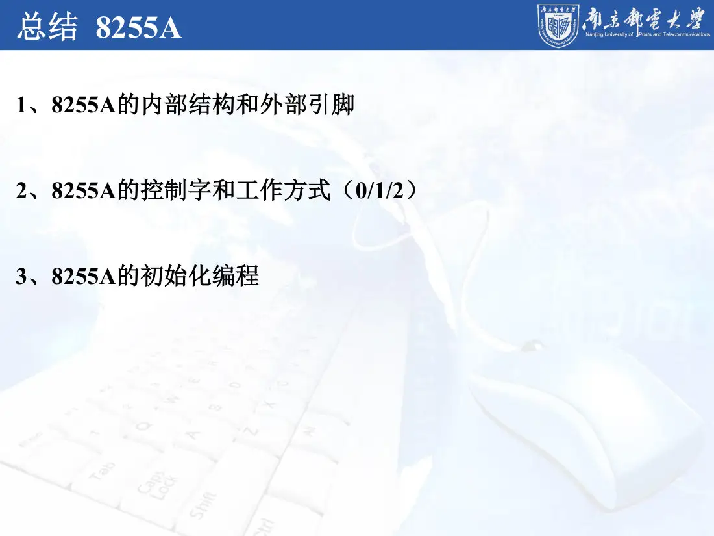

原文：

1、8255A的内部结构和外部引脚

2、8255A的控制字和工作方式（0/1/2）

3、8255A的初始化编程

总结 8255A

南立都電大学 南京郵電大学 G Nanjing University of Posts and Telecommunications

### 2026/11/15

原文：

2026/11/15

### 1、8255A的内部结构和外部引脚

原文：

1、8255A的内部结构和外部引脚

2、8255A的控制字和工作方式（0/1/2）

3、8255A的初始化编程

回顾 8255A

南立都電大学 南京郵電大学 G Nanjing University of Posts and Telecommunication

### 例1：设系统机外扩了一片8255A，相应的实验电路如图所示。

原文：

例1：设系统机外扩了一片8255A，相应的实验电路如图所示。

要求：先预置开关 $\mathbf { K } _ { 3 } \sim \mathbf { K } _ { 1 }$ 为一组状态，然后按下自复按钮K产生一个负脉冲信号输入到 $\mathbf { P C _ { 4 } }$ 。用发光二极管 $\mathbf { L E D _ { i } }$ 亮来显示 $\mathbf { K } _ { 3 } \sim \mathbf { K } _ { 1 }$ 的状态。主机键盘有任意键按下时结束演示。

10.2 8255A的应用举例

南立都電大学 南京郵電大学 Rarung Nanjing University ofPosts and Telecommunication

### 10.2 8255A的应用举例

原文：

要求： $\mathbf { K } _ { 3 } \sim \mathbf { K } _ { 1 }$ 闭合为0，断开为1。

$\mathbf { K } _ { 3 } \mathbf { K } _ { 2 } \mathbf { K } _ { 1 } = \mathbf { 0 0 0 }$ $\mathbf { L E D _ { 1 } }$ $\mathbf { K } _ { 3 } \mathbf { K } _ { 2 } \mathbf { K } _ { 1 } = \mathbf { 0 0 1 }$ $\mathbf { L E D } _ { 2 }$ $\mathbf { K } _ { 3 } \mathbf { K } _ { 2 } \mathbf { K } _ { 1 } = \mathbf { 0 } \mathbf { 1 0 }$ $\mathbf { L E D } _ { 3 }$ $\mathbf { K } _ { 3 } \mathbf { K } _ { 2 } \mathbf { K } _ { 1 } = \mathbf { 0 1 1 }$ $\mathbf { L E D _ { 4 } }$ $\mathbf { K } _ { 3 } \mathbf { K } _ { 2 } \mathbf { K } _ { 1 } = \mathbf { 1 0 0 }$ $\mathbf { L E D _ { 5 } }$ $\mathbf { K } _ { 3 } \mathbf { K } _ { 2 } \mathbf { K } _ { 1 } = \mathbf { 1 0 1 }$ $\bf { L E D _ { 6 } }$ $\mathbf { K } _ { 3 } \mathbf { K } _ { 2 } \mathbf { K } _ { 1 } = \mathbf { 1 1 0 }$ $\mathbf { L E D } _ { 7 }$ $\mathbf { K } _ { 3 } \mathbf { K } _ { 2 } \mathbf { K } _ { 1 } = \mathbf { 1 1 1 }$ $\mathbf { L E D _ { 8 } }$

10.2 8255A的应用举例

南立郵電大學 南京郵電大学 Naring Us Nanjing University of Posts and Telecommunications

### 设计思路：

原文：

设计思路：

1）端口地址

A口：218H、 21CH

B口：219H、 21DH

C口：21AH、21EH

控制口：21BH、21FH

10.2 8255A的应用举例

南立都電大学 南京郵電大学 Nanjing University of Posts and Telecommunication

### 10.2 8255A的应用举例

原文：

2）8255A工作方式的选择当 $\mathbf { P C _ { 4 } }$ (即 $\overline { { \mathbf { S } \mathbf { T } \mathbf { B } } } _ { \mathbf { A } } )$ 接收到负脉冲信号之后， ${ \bf K } _ { 3 } \sim$ $\mathbf { K } _ { 1 }$ 的状态信息被锁存到A口数据寄存器 ${ \bf P } { \bf A } _ { 2 } \sim$ $\mathbf { P A _ { 0 } }$ 中。

CPU读取A口信息，再根据 $\mathbf { P } \mathbf { A } _ { 2 } { \sim } \mathbf { P } \mathbf { A } _ { 0 }$ 的状态，输出相应数据到B口，使$\mathbf { L E D _ { i } }$ 亮。

因此，B口应为基本型输出，A口应为选通型输图中：PB 接 $\mathbf { L E D _ { i + 1 } }$ $\mathbf { P A } _ { 2 } { \sim } \mathbf { P A } _ { \mathbf { 0 } }$ 接开关 $\mathbf { K } _ { 3 } \sim \mathbf { K } _ { 1 }$ $\mathbf { P C _ { 4 } }$ 接自复按钮K。

10.2 8255A的应用举例

南立郵電大學 南京郵電大学 Naring Us Nanjing University of Posts and Telecommunication

### 3）8255A与CPU交换信息的方式

原文：

3）8255A与CPU交换信息的方式

CPU → 8255A B口：

无条件输出

8255A A口 → CPU：

解法①查询方式

当 $\bf P C _ { 5 } { = } 1$ 时，表示 ${ \bf K } _ { 3 } \sim { \bf K } _ { 1 }$ 的值已经写入A口了；

解法②中断方式

$\mathbf { P C } _ { 3 }$ 接系统从8259A的 $\mathbf { I R _ { 1 } }$ 按用户中断处理。

A口工作在选通型输入时：$\mathbf { P C _ { 5 } } .$ 成为输入线 $\mathbf { I B F _ { A } }$ $\mathbf { P C } _ { 3 } .$ 成为输出线 $\mathbf { I N T R _ { A } }$

10.2 8255A的应用举例

南立都電大学 南京郵電大学 Nanjing University of Posts and Telecommunication

### 解法① 查询方式

原文：

解法① 查询方式

B口基本型输出（方式0），A口选通型输入（方式1）。

方式选择控制字：

B口方式0输出

A口输入

A口禁止中断控制字：

10.2 8255A的应用举例

南立都電大学 南京郵電大學 Rarung Nanjing University of Posts and Telecommunication

### [查询方式程序清单]

原文：

[查询方式程序清单]
<table><tr><td colspan="3">.486</td></tr><tr><td>DATA</td><td colspan="2">SEGMENT</td></tr><tr><td>MESG</td><td>DB</td><td>&#x27;8255A READY...&#x27;, 0DH, 0AH, &#x27;$&#x27;</td></tr><tr><td rowspan="8">TAB</td><td>DB</td><td>11111110B</td></tr><tr><td>DB</td><td>11111101B</td></tr><tr><td>DB</td><td>11111011B</td></tr><tr><td>DB</td><td>11110111B</td></tr><tr><td>DB</td><td>11101111B</td></tr><tr><td>DB</td><td>11011111B</td></tr><tr><td>DB</td><td>10111111B</td></tr><tr><td>DB</td><td>01111111B</td></tr></table>

DATA ENDS

CODE SEGMENT ASSUME CS:CODE, DS:DATA

BEG: MOV AX, DATA MOV DS, AX

10.2 8255A的应用举例

南立都電大学 南京郵電大学 Nanjing University of Posts and Telecommunication

### CODE SEGMENT ASSUME CS:CODE, DS:DATA

原文：

CODE SEGMENT ASSUME CS:CODE, DS:DATA

BEG: MOV AX, DATAMOV DS, AXCALL I8255A ;8255A初始化

SCAN: MOV AH, 1

用IN指令去读8255A的C口，测试PC 这一位是否为1，而PC 就是IBF信号。

IN AL, DX ;读8255A C口

TEST AL, 00100000B ; PC5=1 ?

JZ SCAN ; =0 转

10.2 8255A的应用举例

南立都電大学 南京郵電大学 Nanjing University of Posts and Telecommunications

### ;读8255AA口

原文：

;读8255AA口

;查表

MOV DX, 219H ; 21DH

;表项输出到B口

LAST: MOV AH, 4CH INT 21H \_

AL： 00000101

执行OUT指令，将被选中的表项11011111B输出到B口，点亮LED 。

XLAT指令执行时，BX定义为指向TAB表头的指针，AL的值是相对于表头的偏移量。

$$
\mathbf {K} _ {3} \sim \mathbf {K} _ {1} = 1 0 1
$$

中断方式

10.2 8255A的应用举例

南立都電大学 南京郵電大学 Nanjing University of Posts and Telecommunications

### I8255A PROC

原文：

I8255A PROC
<table><tr><td></td><td>MOV</td><td>DX,</td><td>21BH</td><td>; 21FH</td></tr><tr><td></td><td>MOV</td><td>AL,</td><td>0B0H</td><td></td></tr><tr><td></td><td>OUT</td><td>DX,</td><td>AL</td><td>;写入工作方式控制字</td></tr><tr><td></td><td>MOV</td><td>AL,</td><td>08H</td><td></td></tr><tr><td></td><td>OUT</td><td>DX,</td><td>AL</td><td>;PC4=0 (INTEA=0)</td></tr><tr><td></td><td>MOV</td><td>DX,</td><td>219H</td><td>; 21DH, B口</td></tr><tr><td></td><td>MOV</td><td>AL,</td><td>0FFH</td><td></td></tr><tr><td></td><td>OUT</td><td>DX,</td><td>AL</td><td>;初始化,熄灭LED</td></tr><tr><td></td><td>RET</td><td></td><td></td><td></td></tr><tr><td>I8255A</td><td>ENDP</td><td></td><td></td><td></td></tr><tr><td>CODE</td><td>ENDS</td><td></td><td></td><td></td></tr><tr><td></td><td>END</td><td>BEG</td><td></td><td></td></tr></table>

10.2 8255A的应用举例

南立都電大学 南京郵電大学 Nanjing University of Posts and Telecommunications

### 解法② 中断方式

原文：

解法② 中断方式

把实验电路8255A的$\mathbf { P C } _ { 3 }$ 接ISA总线 $\mathbf { B _ { 4 } }$ 端子以便向系统机提出用户中断请求。

B口方式0输出，A口方式1输入，中断方式。

方式选择控制字= B0H

A口允许中断控制字：

<table><tr><td>0 X X X 1 0 0 1 = 09H</td></tr></table>

10.2 8255A的应用举例

南立郵電大學 南京郵電大学 Nargng Ur GQ Nanjing University ofPosts and Telecommunication

### [中断方式程序清单]

原文：

[中断方式程序清单]
<table><tr><td></td><td colspan="2">.486</td></tr><tr><td>DATA</td><td colspan="2">SEGMENT</td></tr><tr><td>MESG</td><td>DB</td><td>&#x27;8255A READY...&#x27;, 0DH, 0AH, &#x27;$&#x27;</td></tr><tr><td rowspan="8">TAB</td><td>DB</td><td>11111110B</td></tr><tr><td>DB</td><td>11111101B</td></tr><tr><td>DB</td><td>11111011B</td></tr><tr><td>DB</td><td>11110111B</td></tr><tr><td>DB</td><td>11101111B</td></tr><tr><td>DB</td><td>11011111B</td></tr><tr><td>DB</td><td>10111111B</td></tr><tr><td>DB</td><td>01111111B</td></tr><tr><td>DATA</td><td colspan="2">ENDS</td></tr><tr><td>CODE</td><td colspan="2">SEGMENT</td></tr><tr><td></td><td colspan="2">ASSUME CS:CODE, DS:DATA</td></tr><tr><td>BEG:</td><td colspan="2">MOV AX, DATA</td></tr><tr><td></td><td colspan="2">MOV DS, AX</td></tr></table>

10.2 8255A的应用举例

南立都電大学 南京郵電大学 Nanjing University of Posts and Telecommunication

### 10.2 8255A的应用举例

原文：

<table><tr><td colspan="4">CLI</td></tr><tr><td>CALL</td><td>I8255A</td><td colspan="2">;8255A初始化</td></tr><tr><td>CALL</td><td>WRITE0A</td><td colspan="2">;置换0AH型中断向量</td></tr><tr><td>CALL</td><td>I8259</td><td colspan="2">;开放用户中断</td></tr><tr><td>MOV</td><td>AH, 9</td><td></td><td></td></tr><tr><td>MOV</td><td>DX, OFFSET MESG</td><td></td><td></td></tr><tr><td>INT</td><td>21H</td><td colspan="2">;给出操作提示</td></tr><tr><td>STI</td><td></td><td colspan="2">;开中断</td></tr><tr><td rowspan="4">SCAN:</td><td>MOV AH, 1</td><td></td><td></td></tr><tr><td>INT 16H</td><td colspan="2">;有键入?</td></tr><tr><td>JZ SCAN</td><td colspan="2">;无转</td></tr><tr><td>...</td><td colspan="2">;有返回DOS</td></tr><tr><td rowspan="7">SERVICE</td><td>PROC</td><td></td><td></td></tr><tr><td>...</td><td colspan="2">;为中断服务</td></tr><tr><td>MOV AL, 20H</td><td colspan="2">;中断结束命令</td></tr><tr><td>OUT 20H, AL</td><td colspan="2">;→主8259</td></tr><tr><td>POP DS</td><td></td><td></td></tr><tr><td>POP AX</td><td></td><td></td></tr><tr><td>IRET</td><td></td><td>;中断返回</td></tr><tr><td>SERVICE</td><td>ENDP</td><td></td><td></td></tr></table>

10.2 8255A的应用举例

南立都電大学 南京郵電大学 Nanjing University of Posts and Telecommunications

### 10.2 8255A的应用举例

原文：

<table><tr><td>I8255A</td><td>PROC</td><td></td><td></td><td></td></tr><tr><td></td><td>MOV</td><td>DX,</td><td>21BH</td><td>; 21FH</td></tr><tr><td></td><td>MOV</td><td>AL,</td><td>0B0H</td><td></td></tr><tr><td></td><td>OUT</td><td>DX,</td><td>AL</td><td>; 写入方式字</td></tr><tr><td></td><td>MOV</td><td>AL,</td><td>09H</td><td></td></tr><tr><td></td><td>OUT</td><td>DX,</td><td>AL</td><td>; PC4=1, (INTEA=1)</td></tr><tr><td></td><td>MOV</td><td>DX,</td><td>219H</td><td>; 21DH, B口</td></tr><tr><td></td><td>MOV</td><td>AL,</td><td>0FFH</td><td></td></tr><tr><td></td><td>OUT</td><td>DX,</td><td>AL</td><td>; 熄灭LED</td></tr><tr><td></td><td>RET</td><td></td><td></td><td></td></tr><tr><td>I8255A</td><td>ENDP</td><td></td><td></td><td></td></tr><tr><td>WRITE0A</td><td>PROC</td><td></td><td></td><td>;中断向量重定向</td></tr><tr><td></td><td>PUSH</td><td>DS</td><td></td><td></td></tr><tr><td></td><td>MOV</td><td>AX,</td><td>CODE</td><td></td></tr><tr><td></td><td>MOV</td><td>DS,</td><td>AX</td><td></td></tr><tr><td></td><td>MOV</td><td>DX,</td><td>OFFSET SERVICE</td><td></td></tr><tr><td></td><td>MOV</td><td>AX,</td><td>250AH</td><td></td></tr></table>

10.2 8255A的应用举例

南立都電大学 南京郵電大学 NaringU Nanjing University of Posts and Telecommunications

### ;开放用户中断

原文：

<table><tr><td></td><td>INT</td><td>21H</td><td></td></tr><tr><td></td><td>POP</td><td>DS</td><td></td></tr><tr><td></td><td>RET</td><td></td><td></td></tr><tr><td>WRITE0A</td><td>ENDP</td><td></td><td></td></tr><tr><td>I8259</td><td>PROC</td><td></td><td></td></tr><tr><td></td><td>IN</td><td>AL,</td><td>21H</td></tr><tr><td></td><td>AND</td><td>AL,</td><td>11111011B</td></tr><tr><td></td><td>OUT</td><td>21H,</td><td>AL</td></tr><tr><td></td><td>IN</td><td>AL,</td><td>0A1H</td></tr><tr><td></td><td>AND</td><td>AL,</td><td>11111101B</td></tr><tr><td></td><td>OUT</td><td>0A1H,</td><td>AL</td></tr><tr><td></td><td>RET</td><td></td><td></td></tr><tr><td>I8259</td><td>ENDP</td><td></td><td></td></tr><tr><td>CODE</td><td>ENDS</td><td></td><td></td></tr><tr><td></td><td>END</td><td>BEG</td><td></td></tr></table>

;开放用户中断

10.2 8255A的应用举例

南立都電大学 南京郵電大学 Nanjing University of Posts and Telecommunications

### 例2：8255A方式1与打印机接口

原文：

例2：8255A方式1与打印机接口

1.打印机接口信号

数据线： $\mathbf { D } _ { 7 } \sim \mathbf { D } _ { 0 }$ o

控制信号：（PC机→打印机）

STROBE：选通信号；

状态信号：（打印机→PC机）

BUSY：忙标志信号

ACKNLG：打印机的应答信号；

10.2 8255A的应用举例

南立郵電大學 南京郵電大学 Nargng Ur GQ Nanjing University ofPosts and Telecommunication

### 2. 打印机时序

原文：

2. 打印机时序

-在 $\mathbf { B U S Y = 0 }$ （空闲）时，CPU执行OUT指令，输出一个数据；

\- CPU使接口电路发出选通脉冲： $\overline { { { \bf S } { \bf T } { \bf R } { \bf O } { \bf B } { \bf E } } } = { \bf 0 }$ ，即有效。

-打印机收到 $\overline { { { \bf S } { \bf T } { \bf R } { \bf O } { \bf B } { \bf E } } } = { \bf 0 }$ 之后，立即使 $\mathbf { B U S Y { = } 1 }$ 以示打印机忙；

-打印机把数据存入内部的数据缓冲器之后，向PC机发出应答信号 $\overline { { \mathbf { A C K N L G } } }$ o

ACKNLG有效后，过5us再使 $\mathbf { B U S Y = 0 }$ $\mathbf { B U S Y = 0 }$ 后撤销 $\overline { { \mathbf { A C K N L G } } }$ o例：采用8255A的端口B工作于选通输出方式，与打印机接口。

10.2 8255A的应用举例

南志都電大学 南京郵電大学 G Nanjing University of Posts and Telecommunications

### $\mathbf { P C } _ { 2 }$ 为B口ACK输入信号；

原文：

此时， $\mathbf { P C _ { 1 } }$ 自动为B口的OBF输出信号；

$\mathbf { P C } _ { 2 }$ 为B口ACK输入信号；

$\bf { P C _ { 0 } }$ 为B口INTR输出信号。

另外，通过 $\mathbf { P C } _ { 2 } \mathrm { i }$ 控制 $\bf { I N T E } _ { B } ,$ 决定是否采用中断方式。

打印机

当CPU输出数据时，8255A产生低有效OBF输出信号，它需要一个ACK响应信号恢复为高；另一方面，打印机需要一个低脉冲STROBE才能接收数据，并反馈一个ACKNLG响应信号表示数据接收完毕。

因此在8255A和打印机接口进行连线时，将8255A的 $\mathbf { P C _ { 1 } }$ 与打印机中的STROBE引脚相连、打印机中的ACKNLG引脚与8255A中的 $\mathbf { P C } _ { 2 } .$ 相连，BUSY引脚与 $\mathbf { P C } _ { 3 }$ 相连，如图所示。

假设8255A的端口地址为80H～83H。

10.2 8255A的应用举例

南立郵電大學 南京郵電大学 Nanjing University ofPosts and Telecommunications

### 端口B工作在方式1输出，因此不分析：需要查询打印机的工作状态BUSY信号。

原文：

端口B工作在方式1输出，因此不分析：需要查询打印机的工作状态BUSY信号。

通过读取C口的内容就可以查询打印机数据口的状态，从而了解打印机是否已经接收完数据。

这是为什么呢？

原因就隐藏在打印机工作时序图中，我们已经学习过：

因为BUSY信号的产生，取决于STROBE信号的后沿，而BUSY信号的撤销，取决于应答信号的前沿，完全不需要额外的操作。

8255A

打印机

对于这个题目，使用查询方式即可。

10.2 8255A的应用举例

南立都電大学 南京郵電大学 Rarung Nanjing University ofPosts and Telecommunication

### 8255A

原文：

8255A

方式选择控制字

$$
\boxed { \begin{array}{c c c c c c c c} 1 & X & X & X & X & 1 & 0 & 1 \\ \hline \text {B口方式1输出} & & & & & & & \\ & & & & & & & \mathrm{PC} _ {3} \text {输入} \end{array} } = 8 5 \mathrm{H}
$$

C口置0/置1控制字B口禁止中断

$$
\boxed { \begin{array}{c c c c c c c c} \mathbf {0} & \mathbf {X} & \mathbf {X} & \mathbf {X} & \mathbf {0} & 1 & \mathbf {0} & \mathbf {0} \end{array} } = \mathbf {0 4 H}
$$

.586DATA SEGMENT USE16BUF DB HELLO’, 0AH, 0DHLENS EQU \$-BUFDATA ENDSCODE SEGMENT USE16ASSUME CS:CODE, DS:DATABEG: MOV AX, DATAMOV DS, AXCALL I8255A ;8255A初始化

打印机

<table><tr><td>I8255A PROC</td><td></td><td></td></tr><tr><td>MOV</td><td>AL,</td><td>85H</td></tr><tr><td>OUT</td><td>83H,</td><td>AL</td></tr><tr><td>MOV</td><td>AL,</td><td>04H</td></tr><tr><td>OUT</td><td>83H,</td><td>AL</td></tr><tr><td>RET</td><td></td><td></td></tr><tr><td>I8255A ENDP</td><td></td><td></td></tr></table>

10.2 8255A的应用举例

南立都電大学 南京郵電大学 Nargng o Nanjing University of Posts and Telecommunications

### 10.2 8255A的应用举例

原文：

<table><tr><td></td><td>LEA</td><td>BX,</td><td>BUF</td></tr><tr><td></td><td>MOV</td><td>CX,</td><td>LENS</td></tr><tr><td>NEXT:</td><td>MOV</td><td>AL,</td><td>[BX]</td></tr><tr><td></td><td>INC</td><td>BX</td><td></td></tr><tr><td></td><td>OUT</td><td>81H,</td><td>AL</td></tr><tr><td>SCAN:</td><td>IN</td><td>AL,</td><td>82H</td></tr><tr><td></td><td>TEST</td><td>AL,</td><td>02H</td></tr><tr><td></td><td>JZ</td><td>SCAN</td><td></td></tr><tr><td></td><td>LOOP</td><td>NEXT</td><td></td></tr><tr><td></td><td>MOV</td><td>AH,</td><td>4CH</td></tr><tr><td></td><td>INT</td><td>21H</td><td></td></tr><tr><td>CODE</td><td>ENDS</td><td></td><td></td></tr><tr><td></td><td>END</td><td>BEG</td><td></td></tr></table>

00000010B若OBF信号等于0，说明B口还没有收到打印机应答信号，即上一次的字符打印工作尚未完成。

;通过 $\mathbf { P C } _ { 1 } ,$ 查询OBF;OBF=0，不能向B口再写数据$\mathbf { \partial } { \cdot } \overline { { \mathbf { O B F } } } { = } \mathbf { 1 }$ ，可向B口继续写数据

10.2 8255A的应用举例

南立都電大学 南京郵電大学 Nanjing University of Posts and Telecommunications

### 1、8255A控制发光二极管

原文：

1、8255A控制发光二极管

2、8255A与打印机接口

总结 8255A应用程序开发

南立郵電大學 南京郵電大学 Nanjing University of Posts and Telecommunications aand
