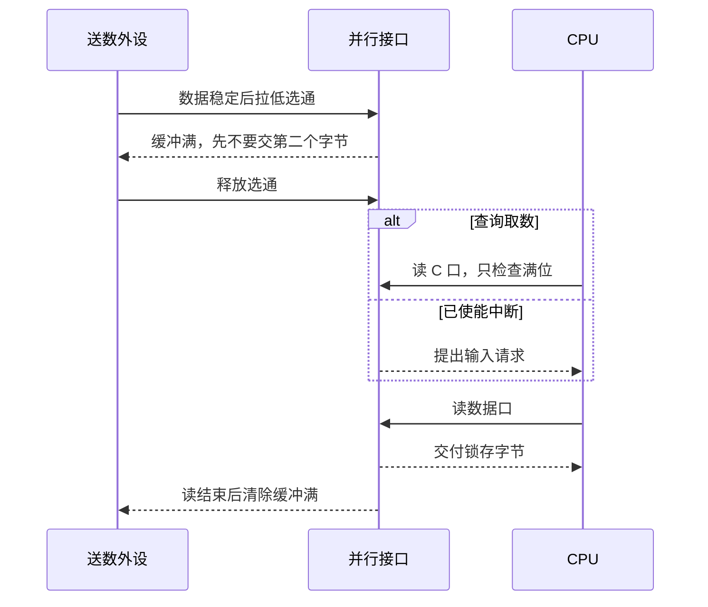
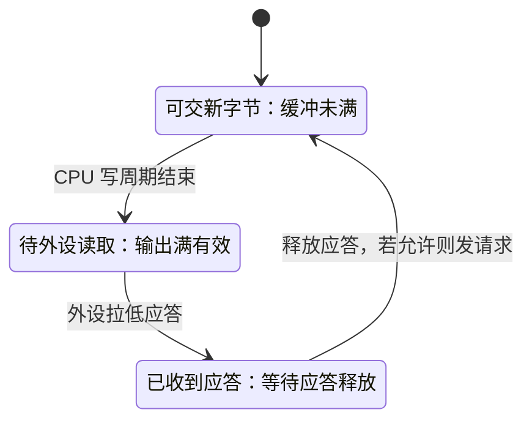

# 《微型计算机接口技术》第10章 并行 I/O 接口（课件）

CPU 在按键动作之前或之后读取引脚，结果可能不同；把开关状态放进一个能被读取的锁存器，仍不能单靠数据线分辨“这是新的一次”还是“上次的旧值”。这就是并行接口要加选通、缓冲满和应答线的原因：八根线回答“哪八位”，联络线回答“什么时候有效、对方是否接走”。本章第 4–75 页围绕 8255A 的这些约定及两个应用。第 2–3 页是上一章回顾，不把串行接口当本章新授内容。

并行链路让多位同拍到达，在短距离和允许较多引线的场合很自然；线路加长后，成本之外还要面对位间到达时差、串扰和信号质量。**订正**：课件第 4 页的固定速率排序只能当作特定课堂条件下的示意，不是普遍比较。若每次并行传 $w$ 位、有效传送率为 $f$ 次每秒，原始比特率才由 $wf$ 决定；单线串行可以靠更高符号率胜出，还要分别扣除协议开销。

## 四个地址是寄存器编号，不是板上一定连续的端口号

8255A 的 8 位系统数据总线经双向缓冲器与 CPU 交换，三组各 8 根外设线分别叫 PA、PB、PC。A 组控制 A 和 C 的高四位，B 组控制 B 和 C 的低四位，但==握手信号不是简单按高低半字节分组==，尤其 A 口握手要用到 PC3。硬件复位后，三口设为输入；要想让某个外设动起来，应先写明确的方式字，再写安全的初始数据。不能用读控制口来确认原始 8255A 的方式字（某些兼容件另有读回能力，不应混用）。

| 芯片 A1:A0 | `/CS=0、/RD=0、/WR=1` | `/CS=0、/RD=1、/WR=0` |
| --- | --- | --- |
| 00 | 读 A | 写 A |
| 01 | 读 B | 写 B |
| 10 | 读 C 或握手状态 | 写 C 的可输出位 |
| 11 | 不作为原器件的可读控制字 | 写方式字或 C 口按位控制字 |

斜杠前缀表示低有效。片选不有效时，不应把芯片当成总线数据源。课件第 10 页直接接 CPU 的 A1、A0，译码范围是 `60H–63H`，所以控制口是 `63H`。第 56 页的实验板只译码高位，不检查 CPU A2，所以 `218H–21BH` 与 `21CH–21FH` 两套端口都有效；后者是前者的镜像，不是第二片芯片。同样，如果换成由 CPU A2、A1 驱动芯片 A1、A0 的板卡，寄存器地址会隔一个字节，不再是“基址加 3”。参见[地址译码](../../../topics/微机接口/dizhi-yima.md)和[端口编址](../../../topics/微机接口/duankou-bianzhi.md)。

## 先选要不要握手，再填方向位

| 方式 | 数据口 | 数据时机由谁保证 |
| --- | --- | --- |
| 0：基本输入或输出 | A、B 和未借作握手的 C 位 | 无自动外设联络；输入直接缓冲，外设须在 CPU 读时提供稳定电平；CPU 写出的输出被锁存 |
| 1：选通输入或输出 | A、B 分别选择方向 | 各方向从 C 口借联络线；有锁存和状态反馈，可查询或用中断搬运 |
| 2：双向 | 只给 A 口；B 仍可独立用方式 0 或 1 | A 用两套联络信号，但共用八根数据线和一个中断输出；外设与接口不得同时驱动 PA |

方式 0 输入没有建立一个等待 CPU 随时取走的收件箱，输出却能保持写入值。第 25–26 页时序图的读写控制线不是同一个“采样时钟”：地址、片选需满足各自的建立/保持，读期间等待总线数据有效，写操作要在规定时窗内使 CPU 数据稳定，之后外设侧数据才有效。采用外设选通后，也仍要满足外设数据相对于选通信号的建立与保持时间。参见[接口功能](../../../topics/微机接口/jiekou-gongneng.md)和[信息交换方式](../../../topics/微机接口/xinxi-jiaohuan.md)。

**两类控制字都写控制口。** D7=1 时重设组方式与数据方向；D7=0 时只作 C 口按位操作（BSR）。方向位 1 表示输入、0 表示输出，但只影响仍可用作普通 I/O 的管脚。

| 方式字位 | 定义 |
| --- | --- |
| D6:D5 | A 组：00 基本方式，01 选通方式，1x 双向方式 |
| D4、D3 | A 数据方向、仍空闲的 C 高组方向；A 双向时 D4 不用 |
| D2 | B 组：0 基本方式，1 选通方式 |
| D1、D0 | B 数据方向、仍空闲的 C 低组方向 |

BSR 字的 D3:D1 选 C 口位号，D0 令该位相关状态清零或置一；无关位取零时，控制字是 $2i+b$（$i$ 为位号，$b$ 为 0 或 1）。某些已配置为联络的 C 位，不控制脚的物理电平，而映射到相应的中断允许触发器。例如 A 口选通输入时，写 `09H` 允许输入中断，写 `08H` 禁止；PC4 仍是外设送入的选通，不会凭软件命令变成输出。

> [!WARNING]
> 看见题目说“控制 PC4”，先问它现在是普通输出、握手输入，还是该模式对应的中断使能入口。把 BSR 字写到 C 数据口，不等于对控制口做按位操作；开片内中断也不等于 PIC 已解屏蔽或 CPU 已开放中断。

**参考解答（第 22–24 页）。** 第 22 页为 A 方式 0 输出、B 方式 0 输入、C 高半字节出/低半字节入，方式字 `83H`。第 23 页为 A 方式 0 输出、B 方式 1 输入，剩余 C 高位出、C 低位入，方式字 `87H`；把 `87H`、`05H` 顺序写到 `21BH`，后者打开经 PC2 选择的 B 口中断允许。第 24 页要求 A 方式 0 输入、B 与 C 方式 0 输出，向 `83H` 写 `90H`。涉及 `21BH` 等大于 8 位的端口号时，先把端口号装入 DX，再用 `OUT DX, AL`，参见 [I/O 指令](../../../topics/微机接口/io-zhiling.md)。

## 从“谁欠谁一个动作”读联络时序

不要把输入缓冲“满”和输出缓冲“满”当成同一极性、同一方向。输入的 `IBF=1` 是芯片告知外设“我有一个字节，尚未被 CPU 取走”；输出的 `/OBF=0` 是芯片告知外设“我刚放上一个字节，等你应答”。两者都不是 CPU 自己的 `/RD`、`/WR` 信号。

| 数据功能 | 外设送给芯片的脚 | 芯片送给外设或主机的脚 | BSR 选择 |
| --- | --- | --- | --- |
| A 方式 1 输入 | PC4 `/STB_A` | PC5 `IBF_A`、PC3 `INTR_A` | PC4 → `INTE_A` |
| A 方式 1 输出 | PC6 `/ACK_A` | PC7 `/OBF_A`、PC3 `INTR_A` | PC6 → `INTE_A` |
| B 方式 1 输入 | PC2 `/STB_B` | PC1 `IBF_B`、PC0 `INTR_B` | PC2 → `INTE_B` |
| B 方式 1 输出 | PC2 `/ACK_B` | PC1 `/OBF_B`、PC0 `INTR_B` | PC2 → `INTE_B` |
| A 方式 2 | PC4 选通输入、PC6 应答输出数据 | PC5 输入满、PC7 输出满、PC3 汇合请求 | PC4 开输入请求，PC6 开输出请求 |

表中 `/ACK_A`、`/ACK_B` 均是==外设应答输入==，不是 CPU 的写信号。联络输入脚与 CPU 读 C 所见的位也不是一回事：手册的状态字在相应位显示 INTE，不应将其当作采样外设选通/应答脚。A 口方式 1 输入余 PC7–6，输出余 PC5–4；B 方式 1 用 PC2–0。A 双向占用 PC7–3，B 若再用方式 1，将其余 PC2–0 用完。普通 C 口方向位不能夺回这些已分配的握手脚。

### 输入：低选通把字节交进来，CPU 读才算取走

外设先稳住字节，拉低 `/STB`，接口锁存并令 IBF 置高。选通结束、IBF 仍为高且 INTE 已开时，才提出输入 INTR。CPU 读真正的 A 或 B 数据口，读的下降边撤请求，结束读的上升边清满；只读 C 状态不消耗字节。查询也能取走同一个锁存字节，无须启用中断。**订正**：第 58 页文字把 PC5 称作输入线；握手方向应以电路和时序为准，PC5 的 IBF 是芯片输出，CPU 通过 C 口状态读它。参见[查询方式](../../../topics/微机接口/chaxun-fangshi.md)。

### 输出：CPU 写产生通知，外设确认才允许发下一字节

在正常 8255A 时序中，CPU 新一次写的开始撤销旧输出请求，写结束后接口把 `/OBF` 拉低，通知外设数据就绪。外设读取后把 `/ACK` 拉低，`/OBF` 恢复为高；应答释放后，若已使能，可向 CPU 请求下一字节。查询分支通过 C 口读 `/OBF`，不能把“值为 1”理解成缓冲满；它是低有效信号的撤销状态。B 口用掩码 `02H`，A 口用 `80H`。如果外设还要求另一个忙线或特定释放时序，必须一起满足，不能把接口状态替代整个外设规格。

这张状态图分开了缓冲已空和应答已释放：在中断分支，后者才触发新的输出请求；在查询分支，能否立刻送下一个字节，仍取决于外设协议。

A 口方式 2 只把这两个方向复用到一组 PA 线上，不是在同一时刻传送两份数据。`/ACK_A` 在双向输出时还允许接口驱动 PA；另一边提供输入字节时应让接口退出驱动。CPU 若响应共享的 `INTR_A`，必须结合 C 口输入满位、输出状态与程序待发数据判断服务哪个方向，不能把每次请求一律当作“收到新输入”。

> [!TIP]
> 看到==查询还是中断==，先维持相同的握手硬件，再决定 CPU 在哪里等待：循环读状态，或者让满足条件的接口请求打断 CPU。换交换方式往往只需改 BSR 使能，不需换方式字。

**参考解答（第 48–50 页）。** 第 48 页选择 A、B 两口；C 承载联络线，并不具备方式 1 数据口。第 49 页把 A 配成方式 0 输入、B 配成方式 1 输出，C 的普通位均为输出，先向 `217H` 写 `94H`，再写 `05H` 允许 B 中断；不能要求已作联络输入的 PC2 也输出。第 50 页先写的 `A0H` 是 A 口方式 1 输出，不是输入，所以第一空为 `21BH`、第二空为 `0DH`（选 PC6、置一）；改查询时第二空为 `0CH`，不是对 PC4 作复位。

## 应用一：把按钮的瞬间变成保持的灯态

第 54–68 页的实验把开关接 A 口低三位，自复按钮通过单脉冲电路给 PC4 送选通；B 口驱动低有效的八只灯。没有选通时，拨开关只改变引脚，不应重选哪盏灯。这是看到“按下时才更新”应选 A 口方式 1 输入的理由；B 口只需基本输出，锁存灯态直到下一次写。方式字取 `B0H`（题图未使用的普通 C 位取输出），送 `21BH`，B 数据口初值写 `FFH`，全部熄灭。

**参考解答。** 查询方案再用 `08H` 禁止 A 口中断。C 口 `21AH` 读出的 `20H` 位为 1 才从 A 口 `218H` 取字节。令 $k=\text{读值}\mathbin{\&}7$，向 B 口 `219H` 写 $255-2^k$：只有第 $k$ 位为低。按钮采样值 `101B` 对应 $k=5$，写 `DFH` 只点亮第六只灯；原程序的查表是对同一映射的实现。镜像地址也可统一换成 `21CH、21DH、21EH、21FH`。

中断方案把 PC3 请求接到板上指定的中断输入、安装对应服务程序、正确开启 PIC 与 CPU 中断，并用 `09H` 打开片内 A 输入中断。服务程序仍要**读 A 数据口**来消除数据就绪，再写 B、向实际受理请求的 PIC 发送 EOI 并返回。不能用 EOI 替代读 A，也不能照抄历史实验板的 IRQ/向量到另一台机。退出时按平台恢复向量和掩码，先关闭本设备请求；参见[中断向量与现场](../../../topics/微机接口/zhongduan-xiangliang-yu-zhan.md)。

## 应用二：打印机接收完这一个字节，才再送下一字节

第 69–75 页让 B 口做方式 1 输出，PB 接数据线，PC1 的低有效 `/OBF` 接打印机 `/STROBE`，应答 `/ACKNLG` 送 PC2，BUSY 另接普通输入 PC3。按图中协议，外设接收后发应答，忙线随其时序撤销；肯定不能只看数据线上还保持着上次值就写新值。这里输出缓冲空与打印机能接受下一字节是两个概念。课件的轮询只看 `/OBF`，依赖所画电路、外设忙线/应答规范及写入间隔；将设计用于其他设备时，若可能还忙，不应在应答一沿就立即发下一字节。

**参考解答。** 端口基址 `80H` 时，选 B 方式 1 输出、剩余 PC3 为输入；其余按题图不使用、取零得到 `85H`，再写 `04H` 关 B 中断，二者都送 `83H`。数据送 `81H`，读 `82H` 与 `02H` 做掩码判断：零说明仍待应答；非零才让软件按照本电路约定前进。移植时可以在等待中加超时、在首字节之前先核实 BUSY 空闲，并显式按目标设备规范检查后续 BUSY 和选通时宽；这三项是**补充**，不是原件程序的一部分。

> [!IMPORTANT]
> 评估任一并行接口题，最后沿引脚核对三件事：谁驱动数据、谁产生握手、CPU 读写的是数据口还是状态/控制口。这三种职责即便出现在同一片 C 口，也不能相互替换。
