# 《微型计算机接口技术》第11章 8254定时/计数器（课件）

原件的每一页，下面附识别出的文字。

### 南京邮电大学计算机学院

原文：

南京邮电大学计算机学院

微型计算机接口技术

南京邮電大學
Tokai University of Posts and Telecommunications
南京邮電大學
Nanjing University of Posts and Telecommunications

第十一章 8254定时/计数器

### 回顾

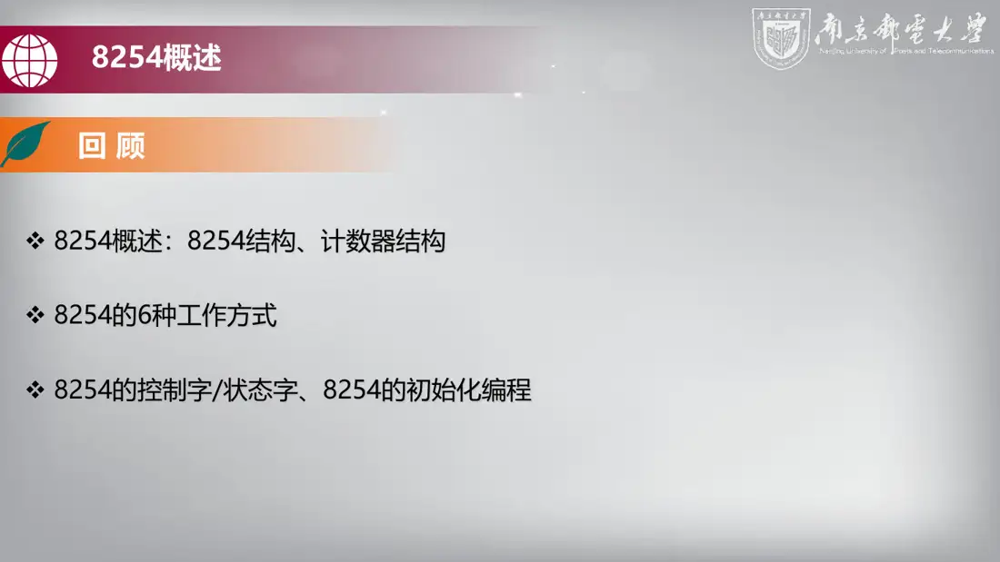

原文：

回顾

✿ 8254概述：8254结构、计数器结构

✿ 8254的6种工作方式

✿ 8254的控制字/状态字、8254的初始化编程

8254概述

南京邮电大学
Nanjing University of Posts and Telecommunications
南京邮电大学
Nanjing University of Posts and Telecommunications

### 连续的方波信号

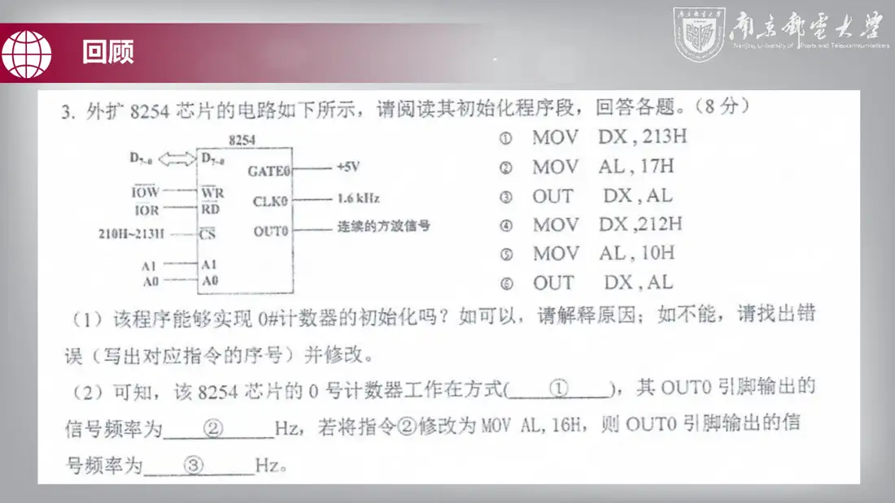

原文：

3. 外扩 8254 芯片的电路如下所示，请阅读其初始化程序段，回答各题。（8 分）

连续的方波信号

① MOV DX,213H

② MOV AL, 17H

③ OUT DX, AL

④ MOV DX,212H

⑤ MOV AL, 10H

(1) 该程序能够实现 0# 计数器的初始化吗? 如可以, 请解释原因; 如不能, 请找出错误 (写出对应指令的序号) 并修改。

(2) 可知, 该 8254 芯片的 0 号计数器工作在方式 (① ), 其 OUTO 引脚输出的信号频率为 ② Hz, 若将指令 ② 修改为 MOV AL, $16 \mathrm{~H}$ , 则 OUTO 引脚输出的信号频率为 ③ Hz。

回顾

南京邮电大学
Nanjing University of Posts and Telecommunications
南京邮电大学
Nanjing University of Posts and Telecommunications

### I8254A PROC

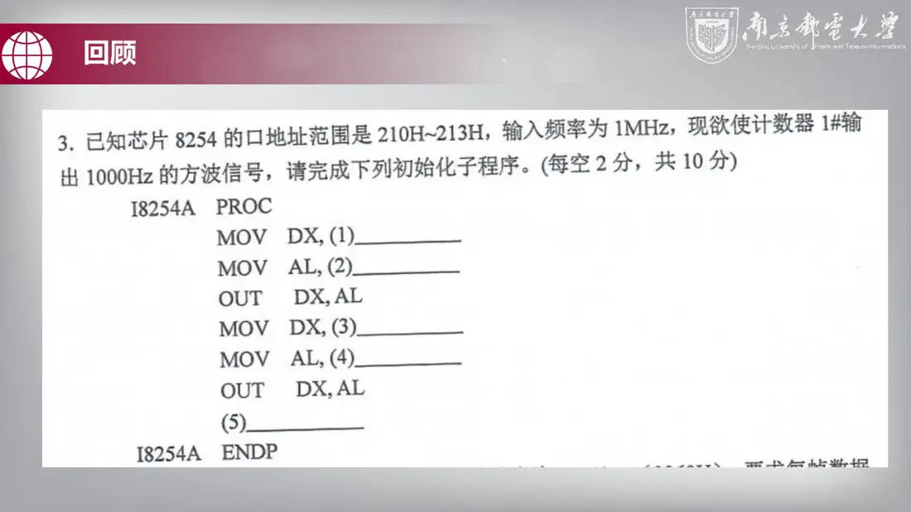

原文：

3. 已知芯片 8254 的口地址范围是 210H\~213H，输入频率为 1MHz，现欲使计数器 1#输出 1000Hz 的方波信号，请完成下列初始化子程序。(每空 2 分，共 10 分)

I8254A PROC

MOV DX,(1)\_\_\_\_

MOV AL, (2)\_\_\_\_

OUT DX, AL

MOV DX,(3)\_\_\_\_

MOV AL,(4)\_\_\_\_

OUT DX, AL

(5)

I8254A ENDP

(1) 两书每帖数据

回顾

南京邮电大学
Nanjing University of Posts and Telecommunications
南京邮电大学
Nanjing University of Posts and Telecommunications

### 知识要点

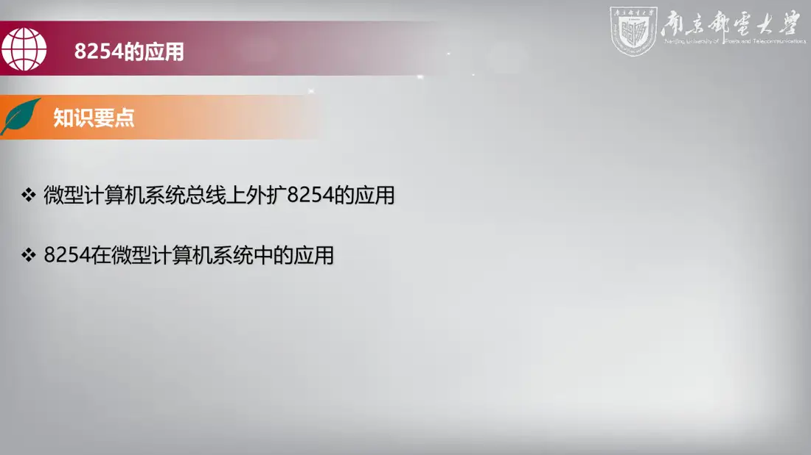

原文：

知识要点

微型计算机系统总线上外扩8254的应用

✿ 8254在微型计算机系统中的应用

8254的应用

南京邮电大学
 Nanjing University of Posts and Telecommunications
南京邮电大学
 Nanjing University of Posts and Telecommunications

### 一. 微型计算机系统总线上外扩8254的应用

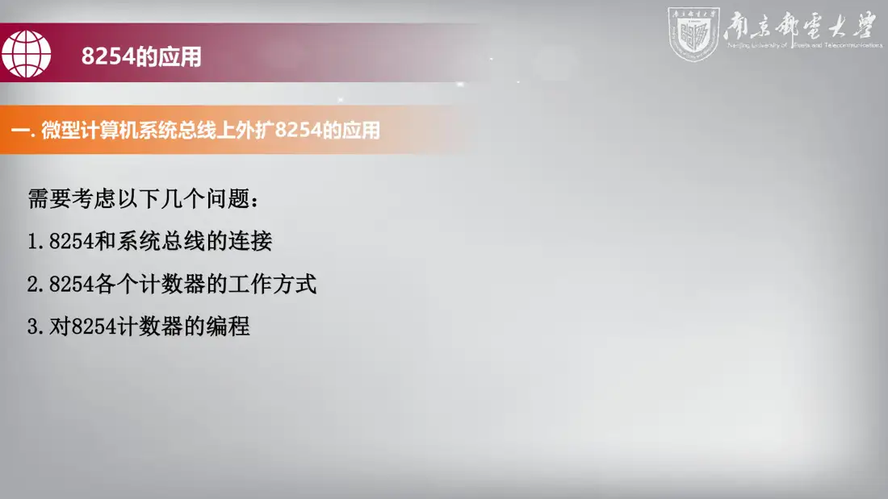

原文：

一. 微型计算机系统总线上外扩8254的应用

需要考虑以下几个问题:

1.8254和系统总线的连接

2.8254各个计数器的工作方式

3. 对8254计数器的编程

南京邮电大学
 Nanjing University of Posts and Telecommunications
南京邮电大学
 Nanjing University of Posts and Telecommunications

8254的应用

### 一. 微型计算机系统总线上外扩8254的应用

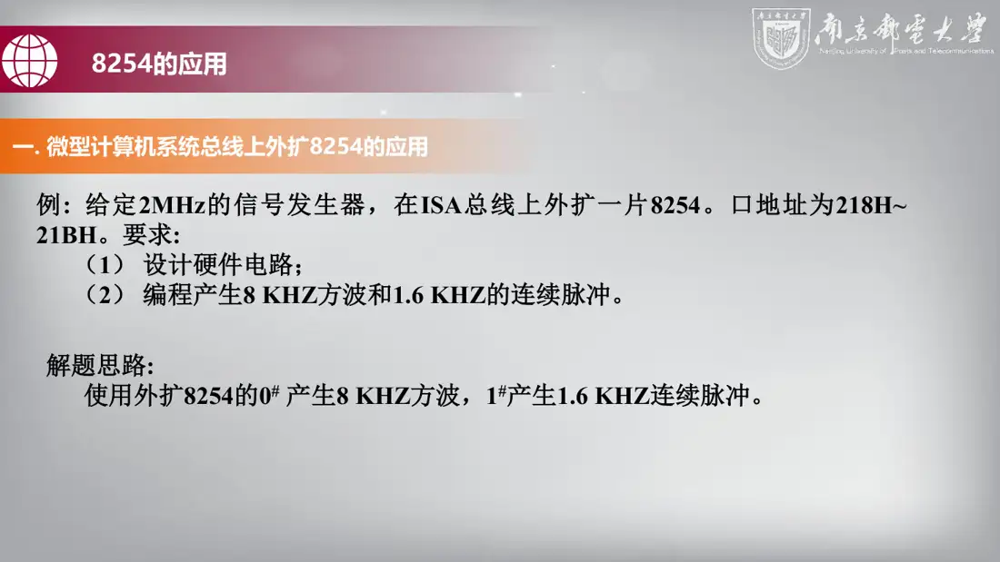

原文：

一. 微型计算机系统总线上外扩8254的应用

例：给定2MHz的信号发生器，在ISA总线上外扩一片8254。口地址为218H\~21BH。要求:

(1) 设计硬件电路;

(2) 编程产生8 KHZ方波和1.6 KHZ的连续脉冲。

解题思路:

使用外扩8254的0 $^{\#}$ 产生8 KHZ方波，1 $^{\#}$ 产生1.6 KHZ连续脉冲。

8254的应用

南京邮電大學
Nanjing University of Posts and Telecommunications
南京邮電大學

### 8254的应用

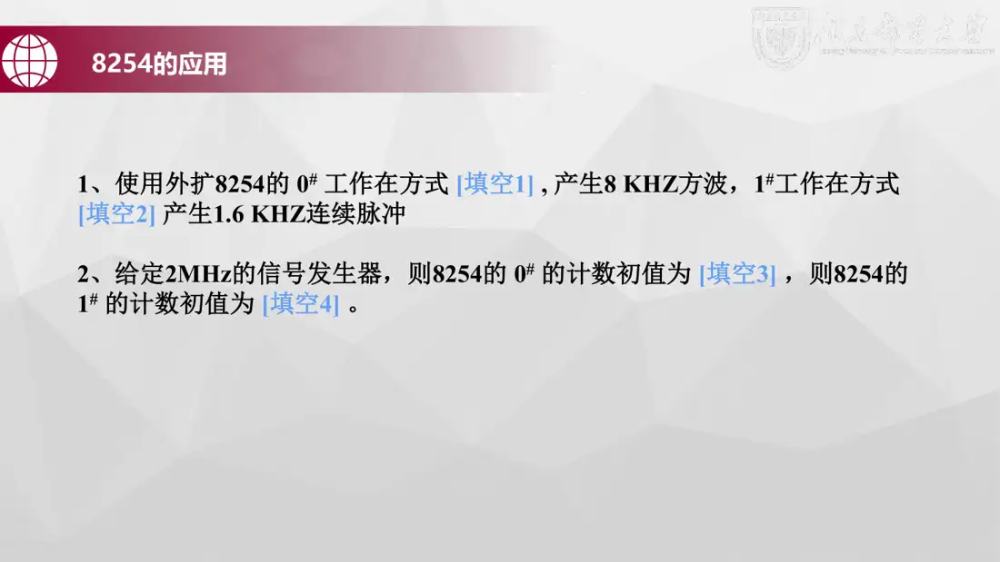

原文：

1、使用外扩8254的 0 $^{\#}$ 工作在方式 [填空1]，产生8 KHZ方波，1 $^{\#}$ 工作在方式 [填空2] 产生1.6 KHZ连续脉冲

2、给定2MHz的信号发生器, 则8254的 $0^{\#}$ 的计数初值为 [填空3], 则8254的 $1^{\#}$ 的计数初值为 [填空4]。

8254的应用

### 一. 微型计算机系统总线上外扩8254的应用

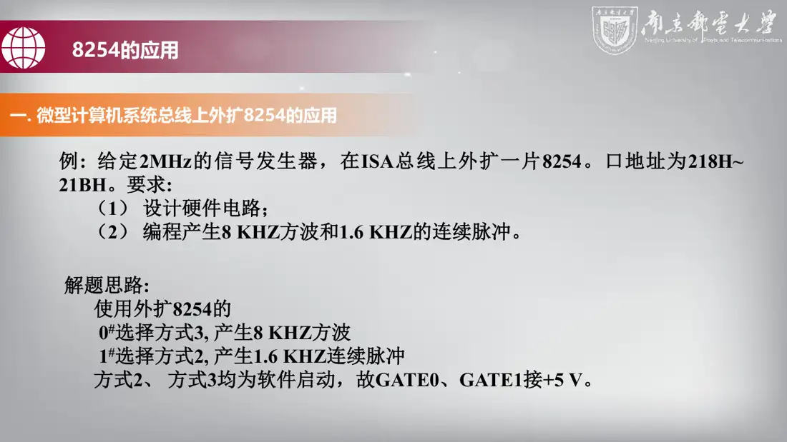

原文：

一. 微型计算机系统总线上外扩8254的应用

例：给定2MHz的信号发生器，在ISA总线上外扩一片8254。口地址为218H\~21BH。要求:

(1) 设计硬件电路;

(2) 编程产生8 KHZ方波和1.6 KHZ的连续脉冲。

解题思路:

使用外扩8254的

0#选择方式3, 产生8 KHZ方波

1#选择方式2, 产生1.6 KHZ连续脉冲

方式2、方式3均为软件启动，故GATE0、GATE1接+5 V。

8254的应用

南京邮电大学
 Nanjing University of Posts and Telecommunications
南京邮电大学
 Nanjing University of Posts and Telecommunications

### (1) 设计硬件电路

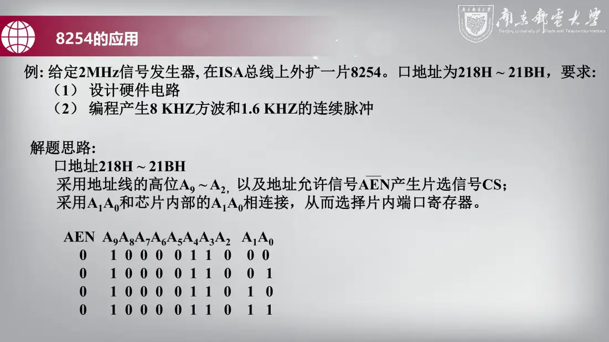

原文：

例: 给定2MHz信号发生器, 在ISA总线上外扩一片8254。口地址为218H \~ 21BH，要求:

(1) 设计硬件电路

(2) 编程产生8 KHZ方波和1.6 KHZ的连续脉冲

解题思路:

口地址218H～21BH

采用地址线的高位 $A_{9}\sim A_{2}$ ，以及地址允许信号AEN产生片选信号CS；

采用 $\mathbf{A}_1\mathbf{A}_0$ 和芯片内部的 $\mathbf{A}_1\mathbf{A}_0$ 相连接，从而选择片内端口寄存器。

$$
\begin{array}{c c c c c c c c c c} \text {AEN} & \mathrm{A} _ {9} \mathrm{A} _ {8} \mathrm{A} _ {7} \mathrm{A} _ {6} \mathrm{A} _ {5} \mathrm{A} _ {4} \mathrm{A} _ {3} \mathrm{A} _ {2} & \mathrm{A} _ {1} \mathrm{A} _ {0} \\ 0 & 1 0 0 0 0 1 1 0 & 0 0 \\ 0 & 1 0 0 0 0 1 1 0 & 0 1 \\ 0 & 1 0 0 0 0 1 1 0 & 1 0 \\ 0 & 1 0 0 0 0 1 1 0 & 1 1 \end{array}
$$

8254的应用

南京邮电大学
Nanjing University of Posts and Telecommunications
南京邮电大学
Nanjing University of Posts and Telecommunications

### 硬件电路:

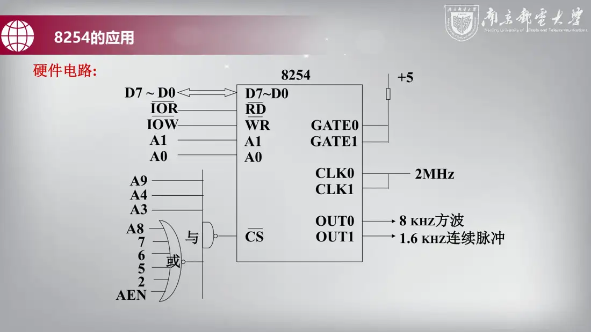

原文：

硬件电路:

8254的应用

南京邮電大學
Nanjing University of Posts and Telecommunications
南京邮電大學

### 编程实现:

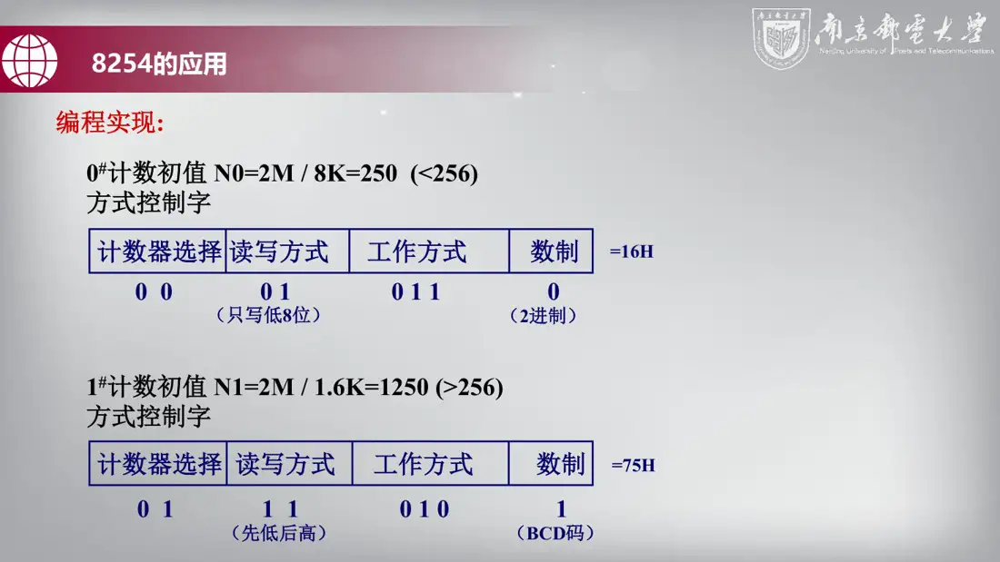

原文：

编程实现:

0#计数初值 N0=2M / 8K=250 (<256)

方式控制字

<table><tr><td>计数器选择</td><td>读写方式</td><td>工作方式</td><td>数制</td><td>=16H</td></tr><tr><td>0 0</td><td>0 1(只写低8位)</td><td>0 1 1</td><td>0(2进制)</td><td></td></tr></table>

1#计数初值 N1=2M / 1.6K=1250 (>256)

方式控制字

<table><tr><td>计数器选择</td><td>读写方式</td><td>工作方式</td><td>数制</td><td>=75H</td></tr><tr><td>0 1</td><td>1 1(先低后高)</td><td>0 1 0</td><td>1(BCD码)</td><td></td></tr></table>

8254的应用

南京邮电大学
Nanjing University of Posts and Telecommunications
南京邮电大学

### 完整程序:

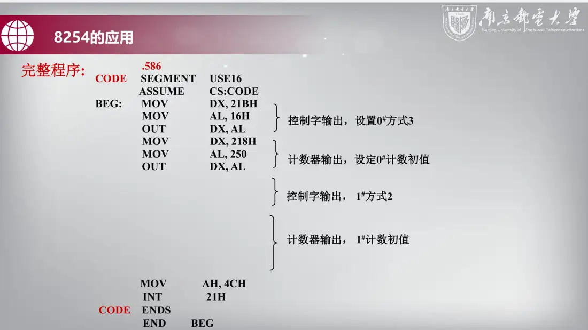

原文：

完整程序:

BEG: MOV DX, 21BH  
MOV AL, 16H  
OUT DX, AL  
MOV DX, 218H  
MOV AL, 250  
OUT DX, AL

MOV AH, 4CH
INT 21H
CODE ENDS
END BEG

控制字输出，设置0#方式3

计数器输出， $1^{\#}$ 计数初值

8254的应用

南京邮电大学
Nanjing University of Posts and Telecommunications
南京邮电大学

### 请写出1#计数器初始化程序?

原文：

请写出1#计数器初始化程序?

8254的应用

南京邮电大学
Nanjing University of Press and Communication

### 8254的应用

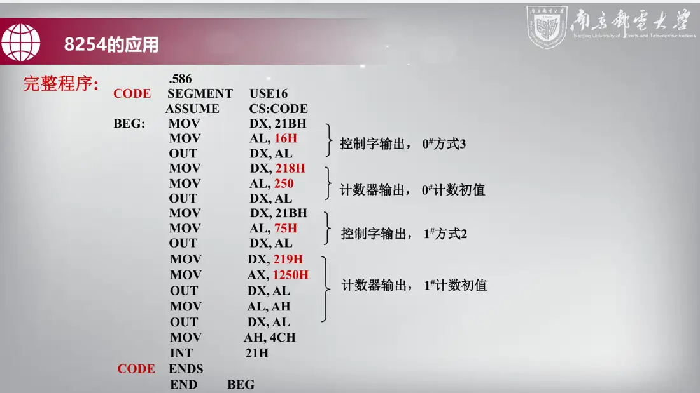

原文：

<table><tr><td>完整程序:</td><td colspan="3">.586</td></tr><tr><td>CODE</td><td>SEGMENT</td><td>USE16</td><td></td></tr><tr><td></td><td>ASSUME</td><td>CS:CODE</td><td></td></tr><tr><td>BEG:</td><td>MOV</td><td>DX, 21BH</td><td rowspan="3">控制字输出,0#方式3</td></tr><tr><td></td><td>MOV</td><td>AL, 16H</td></tr><tr><td></td><td>OUT</td><td>DX, AL</td></tr><tr><td></td><td>MOV</td><td>DX, 218H</td><td rowspan="3">计数器输出,0#计数初值</td></tr><tr><td></td><td>MOV</td><td>AL, 250</td></tr><tr><td></td><td>OUT</td><td>DX, AL</td></tr><tr><td></td><td>MOV</td><td>DX, 21BH</td><td rowspan="3">控制字输出,1#方式2</td></tr><tr><td></td><td>MOV</td><td>AL, 75H</td></tr><tr><td></td><td>OUT</td><td>DX, AL</td></tr><tr><td></td><td>MOV</td><td>DX, 219H</td><td rowspan="7">计数器输出,1#计数初值</td></tr><tr><td></td><td>MOV</td><td>AX, 1250H</td></tr><tr><td></td><td>OUT</td><td>DX, AL</td></tr><tr><td></td><td>MOV</td><td>AL, AH</td></tr><tr><td></td><td>OUT</td><td>DX, AL</td></tr><tr><td></td><td>MOV</td><td>AH, 4CH</td></tr><tr><td></td><td>INT</td><td>21H</td></tr><tr><td>CODE</td><td>ENDS</td><td></td><td></td></tr><tr><td></td><td>END</td><td>BEG</td><td></td></tr></table>

8254的应用

南京邮電大學
Nanjing University of Posts and Telecommunications
南京邮電大學

### 二. 8254在微型计算机系统中的应用

原文：

二. 8254在微型计算机系统中的应用

1.8254在IBM PC/AT中的应用电路

8254的应用

南京邮电大学
 Nanjing University of Posts and Telecommunications
南京邮电大学
 Nanjing University of Posts and Telecommunications

### 3个计数器的计数脉冲输入端都为1.193182 MHZ

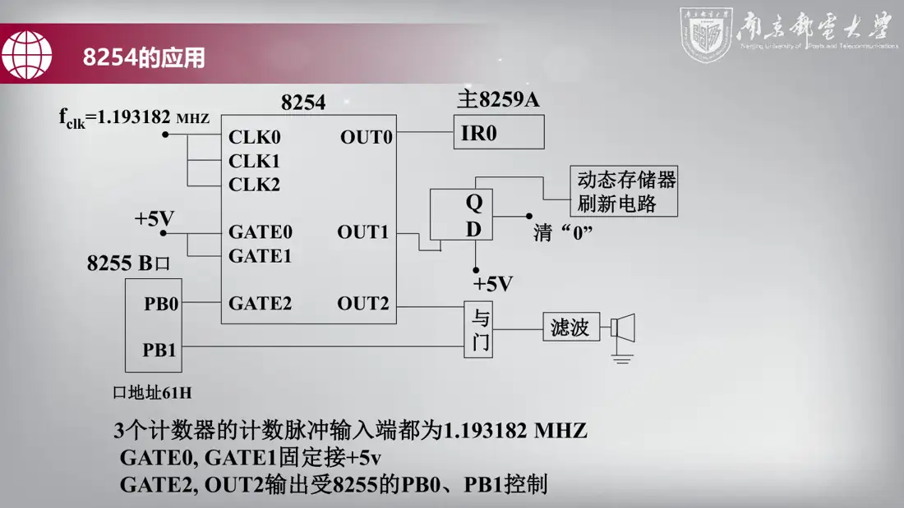

原文：

3个计数器的计数脉冲输入端都为1.193182 MHZ
GATE0, GATE1固定接+5v
GATE2, OUT2输出受8255的PB0、PB1控制

8254的应用

南京邮電大學
Nanjing University of Posts and Telecommunications
南京邮電大學

### 8254的应用

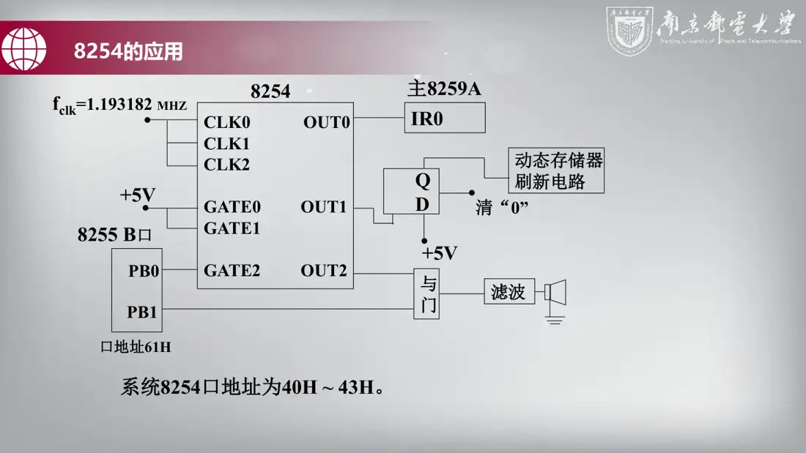

原文：

8254的应用

南京邮電大學
 Nanjing University of Posts and Telecommunications
南京邮電大學
 Nanjing University of Posts and Telecommunications

### 系统加电后，由BIOS完成对3个计数器初始化。

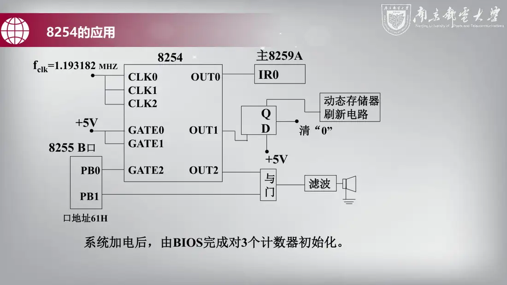

原文：

系统加电后，由BIOS完成对3个计数器初始化。

8254的应用

南京邮電大學
 Nanjing University of Posts and Telecommunications
南京邮電大學

### 8254的应用

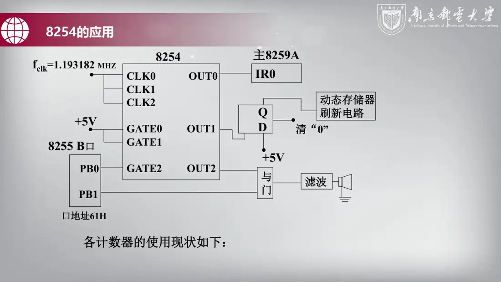

原文：

8254的应用

南京邮電大學
 Nanjing University of Posts and Telecommunications
南京邮電大學

### 作用: 每隔55ms通过中断系统提出一次日时钟中断请求。

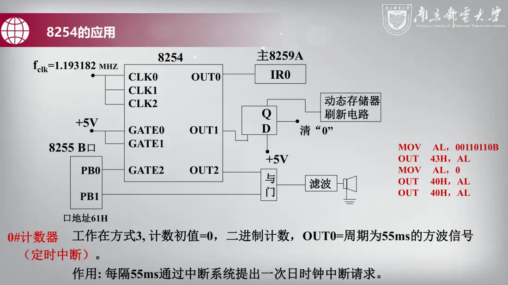

原文：

0#计数器 工作在方式3, 计数初值=0, 二进制计数, OUT0=周期为55ms的方波信号（定时中断）。

作用: 每隔55ms通过中断系统提出一次日时钟中断请求。

8254的应用

南京邮電大學
Nanjing University of Posts and Telecommunications
南京邮電大學

### 作用: 每隔15.1μs（向DRAM刷新控制器）提出一次“动态存储器刷新请求”。

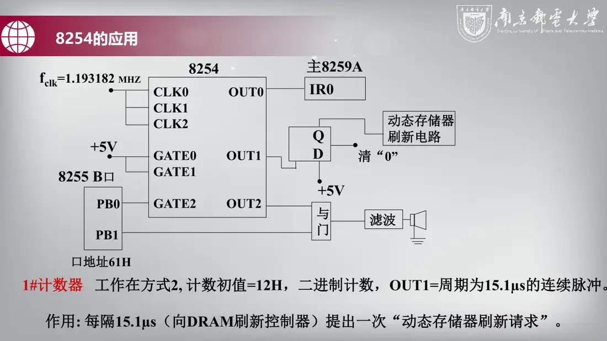

原文：

1#计数器 工作在方式2, 计数初值=12H，二进制计数，OUT1=周期为15.1μs的连续脉冲。

作用: 每隔15.1μs（向DRAM刷新控制器）提出一次“动态存储器刷新请求”。

8254的应用

南京邮電大學
Nanjing University of Posts and Telecommunications
南京邮電大學

### 2#计数器 工作在方式3, 初值=533H，二进制计数；

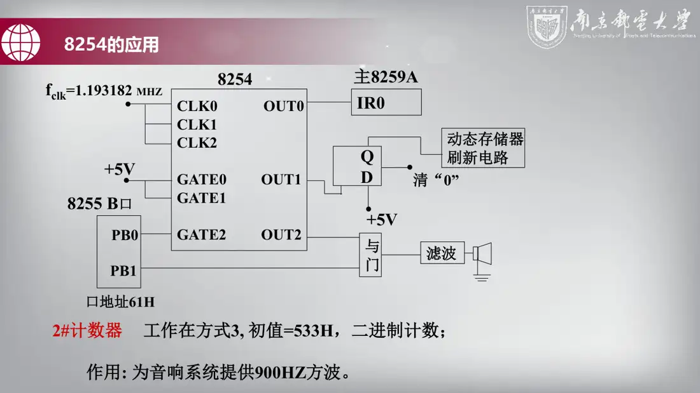

原文：

2#计数器 工作在方式3, 初值=533H，二进制计数；

作用: 为音响系统提供900HZ方波。

8254的应用

南京邮电大学
 Nanjing University of Posts and Telecommunications
南京邮电大学

### 注意：用户程序可以使用0#, 2#计数器，用户程序禁止使用1#计数器。

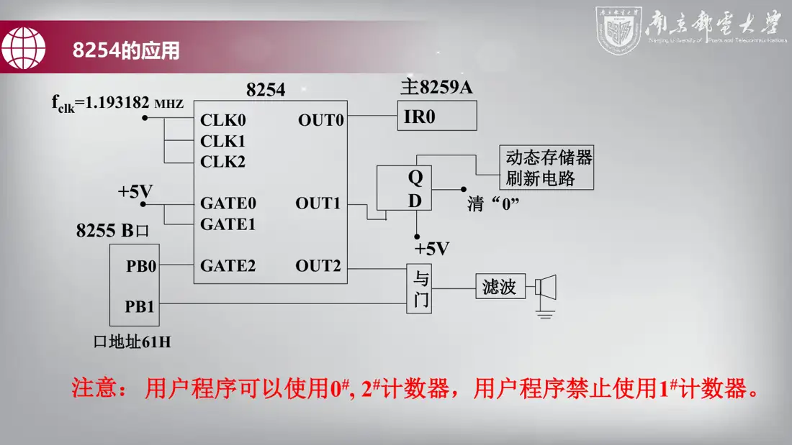

原文：

注意：用户程序可以使用0#, 2#计数器，用户程序禁止使用1#计数器。

8254的应用

南京邮電大學
Nanjing University of Posts and Telecommunications
南京邮電大學

### 8254的应用

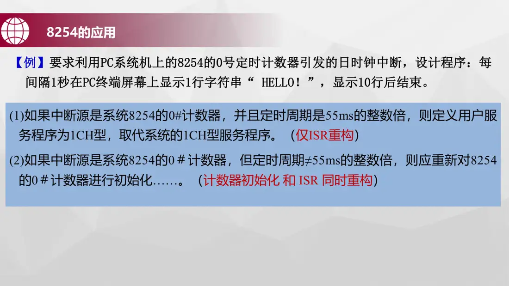

原文：

【例】要求利用PC系统机上的8254的0号定时计数器引发的日时钟中断，设计程序：每隔1秒在PC终端屏幕上显示1行字符串“HELLO！”，显示10行后结束。

(1)如果中断源是系统8254的0#计数器，并且定时周期是55ms的整数倍，则定义用户服务程序为1CH型，取代系统的1CH型服务程序。（仅ISR重构）

(2)如果中断源是系统8254的0#计数器，但定时周期≠55ms的整数倍，则应重新对8254的0#计数器进行初始化……。（计数器初始化和ISR同时重构）

8254的应用

### 对系统8254的0号计数器编程，使得输出端每隔5ms提出一次中断请求。

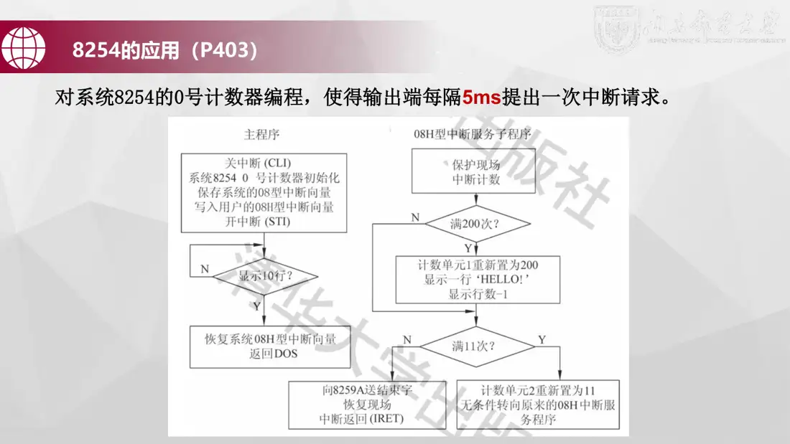

原文：

对系统8254的0号计数器编程，使得输出端每隔5ms提出一次中断请求。

希克森博士
Nanjing University of Physics and Economics

8254的应用 (P403)

### 程序段如下:

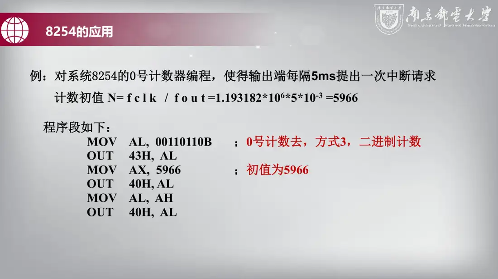

原文：

例：对系统8254的0号计数器编程，使得输出端每隔5ms提出一次中断请求计数初值 N=fclk / fout=1.193182\*10 $^{6}$ \*5\*10 $^{-3}$ =5966

程序段如下:

MOV AL, 00110110B ; 0号计数去，方式3，二进制计数

OUT 43H, AL

MOV AX, 5966 ; 初值为5966

OUT 40H, AL

MOV AL, AH

OUT 40H, AL

8254的应用

南京邮電大學
 Nanjing University of Posts and Telecommunications
南京邮電大學
 Nanjing University of Posts and Telecommunications

### 程序清单

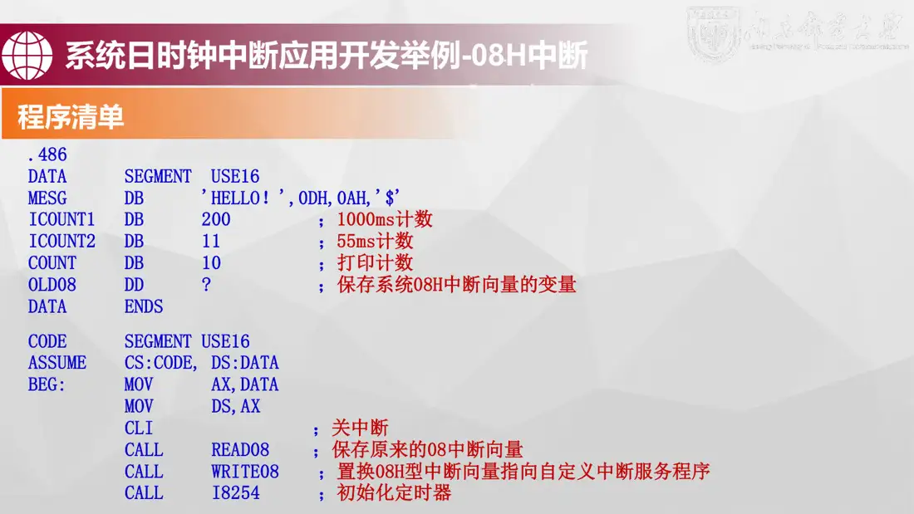

原文：

程序清单

<table><tr><td colspan="4">.486</td></tr><tr><td>DATA</td><td>SEGMENT</td><td>USE16</td><td></td></tr><tr><td>MESG</td><td>DB</td><td>&#x27;HELLO! &#x27;, ODH, OAH,&#x27; $&#x27;</td><td></td></tr><tr><td>ICOUNT1</td><td>DB</td><td>200</td><td>; 1000ms计数</td></tr><tr><td>ICOUNT2</td><td>DB</td><td>11</td><td>; 55ms计数</td></tr><tr><td>COUNT</td><td>DB</td><td>10</td><td>; 打印计数</td></tr><tr><td>OLD08</td><td>DD</td><td>?</td><td>; 保存系统08H中断向量的变量</td></tr><tr><td>DATA</td><td>ENDS</td><td></td><td></td></tr><tr><td>CODE</td><td>SEGMENT</td><td>USE16</td><td></td></tr><tr><td>ASSUME</td><td>CS:CODE,</td><td>DS:DATA</td><td></td></tr><tr><td>BEG:</td><td>MOV</td><td>AX, DATA</td><td></td></tr><tr><td></td><td>MOV</td><td>DS, AX</td><td></td></tr><tr><td></td><td>CLI</td><td></td><td>; 关中断</td></tr><tr><td></td><td>CALL</td><td>READ08</td><td>; 保存原来的08中断向量</td></tr><tr><td></td><td>CALL</td><td>WRITE08</td><td>; 置换08H型中断向量指向自定义中断服务程序</td></tr><tr><td></td><td>CALL</td><td>I8254</td><td>; 初始化定时器</td></tr></table>

系统日时钟中断应用开发举例-08H中断

南京邮电大学
Shanghai University of Press and Communications

### 系统日时钟中断应用开发举例-08H中断

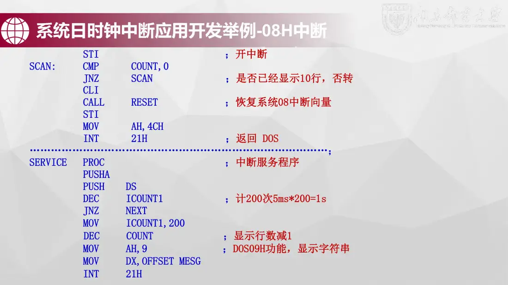

原文：

<table><tr><td rowspan="8">SCAN:</td><td>STI</td><td></td><td>;开中断</td></tr><tr><td>CMP</td><td>COUNT, 0</td><td></td></tr><tr><td>JNZ</td><td>SCAN</td><td>;是否已经显示10行,否转</td></tr><tr><td>CLI</td><td></td><td></td></tr><tr><td>CALL</td><td>RESET</td><td>;恢复系统08中断向量</td></tr><tr><td>STI</td><td></td><td></td></tr><tr><td>MOV</td><td>AH, 4CH</td><td></td></tr><tr><td>INT</td><td>21H</td><td>;返回 DOS</td></tr><tr><td rowspan="10">SERVICE</td><td>PROC</td><td></td><td>;中断服务程序</td></tr><tr><td>PUSHA</td><td></td><td></td></tr><tr><td>PUSH</td><td>DS</td><td></td></tr><tr><td>DEC</td><td>ICOUNT1</td><td>;计200次5ms*200=1s</td></tr><tr><td>JNZ</td><td>NEXT</td><td></td></tr><tr><td>MOV</td><td>ICOUNT1, 200</td><td></td></tr><tr><td>DEC</td><td>COUNT</td><td>;显示行数减1</td></tr><tr><td>MOV</td><td>AH, 9</td><td>;DOS09H功能,显示字符串</td></tr><tr><td>MOV</td><td>DX, OFFSET MESG</td><td></td></tr><tr><td>INT</td><td>21H</td><td></td></tr></table>

系统日时钟中断应用开发举例-08H中断

### 系统日时钟中断应用开发举例-08H中断

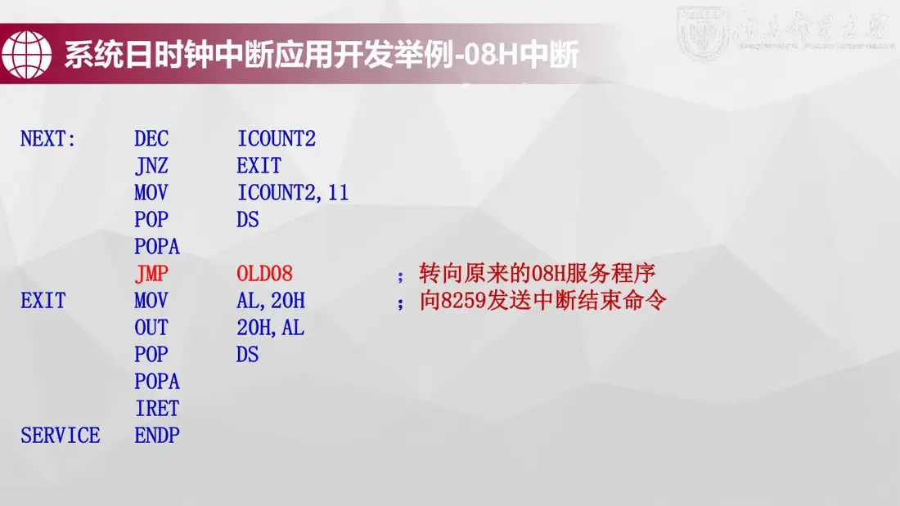

原文：

<table><tr><td rowspan="6">NEXT:</td><td>DEC</td><td>ICOUNT2</td><td></td></tr><tr><td>JNZ</td><td>EXIT</td><td></td></tr><tr><td>MOV</td><td>ICOUNT2, 11</td><td></td></tr><tr><td>POP</td><td>DS</td><td></td></tr><tr><td>POPA</td><td></td><td></td></tr><tr><td>JMP</td><td>OLD08</td><td>;转向原来的08H服务程序</td></tr><tr><td rowspan="5">EXIT</td><td>MOV</td><td>AL, 20H</td><td>;向8259发送中断结束命令</td></tr><tr><td>OUT</td><td>20H, AL</td><td></td></tr><tr><td>POP</td><td>DS</td><td></td></tr><tr><td>POPA</td><td></td><td></td></tr><tr><td>IRET</td><td></td><td></td></tr><tr><td>SERVICE</td><td>ENDP</td><td></td><td></td></tr></table>

系统日时钟中断应用开发举例-08H中断

南京邮电大学
Nanjing University of Metals and Economics

### 系统日时钟中断应用开发举例-08H中断

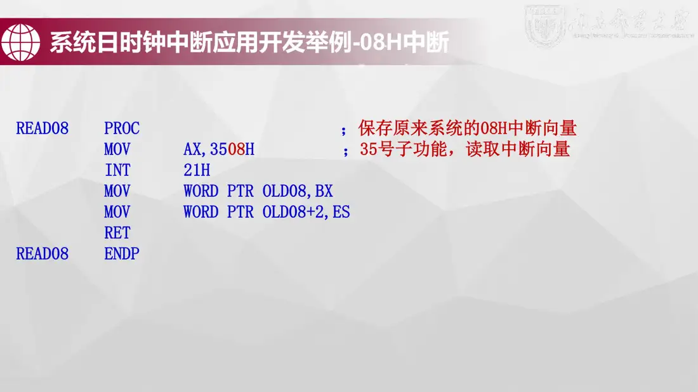

原文：

<table><tr><td rowspan="6">READ08</td><td>PROC</td><td></td><td>; 保存原来系统的08H中断向量</td></tr><tr><td>MOV</td><td>AX, 3508H</td><td>; 35号子功能,读取中断向量</td></tr><tr><td>INT</td><td>21H</td><td></td></tr><tr><td>MOV</td><td>WORD PTR OLD08, BX</td><td></td></tr><tr><td>MOV</td><td>WORD PTR OLD08+2, ES</td><td></td></tr><tr><td>RET</td><td></td><td></td></tr><tr><td>READ08</td><td>ENDP</td><td></td><td></td></tr><tr><td rowspan="9">WRITE08</td><td>PROC</td><td></td><td rowspan="10">; 置换08H型中断向量指向自定义中断服务程序</td></tr><tr><td>PUSH</td><td>DS</td></tr><tr><td>MOV</td><td>AX, CODE</td></tr><tr><td>MOV</td><td>DS, AX</td></tr><tr><td>MOV</td><td>DX, OFFSET SERVICE</td></tr><tr><td>MOV</td><td>AX, 2508H</td></tr><tr><td>INT</td><td>21H</td></tr><tr><td>POP</td><td>DS</td></tr><tr><td>RET</td><td></td></tr><tr><td>WRITE08</td><td>ENDP</td><td></td></tr><tr><td>I8254</td><td>PROC</td><td></td><td></td></tr><tr><td></td><td>MOV</td><td>AL,</td><td>00110110B ; 0号计数器,方式3,二进制计数</td></tr><tr><td></td><td>OUT</td><td>43H,</td><td>AL</td></tr><tr><td></td><td>MOV</td><td>AX,</td><td>5966 ; 初值为5966</td></tr><tr><td></td><td>OUT</td><td>40H,</td><td>AL</td></tr><tr><td></td><td>MOV</td><td>AL,</td><td>AH</td></tr><tr><td>RESET</td><td>OUTPROC</td><td>40H,</td><td>AL; 恢复系统08中断向量</td></tr><tr><td rowspan="5"></td><td>MOV</td><td>DX, WORD PTR OLD08</td><td rowspan="8">; 注意和后一条指令的顺序</td></tr><tr><td>MOV</td><td>DS, WORD PTR OLD08+2</td></tr><tr><td>MOV</td><td>AX, 2508H</td></tr><tr><td>INT</td><td>21H</td></tr><tr><td>RET</td><td></td></tr><tr><td>RESET</td><td>ENDP</td><td></td></tr><tr><td rowspan="2">CODE</td><td>ENDS</td><td></td></tr><tr><td>END</td><td>BEG</td></tr></table>

系统日时钟中断应用开发举例-08H中断

### 系统日时钟中断应用开发举例-08H中断

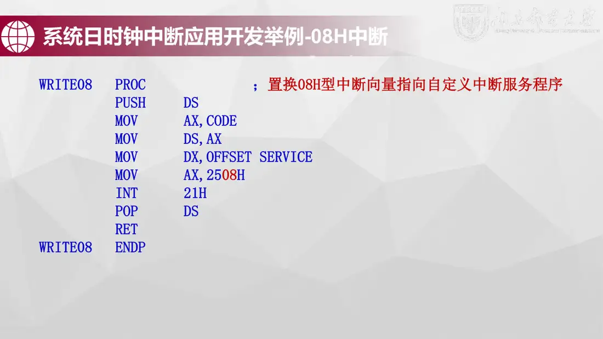

原文：

系统日时钟中断应用开发举例-08H中断

### 系统日时钟中断应用开发举例-08H中断

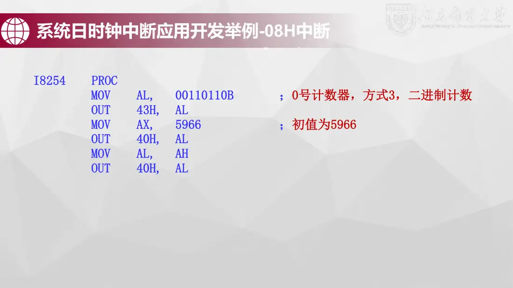

原文：

系统日时钟中断应用开发举例-08H中断

### 系统日时钟中断应用开发举例-08H中断

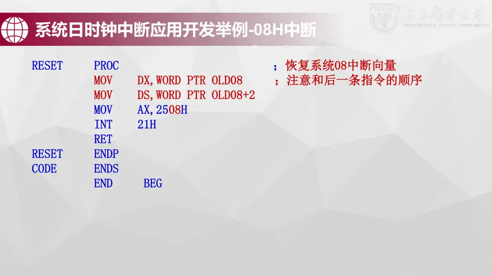

原文：

系统日时钟中断应用开发举例-08H中断

### 系统日时钟中断应用开发举例--程序执行过程

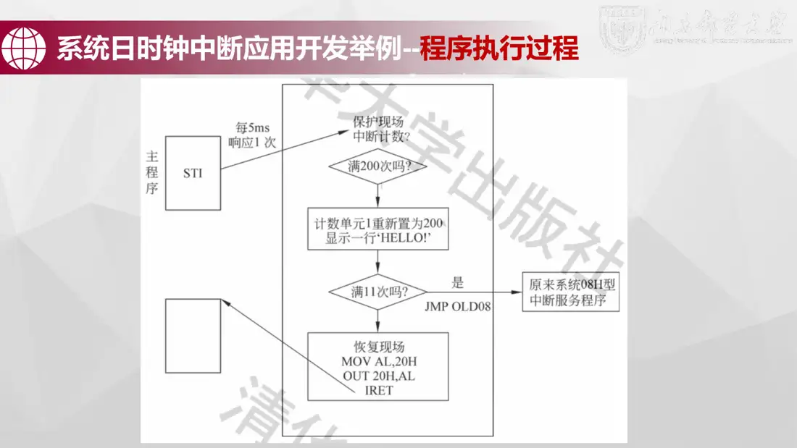

原文：

系统日时钟中断应用开发举例--程序执行过程

### 例: 测试8254计数器方式3的计数过程。

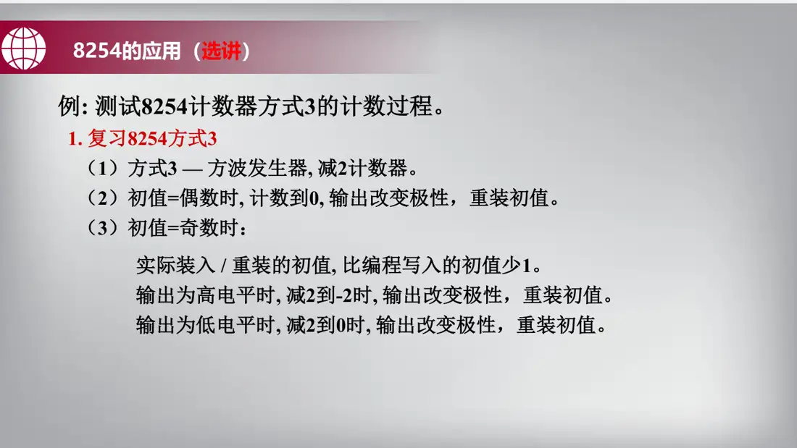

原文：

例: 测试8254计数器方式3的计数过程。

1. 复习8254方式3

(1) 方式3 — 方波发生器, 减2计数器。

(2) 初值=偶数时, 计数到0, 输出改变极性, 重装初值。

(3) 初值=奇数时:

实际装入 / 重装的初值, 比编程写入的初值少1。

输出为高电平时, 减2到-2时, 输出改变极性, 重装初值。

输出为低电平时, 减2到0时, 输出改变极性, 重装初值。

8254的应用（选讲）

### 2. 问题:

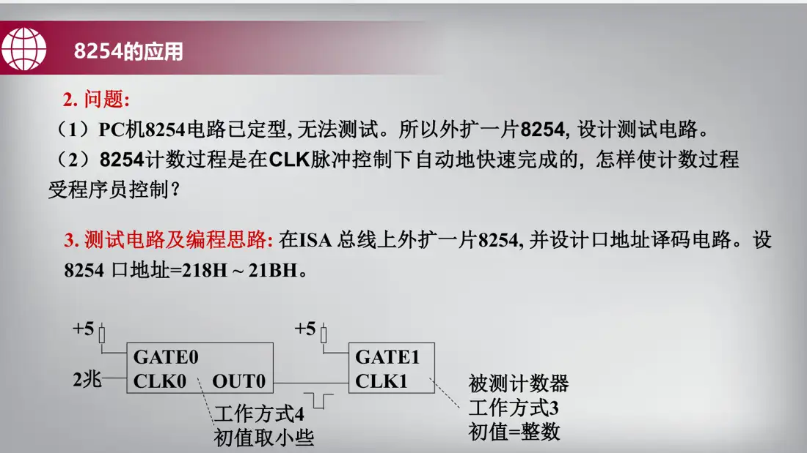

原文：

2. 问题:

(1) PC机8254电路已定型, 无法测试。所以外扩一片8254, 设计测试电路。

(2) 8254计数过程是在CLK脉冲控制下自动地快速完成的, 怎样使计数过程受程序员控制?

3. 测试电路及编程思路: 在ISA 总线上外扩一片8254, 并设计口地址译码电路。设8254 口地址=218H \~ 21BH。

8254的应用

### (2) 怎样产生单脉冲?

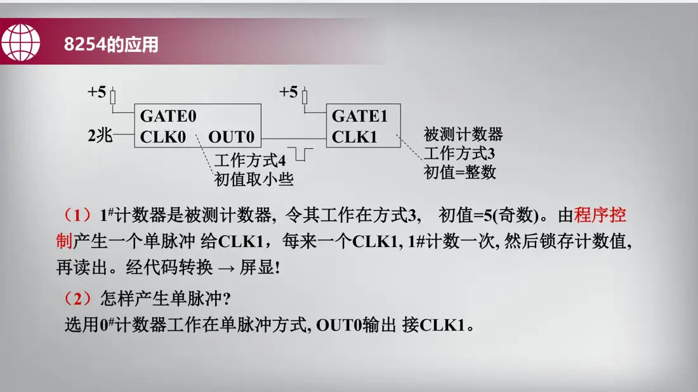

原文：

(1) 1#计数器是被测计数器, 令其工作在方式3, 初值=5(奇数)。由程序控制产生一个单脉冲给CLK1, 每来一个CLK1, 1#计数一次, 然后锁存计数值, 再读出。经代码转换 $\rightarrow$ 屏显!

(2) 怎样产生单脉冲?

选用0#计数器工作在单脉冲方式, OUT0输出接CLK1。

8254的应用

### 怎样使0#计数器在程序员控制下, 产生单脉冲?

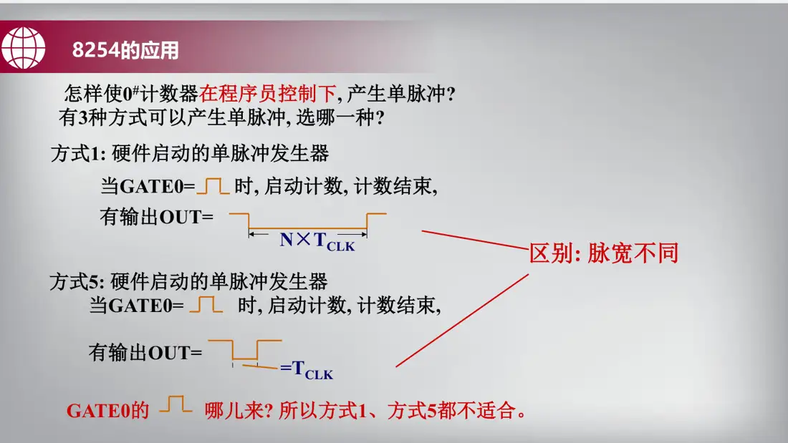

原文：

怎样使0#计数器在程序员控制下, 产生单脉冲?

有3种方式可以产生单脉冲, 选哪一种?

方式1: 硬件启动的单脉冲发生器

当GATE0=□时, 启动计数, 计数结束,

有输出OUT=

$$
\mathrm{OUT} = \quad \mathrm {N\times T _ {CLK}}
$$

区别: 脉宽不同

方式5: 硬件启动的单脉冲发生器

当GATE0= ∩ 时, 启动计数, 计数结束,

有输出OUT= =T $_{CLK}$

GATE0的哪儿来? 所以方式1、方式5都不适合。

8254的应用

### 方式4: 软件启动的单脉冲发生器

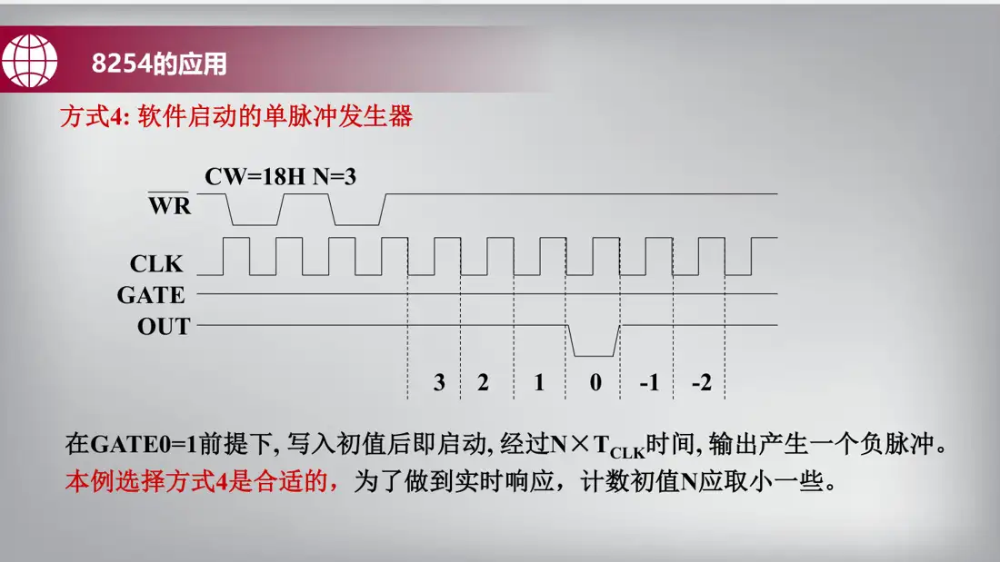

原文：

方式4: 软件启动的单脉冲发生器

$$
\begin{array}{c c c c c c c c c} \text {   WR   } & & & & & & & & \\ \text {   CLK   } & & & & & & & & \\ \text {   GATE   } & & & & & & & & \\ \text {   OUT   } & & & & & & & & \end{array} \quad \begin{array}{c c c c c c c c c} \text {   CW=18H   N=3   } \\ \text {   } \\ \text {   } \\ \text {   } \\ \text {   } \\ \text {   } \\ \text {   } \\ \text {   } \\ \text {   } \\ \text {   } \\ \text {   } \\ \text {   } \\ \text {   } \\ \text {   } \\ \text {   } \\ \text {   } \\ \text {   } \\ \text {   } \\ - 3 & 2 & 1 & 0 & - 1 & - 2 \\ \text {   } \\ \text {   } \\ \text {   } \\ \text {   } \\ \text {   } \\ \text {   } \\ \text {   } \\ \text {   } \\ \text {   } \\ \text {   } \\ \text {   } \\ \text {   } \\ \text {   } \\ \text {   } \\ \text {   } \\ \text {   } \\ \text {-1} \\ \text {-2} \\ \text {-3} \\ \text {-4} \\ \text {-5} \\ \text {-6} \\ \text {-7} \\ \text {-8} \\ \text {-9} \\ \text {-10} \\ \text {-11} \\ \text {-12} \\ \text {-13} \\ \text {-14} \\ \text {-15} \\ \text {-16} \\ \text {-17} \\ \text {-18} \\ \text {-19} \\ \text {-20} \\ \text {-21} \\ \text {-22} \\ \text {-23} \\ \text {-24} \\ \text {-25} \\ \text {-26} \\ \text {-27} \\ \text {-28} \\ \text {-29} \\ \text {-30} \\ \text {-31} \\ \text {-32} \\ \text {-33} \\ \text {-34} \\ \text {-35} \\ \text {-36} \\ \text {-37} \\ \text {-38} \\ \text {-39} \\ \text {-40} \\ \text {-41} \\ \text {-42} \\ \text {-43} \\ \text {-44} \\ \text {-45} \\ \text {-46} \\ \text {-47} \\ \text {-48} \\ \text {-49} \\ \text {-50} \\ \text {-51} \\ \text {-52} \\ \text {-53} \\ \text {-54} \\ \text {-55} \\ \text {-56} \\ \text {-57} \\ \text {-58} \\ \text {-59} \\ \text {-60} \\ \text {-61} \\ \text {-62} \\ \text {-63} \\ \text {-64} \\ \text {-65} \\ \text {-66} \\ \text {-67} \\ \text {-68} \\ \text {-69} \\ \text {-70} \\ \text {-71} \\ \text {-72} \\ \text {-73} \\ \text {-74} \\ \text {-75} \\ \text {-76} \\ \text {-77} \\ \text {-78} \\ \text {-79} \\ \text {-80} \\ \text {-81} \\ \text {-82} \\ \text {-83} \\ \text {-84} \\ \text {-85} \\ \text {-86} \\ \text {-87} \\ \text {-88} \\ \text {-89} \\ \text {-90} \\ \text {-91} \\ \text {-92} \\ \text {-93} \\ \text {-94} \\ \text {-95} \\ \text {-96} \\ \text {-97} \\ \text {-98} \\ \text {-99} \\ \text {-100} \\ - 3 & 2 & 1 & 0 & - 1 & - 0.5 & - 1.5 & - 0.5 & - 1.5 & - 0.5 & - 1.5 & - 0.5 & - 1.5 & - 0.5 & - 1.5 & - 0.5 & - 1.5 & - 0.5 & - 1.5 & - 0.5 & - 1.5 & - 0.5 & - 1.5 & - 1.5 & - 0.5 & - 1.5 & - 0.5 & - 1.5 & - 0.5 & - 1.5 & - 0.5 & - 1.5 & - 0.5 & - 1.5 & - 0.5 & - 1.5 & - 0.5 & - 1.5 & - 0.5 &- 1.5 & - 0.5 & - 1.5 & - 0.5 & - 1.5 & - 0.5 & - 1.5 & - 0.5 & - 1.5 & - 0.5 & - 1.5 & - 0.5 & - 1.5 & - 0.5 & - 1.5 & - 0.5 & - 1. .\\ +
$$

在GATE0=1前提下, 写入初值后即启动, 经过 $N \times T_{CLK}$ 时间, 输出产生一个负脉冲。本例选择方式4是合适的, 为了做到实时响应, 计数初值N应取小一些。

8254的应用

### [程序框图]

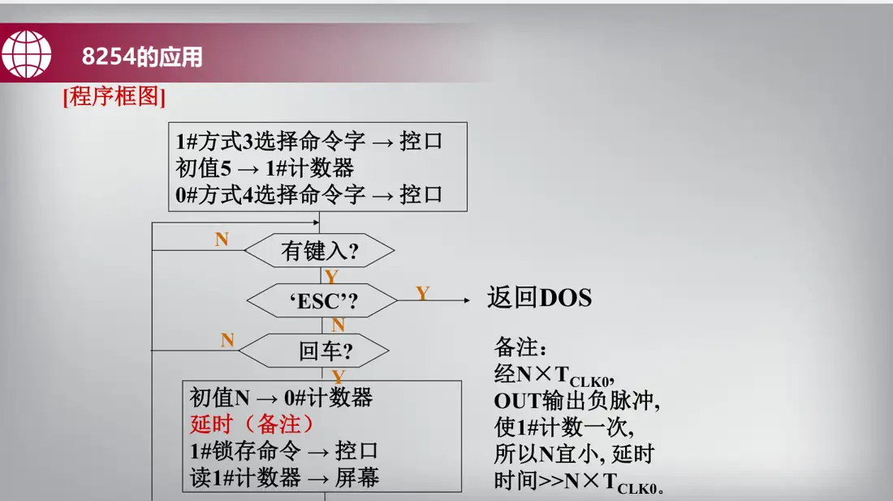

原文：

[程序框图]

1#方式3选择命令字 $\rightarrow$ 控口  
初值 $5 \rightarrow 1$ #计数器  
0#方式4选择命令字 $\rightarrow$ 控口

初值N → 0#计数器
延时（备注）
1#锁存命令 → 控口
读1#计数器 → 屏幕返回DOS

备注:经N×T $_{\text{CLK0}}$ , OUT输出负脉冲, 使1#计数一次, 所以N宜小, 延时时间>>N×T $_{\text{CLK0}}$ 。

8254的应用

### 注意:

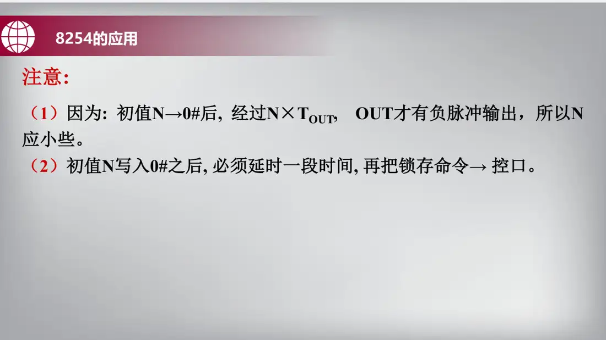

原文：

注意:

(1) 因为: 初值 $\mathrm{N} \rightarrow 0$ #后, 经过 $\mathrm{N} \times \mathrm{T}_{\mathrm{OUT}}$ , OUT才有负脉冲输出, 所以 $\mathrm{N}$ 应小些。

(2) 初值N写入0#之后, 必须延时一段时间, 再把锁存命令 $\rightarrow$ 控口。

8254的应用

### [程序]

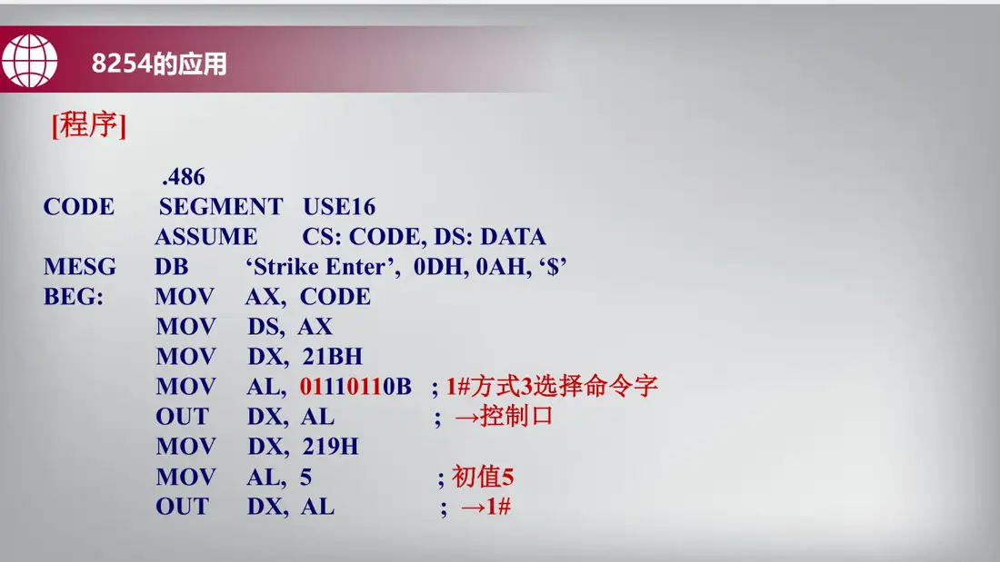

原文：

[程序]

CODE SEGMENT USE16
ASSUME CS: CODE, DS: DATA

MESG DB ‘Strike Enter’, 0DH, 0AH, ‘\$’
BEG: MOV AX, CODE
MOV DS, AX
MOV DX, 21BH
MOV AL, 01110110B ; 1#方式3选择命令字
OUT DX, AL ; →控制口
MOV DX, 219H
MOV AL, 5 ; 初值5
OUT DX, AL ; →1#

8254的应用

### 8254的应用

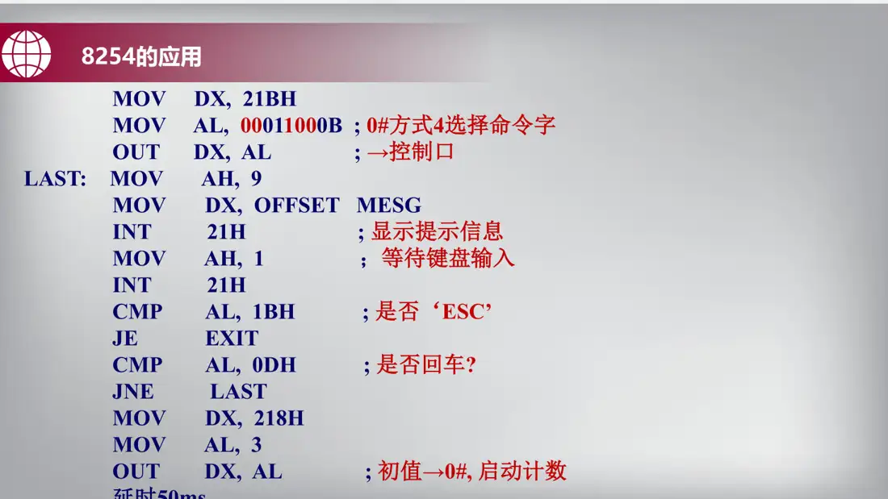

原文：

<table><tr><td rowspan="15">LAST:</td><td>MOV</td><td>DX, 21BH</td><td></td></tr><tr><td>MOV</td><td>AL, 00011000B</td><td>;0#方式4选择命令字</td></tr><tr><td>OUT</td><td>DX, AL</td><td>;→控制口</td></tr><tr><td>MOV</td><td>AH, 9</td><td></td></tr><tr><td>MOV</td><td>DX, OFFSET</td><td>MESG</td></tr><tr><td>INT</td><td>21H</td><td>;显示提示信息</td></tr><tr><td>MOV</td><td>AH, 1</td><td>;等待键盘输入</td></tr><tr><td>INT</td><td>21H</td><td></td></tr><tr><td>CMP</td><td>AL, 1BH</td><td>;是否‘ESC’</td></tr><tr><td>JE</td><td>EXIT</td><td></td></tr><tr><td>CMP</td><td>AL, 0DH</td><td>;是否回车?</td></tr><tr><td>JNE</td><td>LAST</td><td></td></tr><tr><td>MOV</td><td>DX, 218H</td><td></td></tr><tr><td>MOV</td><td>AL, 3</td><td></td></tr><tr><td>OUT</td><td>DX, AL</td><td>;初值→0#,启动计数</td></tr></table>

8254的应用

### MOV DX, 21BH

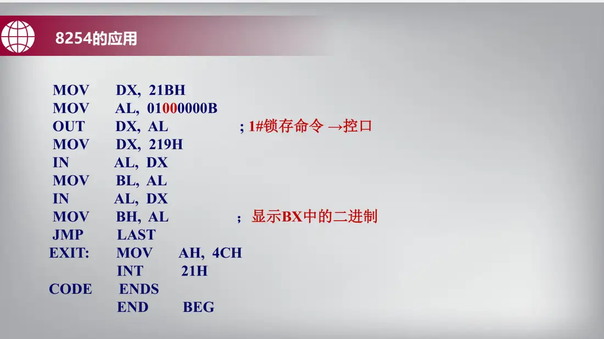

原文：

MOV DX, 21BH
MOV AL, 01000000B
OUT DX, AL ; 1#锁存命令 →控口
MOV DX, 219H
IN AL, DX
MOV BL, AL
IN AL, DX
MOV BH, AL ; 显示BX中的二进制
JMP LAST
EXIT: MOV AH, 4CH
INT 21H
CODE ENDS
END BEG

8254的应用

### 微型计算机系统总线上外扩8254的应用

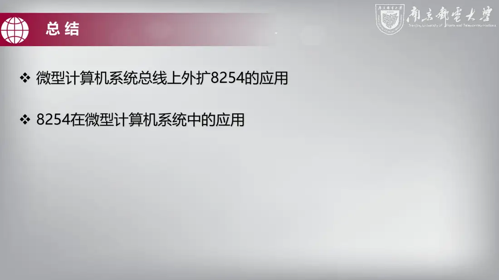

原文：

微型计算机系统总线上外扩8254的应用

✿ 8254在微型计算机系统中的应用

总结

南京邮电大学
 Nanjing University of Posts and Telecommunications
南京邮电大学
 Nanjing University of Posts and Telecommunications

### 课后作业

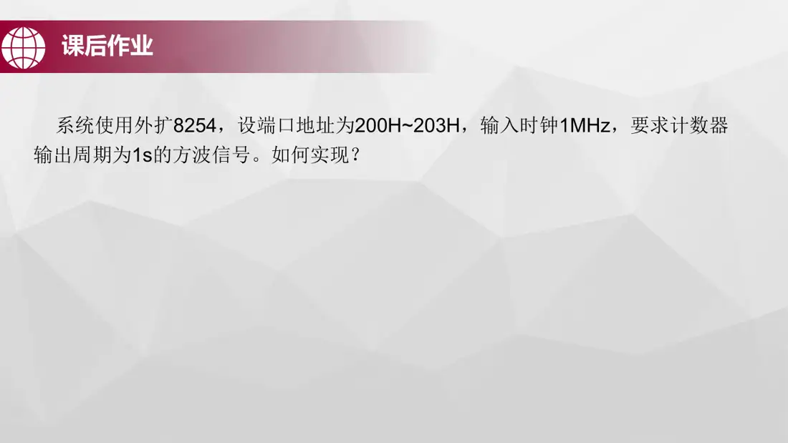

原文：

系统使用外扩8254，设端口地址为200H\~203H，输入时钟1MHz，要求计数器输出周期为1s的方波信号。如何实现？

课后作业

### 第 48 页

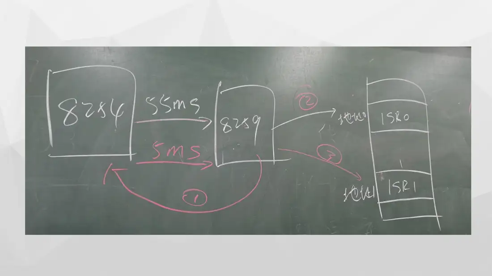
