# 《微型计算机接口技术》第3章 输入输出接口（课件）

原件的每一页，下面附识别出的文字。

### 微型计算机接口技术

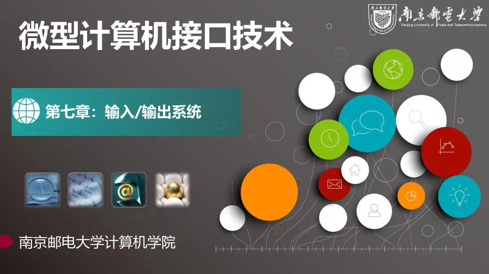

原文：

微型计算机接口技术

第七章：输入/输出系统

The image contains four distinct visual elements: a magnifying glass over a document, a keyboard with 'Close' labels, an @ symbol in a globe, and a golden ingot on white spheres. There is no textual content to extract. Therefore, the correct OCR output is an empty string.

(No text to output)

南京邮电大学计算机学院

南京邮电大学
100-1596
Nanjing University of Posts and Telecommunications
南京邮电大学

### 知识要点

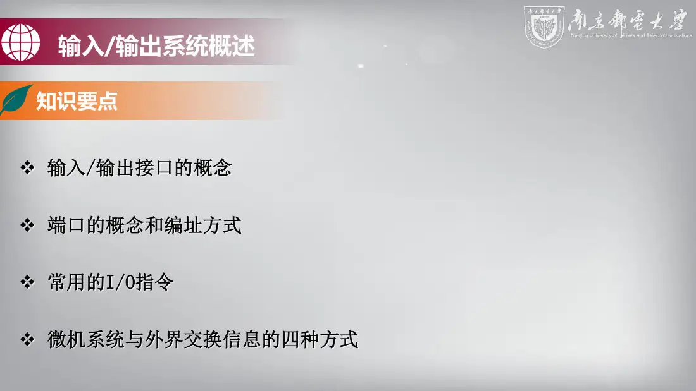

原文：

知识要点

输入/输出接口的概念

端口的概念和编址方式

常用的I/O指令

微机系统与外界交换信息的四种方式

输入/输出系统概述

南京邮电大学
Nanjing University of Posts and Telecommunications

### 输入输出系统概念

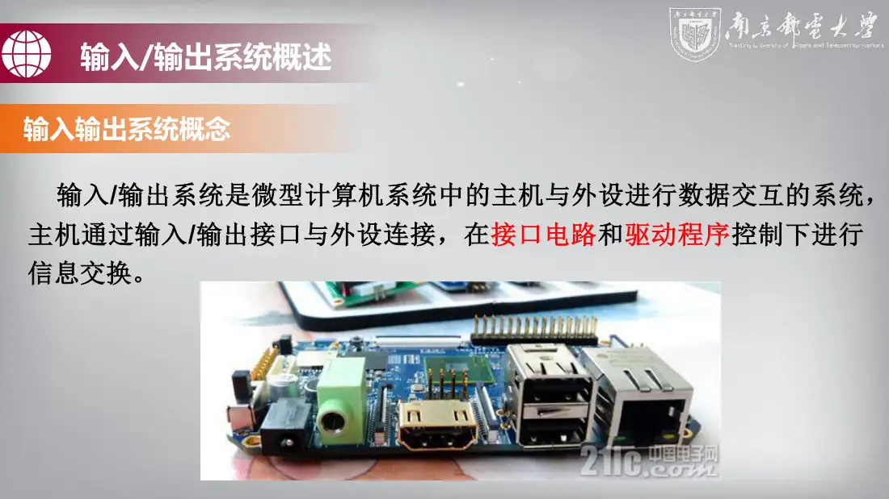

原文：

输入输出系统概念

输入/输出系统是微型计算机系统中的主机与外设进行数据交互的系统，主机通过输入/输出接口与外设连接，在接口电路和驱动程序控制下进行信息交换。

输入/输出系统概述

南京邮电大学
Nanjing University of Posts and Telecommunications

### 一、接口的概念

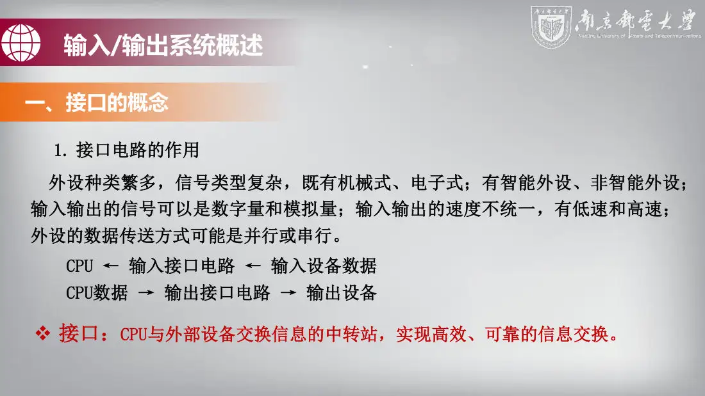

原文：

一、接口的概念

1. 接口电路的作用

外设种类繁多，信号类型复杂，既有机械式、电子式；有智能外设、非智能外设；输入输出的信号可以是数字量和模拟量；输入输出的速度不统一，有低速和高速；外设的数据传送方式可能是并行或串行。

CPU ← 输入接口电路 ← 输入设备数据

CPU数据 $\rightarrow$ 输出接口电路 $\rightarrow$ 输出设备

接口：CPU与外部设备交换信息的中转站，实现高效、可靠的信息交换。

输入/输出系统概述

南京邮电大学
Nanjing University of Posts and Telecommunications

### 2. 接口电路的功能

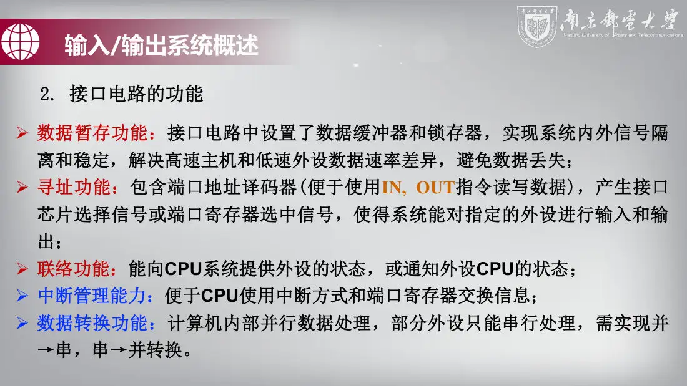

原文：

2. 接口电路的功能

数据暂存功能：接口电路中设置了数据缓冲器和锁存器，实现系统内外信号隔离和稳定，解决高速主机和低速外设数据速率差异，避免数据丢失；

寻址功能：包含端口地址译码器(便于使用IN, OUT指令读写数据)，产生接口芯片选择信号或端口寄存器选中信号，使得系统能对指定的外设进行输入和输出；

➢ 联络功能：能向CPU系统提供外设的状态，或通知外设CPU的状态；

中断管理能力：便于CPU使用中断方式和端口寄存器交换信息；

数据转换功能：计算机内部并行数据处理，部分外设只能串行处理，需实现并→串，串→并转换。

输入/输出系统概述

南京邮电大学
Nanjing University of Posts and Telecommunications

### 3. 接口分类

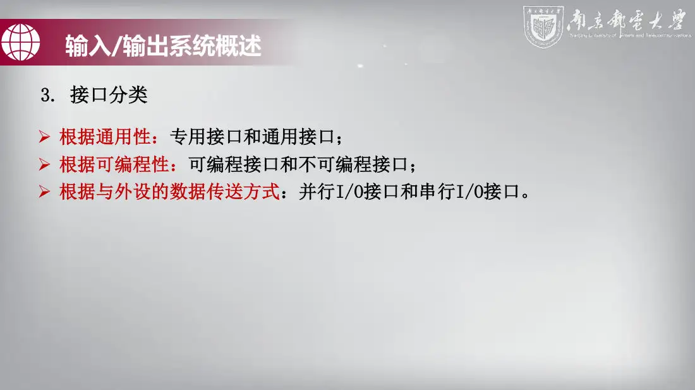

原文：

3. 接口分类

根据通用性：专用接口和通用接口；

根据可编程性：可编程接口和不可编程接口；

根据与外设的数据传送方式：并行I/0接口和串行I/0接口。

输入/输出系统概述

南京邮电大学
Nanjing University of Posts and Telecommunications

### 二、端口的概念

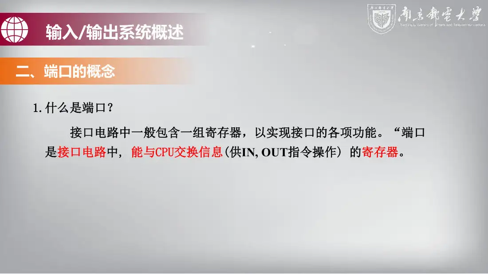

原文：

二、端口的概念

1. 什么是端口？

接口电路中一般包含一组寄存器，以实现接口的各项功能。“端口是接口电路中，能与CPU交换信息(供IN, OUT指令操作)的寄存器。

输入/输出系统概述

南京邮电大学
Nanjing University of Posts and Telecommunications

### 2. 端口的分类:

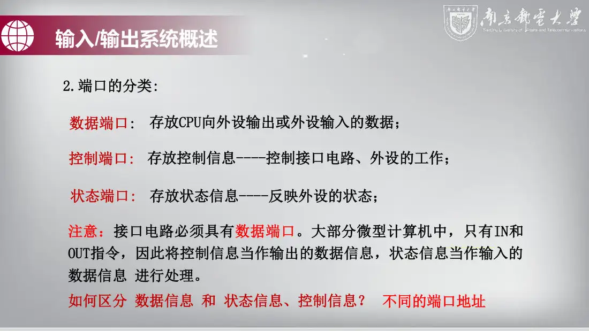

原文：

2. 端口的分类:

数据端口：存放CPU向外设输出或外设输入的数据；

控制端口：存放控制信息----控制接口电路、外设的工作；

状态端口：存放状态信息----反映外设的状态；

注意：接口电路必须具有数据端口。大部分微型计算机中，只有IN和OUT指令，因此将控制信息当作输出的数据信息，状态信息当作输入的数据信息进行处理。

如何区分 数据信息 和 状态信息、控制信息？ 不同的端口地址

输入/输出系统概述

南京邮电大学
Nanjing University of Posts and Telecommunications

### 端口地址

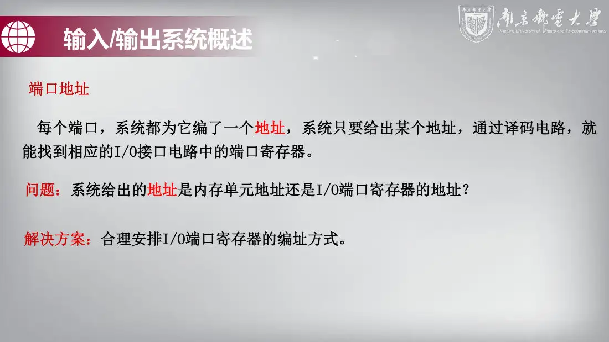

原文：

端口地址

每个端口，系统都为它编了一个地址，系统只要给出某个地址，通过译码电路，就能找到相应的I/O接口电路中的端口寄存器。

问题：系统给出的地址是内存单元地址还是I/O端口寄存器的地址？

解决方案：合理安排I/O端口寄存器的编址方式。

输入/输出系统概述

南京邮电大学
Nanjing University of Posts and Telecommunications

### 3. 端口的编址方式

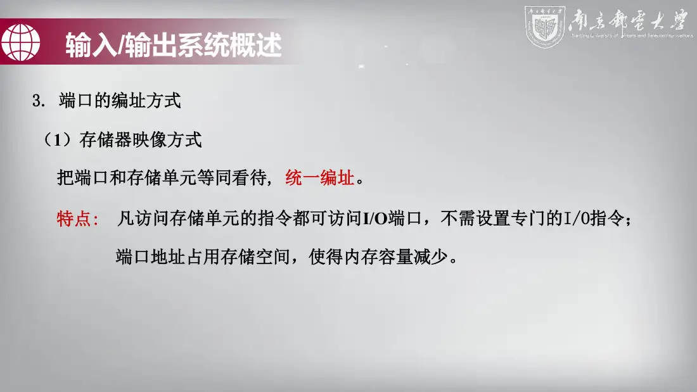

原文：

3. 端口的编址方式

(1) 存储器映像方式

把端口和存储单元等同看待，统一编址。

特点: 凡访问存储单元的指令都可访问I/O端口, 不需设置专门的I/O指令; 端口地址占用存储空间, 使得内存容量减少。

输入/输出系统概述

南京邮电大学
Nanjing University of Posts and Telecommunications

### 3. 端口的编址方式

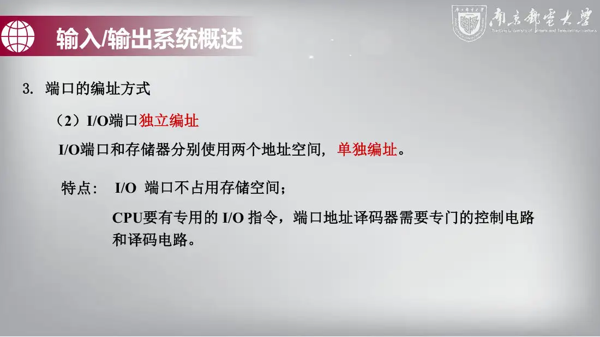

原文：

3. 端口的编址方式

(2) I/O端口独立编址

I/O端口和存储器分别使用两个地址空间，单独编址。

特点：I/O 端口不占用存储空间；

CPU要有专用的 I/O 指令，端口地址译码器需要专门的控制电路和译码电路。

输入/输出系统概述

南京邮电大学
Nanjing University of Posts and Telecommunications

### 4. PC系列机的端口编址

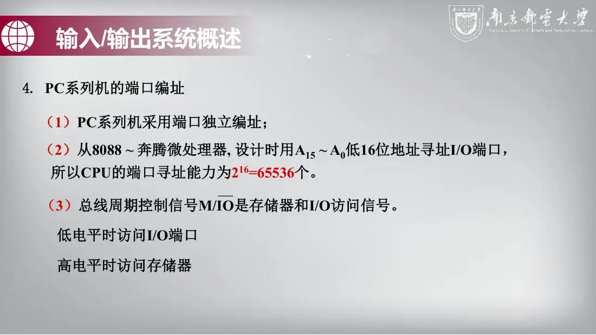

原文：

4. PC系列机的端口编址

(1) PC系列机采用端口独立编址;

(2) 从8088～奔腾微处理器, 设计时用 $\mathrm{A}_{15} \sim \mathrm{A}_{0}$ 低16位地址寻址I/O端口, 所以CPU的端口寻址能力为 $2^{16} = 65536$ 个。

(3) 总线周期控制信号M/IO是存储器和I/O访问信号。

低电平时访问I/O端口

高电平时访问存储器

输入/输出系统概述

南京邮电大学
Nanjing University of Posts and Telecommunications

### 4. PC系列机的端口编址

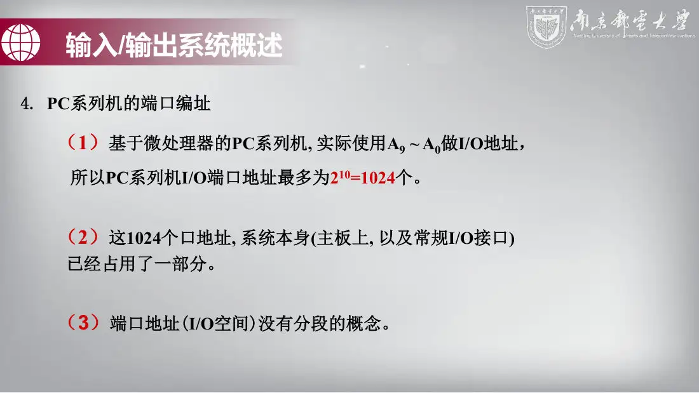

原文：

4. PC系列机的端口编址

(1) 基于微处理器的PC系列机, 实际使用 $\mathrm{A}_{9} \sim \mathrm{A}_{0}$ 做I/O地址, 所以PC系列机I/O端口地址最多为 $2^{10} = 1024$ 个。

(2) 这1024个口地址, 系统本身(主板上, 以及常规I/O接口)已经占用了一部分。

(3) 端口地址(I/O空间)没有分段的概念。

输入/输出系统概述

南京邮电大学
Nanjing University of Posts and Telecommunications

### 三、常用的I/O指令：I/O端口与CPU之间的信息交换

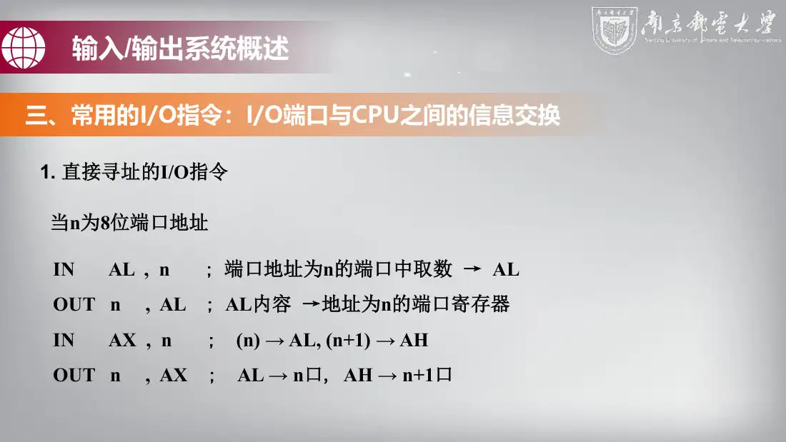

原文：

三、常用的I/O指令：I/O端口与CPU之间的信息交换

1. 直接寻址的I/O指令

当n为8位端口地址

IN AL, n ; 端口地址为n的端口中取数 → AL

OUT n , AL ; AL内容 →地址为n的端口寄存器

IN AX, n ; (n) → AL, (n+1) → AH

OUT n , AX ; AL → n 口, AH → n + 1 口

输入/输出系统概述

南京邮电大学
TJ50-0318
南京邮电大学
Nanjing University of Posts and Telecommunications

### 1. 直接寻址的I/O指令

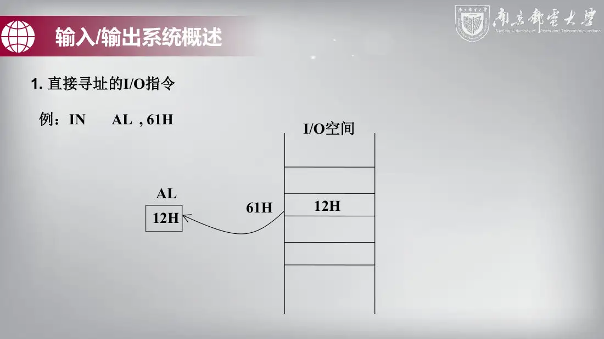

原文：

1. 直接寻址的I/O指令

例：IN AL,61H

输入/输出系统概述

南京邮电大学
Nanjing University of Posts and Telecommunications

### 1. 直接寻址的I/O指令

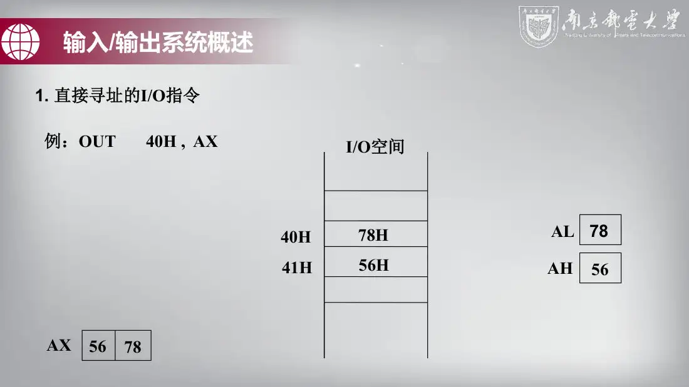

原文：

1. 直接寻址的I/O指令

例：OUT 40H，AX

<table><tr><td colspan="2">I/O空间</td></tr><tr><td></td><td></td></tr><tr><td></td><td></td></tr><tr><td>40H</td><td>78H</td></tr><tr><td>41H</td><td>56H</td></tr><tr><td></td><td></td></tr><tr><td></td><td></td></tr></table>

输入/输出系统概述

南京邮电大学
Nanjing University of Posts and Telecommunications

### 1. 直接寻址的I/O指令

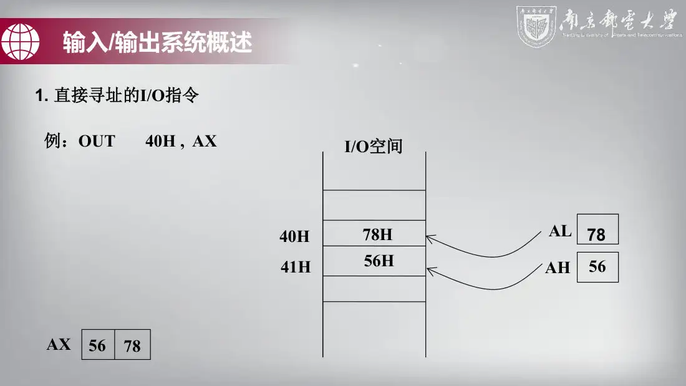

原文：

1. 直接寻址的I/O指令

例: OUT 40H, AX

输入/输出系统概述

南京邮电大学
Nanjing University of Posts and Telecommunications

### 三、常用的I/O指令

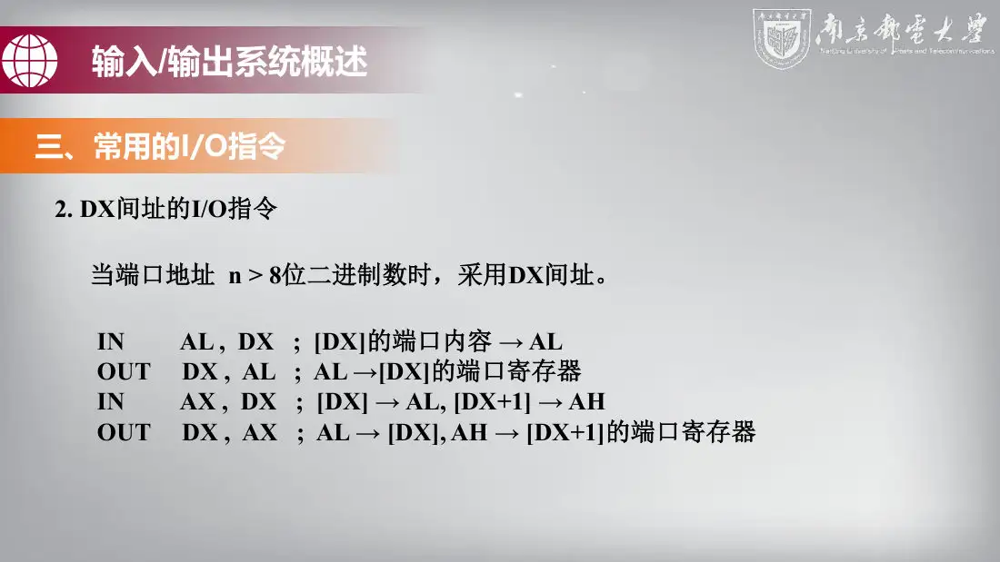

原文：

三、常用的I/O指令

2. DX间址的I/O指令

当端口地址 n > 8 位二进制数时，采用 DX 间址。

IN AL, DX ; [DX]的端口内容 → AL

OUT DX, AL ; AL → [DX] 的端口寄存器

IN AX, DX ; [DX] → AL, [DX+1] → AH

OUT DX, AX ; AL → [DX], AH → [DX+1]的端口寄存器

输入/输出系统概述

南京邮电大学
Nanjing University of Posts and Telecommunications

### 2. DX间址的I/O指令

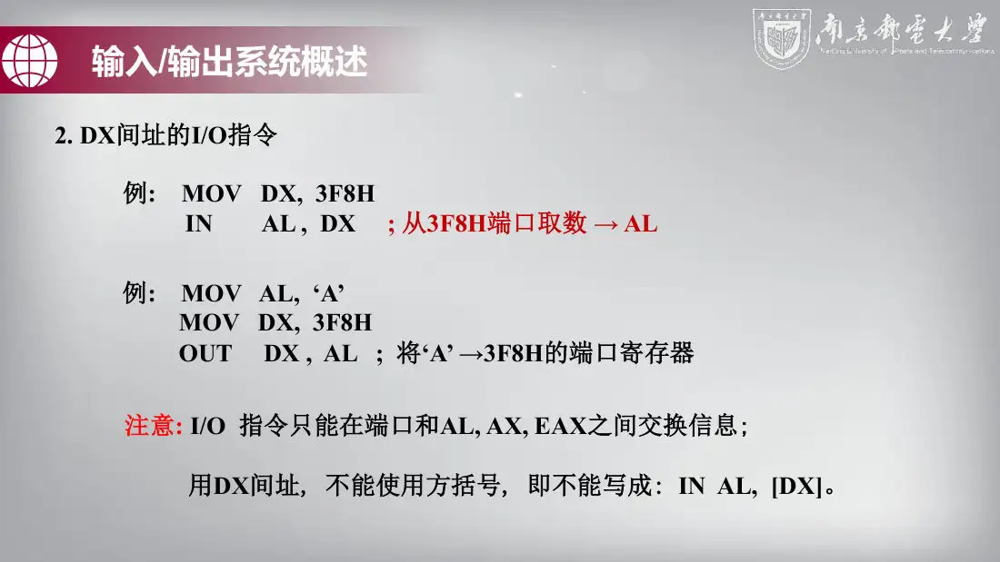

原文：

2. DX间址的I/O指令

例: MOV DX, 3F8H
IN AL, DX ; 从3F8H端口取数 → AL

例: MOV AL, 'A'  
MOV DX, 3F8H  
OUT DX, AL ; 将'A'→3F8H的端口寄存器

注意: I/O 指令只能在端口和AL, AX, EAX之间交换信息;

用DX间址，不能使用方括号，即不能写成：IN AL, [DX]。

输入/输出系统概述

南京邮电大学
150-838
南京邮电大学
Nanjing University of Posts and Telecommunications

### 知识点小结

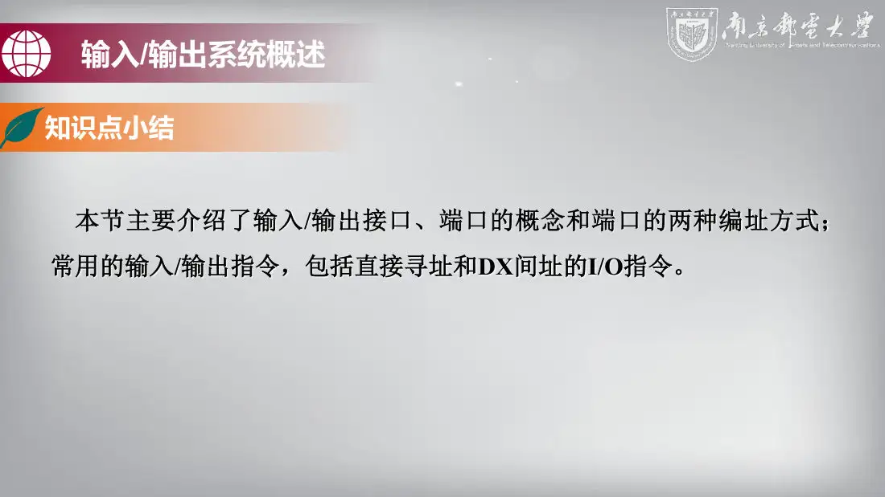

原文：

知识点小结

本节主要介绍了输入/输出接口、端口的概念和端口的两种编址方式；常用的输入/输出指令，包括直接寻址和DX间址的I/O指令。

输入/输出系统概述

南京邮电大学
Nanjing University of Posts and Telecommunications

### 知识要点

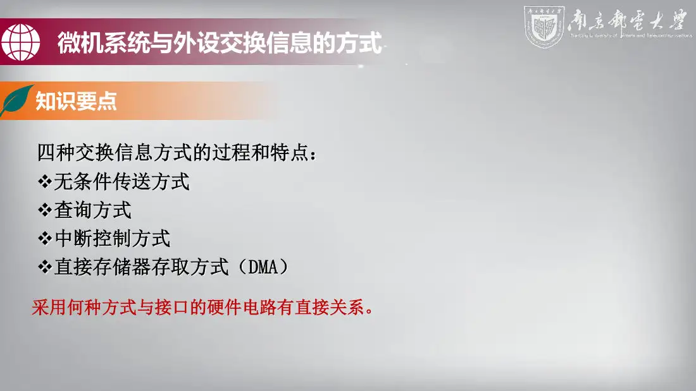

原文：

知识要点

四种交换信息方式的过程和特点:

✿无条件传送方式

◆ 查询方式

中断控制方式

◆直接存储器存取方式（DMA）

采用何种方式与接口的硬件电路有直接关系。

微机系统与外设交换信息的方式

南京邮电大学
Nanjing University of Posts and Telecommunications

### 一、无条件传送方式

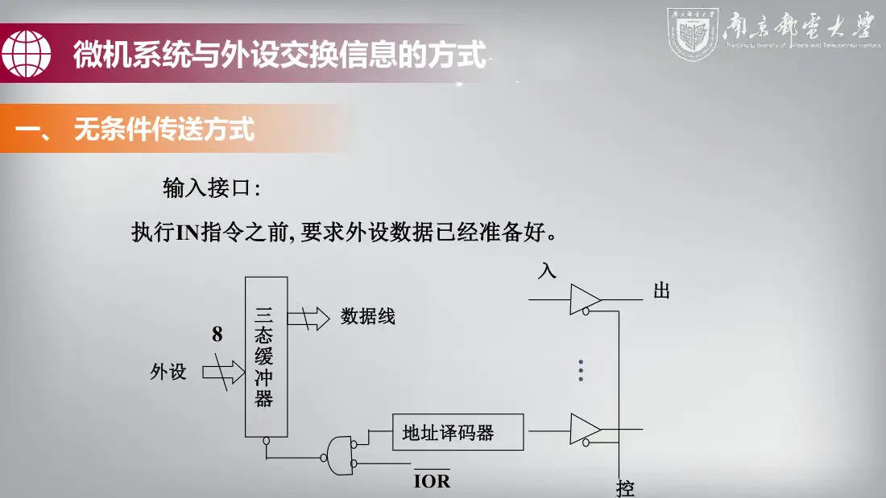

原文：

一、无条件传送方式

输入接口:

执行IN指令之前,要求外设数据已经准备好。

微机系统与外设交换信息的方式

南京邮电大学
Nanjing University of Posts and Telecommunications

### 一、无条件传送方式

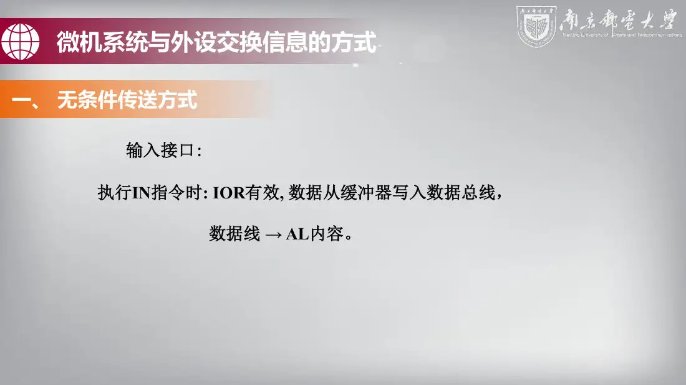

原文：

一、无条件传送方式

输入接口:

执行IN指令时: IOR有效, 数据从缓冲器写入数据总线,

数据线 $\rightarrow$ AL内容。

微机系统与外设交换信息的方式

南京邮电大学
Nanjing University of Posts and Telecommunications

### 一、无条件传送方式

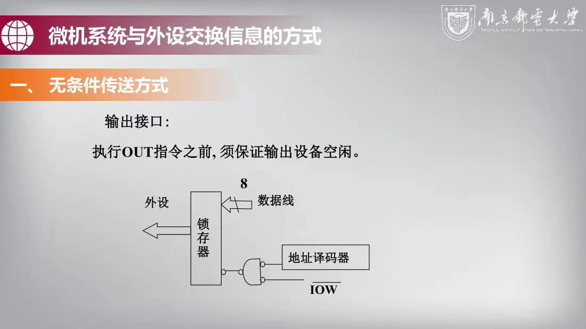

原文：

一、无条件传送方式

输出接口：

执行OUT指令之前,须保证输出设备空闲。

微机系统与外设交换信息的方式

南京邮电大学
Nanjing University of Posts and Telecommunications

### 一、无条件传送方式

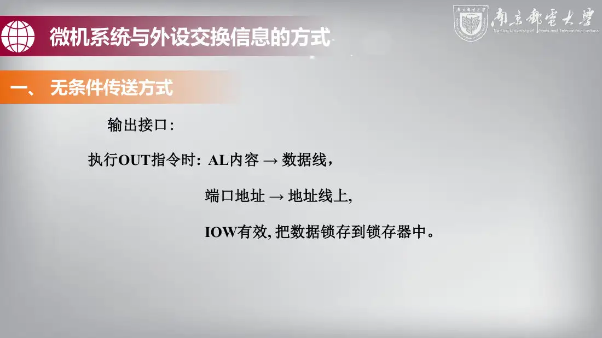

原文：

一、无条件传送方式

输出接口：

执行OUT指令时: AL内容 → 数据线,

端口地址 → 地址线上,

IOW有效, 把数据锁存到锁存器中。

微机系统与外设交换信息的方式

南京邮电大学
Nanjing University of Posts and Telecommunications

### 二、查询方式

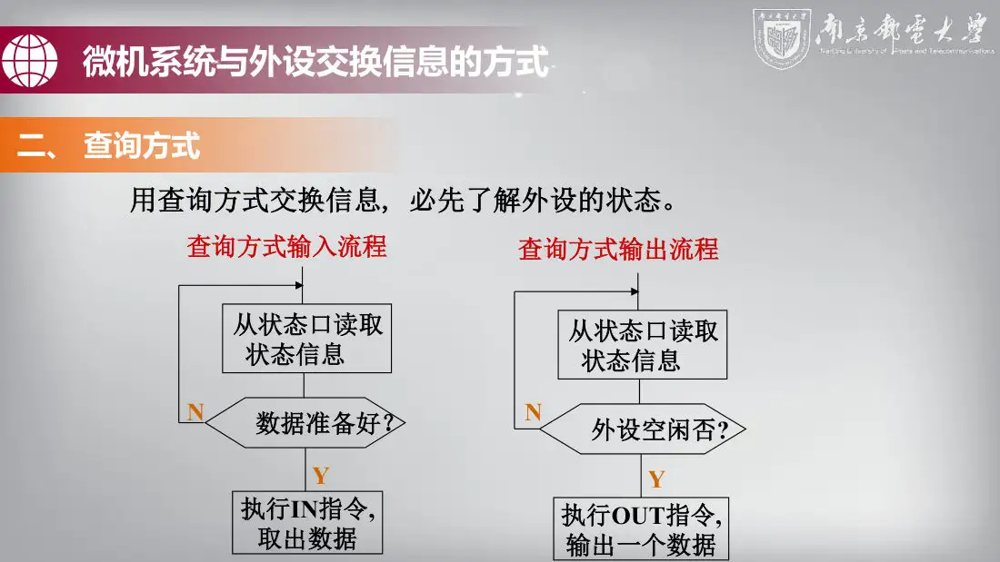

原文：

二、查询方式

用查询方式交换信息，必先了解外设的状态。

微机系统与外设交换信息的方式

南京邮电大学
TJ50-838
南京邮电大学
Nanjing University of Posts and Telecommunications

### 二、查询方式

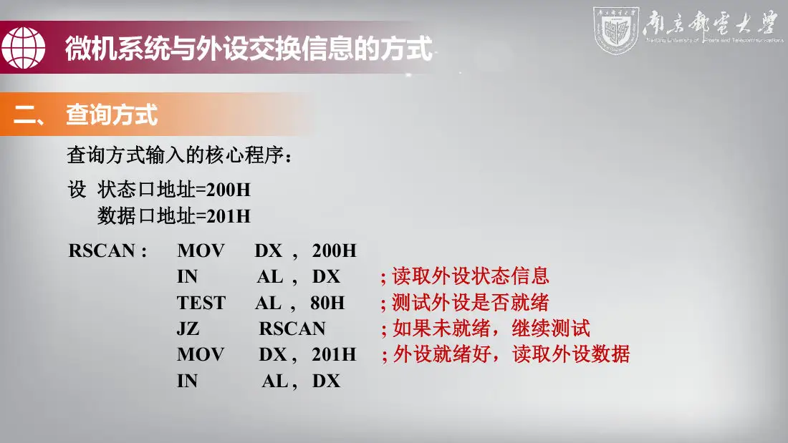

原文：

二、查询方式

查询方式输入的核心程序:

设 状态口地址=200H
数据口地址=201H

RSCAN : MOV DX, 200H
IN AL, DX ; 读取外设状态信息
TEST AL, 80H ; 测试外设是否就绪
JZ RSCAN ; 如果未就绪，继续测试
MOV DX, 201H ; 外设就绪好，读取外设数据
IN AL, DX

微机系统与外设交换信息的方式

南京邮电大学
TJ50-838
南京邮电大学
Nanjing University of Posts and Telecommunications

### 二、查询方式

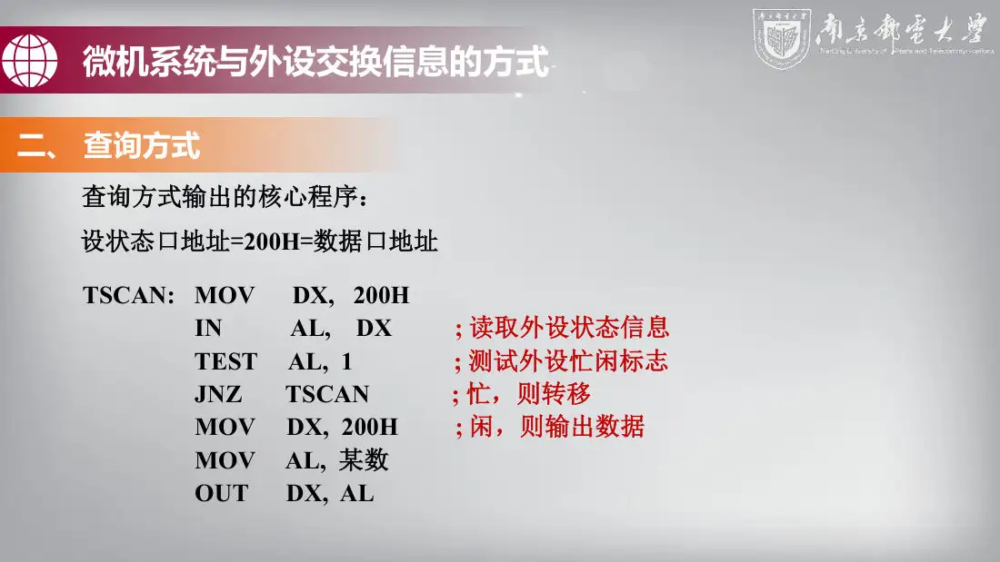

原文：

二、查询方式

查询方式输出的核心程序:

设状态口地址=200H=数据口地址

TSCAN: MOV DX, 200H
IN AL, DX ; 读取外设状态信息
TEST AL, 1 ; 测试外设忙闲标志
JNZ TSCAN ; 忙，则转移
MOV DX, 200H ; 闲，则输出数据
MOV AL, 某数
OUT DX, AL

微机系统与外设交换信息的方式

南京邮电大学
TJ50-0318
南京邮电大学
Nanjing University of Posts and Telecommunications

### 二、辩证思考：查询方式有何缺点？

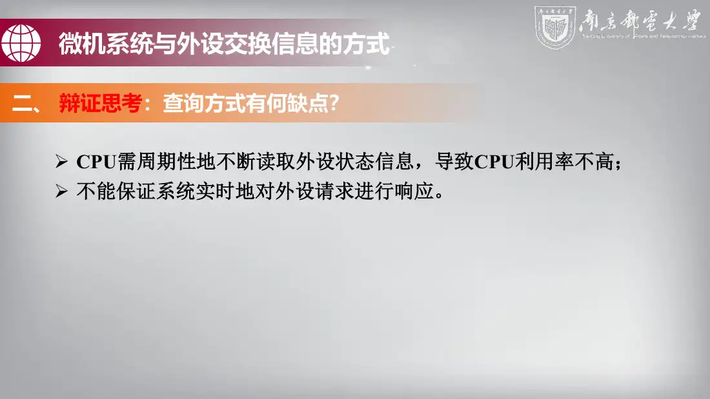

原文：

二、辩证思考：查询方式有何缺点？

➢ CPU需周期性地不断读取外设状态信息，导致CPU利用率不高；

➢ 不能保证系统实时地对外设请求进行响应。

微机系统与外设交换信息的方式

南京邮电大学
Nanjing University of Posts and Telecommunications

### 三、中断控制方式

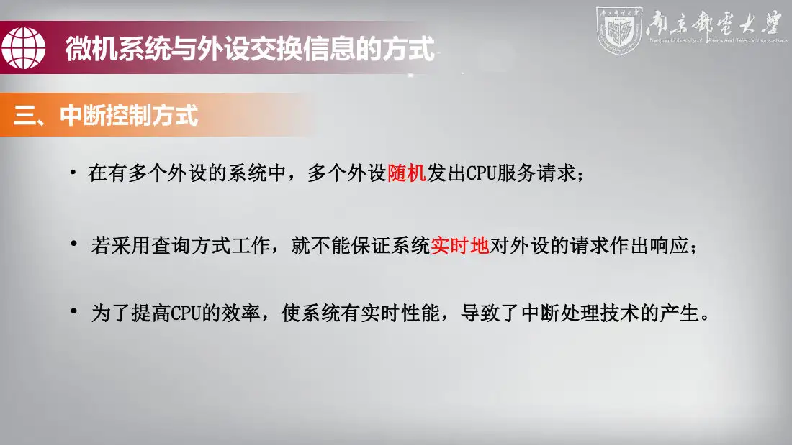

原文：

三、中断控制方式

\- 在有多个外设的系统中，多个外设随机发出CPU服务请求；

\- 若采用查询方式工作，就不能保证系统实时地对外设的请求作出响应；

\- 为了提高CPU的效率，使系统有实时性能，导致了中断处理技术的产生。

微机系统与外设交换信息的方式

南京邮电大学
Nanjing University of Posts and Telecommunications

### 三、中断控制方式

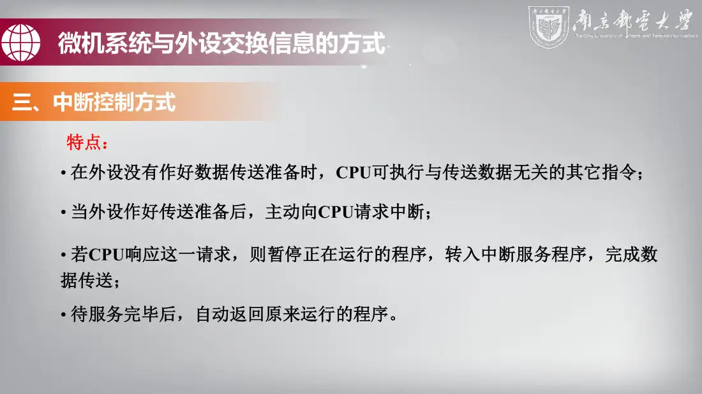

原文：

三、中断控制方式

特点:

· 在外设没有作好数据传送准备时，CPU可执行与传送数据无关的其它指令；

\- 当外设作好传送准备后，主动向CPU请求中断；

\- 若CPU响应这一请求，则暂停正在运行的程序，转入中断服务程序，完成数据传送；

·待服务完毕后，自动返回原来运行的程序。

微机系统与外设交换信息的方式

南京邮电大学
Nanjing University of Posts and Telecommunications

### 三、中断控制方式

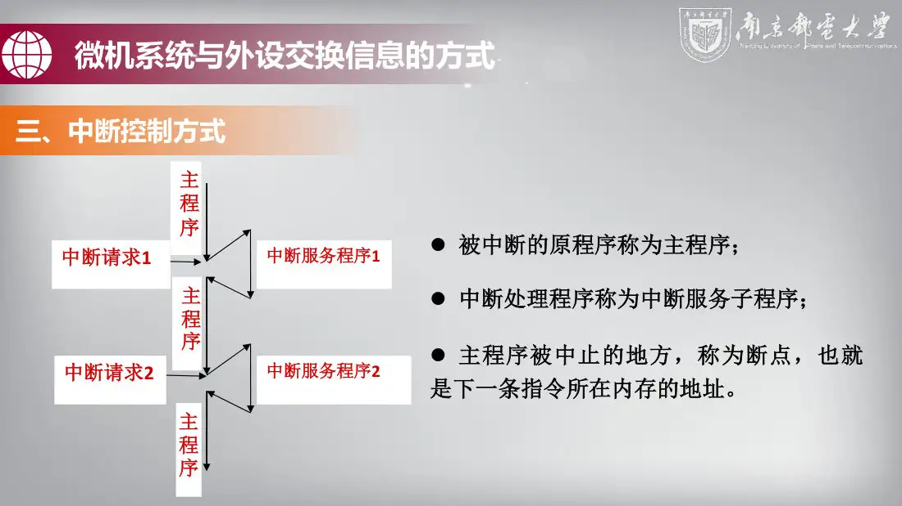

原文：

三、中断控制方式

中断请求1

中断请求2

中断服务程序1

中断服务程序2

\- 被中断的原程序称为主程序;

\- 中断处理程序称为中断服务子程序；

\- 主程序被中止的地方，称为断点，也就是下一条指令所在内存的地址。

微机系统与外设交换信息的方式

南京邮电大学
Nanjing University of Posts and Telecommunications

### 三、辩证思考：中断控制方式有何缺点？

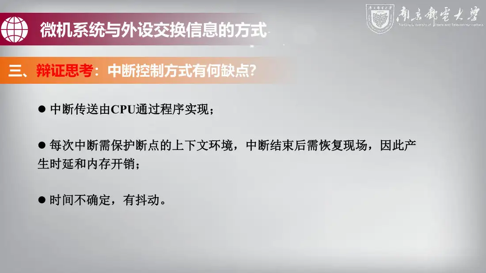

原文：

三、辩证思考：中断控制方式有何缺点？

\- 中断传送由CPU通过程序实现;

\- 每次中断需保护断点的上下文环境，中断结束后需恢复现场，因此产生时延和内存开销；

● 时间不确定，有抖动。

微机系统与外设交换信息的方式

南京邮电大学
Nanjing University of Posts and Telecommunications

### 四、直接存储器存取（DMA）方式

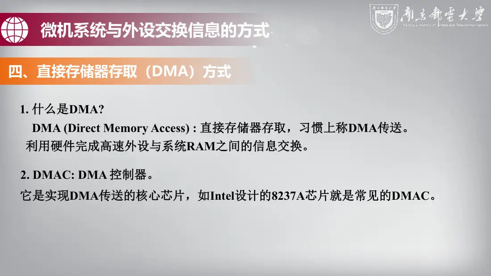

原文：

四、直接存储器存取（DMA）方式

1. 什么是DMA?

DMA (Direct Memory Access): 直接存储器存取，习惯上称DMA传送。

利用硬件完成高速外设与系统RAM之间的信息交换。

2. DMAC: DMA 控制器。

它是实现DMA传送的核心芯片，如Intel设计的8237A芯片就是常见的DMAC。

微机系统与外设交换信息的方式

南京邮电大学
Nanjing University of Posts and Telecommunications

### 四、直接存储器存取（DMA）方式

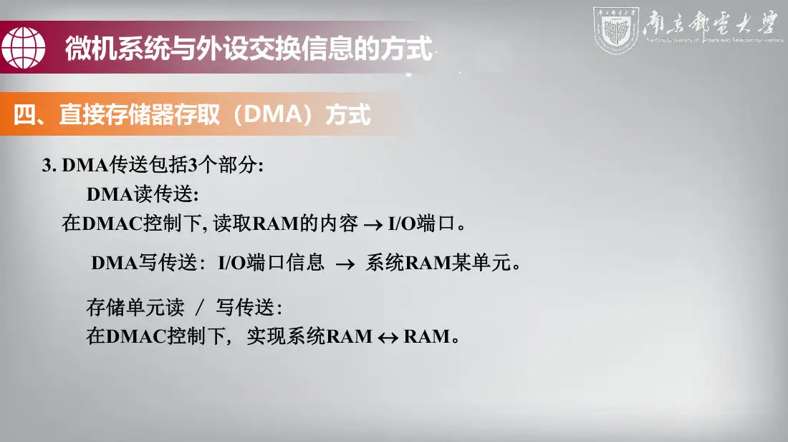

原文：

四、直接存储器存取（DMA）方式

3. DMA传送包括3个部分:

DMA读传送:

在DMAC控制下, 读取RAM的内容 → I/O端口。

DMA写传送：I/O端口信息 → 系统RAM某单元。

存储单元读 / 写传送:

在DMAC控制下，实现系统RAM $\leftrightarrow$ RAM。

微机系统与外设交换信息的方式

南京邮电大学
Nanjing University of Posts and Telecommunications

### 四、直接存储器存取（DMA）方式

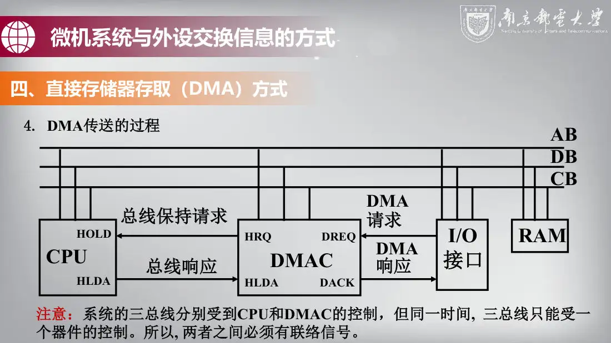

原文：

四、直接存储器存取（DMA）方式

4. DMA传送的过程

微机系统与外设交换信息的方式

南京邮电大学
Nanjing University of Posts and Telecommunications

### AB

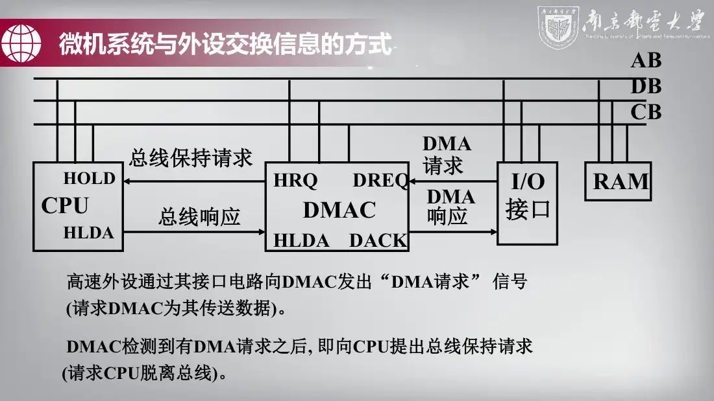

原文：

AB

DMAC检测到有DMA请求之后, 即向CPU提出总线保持请求(请求CPU脱离总线)。

微机系统与外设交换信息的方式

南京邮电大学
Nanjing University of Posts and Telecommunications

### AB

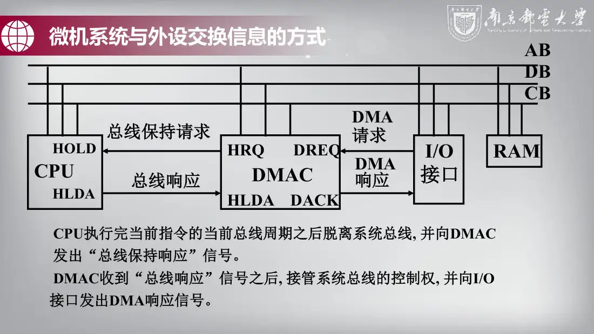

原文：

AB

CPU执行完当前指令的当前总线周期之后脱离系统总线, 并向DMAC发出 “总线保持响应” 信号。

DMAC收到“总线响应”信号之后, 接管系统总线的控制权, 并向I/O接口发出DMA响应信号。

微机系统与外设交换信息的方式

南京邮电大学
Nanjing University of Posts and Telecommunications

### AB

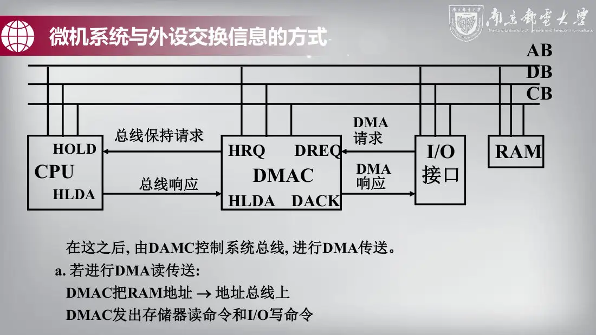

原文：

AB

在这之后, 由DAMC控制系统总线, 进行DMA传送。

a. 若进行DMA读传送:

DMAC把RAM地址 $\rightarrow$ 地址总线上

DMAC发出存储器读命令和I/O写命令

微机系统与外设交换信息的方式

南京邮电大学
Nanjing University of Posts and Telecommunications

### AB

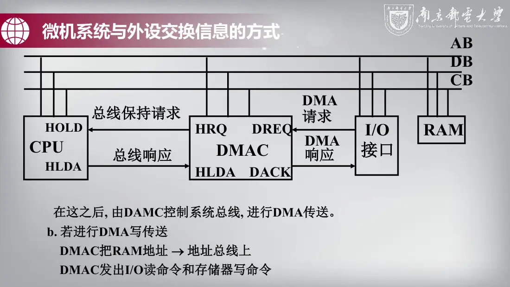

原文：

AB

在这之后, 由DAMC控制系统总线, 进行DMA传送。

b. 若进行DMA写传送

DMAC把RAM地址 $\rightarrow$ 地址总线上

DMAC发出I/O读命令和存储器写命令

微机系统与外设交换信息的方式

南京邮电大学
Nanjing University of Posts and Telecommunications

### AB

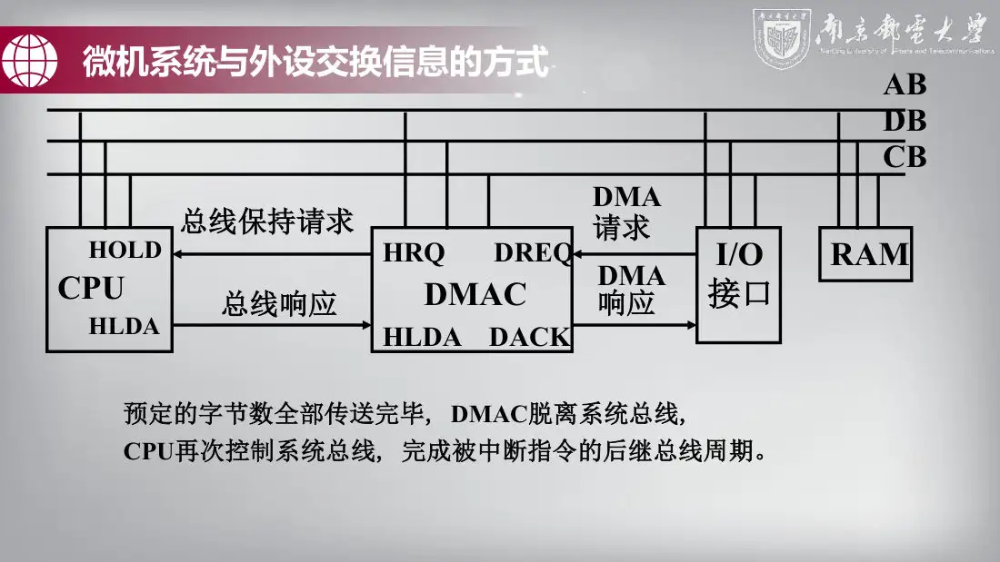

原文：

AB

CPU再次控制系统总线，完成被中断指令的后继总线周期。

微机系统与外设交换信息的方式

南京邮电大学
Nanjing University of Posts and Telecommunications

### 四、直接存储器存取（DMA）方式

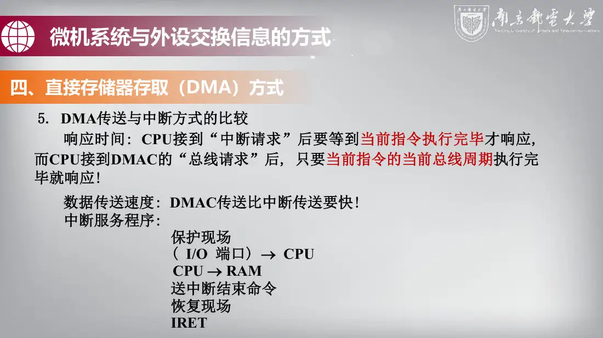

原文：

四、直接存储器存取（DMA）方式

5. DMA传送与中断方式的比较

响应时间：CPU接到“中断请求”后要等到当前指令执行完毕才响应，而CPU接到DMAC的“总线请求”后，只要当前指令的当前总线周期执行完毕就响应！

数据传送速度：DMAC传送比中断传送要快！

中断服务程序:

保护现场

( I/O 端口) → CPU

CPU → RAM

送中断结束命令

恢复现场

IRET

微机系统与外设交换信息的方式

南京邮电大学
Nanjing University of Posts and Telecommunications

### 四、直接存储器存取（DMA）方式

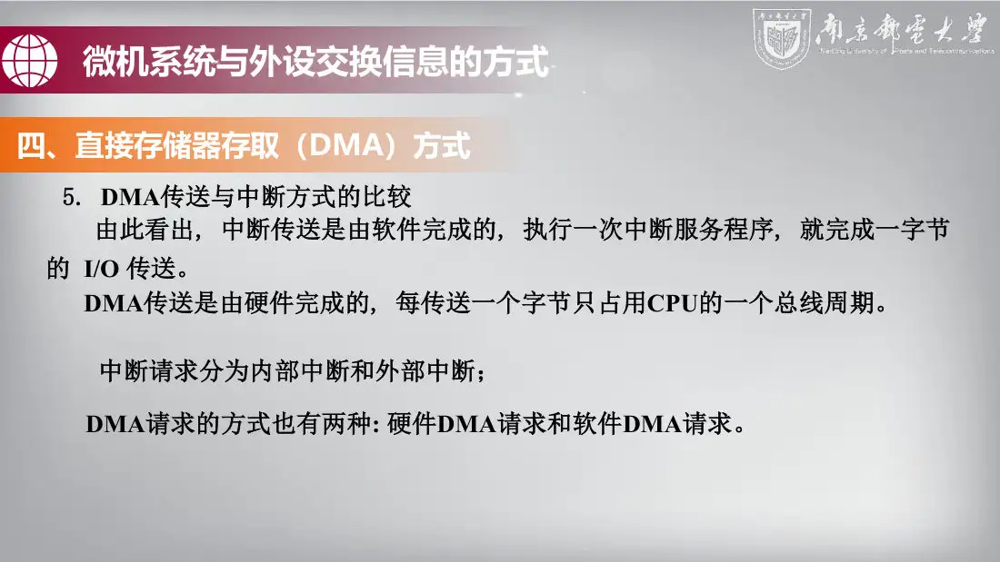

原文：

四、直接存储器存取（DMA）方式

5. DMA传送与中断方式的比较

由此看出，中断传送是由软件完成的，执行一次中断服务程序，就完成一字节的 I/O 传送。

DMA传送是由硬件完成的，每传送一个字节只占用CPU的一个总线周期。

中断请求分为内部中断和外部中断；

DMA请求的方式也有两种: 硬件DMA请求和软件DMA请求。

微机系统与外设交换信息的方式

南京邮电大学
Nanjing University of Posts and Telecommunications

### I/0设备信息交互四种方式的比较:

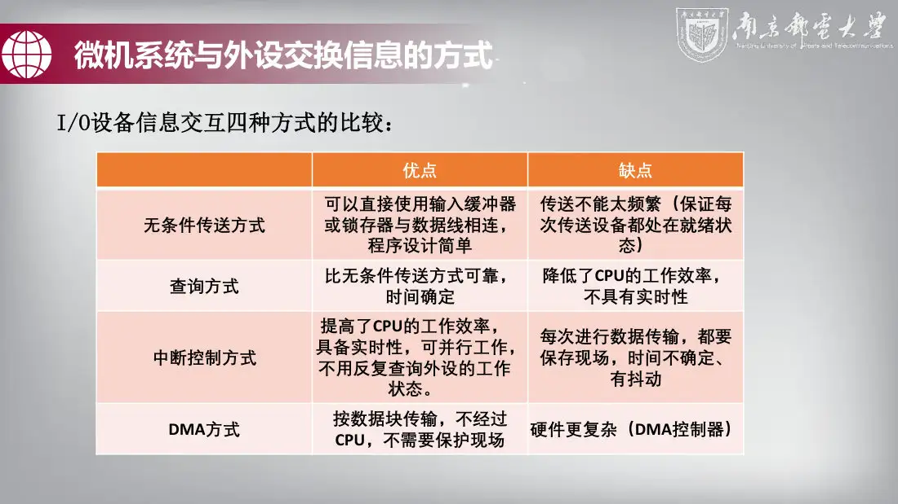

原文：

I/0设备信息交互四种方式的比较:

<table><tr><td></td><td>优点</td><td>缺点</td></tr><tr><td>无条件传送方式</td><td>可以直接使用输入缓冲器或锁存器与数据线相连,程序设计简单</td><td>传送不能太频繁(保证每次传送设备都处在就绪状态)</td></tr><tr><td>查询方式</td><td>比无条件传送方式可靠,时间确定</td><td>降低了CPU的工作效率,不具有实时性</td></tr><tr><td>中断控制方式</td><td>提高了CPU的工作效率,具备实时性,可并行工作,不用反复查询外设的工作状态。</td><td>每次进行数据传输,都要保存现场,时间不确定、有抖动</td></tr><tr><td>DMA方式</td><td>按数据块传输,不经过CPU,不需要保护现场</td><td>硬件更复杂(DMA控制器)</td></tr></table>

微机系统与外设交换信息的方式

南京邮电大学
TJ50-0316
南京邮电大学
Nanjing University of Posts and Telecommunications

### 四种方式的比较，哪一种更好？

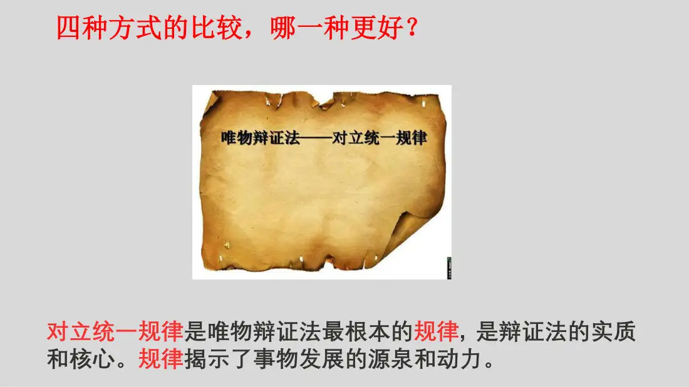

原文：

四种方式的比较，哪一种更好？

对立统一规律是唯物辩证法最根本的规律，是辩证法的实质和核心。规律揭示了事物发展的源泉和动力。

### 知识点小结

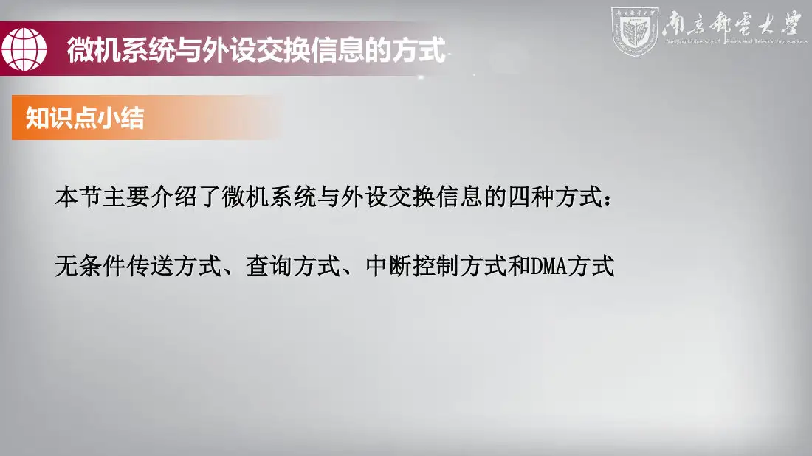

原文：

知识点小结

本节主要介绍了微机系统与外设交换信息的四种方式：

无条件传送方式、查询方式、中断控制方式和DMA方式

微机系统与外设交换信息的方式

南京邮电大学
Nanjing University of Posts and Telecommunications

### 本章总结

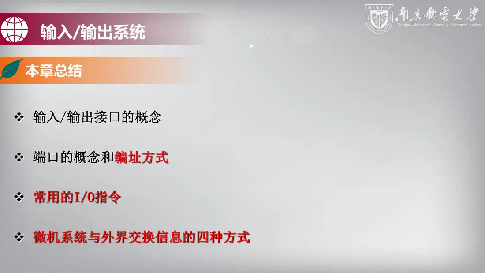

原文：

本章总结

输入/输出接口的概念

端口的概念和编址方式

常用的I/O指令

微机系统与外界交换信息的四种方式

输入/输出系统

南京邮电大学
Nanjing University of Posts and Telecommunications
