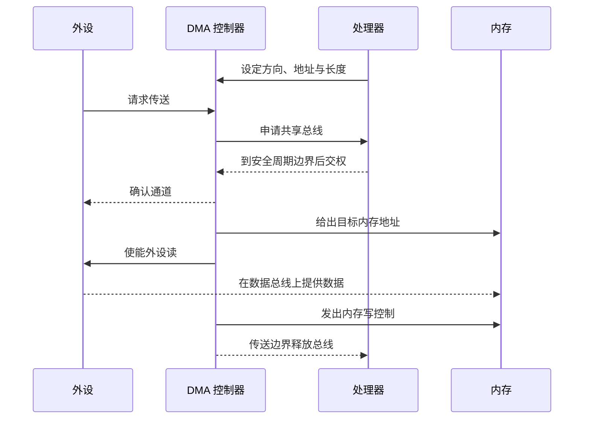

# 《微型计算机接口技术》第3章 输入输出接口（课件）

这里沿用文件名的章节号；原件封面写“第七章：输入/输出系统”。为什么 CPU 不能把一个低速外设直接当成一排存储单元？首先，两边的信号形式和速度可能不合；其次，即使数据线上出现一个字节，也还得知道这是新数据，是否已被取走，下一次写会不会覆盖未送出的数据。本章把这些问题分解到接口电路、端口和交换机制。

## 端口不是插头，而是 CPU 和设备共享的具体约定

接口可用缓冲器、锁存器或队列暂存数据，地址译码选通设备或寄存器，联络及请求电路报告状态；必要时还有格式与物理信号转换。缓冲只能吸收一定时间的速率差，填满之后仍会堵塞或丢数，不能替代流量控制。专用/通用、可编程/不可编程、并行/串行分别在问“适用哪些外设”“能否改配置”“外设侧怎样传”，不是同一分类。参见[接口功能](../../../topics/微机接口/jiekou-gongneng.md)。

| 角色 | 读写时要回答的问题 |
| --- | --- |
| 数据端口 | 这次传的字节是什么；读数据可能取走队首，写数据可能启动设备 |
| 状态端口 | 是否就绪、正在忙还是出错；读状态不能代替读数据 |
| 控制端口 | 要求接口采取什么配置或动作；控制字不当作普通负载 |

数值相同并不保证命中同一个寄存器。普通内存访问和独立 I/O 访问属于不同地址空间；在同一个 I/O 地址上，读与写也可能分别选状态寄存器和输出锁存器。参见[端口与分类](../../../topics/微机接口/duankou-gainian.md)。

| 编址 | 由什么选中 | 与普通内存的边界 |
| --- | --- | --- |
| 存储器映射 I/O | 内存访问加地址译码；由体系结构规定可使用的读写宽度和属性 | 占用一段地址空间，但不等于“把已插入的 RAM 物理容量减去同样大小”；设备访问还可能有副作用 |
| 独立 I/O 编址 | 特定 I/O 周期和端口地址；传统 x86 用 IN/OUT | 端口编号与内存地址可重叠，I/O 空间不使用实模式段地址加偏移的算法 |

课件第 12–13 页分别讨论 x86 的 16 位端口号与部分历史板卡只译码 A9–A0。前者给 $2^{16}$ 个可能端口号，后者只有 $2^{10}$ 种可区别低位模式，不能推出所有 PC 最多仅有 1,024 个 I/O 位置。**补充**：若某个板卡全然不检查上六位，则 0200H 和 0600H 的低十位相同，在该板卡可能响应同一寄存器；若它另检查 A10，就不会形成这对镜像。只有结合 I/O 周期与实际连线才能判定。见[端口编址](../../../topics/微机接口/duankou-bianzhi.md)和[地址译码](../../../topics/微机接口/dizhi-yima.md)。

## 寻址位数和数据位数是两件事

IN 和 OUT 用累加器 AL、AX（以及支持 32 位操作数的 x86 的 EAX）搬运数据。立即端口字段仅 8 位；DX 端口方式接受 16 位地址。DX 方式的 `IN AL, DX` 没有内存方括号，也不是从内存取出一个指针再访问。只有用 AL/AX/EAX 是对这类指令的限制，不妨先把所需数据从其他寄存器移进累加器。

**参考解答（第 15–19 页例示）。** `IN AL, 61H` 以立即数选择 61H，读得的一个字节放入 AL。设 AX=5678H，`OUT 40H, AX` 发出 16 位 I/O 写，按课件的字节通道模型，78H 在低地址 40H，56H 在高地址 41H。设备必须支持该宽度和语义，不能据此假定任意两个 8 位端口都能安全并写，更不能把字写当作两条独立字节指令。对 3F8H 这样的端口先令 DX=3F8H，再用 IN/OUT；若写 ASCII 的大写 A，则 AL=41H。见 [I/O 指令](../../../topics/微机接口/io-zhiling.md)。

> [!TIP]
> 看到==地址超过 FFH==先选 DX；看到==设备只接受一个字节==则选 AL。DX 解决地址能不能编码，不会把发送的数据自动拓宽成 16 位。

## 主动等待、被叫醒，还是把搬运交给别的硬件

第 22–33 页比较三种由 CPU 执行数据指令的路径。无条件传送不是外设没有条件，而是**程序不逐次验证**：读前必须已有稳定输入，写前外设必须可接受。输入时，接口在读使能后驱动总线；输出时，CPU 驱动总线，选中且写有效时接口锁存。若设备什么时候就绪无法预测，就要查询或由外设提出请求。

**参考解答（第 27–28 页例示）。** 输入例中的状态口是 200H，状态掩码 80H，零为未就绪，非零才从 201H 读数据；例如状态 81H 可读，01H 不可读。输出例把读状态与写数据放在同一编号 200H，忙位掩码 01H，非零必须等，零才写；例如 80H 表示不忙，01H 表示忙。这里没有矛盾：输入采用“READY 高有效”，输出采用“BUSY 高有效”，题目先给掩码和极性，再决定循环向哪边转。**补充**：若硬件没保证总会就绪，实际程序要能超时退出。参见[查询方式](../../../topics/微机接口/chaxun-fangshi.md)。

中断把“何时来检查”交给硬件请求，CPU 不必在等待期间空转；它接受请求后仍执行服务程序搬数据，须付上下文处理和返回的代价。长时间屏蔽、优先级阻塞、服务程序占用都会增加延迟，因此使用中断本身不等于满足实时截止期。同样，固定周期查询若有可证明的调度上界、且状态保持至取走，也能给检测时延上界，不应一律说查询没有实时性。见[接口的信息交换方式](../../../topics/微机接口/xinxi-jiaohuan.md)。

## DMA：先转交总线，再说数据往哪走

若每个字节都让 CPU 从 I/O 端口读出、再把它写进内存，大块数据会把 CPU 拴在重复指令上。第 34–43 页改用 DMA 控制器。CPU 一般先配置通道、内存地址、长度和方向；在课件所示共享总线模型下，外设请求之后，控制器向 CPU 申请总线。CPU 允许当前周期安全结束，再确认移交；控制器确认外设请求，发出内存地址以及读、写控制，数据不经过 CPU 累加器。达到本次服务边界或传送完成后，控制器释放总线，CPU 才能重新发起自己的总线周期。请求也可以由软件触发，具体控制器的工作模式与终止规则各有不同。见 [DMA 传送](../../../topics/微机接口/dma-fangshi.md)。

| 原件术语 | 数据方向 | 经典 I/O 与内存传送的控制组合 |
| --- | --- | --- |
| DMA 读 | 内存 → 外设 | 读内存、写 I/O；内存驱动数据 |
| DMA 写 | 外设 → 内存 | 读 I/O、写内存；外设驱动数据 |
| 存储单元间传送 | 内存源 → 内存目的 | 确定两个地址，先读源后写目的；存储器之间不套用 I/O 读写组合 |

图用外设到内存举例；课件的 DREQ/DACK 标识外设与控制器之间的请求/确认，HRQ 接 CPU 的 HOLD，HLDA 是 CPU 回给控制器的总线确认。两组握手各有职责。图中的数据箭头表示共享数据总线上的流向，不是控制器把外设字节作为自己的寄存器数据再交给 CPU。课件的“读/写”名字站在==内存==一边。控制器的总线请求不是 CPU 的中断请求：前者要求总线使用权，后者要求 CPU 进入服务程序。DMA 可以再通过完成中断通知 CPU，两者并不排斥。

> [!WARNING]
> **订正（第 42–44 页的简化）。** “每个 DMA 字节只需一个总线周期”“每次中断只搬一个字节”只适用于课件所画的教学模型。一些 DMA 事务会受等待、仲裁和内存源/目的分步约束，中断例程也可以一次取走多个字节。不逐字节消耗 CPU 指令不意味着传送不占总线，更不意味着 CPU 永远不等待 DMA。

## 用设备与工作负载选机制，不按名次排

| 机制 | 谁察觉就绪 | 谁搬运 | 适用与代价 |
| --- | --- | --- | --- |
| 无条件 | 由硬件、程序时序或约定预先保证 | CPU | 约定稳定时路径最短；约定失效就可能错读或覆盖 |
| 查询 | CPU 读取状态 | CPU | 可做低复杂度、低延迟轮询；长时间空转会占用 CPU |
| 中断 | 外设/控制器给出请求 | CPU 的服务程序 | 偶发事件时少等，但有响应抖动和上下文成本 |
| DMA | 外设或软件请求，控制器接手 | 控制器协调设备与内存 | 大块数据可摊薄配置开销，但需硬件、缓冲及总线仲裁 |

**补充算例。** 只比较 CPU 指令消耗：若逐字节中断要 100 个 CPU 周期的服务开销，另 4 个周期搬运，64 字节共需 $64\times104=6656$ 个周期。若 DMA 启动和收尾合计 135 个 CPU 周期，同样 64 字节便能把这部分开销摊薄；但若 CPU 已能一次中断批量搬运，模型就变成 $100+64\times4=356$ 个 CPU 周期。三数都**不是总响应时间**，不含总线等待；这正是“小且偶发用中断、大块重复优先考虑 DMA”需要条件、不能作为绝对排名的理由。
