# 《微型计算机接口技术》第4章 8254定时器（课件）

原件的每一页，下面附识别出的文字。

### 南京邮电大学计算机学院

原文：

南京邮电大学计算机学院

微型计算机接口技术

南京邮電大學
Tokai University of Posts and Telecommunications
南京邮電大學
Nanjing University of Posts and Telecommunications

第十一章 8254定时/计数器

### 知识要点

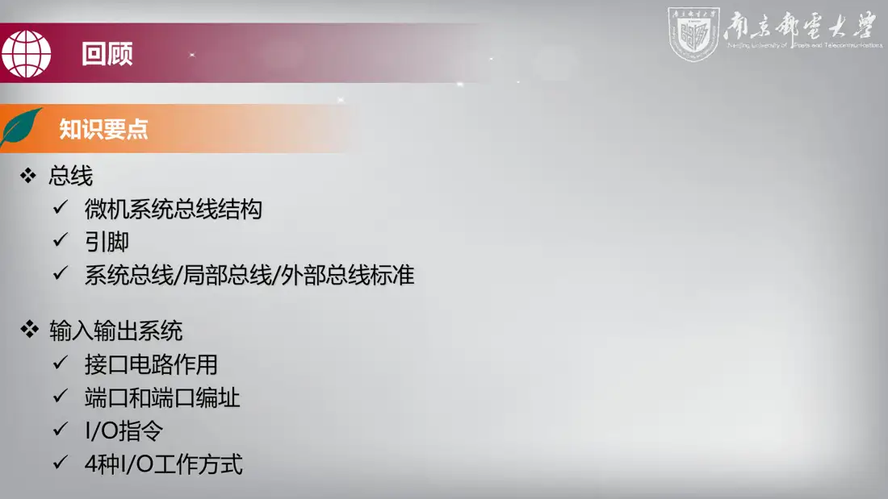

原文：

知识要点

总线

√ 微机系统总线结构

√ 引脚

√ 系统总线/局部总线/外部总线标准

输入输出系统

√ 接口电路作用

√ 端口和端口编址

√ I/O指令

√ 4种I/O工作方式

回顾

南京邮電大學
 Nanjing University of Posts and Telecommunications
南京邮電大學

### I/0设备信息交互四种方式的比较:

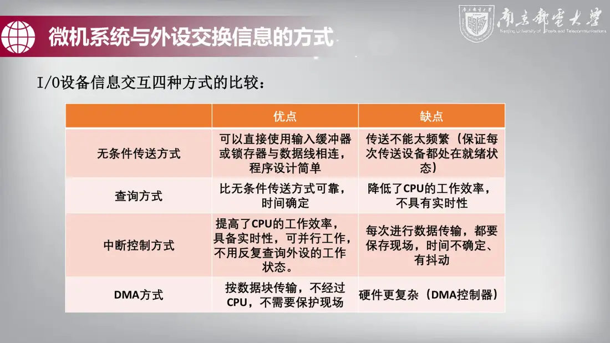

原文：

I/0设备信息交互四种方式的比较:

<table><tr><td></td><td>优点</td><td>缺点</td></tr><tr><td>无条件传送方式</td><td>可以直接使用输入缓冲器或锁存器与数据线相连,程序设计简单</td><td>传送不能太频繁(保证每次传送设备都处在就绪状态)</td></tr><tr><td>查询方式</td><td>比无条件传送方式可靠,时间确定</td><td>降低了CPU的工作效率,不具有实时性</td></tr><tr><td>中断控制方式</td><td>提高了CPU的工作效率,具备实时性,可并行工作,不用反复查询外设的工作状态。</td><td>每次进行数据传输,都要保存现场,时间不确定、有抖动</td></tr><tr><td>DMA方式</td><td>按数据块传输,不经过CPU,不需要保护现场</td><td>硬件更复杂(DMA控制器)</td></tr></table>

微机系统与外设交换信息的方式

南京邮电大学
Nanjing University of Posts and Telecommunications
南京邮电大学

### 知识要点

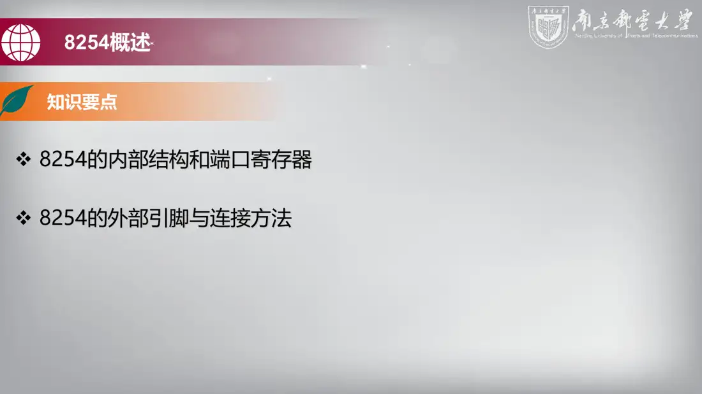

原文：

知识要点

✿ 8254的内部结构和端口寄存器

✿ 8254的外部引脚与连接方法

8254概述

南京邮电大学
 Nanjing University of Posts and Telecommunications
南京邮电大学
 Nanjing University of Posts and Telecommunications

### 计算机中的定时和延时控制、对外部事件或信号的计数方法:

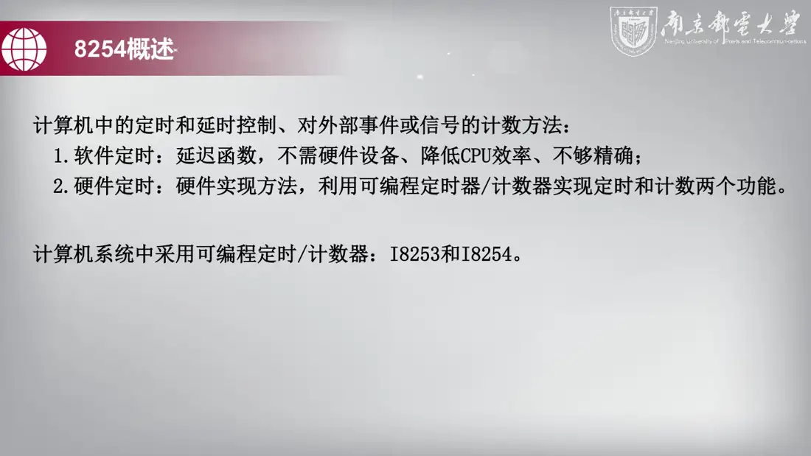

原文：

计算机中的定时和延时控制、对外部事件或信号的计数方法:

1. 软件定时：延迟函数，不需硬件设备、降低CPU效率、不够精确；

2. 硬件定时：硬件实现方法，利用可编程定时器/计数器实现定时和计数两个功能。

计算机系统中采用可编程定时/计数器：I8253和I8254。

8254概述

南京邮電大學
Nanjing University of Posts and Telecommunications
南京邮電大學

### 一. 8254的内部结构

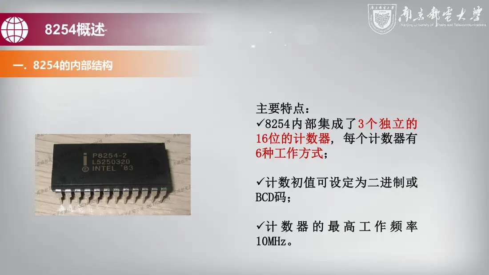

原文：

一. 8254的内部结构

主要特点:

√8254内部集成了3个独立的16位的计数器，每个计数器有6种工作方式；

√计数初值可设定为二进制或BCD码；

√计数器的最高工作频率10MHz。

8254概述

南京邮电大学
Nanjing University of Posts and Telecommunications
南京邮电大学

### 一. 8254的内部结构

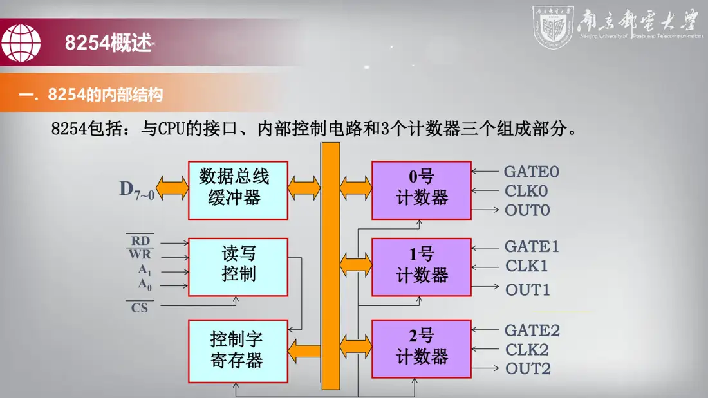

原文：

一. 8254的内部结构

8254包括：与CPU的接口、内部控制电路和3个计数器三个组成部分。

8254概述

南京邮電大學
Nanjing University of Posts and Telecommunications
南京邮電大學

### 8254概述

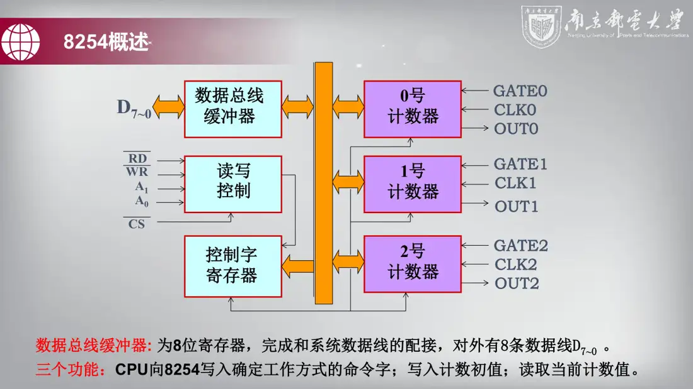

原文：

数据总线缓冲器: 为8位寄存器, 完成和系统数据线的配接, 对外有8条数据线 $\mathrm{D}_{7 \sim 0}$ 。

三个功能：CPU向8254写入确定工作方式的命令字；写入计数初值；读取当前计数值。

8254概述

南京邮電大學
Nanjing University of Posts and Telecommunications
南京邮電大學

### 8254概述

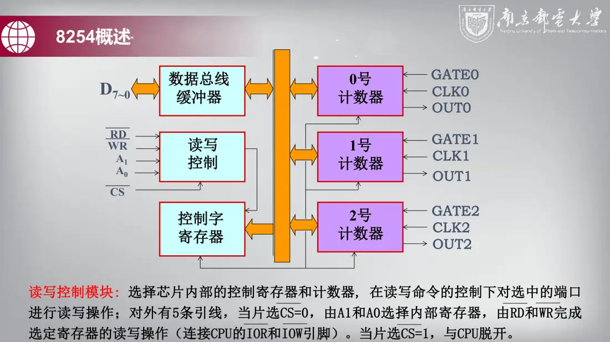

原文：

读写控制模块：选择芯片内部的控制寄存器和计数器，在读写命令的控制下对选中的端口进行读写操作；对外有5条引线，当片选CS=0，由A1和A0选择内部寄存器，由RD和WR完成选定寄存器的读写操作（连接CPU的IOR和IOW引脚）。当片选CS=1，与CPU脱开。

8254概述

南京邮電大學
 Nanjing University of Posts and Telecommunications
南京邮電大學

### 8254概述

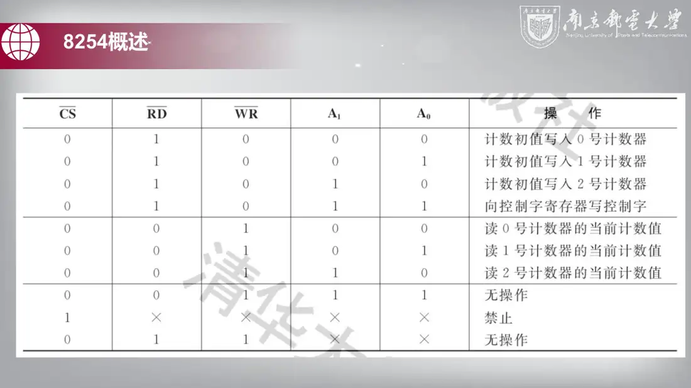

原文：

<table><tr><td> $\overline{\mathbf{{CS}}}$ </td><td> $\overline{\mathbf{{RD}}}$ </td><td> $\overline{\mathbf{{WR}}}$ </td><td> ${\mathrm{A}}_{1}$ </td><td> ${\mathrm{A}}_{0}$ </td><td>操作</td></tr><tr><td>0</td><td>1</td><td>0</td><td>0</td><td>0</td><td>计数初值写入 0 号计数器</td></tr><tr><td>0</td><td>1</td><td>0</td><td>0</td><td>1</td><td>计数初值写入 1 号计数器</td></tr><tr><td>0</td><td>1</td><td>0</td><td>1</td><td>0</td><td>计数初值写入 2 号计数器</td></tr><tr><td>0</td><td>1</td><td>0</td><td>1</td><td>1</td><td>向控制字寄存器写控制字</td></tr><tr><td>0</td><td>0</td><td>1</td><td>0</td><td>0</td><td>读 0 号计数器的当前计数值</td></tr><tr><td>0</td><td>0</td><td>1</td><td>0</td><td>1</td><td>读 1 号计数器的当前计数值</td></tr><tr><td>0</td><td>0</td><td>1</td><td>1</td><td>0</td><td>读 2 号计数器的当前计数值</td></tr><tr><td>0</td><td>0</td><td>1</td><td>1</td><td>1</td><td>无操作</td></tr><tr><td>1</td><td>×</td><td>×</td><td>×</td><td>×</td><td>禁止</td></tr><tr><td>0</td><td>1</td><td>1</td><td>×</td><td>×</td><td>无操作</td></tr></table>

8254概述

南京邮電大學
Nanjing University of Posts and Telecommunications
南京邮電大學

### 8254概述

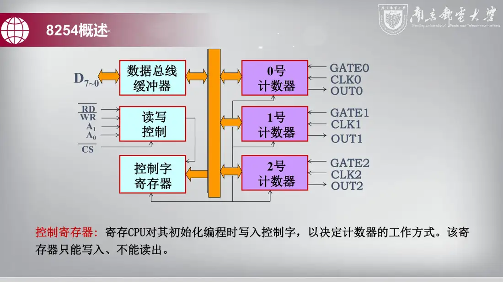

原文：

控制寄存器：寄存CPU对其初始化编程时写入控制字，以决定计数器的工作方式。该寄存器只能写入、不能读出。

8254概述

南京邮电大学
Nanjing University of Posts and Telecommunications
南京邮电大学

### 8254概述

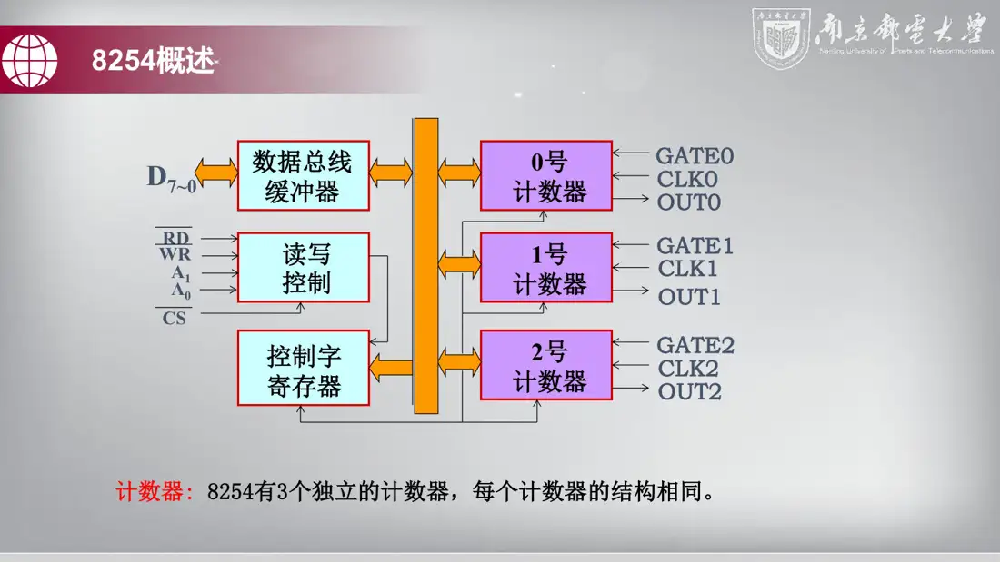

原文：

8254概述

南京邮电大学
Nanjing University of Posts and Telecommunications
南京邮电大学

### 二. 计数器内部结构示意图

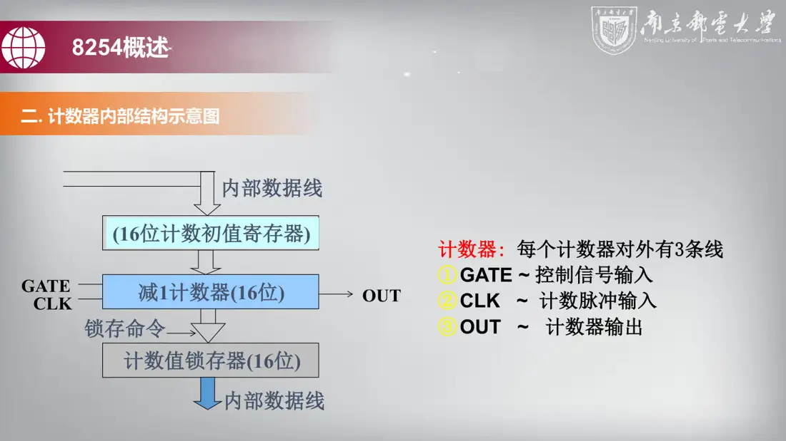

原文：

二. 计数器内部结构示意图

计数器：每个计数器对外有3条线

① GATE \~ 控制信号输入

② CLK \~ 计数脉冲输入

③ OUT \~ 计数器输出

8254概述

南京邮电大学
Nanjing University of Posts and Telecommunications
南京邮电大学

### 8254概述

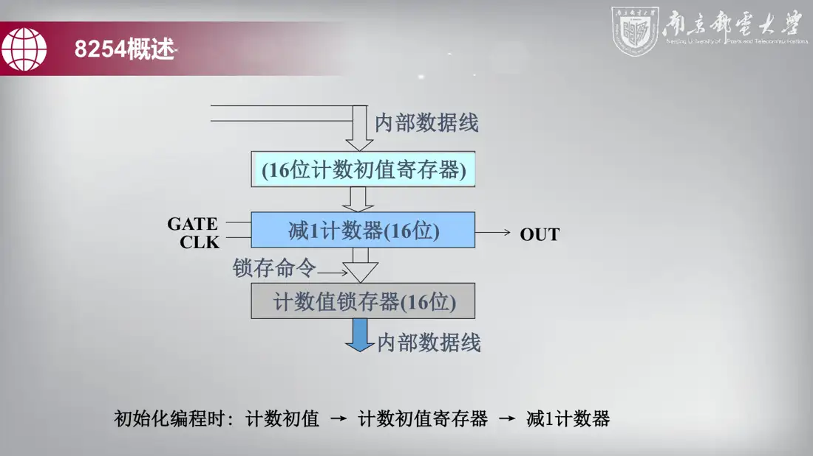

原文：

初始化编程时：计数初值 → 计数初值寄存器 → 减1计数器当GATE=1时, CLK的下降沿使计数器减1, 当计数值减到0 (或由工作方式确定的某个值)时, OUT输出信号。在计数的过程中, 锁存器随减1计数器的变化而变化。

8254概述

南京邮電大學
 Nanjing University of Posts and Telecommunications
南京邮電大學
 Nanjing University of Posts and Telecommunications

### 8254概述

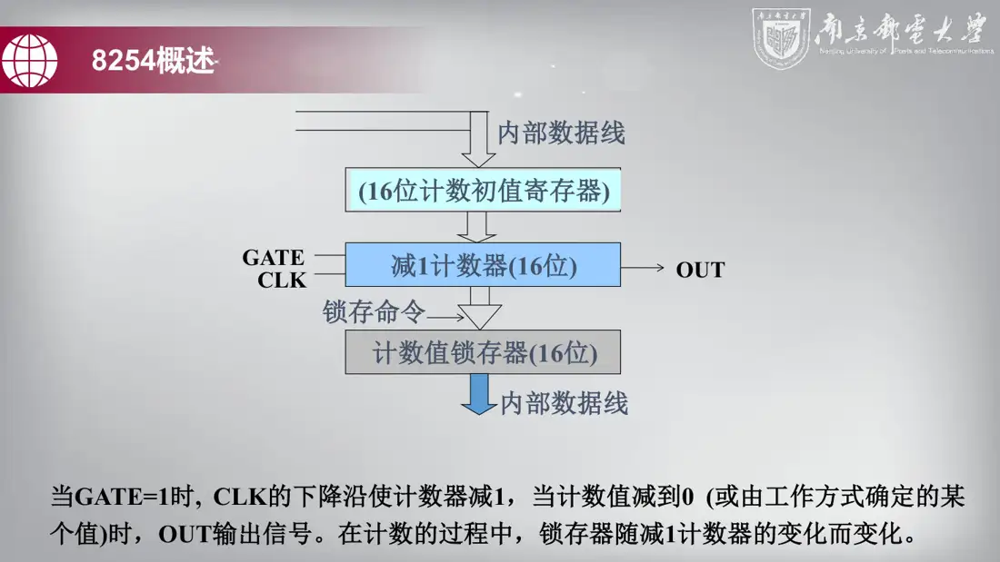

原文：

8254概述

南京邮电大学
Nanjing University of Posts and Telecommunications
南京邮电大学

### 计数初值的计算公式如下:

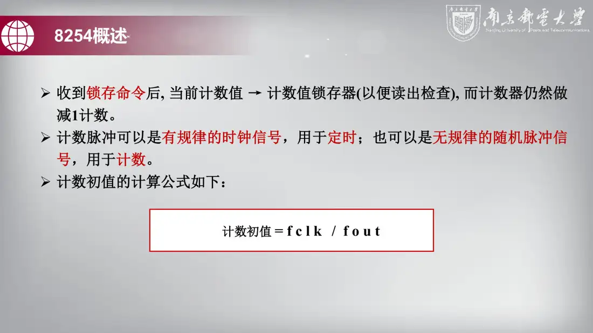

原文：

收到锁存命令后, 当前计数值 → 计数值锁存器(以便读出检查), 而计数器仍然做减1计数。

➢ 计数脉冲可以是有规律的时钟信号，用于定时；也可以是无规律的随机脉冲信号，用于计数。

计数初值的计算公式如下:

计数初值 = f c l k / f o u t

8254概述

南京邮电大学
Nanjing University of Posts and Telecommunications
南京邮电大学

### 三. 8254与系统总线的连接

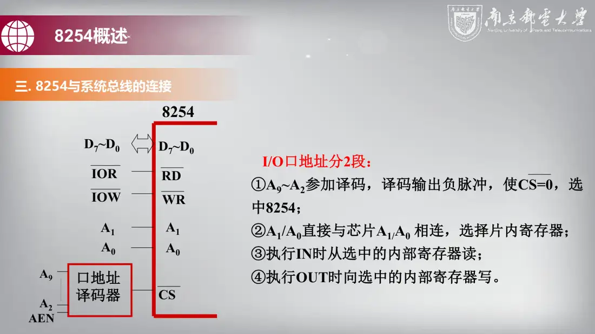

原文：

三. 8254与系统总线的连接

I/O口地址分2段:

① $A_{9}\sim A_{2}$ 参加译码，译码输出负脉冲，使CS=0，选中8254;

② $\mathrm{A}_{1} / \mathrm{A}_{0}$ 直接与芯片 $\mathrm{A}_{1} / \mathrm{A}_{0}$ 相连，选择片内寄存器；

③执行IN时从选中的内部寄存器读;

④执行OUT时向选中的内部寄存器写。

8254概述

南京邮电大学
Nanjing University of Posts and Telecommunications
南京邮电大学

### 四. 8254内部寄存器/计数器口地址

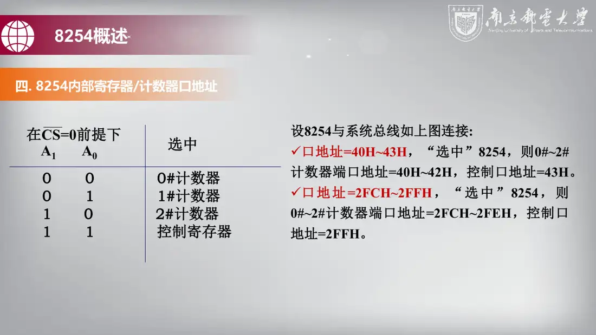

原文：

四. 8254内部寄存器/计数器口地址

<table><tr><td colspan="2">在 $\overline{CS}$ =0前提下</td><td rowspan="2">选中</td></tr><tr><td> $A_1$ </td><td> $A_0$ </td></tr><tr><td>0</td><td>0</td><td>0#计数器</td></tr><tr><td>0</td><td>1</td><td>1#计数器</td></tr><tr><td>1</td><td>0</td><td>2#计数器</td></tr><tr><td>1</td><td>1</td><td>控制寄存器</td></tr></table>

设8254与系统总线如上图连接:

√口地址=40H\~43H，“选中”8254，则0#\~2#计数器端口地址=40H\~42H，控制口地址=43H。√口地址=2FCH\~2FFH，“选中”8254，则0#\~2#计数器端口地址=2FCH\~2FEH，控制口地址=2FFH。

8254概述

南京邮电大学
Nanjing University of Posts and Telecommunications
南京邮电大学
Nanjing University of Posts and Telecommunications

### 知识点小结

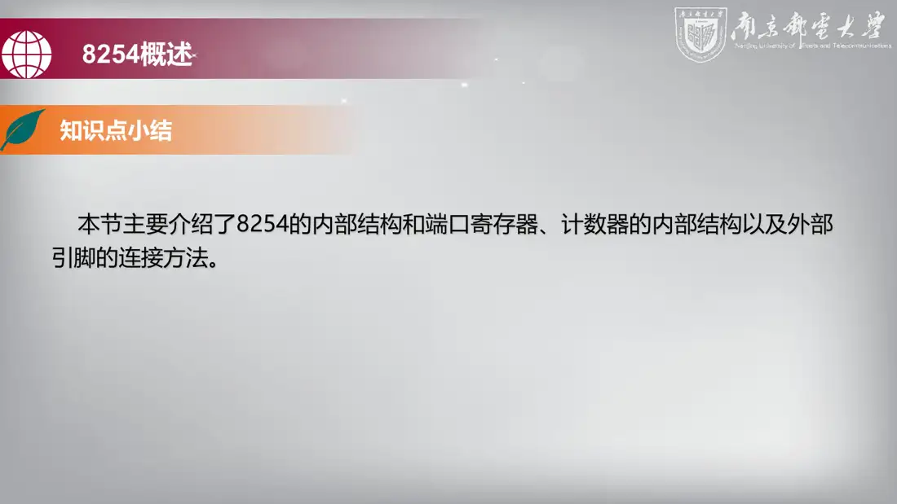

原文：

知识点小结

本节主要介绍了8254的内部结构和端口寄存器、计数器的内部结构以及外部引脚的连接方法。

8254概述

南京邮電大學
 Nanjing University of Posts and Telecommunications
南京邮電大學

### 知识要点

原文：

知识要点

✿ 8254的6种工作方式

8254的工作方式

南京邮电大学
 Nanjing University of Posts and Telecommunications
南京邮电大学
 Nanjing University of Posts and Telecommunications

### 每个计数器有6种工作方式，均在CLK下降沿计数一次。

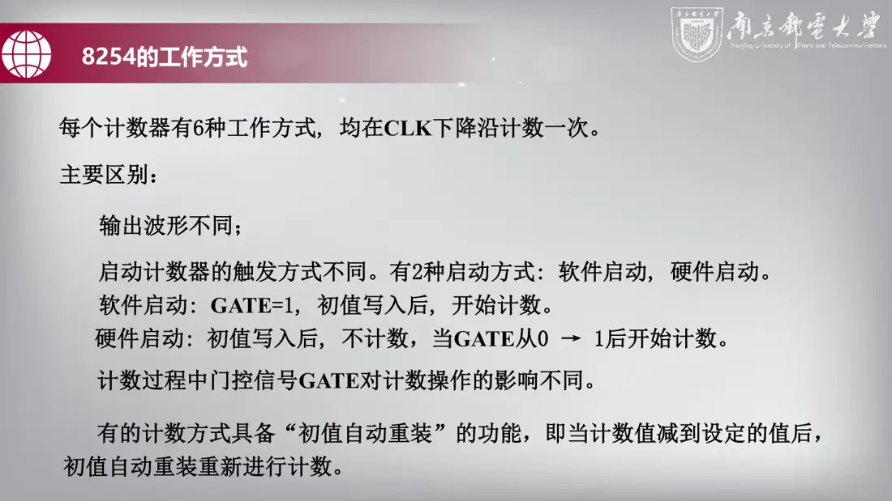

原文：

每个计数器有6种工作方式，均在CLK下降沿计数一次。

主要区别:

输出波形不同;

启动计数器的触发方式不同。有2种启动方式：软件启动，硬件启动。

软件启动: GATE=1, 初值写入后, 开始计数。

硬件启动：初值写入后，不计数，当GATE从0 → 1后开始计数。

计数过程中门控信号GATE对计数操作的影响不同。

有的计数方式具备“初值自动重装”的功能，即当计数值减到设定的值后，初值自动重装重新进行计数。

8254的工作方式

南京邮电大学
 Nanjing University of Posts and Telecommunications
南京邮电大学
 Nanjing University of Posts and Telecommunications

### 1. 方式0：计数结束OUT引脚输出正跃变信号

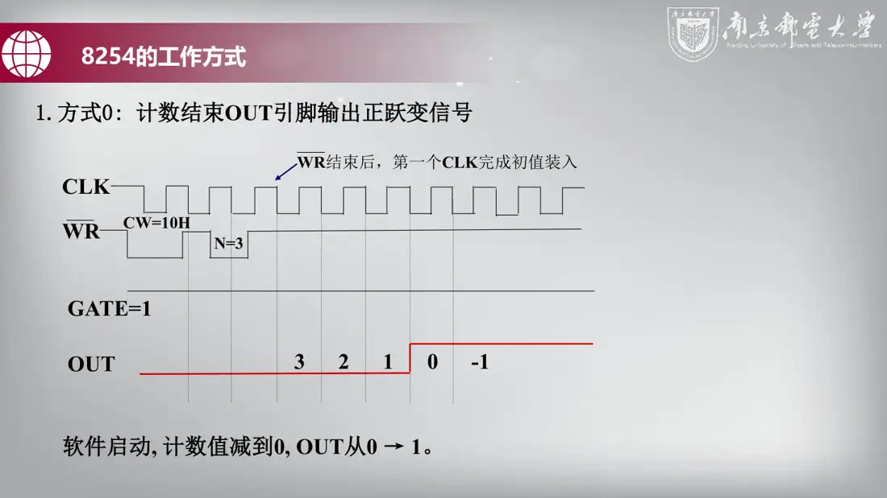

原文：

1. 方式0：计数结束OUT引脚输出正跃变信号

8254的工作方式

南京邮電大學
Nanjing University of Posts and Telecommunications
南京邮電大學

### 1. 方式0：计数结束OUT引脚输出正跃变信号

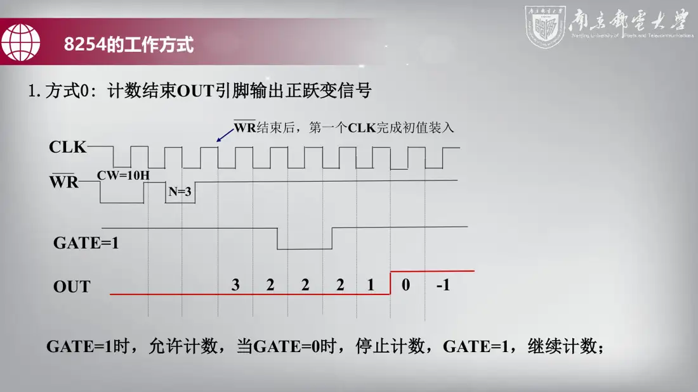

原文：

1. 方式0：计数结束OUT引脚输出正跃变信号

GATE=1时，允许计数，当GATE=0时，停止计数，GATE=1，继续计数；

8254的工作方式

南京邮電大學
Nanjing University of Posts and Telecommunications
南京邮電大學

### 1. 方式0：计数结束OUT引脚输出正跃变信号

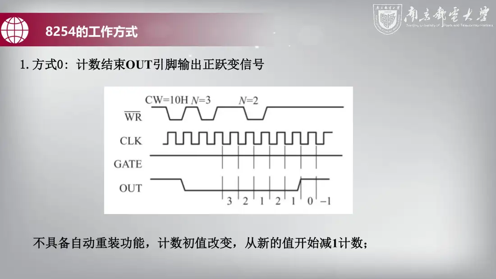

原文：

1. 方式0：计数结束OUT引脚输出正跃变信号

不具备自动重装功能，计数初值改变，从新的值开始减1计数；

8254的工作方式

南京邮電大學
Nanjing University of Posts and Telecommunications
南京邮電大學

### 2. 方式1: (可重触发的) 硬件启动的单脉冲发生器

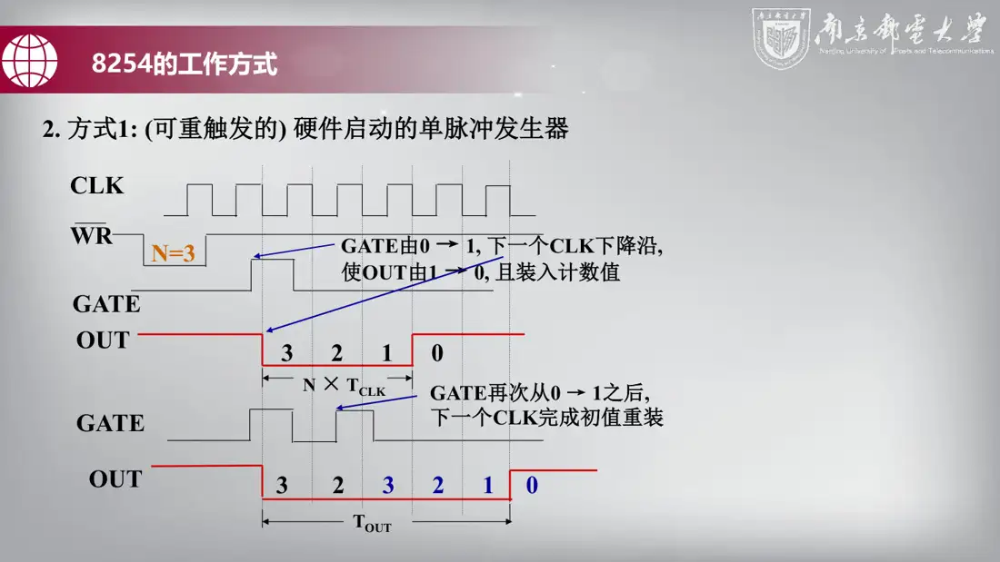

原文：

2. 方式1: (可重触发的) 硬件启动的单脉冲发生器

8254的工作方式

南京邮電大學
 Nanjing University of Posts and Telecommunications
南京邮電大學

### 2. 方式1: (可重触发的) 硬件启动的单脉冲发生器

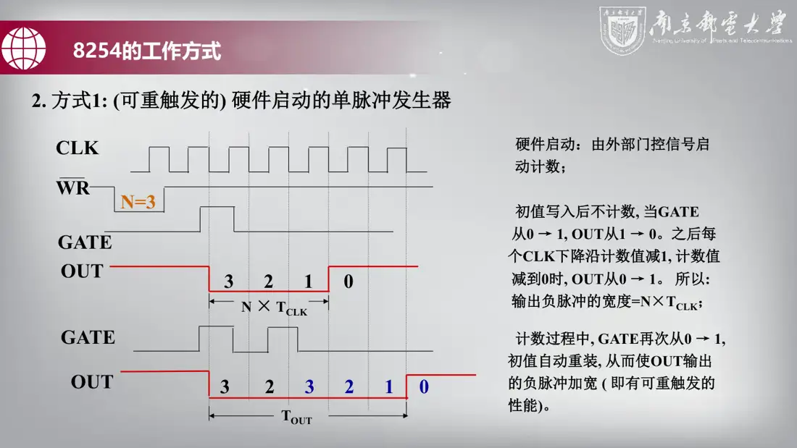

原文：

2. 方式1: (可重触发的) 硬件启动的单脉冲发生器

硬件启动：由外部门控信号启动计数；

初值写入后不计数, 当GATE从0 → 1, OUT从1 → 0。之后每个CLK下降沿计数值减1, 计数值减到0时, OUT从0 → 1。所以: 输出负脉冲的宽度= $N \times T_{CLK}$ ;

计数过程中, GATE再次从0 → 1, 初值自动重装, 从而使OUT输出的负脉冲加宽 (即有可重触发的性能)。

8254的工作方式

南京邮電大學
Nanjing University of Posts and Telecommunications
南京邮電大學

### 3. 方式2: 分频器(脉冲发生器)

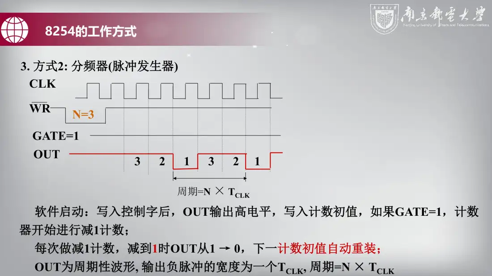

原文：

3. 方式2: 分频器(脉冲发生器)

软件启动: 写入控制字后, OUT输出高电平, 写入计数初值, 如果GATE=1, 计数器开始进行减1计数;

每次做减1计数，减到1时OUT从 $1 \rightarrow 0$ ，下一计数初值自动重装；

OUT为周期性波形, 输出负脉冲的宽度为一个 $T_{CLK}$ , 周期= $N \times T_{CLK}$

8254的工作方式

南京邮電大學
 Nanjing University of Posts and Telecommunications
南京邮電大學

### 3. 方式2: 分频器(脉冲发生器)

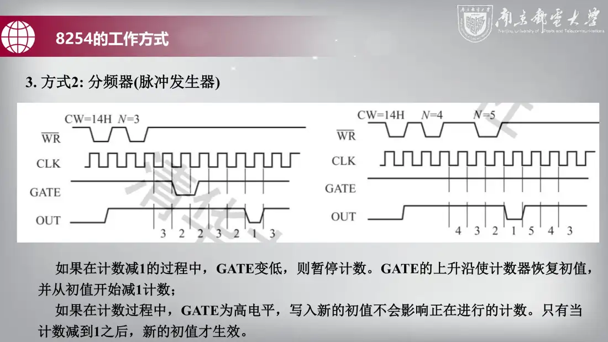

原文：

3. 方式2: 分频器(脉冲发生器)

如果在计数减1的过程中，GATE变低，则暂停计数。GATE的上升沿使计数器恢复初值，并从初值开始减1计数；

如果在计数过程中，GATE为高电平，写入新的初值不会影响正在进行的计数。只有当计数减到1之后，新的初值才生效。

8254的工作方式

南京邮電大學
 Nanjing University of Posts and Telecommunications
南京邮電大學
 Nanjing University of Posts and Telecommunications

### 4. 方式3: 方波发生器

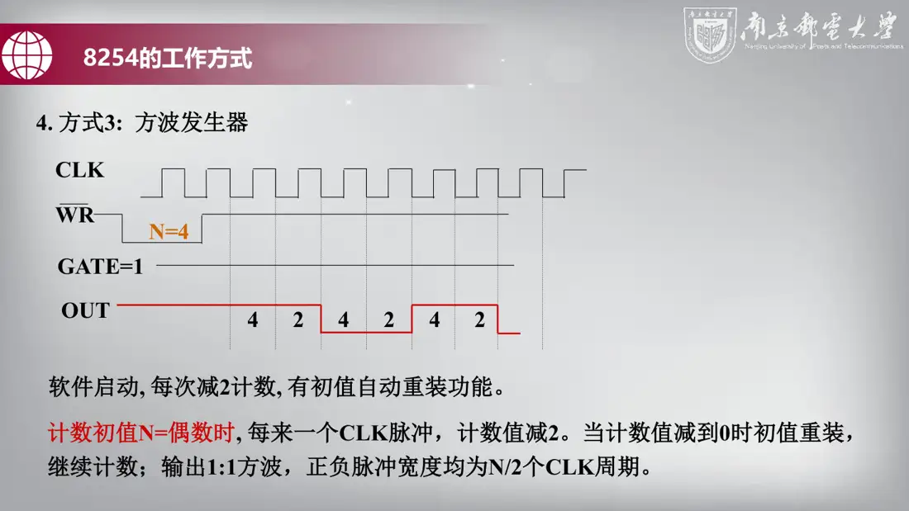

原文：

4. 方式3: 方波发生器

<table><tr><td colspan="12">CLK</td></tr><tr><td>WR</td><td colspan="11">N=4</td></tr><tr><td colspan="12">GATE=1</td></tr><tr><td colspan="3">OUT</td><td>4</td><td>2</td><td>4</td><td>2</td><td>4</td><td>2</td><td></td><td></td><td></td></tr></table>

软件启动, 每次减2计数, 有初值自动重装功能。

计数初值N=偶数时, 每来一个CLK脉冲, 计数值减2。当计数值减到0时初值重装, 继续计数; 输出1:1方波, 正负脉冲宽度均为N/2个CLK周期。

8254的工作方式

南京邮電大學
Nanjing University of Posts and Telecommunications
南京邮電大學

### 4. 方式3: 方波发生器

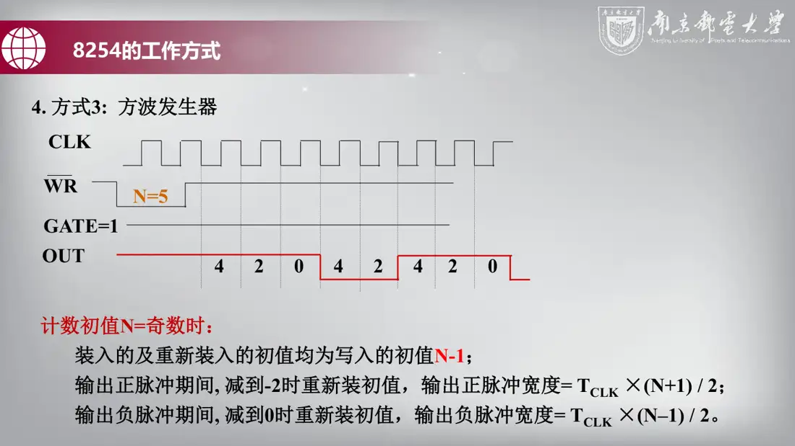

原文：

4. 方式3: 方波发生器

<table><tr><td colspan="12">CLK</td></tr><tr><td>WR</td><td colspan="11">N=5</td></tr><tr><td colspan="12">GATE=1</td></tr><tr><td>OUT</td><td></td><td>4</td><td>2</td><td>0</td><td>4</td><td>2</td><td>4</td><td>2</td><td>0</td><td></td><td></td></tr></table>

计数初值N=奇数时:

装入的及重新装入的初值均为写入的初值N-1;

输出正脉冲期间, 减到-2时重新装初值, 输出正脉冲宽度= $T_{CLK} \times (N+1)/2$ ; 输出负脉冲期间, 减到0时重新装初值, 输出负脉冲宽度= $T_{CLK} \times (N-1)/2$ 。

8254的工作方式

南京邮電大學
 Nanjing University of Posts and Telecommunications
南京邮電大學

### 5. 方式4: 软件触发的单脉冲发生器

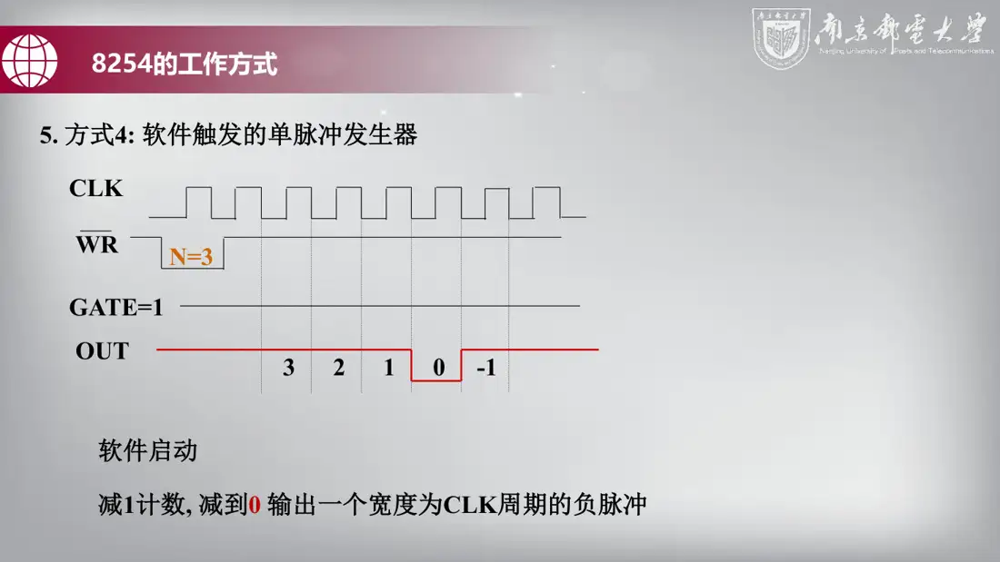

原文：

5. 方式4: 软件触发的单脉冲发生器

WR

GATE=1

OUT

软件启动

减1计数, 减到0 输出一个宽度为CLK周期的负脉冲

8254的工作方式

南京邮電大學
Nanjing University of Posts and Telecommunications
南京邮電大學

### 5. 方式4: 软件触发的单脉冲发生器

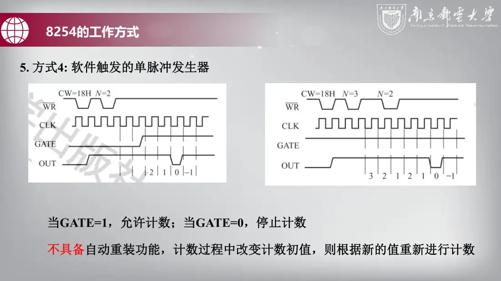

原文：

5. 方式4: 软件触发的单脉冲发生器

当GATE=1，允许计数；当GATE=0，停止计数

不具备自动重装功能，计数过程中改变计数初值，则根据新的值重新进行计数

8254的工作方式

南京邮電大學
 Nanjing University of Posts and Telecommunications
南京邮電大學
 Nanjing University of Posts and Telecommunications

### 6. 方式5: 硬件触发的单脉冲发生器

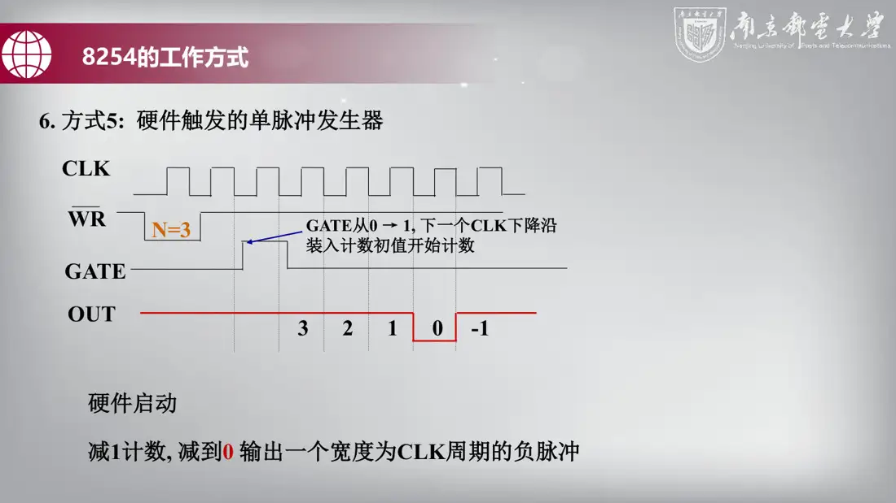

原文：

6. 方式5: 硬件触发的单脉冲发生器

硬件启动

减1计数, 减到0 输出一个宽度为CLK周期的负脉冲

8254的工作方式

南京邮電大學
Nanjing University of Posts and Telecommunications
南京邮電大學

### 6. 方式5: 硬件触发的单脉冲发生器

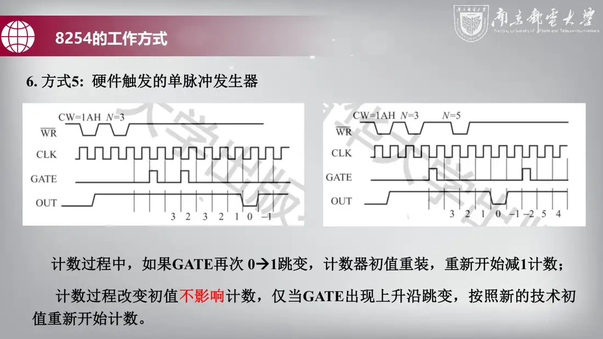

原文：

6. 方式5: 硬件触发的单脉冲发生器

计数过程中，如果GATE再次 0→1 跳变，计数器初值重装，重新开始减1计数；

计数过程改变初值不影响计数，仅当GATE出现上升沿跳变，按照新的技术初值重新开始计数。

8254的工作方式

南京邮電大學
 Nanjing University of Posts and Telecommunications
南京邮電大學

### 郵電大學

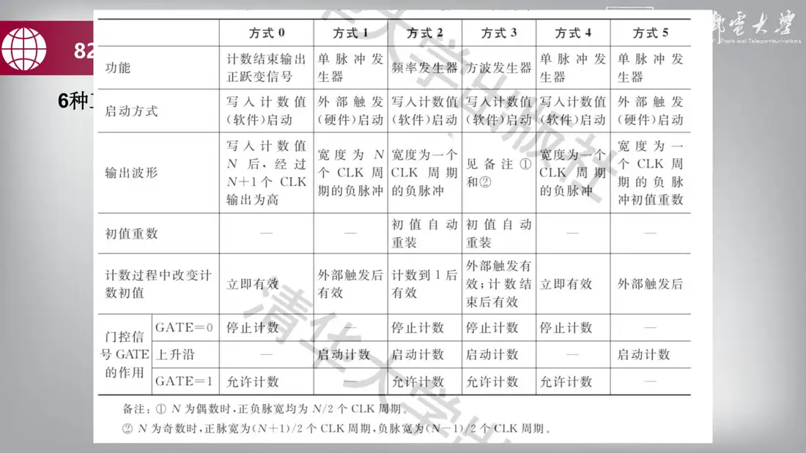

原文：

<table><tr><td colspan="2"></td><td>方式0</td><td>方式1</td><td>方式2</td><td>方式3</td><td>方式4</td><td>方式5</td></tr><tr><td colspan="2">功能</td><td>计数结束输出正跃变信号</td><td>单脉冲发生器</td><td>频率发生器</td><td>方波发生器</td><td>单脉冲发生器</td><td>单脉冲发生器</td></tr><tr><td colspan="2">启动方式</td><td>写入计数值(软件)启动</td><td>外部触发(硬件)启动</td><td>写入计数值(软件)启动</td><td>写入计数值(软件)启动</td><td>写入计数值(软件)启动</td><td>外部触发(硬件)启动</td></tr><tr><td colspan="2">输出波形</td><td>写入计数值N后,经过N+1个CLK输出为高</td><td>宽度为N个CLK周期的负脉冲</td><td>宽度为一个CLK周期的负脉冲</td><td>见备注1和2</td><td>宽度为一个CLK周期的负脉冲</td><td>宽度为一个CLK周期的负脉冲初值重数</td></tr><tr><td colspan="2">初值重数</td><td>—</td><td>—</td><td>初值自动重装</td><td>初值自动重装</td><td>—</td><td>—</td></tr><tr><td colspan="2">计数过程中改变计数初值</td><td>立即有效</td><td>外部触发后有效</td><td>计数到1后有效</td><td>外部触发有效;计数结束后有效</td><td>立即有效</td><td>外部触发后</td></tr><tr><td rowspan="3">门控信号GATE的作用</td><td>GATE=0</td><td>停止计数</td><td>—</td><td>停止计数</td><td>停止计数</td><td>停止计数</td><td>—</td></tr><tr><td>上升沿</td><td>—</td><td>启动计数</td><td>启动计数</td><td>启动计数</td><td>—</td><td>启动计数</td></tr><tr><td>GATE=1</td><td>允许计数</td><td>—</td><td>允许计数</td><td>允许计数</td><td>允许计数</td><td>—</td></tr></table>
备注：① N 为偶数时，正负脉宽均为 N/2 个 CLK 周期。 ② N 为奇数时，正脉宽为 $(N+1)/2$ 个 CLK 周期，负脉宽为 $(N-1)/2$ 个 CLK 周期。

郵電大學

### 知识点小结

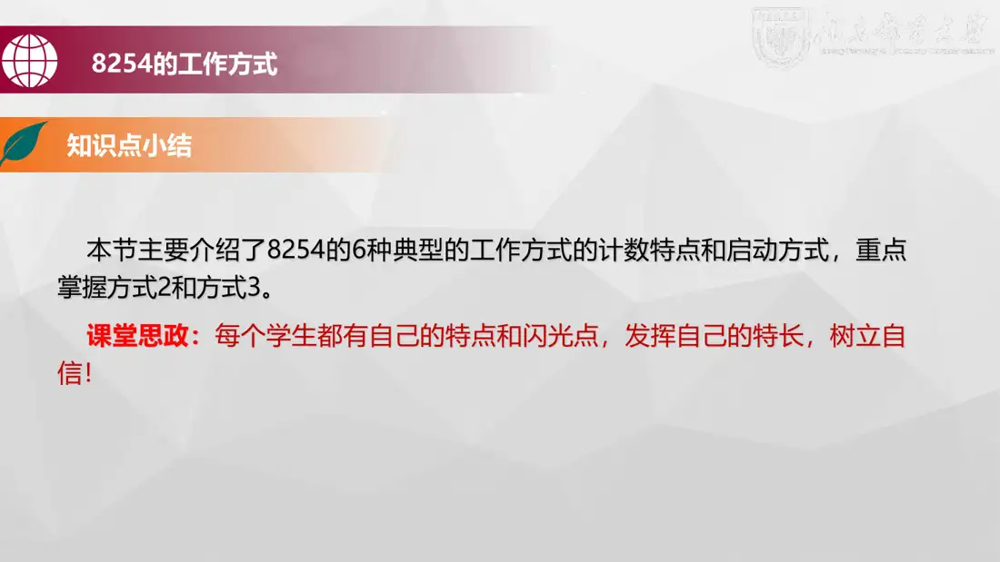

原文：

知识点小结

本节主要介绍了8254的6种典型的工作方式的计数特点和启动方式，重点掌握方式2和方式3。

课堂思政：每个学生都有自己的特点和闪光点，发挥自己的特长，树立自信！

8254的工作方式

南京邮电大学
Nanjing University of Press and Communications

### 知识要点

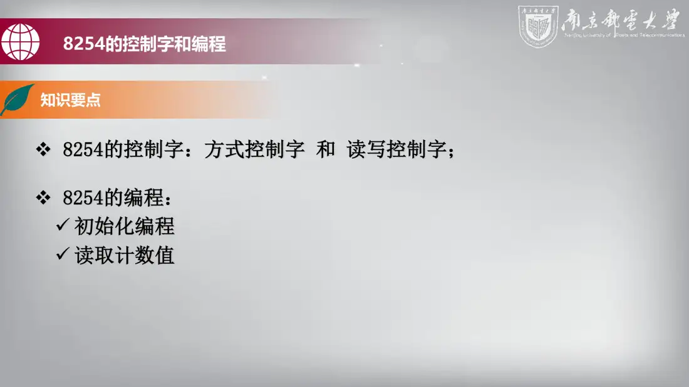

原文：

知识要点

✿ 8254的控制字：方式控制字 和 读写控制字；

✿ 8254的编程:

√ 初始化编程

√ 读取计数值

8254的控制字和编程

南京邮電大學
Nanjing University of Posts and Telecommunications
南京邮電大學

### 一. 8254的控制字/状态字

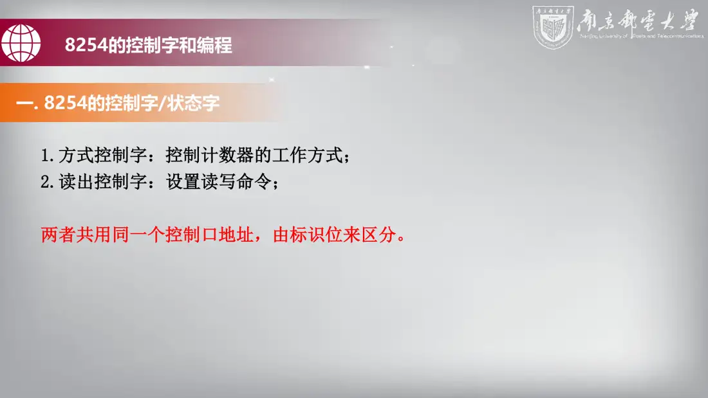

原文：

一. 8254的控制字/状态字

1. 方式控制字：控制计数器的工作方式；

2. 读出控制字：设置读写命令；

两者共用同一个控制口地址，由标识位来区分。

8254的控制字和编程

南京邮电大学
 Nanjing University of Posts and Telecommunications
南京邮电大学
 Nanjing University of Posts and Telecommunications

### 一. 8254的控制字/状态字

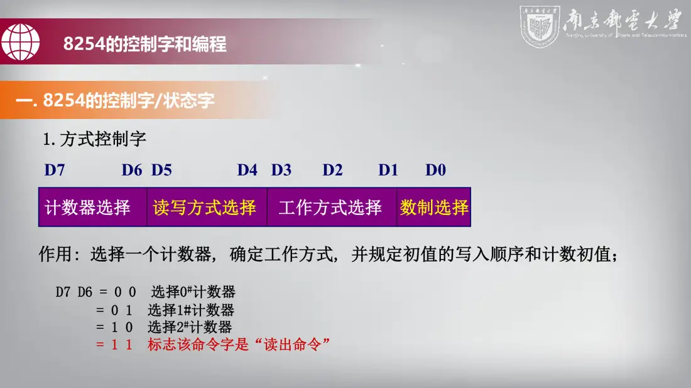

原文：

一. 8254的控制字/状态字

1. 方式控制字

D7

D6 D5

D4 D3

D2

D1

D0

计数器选择 读写方式选择 工作方式选择 数制选择

作用：选择一个计数器，确定工作方式，并规定初值的写入顺序和计数初值；

D7 D6 = 0 0 选择0#计数器
= 0 1 选择1#计数器
= 1 0 选择2#计数器
= 1 1 标志该命令字是“读出命令”

8254的控制字和编程

南京邮電大學
Nanjing University of Posts and Telecommunications
南京邮電大學

### 计数器选择读写方式选择工作方式选择数制选择

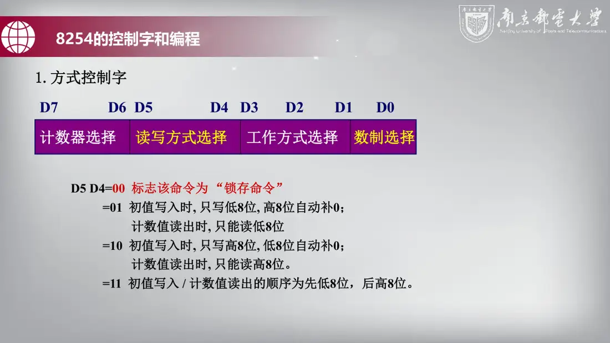

原文：

<table><tr><td>计数器选择</td><td>读写方式选择</td><td>工作方式选择</td><td>数制选择</td></tr></table>

1. 方式控制字

D7

D6 D5

D4 D3

D2

D1

D0

D5 D4=00 标志该命令为 “锁存命令”

=01 初值写入时, 只写低8位, 高8位自动补0; 计数值读出时, 只能读低8位

=10 初值写入时, 只写高8位, 低8位自动补0; 计数值读出时, 只能读高8位。

=11 初值写入 / 计数值读出的顺序为先低8位，后高8位。

8254的控制字和编程

南京邮電大學
 Nanjing University of Posts and Telecommunications
南京邮電大學

### 1. 方式控制字

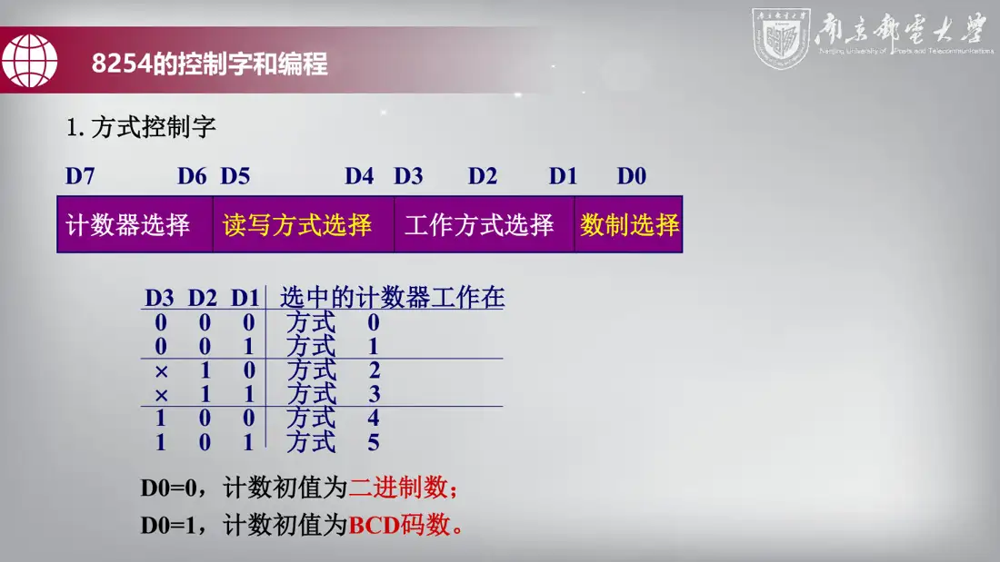

原文：

1. 方式控制字

D7

D6 D5

D4

D3

D2

D1

D0

<table><tr><td>计数器选择</td><td>读写方式选择</td><td>工作方式选择</td><td>数制选择</td></tr></table>

<table><tr><td>D3</td><td>D2</td><td>D1</td><td colspan="2">选中的计数器工作在</td></tr><tr><td>0</td><td>0</td><td>0</td><td>方式</td><td>0</td></tr><tr><td>0</td><td>0</td><td>1</td><td>方式</td><td>1</td></tr><tr><td>×</td><td>1</td><td>0</td><td>方式</td><td>2</td></tr><tr><td>×</td><td>1</td><td>1</td><td>方式</td><td>3</td></tr><tr><td>1</td><td>0</td><td>0</td><td>方式</td><td>4</td></tr><tr><td>1</td><td>0</td><td>1</td><td>方式</td><td>5</td></tr></table>

D0=0，计数初值为二进制数；

D0=1，计数初值为BCD码数。

8254的控制字和编程

南京邮電大學
 Nanjing University of Posts and Telecommunications
南京邮電大學

### 2. 锁存命令字

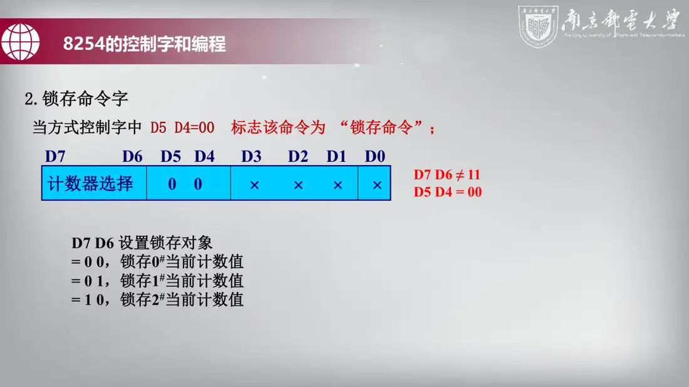

原文：

2. 锁存命令字

当方式控制字中 D5 D4=00 标志该命令为 “锁存命令”；

D7 D6 D5 D4 D3 D2 D1 D0

<table><tr><td>计数器选择</td><td>0 0</td><td>× × ×</td><td>×</td></tr></table>

$$
\mathrm{D7D6} \neq 1 1
$$

$$
\mathrm{D5D4=00}
$$

D7 D6 设置锁存对象

= 0 0，锁存0 $^{\#}$ 当前计数值

= 0 1，锁存1 $^{\#}$ 当前计数值

= 1 0，锁存2 $^{\#}$ 当前计数值

8254的控制字和编程

南京邮電大學
 Nanjing University of Posts and Telecommunications
南京邮電大學

### 3. 读出控制字

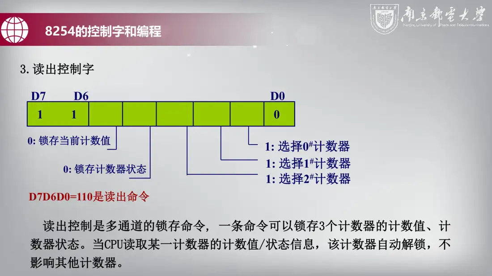

原文：

3. 读出控制字

0: 锁存当前计数值

0: 锁存计数器状态

D7D6D0=110是读出命令

读出控制是多通道的锁存命令，一条命令可以锁存3个计数器的计数值、计数器状态。当CPU读取某一计数器的计数值/状态信息，该计数器自动解锁，不影响其他计数器。

8254的控制字和编程

南京邮電大學
Nanjing University of Posts and Telecommunications
南京邮電大學

### 4. 状态字

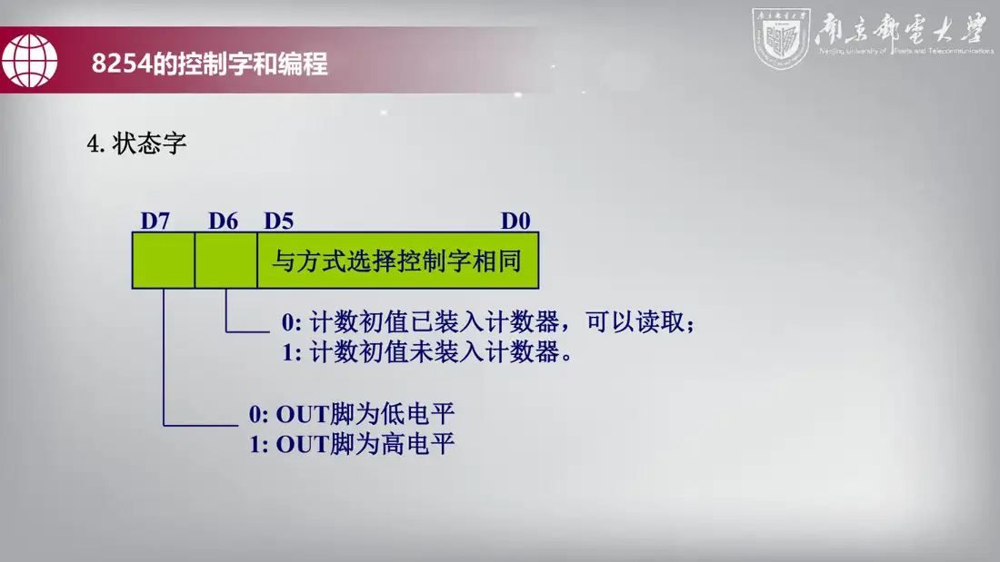

原文：

4. 状态字

与方式选择控制字相同

0: 计数初值已装入计数器，可以读取；

1: 计数初值未装入计数器。

0: OUT脚为低电平

1: OUT脚为高电平

8254的控制字和编程

南京邮電大學
Nanjing University of Posts and Telecommunications
南京邮電大學

### 二. 对8254的编程

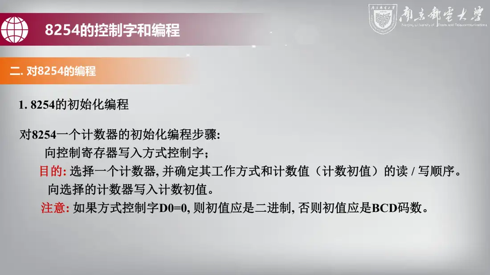

原文：

二. 对8254的编程

1.8254的初始化编程

对8254一个计数器的初始化编程步骤:

向控制寄存器写入方式控制字;

目的: 选择一个计数器, 并确定其工作方式和计数值（计数初值）的读 / 写顺序。

向选择的计数器写入计数初值。

注意: 如果方式控制字D0=0, 则初值应是二进制, 否则初值应是BCD码数。

8254的控制字和编程

南京邮電大學
 Nanjing University of Posts and Telecommunications
南京邮電大學

### 1.8254的初始化编程

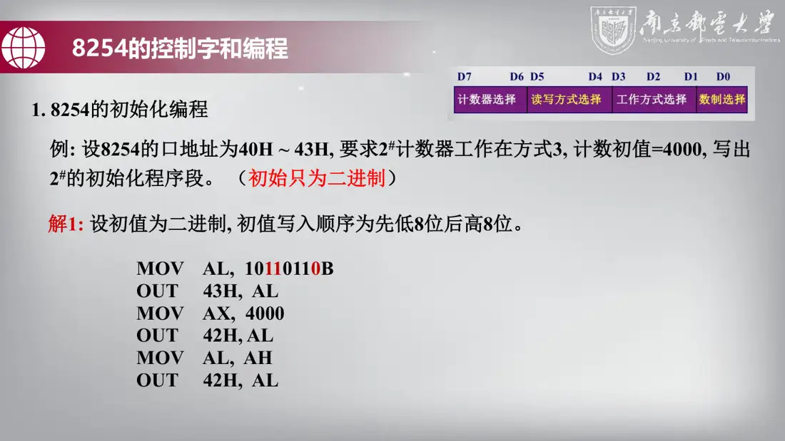

原文：

1.8254的初始化编程

例: 设8254的口地址为40H \~ 43H, 要求2#计数器工作在方式3, 计数初值=4000, 写出2#的初始化程序段。（初始只为二进制）

解1: 设初值为二进制, 初值写入顺序为先低8位后高8位。

8254的控制字和编程

南京邮電大學
Nanjing University of Posts and Telecommunications
南京邮電大學

D7 D6 D5 D4 D3 D2 D1 D0
计数器选择 读写方式选择 工作方式选择 数制选择

### 1.8254的初始化编程

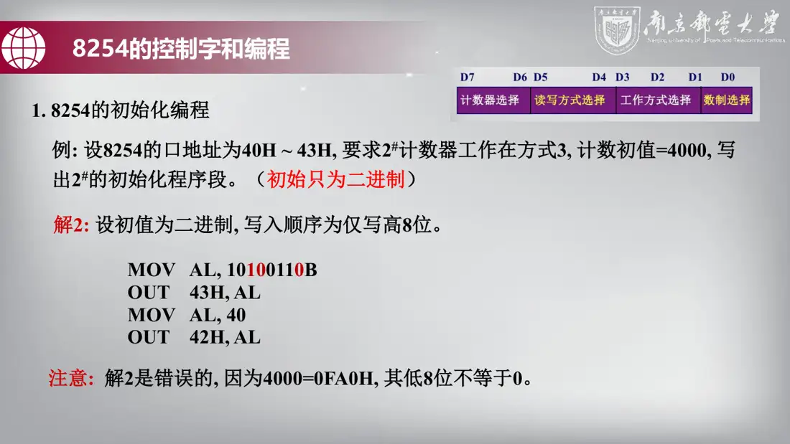

原文：

1.8254的初始化编程

例: 设8254的口地址为40H \~ 43H, 要求2#计数器工作在方式3, 计数初值=4000, 写出2#的初始化程序段。（初始只为二进制）

解2: 设初值为二进制, 写入顺序为仅写高8位。

$$
\begin{array}{l l} \text {MOV} & \text {AL, 10100110B} \\ \text {OUT} & \text {43H, AL} \\ \text {MOV} & \text {AL, 40} \\ \text {OUT} & \text {42H, AL} \end{array}
$$

注意: 解2是错误的, 因为4000=0FA0H, 其低8位不等于0。

D7 D6 D5 D4 D3 D2 D1 D0
计数器选择 读写方式选择 工作方式选择 数制选择

8254的控制字和编程

南京邮電大學
Nanjing University of Posts and Telecommunications
南京邮電大學

### 1.8254的初始化编程

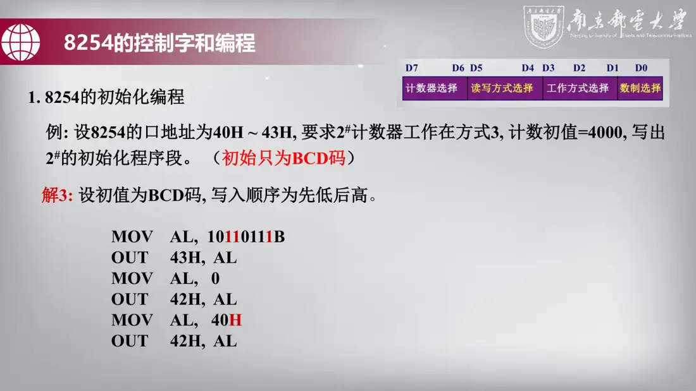

原文：

1.8254的初始化编程

例: 设8254的口地址为40H \~ 43H, 要求2#计数器工作在方式3, 计数初值=4000, 写出2#的初始化程序段。（初始只为BCD码）

解3: 设初值为BCD码, 写入顺序为先低后高。

<table><tr><td>MOV</td><td>AL, 10110111B</td></tr><tr><td>OUT</td><td>43H, AL</td></tr><tr><td>MOV</td><td>AL, 0</td></tr><tr><td>OUT</td><td>42H, AL</td></tr><tr><td>MOV</td><td>AL, 40H</td></tr><tr><td>OUT</td><td>42H, AL</td></tr></table>

D7 D6 D5 D4 D3 D2 D1 D0
计数器选择 读写方式选择 工作方式选择 数制选择

8254的控制字和编程

南京邮電大學
Nanjing University of Posts and Telecommunications
南京邮電大學

### 1.8254的初始化编程

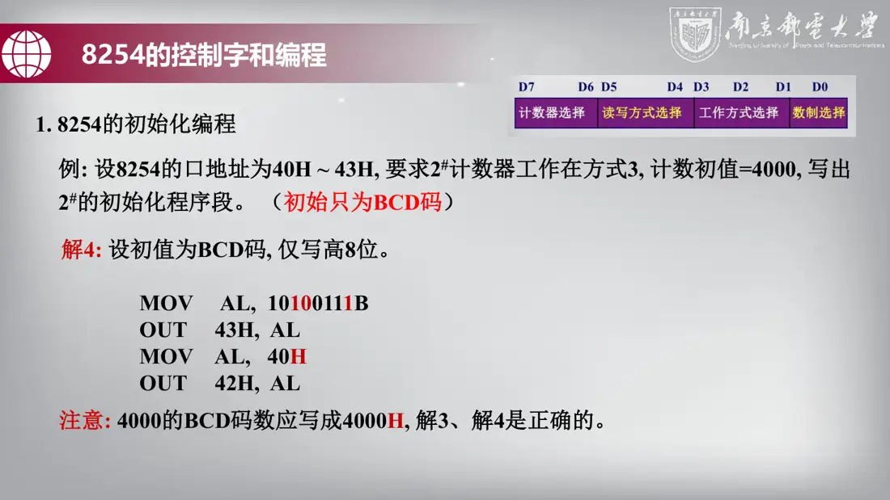

原文：

1.8254的初始化编程

例: 设8254的口地址为40H \~ 43H, 要求2#计数器工作在方式3, 计数初值=4000, 写出2#的初始化程序段。（初始只为BCD码）

解4: 设初值为BCD码, 仅写高8位。

$$
\begin{array}{l l} \text {MOV} & \text {AL, 10100111B} \\ \text {OUT} & \text {43H, AL} \\ \text {MOV} & \text {AL, 40H} \\ \text {OUT} & \text {42H, AL} \end{array}
$$

注意: 4000的BCD码数应写成4000H, 解3、解4是正确的。

D7 D6 D5 D4 D3 D2 D1 D0
计数器选择 读写方式选择 工作方式选择 数制选择

8254的控制字和编程

南京邮電大學
Nanjing University of Posts and Telecommunications
南京邮電大學

### 1.8254的初始化编程

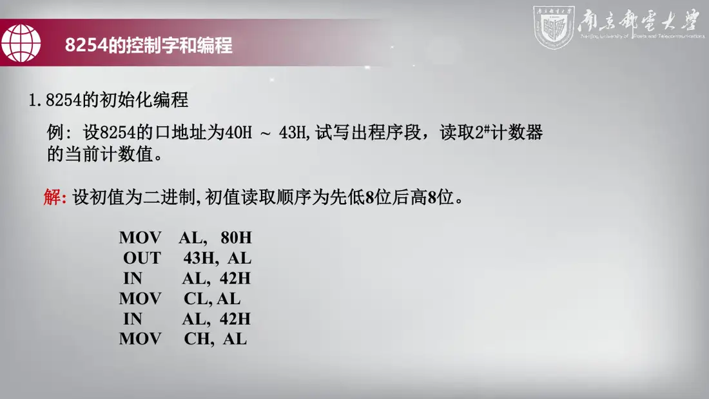

原文：

1.8254的初始化编程

例：设8254的口地址为40H \~ 43H, 试写出程序段，读取2#计数器的当前计数值。

解: 设初值为二进制, 初值读取顺序为先低8位后高8位。

$$
\begin{array}{l l} \text {MOV} & \text {AL, 80H} \\ \text {OUT} & \text {43H, AL} \\ \text {IN} & \text {AL, 42H} \\ \text {MOV} & \text {CL, AL} \\ \text {IN} & \text {AL, 42H} \\ \text {MOV} & \text {CH, AL} \end{array}
$$

8254的控制字和编程

南京邮電大學
Nanjing University of Posts and Telecommunications
南京邮電大學

### 初始化编程的一些说明：

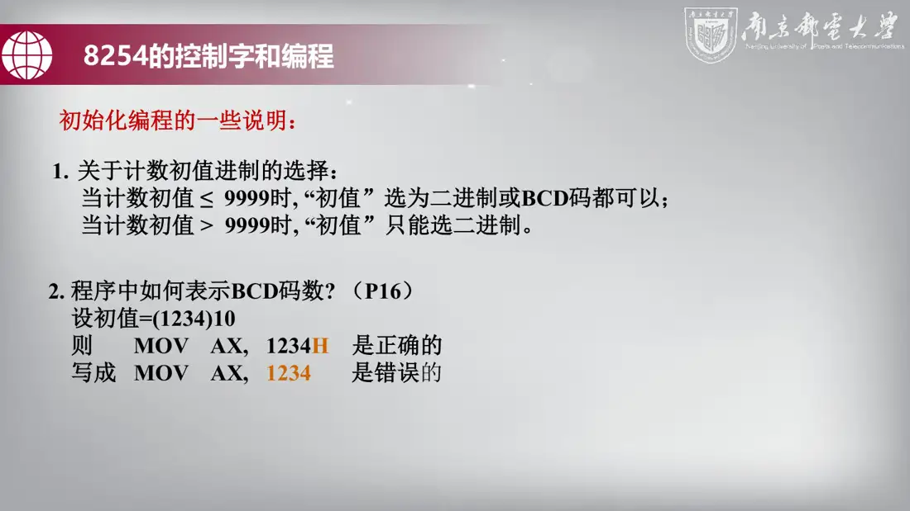

原文：

初始化编程的一些说明：

1. 关于计数初值进制的选择:

当计数初值 $\leq 9999$ 时, “初值”选为二进制或BCD码都可以;

当计数初值 $>9999$ 时，“初值”只能选二进制。

2. 程序中如何表示BCD码数? (P16)
设初值=(1234)10
则 MOV AX, 1234H 是正确的
写成 MOV AX, 1234 是错误的

8254的控制字和编程

南京邮電大學
Nanjing University of Posts and Telecommunications
南京邮電大學

### 知识点小结

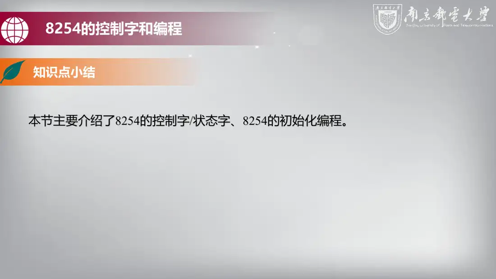

原文：

知识点小结

本节主要介绍了8254的控制字/状态字、8254的初始化编程。

8254的控制字和编程

南京邮電大學
Nanjing University of Posts and Telecommunications
南京邮電大學

### 总结

原文：

总结

√ 8254概述：8254结构、计数器结构

√ 8254的6种工作方式

√ 8254的控制字/状态字、8254的初始化编程

8254的控制字和编程

南京邮电大学
Nanjing University of Press and Communication
