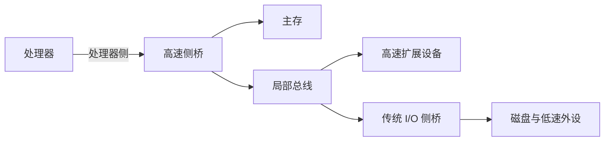

# 《微型计算机接口技术》第5章 总线（课件）

文件名写“第 2 章”，封面写“第五章 总线”，这里按封面题名。课件从存储器接线进入本章：地址要让正确的芯片响应，数据要由恰当的一方驱动，控制信号还要说明哪一时刻可以采样。把这些约定固定下来，多个部件才能共享同一通路。

## 为什么有些芯片同时选中，有些必须轮流选中

位扩展让同组芯片共享地址和控制线，但分别接到不同的数据位；字扩展让各组可访问的地址互斥，各组共享数据线，否则同一根线可能被同时驱动。两种扩展同时用时，先按数据宽度配每组，再按地址深度数有几组。参见[存储器组织](../../../topics/微机接口/cunchu-zuzhi.md)、[容量与线数](../../../topics/微机接口/cunchu-rongliang.md)和[存储器扩展](../../../topics/微机接口/cunchu-kuozhan.md)。

第 3–7 页例子中，做 $8\mathrm{K}\times8$，以 $1\mathrm{K}\times4$ 芯片配为 8 组、每组 2 片；若每片为 $8\mathrm{K}\times1$，则只需 1 组、8 片，各片逻辑地址为 13 位。$64\mathrm{K}\times8$ 可用 $16\mathrm{K}\times8$ 配成 4 组、每组 1 片，也可用 $16\mathrm{K}\times4$ 配成 4 组、每组 2 片；两者均用 14 位选片内地址、另外 2 位选组。

| A15:A14 | 该组地址区间 | 容量 |
| --- | --- | --- |
| 00 | 0000H–3FFFH | 16 KiB |
| 01 | 4000H–7FFFH | 16 KiB |
| 10 | 8000H–BFFFH | 16 KiB |
| 11 | C000H–FFFFH | 16 KiB |

**参考解答（第 8 页）。** （1）1K×8 芯片组成 4 KiB 需 4 片，12 位地址中 10 位片内、至少 2 位选组。（2）512 KiB 需 4 片 128 KiB SRAM，从 10000H 开始的末地址为 8FFFFH，即首地址加 80000H 再减一。该首地址不按 128 KiB 对齐，不能照搬自然对齐的选片布线。（3）A0000H–EFFFFH 首尾均计为 50000H 字节，即 320 KiB，每片 32 KiB，共需 10 片。

**参考解答（第 9 页，原题编号）。** 第 5 题：$1\mathrm{M}\times1$ DRAM 需要 20 位逻辑地址、一位数据；按题意采用行列等分且复用，引脚分两拍各提供 10 位，数据按一位计。若具体芯片另设数据输入和输出脚、或行列不等分，则按实际型号，不能仅凭容量断定物理脚数。第 6 题：$512\mathrm{K}\times8$ SRAM 有 19 根地址线、8 根双向数据线。第 8 题：以 $1024\times1$ 做 $16\mathrm{K}\times8$，16 组各 8 片，共 128 片，14 位地址中 4 位选组、10 位片内。

> [!TIP]
> 看到==首末二址均包括==，先做“末 − 首 + 1”；看到==DRAM 的地址引脚==，先判断有无行列复用。容量给出的是逻辑地址位数，不直接给出物理引脚数。

## 总线速度：整拍容量要乘上传送次数

地址指向谁、数据传什么、控制说明做什么及何时有效，这三种职责不一定使用三套独立引脚。课件第 13 页展示地址锁存、数据双向收发及控制缓冲；地址锁存后可让复用线进入另一个阶段。串行/并行区分同一时刻送几位，分时则区分一组线在不同阶段承担什么角色，不能混作一个维度。还可以按系统层次区分芯片级、系统、局部和外部总线，按方向区分单向与双向，按用途区分专用与共享。参见[总线概念](../../../topics/微机接口/zongxian-gainian.md)。

若一次数据传送宽 $w$ 位，每秒有 $r$ 次有效传送，则理想带宽为 $B_{\mathrm{peak}}=wr/8$ 字节每秒。设时钟为 $f$、每个时钟周期允许 $m$ 次传送，还要用 $r=mf$，不能把频率和传送率无条件等同。**订正（第 14 页）**：该页把频率放在除数；频率越大、每拍所交付字节不变时，带宽应随之上升。其“总线不超过 CPU 数据宽度”的说法也不能套到 CPU 通用寄存器位宽，下一节 32 位 Pentium 与 64 位外部数据线就是反例。

**补充算例。** 32 位总线、33 MHz、每拍一传的理想值是 132 MB/s。若反复出现每 6 拍只有 4 拍携带数据，则持续值为 88 MB/s。课件给出的 64 位 PCI 在 66 MHz 的同一理想模型是 528 MB/s；用整数时钟近似得出的值不是实测速率。ISA 约 8 MHz、宽 16 位，并不能据此认作每拍都传 2 字节。

## Pentium：64 根数据线不代表每次都启用八个字节

A31–A3 选中一个 8 字节对齐区，BE7–BE0 从这一区内选择本次实际使用的字节通道。补充取一个不跨界例子：从 1003H 访问两个字节，对齐区为 1000H–1007H，启用低有效的 /BE3 与 /BE4；不能只编码低三位然后忽略第二字节。$2^{29}$ 个对齐区各 8 字节，仍覆盖 $2^{32}$ 个字节地址；DP7–DP0 是奇偶校验，不计入有效数据宽度。PEN 和 PCHK 分别涉及校验使能和校验结果。参见[典型总线](../../../topics/微机接口/dianxing-zongxian.md)和[地址译码](../../../topics/微机接口/dizhi-yima.md)。

/ADS 有效说明地址与周期类别有效，不表示数据交付已结束。例中 M/IO、D/C、W/R 三位按下列组合区分：

| M/IO、D/C、W/R | 周期类别 |
| --- | --- |
| 000、001 | 中断确认、特殊周期 |
| 010、011 | I/O 读、I/O 写 |
| 100、101 | 指令代码读、保留 |
| 110、111 | 存储器数据读、存储器数据写 |

**订正（第 19 页）**：“微代码读”应理解为对外的指令代码读，不是从系统内存取处理器内部微码。==地址相同不代表访问类型相同==。CLK 提供时序基准，INTR 和 NMI 是中断请求；HOLD 是外部申请总线，HLDA 是处理器允许外部持有，和地址选中不是一回事。

## 接口标准：先分层，再比较速率

课件将 EISA、VESA 与 ISA、PCI 并列为历史标准，重点展开 ISA、PCI，再介绍下列外部接口。插槽、设备协议和底层是串行还是并行分别是不同层次。

| 对象 | 组织方式 | 对应的使用边界 |
| --- | --- | --- |
| ISA | 共享并行背板，62 芯基础段加 36 芯扩展段；课件包括 8 位与 16 位访问 | 24 位寻址给 16 MiB 存储空间，I/O 端口另用 16 位地址；不能把高位数据线当成端口号 |
| 传统 PCI | 局部并行总线，由桥分段，配置机制支持资源发现与分配 | 32/64 位和 33/66 MHz 是配置条件，不能把某个桥的缓冲当成每台设备的固有容量 |
| IDE / 并行 ATA | 在硬盘侧集成控制器，主机与磁盘之间有并行数据线、读写及联络控制 | 16 位和 8.33 MB/s 是课件特定模式；528 MB 是早期寻址及 BIOS 条件，不是整个标准上限 |
| SATA | 串行点到点，由接收端恢复时钟，减少并行线缆复杂度 | 校验能发现传输差错，不能把检测或按协议重传当成“链路直接纠正所有差错”；热插拔须相应控制器及软件支持 |
| 早期窄并行 SCSI | 共享并行总线，8 位数据，独立控制和校验；一事务中区分发起方与目标 | ID0–ID7 包含主机适配器，不表示可再加 8 个外设；2.5/5 MB/s 是原件同步与异步配置的示例（异步 2.5，同步 5） |
| USB | 由主机调度，经集线器向下分支；符合条件的设备可从总线取电 | 设备共享上游链路，插头、电源预算和速率取决于版本与实现 |

ISA 的 SD0–7、SD8–15 分属两段，SA0–19 与扩展地址线承担地址；AEN 条件可同地址一起参与针对 CPU I/O 的译码。/IOR 有效让选中端口驱动数据线，/IOW 有效则把线上数据写到端口；IRQ、DRQ/DACK 各有自己的请求与应答职责，不能代替一次普通端口读写。并行 SCSI 可借助唯一设备号在共享线上进行分布式仲裁，发起和目标是事务角色，不是由设备在电缆上的远近决定。

> [!WARNING]
> **订正（第 39–42 页）。** USB 通过集线器组成分层星形，不是一般外设彼此串联。127 是地址编号上限（不含默认地址 0，集线器也消耗地址），不是任意树形和电源条件下可接设备的保证。添加外设不会增加同一个上游口的带宽，个别设备仍需外接供电。课件的 12 Mbit/s、480 Mbit/s、5 Gbit/s 是相应模式的标称速率，不是每秒多少 MB 的有效负载。

## 从旧主板看桥的职责

第 43–46 页是传统设计，北桥连接处理器、主存和高速侧，南桥连接传统 I/O；PCI 桥把局部扩展与其他层隔开。跨年代看图时，先认出哪条路径传主存数据，哪条要通过 I/O 桥，再认芯片名称。现代设计可以整合桥的职责，并不消除这些路径及各自的吞吐约束。

