# 《微型计算机接口技术》第5章 总线（课件）

原件的每一页，下面附识别出的文字。

### 微型计算机接口技术

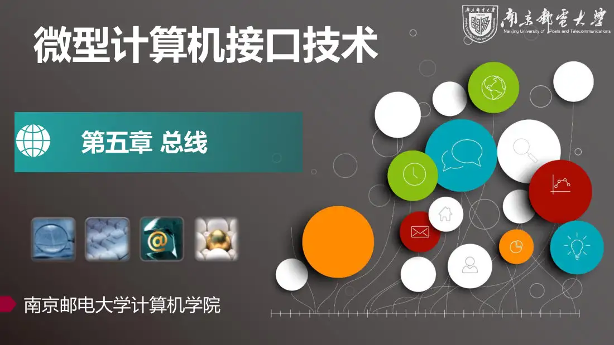

原文：

微型计算机接口技术

第五章 总线

The image contains four distinct visual elements: a magnifying glass over a document, a keyboard with 'Close' labels, an @ symbol, and a golden ingot on white spheres. There is no textual content to extract. Therefore, the correct OCR output is an empty string.

(No text to output)

南京邮电大学计算机学院

南京邮电大学
100-159
Nanjing University of Posts and Telecommunications
南京邮电大学

### 存储器基本概念

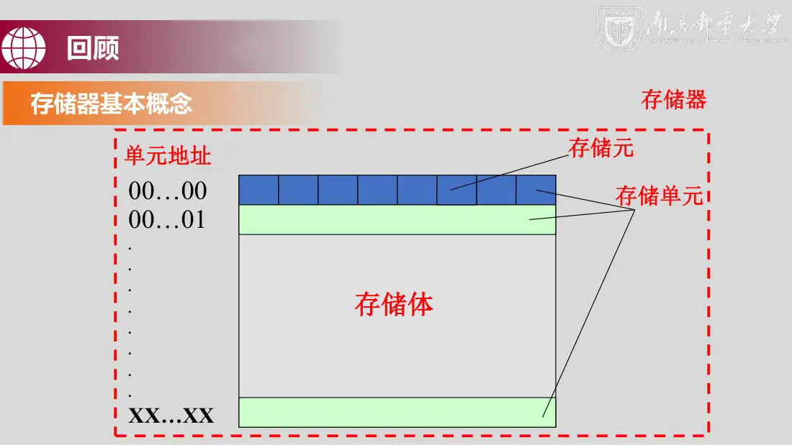

原文：

存储器基本概念

存储器

回顾

南京邮电大学
Nanjing University of Posts and Telecommunications

### 存储器扩展：多个芯片连接

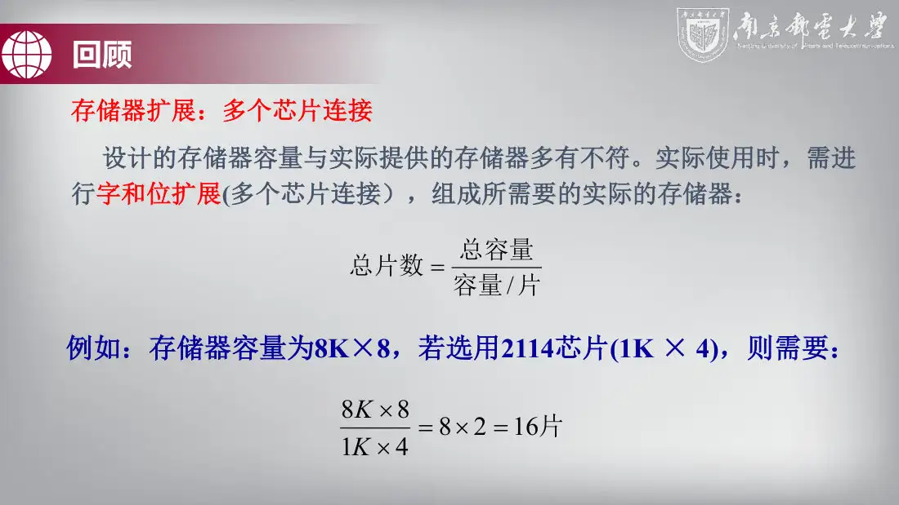

原文：

存储器扩展：多个芯片连接

设计的存储器容量与实际提供的存储器多有不符。实际使用时，需进行字和位扩展(多个芯片连接)，组成所需要的实际的存储器：

$$
\mathrm{总片数} = \frac {\mathrm{总容量}}{\mathrm{容量/片}}
$$

例如：存储器容量为 $8 \mathrm{~K} \times 8$ ，若选用2114芯片 $(1 \mathrm{~K} \times 4)$ ，则需要：

$$
\frac {8 K \times 8}{1 K \times 4} = 8 \times 2 = 1 6 \text {片}
$$

回顾

南京邮电大学
Nanjing University of Posts and Telecommunications

### 每条数据线有一个负载

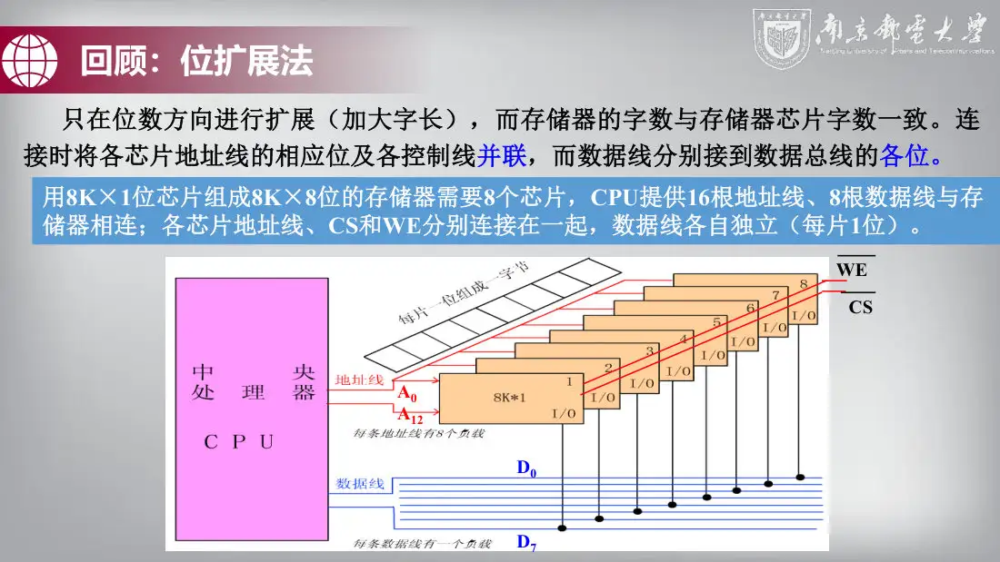

原文：

每条数据线有一个负载

只在位数方向进行扩展（加大字长），而存储器的字数与存储器芯片字数一致。连接时将各芯片地址线的相应位及各控制线并联，而数据线分别接到数据总线的各位。

用8K×1位芯片组成8K×8位的存储器需要8个芯片，CPU提供16根地址线、8根数据线与存储器相连；各芯片地址线、CS和WE分别连接在一起，数据线各自独立（每片1位）。

回顾：位扩展法

南京邮電大學
Nanjing University of Posts and Telecommunications

### 回顾：字扩展法

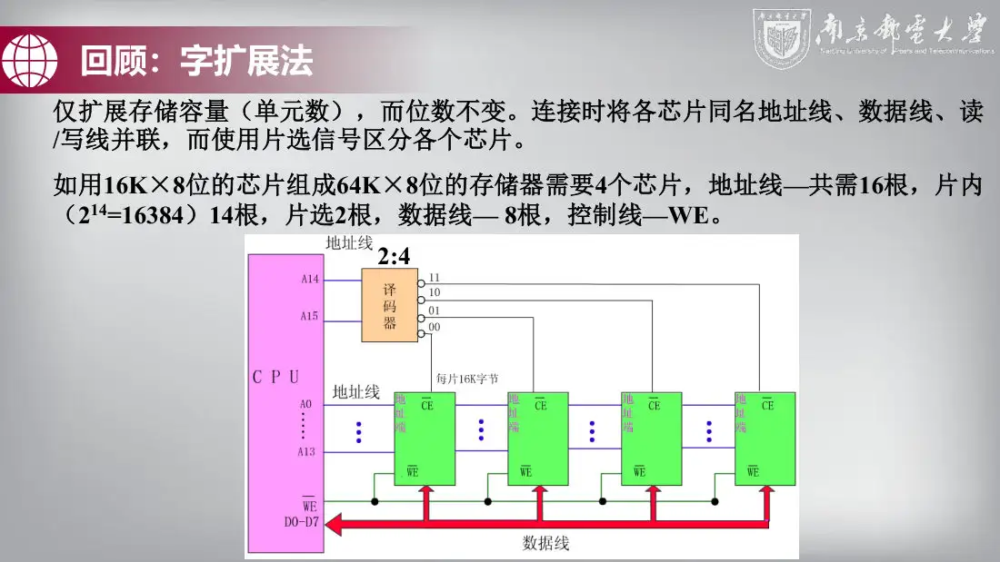

原文：

仅扩展存储容量（单元数），而位数不变。连接时将各芯片同名地址线、数据线、读/写线并联，而使用片选信号区分各个芯片。

如用16K×8位的芯片组成64K×8位的存储器需要4个芯片，地址线—共需16根，片内（2 $^{14}$ =16384）14根，片选2根，数据线—8根，控制线—WE。

回顾：字扩展法

南京邮电大学
Nanjing University of Posts and Telecommunications

### 地址空间分配表（16K\*8芯片）

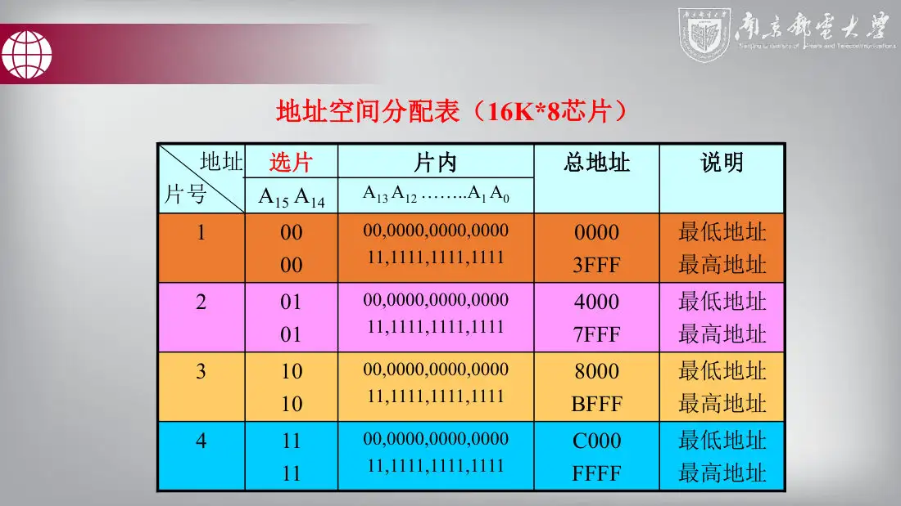

原文：

地址空间分配表（16K\*8芯片）
<table><tr><td rowspan="2">片号\地址</td><td>选片</td><td>片内</td><td rowspan="2">总地址</td><td rowspan="2">说明</td></tr><tr><td> $A_{15}A_{14}$ </td><td> $A_{13}A_{12}......A_{1}A_{0}$ </td></tr><tr><td rowspan="2">1</td><td>00</td><td>00,0000,0000,0000</td><td>0000</td><td>最低地址</td></tr><tr><td>00</td><td>11,1111,1111,1111</td><td>3FFF</td><td>最高地址</td></tr><tr><td rowspan="2">2</td><td>01</td><td>00,0000,0000,0000</td><td>4000</td><td>最低地址</td></tr><tr><td>01</td><td>11,1111,1111,1111</td><td>7FFF</td><td>最高地址</td></tr><tr><td rowspan="2">3</td><td>10</td><td>00,0000,0000,0000</td><td>8000</td><td>最低地址</td></tr><tr><td>10</td><td>11,1111,1111,1111</td><td>BFFF</td><td>最高地址</td></tr><tr><td rowspan="2">4</td><td>11</td><td>00,0000,0000,0000</td><td>C000</td><td>最低地址</td></tr><tr><td>11</td><td>11,1111,1111,1111</td><td>FFFF</td><td>最高地址</td></tr></table>

南京邮電大學
Nanjing University of Posts and Telecommunications

### 回顾：字位同时扩展法

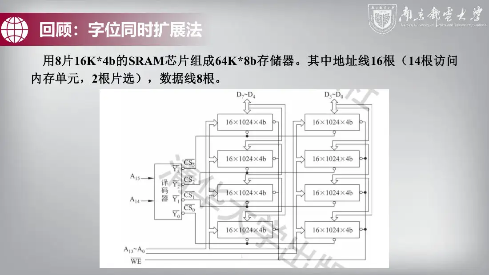

原文：

用8片16K\*4b的SRAM芯片组成64K\*8b存储器。其中地址线16根（14根访问内存单元，2根片选），数据线8根。

回顾：字位同时扩展法

南京邮电大学
Nanjing University of Posts and Telecommunications

### 课堂练习

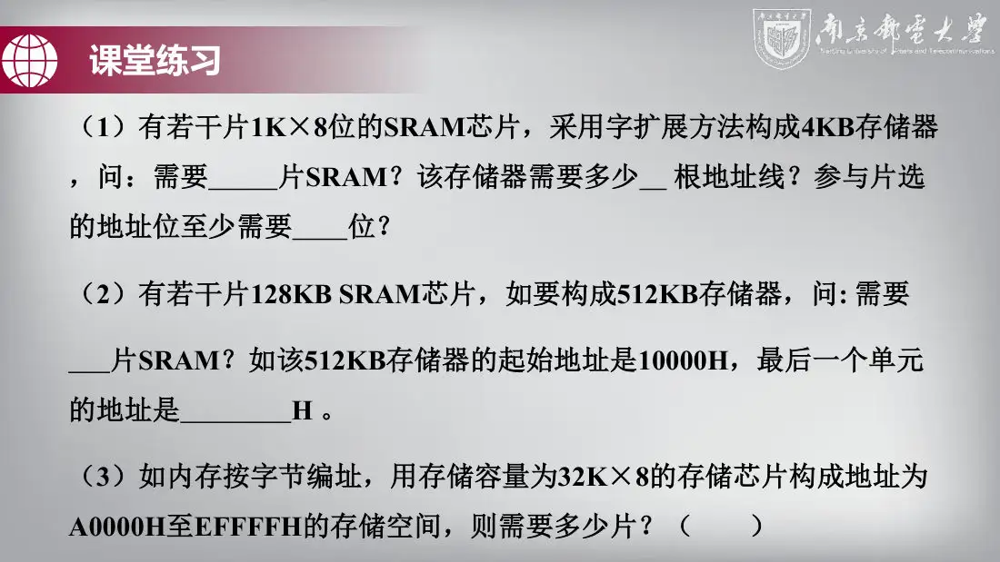

原文：

(1) 有若干片 $1 \mathrm{~K} \times 8$ 位的SRAM芯片, 采用字扩展方法构成4KB存储器, 问: 需要\_\_\_\_片SRAM? 该存储器需要多少\_\_\_\_根地址线? 参与片选的地址位至少需要\_\_\_\_位?

(2) 有若干片128KB SRAM芯片, 如要构成512KB存储器, 问: 需要 片SRAM? 如该512KB存储器的起始地址是10000H, 最后一个单元的地址是\_\_\_\_H。

(3) 如内存按字节编址, 用存储容量为 $32 \mathrm{~K} \times 8$ 的存储芯片构成地址为 A0000H 至 EFFFFH 的存储空间, 则需要多少片? ( )

课堂练习

南京邮電大學
Nanjing University of Posts and Telecommunications

### (1) 实现该存储器所需的芯片数量。

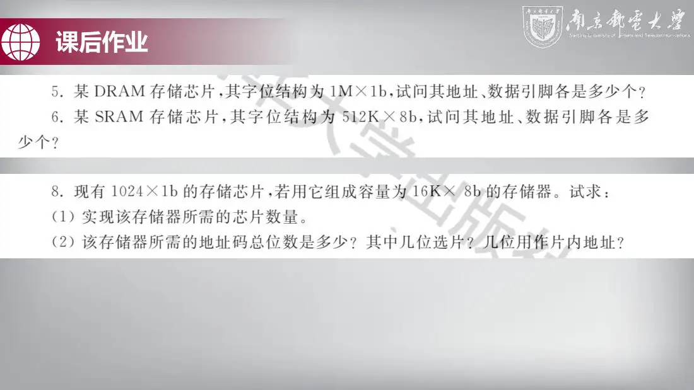

原文：

5. 某 DRAM 存储芯片, 其字位结构为 $1 \mathrm{~M} \times 1 \mathrm{~b}$ , 试问其地址、数据引脚各是多少个?

6. 某 SRAM 存储芯片, 其字位结构为 $512K \times 8b$ , 试问其地址、数据引脚各是多少个?

8. 现有 $1024 \times 1b$ 的存储芯片, 若用它组成容量为 $16K \times 8b$ 的存储器。试求:

(1) 实现该存储器所需的芯片数量。

(2) 该存储器所需的地址码总位数是多少？其中几位选片？几位用作片内地址？

课后作业

南京邮电大学
Nanjing University of Posts and Telecommunications
南京邮电大学

### 知识要点

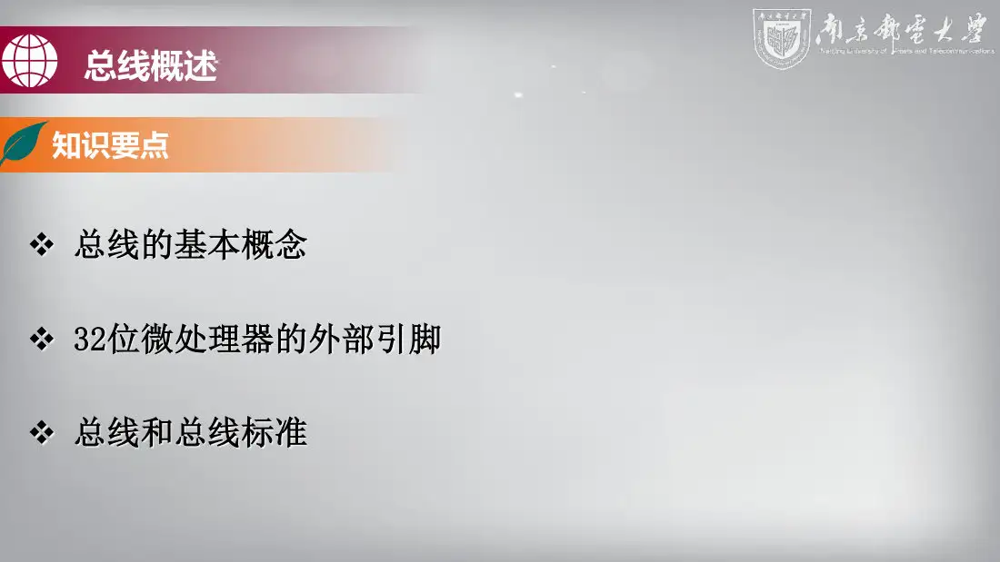

原文：

知识要点

总线的基本概念

✿ 32位微处理器的外部引脚

总线和总线标准

总线概述

南京邮电大学
Nanjing University of Posts and Telecommunications

### 一、总线的基本概念

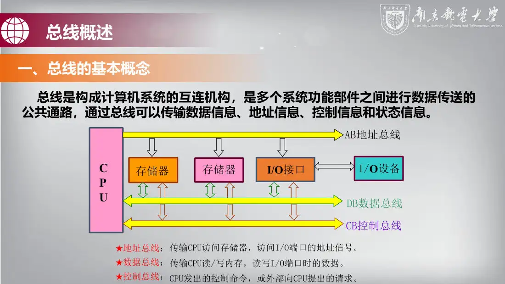

原文：

一、总线的基本概念

总线是构成计算机系统的互连机构，是多个系统功能部件之间进行数据传送的公共通路，通过总线可以传输数据信息、地址信息、控制信息和状态信息。

★地址总线：传输CPU访问存储器，访问I/O端口的地址信号。

★数据总线：传输CPU读/写内存，读写I/O端口时的数据。

★控制总线：CPU发出的控制命令，或外部向CPU提出的请求。

总线概述

南京邮电大学
Nanjing University of Posts and Telecommunications

### 一、总线的基本概念

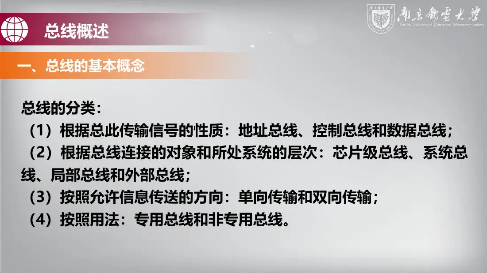

原文：

一、总线的基本概念

总线的分类:

(1) 根据总此传输信号的性质：地址总线、控制总线和数据总线；

(2) 根据总线连接的对象和所处系统的层次: 芯片级总线、系统总线、局部总线和外部总线;

(3) 按照允许信息传送的方向：单向传输和双向传输；

(4) 按照用法: 专用总线和非专用总线。

总线概述

南京邮电大学
TJ50-0318
南京邮电大学
Nanjing University of Posts and Telecommunications

### 总线概述

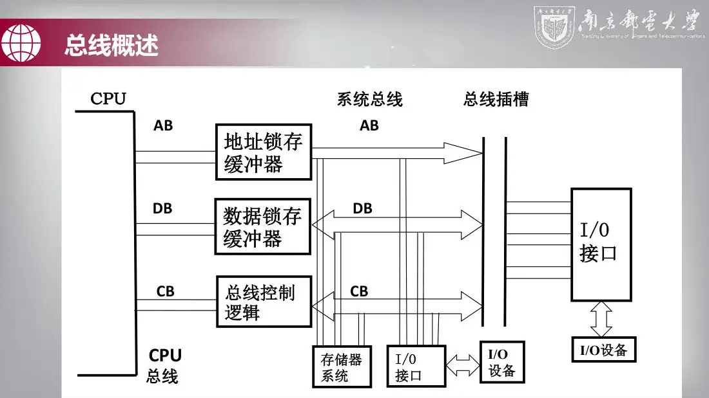

原文：

总线概述

南京邮电大学
Nanjing University of Posts and Telecommunications

### 一、总线的基本概念

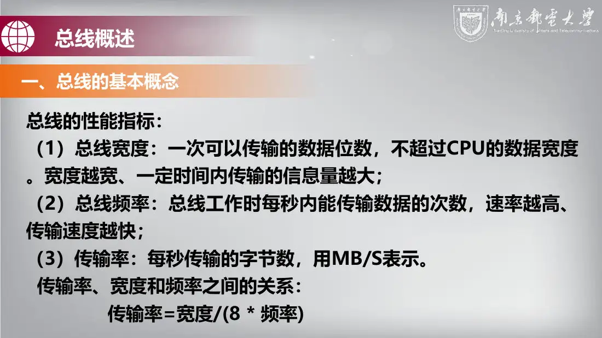

原文：

一、总线的基本概念

总线的性能指标：

(1) 总线宽度: 一次可以传输的数据位数, 不超过CPU的数据宽度。宽度越宽、一定时间内传输的信息量越大;

(2) 总线频率: 总线工作时每秒内能传输数据的次数, 速率越高、传输速度越快;

(3) 传输率: 每秒传输的字节数, 用MB/S表示。

传输率、宽度和频率之间的关系：

传输率=宽度/(8 \* 频率)

总线概述

南京邮电大学
Nanjing University of Posts and Telecommunications

### 一、总线的基本概念

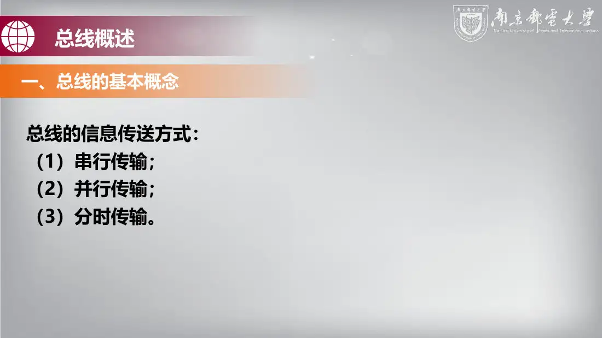

原文：

一、总线的基本概念

总线的信息传送方式：

(1) 串行传输;

(2) 并行传输;

(3) 分时传输。

总线概述

南京邮电大学
Nanjing University of Posts and Telecommunications

### 二、32位微处理器的外部引脚（Pentium）

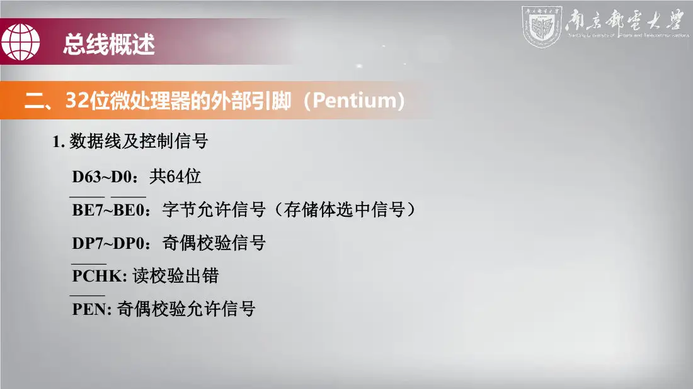

原文：

二、32位微处理器的外部引脚（Pentium）

1. 数据线及控制信号

D63\~D0: 共64位

BE7\~BE0：字节允许信号（存储体选中信号）

DP7\~DP0: 奇偶校验信号

PCHK: 读校验出错

PEN: 奇偶校验允许信号

总线概述

南京邮电大学
Nanjing University of Posts and Telecommunications

### 二、32位微处理器的外部引脚

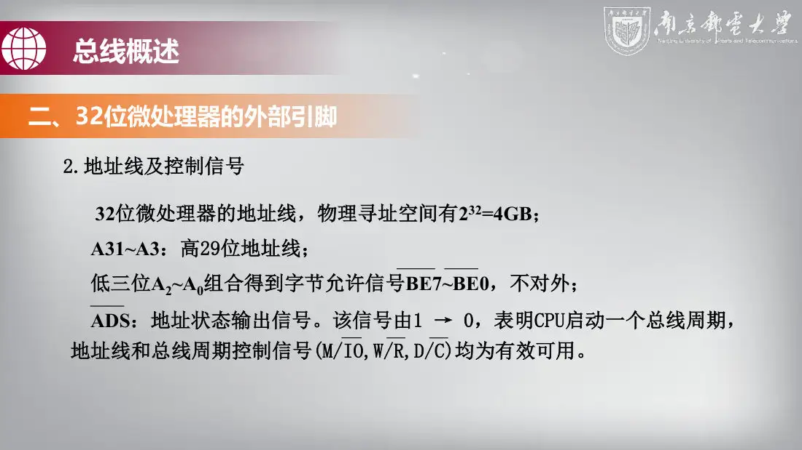

原文：

二、32位微处理器的外部引脚

2. 地址线及控制信号

32位微处理器的地址线，物理寻址空间有 $2^{32}=4GB$ ;

A31\~A3: 高29位地址线;

低三位 $\mathrm{A}_{2} \sim \mathrm{A}_{0}$ 组合得到字节允许信号BE7\~BE0，不对外；

ADS: 地址状态输出信号。该信号由 $1 \rightarrow 0$ ，表明CPU启动一个总线周期，地址线和总线周期控制信号 (M/I0, W/R, D/C) 均为有效可用。

总线概述

南京邮电大学
Nanjing University of Posts and Telecommunications

### 二、32位微处理器的外部引脚

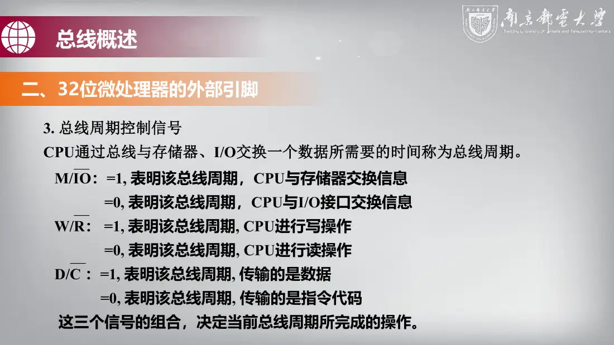

原文：

二、32位微处理器的外部引脚

3. 总线周期控制信号

CPU通过总线与存储器、I/O交换一个数据所需要的时间称为总线周期。

M/IO: =1, 表明该总线周期, CPU与存储器交换信息

=0, 表明该总线周期，CPU与I/O接口交换信息

W/R: =1, 表明该总线周期, CPU进行写操作

=0, 表明该总线周期, CPU进行读操作

D/C : =1, 表明该总线周期, 传输的是数据

=0, 表明该总线周期, 传输的是指令代码

这三个信号的组合，决定当前总线周期所完成的操作。

总线概述

南京邮电大学
Nanjing University of Posts and Telecommunications

### 总线周期控制信号完成的操作

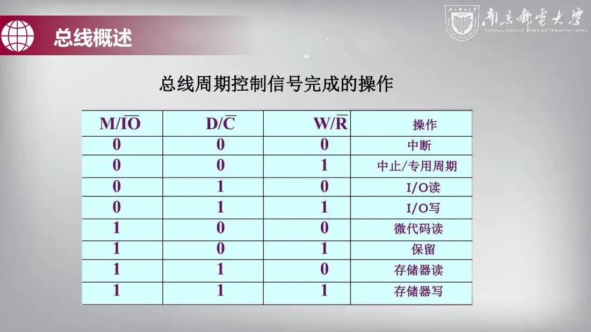

原文：

总线周期控制信号完成的操作

<table><tr><td>M/IO</td><td>D/C</td><td>W/R</td><td>操作</td></tr><tr><td>0</td><td>0</td><td>0</td><td>中断</td></tr><tr><td>0</td><td>0</td><td>1</td><td>中止/专用周期</td></tr><tr><td>0</td><td>1</td><td>0</td><td>I/O读</td></tr><tr><td>0</td><td>1</td><td>1</td><td>I/O写</td></tr><tr><td>1</td><td>0</td><td>0</td><td>微代码读</td></tr><tr><td>1</td><td>0</td><td>1</td><td>保留</td></tr><tr><td>1</td><td>1</td><td>0</td><td>存储器读</td></tr><tr><td>1</td><td>1</td><td>1</td><td>存储器写</td></tr></table>

总线概述

南京邮电大学
T100-038
南京邮电大学
Nanjing University of Posts and Telecommunications

### 二、32位微处理器的外部引脚

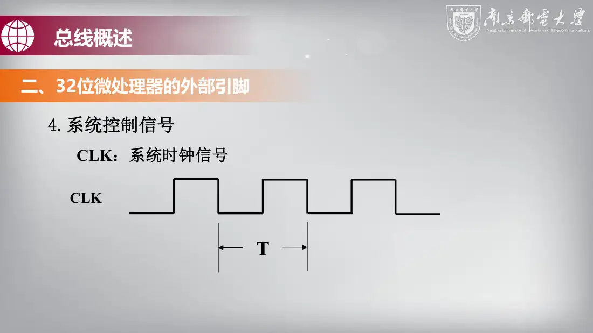

原文：

二、32位微处理器的外部引脚

4. 系统控制信号

CLK: 系统时钟信号

CLK

总线概述

南京邮电大学
Nanjing University of Posts and Telecommunications

### 二、32位微处理器的外部引脚

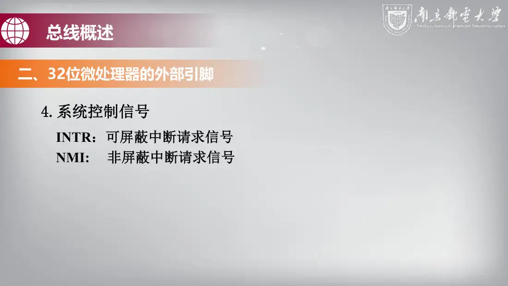

原文：

二、32位微处理器的外部引脚

4. 系统控制信号

INTR: 可屏蔽中断请求信号

NMI: 非屏蔽中断请求信号

总线概述

南京邮电大学
Nanjing University of Posts and Telecommunications

### 二、32位微处理器的外部引脚

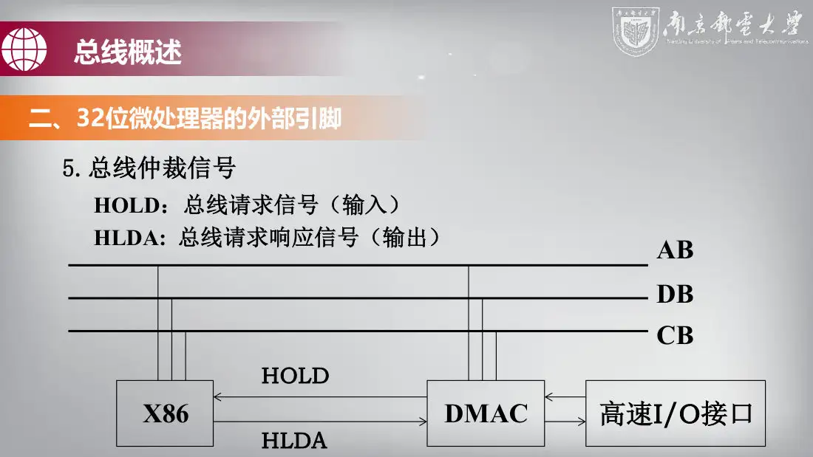

原文：

二、32位微处理器的外部引脚

5. 总线仲裁信号

HOLD: 总线请求信号（输入）

HLDA: 总线请求响应信号（输出）

总线概述

南京邮电大学
TJ50-0318
南京邮电大学
Nanjing University of Posts and Telecommunications

### 三、总线与总线标准

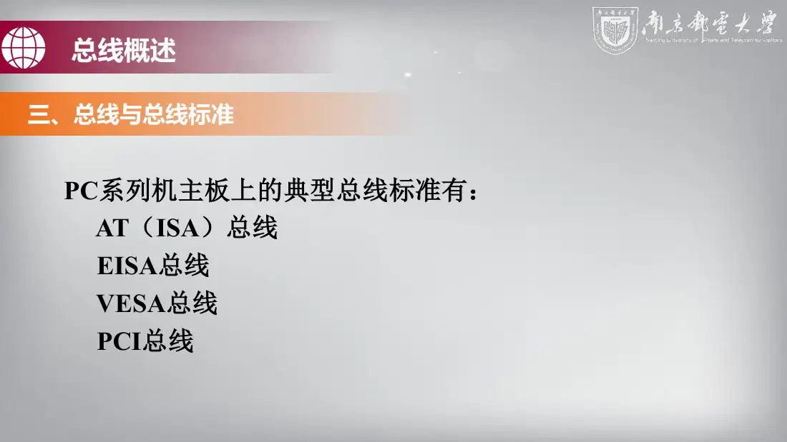

原文：

三、总线与总线标准

PC系列机主板上的典型总线标准有:

AT（ISA）总线

EISA总线

VESA总线

PCI总线

总线概述

南京邮电大学
Nanjing University of Posts and Telecommunications

### 典型总线标准

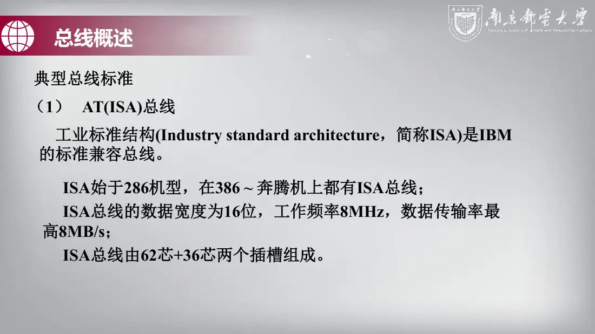

原文：

典型总线标准

(1) AT(ISA)总线

工业标准结构(Industry standard architecture, 简称ISA)是IBM的标准兼容总线。

ISA始于286机型，在386～奔腾机上都有ISA总线；

ISA总线的数据宽度为16位，工作频率8MHz，数据传输率最高8MB/s；

ISA总线由62芯+36芯两个插槽组成。

总线概述

南京邮电大学
TJ50-838
南京邮电大学
Nanjing University of Posts and Telecommunications

### ISA总线主要特性:

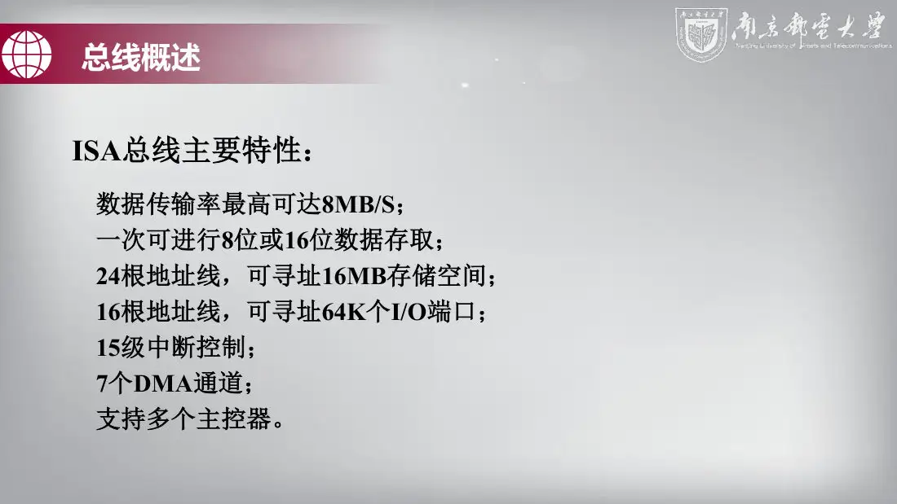

原文：

ISA总线主要特性:

数据传输率最高可达8MB/S;

一次可进行8位或16位数据存取；

24根地址线，可寻址16MB存储空间；

16根地址线，可寻址64K个I/O端口；

15级中断控制;

7个DMA通道;

支持多个主控器。

总线概述

南京邮电大学
Nanjing University of Posts and Telecommunications

### 第 26 页

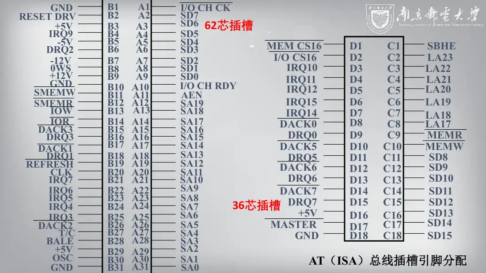

原文：

<table><tr><td>GND</td><td>B1</td><td>A1</td><td>I/O CH CK</td><td></td><td></td><td></td><td></td></tr><tr><td>RESET DRV</td><td>B2</td><td>A2</td><td>SD7</td><td></td><td></td><td></td><td></td></tr><tr><td>+5V</td><td>B3</td><td>A3</td><td>SD6</td><td>62芯插槽</td><td></td><td></td><td></td></tr><tr><td>IRQ9</td><td>B4</td><td>A4</td><td>SD5</td><td></td><td></td><td></td><td></td></tr><tr><td>-5V</td><td>B5</td><td>A5</td><td>SD4</td><td></td><td></td><td></td><td></td></tr><tr><td>DRQ2</td><td>B6</td><td>A6</td><td>SD3</td><td>MEM CS16</td><td>D1</td><td>C1</td><td>SBHE</td></tr><tr><td>-12V</td><td>B7</td><td>A7</td><td>SD2</td><td>I/O CS16</td><td>D2</td><td>C2</td><td>LA23</td></tr><tr><td>0WS</td><td>B8</td><td>A8</td><td>SD1</td><td>IRQ10</td><td>D3</td><td>C3</td><td>LA22</td></tr><tr><td>+12V</td><td>B9</td><td>A9</td><td>SD0</td><td>IRQ11</td><td>D4</td><td>C4</td><td>LA21</td></tr><tr><td>GND</td><td>B10</td><td>A10</td><td>I/O CH RDY</td><td>IRQ12</td><td>D5</td><td>C5</td><td>LA20</td></tr><tr><td>SMEMW</td><td>B11</td><td>A11</td><td>AEN</td><td></td><td></td><td></td><td></td></tr><tr><td>SMEMR</td><td>B12</td><td>A12</td><td>SA19</td><td>IRQ15</td><td>D6</td><td>C6</td><td>LA19</td></tr><tr><td>IOW</td><td>B13</td><td>A13</td><td>SA18</td><td>IRQ14</td><td>D7</td><td>C7</td><td>LA18</td></tr><tr><td>IOR</td><td>B14</td><td>A14</td><td>SA17</td><td>DACK0</td><td>D8</td><td>C8</td><td>LA17</td></tr><tr><td>DACK3</td><td>B15</td><td>A15</td><td>SA16</td><td></td><td></td><td></td><td></td></tr><tr><td>DRQ3</td><td>B16</td><td>A16</td><td>SA15</td><td>DRQ0</td><td>D9</td><td>C9</td><td>MEMR</td></tr><tr><td>DACK1</td><td>B17</td><td>A17</td><td>SA14</td><td>DACK5</td><td>D10</td><td>C10</td><td>MEMW</td></tr><tr><td>DRQ1</td><td>B18</td><td>A18</td><td>SA13</td><td>DRQ5</td><td>D11</td><td>C11</td><td>SD8</td></tr><tr><td>REFRESH</td><td>B19</td><td>A19</td><td>SA12</td><td>DACK6</td><td>D12</td><td>C12</td><td>SD9</td></tr><tr><td>CLK</td><td>B20</td><td>A20</td><td>SA11</td><td>DRQ6</td><td>D13</td><td>C13</td><td>SD10</td></tr><tr><td>IRQ7</td><td>B21</td><td>A21</td><td>SA10</td><td></td><td></td><td></td><td></td></tr><tr><td>IRQ6</td><td>B22</td><td>A22</td><td>SA9</td><td>DACK7</td><td>D14</td><td>C14</td><td>SD11</td></tr><tr><td>IRQ5</td><td>B23</td><td>A23</td><td>SA8</td><td>DRQ7</td><td>D15</td><td>C15</td><td>SD12</td></tr><tr><td>IRQ4</td><td>B24</td><td>A24</td><td>SA7</td><td>+5V</td><td></td><td></td><td></td></tr><tr><td>IRQ3</td><td>B25</td><td>A25</td><td>SA6</td><td></td><td>D16</td><td>C16</td><td>SD13</td></tr><tr><td>DACK2</td><td>B26</td><td>A26</td><td>SA5</td><td>MASTER</td><td>D17</td><td>C17</td><td>SD14</td></tr><tr><td>T/C</td><td>B27</td><td>A27</td><td>SA4</td><td>GND</td><td>D18</td><td>C18</td><td>SD15</td></tr><tr><td>BALE</td><td>B28</td><td>A28</td><td>SA3</td><td></td><td></td><td></td><td></td></tr><tr><td>+5V</td><td>B29</td><td>A29</td><td>SA2</td><td></td><td></td><td></td><td></td></tr><tr><td>OSC</td><td>B30</td><td>A30</td><td>SA1</td><td></td><td></td><td></td><td></td></tr><tr><td>GND</td><td>B31</td><td>A31</td><td>SA0</td><td></td><td></td><td></td><td></td></tr></table>

### 62芯插槽部分引脚:

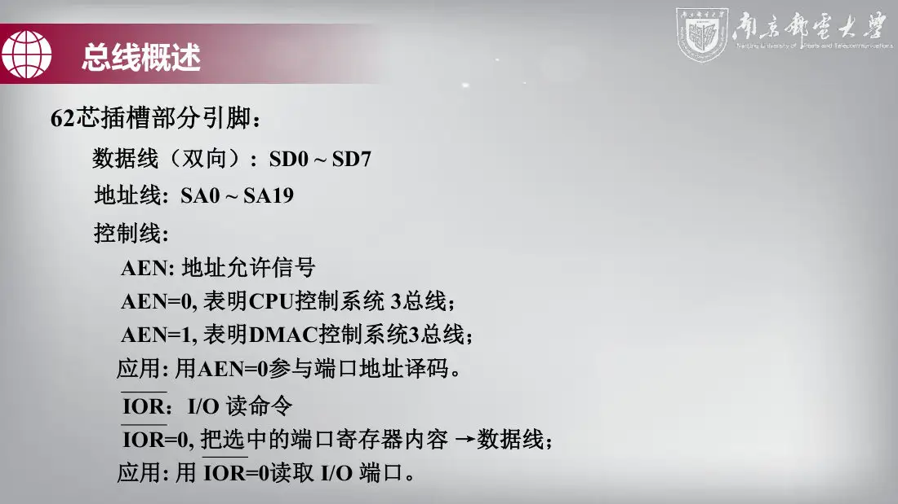

原文：

62芯插槽部分引脚:

数据线（双向）：SD0～SD7

地址线: SA0 \~ SA19

控制线:

AEN: 地址允许信号

AEN=0, 表明CPU控制系统 3 总线;

AEN=1, 表明DMAC控制系统3总线;

应用: 用AEN=0参与端口地址译码。

IOR: I/O 读命令

IOR=0, 把选中的端口寄存器内容 → 数据线;

应用: 用 IOR=0 读取 I/O 端口。

总线概述

南京邮电大学
T-50-0316
南京邮电大学
Nanjing University of Posts and Telecommunications

### 62芯插槽部分引脚:

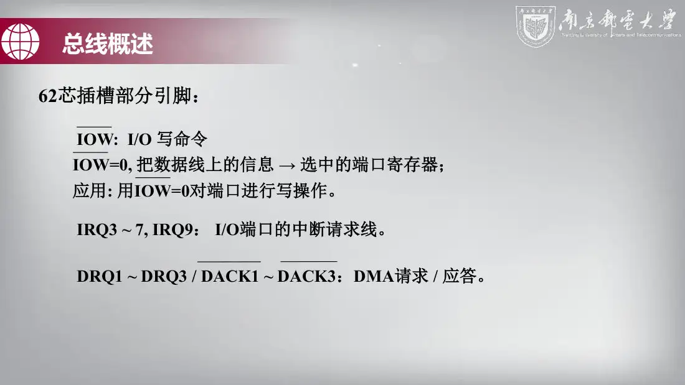

原文：

62芯插槽部分引脚:

IOW: I/O 写命令

IOW=0, 把数据线上的信息 → 选中的端口寄存器;

应用: 用IOW=0对端口进行写操作。

IRQ3 \~ 7, IRQ9: I/O端口的中断请求线。

DRQ1 \~ DRQ3 / DACK1 \~ DACK3: DMA请求 / 应答。

总线概述

南京邮电大学
TJ50-838
南京邮电大学
Nanjing University of Posts and Telecommunications

### 36芯插槽部分引脚:

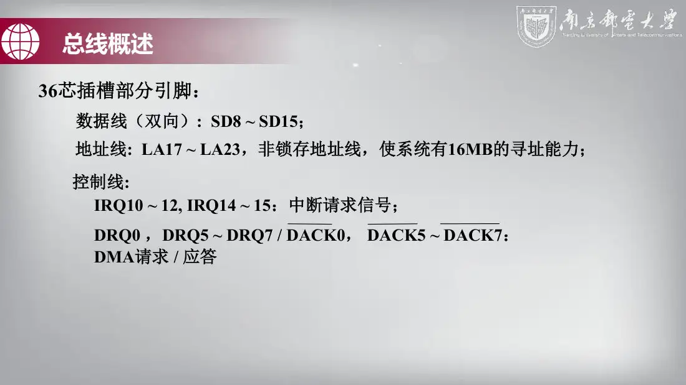

原文：

36芯插槽部分引脚:

数据线（双向）：SD8～SD15；

地址线：LA17～LA23，非锁存地址线，使系统有16MB的寻址能力；

控制线:

IRQ10 \~ 12, IRQ14 \~ 15: 中断请求信号;

DRQ0, DRQ5 \~ DRQ7 / DACK0, DACK5 \~ DACK7:

DMA请求 / 应答

总线概述

南京邮电大学
150-838
南京邮电大学
Nanjing University of Posts and Telecommunications

### 三、总线与总线标准

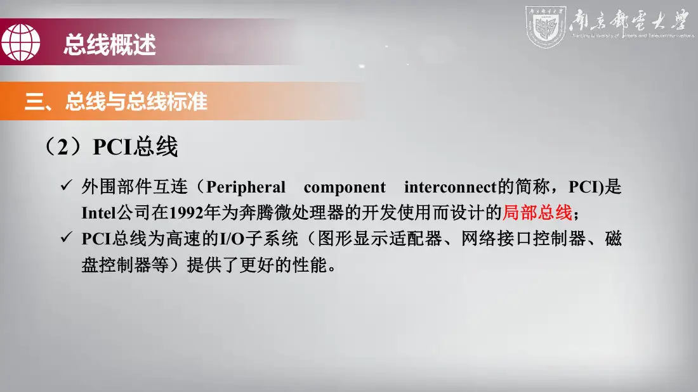

原文：

三、总线与总线标准

(2) PCI总线

√ 外围部件互连（Peripheral component interconnect的简称，PCI)是Intel公司在1992年为奔腾微处理器的开发使用而设计的局部总线；

√ PCI总线为高速的I/O子系统（图形显示适配器、网络接口控制器、磁盘控制器等）提供了更好的性能。

总线概述

南京邮电大学
TJ50-838
南京邮电大学
Nanjing University of Posts and Telecommunications

### PCI总线主要特点:

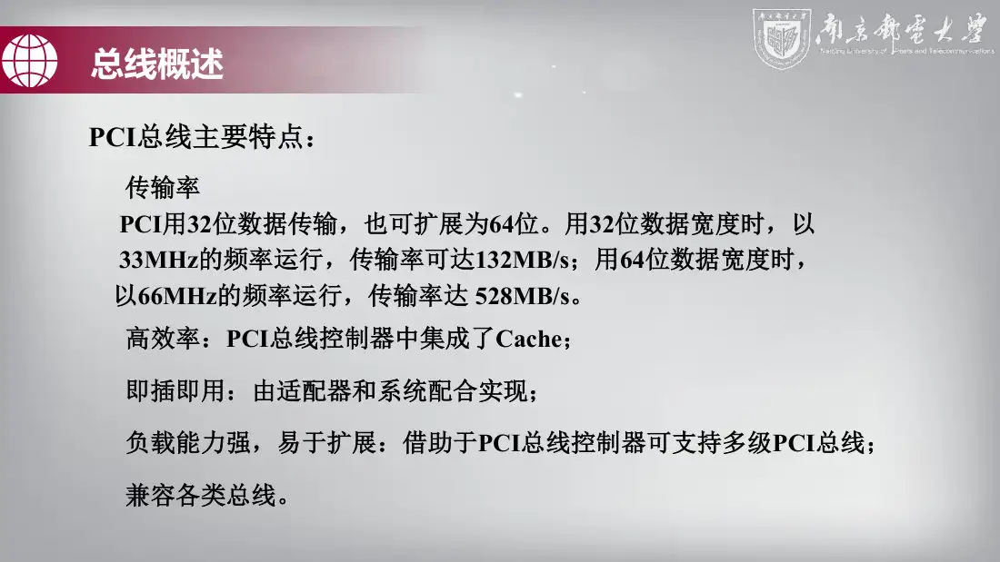

原文：

PCI总线主要特点:

传输率

PCI用32位数据传输，也可扩展为64位。用32位数据宽度时，以33MHz的频率运行，传输率可达132MB/s；用64位数据宽度时，以66MHz的频率运行，传输率达528MB/s。

高效率：PCI总线控制器中集成了Cache;

即插即用：由适配器和系统配合实现；

负载能力强，易于扩展：借助于PCI总线控制器可支持多级PCI总线；兼容各类总线。

总线概述

南京邮电大学
Nanjing University of Posts and Telecommunications

### 主板上的 PCI插槽

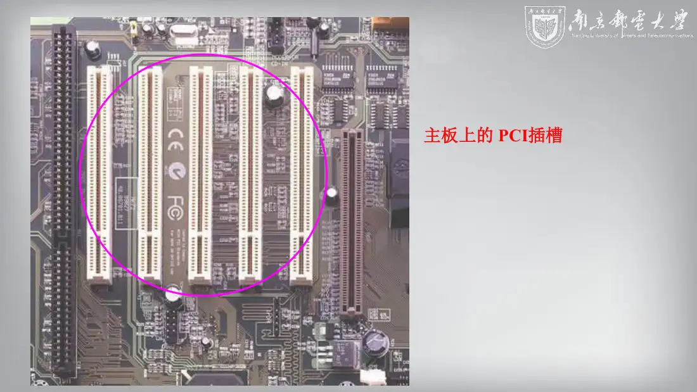

原文：

主板上的 PCI插槽

南京邮电大学
Nanjing University of Posts and Telecommunications

### 通用外部总线标准

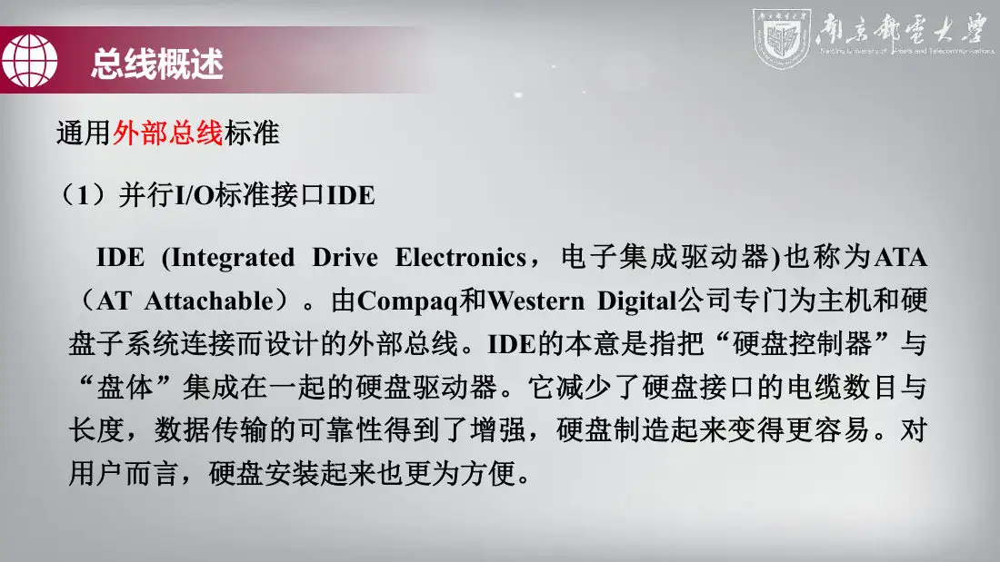

原文：

通用外部总线标准

(1) 并行I/O标准接口IDE

IDE (Integrated Drive Electronics, 电子集成驱动器)也称为ATA（AT Attachable）。由Compaq和Western Digital公司专门为主机和硬盘子系统连接而设计的外部总线。IDE的本意是指把“硬盘控制器”与“盘体”集成在一起的硬盘驱动器。它减少了硬盘接口的电缆数目与长度，数据传输的可靠性得到了增强，硬盘制造起来变得更容易。对用户而言，硬盘安装起来也更为方便。

总线概述

南京邮电大学
TJ50-838
南京邮电大学
Nanjing University of Posts and Telecommunications

### 3. 通用外部总线标准

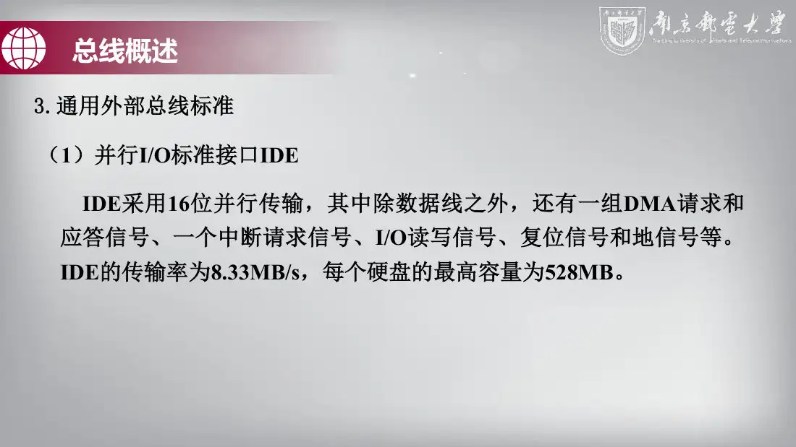

原文：

3. 通用外部总线标准

(1) 并行I/O标准接口IDE

IDE采用16位并行传输，其中除数据线之外，还有一组DMA请求和应答信号、一个中断请求信号、I/O读写信号、复位信号和地信号等。IDE的传输率为8.33MB/s，每个硬盘的最高容量为528MB。

总线概述

南京邮电大学
TJ50-838
南京邮电大学
Nanjing University of Posts and Telecommunications

### 硬盘IDE接口(右图)

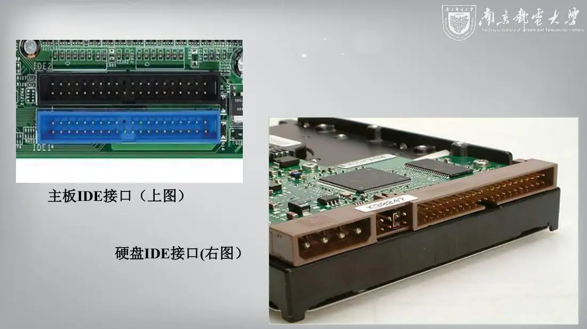

原文：

硬盘IDE接口(右图)

南京邮电大学
Nanjing University of Posts and Telecommunications

### 3. 通用外部总线标准

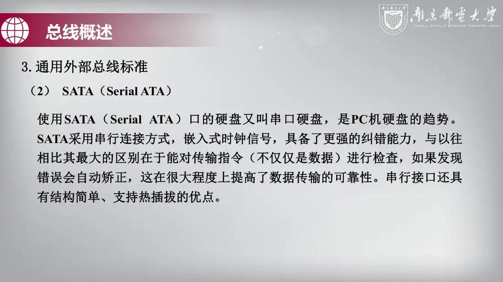

原文：

3. 通用外部总线标准

(2) SATA (Serial ATA)

使用SATA（Serial ATA）口的硬盘又叫串口硬盘，是PC机硬盘的趋势。SATA采用串行连接方式，嵌入式时钟信号，具备了更强的纠错能力，与以往相比其最大的区别在于能对传输指令（不仅仅是数据）进行检查，如果发现错误会自动矫正，这在很大程度上提高了数据传输的可靠性。串行接口还具有结构简单、支持热插拔的优点。

总线概述

南京邮电大学
TJ50-0318
南京邮电大学
Nanjing University of Posts and Telecommunications

### 3. 通用外部总线标准

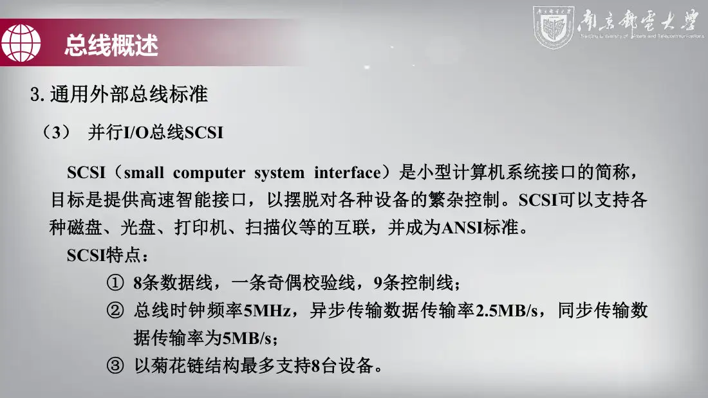

原文：

3. 通用外部总线标准

(3) 并行I/O总线SCSI

SCSI（small computer system interface）是小型计算机系统接口的简称，目标是提供高速智能接口，以摆脱对各种设备的繁杂控制。SCSI可以支持各种磁盘、光盘、打印机、扫描仪等的互联，并成为ANSI标准。

SCSI特点:

① 8条数据线，一条奇偶校验线，9条控制线；

② 总线时钟频率5MHz，异步传输数据传输率2.5MB/s，同步传输数据传输率为5MB/s;

③ 以菊花链结构最多支持8台设备。

总线概述

南京邮电大学
T-50-0316
南京邮电大学
Nanjing University of Posts and Telecommunications

### 3. 通用外部总线标准

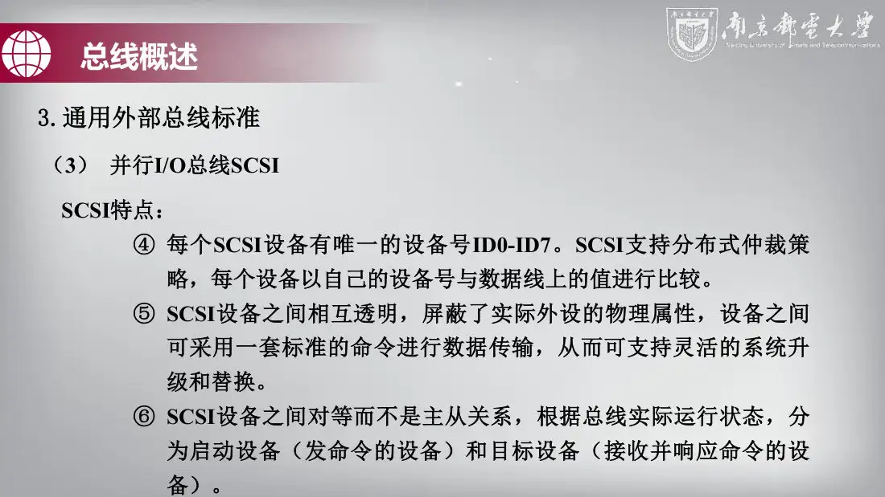

原文：

3. 通用外部总线标准

(3) 并行I/O总线SCSI

SCSI特点:

④ 每个SCSI设备有唯一的设备号ID0-ID7。SCSI支持分布式仲裁策略，每个设备以自己的设备号与数据线上的值进行比较。

⑤ SCSI设备之间相互透明，屏蔽了实际外设的物理属性，设备之间可采用一套标准的命令进行数据传输，从而可支持灵活的系统升级和替换。

⑥ SCSI设备之间对等而不是主从关系，根据总线实际运行状态，分为启动设备（发命令的设备）和目标设备（接收并响应命令的设备）。

总线概述

南京邮电大学
TJ50-838
南京邮电大学
Nanjing University of Posts and Telecommunications

### 3. 通用外部总线标准

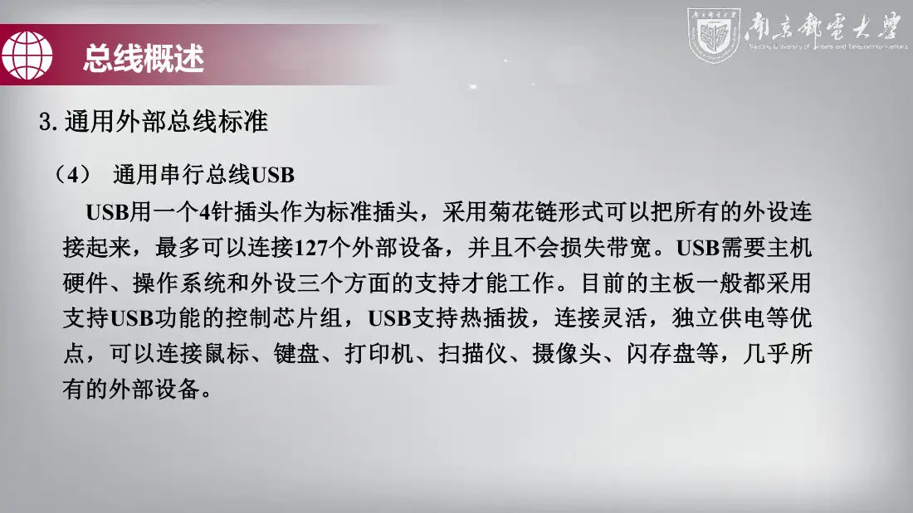

原文：

3. 通用外部总线标准

(4) 通用串行总线USB

USB用一个4针插头作为标准插头，采用菊花链形式可以把所有的外设连接起来，最多可以连接127个外部设备，并且不会损失带宽。USB需要主机硬件、操作系统和外设三个方面的支持才能工作。目前的主板一般都采用支持USB功能的控制芯片组，USB支持热插拔，连接灵活，独立供电等优点，可以连接鼠标、键盘、打印机、扫描仪、摄像头、闪存盘等，几乎所有的外部设备。

总线概述

南京邮电大学
TJ50-0318
南京邮电大学
Nanjing University of Posts and Telecommunications

### 3. 通用外部总线标准

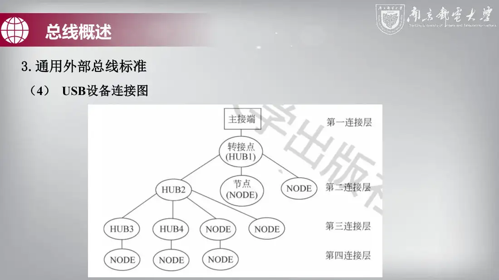

原文：

3. 通用外部总线标准

(4) USB设备连接图

总线概述

南京邮电大学
Nanjing University of Posts and Telecommunications

### 3. 通用外部总线标准

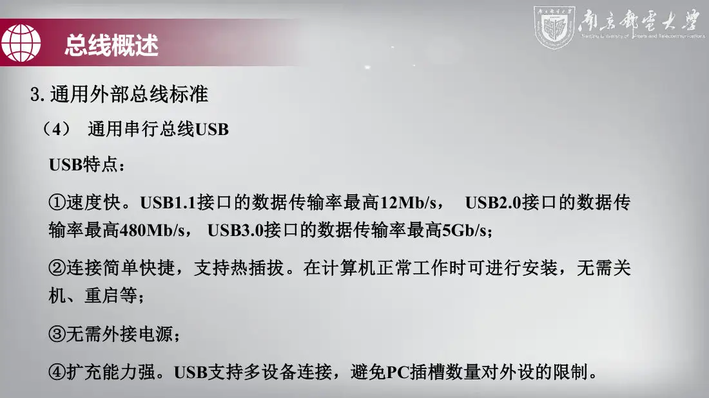

原文：

3. 通用外部总线标准

(4) 通用串行总线USB

USB特点:

①速度快。USB1.1接口的数据传输率最高12Mb/s，USB2.0接口的数据传输率最高480Mb/s，USB3.0接口的数据传输率最高5Gb/s；

②连接简单快捷，支持热插拔。在计算机正常工作时可进行安装，无需关机、重启等；

③无需外接电源;

④扩充能力强。USB支持多设备连接，避免PC插槽数量对外设的限制。

总线概述

南京邮电大学
TJ50-838
南京邮电大学
Nanjing University of Posts and Telecommunications

### 3. 通用外部总线标准

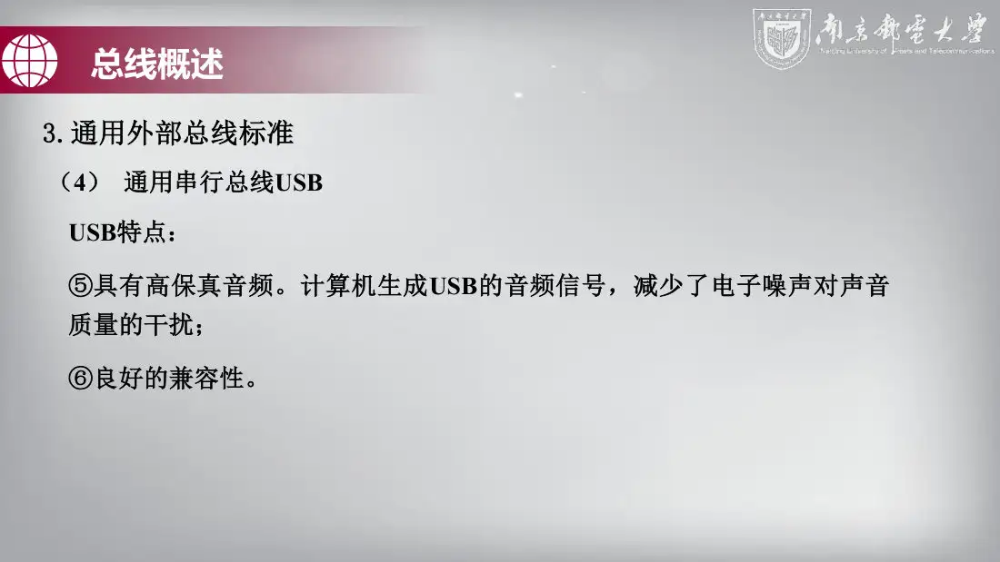

原文：

3. 通用外部总线标准

(4) 通用串行总线USB

USB特点:

⑤具有高保真音频。计算机生成USB的音频信号，减少了电子噪声对声音质量的干扰；

⑥良好的兼容性。

总线概述

南京邮电大学
Nanjing University of Posts and Telecommunications

### 4.32位微型计算机总线结构

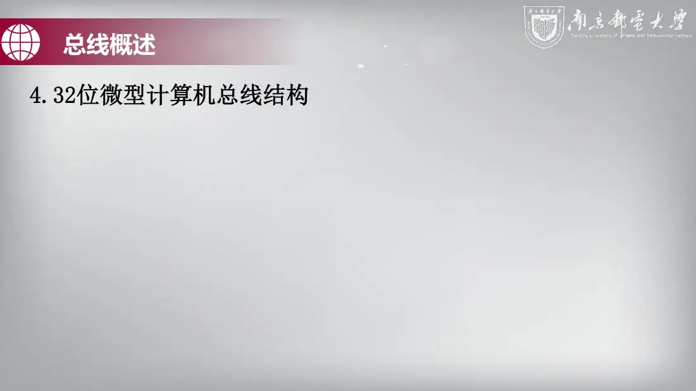

原文：

4.32位微型计算机总线结构

总线概述

南京邮电大学
Nanjing University of Posts and Telecommunications

### 总线概述 (P225)

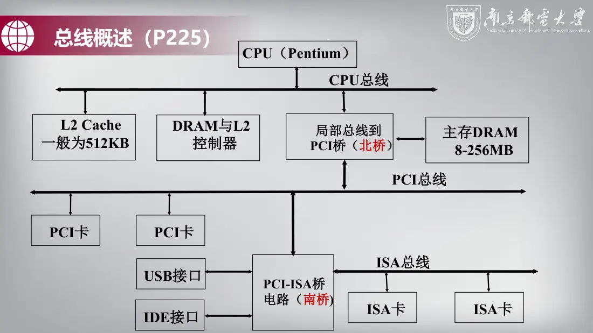

原文：

总线概述 (P225)

南京邮电大学
150-838
南京邮电大学
Nanjing University of Posts and Telecommunications

### 总线概述

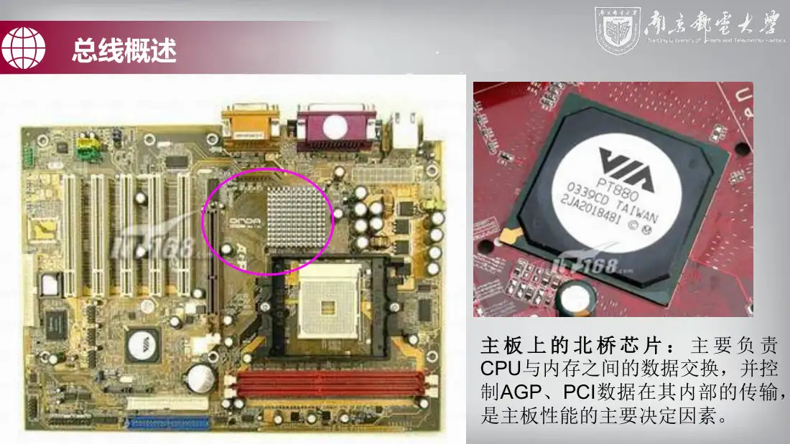

原文：

主板上的北桥芯片：主要负责CPU与内存之间的数据交换，并控制AGP、PCI数据在其内部的传输，是主板性能的主要决定因素。

总线概述

南京邮电大学
Nanjing University of Posts and Telecommunications

### 总线概述

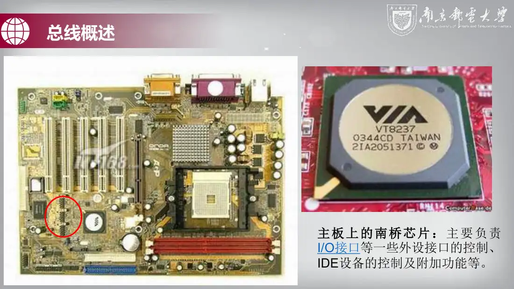

原文：

主板上的南桥芯片：主要负责I/O接口等一些外设接口的控制、IDE设备的控制及附加功能等。

总线概述

南京邮电大学
TJ50-838
南京邮电大学
Nanjing University of Posts and Telecommunications

### 知识点小结

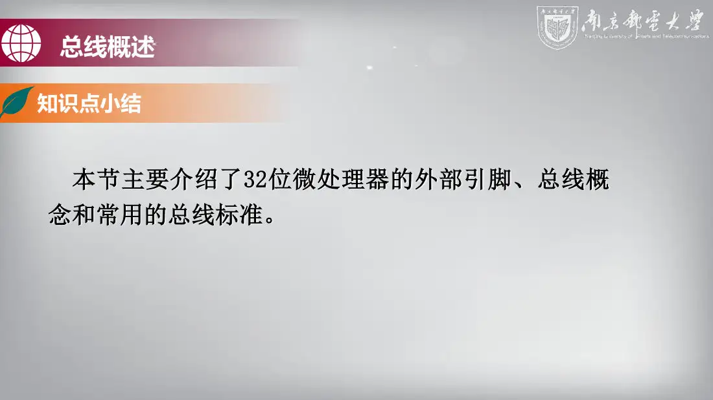

原文：

知识点小结

本节主要介绍了32位微处理器的外部引脚、总线概念和常用的总线标准。

总线概述

南京邮电大学
Nanjing University of Posts and Telecommunications
