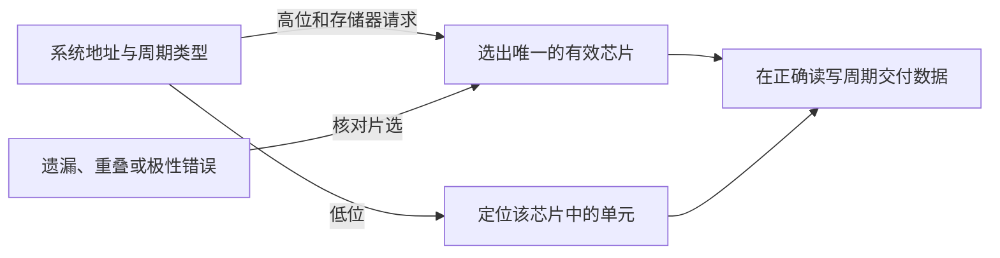

# 《微型计算机接口技术》第6章 存储器系统（课件）

一个系统用 8 KiB 芯片填入前 32 KiB，顶部却要恰好留出 2 KiB 工作区。最后一片如果也接到同一个 8 KiB 片选输出，为什么多出来的 6 KiB 不是“空的”？本章的关键是把==系统地址、片选条件、片内地址和存储内容==分别算清，再检查有没有同一单元出现多个地址，或者多个芯片响应同一次访问。

## 从一位存储元到一个可读写的单元

一位存储元只能记一个二进制值；同一次寻址得到的若干位组成一个存储单元，规则排列的存储元组成存储体。地址是选中单元的编号，不是位于里面的数据。比如 $1024\times8$ 表示 $2^{10}$ 个单元、每单元 8 位，容量为 8192 位或 1 KiB；不表示有 8192 个可单独编址的字节。题给“字编址”还是“字节编址”时，还要以题设定义的一次寻址单位为准。参见[存储单元与地址](../../../topics/微机接口/cunchu-danyuan.md)和[容量与线数](../../../topics/微机接口/cunchu-rongliang.md)。

第 4 页按内部实现及改写方式分类。SRAM 通电时不用周期刷新；DRAM 的位状态会衰减，需刷新。掩膜 ROM 的内容制造时确定，PROM 可编程一次，EPROM 可用紫外擦除再编程，EEPROM 用电方式擦写；这里的“只读”描述正常读取用途，不意味着后三类绝无重新制备内容的机制。课件列 8118（16K×1）、2114（1K×4）、6116（2K×8），正是为了区分每片的单元数和每次交付位数。寄存器、Cache、主存和外存分层，是因为容量、访问时间和成本不能靠一种电路同时做到最好；层次利用常用数据集中访问的特点，不是把全部外存都改用最快的材料。

存储芯片不只有存储体。行列译码把地址定位到单元，I/O 缓冲决定数据进出，片选让芯片参与总线操作。在典型具有低有效 /CS、/OE、/WE 的 SRAM 中，读时先保证地址及片选有效、令 /OE 有效而 /WE 无效，等数据稳定再采样；写时让 CPU 驱动总线，满足地址与数据建立、保持条件，在规定的 /WE 窗口完成存入。未选中芯片的输出应不驱动总线；具体信号有效电平及建立、保持时间仍由芯片决定。参见[存储器组织](../../../topics/微机接口/cunchu-zuzhi.md)。

## 两个独立的扩展方向

| 方案 | 同时选中什么 | 哪些线共用 |
| --- | --- | --- |
| 位扩展 | 同一地址的多片，每片负责字中的不同位 | 地址与控制共用，数据位彼此分开 |
| 字扩展 | 被高位译码选中的一组 | 各组低位地址、数据线和读写控制可共用，片选应互斥 |
| 字位同时扩展 | 先构造足够宽的一组，再用高位选组 | 组内扩宽、组间扩深，绝不能令两组同时驱动同一数据位 |

**参考解答（第 9–13 页例示）。** $8\mathrm{K}\times8$ 若用 $1\mathrm{K}\times4$ 的 2114，要 8 组各 2 片；若用 $8\mathrm{K}\times1$，只需 1 组共 8 片且分别负责 D0–D7。$64\mathrm{K}\times8$ 用 $16\mathrm{K}\times8$ 是 4 组各 1 片，A13–A0 送各片、A15–A14 选择四组，地址依次为 0000H–3FFFH、4000H–7FFFH、8000H–BFFFH、C000H–FFFFH。以 2114 构成 $2\mathrm{K}\times8$ 时，需 2 组各 2 片，每片接 A9–A0，各组内两片分别负责低、高 4 位。若系统有多余高位地址，仍要决定这些位是否参与组选择和区域使能，不能因组数少就一概丢弃。参见[存储器扩展](../../../topics/微机接口/cunchu-kuozhan.md)。

> [!TIP]
> 题目给“芯片容量”时，先拆开地址深度与数据位宽分别做除法。只用总容量相除可能得到正确片数，却仍没有回答==哪些片要同时工作、低地址接到哪里==。

## 译码不足会产生两种不同的“重叠”

**线选法**简单：课件第 15 页每片 1 KiB，低 10 位进片内，A10、A11、A12、A13 各选择一个芯片，A15、A14 未参加。表中的 0400H–07FFH、0800H–0BFFH、1000H–13FFH 和 2000H–23FFH 是只选择相应一路、两更高位均为零的代表区间，不是完整映射。**补充反例**：0400H 和 4400H 对片 1 的选择和片内偏移完全相同，是==同一物理单元的镜像==；0C00H 则同时令 A10 和 A11 有效，若没有其他互斥条件，会选中两片，是==一次访问有两个驱动方==。别把这两个风险混为一谈。

**全译码**让所有未作片内地址的高位都参与选片。课件第 17 页用 8 片 $8\mathrm{K}\times8$ 填满 64 KiB，A12–A0 送各片，A15–A13 通过 3 选 8 译码选择其中一片，组号从 0 到 7。**部分译码**只检查部分高位，优点是少用若干译码条件；若未检查的是 $k$ 根高位，则其可取的不同组合产生最多 $2^k$ 套镜像，前提是这些组合没被其他电路排除。课件第 18 页的 4 片 8 KiB 忽略 A15，四个物理区间都能从低半和高半访问，例如 0000H–1FFFH 与 8000H–9FFFH 指向同一片。见[地址译码](../../../topics/微机接口/dizhi-yima.md)。

## 例题：8 KiB 的译码器如何只放行顶部 2 KiB

第 19–23 页先确定地址空间，再确定各器件容量及位图，最后接译码器。16 位地址、8 位双向数据线的题设给 0000H–1FFFH 一片 EPROM，2000H–7FFFH 三片 8 KiB SRAM，F800H–FFFFH 一片 2 KiB SRAM。中间 8000H–F7FFH 共 30 KiB，不能被任何一片占用。

| 区域 | 片内地址 | 片选高位 |
| --- | --- | --- |
| 0000H–1FFFH，EPROM | A12–A0 | A15:A13=`000` |
| 2000H–7FFFH，三片 8 KiB SRAM | A12–A0 | A15:A13 分别为 `001`、`010`、`011` |
| F800H–FFFFH，2 KiB SRAM | A10–A0 | A15:A11=`11111` |

**参考解答。** 8 KiB 的片选直接用 74LS138 的有效 Y0–Y3 输出；最高 2 KiB 落在 Y7 所覆盖的 E000H–FFFFH 内，还必须令 A12、A11 都为 1。以 $M$ 表示有效存储器请求，逻辑上的选中为 $M\land A_{15}\land A_{14}\land A_{13}\land A_{12}\land A_{11}$，接到低有效 /CS 前要按输出极性实现。用低有效的译码器输出时，可把 Y7 反相为“Y7 已选中”，再与 A12、A11 作三输入与非；Y7 本身已受存储器请求的使能约束。不接最后两位会让 E000H–E7FFH、E800H–EFFFH、F000H–F7FFH 都镜像到最后一片。实际板上还应保证 EPROM 不在 CPU 写该区时驱动总线；无独立 /OE 的器件需要相应的读限定或总线保护，不靠这张地址表代替电气条件。

**参考解答（第 24–25 页，核对原件）。** （1）4 KiB 要 4 片 1K×8 SRAM，地址共 12 位，其中 10 位片内、2 位选组。（2）512 KiB 要 4 片 128 KiB，从 10000H 开始，末址为 8FFFFH。（3）A0000H–EFFFFH 包含首尾，共 50000H 字节，即 320 KiB，按每片 32 KiB 需 10 片。（4）第 6 片连接从零数起的 Y5，故高三位为 101；低 13 位依次从全零到全一，得到 A000H–BFFFH。前三个是**容量与边界题**，最后一个是**实际接线题**，片号和译码器输出的起始编号不同。

> [!WARNING]
> ==纸面区间互斥，不等于实际片选无冲突。== 设计题至少拿首址、末址、区外紧邻地址和一组高位镜像试验。F7FFH 只比 F800H 小 1，却必须不选中顶部 SRAM；只验证合法地址能读到数据，抓不住错误映射。

## 历史机型的地址图为什么不是物理条数图

第 26 页所示 IBM PC/XT 使用 1 MiB 地址空间中的分区；00000H–9FFFFH 共 640 KiB 是图中的常规 RAM，含中断向量、BIOS 数据及程序使用区；A0000H–BFFFFH 预留给显示等，课件的单色 B0000H 与彩色 B8000H 是不同起点。C0000H–FFFFFH 是图中的 256 KiB ROM 类区域，其中 C0000H–EFFFFH 的扩展区只占 192 KiB；FE000H–FFFFFH 是 8 KiB 的基本 ROM，F6000H–FDFFFH 的 32 KiB 放历史示例的 BASIC。**订正**：别把图中的 256 KiB 类别标签读成 C0000H–EFFFFH 那一段的容量。也不能由“保留”推断每个地址已经安装物理芯片；不同兼容机配置会改变扩展区内容。
