# 《微型计算机接口技术》第6章 存储器系统（课件）

原件的每一页，下面附识别出的文字。

### ! "#\$ %&'()

原文：

! "#\$ %&'()

6

微型计算机原理与接口技术

### 6.1 概述

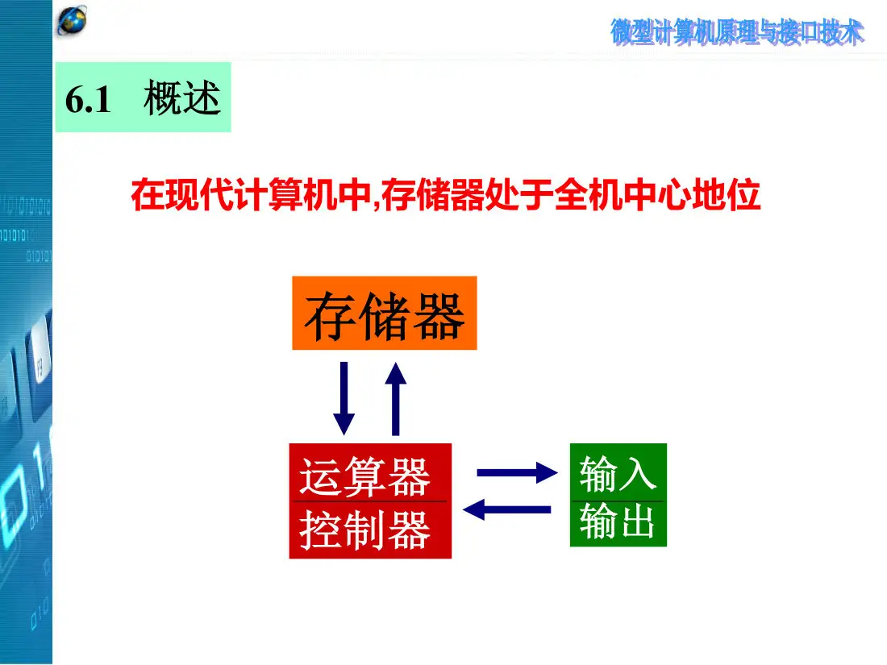

原文：

6.1 概述

在现代计算机中,存储器处于全机中心地位

存储器

6

微型计算机原理与接口技术

### 存储容量（Memory Capacity ）

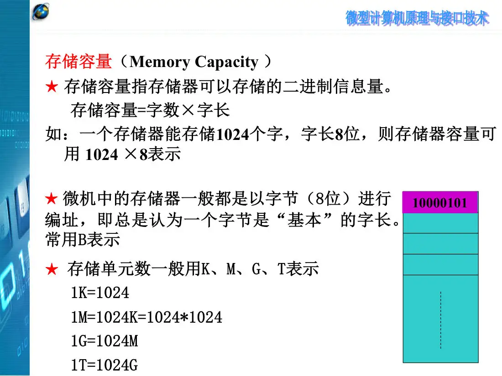

原文：

存储容量（Memory Capacity ）

! 存储容量指存储器可以存储的二进制信息量。存储容量=字数×字长

如：一个存储器能存储1024个字，字长8位，则存储器容量可用 1024 ×8表示

! 微机中的存储器一般都是以字节（8位）进行编址，即总是认为一个字节是“基本”的字长。常用B表示

! 存储单元数一般用K、M、G、T表示1K=10241M=1024K=1024\*10241G=1024M1T=1024G

6

微型计算机原理与接口技术

### 微型计算机原理与接口技术

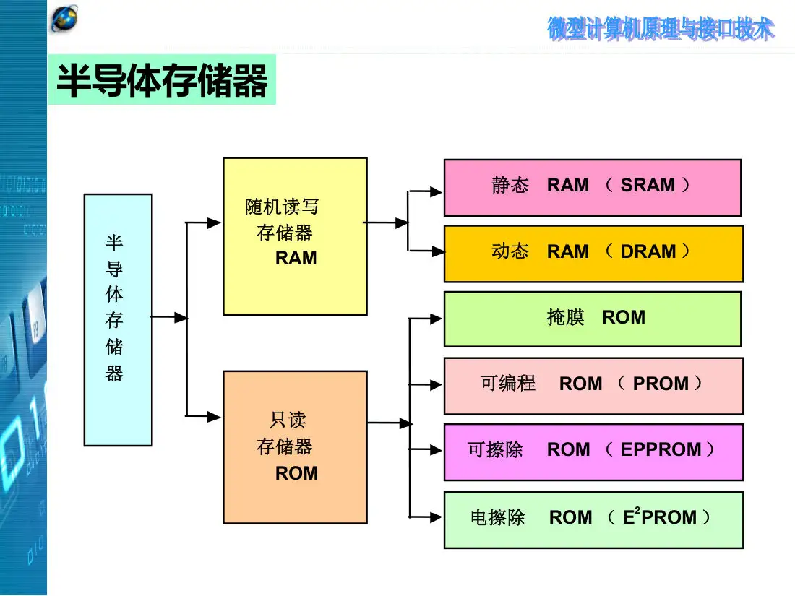

原文：

微型计算机原理与接口技术

半导体存储器

6

### 微型计算机原理与接口技术

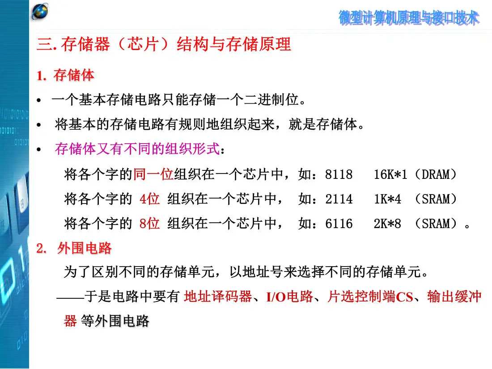

原文：

微型计算机原理与接口技术

三. 存储器（芯片）结构与存储原理

1. 存储体

• 一个基本存储电路只能存储一个二进制位。

• 将基本的存储电路有规则地组织起来，就是存储体。

• 存储体又有不同的组织形式：

将各个字的同一位组织在一个芯片中，如：8118 16K\*1（DRAM）

将各个字的 4位 组织在一个芯片中， 如：2114 1K\*4 （SRAM）

将各个字的 8位 组织在一个芯片中， 如：6116 2K\*8 （SRAM）。

2. 外围电路

为了区别不同的存储单元，以地址号来选择不同的存储单元。

——于是电路中要有 地址译码器、I/O电路、片选控制端CS、输出缓冲器 等外围电路

6

### 微型计算机原理与接口技术

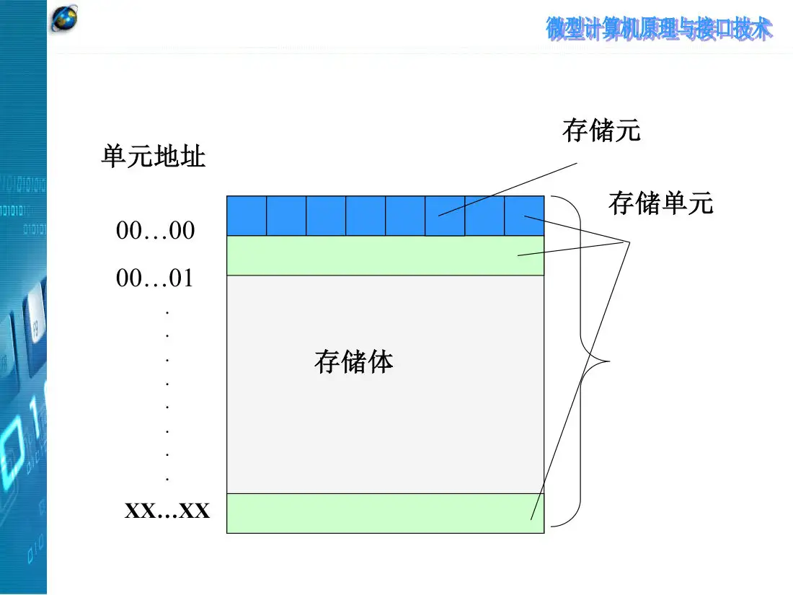

原文：

微型计算机原理与接口技术

6

### 微型计算机原理与接口技术

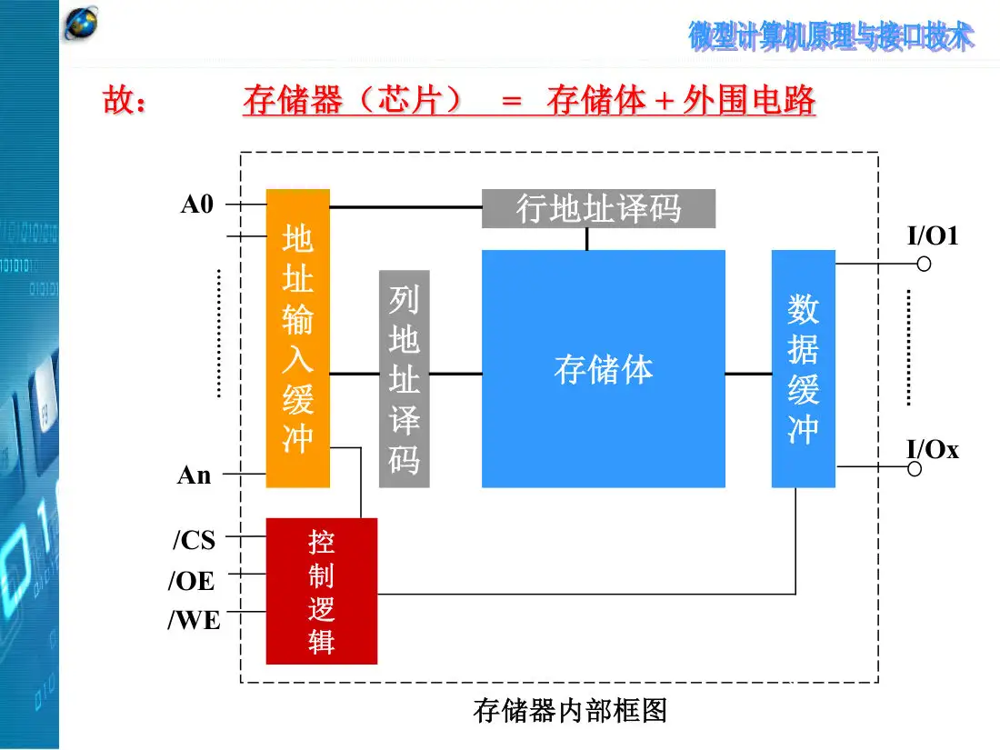

原文：

微型计算机原理与接口技术

### 6.3 微型计算机系统中的存储器组织

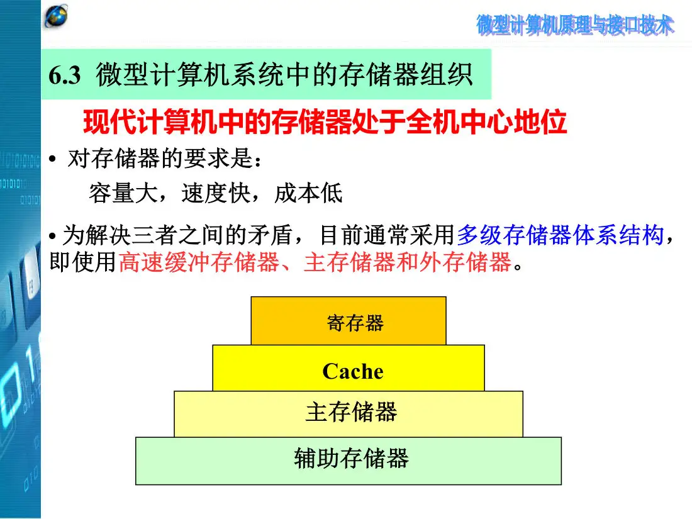

原文：

6.3 微型计算机系统中的存储器组织

现代计算机中的存储器处于全机中心地位

• 对存储器的要求是：

容量大，速度快，成本低

• 为解决三者之间的矛盾，目前通常采用多级存储器体系结构，即使用高速缓冲存储器、主存储器和外存储器。

寄存器

Cache

主存储器

辅助存储器

6

微型计算机原理与接口技术

### 微型计算机原理与接口技术

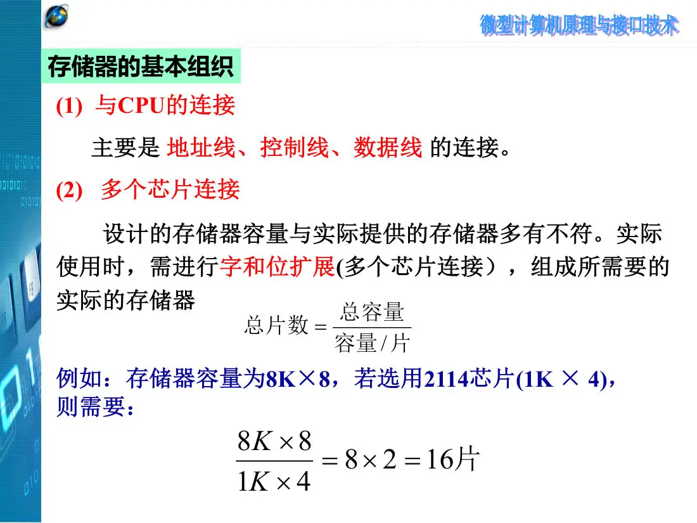

原文：

微型计算机原理与接口技术

存储器的基本组织

(1) 与CPU的连接

主要是 地址线、控制线、数据线 的连接。

(2) 多个芯片连接

设计的存储器容量与实际提供的存储器多有不符。实际使用时，需进行字和位扩展(多个芯片连接），组成所需要的实际的存储器 总容量

$$
\mathrm{总片数} = \frac {\mathrm{总容量}}{\mathrm{容量/片}}
$$

例如：存储器容量为 $\mathbf { 8 K } \times \mathbf { 8 }$ ，若选用2114芯片 $( 1 K \times 4 )$ 则需要：

$$
\frac {8 K \times 8}{1 K \times 4} = 8 \times 2 = 1 6 \text {片}
$$

6

### （1）位扩展法

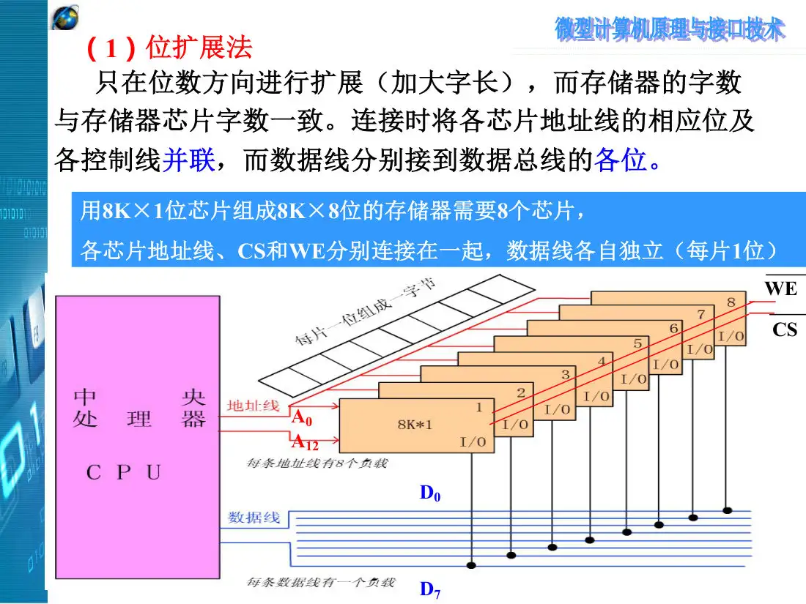

原文：

（1）位扩展法

只在位数方向进行扩展（加大字长），而存储器的字数与存储器芯片字数一致。连接时将各芯片地址线的相应位及各控制线并联，而数据线分别接到数据总线的各位。

用8K×1位芯片组成8K×8位的存储器需要8个芯片，

各芯片地址线、CS和WE分别连接在一起，数据线各自独立（每片1位）

6

微型计算机原理与接口技术

### （2）字扩展法

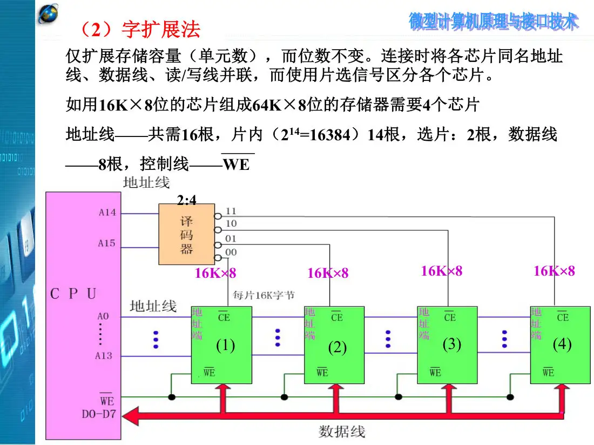

原文：

（2）字扩展法

仅扩展存储容量（单元数），而位数不变。连接时将各芯片同名地址线、数据线、读/写线并联，而使用片选信号区分各个芯片。

如用16K×8位的芯片组成64K×8位的存储器需要4个芯片地址线——共需16根，片内（214=16384）14根，选片：2根，数据线——8根，控制线——WE

6

微型计算机原理与接口技术

### 地址空间分配表

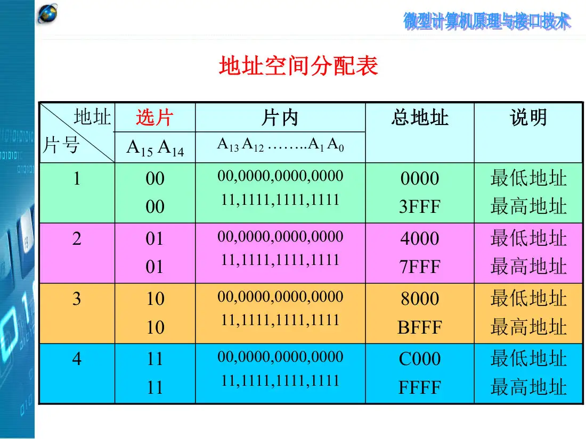

原文：

地址空间分配表

<table><tr><td rowspan="2">片号\地址</td><td>选片</td><td>片内</td><td rowspan="2">总地址</td><td rowspan="2">说明</td></tr><tr><td> $A_{15}A_{14}$ </td><td> $A_{13}A_{12}......A_{1}A_{0}$ </td></tr><tr><td rowspan="2">1</td><td>00</td><td>00,0000,0000,0000</td><td>0000</td><td>最低地址</td></tr><tr><td>00</td><td>11,1111,1111,1111</td><td>3FFF</td><td>最高地址</td></tr><tr><td rowspan="2">2</td><td>01</td><td>00,0000,0000,0000</td><td>4000</td><td>最低地址</td></tr><tr><td>01</td><td>11,1111,1111,1111</td><td>7FFF</td><td>最高地址</td></tr><tr><td rowspan="2">3</td><td>10</td><td>00,0000,0000,0000</td><td>8000</td><td>最低地址</td></tr><tr><td>10</td><td>11,1111,1111,1111</td><td>BFFF</td><td>最高地址</td></tr><tr><td rowspan="2">4</td><td>11</td><td>00,0000,0000,0000</td><td>C000</td><td>最低地址</td></tr><tr><td>11</td><td>11,1111,1111,1111</td><td>FFFF</td><td>最高地址</td></tr></table>

6

微型计算机原理与接口技术

### 微型计算机原理与接口技术

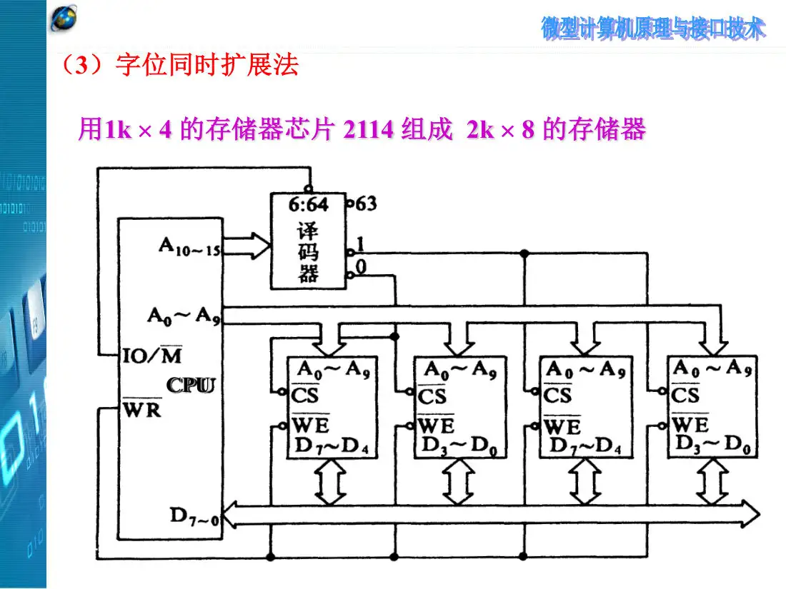

原文：

微型计算机原理与接口技术

（3）字位同时扩展法

用1k ´ 4 的存储器芯片 2114 组成 2k ´ 8 的存储器

6

### 微型计算机原理与接口技术

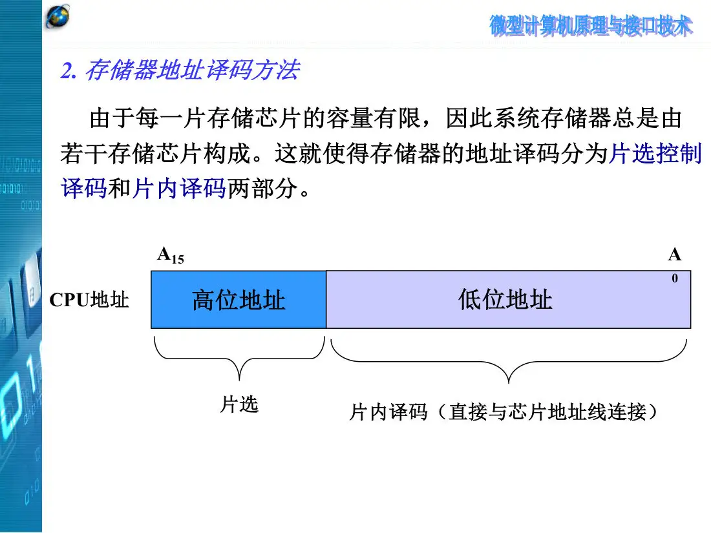

原文：

微型计算机原理与接口技术

2. 存储器地址译码方法

由于每一片存储芯片的容量有限，因此系统存储器总是由若干存储芯片构成。这就使得存储器的地址译码分为片选控制译码和片内译码两部分。

6

### （1）线选法

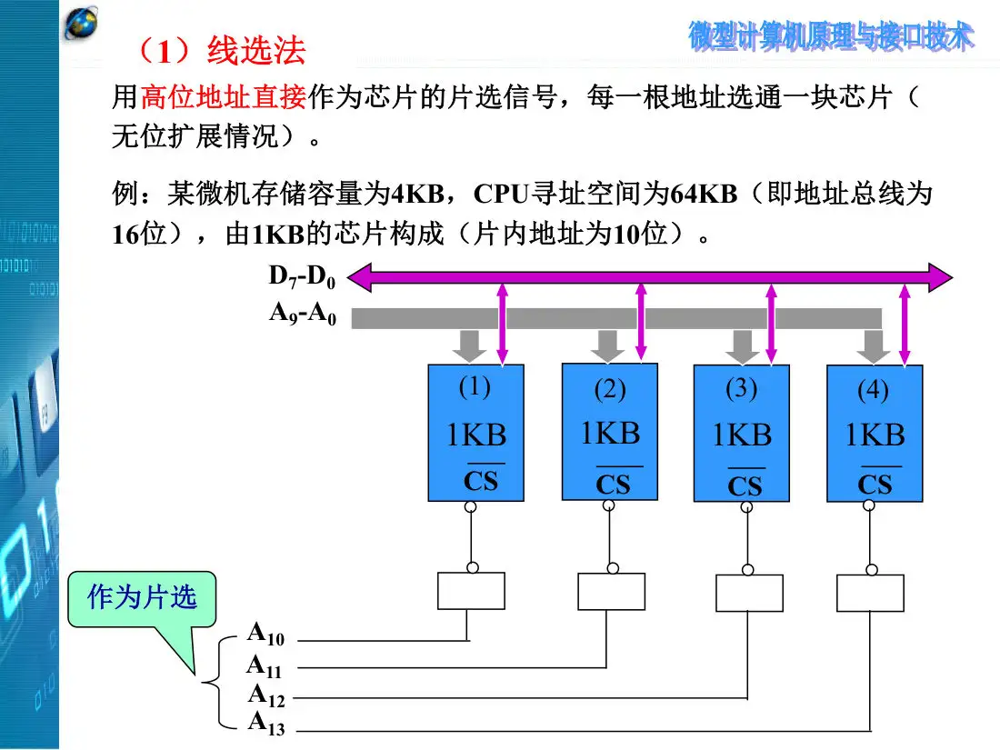

原文：

（1）线选法

用高位地址直接作为芯片的片选信号，每一根地址选通一块芯片（无位扩展情况）。

例：某微机存储容量为4KB，CPU寻址空间为64KB（即地址总线为16位），由1KB的芯片构成（片内地址为10位）。

6

微型计算机原理与接口技术

### 微型计算机原理与接口技术

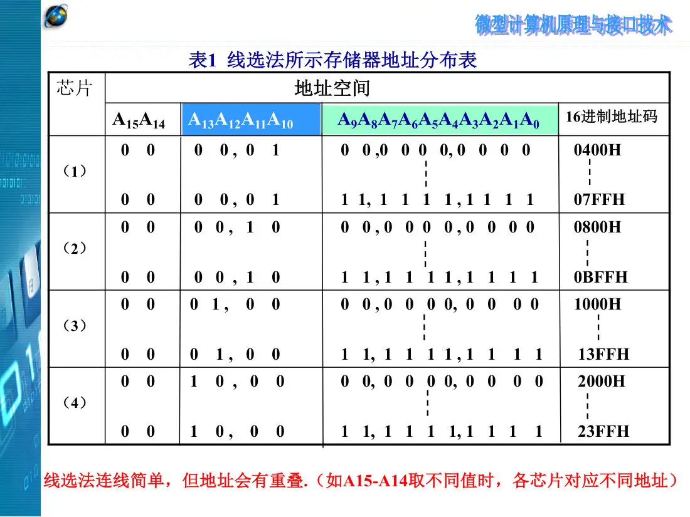

原文：

微型计算机原理与接口技术

表1 线选法所示存储器地址分布表
<table><tr><td rowspan="2">芯片</td><td colspan="4">地址空间</td></tr><tr><td> $A_{15}A_{14}$ </td><td> $A_{13}A_{12}A_{11}A_{10}$ </td><td> $A_{9}A_{8}A_{7}A_{6}A_{5}A_{4}A_{3}A_{2}A_{1}A_{0}$ </td><td>16进制地址码</td></tr><tr><td rowspan="2">(1)</td><td>0 0</td><td>0 0, 0 1</td><td>0 0,0 0 0 0,0 0 0 0</td><td>0400H</td></tr><tr><td>0 0</td><td>0 0, 0 1</td><td>1 1, 1 1 1 1,1 1 1 1</td><td>07FFH</td></tr><tr><td rowspan="2">(2)</td><td>0 0</td><td>0 0, 1 0</td><td>0 0,0 0 0 0,0 0 0 0</td><td>0800H</td></tr><tr><td>0 0</td><td>0 0, 1 0</td><td>1 1,1 1 1 1,1 1 1 1</td><td>0BFFH</td></tr><tr><td rowspan="2">(3)</td><td>0 0</td><td>0 1, 0 0</td><td>0 0,0 0 0 0,0 0 0 0</td><td>1000H</td></tr><tr><td>0 0</td><td>0 1, 0 0</td><td>1 1, 1 1 1 1,1 1 1 1</td><td>13FFH</td></tr><tr><td rowspan="2">(4)</td><td>0 0</td><td>1 0, 0 0</td><td>0 0,0 0 0 0,0 0 0 0</td><td>2000H</td></tr><tr><td>0 0</td><td>1 0, 0 0</td><td>1 1, 1 1 1 1,1 1 1 1</td><td>23FFH</td></tr></table>

线选法连线简单，但地址会有重叠.（如A15-A14取不同值时，各芯片对应不同地址）

6

### （2）全译码法

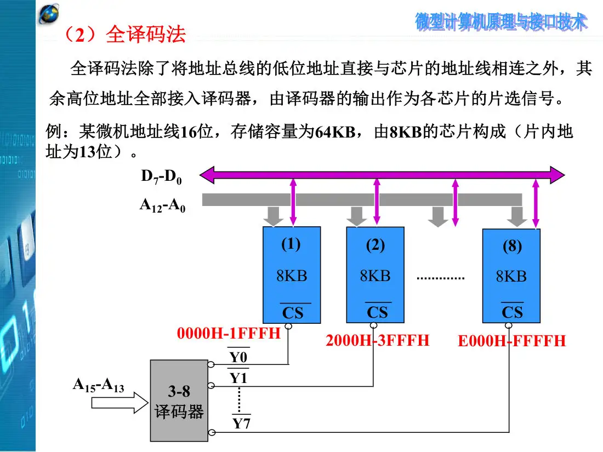

原文：

（2）全译码法

全译码法除了将地址总线的低位地址直接与芯片的地址线相连之外，其余高位地址全部接入译码器，由译码器的输出作为各芯片的片选信号。

例：某微机地址线16位，存储容量为64KB，由8KB的芯片构成（片内地址为13位）。

6

微型计算机原理与接口技术

### （3）部分译码法

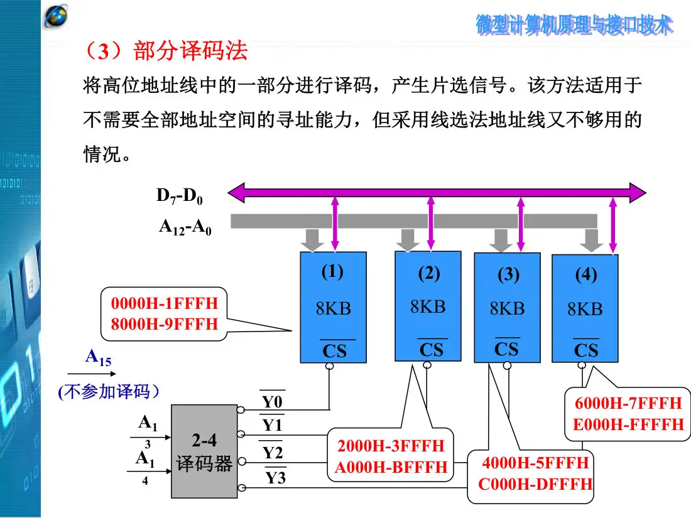

原文：

（3）部分译码法

将高位地址线中的一部分进行译码，产生片选信号。该方法适用于不需要全部地址空间的寻址能力，但采用线选法地址线又不够用的情况。

6

微型计算机原理与接口技术

### （4）存储器地址译码电路设计步骤

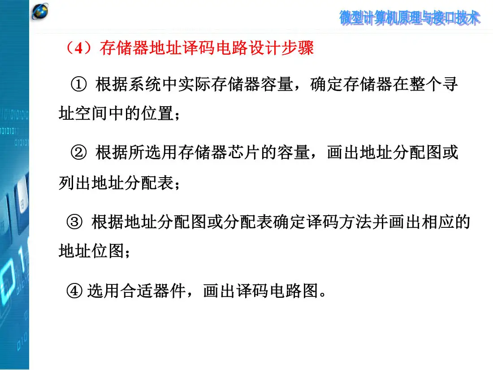

原文：

（4）存储器地址译码电路设计步骤

① 根据系统中实际存储器容量，确定存储器在整个寻址空间中的位置；

② 根据所选用存储器芯片的容量，画出地址分配图或列出地址分配表；

③ 根据地址分配图或分配表确定译码方法并画出相应的地址位图；

④ 选用合适器件，画出译码电路图。

6

微型计算机原理与接口技术

### 存储器地址译码举例：

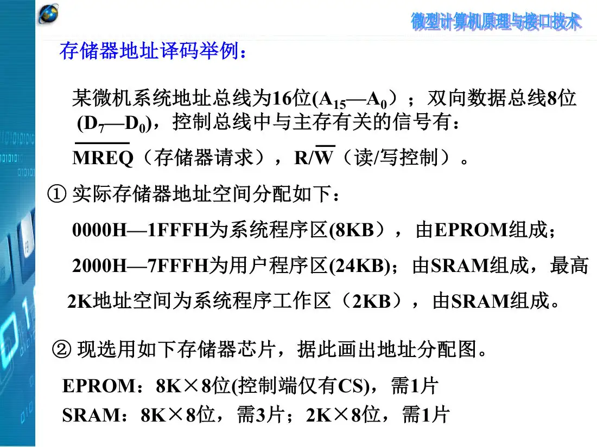

原文：

存储器地址译码举例：

某微机系统地址总线为16位 $( \mathbf { A _ { 1 5 } { - } A _ { 0 } } )$ ；双向数据总线8位$( { \bf D } _ { 7 } - { \bf D _ { 0 } } )$ ，控制总线中与主存有关的信号有：MREQ（存储器请求）， $\mathbf { R } / \overline { { \mathbf { W } } }$ （读/写控制）。

① 实际存储器地址空间分配如下：

0000H—1FFFH为系统程序区(8KB），由EPROM组成；2000H—7FFFH为用户程序区(24KB)；由SRAM组成，最高2K地址空间为系统程序工作区（2KB），由SRAM组成。

② 现选用如下存储器芯片，据此画出地址分配图。

EPROM：8K×8位(控制端仅有CS)，需1片SRAM：8K×8位，需3片； $2 \mathbf { K } \times 8 \mathbf { \mu m }$ ，需1片

6

微型计算机原理与接口技术

### 微型计算机原理与接口技术

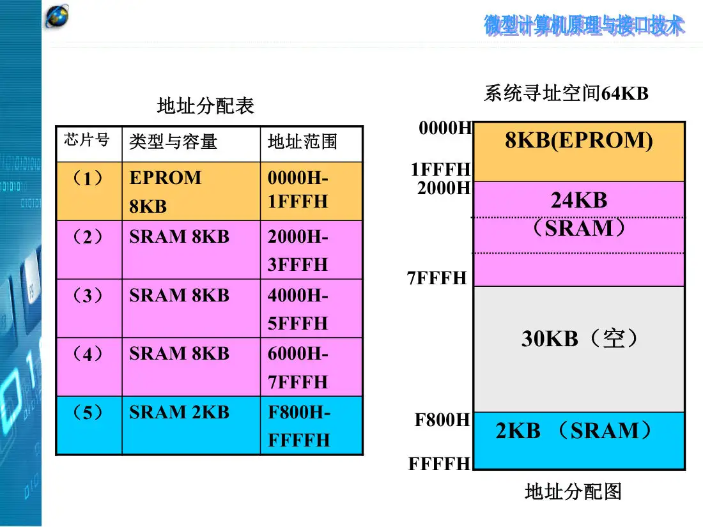

原文：

微型计算机原理与接口技术

地址分配表
<table><tr><td>芯片号</td><td>类型与容量</td><td>地址范围</td></tr><tr><td>(1)</td><td>EPROM8KB</td><td>0000H-1FFFH</td></tr><tr><td>(2)</td><td>SRAM 8KB</td><td>2000H-3FFFH</td></tr><tr><td>(3)</td><td>SRAM 8KB</td><td>4000H-5FFFH</td></tr><tr><td>(4)</td><td>SRAM 8KB</td><td>6000H-7FFFH</td></tr><tr><td>(5)</td><td>SRAM 2KB</td><td>F800H-FFFFH</td></tr></table>

系统寻址空间64KB 地址分配图
<table><tr><td>0000H</td><td>8KB(EPROM)</td></tr><tr><td>1FFFH</td><td></td></tr><tr><td>2000H</td><td>24KB(SRAM)</td></tr><tr><td>7FFFH</td><td></td></tr><tr><td></td><td>30KB(空)</td></tr><tr><td>F800H</td><td>2KB(SRAM)</td></tr><tr><td>FFFFH</td><td></td></tr></table>

6

### 微型计算机原理与接口技术

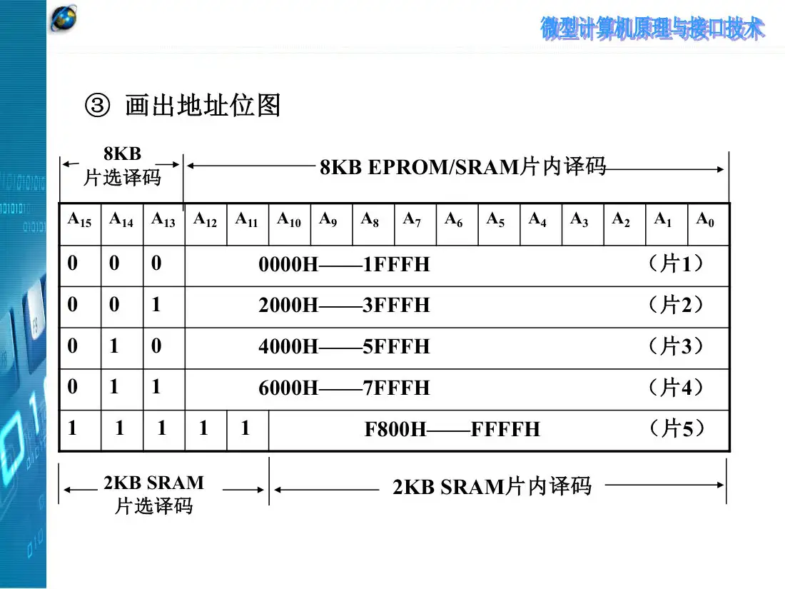

原文：

微型计算机原理与接口技术

③ 画出地址位图

<table><tr><td colspan="3">8KB片选译码</td><td colspan="13">8KB EPROM/SRAM片内译码</td></tr><tr><td> $A_{15}$ </td><td> $A_{14}$ </td><td> $A_{13}$ </td><td> $A_{12}$ </td><td> $A_{11}$ </td><td> $A_{10}$ </td><td> $A_9$ </td><td> $A_8$ </td><td> $A_7$ </td><td> $A_6$ </td><td> $A_5$ </td><td> $A_4$ </td><td> $A_3$ </td><td> $A_2$ </td><td> $A_1$ </td><td> $A_0$ </td></tr><tr><td>0</td><td>0</td><td>0</td><td colspan="13">0000H——1FFFH(片1)</td></tr><tr><td>0</td><td>0</td><td>1</td><td colspan="13">2000H——3FFFH(片2)</td></tr><tr><td>0</td><td>1</td><td>0</td><td colspan="13">4000H——5FFFH(片3)</td></tr><tr><td>0</td><td>1</td><td>1</td><td colspan="13">6000H——7FFFH(片4)</td></tr><tr><td>1</td><td>1</td><td>1</td><td>1</td><td>1</td><td colspan="11">F800H——FFFFH(片5)</td></tr><tr><td colspan="16">←2KB SRAM片选译码→←2KB SRAM片内译码→</td></tr></table>

6

### ④ 选用3-8译码器和基本门电路设计电路

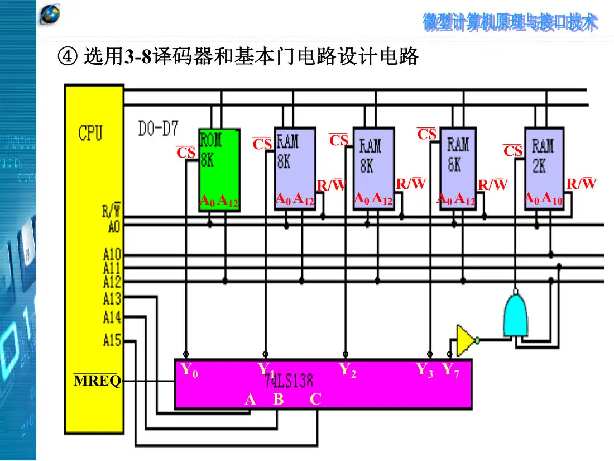

原文：

④ 选用3-8译码器和基本门电路设计电路

6

微型计算机原理与接口技术

### 3. 课堂练习

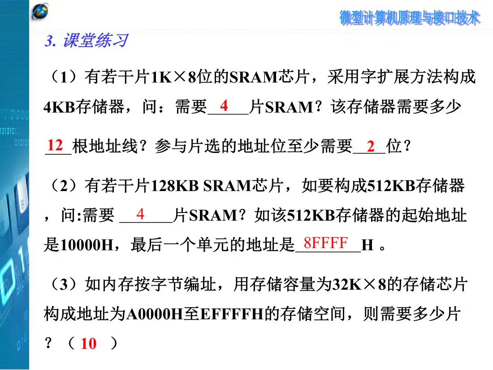

原文：

3. 课堂练习

（1）有若干片1K×8位的SRAM芯片，采用字扩展方法构成4KB存储器，问：需要 片SRAM？该存储器需要多少4

根地址线？参与片选的地址位至少需要 位？12 2

（2）有若干片128KB SRAM芯片，如要构成512KB存储器，问:需要 片SRAM？如该512KB存储器的起始地址4是10000H，最后一个单元的地址是 H 。8FFFF

（3）如内存按字节编址，用存储容量为32K×8的存储芯片构成地址为A0000H至EFFFFH的存储空间，则需要多少片？（ ）10

6

微型计算机原理与接口技术

### （4）已知如下电路，问第6个芯片的寻址范围从 到A000HBFFFH

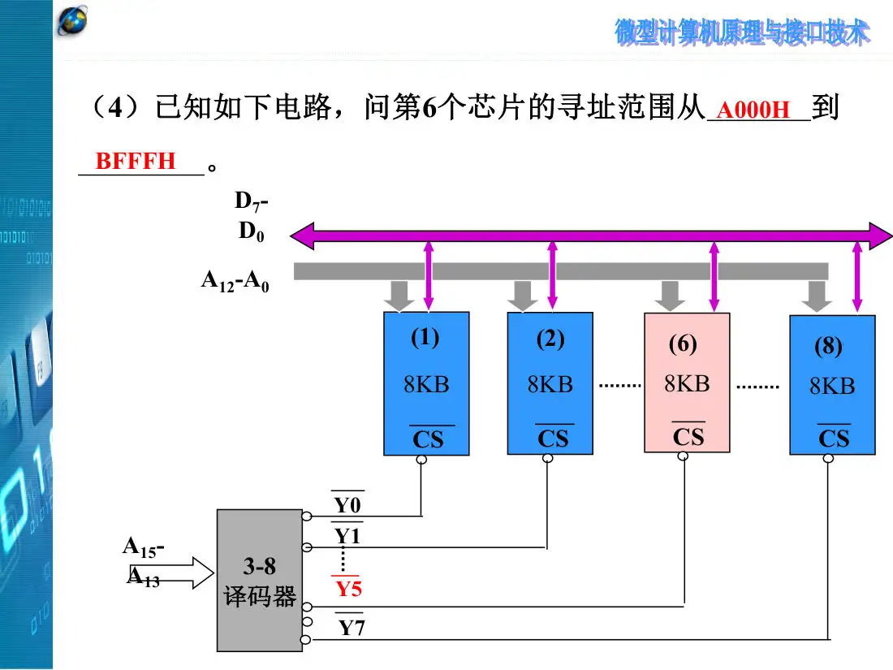

原文：

（4）已知如下电路，问第6个芯片的寻址范围从 到A000HBFFFH

6

微型计算机原理与接口技术

### 微型计算机原理与接口技术

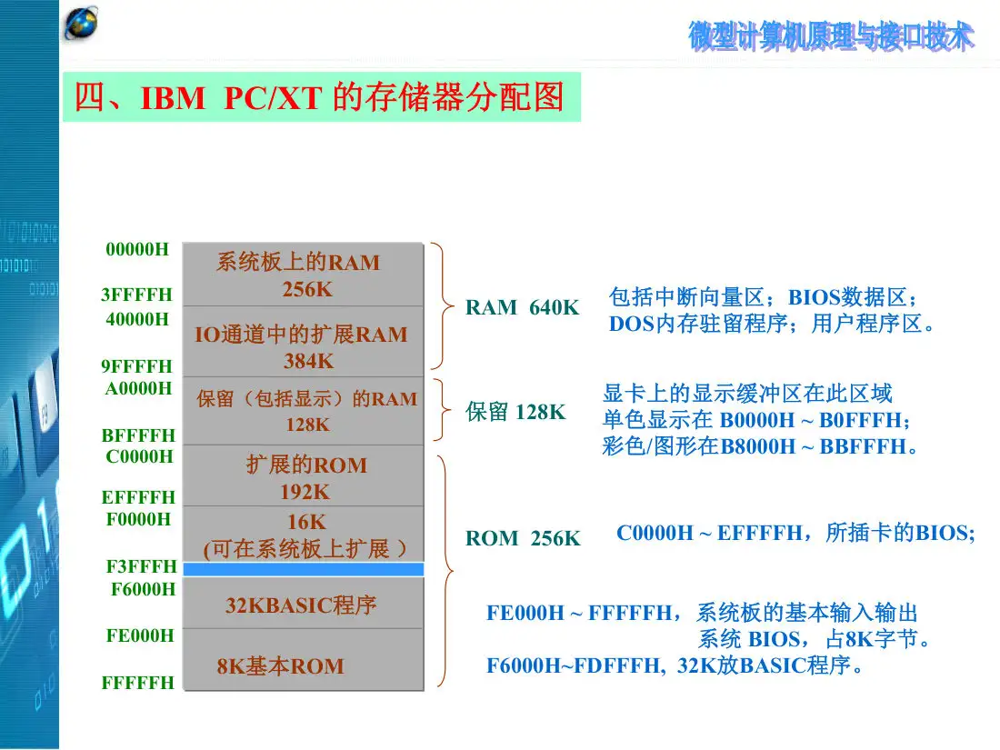

原文：

微型计算机原理与接口技术

四、IBM PC/XT 的存储器分配图

<table><tr><td>00000H</td><td>系统板上的RAM</td></tr><tr><td>3FFFFH</td><td>256K</td></tr><tr><td>40000H</td><td>IO通道中的扩展RAM</td></tr><tr><td>9FFFFH</td><td>384K</td></tr><tr><td>A0000H</td><td>保留(包括显示)的RAM</td></tr><tr><td>BFFFFH</td><td>128K</td></tr><tr><td>C0000H</td><td>扩展的ROM</td></tr><tr><td>EFFFFH</td><td>192K</td></tr><tr><td>F0000H</td><td>16K</td></tr><tr><td>F3FFFH</td><td>(可在系统板上扩展)</td></tr><tr><td>F6000H</td><td>32KBASIC程序</td></tr><tr><td>FE000H</td><td rowspan="2">8K基本ROM</td></tr><tr><td>FFFFH</td></tr></table>

包括中断向量区；BIOS数据区；DOS内存驻留程序；用户程序区。

保留 128K

显卡上的显示缓冲区在此区域单色显示在 B0000H \~ B0FFFH；彩色/图形在B8000H \~ BBFFFH。

ROM 256K C0000H \~ EFFFFH，所插卡的BIOS;

FE000H \~ FFFFFH，系统板的基本输入输出系统 BIOS，占8K字节。F6000H\~FDFFFH, 32K放BASIC程序。

6

### 第6章 学习重点

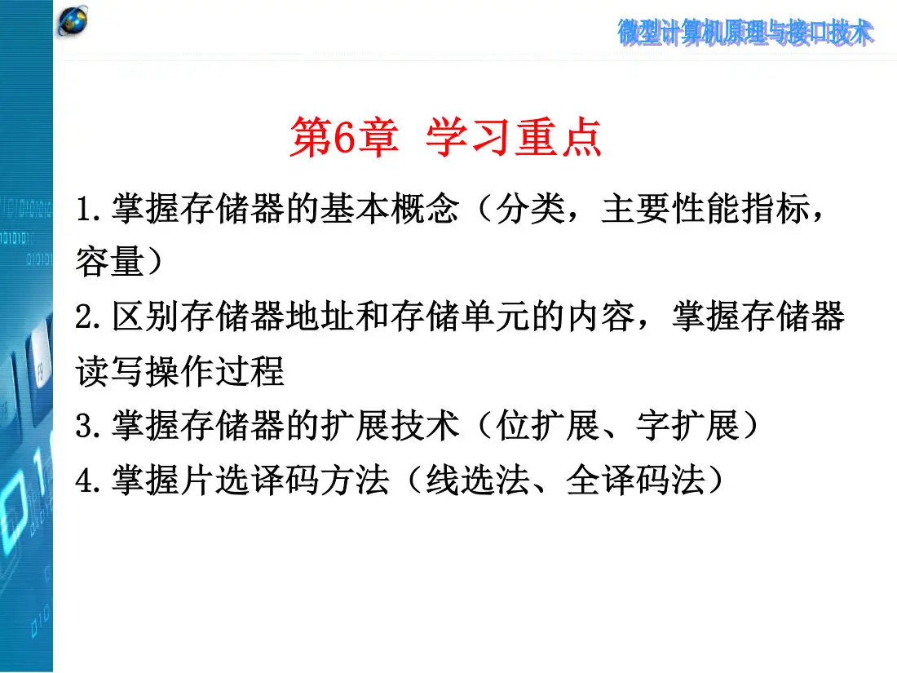

原文：

第6章 学习重点

1.掌握存储器的基本概念（分类，主要性能指标，容量）

2.区别存储器地址和存储单元的内容，掌握存储器读写操作过程

3.掌握存储器的扩展技术（位扩展、字扩展）

4.掌握片选译码方法（线选法、全译码法）

6

微型计算机原理与接口技术
