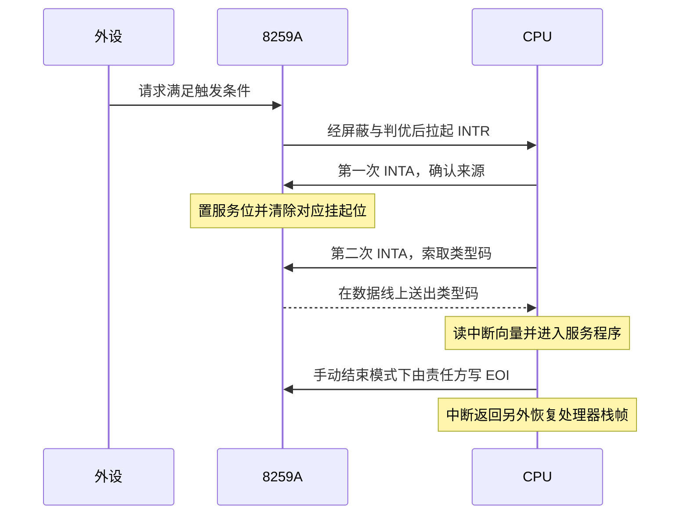
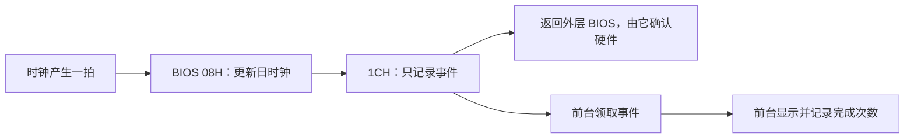

# 中断系统 8-2：从外设请求到系统时钟回调

这是旧课件的独立伴读，不转载图、题干或原程序。本文的 PC/AT、BIOS、DOS 约定不是现代机器或现行考纲的保证。器件行为见 [Intel 8259A 手册](https://www.scs.stanford.edu/26sp-cs212/pintos/specs/8259A.pdf)；向量操作见 [Microsoft MS-DOS 程序员参考手册](https://ftpmirror.your.org/pub/misc/bitsavers/pdf/microsoft/msdos_5/Microsoft_-_MS-DOS_Programmers_Reference_1991.pdf)。

## 一根 INTR 怎样处理多个外设？

处理器知道有人请求，却还需要知道「是谁、能不能等、从哪里处理」。若把外设简单合并成一根线，这些信息就会丢掉。8259A 把请求、屏蔽和在服务状态分开保存。

| 状态 | 寄存器 | 某位为 1 表示什么 |
|---|---|---|
| 挂起 | IRR | 有待响应的请求，不保证未屏蔽 |
| 屏蔽 | IMR | 禁止对应输入参加响应，不表示请求已取消 |
| 在服务 | ISR | 这一层已获确认而尚未结束，通常会阻挡同级和更低级 |

固定优先级下，较小的输入号靠前。判优电路比较未屏蔽的挂起请求与当前在服务层；选中后，控制逻辑才把 INT 送到 CPU 的 INTR。数据缓冲器收命令字、送类型码；片选查译码，A0 区分两个端口；CAS0–CAS2 用于选择被确认的从片。设备是否允许发请求、PIC 是否放行、CPU 的 IF 是否允许，是三个不同的问题。

**参考解答（第 10 页）。** 每接一个从片，就拿走主片的一条直接输入，换得从片的 8 条输入。$s$ 个从片能接 $(8-s)+8s=8+7s$ 条，其中 $0\le s\le8$。45 条用 5 个从片只能接 43 条；6 个从片可接 50 条，所以至少 1 主 6 从，共 7 片。1 主 1 从有 15 条外设输入；IRQ0 到 IRQ15 的编号不意味着级联占用的主片 IR2 也能独立给外设。1 主 8 从接满时是 64 条，不是 72 条。

**参考解答（第 18 页）。** 仅屏蔽 IR6、IR1 时，位权 64 加 2，掩码为 **42H**。若题目改成「在原配置上再屏蔽两路」，应对原值按位或 42H；如果只是让 IR3 开放，应对原值按位与 F7H 来清第 3 位；若要求只开放 IR0、IR1，其他全屏蔽，才直接写 FCH。见[端口编址](../../../topics/微机接口/duankou-bianzhi.md)和[按位逻辑指令](../../../topics/微机接口/suanlu-yunsuan.md)。

## 两次响应为何不是两次中断？

这是 8086/88 工作模式，不是所有处理器总线的通用规则。第一次响应确认来源，第二次给 CPU 类型码；CPU 依[中断向量表与栈帧](../../../topics/微机接口/zhongduan-xiangliang-yu-zhan.md)取得入口。EOI 清控制器的在服务状态，IRET 从 CPU 栈恢复程序和标志，不能把其中一个当作另一个的副作用。

**参考解答（第 30–42 页）。** 图中 IR0、IR6、IR7 同时到达，固定优先级，先前无人服务，仅 IR6 被屏蔽。IRR 初始 C1H；获选 IR0 后，第一回 INTA 使 IRR 变 C0H、ISR 置 01H，第二回传 08H。IR0 在服务期间，IR7 虽已挂起也不能抢占；其请求仍有效时，IR0 结束后才重新判优。第 42 页的返回地址来自**堆栈**；向量表是入口地址，不是原来从哪里被打断。

**订正。** 第 41 页正文将尚待服务的 IR7 写成 ISR7；是否仍在等待要看 IRR7，ISR7 表示已获确认。==屏蔽不等于清除，响应不等于结束。==

## 控制器选了请求，为什么 CPU 仍可能不响应？

| 决策 | 传统 PC/AT 教学例 | 改变配置的边界 |
|---|---|---|
| 触发 | 常用上升沿 | 电平模式中设备不撤请求可再次触发 |
| 屏蔽 | IMR 控制输入；IF 控制 CPU | 特殊屏蔽可改变在服务优先级的阻挡关系 |
| 判优 | 常规全嵌套，固定 IR0 最高 | 轮转可把刚服务的来源排到最低；级联还受主片支配 |
| 结束 | 服务责任方写 EOI | AEOI 在最后一个响应脉冲结束时自动清位 |
| 配置 | BIOS 初始设置；应用通常只调整屏蔽与结束 | ICW1 设触发与构型；ICW2 给向量基址；ICW3 描述级联；需要 ICW4 时再选处理器模式等 |

缓冲方式与优先级是不同维度：非缓冲方式用 SP/EN 输入区分主从；缓冲方式下该引脚输出总线缓冲使能，主从角色改由配置字确定。特殊全嵌套可允许同一个从片内更高级请求经主片再次进入，结束时先清从片并检查其在服务状态是否为空，再决定是否清主片级联位。

CPU 在可接受中断的边界、IF 允许且没有须优先处理的事件时才响应 INTR；DMA 占总线时也可能暂缓相关总线操作，不能把 DMA 与 CPU 的中断都放进同一张 PIC 优先级表。

**补充（第 48 页）。** 图上的 NMI 和 INTR 是两个输入，非屏蔽请求走 NMI。传统实模式下 NMI 对应固定类型 2，不从 8259A 取码，不受 IF 或 PIC 屏蔽位限制。非屏蔽不等于可以无限嵌套，具体触发与嵌套规则以处理器为准。

### PC/AT 例的地址和 EOI 责任

| 设备 | 命令口（含 EOI） | 数据口（含 IMR） | 本例的向量范围 |
|---|---|---|---|
| 主片 | 20H | 21H | 08H–0FH，IR2 用于级联 |
| 从片 | A0H | A1H | 70H–77H |

主片 IR0 常接日时钟、IR1 键盘、IR3/IR4 串行口、IR5/IR7 并行口、IR6 软驱；从片 IR0 常接实时时钟，IR5、IR6 在此例是协处理器与硬盘。分配是机器约定，不是芯片的固定地址。主片先把整个从片看作 IR2，因此默认 IR0、IR1 仍排在它之前；若选中从片，再辨其内部优先级。IRQ9 是从片 IR1，PIC 给 71H；旧 BIOS 可转交兼容的 0AH，但 PIC 没有因此改码。

**补充（第 63 页）。** 原例先写主片再写从片。常规级联处理宜先清从片再释放主片级联位，避免在尚未清除下游时先解开上游；两片都须完成确认，不应把原例用于允许提前嵌套的路径。传统地址下非特定 EOI 值同为 20H，依序送 A0H、20H。直接来自主片的普通请求只确认主片。既让现成 BIOS 服务确认又自行再确认，会错误清掉别的在服务位；自动结束和特殊嵌套模式也不能机械套用这一条。

## 日时钟：08H 是硬件入口，1CH 是软件回调

旧 PC/AT 例中，PIT 第 0 通道约每 55 ms 令主片 IR0 发请求。BIOS 在 08H 硬件服务中更新从 0040:006C 起的四字节计数，处理软驱马达定时；原件的日滚动门槛是 001800B0H；不能只把高字数到 24 当作精确的一天，低字也参与计数。传统机可在启动时从 CMOS 实时时钟取得初值。它调用 INT 1CH 供扩展，再完成硬件确认与返回。这不是从片 IR0 的实时时钟服务。也不要把某 BIOS 的入口 DS 值当成自己的数据段契约。

| 选择 | 谁保留哪些职责 |
|---|---|
| 扩展 1CH | 保存现场、保持前代回调约定，按约定返回 BIOS；外层 BIOS 仍负责硬件 EOI |
| 接管 08H 后链到旧处理 | 恢复现场，保持原硬件栈帧并远跳转；旧处理继续维护时钟、回调、EOI 和返回 |
| 完全替换 08H | 新处理须独立维护原 BIOS 责任并完成 EOI 和中断返回；只换入口不会自动保留旧行为 |

向量安装、恢复放在前台：DOS INT 21H 的 AH=35H 读取 AL 指定类型的旧向量，返回 ES:BX；AH=25H 写入 DS:DX 指定的新向量。退出前恢复旧向量。如果地址变量在旧 DS，先取齐两个字再改 DS。链转 08H 需要保留远指针及原中断帧，不能把远跳转写成仅改变偏移的近跳转。原件使用 PUSHA 的示例不适用于纯 8086，后者要逐一保存实际会改动的寄存器。见[堆栈](../../../topics/微机接口/duizhan-caozuo.md)和[BIOS 与 DOS 调用](../../../topics/微机接口/dos-bios-diaoyong.md)。

**参考解答（第 73–103 页两种时钟做法）。** 若只需每隔约一秒处理一次、累计十次，不必改基础时钟。优先用 1CH，08H 链转用于理解责任边界。两者均可让服务程序只记录拍数和待处理事件，前台领取事件、显示，完成十次后还原向量。共享状态须按处理器字宽和并发模型取得一致快照；不要反复覆盖同一个布尔标志，否则前台迟到时多条事件会合并。按常见的 1,193,182 Hz、除数 65,536 计算，$18\times65536/1193182\approx0.989\ \mathrm{s}$。需要减小长期漂移时，每拍累计 65,536 个输入时钟，以 1,193,182 为阈值并保留余数，事件间隔在 18 或 19 拍之间变化，误差仍受一个基础节拍的粒度限制。

> [!WARNING]
> ==换向量不是换计时来源。== 第 74 页把短于一拍的任务归给 08H，但只换入口而不改变 PIT，仍不能突破这一拍。若实际改频还要兼顾旧 BIOS 时钟与恢复。第 75 页的 EOI 说明适合完全替换，第 102 页链给旧服务时 EOI 仍属旧服务。第 90、103 页的 DOS 显示只宜分析历史演示，不宜当成通用作法；前台可能正在 DOS，一些 BIOS 服务也未必可重入，宜把显示等长操作留在前台。
