# 《微型计算机接口技术》第8-2章 中断系统（课件）

原件的每一页，下面附识别出的文字。

### 微型计算机原理与接口技术

原文：

微型计算机原理与接口技术

第八章 中断的基本概念

The image contains four distinct icons: a magnifying glass over a globe, a keyboard with 'Close' labels, an @ symbol, and a golden ingot of eggs. There are no text or numerical data present in the image. Therefore, the correct OCR output is an empty string.

南京邮电大学计算机学院

南京邮電大學
Nanjing University of Posts and Telecommunications

### 中断概念、内部/外部中断

原文：

中断概念、内部/外部中断

中断类型码、中断向量

中断响应过程

多级中断管理

✿ 80X86中断相关指令

回顾：中断

南京邮电大学
Nanjing University of Posts and Telecommunications

### 中断控制器8259A

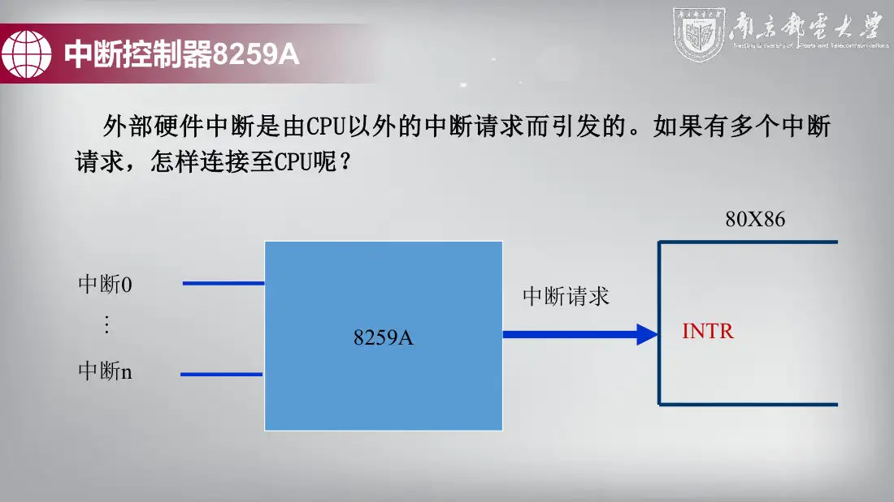

原文：

外部硬件中断是由CPU以外的中断请求而引发的。如果有多个中断请求，怎样连接至CPU呢？

中断控制器8259A

南京邮电大学
Nanjing University of Posts and Telecommunications

### 知识要点

原文：

知识要点

8259A功能

✿ 8259A主从级联

中断控制器8259A功能

南京邮电大学
Nanjing University of Posts and Telecommunications

### 一、8259A功能

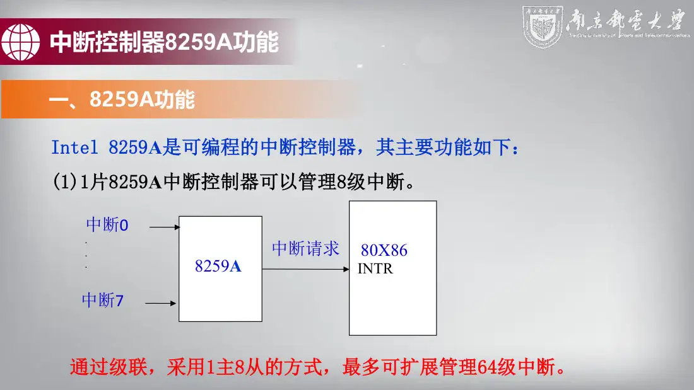

原文：

一、8259A功能

Intel 8259A是可编程的中断控制器，其主要功能如下：

(1) 1片8259A中断控制器可以管理8级中断。

通过级联，采用1主8从的方式，最多可扩展管理64级中断。

中断控制器8259A功能

南京邮电大学
Nanjing University of Posts and Telecommunications

### (2) 每一级中断都可以通过设置内部屏蔽字进行屏蔽或允许。

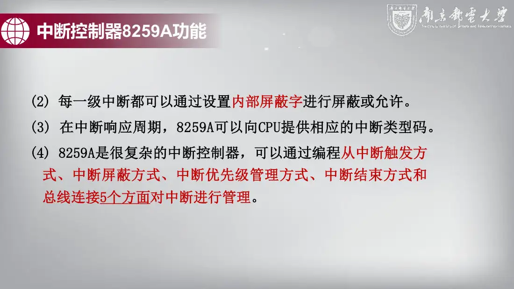

原文：

(2) 每一级中断都可以通过设置内部屏蔽字进行屏蔽或允许。

(3) 在中断响应周期，8259A可以向CPU提供相应的中断类型码。

(4) 8259A是很复杂的中断控制器, 可以通过编程从中断触发方式、中断屏蔽方式、中断优先级管理方式、中断结束方式和总线连接5个方面对中断进行管理。

中断控制器8259A功能

南京邮电大学
Nanjing University of Posts and Telecommunications

### 二、8259A主从级联

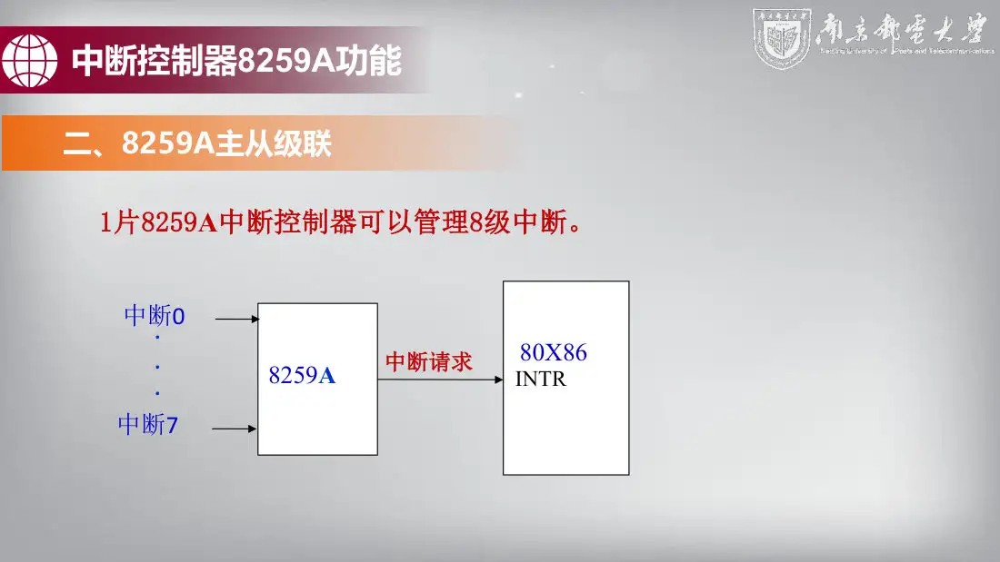

原文：

二、8259A主从级联

1片8259A中断控制器可以管理8级中断。

$$
\begin{array}{l} \text {中断0} \\ \text {中断7} \end{array} \xrightarrow {\text {中断请求}} \boxed {8 2 5 9 A} \xrightarrow {\text {中断请求}} \boxed {8 0 X 8 6} \boxed {\text {INTR}}
$$

中断控制器8259A功能

南京邮电大学
Nanjing University of Posts and Telecommunications

### 二、8259A主从级联

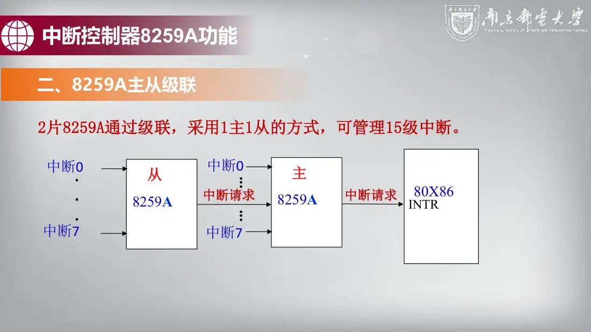

原文：

二、8259A主从级联

2片8259A通过级联，采用1主1从的方式，可管理15级中断。

$$
\begin{array}{c c c} \text {中断0} & \longrightarrow & \text {从} \\ \cdot & \longrightarrow & \text {8259A} \\ \cdot & \longrightarrow & \text {中断请求} \\ \cdot & \longrightarrow & \text {主} \\ \text {中断7} & \longrightarrow & \text {8259A} \\ \text {中断0} & \longrightarrow & \text {中断请求} \\ \text {中断7} & \longrightarrow & \text {8259A} \\ \text {中断请求} & \longrightarrow & \text {80X86 INTR} \\ \end{array}
$$

中断控制器8259A功能

南京邮电大学
Nanjing University of Posts and Telecommunications

### 二、8259A主从级联

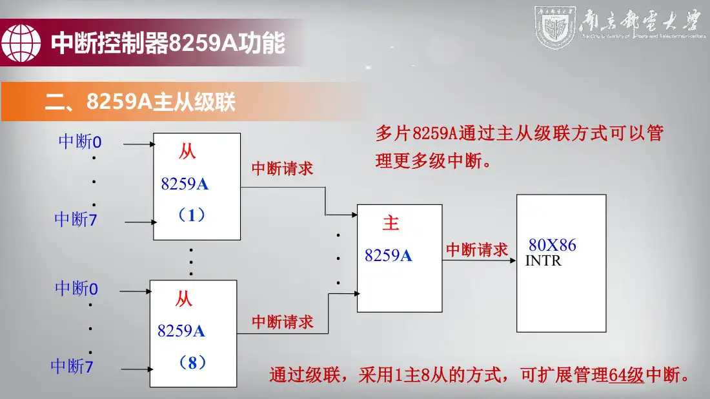

原文：

二、8259A主从级联

中断0

中断请求

中断7

中断0

中断7

中断请求

(8)

多片8259A通过主从级联方式可以管理更多级中断。

中断请求

通过级联，采用1主8从的方式，可扩展管理64级中断。

中断控制器8259A功能

南京邮电大学
Nanjing University of Posts and Telecommunications

### 外设有45个中断源，至少需要（）片8259A级联。

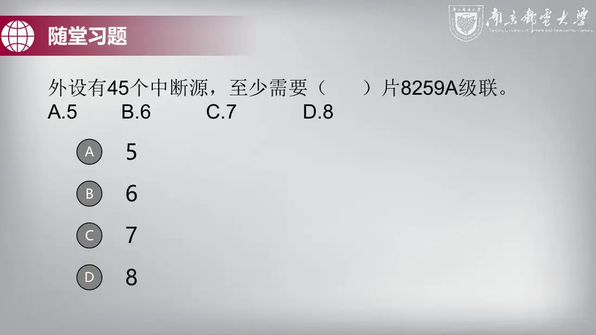

原文：

外设有45个中断源，至少需要（）片8259A级联。
A.5 B.6 C.7 D.8
A 5
B 6
C 7
D 8

随堂习题

南京邮电大学
Nanjing University of Posts and Telecommunications
南京邮電大學

### 知识点小结

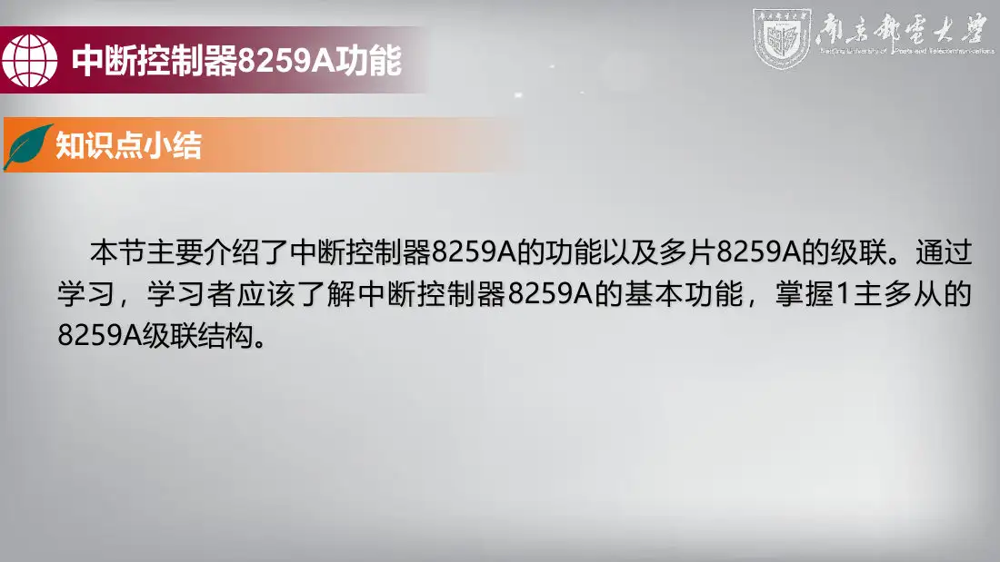

原文：

知识点小结

本节主要介绍了中断控制器8259A的功能以及多片8259A的级联。通过学习，学习者应该了解中断控制器8259A的基本功能，掌握1主多从的8259A级联结构。

中断控制器8259A功能

南京邮电大学
Nanjing University of Posts and Telecommunications

### 知识要点

原文：

知识要点

✿ 8259A内部结构

中断控制器8259A功能及内部结构

南京邮电大学
Nanjing University of Posts and Telecommunications

### 一、8259A内部结构

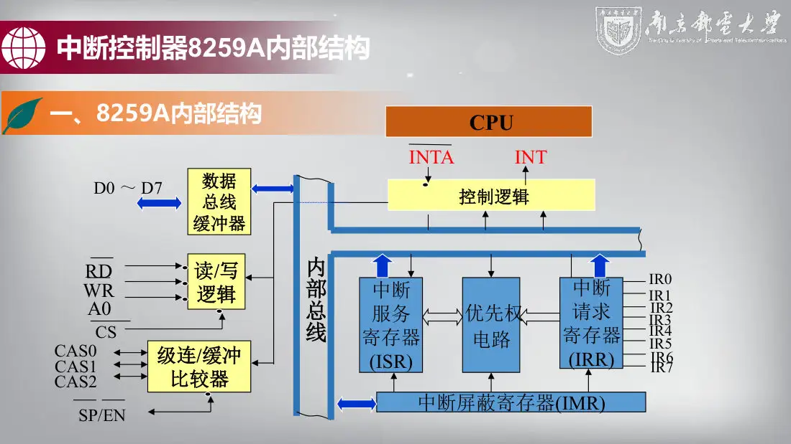

原文：

一、8259A内部结构

中断控制器8259A内部结构

南京邮电大学
Nanjing University of Posts and Telecommunications

### (1) 中断请求寄存器 ( IRR )

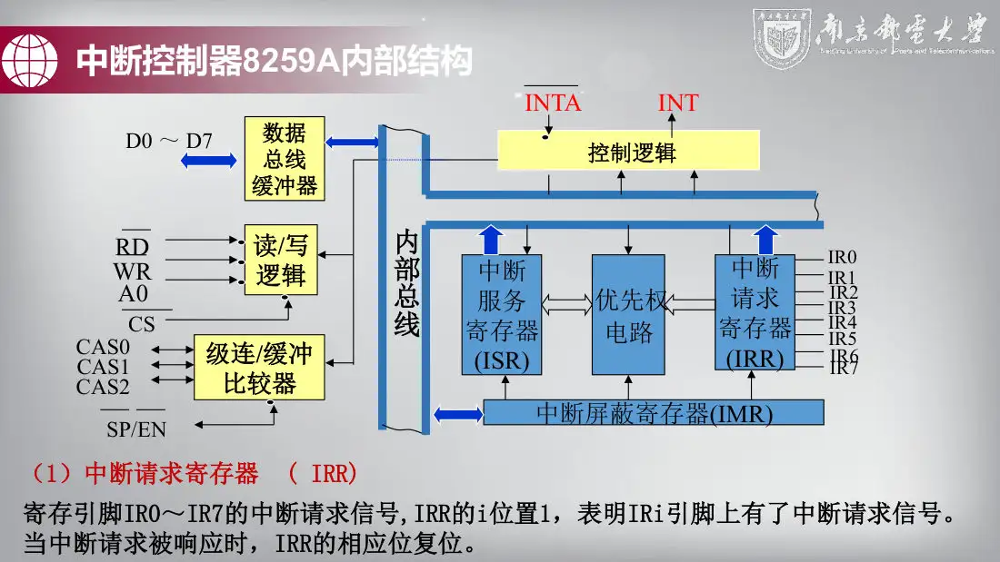

原文：

(1) 中断请求寄存器 ( IRR )

寄存引脚IRO～IR7的中断请求信号，IRR的i位置1，表明IRi引脚上有了中断请求信号。当中断请求被响应时，IRR的相应位复位。

中断控制器8259A内部结构

南京邮电大学
Nanjing University of Posts and Telecommunications

### (2) 中断屏蔽寄存器 (IMR)

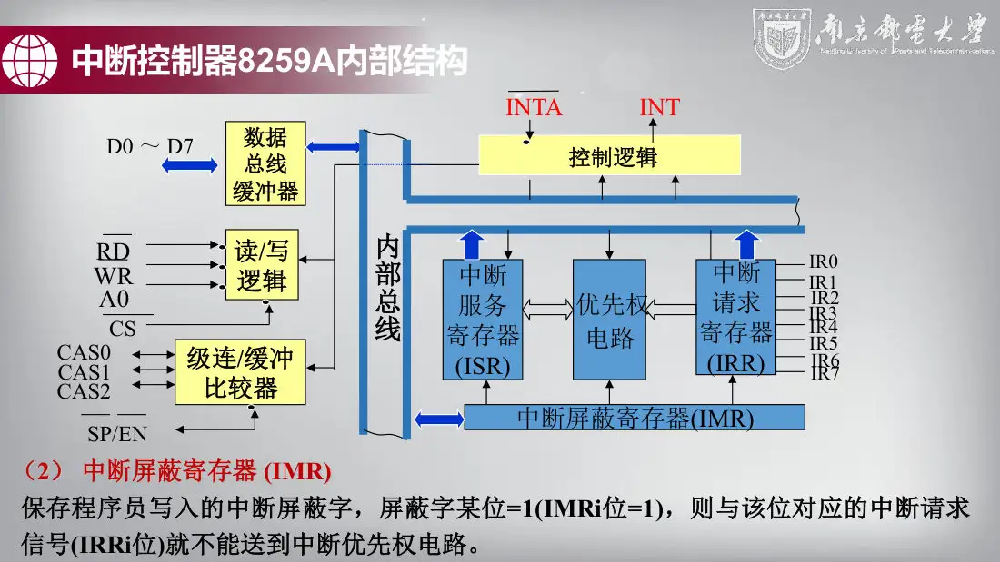

原文：

(2) 中断屏蔽寄存器 (IMR)

保存程序员写入的中断屏蔽字，屏蔽字某位=1(IMRi位=1)，则与该位对应的中断请求信号(IRRi位)就不能送到中断优先权电路。

中断控制器8259A内部结构

南京邮电大学
Nanjing University of Posts and Telecommunications

### 优先权电路

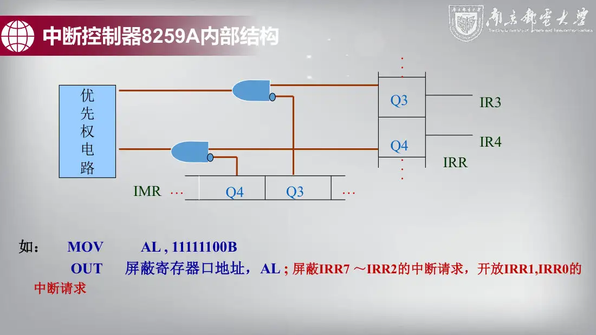

原文：

优先权电路

如: MOV AL, 11111100B

OUT 屏蔽寄存器口地址，AL；屏蔽IRR7～IRR2的中断请求，开放IRR1,IRR0的中断请求

中断控制器8259A内部结构

南京邮电大学
Nanjing University of Posts and Telecommunications

### 优先权电路

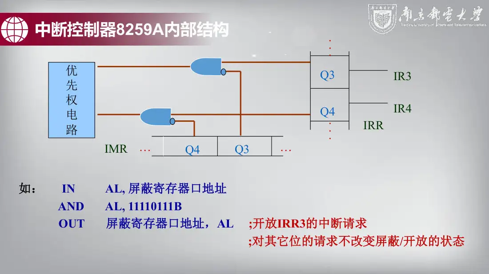

原文：

优先权电路

如: IN AL, 屏蔽寄存器口地址

AND AL, 11110111B

OUT 屏蔽寄存器口地址，AL ;开放IRR3的中断请求

;对其它位的请求不改变屏蔽/开放的状态

中断控制器8259A内部结构

南京邮电大学
Nanjing University of Posts and Telecommunications

### A.42H    B.FFH    C.00H    D.BDH

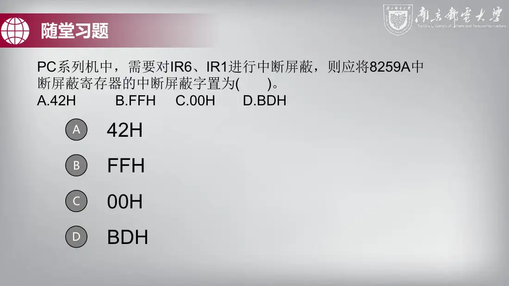

原文：

PC系列机中，需要对IR6、IR1进行中断屏蔽，则应将8259A中断屏蔽寄存器的中断屏蔽字置为( )。
A.42H    B.FFH    C.00H    D.BDH
A 42H
B FFH
C 00H
D BDH

随堂习题

南京邮电大学
Nanjing University of Posts and Telecommunications
南京邮电大学

### (3) 优先权电路(排队电路)

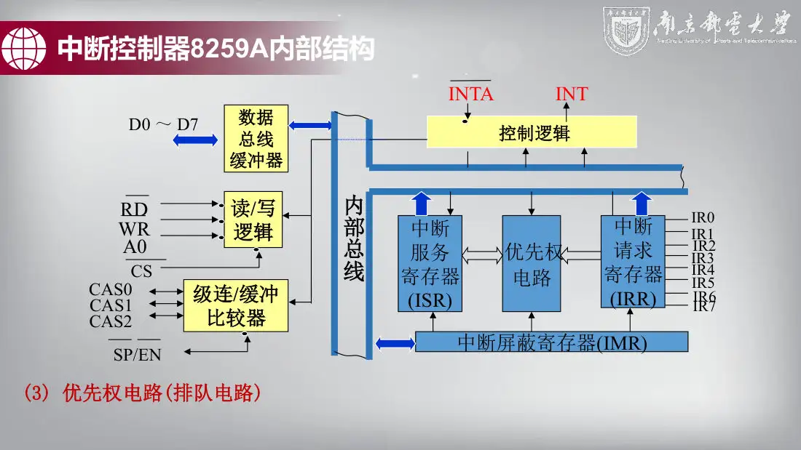

原文：

(3) 优先权电路(排队电路)

中断控制器8259A内部结构

南京邮电大学
Nanjing University of Posts and Telecommunications

### 作用：

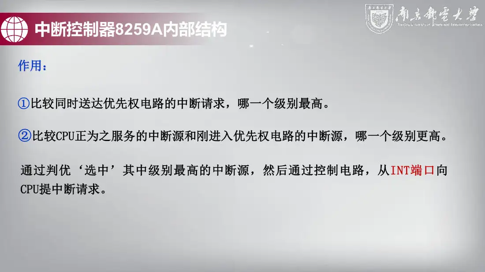

原文：

作用：

①比较同时送达优先权电路的中断请求，哪一个级别最高。

②比较CPU正为之服务的中断源和刚进入优先权电路的中断源，哪一个级别更高。

通过判优‘选中’其中级别最高的中断源，然后通过控制电路，从INT端口向CPU提中断请求。

中断控制器8259A内部结构

南京邮电大学
Nanjing University of Posts and Telecommunications

### 中断控制器8259A内部结构

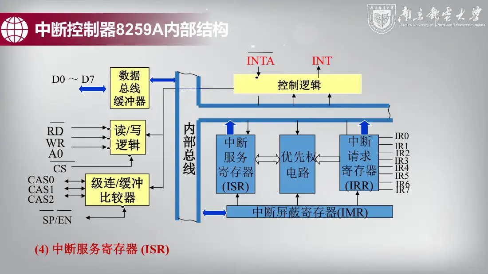

原文：

中断控制器8259A内部结构

南京邮电大学
Nanjing University of Posts and Telecommunications

### ISR: 8位寄存器，ISRi位与IRRi位一一对应。

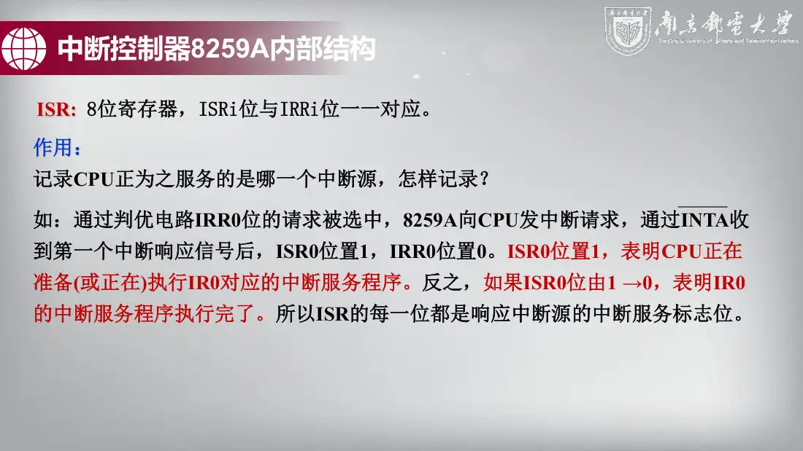

原文：

ISR: 8位寄存器，ISRi位与IRRi位一一对应。

作用:

记录CPU正为之服务的是哪一个中断源，怎样记录？

如：通过判优电路IRR0位的请求被选中，8259A向CPU发中断请求，通过INTA收到第一个中断响应信号后，ISR0位置1，IRR0位置0。ISR0位置1，表明CPU正在准备(或正在)执行IR0对应的中断服务程序。反之，如果ISR0位由 $1 \rightarrow 0$ ，表明IR0的中断服务程序执行完了。所以ISR的每一位都是响应中断源的中断服务标志位。

中断控制器8259A内部结构

南京邮电大学
Nanjing University of Posts and Telecommunications

### (5) 中断控制电路（控制逻辑）

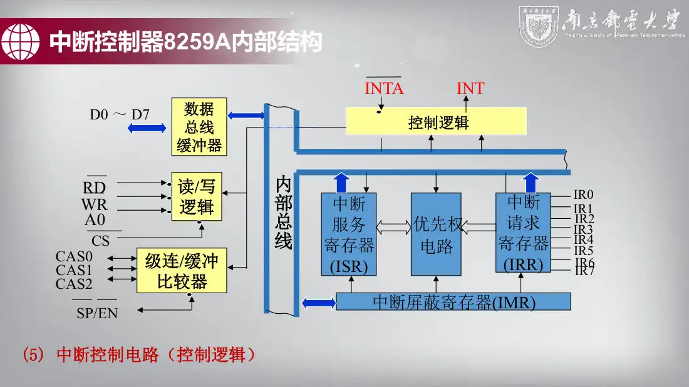

原文：

(5) 中断控制电路（控制逻辑）

中断控制器8259A内部结构

南京邮电大学
Nanjing University of Posts and Telecommunications

### 作用:

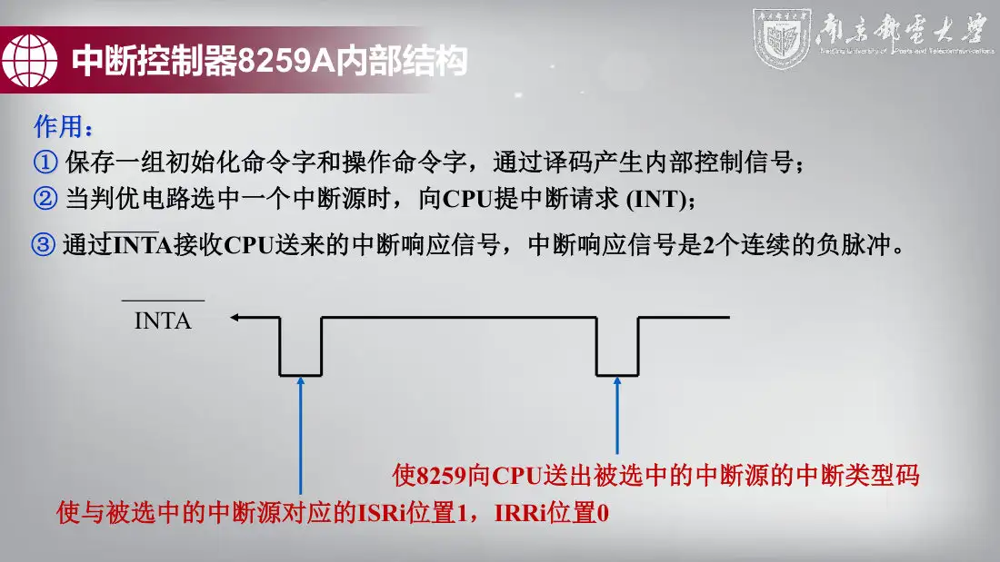

原文：

作用:

① 保存一组初始化命令字和操作命令字，通过译码产生内部控制信号；

② 当判优电路选中一个中断源时，向CPU提中断请求(INT);

③ 通过INTA接收CPU送来的中断响应信号，中断响应信号是2个连续的负脉冲。

使与被选中的中断源对应的ISRi位置1，IRRi位置0

中断控制器8259A内部结构

南京邮电大学
Nanjing University of Posts and Telecommunications

### (6) 数据总线缓冲器

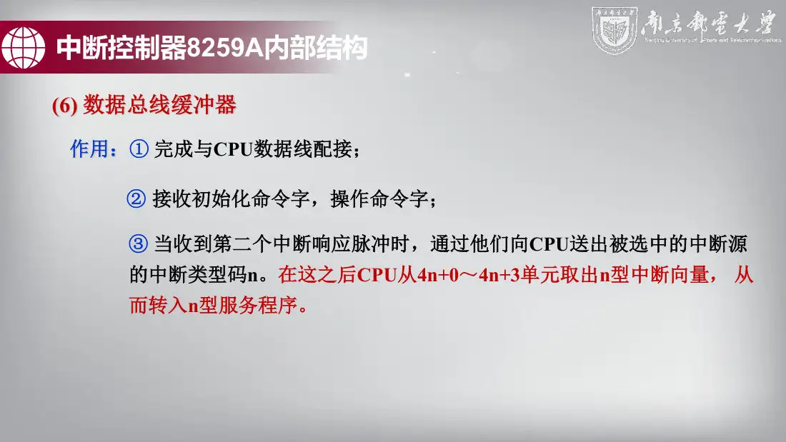

原文：

(6) 数据总线缓冲器

作用：① 完成与CPU数据线配接；

② 接收初始化命令字，操作命令字；

③ 当收到第二个中断响应脉冲时，通过他们向CPU送出被选中的中断源的中断类型码n。在这之后CPU从4n+0～4n+3单元取出n型中断向量，从而转入n型服务程序。

中断控制器8259A内部结构

南京邮电大学
Nanjing University of Posts and Telecommunications

### (7) 读/写控制模块

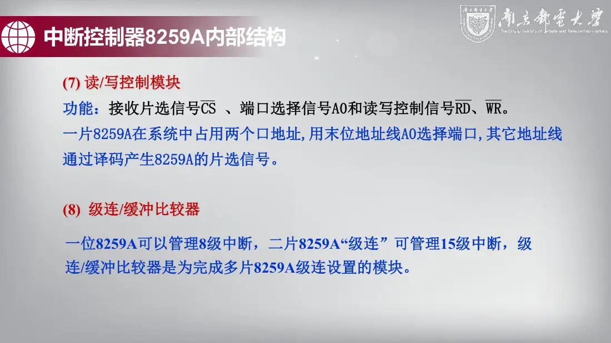

原文：

(7) 读/写控制模块

功能：接收片选信号 $\overline{\mathrm{CS}}$ 、端口选择信号AO和读写控制信号 $\overline{\mathrm{RD}}$ 、 $\overline{\mathrm{WR}}$ 。一片8259A在系统中占用两个口地址,用末位地址线AO选择端口,其它地址线通过译码产生8259A的片选信号。

(8) 级连/缓冲比较器

一位8259A可以管理8级中断，二片8259A“级连”可管理15级中断，级连/缓冲比较器是为完成多片8259A级连设置的模块。

中断控制器8259A内部结构

南京邮电大学
Nanjing University of Posts and Telecommunications

### 知识点小结

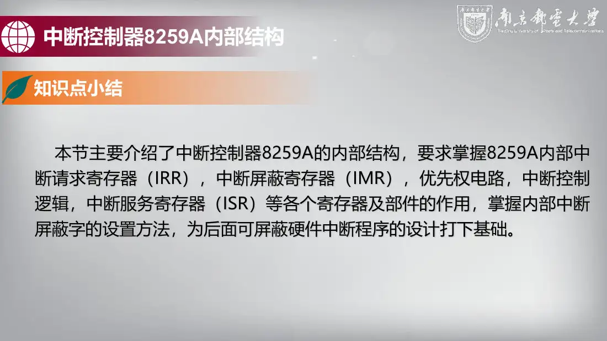

原文：

知识点小结

本节主要介绍了中断控制器8259A的内部结构，要求掌握8259A内部中断请求寄存器（IRR），中断屏蔽寄存器（IMR），优先权电路，中断控制逻辑，中断服务寄存器（ISR）等各个寄存器及部件的作用，掌握内部中断屏蔽字的设置方法，为后面可屏蔽硬件中断程序的设计打下基础。

中断控制器8259A内部结构

南京邮电大学
Nanjing University of Posts and Telecommunications

### 二、8259A的中断过程-CPU响应可屏蔽硬件中断的过程

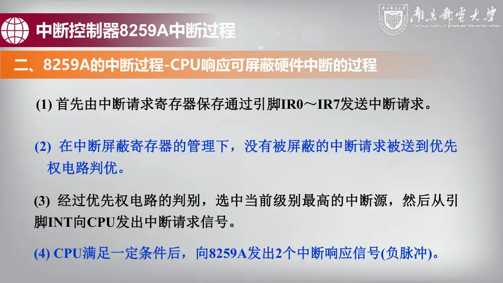

原文：

二、8259A的中断过程-CPU响应可屏蔽硬件中断的过程

(1) 首先由中断请求寄存器保存通过引脚IR0～IR7发送中断请求。

(2) 在中断屏蔽寄存器的管理下，没有被屏蔽的中断请求被送到优先权电路判优。

(3) 经过优先权电路的判别，选中当前级别最高的中断源，然后从引脚INT向CPU发出中断请求信号。

(4) CPU满足一定条件后，向8259A发出2个中断响应信号(负脉冲)。

中断控制器8259A中断过程

南京邮电大学
Nanjing University of Posts and Telecommunications

### 中断控制器8259A中断过程

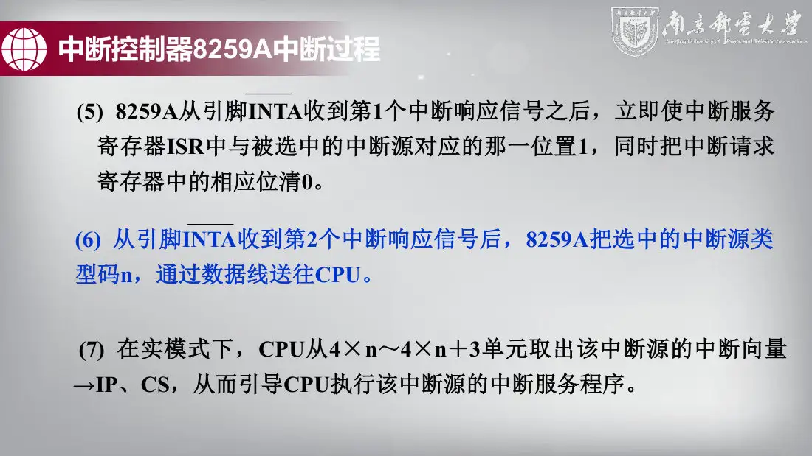

原文：

(5) 8259A从引脚INTA收到第1个中断响应信号之后，立即使中断服务寄存器ISR中与被选中的中断源对应的那一位置1，同时把中断请求寄存器中的相应位清0。

(6) 从引脚INTA收到第2个中断响应信号后，8259A把选中的中断源类型码n，通过数据线送往CPU。

(7) 在实模式下，CPU从 $4 \times n \sim 4 \times n + 3$ 单元取出该中断源的中断向量 $\rightarrow$ IP、CS，从而引导CPU执行该中断源的中断服务程序。

中断控制器8259A中断过程

南京邮电大学
Nanjing University of Posts and Telecommunications

### 中断控制器8259A中断过程

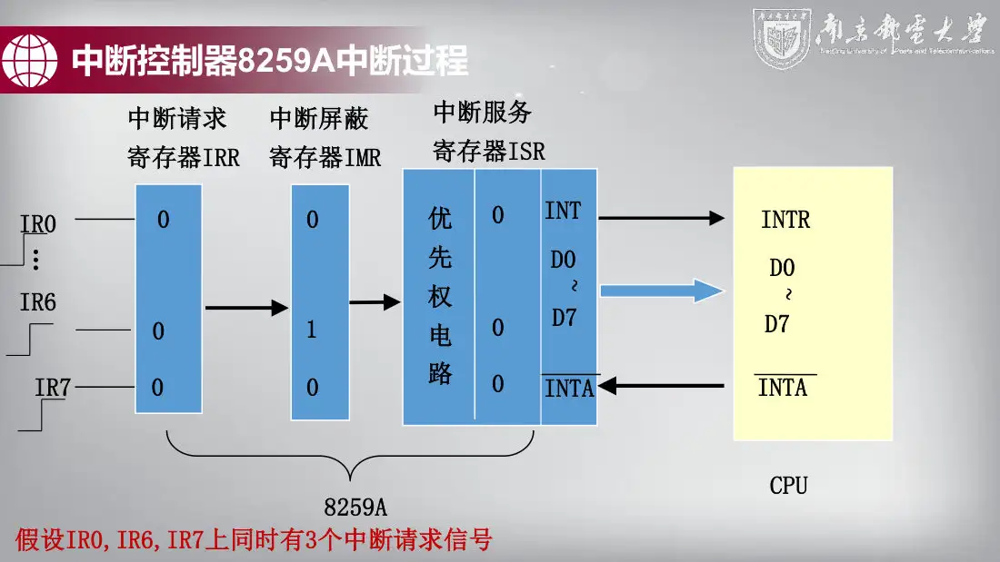

原文：

中断控制器8259A中断过程

南京邮电大学
Nanjing University of Posts and Telecommunications

### 中断屏蔽

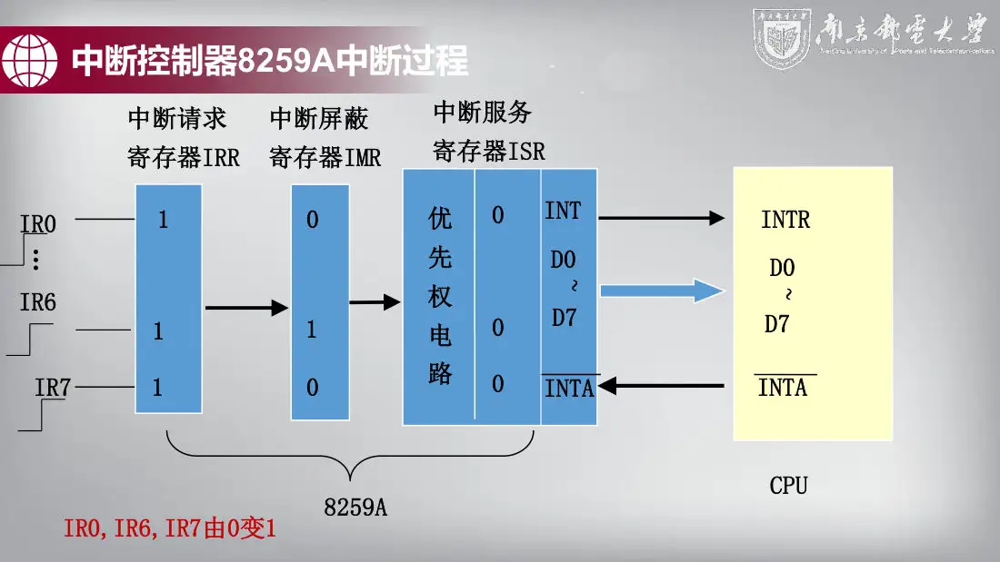

原文：

中断屏蔽

中断控制器8259A中断过程

南京邮电大学
Nanjing University of Posts and Telecommunications

### 中断控制器8259A中断过程

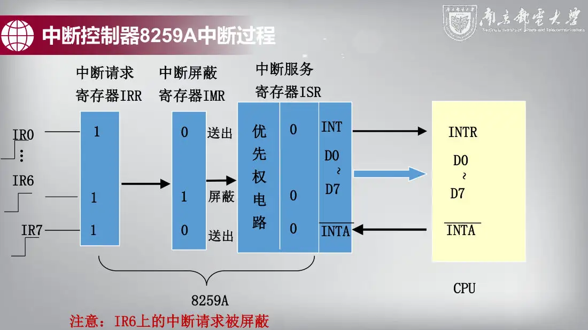

原文：

中断控制器8259A中断过程

南京邮电大学
Nanjing University of Posts and Telecommunications

### 中断请求

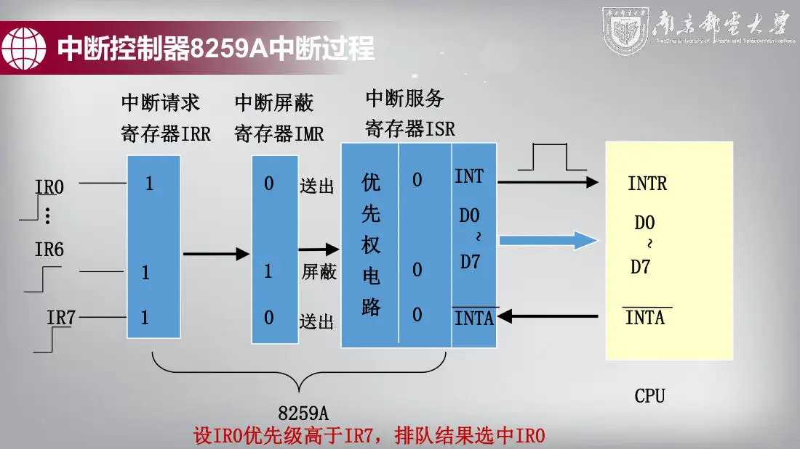

原文：

中断请求

寄存器IRR

中断屏蔽

寄存器IMR

送出

屏蔽

0

送出

优

先

权

电

路

INT

DO

INTR

DO

D7

INTA

8259A

CPU

设IRO优先级高于IR7，排队结果选中IRO

中断控制器8259A中断过程

南京邮电大学
Nanjing University of Posts and Telecommunications

### 中断控制器8259A中断过程

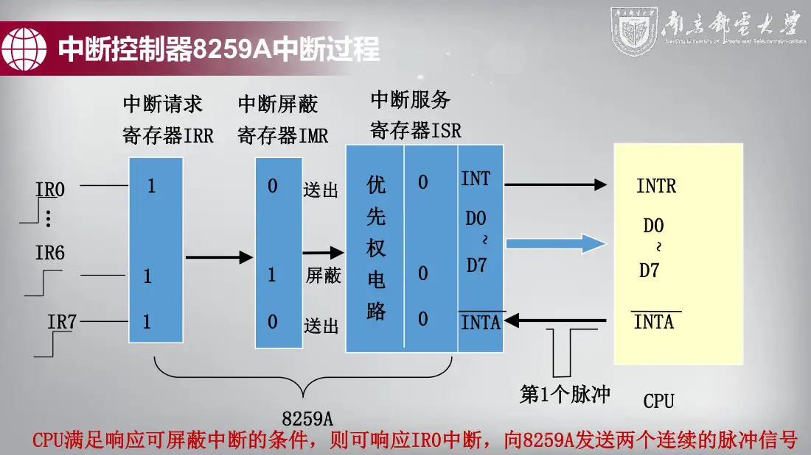

原文：

中断控制器8259A中断过程

南京邮电大学
Nanjing University of Posts and Telecommunications

### CPU

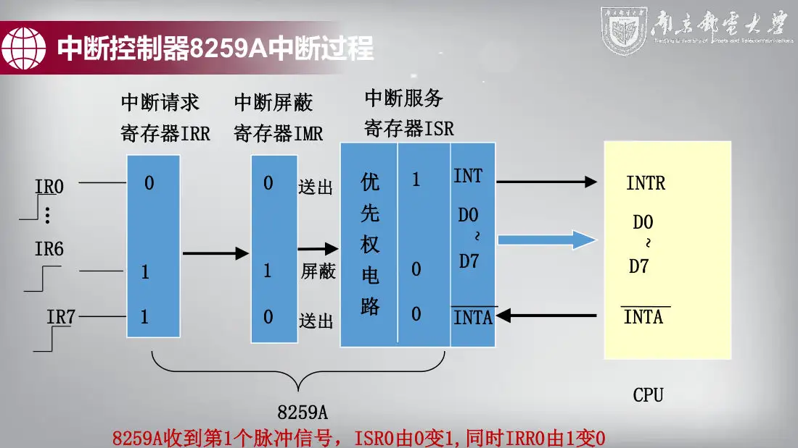

原文：

CPU

8259A

中断屏蔽

寄存器IRR

寄存器IMR

送出

INT

先

DO

INTR

权

屏蔽

电

送出

路

INTA

8259A收到第1个脉冲信号，ISRO由0变1, 同时IRRO由1变0

中断控制器8259A中断过程

南京邮电大学
Nanjing University of Posts and Telecommunications

### 中断请求

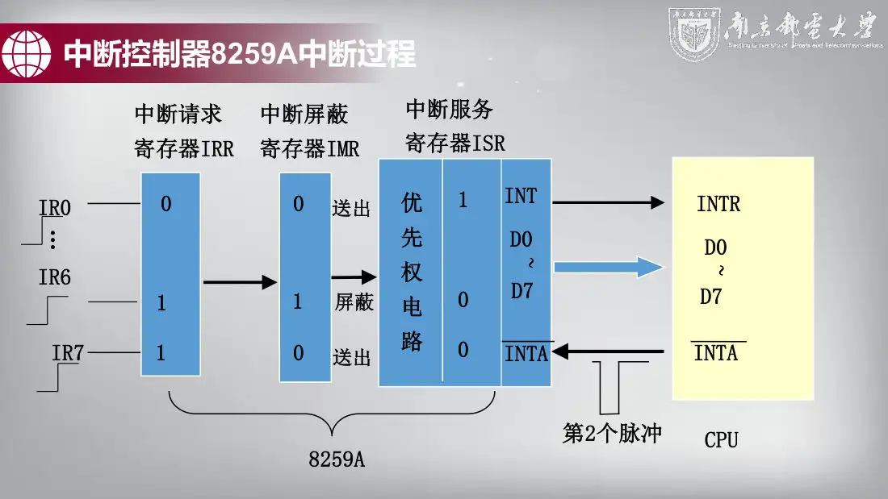

原文：

中断请求

寄存器IRR

中断屏蔽

寄存器IMR

送出

INT

先

DO

INTR

DO

屏蔽

权

电

D7

D7

0

送出

路

INTA

INTA

8259A

第2个脉冲

CPU

中断控制器8259A中断过程

南京邮电大学
Nanjing University of Posts and Telecommunications

### 8259A

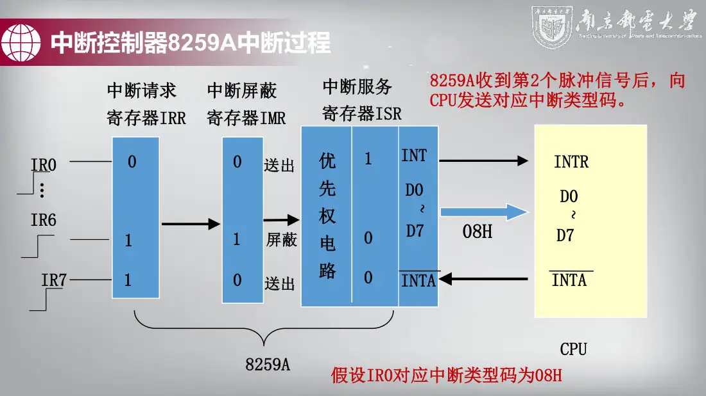

原文：

8259A

8259A收到第2个脉冲信号后，向CPU发送对应中断类型码。

CPU

中断控制器8259A中断过程

南京邮电大学
Nanjing University of Posts and Telecommunications

### CPU

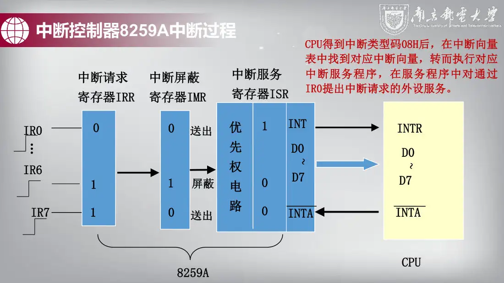

原文：

CPU

CPU得到中断类型码08H后，在中断向量表中找到对应中断向量，转而执行对应中断服务程序，在服务程序中对通过IRO提出中断请求的外设服务。

南京邮电大学
Nanjing University of Posts and Telecommunications

中断控制器8259A中断过程

### 中断请求

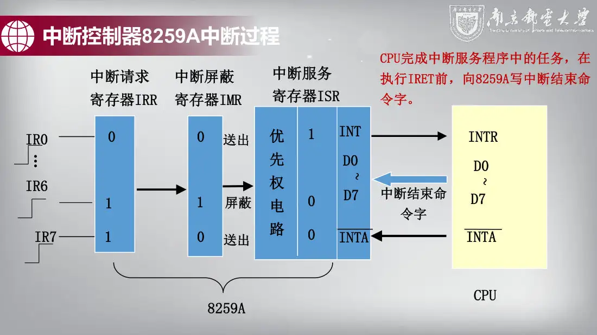

原文：

中断请求
寄存器IRR中断屏蔽

寄存器IMR中断服务寄存器ISR

送出

CPU完成中断服务程序中的任务，在执行IRET前，向8259A写中断结束命令字。

中断结束命令字

INTA

CPU

中断控制器8259A中断过程

南京邮电大学
Nanjing University of Posts and Telecommunications

### 中断服务寄存器ISR

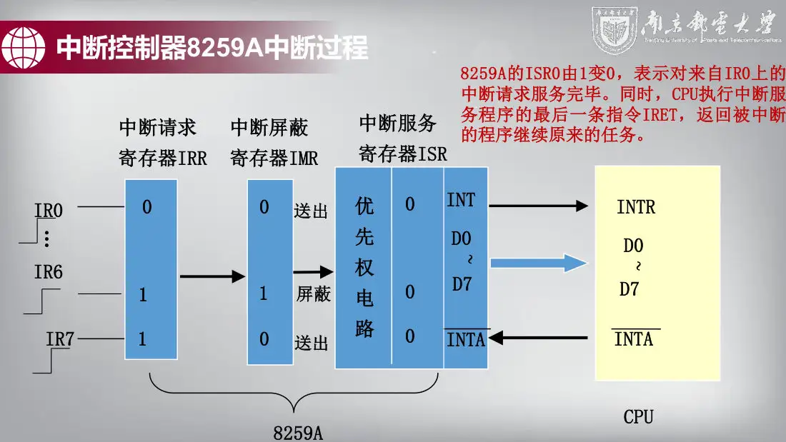

原文：

中断服务寄存器ISR

8259A的ISRO由1变0，表示对来自IRO上的中断请求服务完毕。同时，CPU执行中断服务程序的最后一条指令IRET，返回被中断的程序继续原来的任务。

中断控制器8259A中断过程

南京邮电大学
Nanjing University of Posts and Telecommunications

### 中断服务

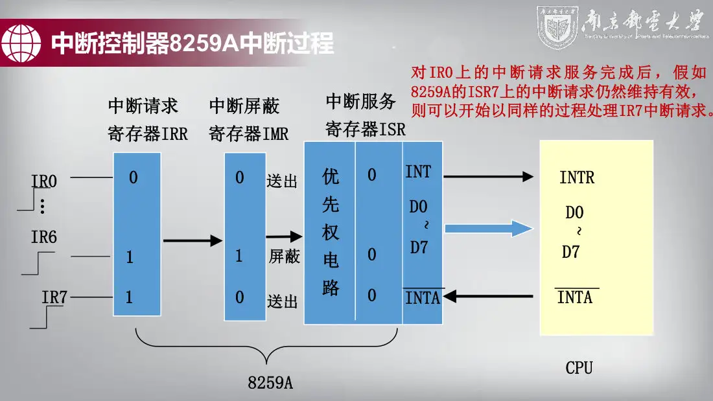

原文：

中断服务
寄存器ISR

对IRO上的中断请求服务完成后，假如8259A的ISR7上的中断请求仍然维持有效，则可以开始以同样的过程处理IR7中断请求。

中断控制器8259A中断过程

南京邮电大学
Nanjing University of Posts and Telecommunications

### 提交

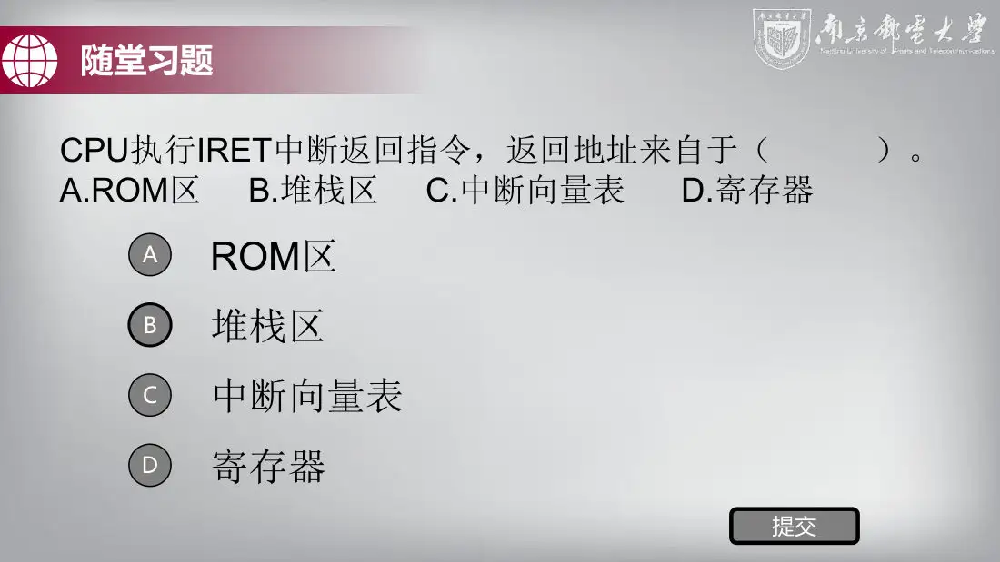

原文：

CPU执行IRET中断返回指令，返回地址来自于（ ）。 A. ROM区 B. 堆栈区 C. 中断向量表 D. 寄存器 A ROM区 B. 堆栈区 C. 中断向量表 D. 寄存器 D 寄存器

提交

随堂习题

南京邮电大学
150-8326
Nanjing University of Posts and Telecommunications
南京邮電大學

### 三、8259A的中断管理方式 P293-296

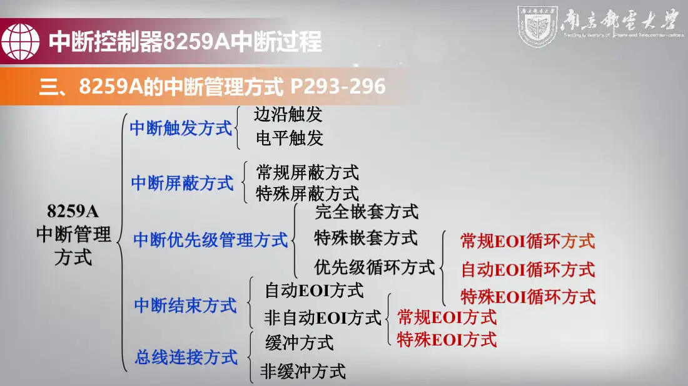

原文：

三、8259A的中断管理方式 P293-296

中断触发方式

边沿触发

电平触发

中断屏蔽方式

常规屏蔽方式

特殊屏蔽方式

8259A

完全嵌套方式

中断管理

方式

中断优先级管理方式

特殊嵌套方式

常规EOI循环方式

优先级循环方式

自动EOI循环方式

中断结束方式

自动EOI方式

特殊EOI循环方式

非自动EOI方式

常规EOI方式

总线连接方式

缓冲方式

特殊EOI方式

非缓冲方式

中断控制器8259A中断过程

南京邮电大学
Nanjing University of Posts and Telecommunications

### ① 系统8259A,中断触发方式为边沿触发，↑// 为中断请求。

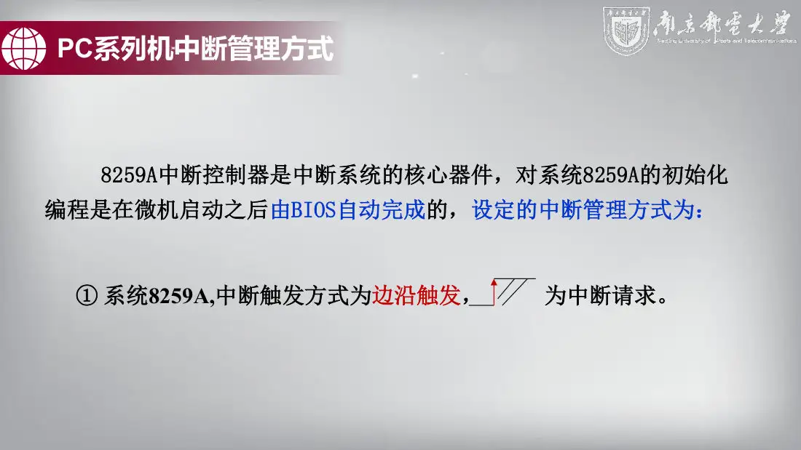

原文：

8259A中断控制器是中断系统的核心器件，对系统8259A的初始化编程是在微机启动之后由BIOS自动完成的，设定的中断管理方式为：

① 系统8259A,中断触发方式为边沿触发，↑// 为中断请求。

PC系列机中断管理方式

南京邮电大学
Nanjing University of Posts and Telecommunications

### ② 中断屏蔽方式采用常规屏蔽方式

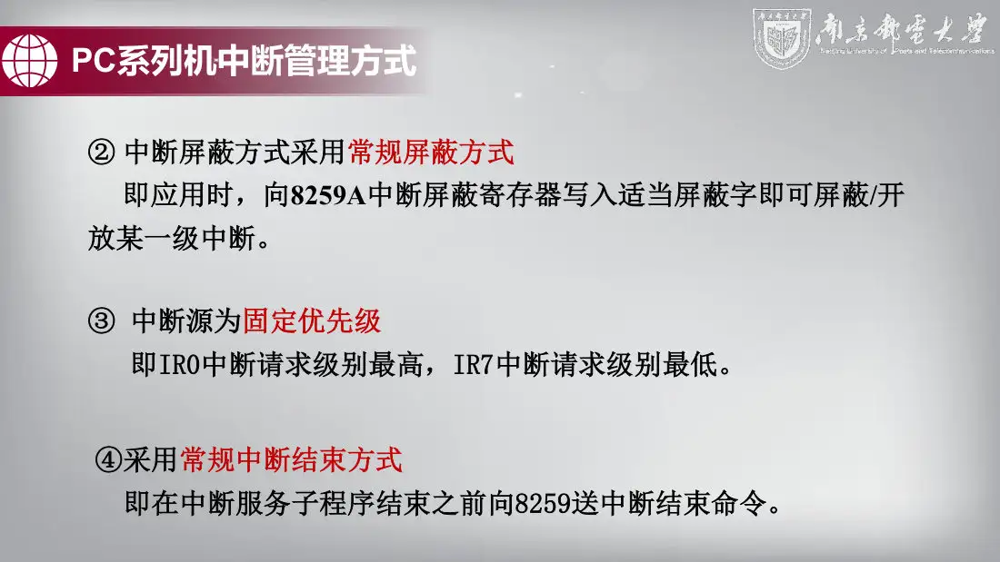

原文：

② 中断屏蔽方式采用常规屏蔽方式

即应用时，向8259A中断屏蔽寄存器写入适当屏蔽字即可屏蔽/开放某一级中断。

③ 中断源为固定优先级

即IRO中断请求级别最高，IR7中断请求级别最低。

④采用常规中断结束方式

即在中断服务子程序结束之前向8259送中断结束命令。

PC系列机中断管理方式

南京邮电大学
Nanjing University of Posts and Telecommunications

### PC系列机中8259的编程

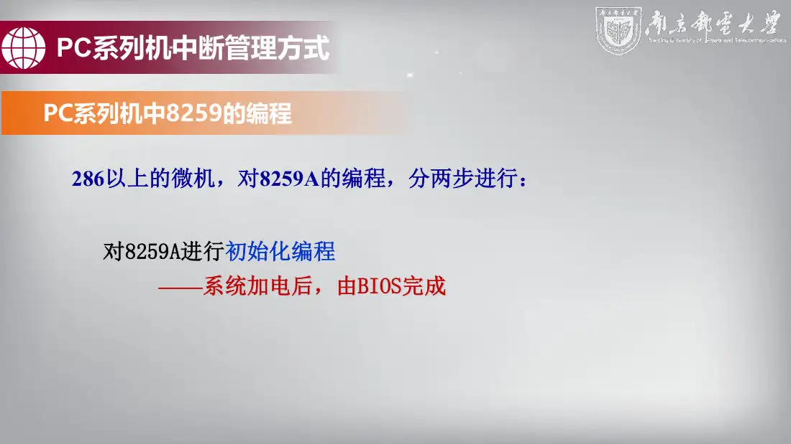

原文：

PC系列机中8259的编程

286以上的微机，对8259A的编程，分两步进行：

对8259A进行初始化编程

——系统加电后，由BIOS完成

PC系列机中断管理方式

南京邮电大学
Nanjing University of Posts and Telecommunications

### 对8259A进行应用编程

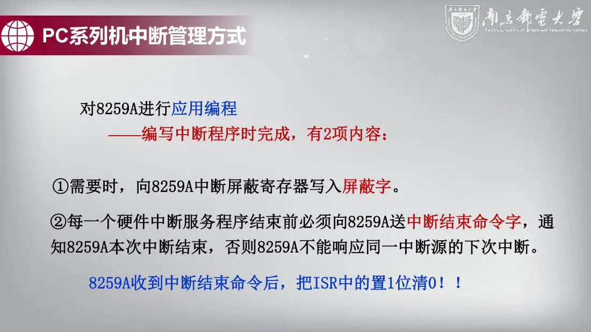

原文：

对8259A进行应用编程

——编写中断程序时完成，有2项内容：

①需要时，向8259A中断屏蔽寄存器写入屏蔽字。

②每一个硬件中断服务程序结束前必须向8259A送中断结束命令字，通知8259A本次中断结束，否则8259A不能响应同一中断源的下次中断。

8259A收到中断结束命令后，把ISR中的置1位清0！！

PC系列机中断管理方式

南京邮电大学
Nanjing University of Posts and Telecommunications

### 非屏蔽中断

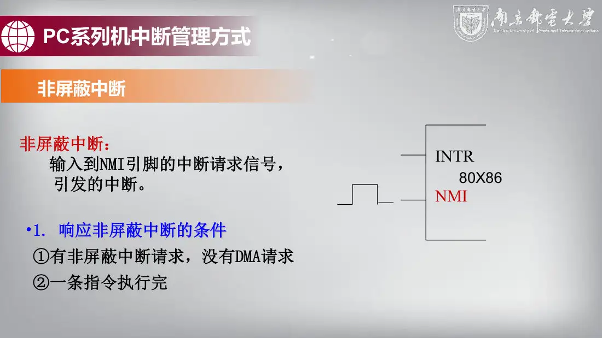

原文：

非屏蔽中断

非屏蔽中断:

输入到NMI引脚的中断请求信号，引发的中断。

•1. 响应非屏蔽中断的条件

①有非屏蔽中断请求，没有DMA请求

②一条指令执行完

PC系列机中断管理方式

南京邮电大学
Nanjing University of Posts and Telecommunications

### •2. CPU响应非屏蔽中断过程

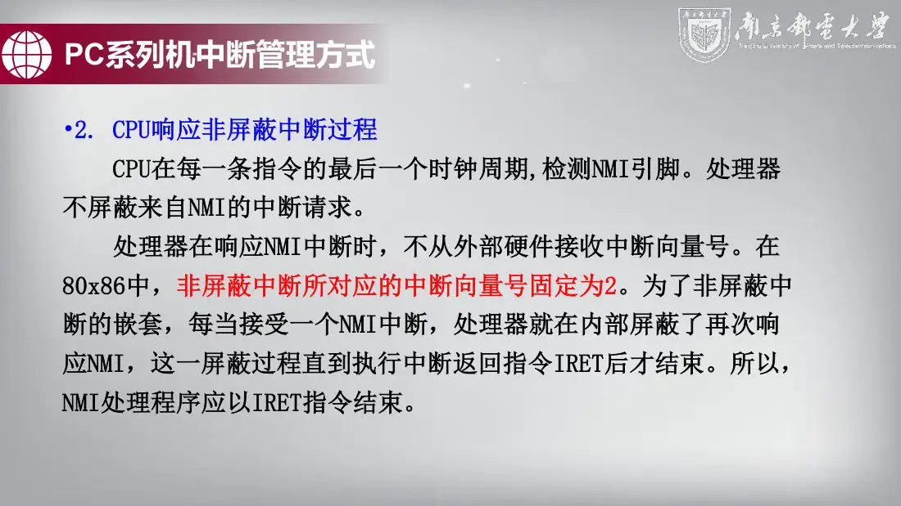

原文：

•2. CPU响应非屏蔽中断过程

CPU在每一条指令的最后一个时钟周期, 检测NMI引脚。处理器不屏蔽来自NMI的中断请求。

处理器在响应NMI中断时，不从外部硬件接收中断向量号。在80x86中，非屏蔽中断所对应的中断向量号固定为2。为了非屏蔽中断的嵌套，每当接受一个NMI中断，处理器就在内部屏蔽了再次响应NMI，这一屏蔽过程直到执行中断返回指令IRET后才结束。所以，NMI处理程序应以IRET指令结束。

PC系列机中断管理方式

南京邮电大学
Nanjing University of Posts and Telecommunications

### 知识点小结

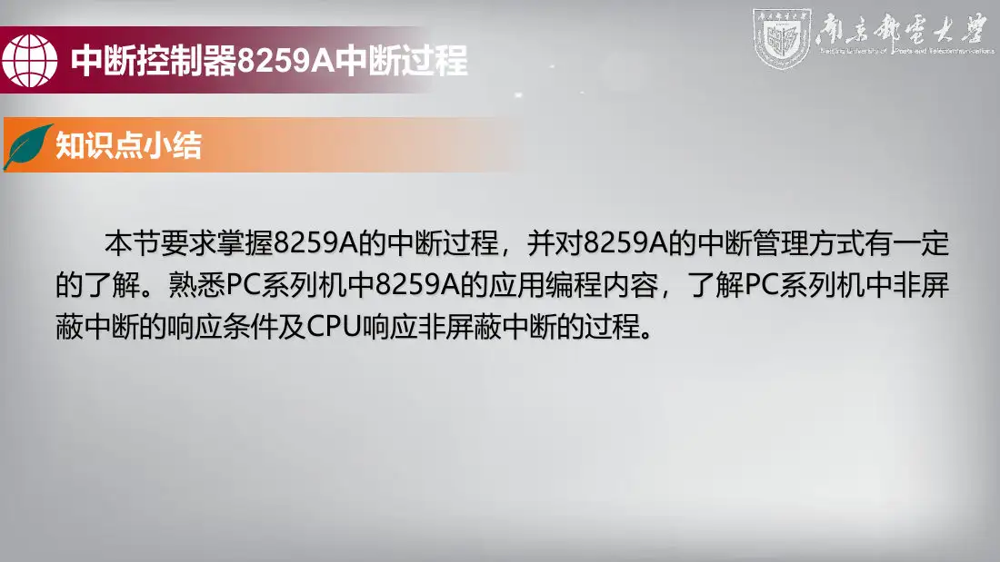

原文：

知识点小结

本节要求掌握8259A的中断过程，并对8259A的中断管理方式有一定的了解。熟悉PC系列机中8259A的应用编程内容，了解PC系列机中非屏蔽中断的响应条件及CPU响应非屏蔽中断的过程。

中断控制器8259A中断过程

南京邮电大学
Nanjing University of Posts and Telecommunications

### 知识要点

原文：

知识要点

PC系列机中可屏蔽中断

响应可屏蔽中断的条件

◆ CPU响应可屏蔽中断的过程

PC系列机可屏蔽中断的硬件结构

PC系列机中可屏蔽中断

南京邮电大学
Nanjing University of Posts and Telecommunications

### 一、可屏蔽中断

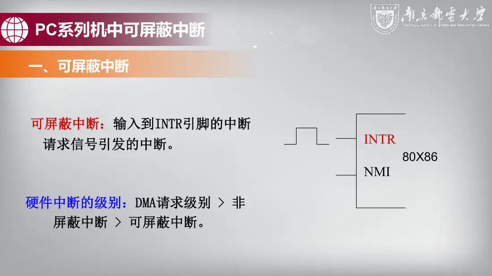

原文：

一、可屏蔽中断

可屏蔽中断：输入到INTR引脚的中断请求信号引发的中断。

硬件中断的级别：DMA请求级别 > 非屏蔽中断 > 可屏蔽中断。

PC系列机中可屏蔽中断

南京邮电大学
Nanjing University of Posts and Telecommunications

### 二、响应可屏蔽中断的条件

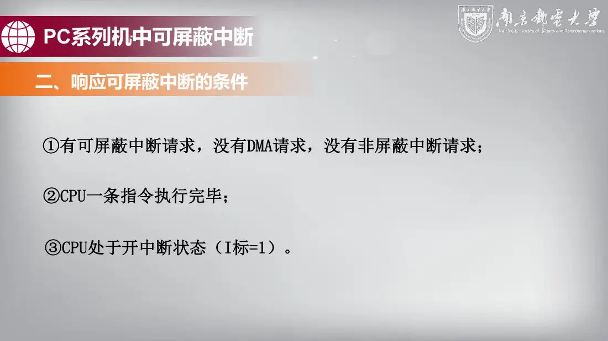

原文：

二、响应可屏蔽中断的条件

①有可屏蔽中断请求，没有DMA请求，没有非屏蔽中断请求；

②CPU一条指令执行完毕;

③CPU处于开中断状态（I标=1）。

PC系列机中可屏蔽中断

南京邮电大学
Nanjing University of Posts and Telecommunications

### 三、CPU响应可屏蔽中断过程

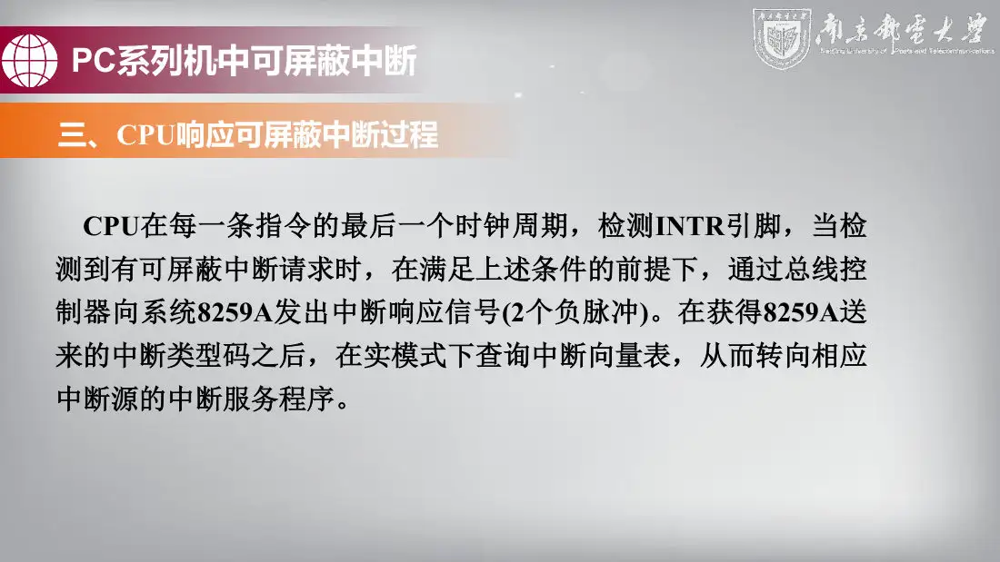

原文：

三、CPU响应可屏蔽中断过程

CPU在每一条指令的最后一个时钟周期，检测INTR引脚，当检测到有可屏蔽中断请求时，在满足上述条件的前提下，通过总线控制器向系统8259A发出中断响应信号(2个负脉冲)。在获得8259A送来的中断类型码之后，在实模式下查询中断向量表，从而转向相应中断源的中断服务程序。

PC系列机中可屏蔽中断

南京邮电大学
Nanjing University of Posts and Telecommunications

### ISR置位，IRR清零

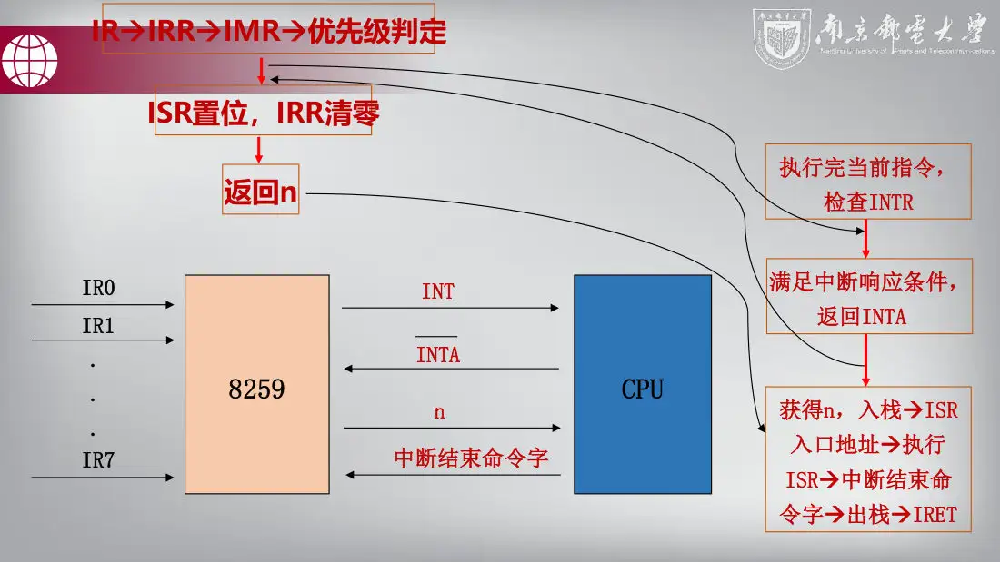

原文：

ISR置位，IRR清零

返回n

8259

中断结束命令字 执行完当前指令，检查INTR

满足中断响应条件，返回INTA

获得n，入栈→ISR
入口地址→执行
ISR→中断结束命
令字→出栈→IRET

IR→IRR→IMR→优先级判定

南京邮电大学
Nanjing University of Posts and Telecommunications

### 四、PC系列机可屏蔽中断的硬件结构

原文：

四、PC系列机可屏蔽中断的硬件结构

PC系列机中可屏蔽中断

南京邮电大学
Nanjing University of Posts and Telecommunications

### PC系列机中可屏蔽中断

原文：

PC系列机中可屏蔽中断

南京邮电大学
Nanjing University of Posts and Telecommunications

### PC系列机中可屏蔽中断

原文：

PC系列机中可屏蔽中断

南京邮电大学
Nanjing University of Posts and Telecommunications

### (1) 使用2片8259级连，管理15级中断

原文：

(1) 使用2片8259级连，管理15级中断

(2) 中断源与中断类型

<table><tr><td>主8259</td><td>中断源</td><td>中断类型</td><td>从8259</td><td>中断源</td><td>中断类型</td></tr><tr><td>IR0</td><td>日时钟</td><td>08H</td><td>IR0</td><td>实时时钟</td><td>70H</td></tr><tr><td>IR1</td><td>键盘</td><td>09H</td><td>IR1</td><td>用户中断</td><td>71H改向0AH</td></tr><tr><td>IR2</td><td>从8259</td><td></td><td>IR2</td><td>保留</td><td>72H</td></tr><tr><td>IR3</td><td>辅串口</td><td>0BH</td><td>IR3</td><td>保留</td><td>73H</td></tr><tr><td>IR4</td><td>主串口</td><td>0CH</td><td>IR4</td><td>保留</td><td>74H</td></tr><tr><td>IR5</td><td>并行口2</td><td>0DH</td><td>IR5</td><td>协处理器</td><td>75H</td></tr><tr><td>IR6</td><td>软盘</td><td>0EH</td><td>IR6</td><td>硬盘</td><td>76H</td></tr><tr><td>IR7</td><td>并行口1</td><td>0FH</td><td>IR7</td><td>保留</td><td>77H</td></tr></table>

PC系列机中可屏蔽中断

南京邮电大学
Nanjing University of Posts and Telecommunications

### (3) 系统分配的8259口地址

原文：

(3) 系统分配的8259口地址

<table><tr><td></td><td>中断屏蔽寄存器口地址</td><td>接收中断结束命令的寄存器口地址</td></tr><tr><td>主8259</td><td>21H</td><td>20H</td></tr><tr><td>从8259</td><td>A1H</td><td>A0H</td></tr></table>

PC系列机中可屏蔽中断

南京邮电大学
Nanjing University of Posts and Telecommunications

### (4) 硬件可屏蔽中断的中断级别

原文：

(4) 硬件可屏蔽中断的中断级别

<table><tr><td>主8259</td><td>中断源</td><td>中断级别</td><td>从8259</td><td>中断源</td><td>中断级别</td></tr><tr><td>IR0</td><td>日时钟</td><td rowspan="3">最高次高</td><td>IR0</td><td>实时时钟</td><td rowspan="8">高</td></tr><tr><td>IR1</td><td>键盘</td><td>IR1</td><td>用户中断</td></tr><tr><td>IR2</td><td>从8259</td><td>IR2</td><td>保留</td></tr><tr><td>IR3</td><td>辅串口</td><td rowspan="3">高</td><td>IR3</td><td>保留</td></tr><tr><td>IR4</td><td>主串口</td><td>IR4</td><td>保留</td></tr><tr><td>IR5</td><td>并行口2</td><td>IR5</td><td>协处理器</td></tr><tr><td>IR6</td><td>软盘</td><td rowspan="2">最低</td><td>IR6</td><td>硬盘</td></tr><tr><td>IR7</td><td>并行口1</td><td>IR7</td><td>保留</td></tr></table>

PC系列机中可屏蔽中断

南京邮电大学
Nanjing University of Posts and Telecommunications

### (5) 中断结束命令

原文：

(5) 中断结束命令

① 命令字=20H

② 接入主8259A IR0, IR1, IR3 \~IR7的中断源，其服务程序结束要向主8259送中断结束命令字

MOV AL, 20H
OUT 20H, AL
恢复现场
IRET

PC系列机中可屏蔽中断

南京邮电大学
Nanjing University of Posts and Telecommunications

### MOV AL, 20H

原文：

③接入从8259的中断源，经主8259A的IR2向INTR提中断请求，其服务程序结束应分别向主、从8259各送一个中断结束命令字。

MOV AL, 20H

OUT 20H, AL ; 主8259A

OUT 0A0H, AL ; 从8259A
恢复现场

IRET

PC系列机中可屏蔽中断

南京邮电大学
Nanjing University of Posts and Telecommunications

### 知识点小结

原文：

知识点小结

本节主要介绍了PC系列机中的可屏蔽中断。通过本节的学习，学习者应该掌握PC系列机中可屏蔽中断的响应条件和CPU响应可屏蔽中断的过程。熟悉PC系列机中可屏蔽中断的硬件结构，掌握PC系列机中主从两片8259A的中断源和中断类型、系统分配给主从8259A的口地址、硬件可屏蔽中断的优先级别以及中断结束字的写入方法。

PC系列机中可屏蔽中断

南京邮电大学
Nanjing University of Posts and Telecommunications

### 南京邮电大学

原文：

毛泽东指出：“粗枝大叶、自以为是的主观主义作风，就是党性不纯的第一个表现；而实事求是，理论与实际密切联系，则是一个党性坚强的党员的起码态度。”

南京邮电大学
T108-0356
南京邮电大学
Nanjing University of Posts and Telecommunications

### 知识要点

原文：

知识要点

日时钟中断源

日时钟中断类型

日时钟中断处理流程

系统日时钟中断开发应用

系统日时钟中断

南京邮电大学
Nanjing University of Posts and Telecommunications

### 一、中断源

原文：

一、中断源

日时钟中断的中断源是：系统8254 0#计数器

BIOS对系统8254 0#计数器初始化，使系统8254 0#计数器每55ms产生一次中断请求。

系统日时钟中断

南京邮电大学
Nanjing University of Posts and Telecommunications

### 二、中断类型

原文：

二、中断类型

日时钟的中断请求接至系统主8259A的IRO。

日时钟中断的中断类型是：08H (P305 表8.2)。

系统日时钟中断

南京邮电大学
Nanjing University of Posts and Telecommunications

### ※ 什么是“日时钟计数器”

原文：

※ 什么是“日时钟计数器”

BIOS系统规定：系统RAM中40H:6CH～40H:6FH这4个单元（共32位）为日时钟计数器，每55ms加1次，计数到:001800B0H，为24小时，其计数值供系统软件使用。其中40H:6CH～40H:6DH计数字单元，计满为约1小时；40H:6EH～40H:6FH计满24次为1日。

系统启动时CPU执行BIOS中的一段程序，读取CMOS实时时钟电路的时间值 $\rightarrow$ 计数值 $\rightarrow 40:6\mathrm{CH}\sim 40:6\mathrm{FH}$ 作为日时钟计数器的计数初值。

系统日时钟中断

南京邮电大学
Nanjing University of Posts and Telecommunications

### 三、日时钟中断处理流程

原文：

三、日时钟中断处理流程

CPU转入08型中断后，完成下列工作

① 开中断，保护现场（DS…压栈）

② 40H→DS，对“日时钟计数器”加1

③ 测算软驱马达关闭时间

④ 执行INT 1CH

⑤ 向主8259送中断结束命令

⑥ 恢复现场，IRET

1CH服务程序

系统日时钟中断

南京邮电大学
Nanjing University of Posts and Telecommunications

### ※关于1CH服务程序

原文：

※关于1CH服务程序

8#中断，在DS=40H的前提下，每隔55ms调用一次1CH服务程序，之后又返回8型中断！

1CH服务程序

所以1CH中断是日时钟的外扩中断，用户可开发新的1CH中断（完成每55ms一次的定时操作）取代原来的中断服务子程序。

系统日时钟中断

南京邮电大学
Nanjing University of Posts and Telecommunications

### 四、系统日时钟中断开发应用

原文：

四、系统日时钟中断开发应用

(1) 置换中断向量

CPU响应日时钟中断后，自动转向“08H型”服务程序。根据BIOS设计的08H型中断服务程序处理流程，可以知道，用户自行设计的定时中断服务程序类型可以是“08H”，也可以是1CH。

系统日时钟中断

南京邮电大学
Nanjing University of Posts and Telecommunications

### ①当用户程序的某项定时操作, 其定时周期等于55ms的整数倍时,

原文：

①当用户程序的某项定时操作, 其定时周期等于55ms的整数倍时,

可定义用户程序的定时操作为1CH中断。此时需要置换1CH型中断向量, 调用DOS系统25H号子程序把用户定时中断服务程序入口地址写入4×1CH～4×1CH+3单元。

也可以定义用户中断服务程序为08H型中断，此时需要置换08H型中断向量, 调用DOS系统25H号子程序把用户定时中断服务程序入口地址写入4×08H～4×08H+3单元。

系统日时钟中断

南京邮电大学
Nanjing University of Posts and Telecommunications

### 系统日时钟中断

原文：

②当用户程序的定时操作, 其定时周期不等于55ms的整数倍, 或者小于55ms时, 定义用户中断服务程序为08H型中断, 此时需要置换08H型中断向量, 调用DOS系统25H号子程序把用户定时中断服务程序入口地址写入4×08H～4×08H+3单元。

系统日时钟中断

南京邮电大学
Nanjing University of Posts and Telecommunications

### (2) 用户中断服务程序结束

原文：

(2) 用户中断服务程序结束

① 若用户定时中断定义为1CH型，服务程序结束前不需要向主8259A送结束命令。

② 若用户定时中断定义为08H型，服务程序结束前，需要先向主8259A送中断结束命令。

MOV AL, 20H

OUT 20H, AL

(3) 中断服务程序的执行时间

定时中断服务程序的执行时间, 必须远远小于定时中断的时间间隔。

系统日时钟中断

南京邮电大学
Nanjing University of Posts and Telecommunications

### (4) 避免DOS重入 (P308)

原文：

(4) 避免DOS重入 (P308)

系统日时钟中断

南京邮电大学
Nanjing University of Posts and Telecommunications

INT 21H

### (4) 避免DOS重入

原文：

(4) 避免DOS重入

中断服务程序不调用INT 21H功能，或者主程序和中断服务程序不同时调用INT 21H。中断服务程序进行IO操作、屏幕显示等操作可调用BIOS功能。

系统日时钟中断

南京邮电大学
Nanjing University of Posts and Telecommunications

### 知识点小结

原文：

知识点小结

本节主要介绍了系统日时钟中断的相关内容，应该了解系统日时钟中断的中断源，中断类型以及系统日时钟处理流程，掌握系统日时钟中断的开发应用方法。

系统日时钟中断

南京邮电大学
Nanjing University of Posts and Telecommunications

### 知识要点

原文：

知识要点

✿ 1CH型中断的开发设计思路

系统日时钟中断应用开发举例-ICH中断

南京邮电大学
Nanjing University of Posts and Telecommunications

### 系统日时钟中断应用开发举例-ICH中断

原文：

【例】要求利用PC系统机上的8254的0号定时计数器引发的日时钟中断，设计程序：每间隔1秒在PC终端屏幕上显示1行字符串“HELLO！”，显示10行后结束。

系统日时钟中断应用开发举例-ICH中断

南京邮电大学
Nanjing University of Posts and Telecommunications

### 一、设计思路

原文：

一、设计思路

系统8254的0号定时计数器每55ms向系统主8259A IRO端发送1次日时钟中断请求，CPU响应后转入08H型中断服务程序，并在其中执行软件中断INT 1CH。用户可以利用这个55ms执行一次的中断服务，设计程序段完成相应的功能。

系统日时钟中断应用开发举例-ICH中断

南京邮电大学
Nanjing University of Posts and Telecommunications

### 系统日时钟中断应用开发举例-ICH中断

原文：

本例中除了置换系统1CH中断向量，将其指向自定义的中断服务程序外，还需要设定1个计数变量，每当系统提请18次日时钟中断（18x55ms=990ms大约为1S）时在自定义的中断服务程序中完成1次字符串显示。

系统日时钟中断应用开发举例-ICH中断

南京邮电大学
Nanjing University of Posts and Telecommunications

### 二、程序流程图

原文：

二、程序流程图

主程序

关中断（CLI）  
保存系统的1CH型中断向量  
写入用户的1CH型中断向量  
开中断（STI）

显示10行？

恢复系统1CH型中断向量
返回DOS

1CH型中断服务子程序

保护现场
重新定义用户数据段
中断计数

满18次？

计数单元重新置为18
显示一行 ‘HELL0!’
显示行数-1

恢复现场
中断返回（IRET）

系统日时钟中断应用开发举例-ICH中断

南京邮电大学
Nanjing University of Posts and Telecommunications

### 为此, 需要进行的操作为:

原文：

为此, 需要进行的操作为:

保存原来系统的1CH中断向量到数据段OLD1C双字单元;

<table><tr><td>READ1C</td><td>PROC</td><td></td><td>;转移系统1CH型中断向量</td></tr><tr><td></td><td>MOV</td><td>AX, 351CH</td><td></td></tr><tr><td></td><td>INT</td><td>21H</td><td></td></tr><tr><td></td><td>MOV</td><td>WORD PTR OLD1C, BX</td><td></td></tr><tr><td></td><td>MOV</td><td>WORD PTR OLD1C+2, ES</td><td></td></tr><tr><td></td><td>RET</td><td></td><td></td></tr><tr><td>READ1C</td><td>ENDP</td><td></td><td></td></tr></table>

系统日时钟中断应用开发举例-ICH中断

南京邮电大学
Nanjing University of Posts and Telecommunications

### 置换1CH中断向量使其指向我们自己的中断服务程序；

原文：

置换1CH中断向量使其指向我们自己的中断服务程序；

<table><tr><td>WRITE1C</td><td>PROC</td><td></td><td>;写入用户1CH型中断向量</td></tr><tr><td></td><td>PUSH</td><td>DS</td><td></td></tr><tr><td></td><td>MOV</td><td>AX, CODE</td><td></td></tr><tr><td></td><td>MOV</td><td>DS, AX</td><td></td></tr><tr><td></td><td>MOV</td><td>DX, OFFSET SERVICE</td><td></td></tr><tr><td></td><td>MOV</td><td>AX, 251CH</td><td></td></tr><tr><td></td><td>INT</td><td>21H</td><td></td></tr><tr><td></td><td>POP</td><td>DS</td><td></td></tr><tr><td></td><td>RET</td><td></td><td></td></tr><tr><td>WRITE1C</td><td>ENDP</td><td></td><td></td></tr></table>

系统日时钟中断应用开发举例-ICH中断

南京邮电大学
Nanjing University of Posts and Telecommunications

### 系统日时钟中断应用开发举例-ICH中断

原文：

中断服务程序每执行18次时在其中显示1次字符串(18x55ms=990ms大约为1S);

<table><tr><td>SERVICE</td><td>PROC</td><td></td><td></td></tr><tr><td></td><td>......</td><td></td><td></td></tr><tr><td></td><td>DEC</td><td>ICOUNT</td><td>;中断计数</td></tr><tr><td></td><td>JNZ</td><td>EXIT</td><td>;不满18次,1s未到转</td></tr><tr><td></td><td>MOV</td><td>ICOUNT, 18</td><td>;恢复ICOUNT,显示字符串</td></tr><tr><td></td><td>......</td><td></td><td></td></tr><tr><td></td><td>MOV</td><td>AH, 9</td><td>;显示字符串</td></tr><tr><td></td><td>LEA</td><td>DX, MESG</td><td></td></tr><tr><td></td><td>INT</td><td>21H</td><td></td></tr><tr><td>EXIT:</td><td>......</td><td></td><td></td></tr><tr><td></td><td>IRET</td><td></td><td>;返回系统8型中断服务程序</td></tr><tr><td>SERVICE</td><td>ENDP</td><td></td><td></td></tr></table>

系统日时钟中断应用开发举例-ICH中断

南京邮电大学
Nanjing University of Posts and Telecommunications

### 在返回操作系统前恢复原来保存的1CH中断向量。

原文：

在返回操作系统前恢复原来保存的1CH中断向量。

<table><tr><td>RESET</td><td>PROC</td><td></td><td>; 恢复系统1CH型中断向量</td></tr><tr><td></td><td>MOV</td><td>DX, WORD PTR OLD1C</td><td></td></tr><tr><td></td><td>MOV</td><td>DS, WORD PTR OLD1C+2</td><td></td></tr><tr><td></td><td>MOV</td><td>AX, 251CH</td><td></td></tr><tr><td></td><td>INT</td><td>21H</td><td></td></tr><tr><td></td><td>RET</td><td></td><td></td></tr><tr><td>RESET</td><td>ENDP</td><td></td><td></td></tr></table>

系统日时钟中断应用开发举例-ICH中断

南京邮电大学
Nanjing University of Posts and Telecommunications

### 三、程序清单 P309 \~ 310

原文：

三、程序清单 P309 \~ 310

<table><tr><td colspan="4">.486</td></tr><tr><td>DATA</td><td>SEGMENT</td><td>USE16</td><td></td></tr><tr><td>MESG</td><td>DB</td><td>‘HELLO!’, ODH, OAH, ’ $’</td><td></td></tr><tr><td>OLD1C</td><td>DD</td><td>?</td><td></td></tr><tr><td>ICOUNT</td><td>DB</td><td>18</td><td>; 中断计数初值</td></tr><tr><td>COUNT</td><td>DB</td><td>10</td><td>; 显示行数控制</td></tr><tr><td>DATA</td><td>ENDS</td><td></td><td></td></tr><tr><td rowspan="2">CODE</td><td>SEGMENT</td><td>USE16</td><td></td></tr><tr><td>ASSUME</td><td>CS:CODE, DS:DATA</td><td></td></tr><tr><td rowspan="4">BEG:</td><td>MOV</td><td>AX, DATA</td><td></td></tr><tr><td>MOV</td><td>DS, AX</td><td></td></tr><tr><td>CLI</td><td></td><td>; 关中断</td></tr><tr><td>CALL</td><td>READ1C</td><td></td></tr><tr><td rowspan="7">SCAN:</td><td>CALL</td><td>WRITE1C</td><td rowspan="2">;开中断</td></tr><tr><td>STI</td><td></td></tr><tr><td>CMP</td><td>COUNT, 0</td><td rowspan="2">;是否已经显示16</td></tr><tr><td>JNZ</td><td>SCAN</td></tr><tr><td>CALL</td><td>RESET</td><td rowspan="3">;结束返回DOS</td></tr><tr><td>MOV</td><td>AH, 4CH</td></tr><tr><td>INT</td><td>21H</td></tr><tr><td rowspan="7">; SERVICE</td><td>PROC</td><td></td><td rowspan="2">;保护现场</td></tr><tr><td>PUSHA</td><td></td></tr><tr><td>PUSH</td><td>DS</td><td rowspan="2">;DS=40H</td></tr><tr><td>MOV</td><td>AX, DATA</td></tr><tr><td>MOV</td><td>DS, AX</td><td>;重新给DS赋值</td></tr><tr><td>DEC</td><td>ICOUNT</td><td>;中断计数</td></tr><tr><td>JNZ</td><td>EXIT</td><td>;不满18次转</td></tr></table>

系统日时钟中断应用开发举例-ICH中断

南京邮电大学
Nanjing University of Posts and Telecommunications

### 系统日时钟中断应用开发举例-ICH中断

原文：

系统日时钟中断应用开发举例-ICH中断

南京邮电大学
Nanjing University of Posts and Telecommunications

### 系统日时钟中断应用开发举例-ICH中断

原文：

<table><tr><td></td><td>MOV</td><td>ICOUNT, 18</td><td></td></tr><tr><td></td><td>DEC</td><td>COUNT</td><td>; 显示行数减1</td></tr><tr><td></td><td>MOV</td><td>AH, 9</td><td>; 显示字符串</td></tr><tr><td></td><td>LEA</td><td>DX, MESG</td><td></td></tr><tr><td></td><td>INT</td><td>21H</td><td></td></tr><tr><td>EXIT:</td><td>POP</td><td>DS</td><td>; 恢复现场</td></tr><tr><td></td><td>POPA</td><td></td><td></td></tr><tr><td></td><td>IRET</td><td></td><td>; 返回系统8型中断服务程序</td></tr><tr><td>SERVICE</td><td>ENDP</td><td></td><td></td></tr><tr><td colspan="4">;</td></tr><tr><td>READ1C</td><td>PROC</td><td></td><td>; 转移系统1CH型中断向量</td></tr><tr><td></td><td>MOV</td><td>AX, 351CH</td><td></td></tr><tr><td></td><td>INT</td><td>21H</td><td></td></tr><tr><td></td><td>MOV</td><td>WORD PTR OLD1C, BX</td><td></td></tr><tr><td></td><td>MOV</td><td>WORD PTR OLD1C+2, ES</td><td></td></tr></table>

系统日时钟中断应用开发举例-ICH中断

南京邮电大学
Nanjing University of Posts and Telecommunications

### ；写入用户1CH型中断向量

原文：

<table><tr><td colspan="3">RET</td></tr><tr><td>READ1C</td><td>ENDP</td><td></td></tr><tr><td colspan="3">;</td></tr><tr><td rowspan="9">WRITE1C</td><td>PROC</td><td></td></tr><tr><td>PUSH</td><td>DS</td></tr><tr><td>MOV</td><td>AX, CODE</td></tr><tr><td>MOV</td><td>DS, AX</td></tr><tr><td>MOV</td><td>DX, OFFSET SERVICE</td></tr><tr><td>MOV</td><td>AX, 251CH</td></tr><tr><td>INT</td><td>21H</td></tr><tr><td>POP</td><td>DS</td></tr><tr><td>RET</td><td></td></tr><tr><td>WRITE1C</td><td>ENDP</td><td></td></tr></table>

；写入用户1CH型中断向量

系统日时钟中断应用开发举例-ICH中断

南京邮电大学
Nanjing University of Posts and Telecommunications

### 系统日时钟中断应用开发举例-ICH中断

原文：

<table><tr><td rowspan="6">RESET</td><td>PROC</td><td></td><td rowspan="6">; 恢复系统1CH型中断向量</td></tr><tr><td>MOV</td><td>DX, WORD PTR OLD1C</td></tr><tr><td>MOV</td><td>DS, WORD PTR OLD1C+2</td></tr><tr><td>MOV</td><td>AX, 251CH</td></tr><tr><td>INT</td><td>21H</td></tr><tr><td>RET</td><td></td></tr><tr><td>RESET</td><td>ENDP</td><td></td><td></td></tr><tr><td>CODE</td><td>ENDS</td><td></td><td></td></tr><tr><td>END</td><td>BEG</td><td></td><td></td></tr></table>

系统日时钟中断应用开发举例-ICH中断

南京邮电大学
Nanjing University of Posts and Telecommunications

### 四、程序分析

原文：

四、程序分析

① 程序的执行过程如图所示。

系统日时钟中断应用开发举例-ICH中断

南京邮电大学
Nanjing University of Posts and Telecommunications

### ③ RESET子程序中

原文：

② 在进入用户定义的中断服务程序后，需要保存DS并重新对DS进行赋值。在中断返回前，需要恢复DS。

③ RESET子程序中

MOV DX, WORD PTR OLD1C和

MOV DS, WORD PTR OLD1C+2

两条指令先后顺序不可颠倒。

④ 用户定义的中断服务程序中不需要对系统主8259A写中断结束命令字。

系统日时钟中断应用开发举例-ICH中断

南京邮电大学
Nanjing University of Posts and Telecommunications

### 系统日时钟中断应用开发举例-ICH中断

原文：

⑤ 在本程序的中断服务程序中使用了DOS功能调用来显示字符串。这是一种不推荐的做法。在程序设计考虑不周到时容易发生DOS重入问题。因此，我们应该尽量避免在中断服务程序中使用DOS功能调用，而用BIOS功能调用替换之。

系统日时钟中断应用开发举例-ICH中断

南京邮电大学
Nanjing University of Posts and Telecommunications

### 知识点小结

原文：

知识点小结

本节在上一节介绍的1CH型中断应用开发设计思路的基础上，详细地讲解了该1CH型定时中断应用程序，并对程序做了进一步的分析。通过本节的学习，学习者应该掌握系统1CH型定时中断应用程序的开发方法，并能按照要求熟练设计1CH型定时中断程序。

系统日时钟中断应用开发举例-ICH中断

南京邮电大学
Nanjing University of Posts and Telecommunications

### ✿ 08H型中断的开发设计思路

原文：

✿ 08H型中断的开发设计思路

【例】要求利用PC系统机上的8254的0号定时计数器引发的日时钟中断，设计程序：每间隔1秒在PC终端屏幕上显示1行字符串“HELLO！”，显示10行后结束。

系统日时钟中断应用开发举例-08H中断

南京邮电大学
Nanjing University of Posts and Telecommunications

### 一、设计思路

原文：

一、设计思路

系统8254 的0号定时计数器每55ms向系统主8259A IRO端提1次日时钟中断请求，CPU响应后转入08H型中断服务程序。用户可以利用这个55ms执行一次的中断服务，定义用户中断服务程序为08H型，设计程序段完成相应的功能。

系统日时钟中断应用开发举例-08H中断

南京邮电大学
Nanjing University of Posts and Telecommunications

### 为此我们需要进行的操作为：\*为与前一节的方法不同的操作。

原文：

本例中（1）需要置换系统08H中断向量，将其指向自定义的中断服务程序。调用DOS系统25H号子程序把用户定时中断服务程序入口地址写入4×08H～4×08H+3单元。

(2) 设定1个计数变量, 每当系统提请18次日时钟中断 ( $18 \times 55 \mathrm{~ms} = 990 \mathrm{~ms}$ ) 时在自定义的中断服务程序中完成1次字符串显示。

为此我们需要进行的操作为：\*为与前一节的方法不同的操作。

系统日时钟中断应用开发举例-08H中断

南京邮电大学
Nanjing University of Posts and Telecommunications

### ①保存原来系统的08H中断向量到段OLD08双字单元 \

原文：

①保存原来系统的08H中断向量到段OLD08双字单元 \*

CODE SEGMENT USE16

OLD08 DD ? ; 保存系统08H中断向量的变量

ASSUME CS:CODE, DS:DATA

READ08 PROC ; 保存原来系统的08H 中断向量

MOV AX, 3508H

READ08 ENDP

系统日时钟中断应用开发举例-08H中断

南京邮电大学
Nanjing University of Posts and Telecommunications

### ②置换08H中断向量使其指向我们自己的中断服务程序

原文：

②置换08H中断向量使其指向我们自己的中断服务程序

<table><tr><td>WRITE08</td><td>PROC</td><td></td><td>;置换08H型中断向量指向自定义中断服务程序</td></tr><tr><td></td><td>PUSH</td><td>DS</td><td></td></tr><tr><td></td><td>MOV</td><td>AX, CODE</td><td></td></tr><tr><td></td><td>MOV</td><td>DS, AX</td><td></td></tr><tr><td></td><td>MOV</td><td>DX, OFFSET SERVICE</td><td></td></tr><tr><td></td><td>MOV</td><td>AX, 2508H</td><td></td></tr><tr><td></td><td>INT</td><td>21H</td><td></td></tr><tr><td></td><td>POP</td><td>DS</td><td></td></tr><tr><td></td><td>RET</td><td></td><td></td></tr><tr><td>WRITE08</td><td>ENDP</td><td></td><td></td></tr></table>

系统日时钟中断应用开发举例-08H中断

南京邮电大学
Nanjing University of Posts and Telecommunications

### 系统日时钟中断应用开发举例-08H中断

原文：

③在每次中断服务程序的末尾，用指令JMP CS:OLD08 跳转到日时钟中断服务程序 \*

<table><tr><td rowspan="4">SERVICE</td><td>PROC</td><td></td><td>;中断服务程序</td></tr><tr><td>PUSHA</td><td></td><td></td></tr><tr><td>PUSH</td><td>DS</td><td></td></tr><tr><td>......</td><td></td><td></td></tr><tr><td rowspan="3">EXIT:</td><td>POP</td><td>DS</td><td></td></tr><tr><td>POPA</td><td></td><td></td></tr><tr><td>JMP</td><td>CS:OLD08</td><td>;转向原来的08H服务程序</td></tr><tr><td>SERVICE</td><td>ENDP</td><td></td><td></td></tr></table>

④原来系统08H中断需要完成的任务，包括往主8259A写中断结束命令字,返回断点等均在原来的中断服务程序中完成。

系统日时钟中断应用开发举例-08H中断

南京邮电大学
Nanjing University of Posts and Telecommunications

### 系统日时钟中断应用开发举例-08H中断

原文：

⑤中断服务程序每执行18次时在其中显示1次字符串(18x55ms=990ms)大约为1s.

<table><tr><td>SERVICE</td><td>PROC</td><td></td><td>;中断服务程序</td></tr><tr><td></td><td>......</td><td></td><td></td></tr><tr><td></td><td>MOV</td><td>AX, DATA</td><td></td></tr><tr><td></td><td>MOV</td><td>DS, AX</td><td></td></tr><tr><td></td><td>DEC</td><td>ICOUNT</td><td>;计18次55msx18=990ms</td></tr><tr><td></td><td>JNZ</td><td>EXIT</td><td></td></tr><tr><td></td><td>MOV</td><td>ICOUNT, 18</td><td></td></tr><tr><td></td><td>DEC</td><td>COUNT</td><td>;显示行数减1</td></tr><tr><td></td><td>MOV</td><td>AH, 9</td><td>;显示字符串</td></tr><tr><td></td><td>MOV</td><td>DX, OFFSET MESG</td><td></td></tr><tr><td></td><td>INT</td><td>21H</td><td></td></tr><tr><td></td><td>......</td><td></td><td></td></tr><tr><td>SERVICE</td><td>ENDP</td><td></td><td></td></tr></table>

系统日时钟中断应用开发举例-08H中断

南京邮电大学
Nanjing University of Posts and Telecommunications

### ⑥在返回操作系统前恢复原来保存的08H中断向量。

原文：

⑥在返回操作系统前恢复原来保存的08H中断向量。

<table><tr><td rowspan="6">RESET</td><td>PROC</td><td></td><td>; 恢复系统08中断向量</td></tr><tr><td>MOV</td><td>DX, WORD PTR OLD08</td><td>; 注意和后一条指令的顺序</td></tr><tr><td>MOV</td><td>DS, WORD PTR OLD08+2</td><td></td></tr><tr><td>MOV</td><td>AX, 2508H</td><td></td></tr><tr><td>INT</td><td>21H</td><td></td></tr><tr><td>RET</td><td></td><td></td></tr><tr><td>RESET</td><td>ENDP</td><td></td><td></td></tr></table>

系统日时钟中断应用开发举例-08H中断

南京邮电大学
Nanjing University of Posts and Telecommunications

### 知识点小结

原文：

知识点小结

本节通过一个具体的例子，详细讲解了系统08H型定时中断的应用开发设计思路和需要完成的操作。在下一节中，我们将讲解该08H型定时中断应用程序，并对程序做进一步的分析。

系统日时钟中断应用开发举例-08H中断

南京邮电大学
Nanjing University of Posts and Telecommunications

### 总结

原文：

总结

✿ 8259A中断控制器

√ 8259A功能

√ 8259A结构

√ 8259A主从级联方式

√ 8259A中断过程

✿ PC系列机中可屏蔽/不可屏蔽中断
✓ 可屏蔽/不可屏蔽中断概念和条件
✓ 可屏蔽/不可屏蔽中断响应过程

系统日时钟中断

南京邮电大学
Nanjing University of Posts and Telecommunications
