# 《微型计算机接口技术》第8章 中断系统（课件）

原件的每一页，下面附识别出的文字。

### 第八章 中断的基本概念

原文：

微型计算机原理与接口技术 Microcomputer Principle and Interface Technology

第八章 中断的基本概念

The image contains four distinct visual elements: a magnifying glass over a globe, a keyboard with 'Close' labels, an @ symbol in a globe, and a golden egg surrounded by eggs. There is no textual content to extract.

南京邮电大学计算机学院

南京邮电大学
Nanjing University of Posts and Telecommunications

### 知识要点

原文：

知识要点

中断的定义

中断源及中断分类

南京邮电大学
Nanjing University of Posts and Telecommunications

中断的基本概念

### 一、中断概念的引入

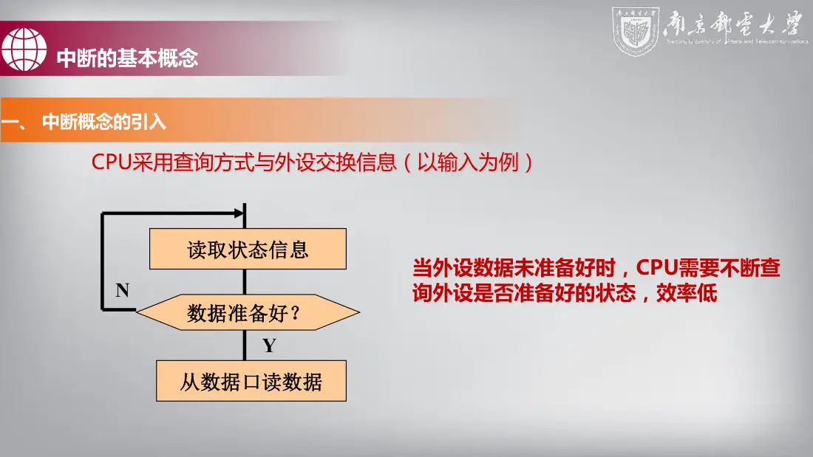

原文：

一、中断概念的引入

CPU采用查询方式与外设交换信息（以输入为例）

当外设数据未准备好时，CPU需要不断查询外设是否准备好的状态，效率低

中断的基本概念

南京邮电大学
Nanjing University of Posts and Telecommunications

### CPU采用中断方式与外设交换信息（以输入为例）

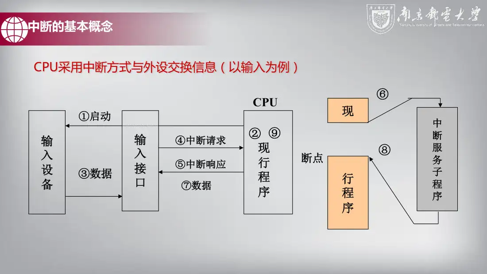

原文：

CPU采用中断方式与外设交换信息（以输入为例）

输入设备

①启动

④中断请求

⑤中断响应

⑦数据

CPU

断点

中断的基本概念

南京邮电大学
Nanjing University of Posts and Telecommunications

### 二、中断

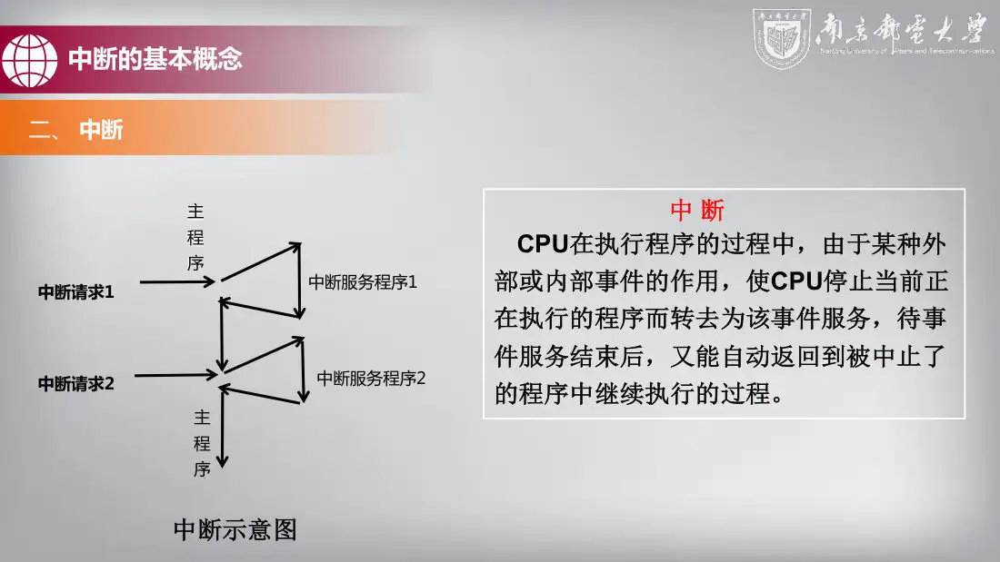

原文：

二、中断

中断

CPU在执行程序的过程中，由于某种外部或内部事件的作用，使CPU停止当前正在执行的程序而转去为该事件服务，待事件服务结束后，又能自动返回到被中止了的程序中继续执行的过程。

中断的基本概念

南京邮电大学
Nanjing University of Posts and Telecommunications

### 二、中断

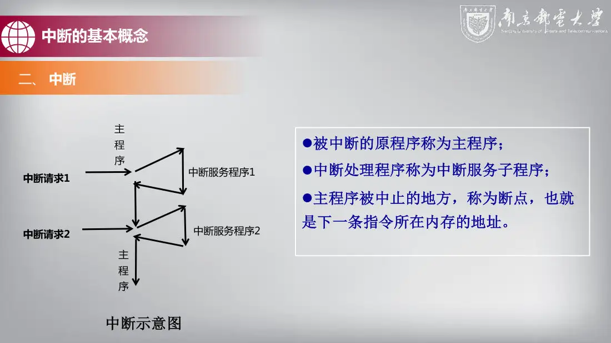

原文：

二、中断

●被中断的原程序称为主程序;

●中断处理程序称为中断服务子程序；

\- 主程序被中止的地方，称为断点，也就是下一条指令所在内存的地址。

中断的基本概念

南京邮电大学
Nanjing University of Posts and Telecommunications

### 中断的基本概念

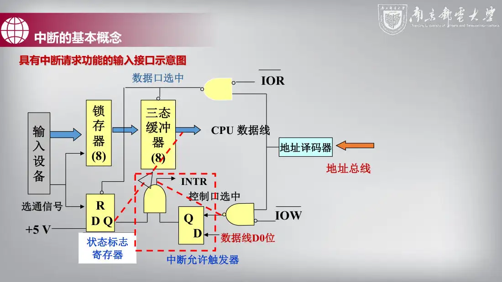

原文：

中断的基本概念

具有中断请求功能的输入接口示意图

南京邮电大学
Nanjing University of Posts and Telecommunications

### 三、中断源及中断分类

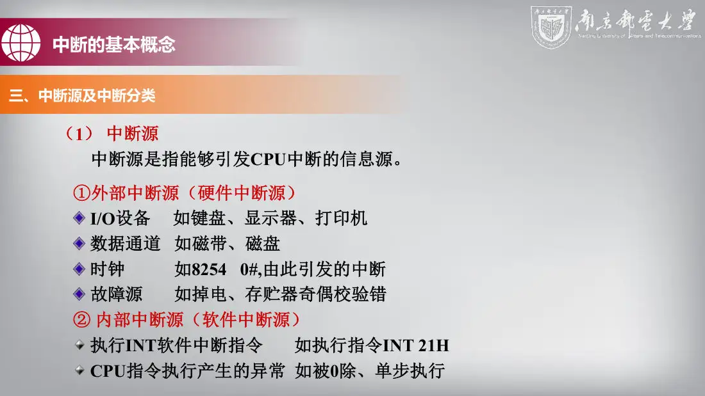

原文：

三、中断源及中断分类

(1) 中断源

中断源是指能够引发CPU中断的信息源。

①外部中断源（硬件中断源）

I/O设备 如键盘、显示器、打印机

数据通道 如磁带、磁盘

时钟 如8254 0#,由此引发的中断

故障源 如掉电、存贮器奇偶校验错

② 内部中断源（软件中断源）

执行INT软件中断指令 如执行指令INT 21H

CPU指令执行产生的异常 如被0除、单步执行

中断的基本概念

南京邮电大学
Nanjing University of Posts and Telecommunications

### 三、中断源及中断分类

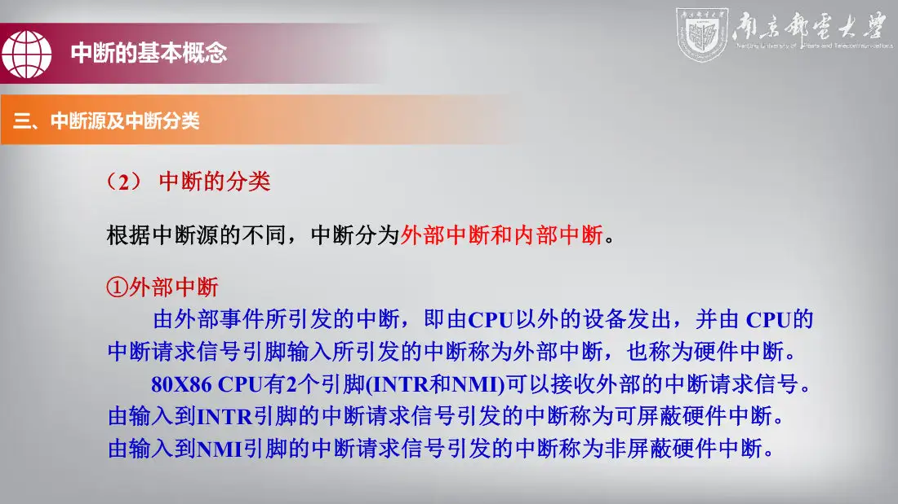

原文：

三、中断源及中断分类

(2) 中断的分类

根据中断源的不同，中断分为外部中断和内部中断。

①外部中断

由外部事件所引发的中断，即由CPU以外的设备发出，并由CPU的中断请求信号引脚输入所引发的中断称为外部中断，也称为硬件中断。

80X86 CPU有2个引脚(INTR和NMI)可以接收外部的中断请求信号。由输入到INTR引脚的中断请求信号引发的中断称为可屏蔽硬件中断。由输入到NMI引脚的中断请求信号引发的中断称为非屏蔽硬件中断。

中断的基本概念

南京邮电大学
Nanjing University of Posts and Telecommunications

### ② 内部中断

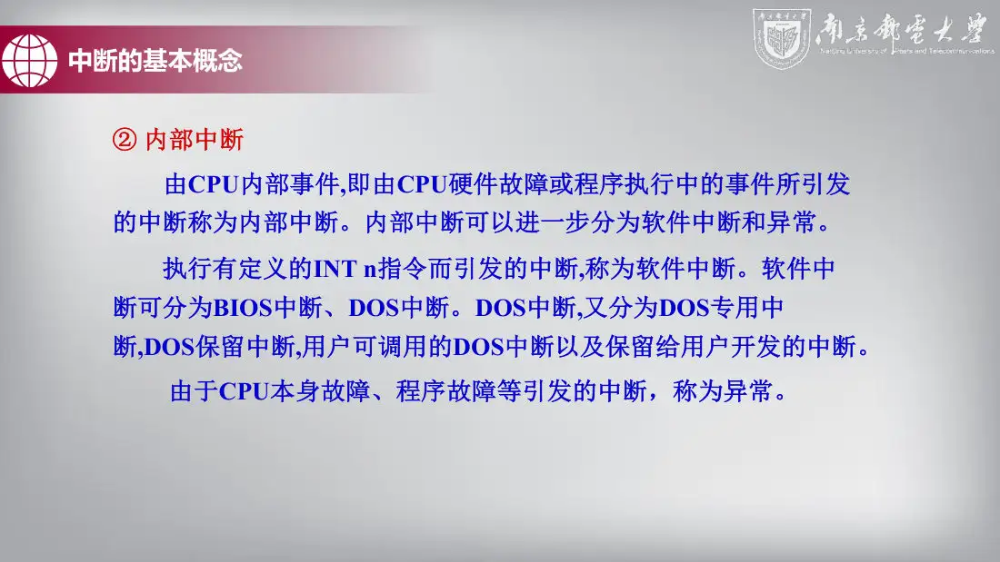

原文：

② 内部中断

由CPU内部事件,即由CPU硬件故障或程序执行中的事件所引发的中断称为内部中断。内部中断可以进一步分为软件中断和异常。

执行有定义的INT n指令而引发的中断,称为软件中断。软件中断可分为BIOS中断、DOS中断。DOS中断,又分为DOS专用中断,DOS保留中断,用户可调用的DOS中断以及保留给用户开发的中断。

由于CPU本身故障、程序故障等引发的中断，称为异常。

中断的基本概念

南京邮电大学
Nanjing University of Posts and Telecommunications

### 部分异常如下:

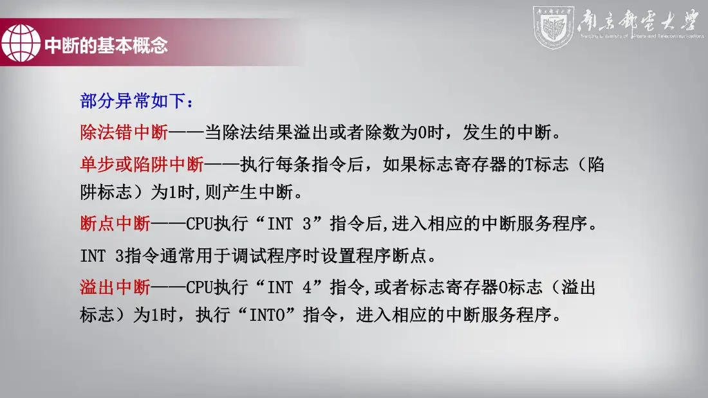

原文：

部分异常如下:

除法错中断——当除法结果溢出或者除数为0时，发生的中断。

单步或陷阱中断——执行每条指令后，如果标志寄存器的T标志（陷阱标志）为1时, 则产生中断。

断点中断——CPU执行 “INT 3” 指令后, 进入相应的中断服务程序。

INT 3指令通常用于调试程序时设置程序断点。

溢出中断——CPU执行 “INT 4” 指令, 或者标志寄存器0标志（溢出标志）为1时，执行 “INTO” 指令，进入相应的中断服务程序。

中断的基本概念

南京邮电大学
Nanjing University of Posts and Telecommunications

### 知识点小结

原文：

知识点小结

本节主要介绍了有关中断的基本概念，中断源以及中断分类。通过本节的学习，学习者能够初步了解中断的基本过程；了解内部中断源和外部中断源；掌握内部中断和外部中断的基本知识。

中断的基本概念

南京邮电大学
Nanjing University of Posts and Telecommunications

### 知识要点

原文：

知识要点

中断类型码

中断向量

中断向量表

中断向量及中断向量表

南京邮电大学
Nanjing University of Posts and Telecommunications

### 一、中断类型码

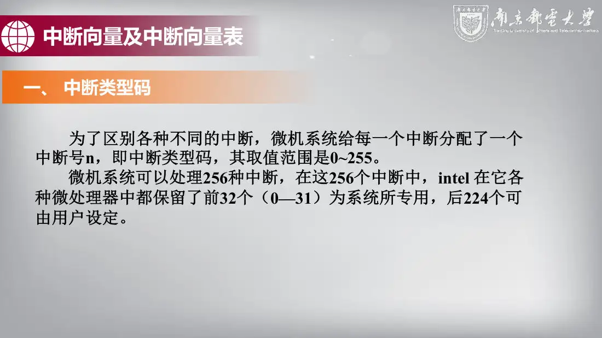

原文：

一、中断类型码

为了区别各种不同的中断，微机系统给每一个中断分配了一个中断号n，即中断类型码，其取值范围是0\~255。

微机系统可以处理256种中断，在这256个中断中，intel在它各种微处理器中都保留了前32个（0—31）为系统所专用，后224个可由用户设定。

中断向量及中断向量表

南京邮电大学
Nanjing University of Posts and Telecommunications

### 一、中断类型码

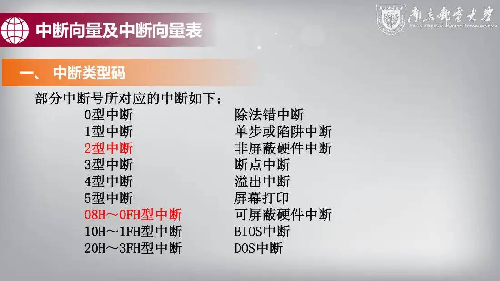

原文：

一、中断类型码

部分中断号所对应的中断如下:

0型中断

除法错中断

1型中断

单步或陷阱中断

2型中断

非屏蔽硬件中断

3型中断

断点中断

4型中断

溢出中断

5型中断

屏幕打印

08H～0FH型中断

可屏蔽硬件中断

10H～1FH型中断

BIOS中断

20H～3FH型中断

DOS中断

中断向量及中断向量表

南京邮电大学
Nanjing University of Posts and Telecommunications

### 二、中断向量

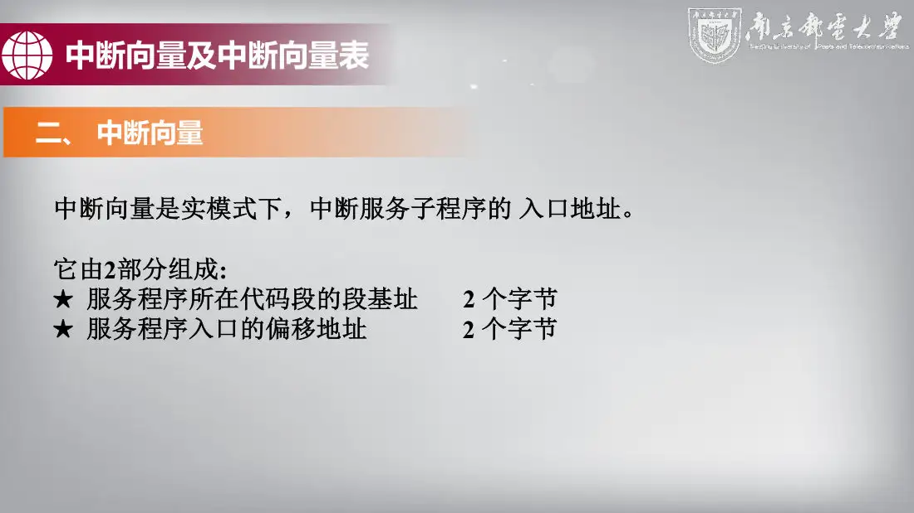

原文：

二、中断向量

中断向量是实模式下，中断服务子程序的入口地址。

它由2部分组成:

★ 服务程序所在代码段的段基址 2 个字节

★ 服务程序入口的偏移地址 2 个字节

中断向量及中断向量表

南京邮电大学
Nanjing University of Posts and Telecommunications

### 三、中断向量表

原文：

三、中断向量表

中断类型码通过一个地址指针表与中断服务程序的入口地址相联系：

实模式下：该表称为中断向量表；

保护模式下：该表称为中断描述符表。

中断向量及中断向量表

南京邮电大学
Nanjing University of Posts and Telecommunications

### 三、中断向量表

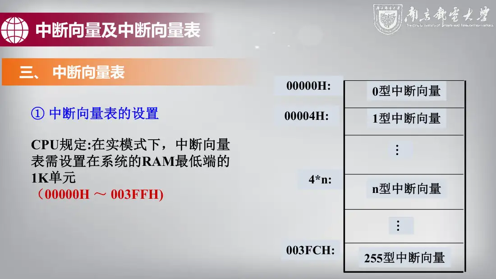

原文：

三、中断向量表

① 中断向量表的设置

CPU规定:在实模式下，中断向量表需设置在系统的RAM最低端的1K单元
(00000H \~ 003FFH)

<table><tr><td>00000H:</td><td>0型中断向量</td></tr><tr><td>00004H:</td><td>1型中断向量</td></tr><tr><td rowspan="2">4*n:</td><td>⋮</td></tr><tr><td>n型中断向量</td></tr><tr><td rowspan="2">003FCH:</td><td>⋮</td></tr><tr><td>255型中断向量</td></tr></table>

中断向量及中断向量表

南京邮电大学
Nanjing University of Posts and Telecommunications

### ②. 中断向量表的表地址与中断类型的关系

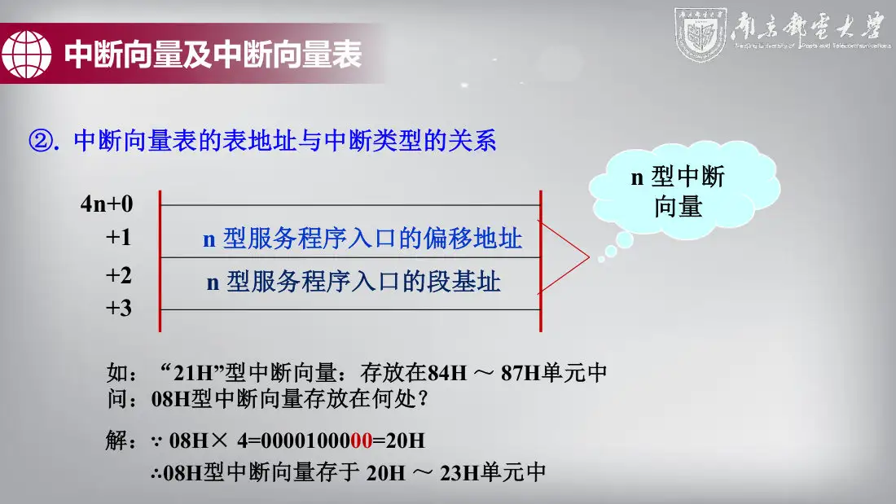

原文：

②. 中断向量表的表地址与中断类型的关系

n 型服务程序入口的偏移地址

n 型服务程序入口的段基址

n 型中断
向量

如：“21H”型中断向量：存放在84H～87H单元中

问：08H型中断向量存放在何处？

解：∵ 08H × 4=0000100000=20H

∴08H型中断向量存于 20H \~ 23H单元中

中断向量及中断向量表

南京邮电大学
Nanjing University of Posts and Telecommunications

### 填空题 4分

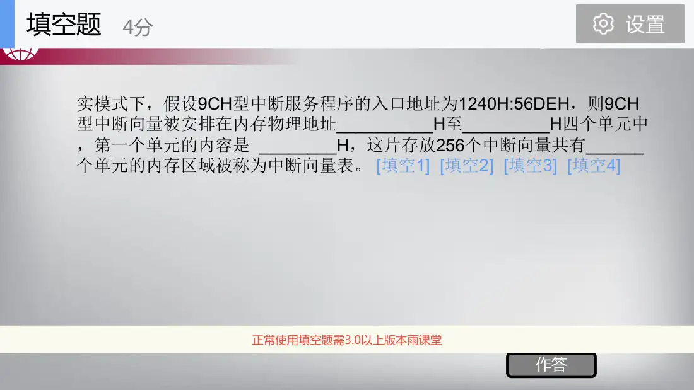

原文：

填空题 4分

实模式下, 假设9CH型中断服务程序的入口地址为1240H:56DEH, 则9CH型中断向量被安排在内存物理地址 H 至 H 四个单元中, 第一个单元的内容是 H, 这片存放256个中断向量共有 个单元的内存区域被称为中断向量表。[填空1] [填空2] [填空3] [填空4]

正常使用填空题需3.0以上版本雨课堂

作答

设置

### ③. 中断向量表的初始化

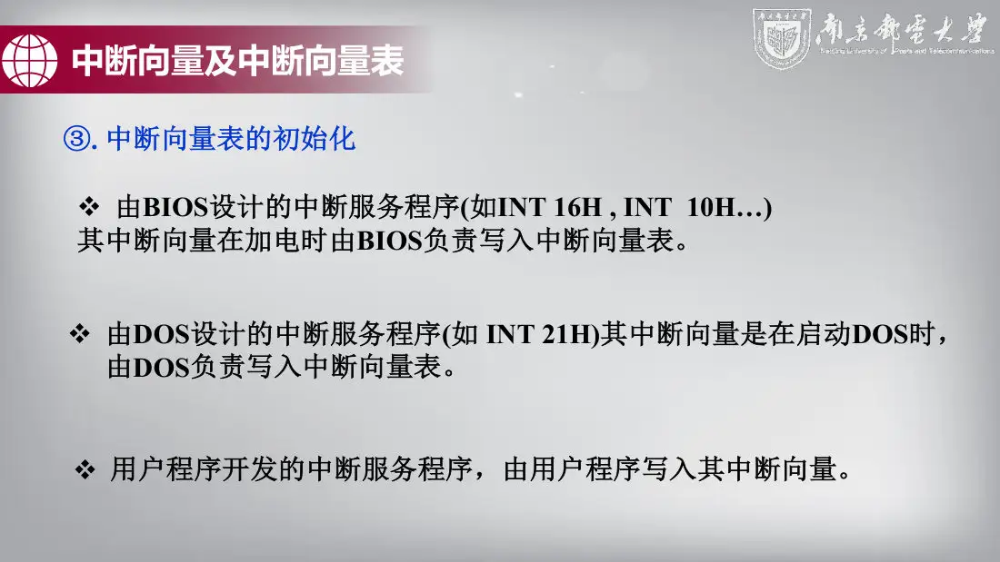

原文：

③. 中断向量表的初始化

✿ 由BIOS设计的中断服务程序(如INT 16H, INT 10H...)其中断向量在加电时由BIOS负责写入中断向量表。

✿ 由DOS设计的中断服务程序(如 INT 21H)其中断向量是在启动DOS时，由DOS负责写入中断向量表。

✿ 用户程序开发的中断服务程序，由用户程序写入其中断向量。

中断向量及中断向量表

南京邮电大学
Nanjing University of Posts and Telecommunications

### 问题：用户如何向中断向量表中写入中断向量？

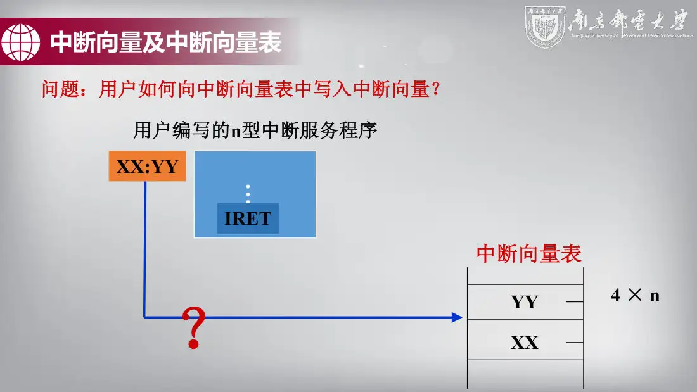

原文：

问题：用户如何向中断向量表中写入中断向量？

用户编写的n型中断服务程序

中断向量表

中断向量及中断向量表

南京邮电大学
Nanjing University of Posts and Telecommunications

### 方法一、用户自己编写程序填写中断向量

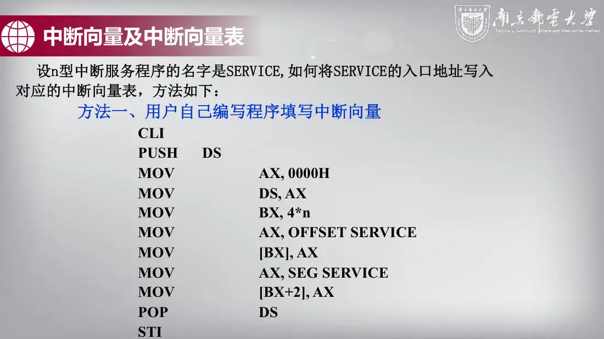

原文：

设n型中断服务程序的名字是SERVICE, 如何将SERVICE的入口地址写入对应的中断向量表，方法如下：

方法一、用户自己编写程序填写中断向量

CLI
PUSH DS
MOV AX, 0000H
MOV DS, AX
MOV BX, 4\*n
MOV AX, OFFSET SERVICE
MOV [BX], AX
MOV AX, SEG SERVICE
MOV [BX+2], AX
POP DS
STI

中断向量及中断向量表

南京微电大学
Nanjing University of Posts and Telecommunications

### 方法二、DOS设计2个子程序，专门用于中断向量的读出、写入

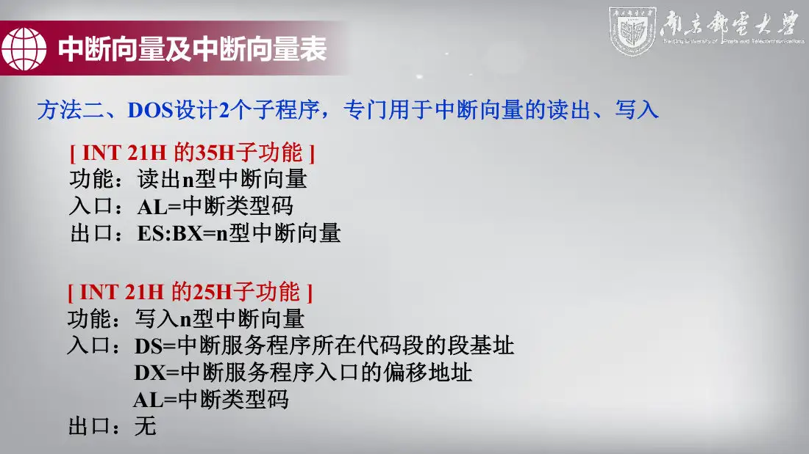

原文：

方法二、DOS设计2个子程序，专门用于中断向量的读出、写入

[ INT 21H 的35H子功能 ]

功能：读出n型中断向量

入口：AL=中断类型码

出口：ES:BX=n型中断向量

[ INT 21H 的25H子功能 ]

功能：写入n型中断向量

入口：DS=中断服务程序所在代码段的段基址

DX=中断服务程序入口的偏移地址

AL=中断类型码

出口：无

中断向量及中断向量表

南京邮电大学
Nanjing University of Posts and Telecommunications

### 采用方法2，对应的程序段如下：

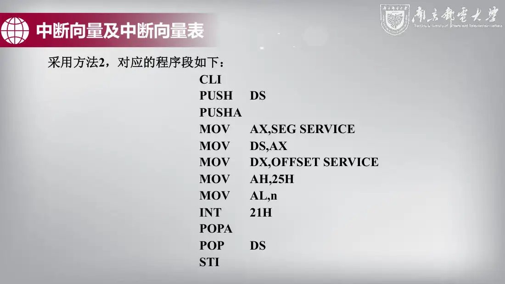

原文：

采用方法2，对应的程序段如下：

CLI
PUSH DS
PUSHA
MOV AX,SEG SERVICE
MOV DS,AX
MOV DX,OFFSET SERVICE
MOV AH,25H
MOV AL,n
INT 21H
POPA
POP DS
STI

中断向量及中断向量表

南京邮电大学
Nanjing University of Posts and Telecommunications

### 知识点小结

原文：

知识点小结

本节主要介绍了中断类型码、中断向量和中断向量表的相关知识。通过学习，学习者应该掌握实模式下中断向量的定义、中断向量表的设置，以及中断向量表的表地址与中断类型之间的关系，同时，需要掌握中断向量表的初始化方法。

中断向量及中断向量表

南京邮电大学
Netting University of Posts and Telecommunications

### 知识要点

原文：

知识要点

中断响应和处理过程

中断向量的引导作用

中断服务子程序的一般结构

中断响应及处理

南京邮电大学
Nanjing University of Posts and Telecommunications

### 一、中断响应和处理过程

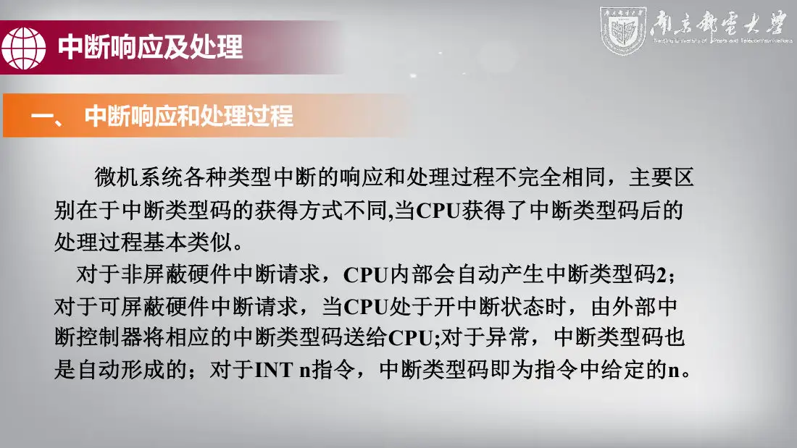

原文：

一、中断响应和处理过程

微机系统各种类型中断的响应和处理过程不完全相同，主要区别在于中断类型码的获得方式不同,当CPU获得了中断类型码后的处理过程基本类似。

对于非屏蔽硬件中断请求，CPU内部会自动产生中断类型码2；对于可屏蔽硬件中断请求，当CPU处于开中断状态时，由外部中断控制器将相应的中断类型码送给CPU；对于异常，中断类型码也是自动形成的；对于INT n指令，中断类型码即为指令中给定的n。

中断响应及处理

南京邮电大学
Nanjing University of Posts and Telecommunications

### CPU获得了中断类型码n后，中断的处理过程如下：

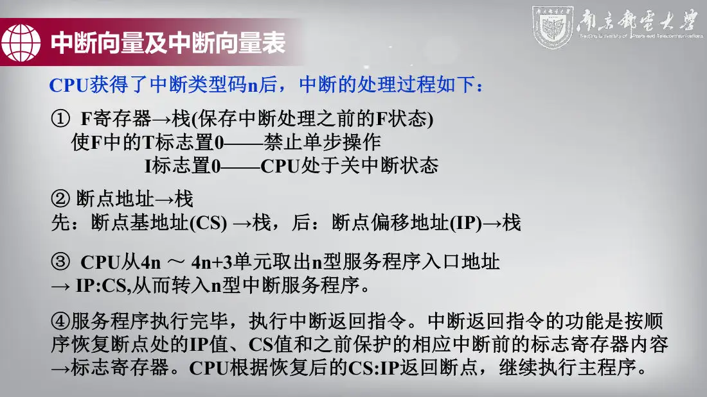

原文：

CPU获得了中断类型码n后，中断的处理过程如下：

① F寄存器→栈(保存中断处理之前的F状态)
使F中的T标志置0——禁止单步操作
I标志置0——CPU处于关中断状态

② 断点地址→栈

先：断点基地址(CS)→栈，后：断点偏移地址(IP)→栈

③ CPU从4n～4n+3单元取出n型服务程序入口地址

→ IP:CS,从而转入n型中断服务程序。

④服务程序执行完毕，执行中断返回指令。中断返回指令的功能是按顺序恢复断点处的IP值、CS值和之前保护的相应中断前的标志寄存器内容→标志寄存器。CPU根据恢复后的CS:IP返回断点，继续执行主程序。

中断向量及中断向量表

南京邮电大学
Nanjing University of Posts and Telecommunications

### XX:YY

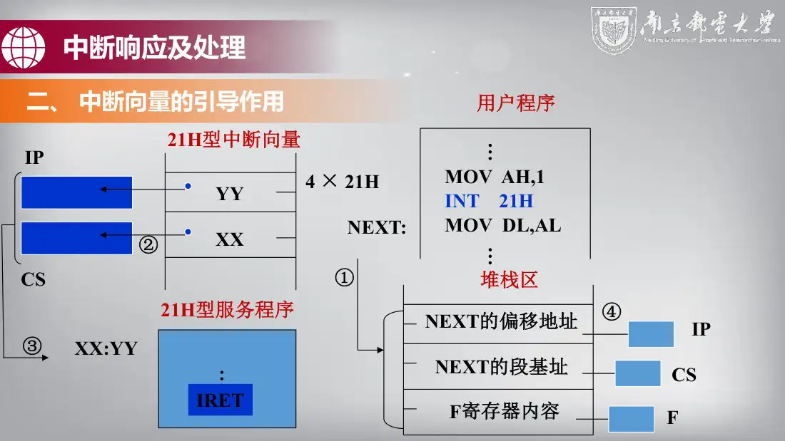

原文：

XX:YY

二、中断向量的引导作用

中断响应及处理

南京邮电大学
Nanjing University of Posts and Telecommunications

### 三、中断服务子程序的结构

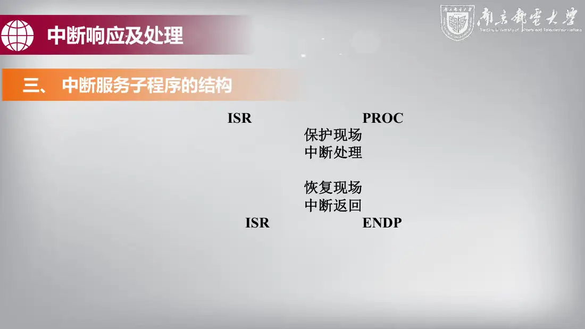

原文：

三、中断服务子程序的结构

<table><tr><td>ISR</td><td>PROC</td></tr><tr><td></td><td>保护现场</td></tr><tr><td></td><td>中断处理</td></tr><tr><td></td><td>恢复现场</td></tr><tr><td></td><td>中断返回</td></tr><tr><td>ISR</td><td>ENDP</td></tr></table>

中断响应及处理

南京邮电大学
Nanjing University of Posts and Telecommunications

### 知识点小结

原文：

知识点小结

本节主要介绍了不同中断类型中断,CPU获取中断类型码n的方法以及CPU获得中断类型码n后，中断响应及处理的过程。通过学习，学习者应该掌握一般中断的响应及处理过程，并体会到中断向量在此过程中的引导作用，掌握中断服务程序的一般结构。

中断响应及处理

南京邮电大学
Nanjing University of Posts and Telecommunications

### 知识要点

原文：

知识要点

中断优先与中断分级

✿禁止中断与中断屏蔽

中断嵌套

中断系统应具备的基本功能

多级中断管理

南京邮电大学
Nanjing University of Posts and Telecommunications

### 一、中断优先与中断分级

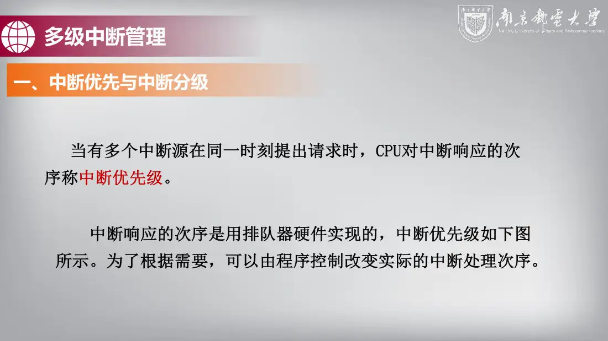

原文：

一、中断优先与中断分级

当有多个中断源在同一时刻提出请求时，CPU对中断响应的次序称中断优先级。

中断响应的次序是用排队器硬件实现的，中断优先级如下图所示。为了根据需要，可以由程序控制改变实际的中断处理次序。

多级中断管理

南京邮电大学
Nanjing University of Posts and Telecommunications

### 80X86响应中断的优先级如下:

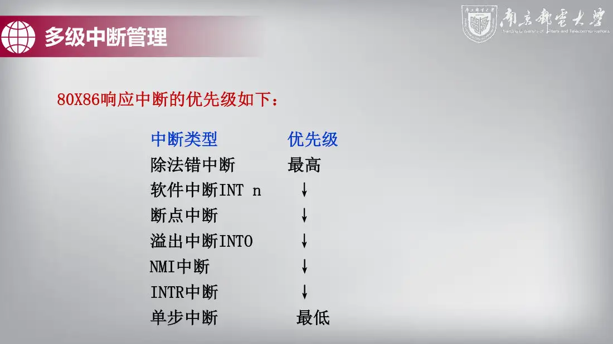

原文：

80X86响应中断的优先级如下:

<table><tr><td>中断类型</td><td>优先级</td></tr><tr><td>除法错中断</td><td>最高</td></tr><tr><td>软件中断INT n</td><td>↓</td></tr><tr><td>断点中断</td><td>↓</td></tr><tr><td>溢出中断INTO</td><td>↓</td></tr><tr><td>NMI中断</td><td>↓</td></tr><tr><td>INTR中断</td><td>↓</td></tr><tr><td>单步中断</td><td>最低</td></tr></table>

多级中断管理

南京邮电大学
Nanjing University of Posts and Telecommunications

### 二、禁止中断与中断屏蔽

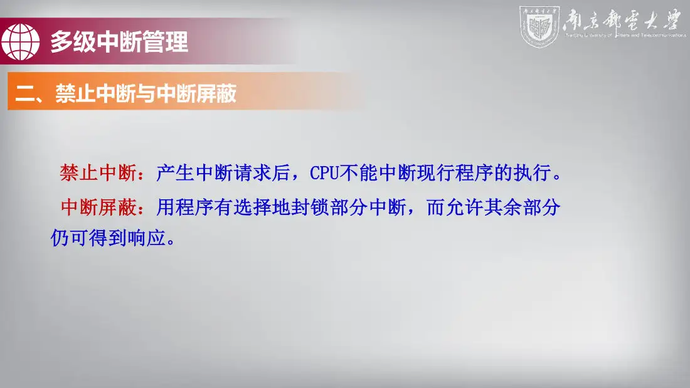

原文：

二、禁止中断与中断屏蔽

禁止中断：产生中断请求后，CPU不能中断现行程序的执行。

中断屏蔽：用程序有选择地封锁部分中断，而允许其余部分仍可得到响应。

多级中断管理

南京邮电大学
Nanjing University of Posts and Telecommunications

### 三、中断嵌套

原文：

三、中断嵌套

中断嵌套：在执行中断服务程序时，仍可再响应中断申请。

多级中断管理

南京邮电大学
Nanjing University of Posts and Telecommunications

### 四、中断系统应具备的基本功能

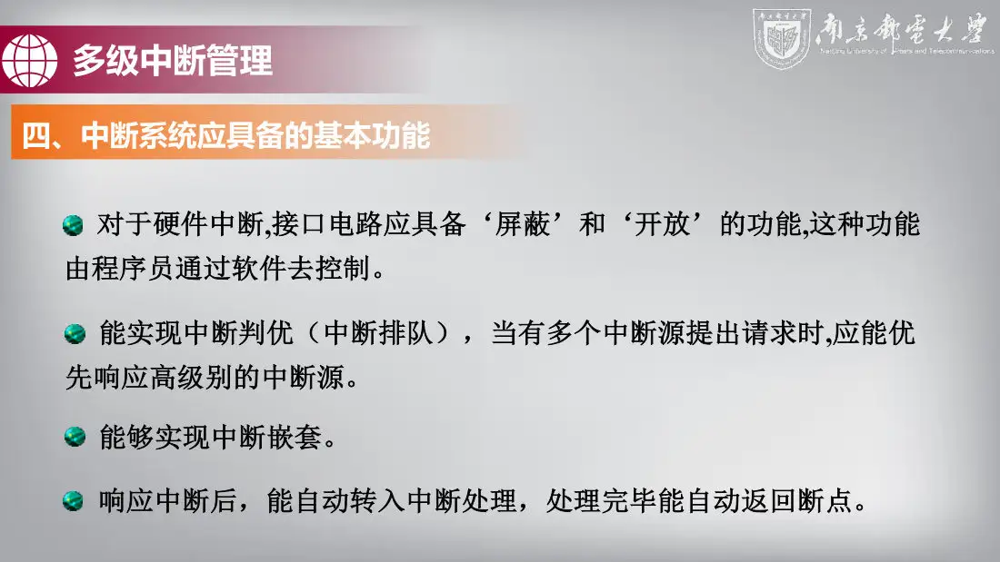

原文：

四、中断系统应具备的基本功能

对于硬件中断,接口电路应具备‘屏蔽’和‘开放’的功能,这种功能由程序员通过软件去控制。

能实现中断判优（中断排队），当有多个中断源提出请求时,应能优先响应高级别的中断源。

能够实现中断嵌套。

响应中断后，能自动转入中断处理，处理完毕能自动返回断点。

多级中断管理

南京邮电大学
Nanjing University of Posts and Telecommunications

### 知识点小结

原文：

知识点小结

本节主要介绍了多级中断管理的相关内容。通过本节的学习，学习者应了解中断优先级、中断嵌套、中断屏蔽和开放等基本概念，并对中断系统应该具备的功能有较为深入的了解。

多级中断管理

南京邮电大学
Nanjing University of Posts and Telecommunications

### 30x86中断指令

原文：

30x86中断指令

知识要点

✿ 80x86中断指令

STI, CLI, INT n, IRET, INTO

南京邮电大学
Nanjing University of Posts and Telecommunications

### 1. 开中断指令 STI

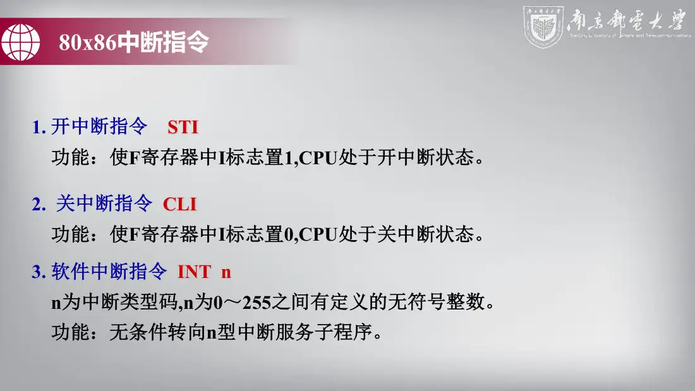

原文：

1. 开中断指令 STI

功能：使F寄存器中I标志置1,CPU处于开中断状态。

2. 关中断指令 CLI

功能：使F寄存器中I标志置0,CPU处于关中断状态。

3. 软件中断指令 INT n

n为中断类型码,n为0～255之间有定义的无符号整数。

功能：无条件转向n型中断服务子程序。

80x86中断指令

南京邮电大学
Nanjing University of Posts and Telecommunications

### INT n 指令的执行过程-CPU响应软件中断的过程

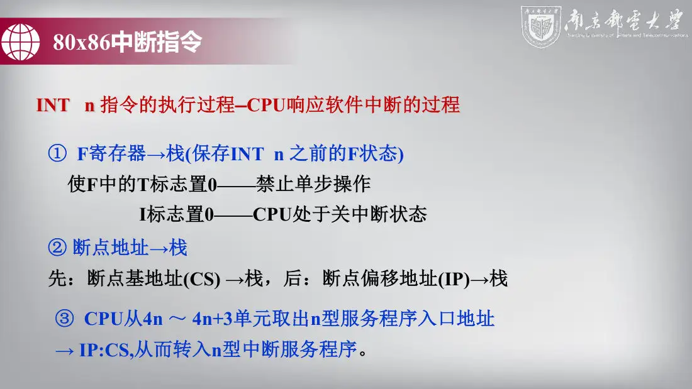

原文：

INT n 指令的执行过程-CPU响应软件中断的过程

① F寄存器→栈(保存INT n 之前的F状态)

使F中的T标志置0——禁止单步操作

I标志置0——CPU处于关中断状态

② 断点地址→栈

先：断点基地址(CS)→栈，后：断点偏移地址(IP)→栈

③ CPU从4n～4n+3单元取出n型服务程序入口地址

→ IP:CS,从而转入n型中断服务程序。

80x86中断指令

南京數電大學
Nanjing University of Posts and Telecommunications

### IRET 是中断服务子程序的出口指令

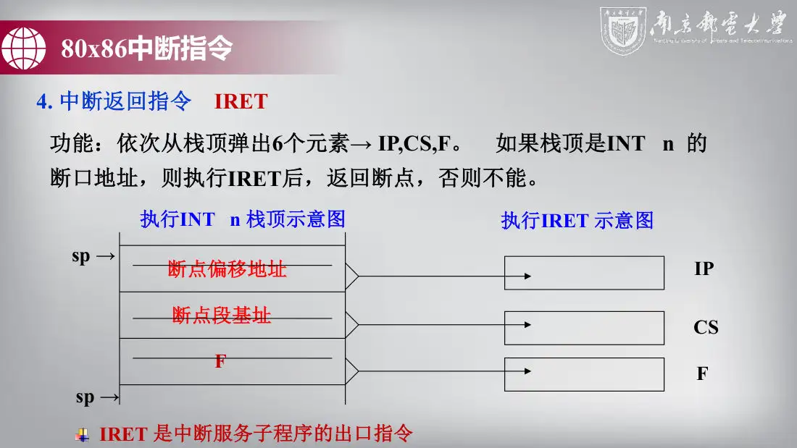

原文：

IRET 是中断服务子程序的出口指令

4. 中断返回指令 IRET

功能：依次从栈顶弹出6个元素 $\rightarrow$ IP,CS,F。如果栈顶是INT n的断口地址，则执行IRET后，返回断点，否则不能。

执行INT n 栈顶示意图

执行IRET 示意图

80x86中断指令

南京邮电大学
Nanjing University of Posts and Telecommunications

### 5. 溢出中断指令 INTO

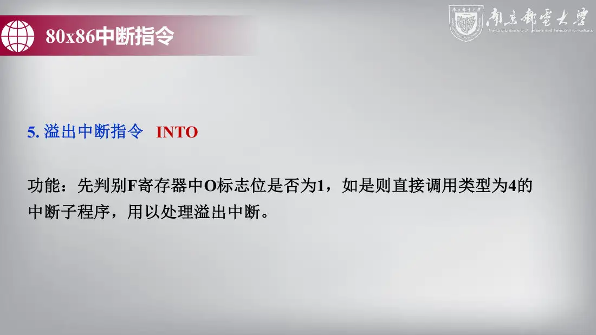

原文：

5. 溢出中断指令 INTO

功能：先判别F寄存器中O标志位是否为1，如是则直接调用类型为4的中断子程序，用以处理溢出中断。

80x86中断指令

南京邮电大学
Nanjing University of Posts and Telecommunications

### 知识点小结

原文：

知识点小结

本节主要介绍了80x86的中断指令。通过本节的学习，学习者应熟练掌握开中断指令STI,关中断指令CLI,软件中断指令INT n,中断返回指令IRET,以及溢出中断指令INTO等指令，为后面的中断程序设计打下基础。

80x86中断指令

南京邮电大学
Nanjing University of Posts and Telecommunications

### 知识要点

原文：

知识要点

8259A功能

✿ 8259A主从级联

中断控制器8259A功能

南京邮电大学
Nanjing University of Posts and Telecommunications

### 中断控制器8259A的功能

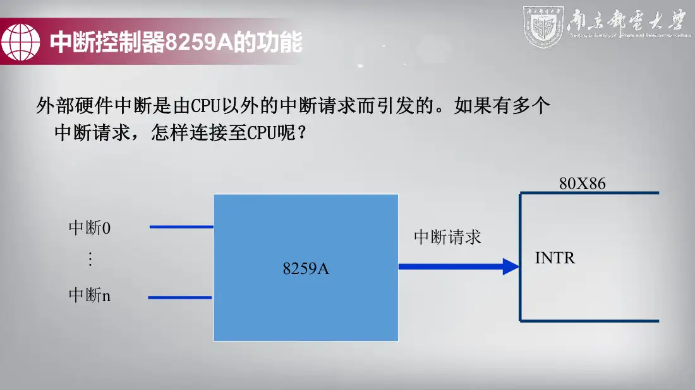

原文：

外部硬件中断是由CPU以外的中断请求而引发的。如果有多个中断请求，怎样连接至CPU呢？

中断控制器8259A的功能

南京邮电大学
Nanjing University of Posts and Telecommunications

### 一、8259A功能

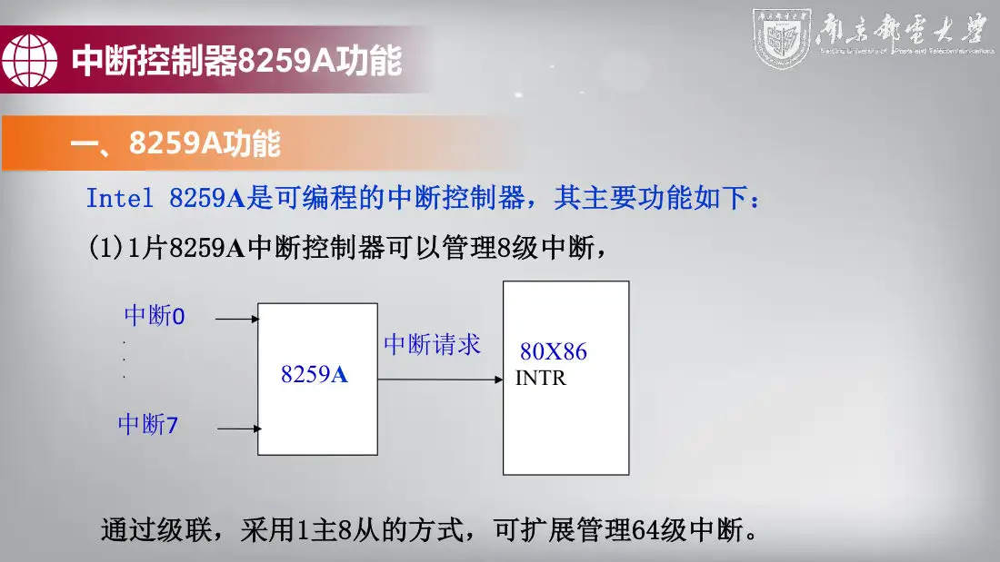

原文：

一、8259A功能

Intel 8259A是可编程的中断控制器，其主要功能如下：

(1)1片8259A中断控制器可以管理8级中断，

中断0

中断7

通过级联，采用1主8从的方式，可扩展管理64级中断。

中断控制器8259A功能

南京邮电大学
Nanjing University of Posts and Telecommunications

### (2) 每一级中断都可以通过设置内部屏蔽字进行屏蔽或允许。

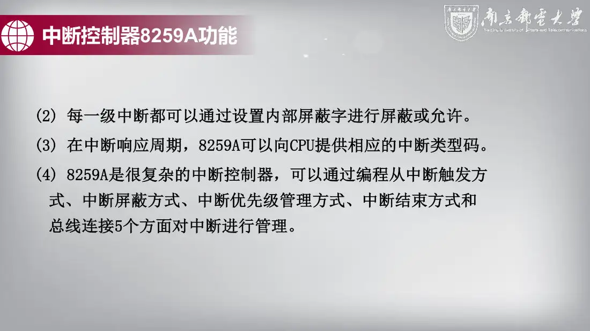

原文：

(2) 每一级中断都可以通过设置内部屏蔽字进行屏蔽或允许。

(3) 在中断响应周期，8259A可以向CPU提供相应的中断类型码。

(4) 8259A是很复杂的中断控制器, 可以通过编程从中断触发方式、中断屏蔽方式、中断优先级管理方式、中断结束方式和总线连接5个方面对中断进行管理。

中断控制器8259A功能

南京数电大学
Nanjing University of Posts and Telecommunications

### 二、8259A主从级联

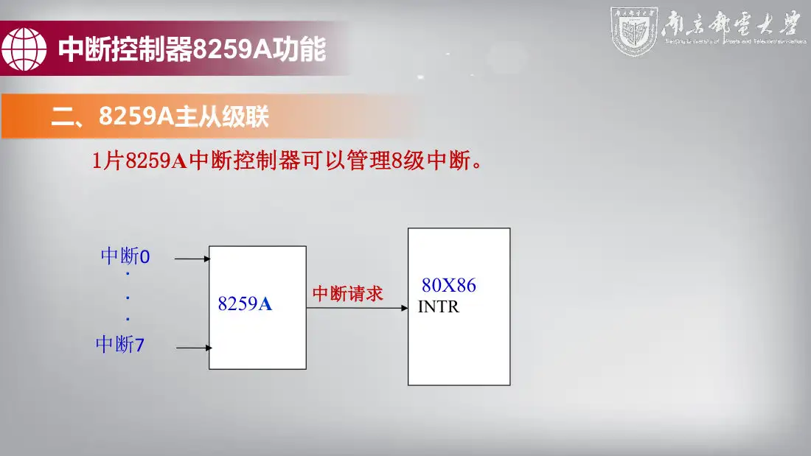

原文：

二、8259A主从级联

1片8259A中断控制器可以管理8级中断。

$$
\begin{array}{l} \text {中断0} \\ \text {中断7} \end{array} \xrightarrow {\text {中断请求}} \boxed {8 2 5 9 A} \xrightarrow {\text {中断请求}} \boxed {8 0 X 8 6} \boxed {\text {INTR}}
$$

中断控制器8259A功能

南京概電大學
Nanjing University of Posts and Telecommunications

### 二、8259A主从级联

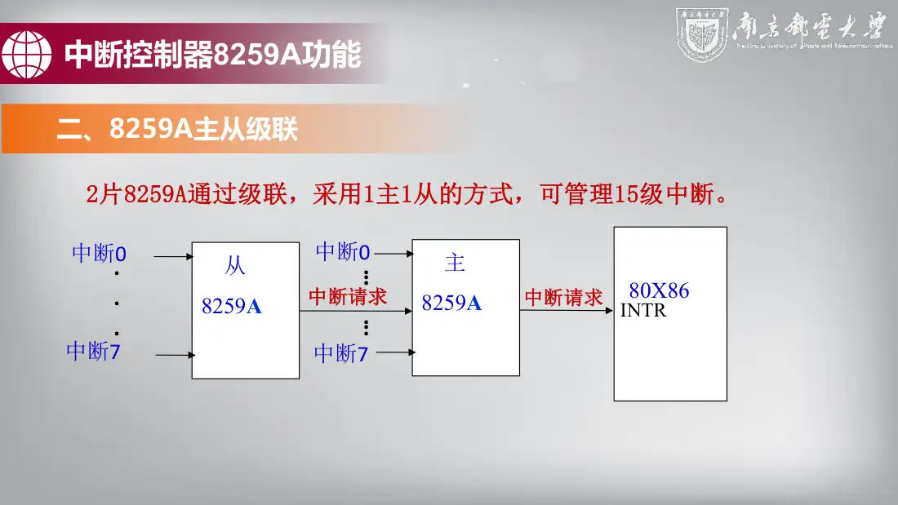

原文：

二、8259A主从级联

2片8259A通过级联，采用1主1从的方式，可管理15级中断。

$$
\begin{array}{c c c} \text {中断0} & \longrightarrow & \text {从} \\ \cdot & \longrightarrow & \text {8259A} \\ \cdot & \longrightarrow & \text {中断请求} \\ \cdot & \longrightarrow & \text {中断7} \\ \text {中断7} & \longrightarrow & \text {主} \\ \text {中断0} & \longrightarrow & \text {8259A} \\ \text {中断请求} & \longrightarrow & \text {中断请求} \\ \text {中断7} & \longrightarrow & \text {80X86 INTR} \end{array}
$$

中断控制器8259A功能

南京邮电大学
Nanjing University of Posts and Telecommunications

### 二、8259A主从级联

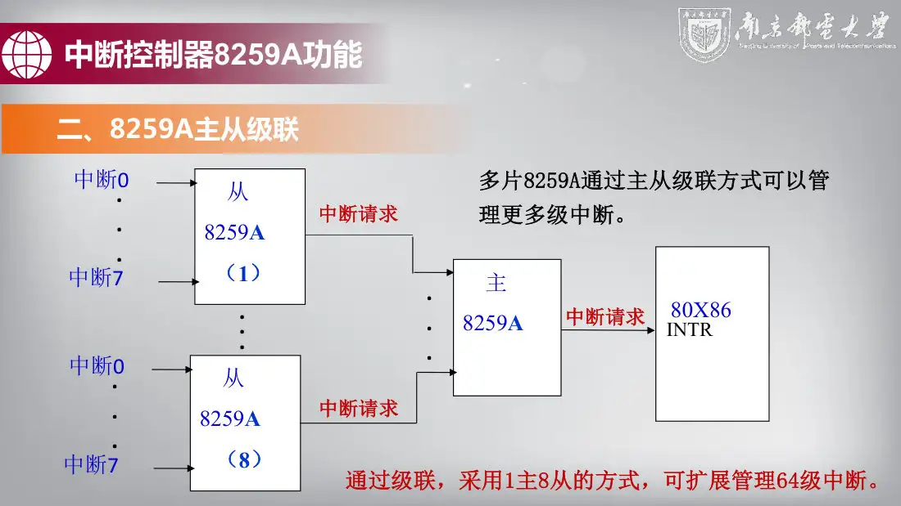

原文：

二、8259A主从级联

中断0

中断请求

中断7

中断0

中断7

中断请求

多片8259A通过主从级联方式可以管理更多级中断。

中断请求

通过级联，采用1主8从的方式，可扩展管理64级中断。

中断控制器8259A功能

南京邮电大学
Nanjing University of Posts and Telecommunications

### 知识点小结

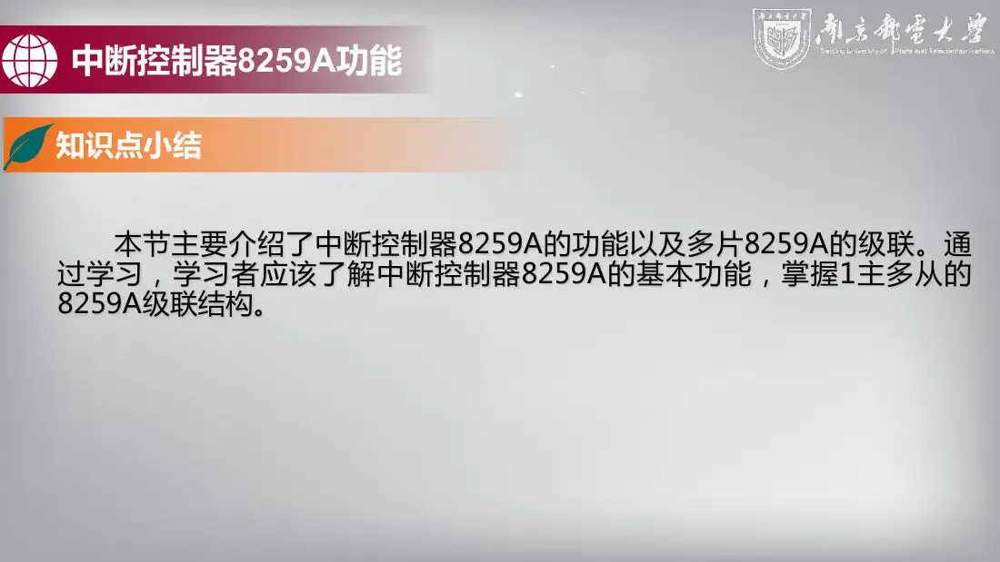

原文：

知识点小结

本节主要介绍了中断控制器8259A的功能以及多片8259A的级联。通过学习，学习者应该了解中断控制器8259A的基本功能，掌握1主多从的8259A级联结构。

中断控制器8259A功能

南京邮电大学
Nanjing University of Posts and Telecommunications

### 知识要点

原文：

知识要点

✿ 8259A内部结构

中断控制器8259A功能及内部结构

南京邮电大学
Nanjing University of Posts and Telecommunications

### 一、8259A内部结构

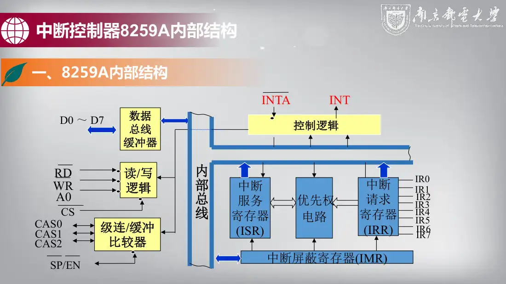

原文：

一、8259A内部结构

中断控制器8259A内部结构

南京邮电大学
Nanjing University of Posts and Telecommunications

### (1) 中断请求寄存器 ( IRR )

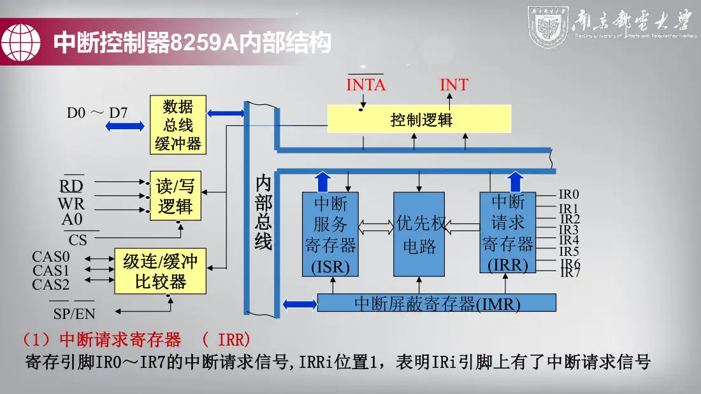

原文：

(1) 中断请求寄存器 ( IRR )

寄存引脚IRO～IR7的中断请求信号, IRRi位置1，表明IRi引脚上有了中断请求信号

中断控制器8259A内部结构

南京邮电大学
Nanjing University of Posts and Telecommunications

### (2) 中断屏蔽寄存器 (IMR)

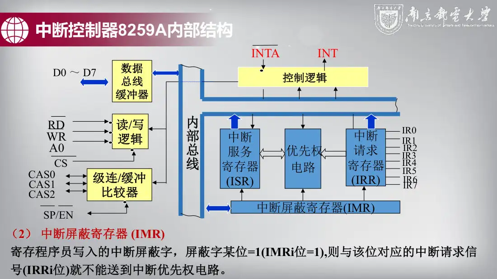

原文：

(2) 中断屏蔽寄存器 (IMR)

寄存程序员写入的中断屏蔽字，屏蔽字某位=1(IMRi位=1)，则与该位对应的中断请求信号(IRRi位)就不能送到中断优先权电路。

中断控制器8259A内部结构

南京邮电大学
Nanjing University of Posts and Telecommunications

### 优先权电路

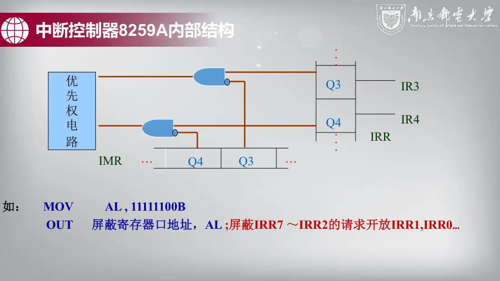

原文：

优先权电路

如: MOV AL, 11111100B

OUT 屏蔽寄存器口地址，AL；屏蔽IRR7～IRR2的请求开放IRR1,IRR0...

中断控制器8259A内部结构

南京数电大学
Nanjing University of Posts and Telecommunications

### 优先权电路

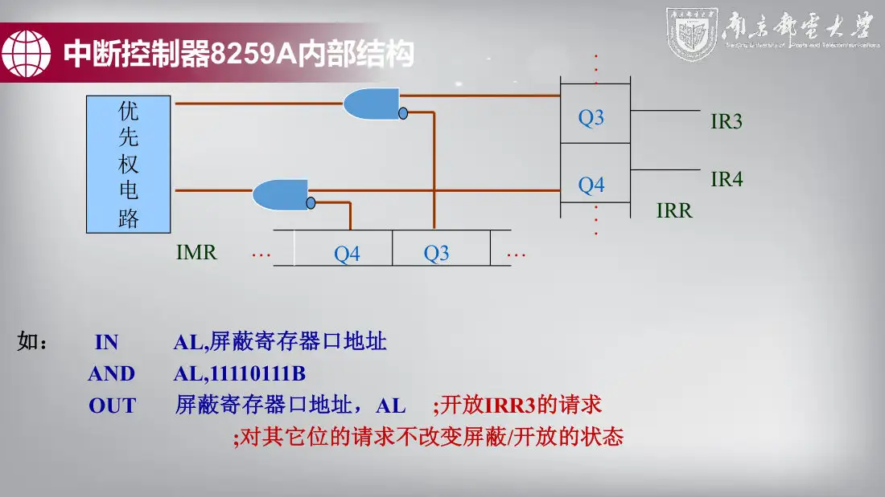

原文：

优先权电路

如: IN AL,屏蔽寄存器口地址

AND AL,11110111B

OUT 屏蔽寄存器口地址，AL ;开放IRR3的请求

;对其它位的请求不改变屏蔽/开放的状态

南京邮电大学
Nanjing University of Posts and Telecommunications

中断控制器8259A内部结构

### 中断控制器8259A内部结构

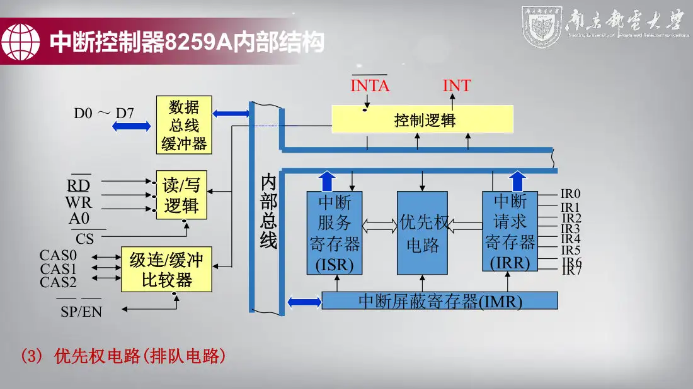

原文：

中断控制器8259A内部结构

南京邮电大学
Nanjing University of Posts and Telecommunications

### 作用:

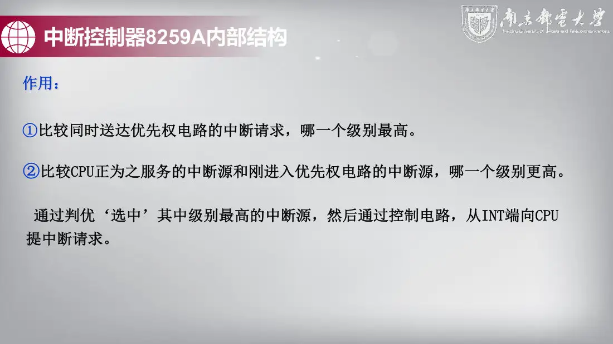

原文：

作用:

①比较同时送达优先权电路的中断请求，哪一个级别最高。

②比较CPU正为之服务的中断源和刚进入优先权电路的中断源，哪一个级别更高。

通过判优‘选中’其中级别最高的中断源，然后通过控制电路，从INT端向CPU提中断请求。

中断控制器8259A内部结构

南京邮电大学
Nanjing University of Posts and Telecommunications

### (4) 中断控制电路

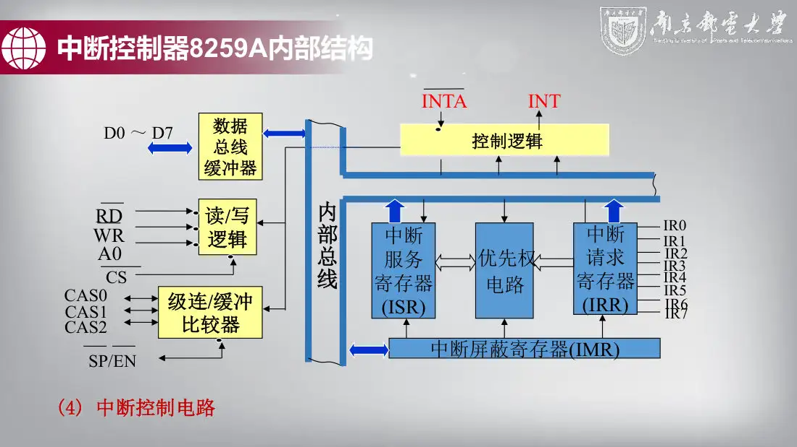

原文：

(4) 中断控制电路

中断控制器8259A内部结构

南京邮电大学
Nanjing University of Posts and Telecommunications

### 作用:

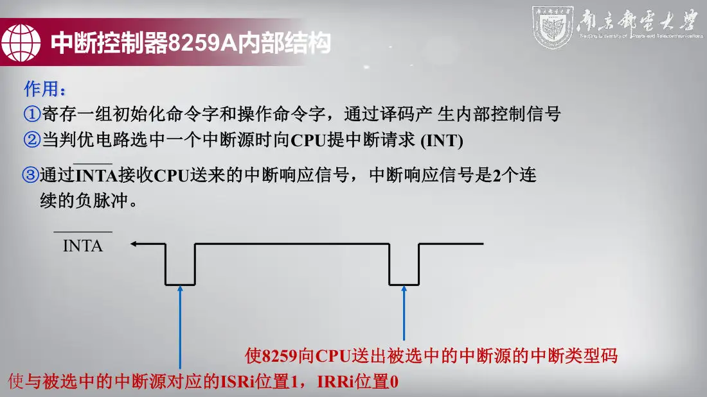

原文：

作用:

①寄存一组初始化命令字和操作命令字，通过译码产生内部控制信号

②当判优电路选中一个中断源时向CPU提中断请求(INT)

③通过INTA接收CPU送来的中断响应信号，中断响应信号是2个连续的负脉冲。

使与被选中的中断源对应的ISRi位置1，IRRi位置0

中断控制器8259A内部结构

南京概電大學
Nanjing University of Posts and Telecommunications

### 中断控制器8259A内部结构

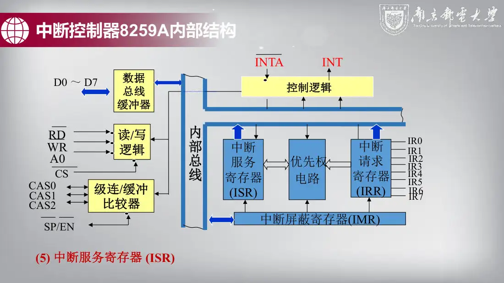

原文：

中断控制器8259A内部结构

南京邮电大学
Nanjing University of Posts and Telecommunications

### ISR: 8位寄存器，ISRi位与IRRi位一一对应

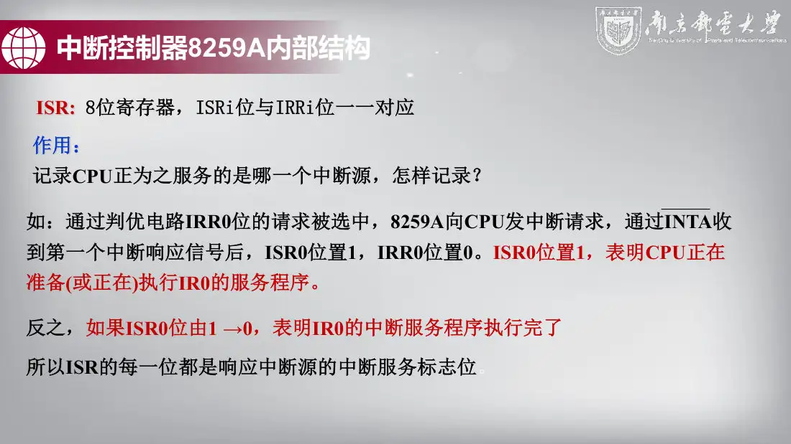

原文：

ISR: 8位寄存器，ISRi位与IRRi位一一对应

作用:

记录CPU正为之服务的是哪一个中断源，怎样记录？

如：通过判优电路IRR0位的请求被选中，8259A向CPU发中断请求，通过INTA收到第一个中断响应信号后，ISR0位置1，IRR0位置0。ISR0位置1，表明CPU正在准备(或正在)执行IR0的服务程序。

反之，如果ISR0位由1 → 0，表明IR0的中断服务程序执行完了

所以ISR的每一位都是响应中断源的中断服务标志位。

中断控制器8259A内部结构

南京邮电大学
Nanjing University of Posts and Telecommunications

### (6) 数据总线缓冲器

原文：

(6) 数据总线缓冲器

作用：①完成与CPU数据线配接

②接收初始化命令字，操作命令字

③当收到第二个中断响应脉冲时，通过他们

向CPU送出被选中的中断源的中断类型码n

在这之后CPU从4n+0～4n+3单元取出n型中断向量，从而转入n型服务程序。

中断控制器8259A内部结构

南京邮电大学
Nanjing University of Posts and Telecommunications

### (7) 读/写控制模块

原文：

(7) 读/写控制模块

功能：接收片选信号 $\overline{\mathrm{CS}}$ 、端口选择信号AO和读写控制信号 $\overline{\mathrm{RD}}$ 、 $\overline{\mathrm{WR}}$ 。一片8259A在系统中占用两个口地址,用末位地址线AO选择端口,其它地址线通过译码产生8259A的片选信号。

(8) 级连/缓冲比较器

一位8259A可以管理8级中断，二片8259A“级连”可管理15级中断，级连/缓冲比较器是为完成多片8259A级连设置的模块。

中断控制器8259A内部结构

南京邮电大学
Nanjing University of Posts and Telecommunications

### 知识点小结

原文：

知识点小结

本节主要介绍了中断控制器8259A的内部结构。通过学习，学习者应该掌握8259A内部中断请求寄存器（IRR），中断屏蔽寄存器（IMR），优先权电路，中断控制逻辑，中断服务寄存器（ISR）等各个寄存器及部件的作用，掌握内部中断屏蔽字的设置方法。为后面可屏蔽硬件中断程序的设计打下基础。

中断控制器8259A内部结构

南京邮电大学
Netting University of Posts and Telecommunications

### 一、8259A外部引脚

原文：

一、8259A外部引脚

IR0 \~ IR7 ：外部中断请求信号输入

INT : 输出，指向CPU的INTR端

INTA：输入，接收CPU发来的中断响应

D0\~D7 : 输入/输出，数据总线

CS : 片选信号

A0 : 地址线A0，用于选择内部端口

WR、RD：读/写控制信号

CAS0\~CAS2: 用于8259级联

SP/EN : 用于8259级联

引脚信号
<table><tr><td>CS</td><td>1</td><td>28</td><td>Vcc</td></tr><tr><td>WR</td><td>2</td><td>27</td><td>A0</td></tr><tr><td>RD</td><td>3</td><td>26</td><td>INTA</td></tr><tr><td>D7</td><td>4</td><td>25</td><td>IR7</td></tr><tr><td>D6</td><td>5</td><td>24</td><td>IR6</td></tr><tr><td>D5</td><td>6</td><td>23</td><td>IR5</td></tr><tr><td>D4</td><td>7</td><td>22</td><td>IR4</td></tr><tr><td>D3</td><td>8</td><td>21</td><td>IR3</td></tr><tr><td>D2</td><td>9</td><td>20</td><td>IR2</td></tr><tr><td>D1</td><td>10</td><td>19</td><td>IR1</td></tr><tr><td>D0</td><td>11</td><td>18</td><td>IR0</td></tr><tr><td>CAS0</td><td>12</td><td>17</td><td>INT</td></tr><tr><td>CAS1</td><td>13</td><td>16</td><td>SP/EN</td></tr><tr><td>GND</td><td>14</td><td>15</td><td>CAS2</td></tr></table>

中断控制器8259A中断过程

南京邮电大学
Nanjing University of Posts and Telecommunications

### 8259A寄存器读写地址表

原文：

8259A寄存器读写地址表

<table><tr><td> $\overline{CS}$ </td><td>A0</td><td> $\overline{RD}$ </td><td> $\overline{WR}$ </td><td>奇地址/偶地址</td><td>功能</td></tr><tr><td>0</td><td>0</td><td>1</td><td>0</td><td>偶地址</td><td>写ICW1、ICW2、ICW3</td></tr><tr><td>0</td><td>0</td><td>0</td><td>1</td><td>偶地址</td><td>读查询字、IRR、ISR</td></tr><tr><td>0</td><td>1</td><td>1</td><td>0</td><td>奇地址</td><td>写ICW2、ICW3、ICW4、OCW4</td></tr><tr><td>0</td><td>1</td><td>0</td><td>1</td><td>奇地址</td><td>读IMR</td></tr><tr><td>X</td><td>X</td><td>1</td><td>1</td><td></td><td>数据总线为高阻态</td></tr></table>

中断控制器8259A中断过程

南京邮电大学
Nanjing University of Posts and Telecommunications

### 二、8259A的中断过程-CPU响应可屏蔽硬件中断的过程

原文：

二、8259A的中断过程-CPU响应可屏蔽硬件中断的过程

(1) 首先由中断请求寄存器寄存加到引脚IR0～IR7上的中断请求。

(2) 在中断屏蔽寄存器的管理下,没有被屏蔽的中断请求被送到优先权电路判优。

(3) 经过优先权电路的判别,选中当前级别最高的中断源,然后从引脚INT向CPU发出中断请求信号。

(4) CPU满足一定条件后,向8259A发出2个中断响应信号(负脉冲)。

中断控制器8259A中断过程

南京邮电大学
Nanjing University of Posts and Telecommunications

### 中断控制器8259A中断过程

原文：

(5) 8259A从引脚INTA收到第1个中断响应信号之后,立即使中断服务寄存器中与被选中的中断源对应的那一位置1,同时把中断请求寄存器中的相应位清0。

(6) 从引脚INTA收到第2个中断响应信号后,8259A把选中的中断源类型码n,通过数据线送往CPU。

(7) 在实模式下, CPU从 $4 \times n \sim 4 \times n + 3$ 单元取出该中断源的中断向量 $\rightarrow$ IP、CS, 从而引导CPU执行该中断源的中断服务程序。

中断控制器8259A中断过程

南京邮电大学
Nanjing University of Posts and Telecommunications

### 中断控制器8259A中断过程

原文：

中断控制器8259A中断过程

南京邮电大学
Nanjing University of Posts and Telecommunications

### 中断控制器8259A中断过程

原文：

中断控制器8259A中断过程

南京邮电大学
Nanjing University of Posts and Telecommunications

### 中断控制器8259A中断过程

原文：

中断控制器8259A中断过程

南京邮电大学
Nanjing University of Posts and Telecommunications

### 中断请求

原文：

中断请求

中断屏蔽

寄存器IRR

寄存器IMR

送出

优

屏蔽

先

送出

INT

权

电

路

DO

INTR

D7

INTA

设IRO优先级高于IR7，排队结果选中IRO

中断控制器8259A中断过程

南京邮电大学
Nanjing University of Posts and Telecommunications

### 中断控制器8259A中断过程

原文：

中断控制器8259A中断过程

南京邮电大学
Nanjing University of Posts and Telecommunications

### 寄存器IRR

原文：

寄存器IRR

中断屏蔽

寄存器IMR

送出

送出

INT

先

权

电

路

INTR

INTA

8259A收到第1个脉冲信号，ISRO由0变1, 同时IRRO由1变0

中断控制器8259A中断过程

南京邮电大学
Nanjing University of Posts and Telecommunications

### 8259A

原文：

8259A

中断请求

寄存器IRR

中断屏蔽

寄存器IMR

送出

INT

先

DO

INTR

D0

权

屏蔽

电

D7

0

送出

路

INTA

INTA

第2个脉冲

中断控制器8259A中断过程

南京邮电大学
Nanjing University of Posts and Telecommunications

### 8259A

原文：

8259A

中断服务寄存器ISR

8259A收到第2个脉冲信号后，向CPU发送对应中断类型码

CPU

假设IRO对应中断类型码为08H

中断控制器8259A中断过程

南京邮电大学
Nanjing University of Posts and Telecommunications

### CPU

原文：

CPU

中断服务寄存器ISR

CPU得到中断类型码08H后，在中断向量表中找到对应中断向量，转而执行对应中断服务程序，在服务程序中对通过IRO提出中断请求的外设服务

中断控制器8259A中断过程

南京邮电大学
Nanjing University of Posts and Telecommunications

### 中断请求寄存器IRR

原文：

中断请求寄存器IRR

中断屏蔽中断服务寄存器ISR

送出

权

CPU完成中断服务程序中的任务，在执行IRET前，向8259A写中断结束命令字。

中断结束命令字

INTA

CPU

中断控制器8259A中断过程

南京数电大学
Nanjing University of Posts and Telecommunications

### 中断服务寄存器ISR

原文：

中断服务寄存器ISR

8259A的ISRO由1变0，表示对来自IRO上的中断请求服务完毕。同时,CPU执行中断服务程序的最后一条指令IRET,返回被中断的程序继续原来的任务

南京数电大学
Nanjing University of Posts and Telecommunications

中断控制器8259A中断过程

### 寄存器IRR

原文：

寄存器IRR

中断屏蔽

寄存器IMR

送出

屏蔽

送出

中断服务寄存器ISR

优先

权

电

路

INT

对IRO上的中断请求服务完成后，假如8259A的ISR7上的中断请求仍然维持有效，则可以开始以同样的过程处理IR7中断请求。

INTR

INTA

CPU

中断控制器8259A中断过程

南京邮电大学
Nanjing University of Posts and Telecommunications

### 三、8259A的中断管理方式

原文：

三、8259A的中断管理方式

中断触发方式

边沿触发

电平触发

中断屏蔽方式

常规屏蔽方式

特殊屏蔽方式

8259A

完全嵌套方式

中断管理

中断优先级管理方式

方式

特殊嵌套方式

常规EOI循环方式

优先级循环方式

自动EOI循环方式

自动EOI方式

中断结束方式

特殊EOI循环方式

非自动EOI方式

常规EOI方式

总线连接方式

缓冲方式

非缓冲方式

特殊EOI方式

中断控制器8259A中断过程

南京邮电大学
Nanjing University of Posts and Telecommunications

### 知识点小结

原文：

知识点小结

本节主要介绍了中断控制器8259A的外部引脚以及8259A的中断过程。通过本节的学习，学习者应该了解8259A的外部引脚，掌握CPU响应可屏蔽中断的过程，并对8259A的中断管理方式有一定的了解。

中断控制器8259A中断过程

南京邮电大学
Nanjing University of Posts and Telecommunications

### 知识要点

原文：

知识要点

PC系列机中断管理方式

PC系列机中8259A的编程

✿ 非屏蔽中断

PC系列机中断管理方式

南京概電大學
Nanjing University of Posts and Telecommunications

### 一、PC系列机中断管理方式

原文：

一、PC系列机中断管理方式

8259A中断控制器是中断系统的核心器件，对系统8259A的初始化编程是在微机启动之后由BIOS自动完成的，设定的中断管理方式为：

① 系统8259A,中断触发方式为边沿触发，↑// 为中断请求。

PC系列机中断管理方式

南京邮电大学
Nanjing University of Posts and Telecommunications

### 单选题 1分

原文：

单选题 1分

CPU执行IRET中断返回指令，返回地址来自于（ ）。 A. ROM区 B. 堆栈区 C. 中断向量表 D. 寄存器 A ROM区 B. 堆栈区 C. 中断向量表 D. 寄存器 D 寄存器

设置

### ② 中断屏蔽方式采用常规屏蔽方式

原文：

② 中断屏蔽方式采用常规屏蔽方式

即应用时，向8259A中断屏蔽寄存器写入适当屏蔽字即可屏蔽/开放某一级中断。

③ 中断源为固定优先级

即IRO中断请求级别最高，IR7中断请求级别最低。

④采用常规中断结束方式

即在中断服务子程序结束之前向8259送中断结束命令。

PC系列机中断管理方式

南京邮电大学
Nanjing University of Posts and Telecommunications

### 单选题 1分

原文：

单选题 1分

PC系列机中，需要对IR6、IR1进行中断屏蔽，则应将8259A中断屏蔽寄存器的中断屏蔽字置为( )。
A.42H    B.FFH    C.00H    D.BDH
A 42H
B FFH
C 00H
D BDH

设置

### 外设有45个中断源，至少需要（）片8259A级联。

原文：

外设有45个中断源，至少需要（）片8259A级联。
A.5 B.6 C.7 D.8
A 5
B 6
C 7
D 8

单选题 1分

设置

### 二、PC系列机中8259的编程

原文：

二、PC系列机中8259的编程

286以上的微机，对8259A的编程，分两步进行：

★对8259A进行初始化编程

——系统加电后，由BIOS完成

PC系列机中断管理方式

南京邮电大学
Nanjing University of Posts and Telecommunications

### ★★对8259A进行应用编程

原文：

★★对8259A进行应用编程

——编写中断程序时完成，有2项内容：

①需要时，向8259A中断屏蔽寄存器写入屏蔽字。

②每一个硬件中断服务程序结束前必须向8259A送中断结束命令字，通知8259A本次中断结束，否则8259A不能响应同一中断源的下次中断。

8259A收到中断结束命令后，把ISR中的置1位清0！！

PC系列机中断管理方式

南京邮电大学
Nanjing University of Posts and Telecommunications

### 三、非屏蔽中断

原文：

三、非屏蔽中断

非屏蔽中断:

输入到NMI引脚的中断请求信号，引发的中断。

•1. 响应非屏蔽中断的条件

①有非屏蔽中断请求，没有DMA请求

②一条指令执行完

PC系列机中断管理方式

南京邮电大学
Nanjing University of Posts and Telecommunications

### •2. CPU响应非屏蔽中断过程

原文：

•2. CPU响应非屏蔽中断过程

CPU在每一条指令的最后一个时钟周期, 检测NMI引脚。处理器不屏蔽来自NMI的中断请求。

处理器在响应NMI中断时，不从外部硬件接收中断向量号。在80x86中，非屏蔽中断所对应的中断向量号固定为2。为了防止非屏蔽中断的嵌套，每当接受一个NMI中断，处理器就在内部屏蔽了再次响应NMI，这一屏蔽过程直到执行中断返回指令IRET后才结束。所以，NMI处理程序应以IRET指令结束。

PC系列机中断管理方式

南京邮电大学
Nanjing University of Posts and Telecommunications

### 知识点小结

原文：

知识点小结

本节主要介绍了PC系列机中的中断管理方式、8259A编程及非屏蔽硬件中断。通过本节的学习，学习者应该了解PC系列机中的中断管理方式，熟悉PC系列机中8259A的应用编程内容，了解PC系列机中非屏蔽中断的响应条件及CPU响应非屏蔽中断的过程。

PC系列机中的中断管理方式

南京邮电大学
Netting University of Posts and Telecommunications

### 知识要点

原文：

知识要点

PC系列机中可屏蔽中断

响应可屏蔽中断的条件

◆ CPU响应可屏蔽中断的过程

PC系列机可屏蔽中断的硬件结构

PC系列机中可屏蔽中断

南京概電大學
Nanjing University of Posts and Telecommunications

### 一、可屏蔽中断

原文：

一、可屏蔽中断

可屏蔽中断:

输入到INTR引脚的中断请求信号，引发的中断。

硬件中断的级别

DMA请求级别高于非屏蔽中断高于可屏蔽中断。

PC系列机中可屏蔽中断

南京邮电大学
Nanjing University of Posts and Telecommunications

### 二、响应可屏蔽中断的条件

原文：

二、响应可屏蔽中断的条件

①有可屏蔽中断请求，没有DMA请求，没有非屏蔽中断请求；

②CPU一条指令执行完毕;

③CPU处于开中断状态（I标=1）。

PC系列机中可屏蔽中断

南京邮电大学
Netting University of Posts and Telecommunications

### 三、CPU响应可屏蔽中断过程

原文：

三、CPU响应可屏蔽中断过程

CPU在每一条指令的最后一个时钟周期,检测INTR引脚,当检测到有可屏蔽中断请求时,在满足上述条件的前提下,通过总线控制器向系统8259A发出中断响应信号(2个负脉冲)。在获得8259A送来的中断类型码之后,在实模式下查询中断向量表,从而转向相应中断源的中断服务程序。

PC系列机中可屏蔽中断

南京邮电大学
Netting University of Posts and Telecommunications

### 四、PC系列机可屏蔽中断的硬件结构

原文：

四、PC系列机可屏蔽中断的硬件结构

PC系列机中可屏蔽中断

南京概電大學
Nanjing University of Posts and Telecommunications

### PC系列机中可屏蔽中断

原文：

PC系列机中可屏蔽中断

南京邮电大学
Nanjing University of Posts and Telecommunications

### PC系列机中可屏蔽中断

原文：

PC系列机中可屏蔽中断

南京邮电大学
Nanjing University of Posts and Telecommunications

### • (1) 使用2片8259级连，管理15级中断

原文：

• (1) 使用2片8259级连，管理15级中断

• (2) 中断源与中断类型

<table><tr><td>主8259</td><td>中断源</td><td>中断类型</td><td>从8259</td><td>中断源</td><td>中断类型</td></tr><tr><td>IR0</td><td>日时钟</td><td>08H</td><td>IR0</td><td>实时时钟</td><td>70H</td></tr><tr><td>IR1</td><td>键盘</td><td>09H</td><td>IR1</td><td>用户中断</td><td>71H改向0AH</td></tr><tr><td>IR2</td><td>从8259</td><td></td><td>IR2</td><td>保留</td><td>72H</td></tr><tr><td>IR3</td><td>辅串口</td><td>0BH</td><td>IR3</td><td>保留</td><td>73H</td></tr><tr><td>IR4</td><td>主串口</td><td>0CH</td><td>IR4</td><td>保留</td><td>74H</td></tr><tr><td>IR5</td><td>并行口2</td><td>0DH</td><td>IR5</td><td>协处理器</td><td>75H</td></tr><tr><td>IR6</td><td>软盘</td><td>0EH</td><td>IR6</td><td>硬盘</td><td>76H</td></tr><tr><td>IR7</td><td>并行口1</td><td>0FH</td><td>IR7</td><td>保留</td><td>77H</td></tr></table>

PC系列机中可屏蔽中断

南京概電大學
Nanjing University of Posts and Telecommunications

### • （3）系统分配的8259口地址

原文：

• （3）系统分配的8259口地址

<table><tr><td></td><td>中断屏蔽寄存器口地址</td><td>接收中断结束命令的寄存器口地址</td></tr><tr><td>主8259</td><td>21H</td><td>20H</td></tr><tr><td>从8259</td><td>A1H</td><td>A0H</td></tr></table>

PC系列机中可屏蔽中断

南京邮电大学
Nanjing University of Posts and Telecommunications

### • （4）硬件可屏蔽中断的中断级别

原文：

• （4）硬件可屏蔽中断的中断级别

<table><tr><td>主8259</td><td>中断源</td><td>中断级别</td><td>从8259</td><td>中断源</td><td>中断级别</td></tr><tr><td>IR0</td><td>日时钟</td><td rowspan="3">最高次高</td><td>IR0</td><td>实时时钟</td><td rowspan="8">高</td></tr><tr><td>IR1</td><td>键盘</td><td>IR1</td><td>用户中断</td></tr><tr><td>IR2</td><td>从8259</td><td>IR2</td><td>保留</td></tr><tr><td>IR3</td><td>辅串口</td><td rowspan="3">高</td><td>IR3</td><td>保留</td></tr><tr><td>IR4</td><td>主串口</td><td>IR4</td><td>保留</td></tr><tr><td>IR5</td><td>并行口2</td><td>IR5</td><td>协处理器</td></tr><tr><td>IR6</td><td>软盘</td><td rowspan="2">最低</td><td>IR6</td><td>硬盘</td></tr><tr><td>IR7</td><td>并行口1</td><td>IR7</td><td>保留</td></tr></table>

PC系列机中可屏蔽中断

南京概電大學
Nanjing University of Posts and Telecommunications

### (5) 中断结束命令

原文：

(5) 中断结束命令

① 命令字=20H

② 接入主8259A IRO, IR1, IR3 \~IR7的中断源，其服务程序结束要向主8259送中断结束命令字

MOV AL, 20H
OUT 20H, AL
恢复现场
IRET

PC系列机中可屏蔽中断

南京邮电大学
Nanjing University of Posts and Telecommunications

### MOV AL, 20H

原文：

③接入从8259的中断源，经主8259A的IR2向INTR提中断请求，其服务程序结束应分别向主、从8259各送一个中断结束命令字。

MOV AL, 20H  
OUT 20H, AL  
OUT 0A0H, AL  
恢复现场  
IRET

PC系列机中可屏蔽中断

南京邮电大学
Nanjing University of Posts and Telecommunications

### 知识点小结

原文：

知识点小结

本节主要介绍了PC系列机中的可屏蔽中断。通过本节的学习，学习者应该掌握PC系列机中可屏蔽中断的响应条件和CPU响应可屏蔽中断的过程。熟悉PC系列机中可屏蔽中断的硬件结构，掌握PC系列机中主从两片8259A的中断源和中断类型、系统分配给主从8259A的口地址、硬件可屏蔽中断的优先级别以及中断结束字的写入方法。

PC系列机中可屏蔽中断

南京邮电大学
Netting University of Posts and Telecommunications

### 知识要点

原文：

知识要点

日时钟中断源

日时钟中断类型

日时钟中断处理流程

系统日时钟中断开发应用

系统日时钟中断

南京概電大學
Nanjing University of Posts and Telecommunications

### 一、中断源

原文：

一、中断源

日时钟中断的中断源是：系统8254 0#计数器

BIOS对系统8254 0#计数器初始化，使系统8254 0#计数器每55ms产生一次中断请求。

系统日时钟中断

南京概電大學
Nanjing University of Posts and Telecommunications

### 二、中断类型

原文：

二、中断类型

日时钟的中断请求接至系统主8259A的IRO。

日时钟中断的中断类型是: 08H

系统日时钟中断

南京邮电大学
Nanjing University of Posts and Telecommunications

### 三、日时钟中断处理流程

原文：

三、日时钟中断处理流程

CPU转入8型中断后，完成下列工作

① 开中断，保护现场（DS…压栈）

② 40H → DS，对“日时钟计数器”加1

③ 测算软驱马达关闭时间

1CH服务程序

④ 执行INT 1CH

⑤ 向主8259送中断结束命令

⑥ 恢复现场，IRET

系统日时钟中断

南京邮电大学
Nanjing University of Posts and Telecommunications

### ※ 什么是“日时钟计数器”

原文：

※ 什么是“日时钟计数器”

BIOS系统规定: 40H:6CH～40H:6FH这4个单元（共32位）为日时钟计数器，每55ms加1次，计数到:001800B0H，为24小时,其计数值供系统软件使用。

系统启动时CPU执行BIOS中的一段程序，读取CMOS实时时钟电路的时间值 $\rightarrow$ 计数值 $\rightarrow 40:6\mathrm{CH} \sim 40:6\mathrm{FH}$ 做为日时钟计数器的计数初值。

系统日时钟中断

南京邮电大学
Nanjing University of Posts and Telecommunications

### ※关于1CH服务程序

原文：

※关于1CH服务程序

8#服务程序，每隔55ms在DS=40H的前提下，调用一次1CH服务程序，之后又返回8型！！

1CH服务程序

所以1CH中断是日时钟的外扩中断，用户可开发新的1CH中断（完成每55ms一次的定时操作）取代原来的中断服务子程序。

系统日时钟中断

南京邮电大学
Nanjing University of Posts and Telecommunications

### 四、系统日时钟中断开发应用

原文：

四、系统日时钟中断开发应用

(1) 置换中断向量

CPU响应日时钟中断后，自动转向“08H型”服务程序。根据BIOS设计的08H型中断服务程序处理流程，可以知道，用户自行设计的定时中断服务程序类型可以是“08H”，也可以是1CH。

系统日时钟中断

南京数电大学
Nanjing University of Posts and Telecommunications

### ①当用户程序的某项定时操作, 其定时周期等于55ms的整数倍时,

原文：

①当用户程序的某项定时操作, 其定时周期等于55ms的整数倍时,

可定义用户程序的定时操作为1CH中断。此时需要置换1CH型中断向量, 调用DOS系统25H号子程序把用户定时中断服务程序入口地址写入4×1CH～4×1CH+3单元。

也可以定义用户中断服务程序为08H型中断，此时需要置换08H型中断向量, 调用DOS系统25H号子程序把用户定时中断服务程序入口地址写入4×08H～4×08H+3单元。

系统日时钟中断

南京邮电大学
Nanjing University of Posts and Telecommunications

### 系统日时钟中断

原文：

②当用户程序的定时操作, 其定时周期不等于55ms的整数倍, 或者小于55ms时, 定义用户中断服务程序为08H型中断, 此时需要置换08H型中断向量, 调用DOS系统25H号子程序把用户定时中断服务程序入口地址写入4×08H～4×08H+3单元。

系统日时钟中断

南京邮电大学
Nanjing University of Posts and Telecommunications

### (2) 用户中断服务程序结束

原文：

(2) 用户中断服务程序结束

① 若用户定时中断定义为1CH型，服务程序结束前不需要向主8259A送结束命令。

② 若用户定时中断定义为08H型，服务程序结束前，需要先向主8259A送中断结束命令。

MOV AL, 20H

OUT 20H, AL

(3) 中断服务程序的执行时间

定时中断服务程序的执行时间, 必须远远小于定时中断的时间间隔。

系统日时钟中断

南京邮电大学
Nanjing University of Posts and Telecommunications

### (4) 避免DOS重入

原文：

(4) 避免DOS重入

“DOS 重入”示意图

系统日时钟中断

南京邮电大学
Nanjing University of Posts and Telecommunications

INT 21H

### 知识点小结

原文：

知识点小结

本节主要介绍了系统日时钟中断的相关内容。通过本节的学习，学习者应该了解系统日时钟中断的中断源，中断类型以及系统日时钟处理流程，掌握系统日时钟中断的开发应用方法。

系统日时钟中断

南京邮电大学
Nanjing University of Posts and Telecommunications

### 知识要点

原文：

知识要点

✿ 1CH型中断的开发设计思路

系统日时钟中断应用开发举例-ICH中断

南京概電大學
Nanjing University of Posts and Telecommunications

### 系统日时钟中断应用开发举例-ICH中断

原文：

【例】要求利用PC系统机上的8254的0号定时计数器引发的日时钟中断，设计程序：每间隔1秒在PC终端屏幕上显示1行字符串“HELLO！”，显示10行后结束。

系统日时钟中断应用开发举例-ICH中断

南京邮电大学
Nanjing University of Posts and Telecommunications

### 一、设计思路

原文：

一、设计思路

系统8254 的0号定时计数器每55ms向系统主8259A IRO端提1次日时钟中断请求，CPU响应后转入08H型中断服务程序，并在其中执行软件中断INT 1CH。用户可以利用这个55ms执行一次的中断服务，设计程序段完成相应的功能。

系统日时钟中断应用开发举例-ICH中断

南京邮电大学
Nanjing University of Posts and Telecommunications

### 系统日时钟中断的处理流程

原文：

系统日时钟中断的处理流程

CPU转入8型中断后，完成下列工作

① 开中断，保护现场（DS…压栈）

② 40H → DS，对“日时钟计数器”加1

③ 测算软驱马达关闭时间

1CH服务程序

④ 执行INT 1CH

⑤ 向主8259送中断结束命令

⑥ 恢复现场，IRET

系统日时钟中断应用开发举例-ICH中断

南京邮电大学
Nanjing University of Posts and Telecommunications

### 系统日时钟中断应用开发举例-ICH中断

原文：

8#服务程序，每隔55ms在DS=40H的前提下，调用一次1CH服务程序，之后又返回8型！！

所以1CH中断是日时钟的外扩中断。当用户程序的某项定时操作, 其定时周期等于55ms的整数倍时, 可定义用户程序的定时操作为1CH中断, 取代原来的1CH中断服务子程序。此时需要置换1CH型中断向量, 调用DOS系统25H号子程序把用户定时中断服务程序入口地址写入4×1CH～4×1CH+3单元。

系统日时钟中断应用开发举例-ICH中断

南京邮电大学
Nanjing University of Posts and Telecommunications

### 系统日时钟中断应用开发举例-ICH中断

原文：

本例中除了置换系统1CH中断向量，将其指向自定义的中断服务程序外，还需要设定1个计数变量，每当系统提请18次日时钟中断（18x55ms=990ms大约为1S）时在自定义的中断服务程序中完成1次字符串显示。

系统日时钟中断应用开发举例-ICH中断

南京邮电大学
Nanjing University of Posts and Telecommunications

### 为此, 需要进行的操作为:

原文：

为此, 需要进行的操作为:

●保存原来系统的1CH中断向量到数据段OLD1C双字单元;

<table><tr><td>READ1C</td><td>PROC</td><td></td><td>;转移系统1CH型中断向量</td></tr><tr><td></td><td>MOV</td><td>AX, 351CH</td><td></td></tr><tr><td></td><td>INT</td><td>21H</td><td></td></tr><tr><td></td><td>MOV</td><td>WORD PTR OLD1C, BX</td><td></td></tr><tr><td></td><td>MOV</td><td>WORD PTR OLD1C+2, ES</td><td></td></tr><tr><td></td><td>RET</td><td></td><td></td></tr><tr><td>READ1C</td><td>ENDP</td><td></td><td></td></tr></table>

系统日时钟中断应用开发举例-ICH中断

南京邮电大学
Nanjing University of Posts and Telecommunications

### \- 置换1CH中断向量使其指向我们自己的中断服务程序;

原文：

\- 置换1CH中断向量使其指向我们自己的中断服务程序;

WRITE1C PROC ; 写入用户1CH型中断向量
    PUSH DS
    MOV AX, CODE
    MOV DS, AX
    MOV DX, OFFSET SERVICE
    MOV AX, 251CH
    INT 21H
    POP DS
    RET
WRITE1C ENDP

系统日时钟中断应用开发举例-ICH中断

南京邮电大学
Nanjing University of Posts and Telecommunications

### 系统日时钟中断应用开发举例-ICH中断

原文：

<table><tr><td colspan="4">●中断服务程序每执行18次时在其中显示1次字符串(18x55ms=990ms大约为1S);</td></tr><tr><td>SERVICE</td><td>PROC</td><td></td><td></td></tr><tr><td></td><td>......</td><td></td><td></td></tr><tr><td></td><td>DEC</td><td>ICOUNT</td><td>;中断计数</td></tr><tr><td></td><td>JNZ</td><td>EXIT</td><td>;不满18次转</td></tr><tr><td></td><td>MOV</td><td>ICOUNT, 18</td><td></td></tr><tr><td></td><td>......</td><td></td><td></td></tr><tr><td></td><td>MOV</td><td>AH, 9</td><td>;显示字符串</td></tr><tr><td></td><td>LEA</td><td>DX, MESG</td><td></td></tr><tr><td></td><td>INT</td><td>21H</td><td></td></tr><tr><td>EXIT:</td><td>......</td><td></td><td></td></tr><tr><td></td><td>IRET</td><td></td><td>;返回系统8型中断服务程序</td></tr><tr><td>SERVICE</td><td>ENDP</td><td></td><td></td></tr></table>

系统日时钟中断应用开发举例-ICH中断

南京新電大學
Nanjing University of Posts and Telecommunications

### ●在返回操作系统前恢复原来保存的1CH中断向量。

原文：

●在返回操作系统前恢复原来保存的1CH中断向量。

<table><tr><td rowspan="6">RESET</td><td>PROC</td><td></td><td>; 恢复系统1CH型中断向量</td></tr><tr><td>MOV</td><td colspan="2">DX, WORD PTR OLD1C</td></tr><tr><td>MOV</td><td colspan="2">DS, WORD PTR OLD1C+2</td></tr><tr><td>MOV</td><td colspan="2">AX, 251CH</td></tr><tr><td>INT</td><td colspan="2">21H</td></tr><tr><td>RET</td><td colspan="2"></td></tr><tr><td>RESET</td><td>ENDP</td><td colspan="2"></td></tr></table>

系统日时钟中断应用开发举例-ICH中断

南京邮电大学
Nanjing University of Posts and Telecommunications

### 知识点小结

原文：

知识点小结

本节通过一个具体的例子，详细讲解了系统1CH型定时中断的应用开发设计思路和需要完成的操作。在下一节中，我们将讲解该1CH型定时中断应用程序，并对程序做进一步的分析。

系统日时钟中断应用开发举例-ICH中断

南京邮电大学
Nanjing University of Posts and Telecommunications

### 知识要点

原文：

知识要点

✿ 1CH型中断的应用程序流程图

◆ 1CH型中断的应用程序清单

◆ 1CH型中断的应用程序分析

系统日时钟中断应用开发举例-ICH中断

南京概電大學
Nanjing University of Posts and Telecommunications

### 系统日时钟中断应用开发举例-ICH中断

原文：

【例】要求利用PC系统机上的8254的0号定时计数器引发的日时钟中断，设计程序：每间隔1秒在PC终端屏幕上显示1行字符串“HELLO！”，显示10行后结束。

系统日时钟中断应用开发举例-ICH中断

南京邮电大学
Nanjing University of Posts and Telecommunications

### 二、程序流程图

原文：

二、程序流程图

主程序

关中断（CLI）  
保存系统的1CH型中断向量  
写入用户的1CH型中断向量  
开中断（STI）

显示10行？

恢复系统1CH型中断向量返回DOS

1CH型中断服务子程序

保护现场  
重新定义用户数据段  
中断计数

满18次？

计数单元重新置为18  
显示一行‘HELLO!’  
显示行数-1

恢复现场中断返回（IRET）

系统日时钟中断应用开发举例-ICH中断

南京概電大學
Nanjing University of Posts and Telecommunications

### 三、程序清单

原文：

三、程序清单

<table><tr><td colspan="4">.486</td></tr><tr><td>DATA</td><td>SEGMENT</td><td>USE16</td><td></td></tr><tr><td>MESG</td><td></td><td colspan="2">DB‘HELLO!’,ODH, OAH,’ $’</td></tr><tr><td>OLD1C</td><td>DD</td><td>?</td><td></td></tr><tr><td>ICOUNT</td><td>DB</td><td>18</td><td>;中断计数初值</td></tr><tr><td>COUNT</td><td>DB</td><td>10</td><td>;显示行数控制</td></tr><tr><td>DATA</td><td>ENDS</td><td></td><td></td></tr><tr><td>CODE</td><td>SEGMENT</td><td>USE16</td><td></td></tr><tr><td></td><td>ASSUME</td><td>CS:CODE, DS:DATA</td><td></td></tr><tr><td>BEG:</td><td>MOV</td><td>AX, DATA</td><td></td></tr><tr><td></td><td>MOV</td><td>DS, AX</td><td></td></tr><tr><td></td><td>CLI</td><td></td><td>;关中断</td></tr><tr><td></td><td>CALL</td><td>READ1C</td><td></td></tr></table>

系统日时钟中断应用开发举例-ICH中断

南京邮电大学
Nanjing University of Posts and Telecommunications

### 系统日时钟中断应用开发举例-ICH中断

原文：

<table><tr><td rowspan="7">SCAN:</td><td>CALL</td><td>WRITE1C</td><td rowspan="2">;开中断</td></tr><tr><td>STI</td><td></td></tr><tr><td>CMP</td><td>COUNT, 0</td><td rowspan="5">;是否已经显示10行,</td></tr><tr><td>JNZ</td><td>SCAN</td></tr><tr><td>CALL</td><td>RESET</td></tr><tr><td>MOV</td><td>AH, 4CH</td></tr><tr><td>INT</td><td>21H</td></tr><tr><td rowspan="7">; SERVICE</td><td>PROC</td><td></td><td rowspan="2">;保护现场</td></tr><tr><td>PUSHA</td><td></td></tr><tr><td>PUSH</td><td>DS</td><td rowspan="2">;DS=40H</td></tr><tr><td>MOV</td><td>AX, DATA</td></tr><tr><td>MOV</td><td>DS, AX</td><td>;重新给DS赋值</td></tr><tr><td>DEC</td><td>ICOUNT</td><td>;中断计数</td></tr><tr><td>JNZMOV</td><td>EXITICOUNT, 18</td><td>;不满18次转</td></tr><tr><td></td><td>DEC</td><td>COUNT</td><td>; 显示行数减1</td></tr><tr><td></td><td>MOV</td><td>AH, 9</td><td>; 显示字符串</td></tr><tr><td></td><td>LEA</td><td>DX, MESG</td><td></td></tr><tr><td></td><td>INT</td><td>21H</td><td></td></tr><tr><td>EXIT:</td><td>POP</td><td>DS</td><td>; 恢复现场</td></tr><tr><td></td><td>POPA</td><td></td><td></td></tr><tr><td></td><td>IRET</td><td></td><td>; 返回系统8型中断服务程序</td></tr><tr><td>SERVICE</td><td>ENDP</td><td></td><td></td></tr><tr><td colspan="4">;</td></tr><tr><td>READ1C</td><td>PROC</td><td></td><td>;转移系统1CH型中断向量</td></tr><tr><td></td><td>MOV</td><td>AX, 351CH</td><td></td></tr><tr><td></td><td>INT</td><td>21H</td><td></td></tr><tr><td></td><td>MOV</td><td>WORD PTR OLD1C, BX</td><td></td></tr><tr><td></td><td>MOV</td><td>WORD PTR OLD1C+2, ES</td><td></td></tr></table>

系统日时钟中断应用开发举例-ICH中断

南京邮电大学
Nanjing University of Posts and Telecommunications

### 系统日时钟中断应用开发举例-ICH中断

原文：

系统日时钟中断应用开发举例-ICH中断

南京邮电大学
Nanjing University of Posts and Telecommunications

### 系统日时钟中断应用开发举例-ICH中断

原文：

<table><tr><td>RETREAD1C</td><td>ENDP</td><td></td></tr><tr><td colspan="3">;</td></tr><tr><td rowspan="9">WRITE1C</td><td>PROC</td><td rowspan="9">;写入用户1CH型中断向量</td></tr><tr><td>PUSH DS</td></tr><tr><td>MOV AX, CODE</td></tr><tr><td>MOV DS, AX</td></tr><tr><td>MOV DX, OFFSET SERVICE</td></tr><tr><td>MOV AX, 251CH</td></tr><tr><td>INT 21H</td></tr><tr><td>POP DS</td></tr><tr><td>RET</td></tr><tr><td>WRITE1C</td><td>ENDP</td><td></td></tr></table>

系统日时钟中断应用开发举例-ICH中断

南京邮电大学
Nanjing University of Posts and Telecommunications

### 系统日时钟中断应用开发举例-ICH中断

原文：

<table><tr><td rowspan="6">RESET</td><td>PROC</td><td></td><td>; 恢复系统1CH型中断向量</td></tr><tr><td>MOV</td><td>DX, WORD PTR OLD1C</td><td></td></tr><tr><td>MOV</td><td>DS, WORD PTR OLD1C+2</td><td></td></tr><tr><td>MOV</td><td>AX, 251CH</td><td></td></tr><tr><td>INT</td><td>21H</td><td></td></tr><tr><td>RET</td><td></td><td></td></tr><tr><td>RESET</td><td>ENDP</td><td></td><td></td></tr><tr><td>CODE</td><td>ENDS</td><td></td><td></td></tr><tr><td></td><td>END</td><td>BEG</td><td></td></tr></table>

系统日时钟中断应用开发举例-ICH中断

南京邮电大学
Nanjing University of Posts and Telecommunications

### 四、程序分析

原文：

四、程序分析

①程序的执行过程如图所示。

系统日时钟中断应用开发举例-ICH中断

南京概電大學
Nanjing University of Posts and Telecommunications

### ③RESET子程序中

原文：

②在进入用户定义的中断服务程序后，需要保存DS并重新对DS进行赋值。在中断返回前，需要恢复DS。

③RESET子程序中

MOV DX, WORD PTR OLD1C和

MOV DS, WORD PTR OLD1C+2

两条指令先后顺序不可颠倒。

④用户定义的中断服务程序中不需要对系统主8259A写中断结束命令字。

系统日时钟中断应用开发举例-ICH中断

南京数电大学
Nanjing University of Posts and Telecommunications

### 系统日时钟中断应用开发举例-ICH中断

原文：

⑤在本程序的中断服务程序中使用了DOS功能调用来显示字符串。这是一种不推荐的做法。在程序设计考虑不周到时容易发生DOS重入问题。因此，我们应该尽量避免在中断服务程序中使用DOS功能调用，而用BIOS功能调用替换之。

系统日时钟中断应用开发举例-ICH中断

南京邮电大学
Nanjing University of Posts and Telecommunications

### 知识点小结

原文：

知识点小结

本节在上一节介绍的1CH型中断应用开发设计思路的基础上，详细地讲解了该1CH型定时中断应用程序，并对程序做了进一步的分析。通过本节的学习，学习者应该掌握系统1CH型定时中断应用程序的开发方法，并能按照要求熟练设计1CH型定时中断程序

系统日时钟中断应用开发举例-ICH中断

南京数电大学
Nanjing University of Posts and Telecommunications

### 知识要点

原文：

知识要点

✿ 08H型中断的开发设计思路

系统日时钟中断应用开发举例-08H中断

南京概電大學
Nanjing University of Posts and Telecommunications

### 系统日时钟中断应用开发举例-08H中断

原文：

【例】要求利用PC系统机上的8254的0号定时计数器引发的日时钟中断，设计程序：每间隔1秒在PC终端屏幕上显示1行字符串“HELLO！”，显示10行后结束。

系统日时钟中断应用开发举例-08H中断

南京邮电大学
Nanjing University of Posts and Telecommunications

### 一、设计思路

原文：

一、设计思路

系统8254 的0号定时计数器每55ms向系统主8259A IRO端提1次日时钟中断请求，CPU响应后转入08H型中断服务程序。用户可以利用这个55ms执行一次的中断服务，定义用户中断服务程序为08H型，设计程序段完成相应的功能。

系统日时钟中断应用开发举例-08H中断

南京邮电大学
Nanjing University of Posts and Telecommunications

### 系统日时钟中断应用开发举例-08H中断

原文：

系统日时钟中断应用开发举例-08H中断

南京邮电大学
Nanjing University of Posts and Telecommunications

### 为此我们需要进行的操作为：\*为与前一节的方法不同的操作。

原文：

本例中（1）需要置换系统08H中断向量，将其指向自定义的中断服务程序。调用DOS系统25H号子程序把用户定时中断服务程序入口地址写入4×08H～4×08H+3单元。

(2) 设定1个计数变量, 每当系统提请18次日时钟中断 ( $18 \times 55 \mathrm{~ms} = 990 \mathrm{~ms}$ ) 时在自定义的中断服务程序中完成1次字符串显示。

为此我们需要进行的操作为：\*为与前一节的方法不同的操作。

系统日时钟中断应用开发举例-08H中断

南京邮电大学
Nanjing University of Posts and Telecommunications

### ①保存原来系统的08H中断向量到段OLD08双字单元 \

原文：

①保存原来系统的08H中断向量到段OLD08双字单元 \*

CODE SEGMENT USE16

OLD08 DD ? ; 保存系统08H中断向量的变量

ASSUME CS:CODE, DS:DATA

READ08 PROC ; 保存原来系统的08H 中断向量

MOV AX, 3508H

INT 21H

MOV WORD PTR OLD08, BX

READ08 ENDP

系统日时钟中断应用开发举例-08H中断

南京邮电大学
Nanjing University of Posts and Telecommunications

### ②置换08H中断向量使其指向我们自己的中断服务程序

原文：

②置换08H中断向量使其指向我们自己的中断服务程序

<table><tr><td>WRITE08</td><td>PROC</td><td></td><td>;置换08H型中断向量指向自定义中断服务程序</td></tr><tr><td></td><td>PUSH</td><td>DS</td><td></td></tr><tr><td></td><td>MOV</td><td>AX, CODE</td><td></td></tr><tr><td></td><td>MOV</td><td>DS, AX</td><td></td></tr><tr><td></td><td>MOV</td><td>DX, OFFSET SERVICE</td><td></td></tr><tr><td></td><td>MOV</td><td>AX, 2508H</td><td></td></tr><tr><td></td><td>INT</td><td>21H</td><td></td></tr><tr><td></td><td>POP</td><td>DS</td><td></td></tr><tr><td></td><td>RET</td><td></td><td></td></tr><tr><td>WRITE08</td><td>ENDP</td><td></td><td></td></tr></table>

系统日时钟中断应用开发举例-08H中断

南京邮电大学
Nanjing University of Posts and Telecommunications

### 系统日时钟中断应用开发举例-08H中断

原文：

③在每次中断服务程序的末尾，用指令JMP CS:OLD08 跳转到日时钟中断服务程序 \*

<table><tr><td rowspan="4">SERVICE</td><td>PROC</td><td></td><td>;中断服务程序</td></tr><tr><td>PUSHA</td><td></td><td></td></tr><tr><td>PUSH</td><td>DS</td><td></td></tr><tr><td>......</td><td></td><td></td></tr><tr><td rowspan="3">EXIT:</td><td>POP</td><td>DS</td><td></td></tr><tr><td>POPA</td><td></td><td></td></tr><tr><td>JMP</td><td>CS:OLD08</td><td>;转向原来的08H服务程序</td></tr><tr><td>SERVICE</td><td>ENDP</td><td></td><td></td></tr></table>

④原来系统08H中断需要完成的任务，包括往主8259A写中断结束命令字,返回断点等均在原来的中断服务程序中完成。

系统日时钟中断应用开发举例-08H中断

南京邮电大学
Nanjing University of Posts and Telecommunications

### 系统日时钟中断应用开发举例-08H中断

原文：

⑤中断服务程序每执行18次时在其中显示1次字符串(18x55ms=990ms)大约为1s.

<table><tr><td>SERVICE</td><td>PROC</td><td></td><td>;中断服务程序</td></tr><tr><td></td><td>......</td><td></td><td></td></tr><tr><td></td><td>MOV</td><td>AX, DATA</td><td></td></tr><tr><td></td><td>MOV</td><td>DS, AX</td><td></td></tr><tr><td></td><td>DEC</td><td>ICOUNT</td><td>;计18次55msx18=990ms</td></tr><tr><td></td><td>JNZ</td><td>EXIT</td><td></td></tr><tr><td></td><td>MOV</td><td>ICOUNT, 18</td><td></td></tr><tr><td></td><td>DEC</td><td>COUNT</td><td>;显示行数减1</td></tr><tr><td></td><td>MOV</td><td>AH, 9</td><td>;显示字符串</td></tr><tr><td></td><td>MOV</td><td>DX, OFFSET MESG</td><td></td></tr><tr><td></td><td>INT</td><td>21H</td><td></td></tr><tr><td></td><td>......</td><td></td><td></td></tr><tr><td>SERVICE</td><td>ENDP</td><td></td><td></td></tr></table>

系统日时钟中断应用开发举例-08H中断

南京邮电大学
Nanjing University of Posts and Telecommunications

### ⑥在返回操作系统前恢复原来保存的08H中断向量。

原文：

⑥在返回操作系统前恢复原来保存的08H中断向量。

<table><tr><td rowspan="6">RESET</td><td>PROC</td><td></td><td>; 恢复系统08中断向量</td></tr><tr><td>MOV</td><td>DX, WORD PTR OLD08</td><td>; 注意和后一条指令的顺序</td></tr><tr><td>MOV</td><td>DS, WORD PTR OLD08+2</td><td></td></tr><tr><td>MOV</td><td>AX, 2508H</td><td></td></tr><tr><td>INT</td><td>21H</td><td></td></tr><tr><td>RET</td><td></td><td></td></tr><tr><td>RESET</td><td>ENDP</td><td></td><td></td></tr></table>

系统日时钟中断应用开发举例-08H中断

南京邮电大学
Nanjing University of Posts and Telecommunications

### 知识点小结

原文：

知识点小结

本节通过一个具体的例子，详细讲解了系统08H型定时中断的应用开发设计思路和需要完成的操作。在下一节中，我们将讲解该08H型定时中断应用程序，并对程序做进一步的分析。

系统日时钟中断应用开发举例-08H中断

南京邮电大学
Nanjing University of Posts and Telecommunications

### 知识要点

原文：

知识要点

✿ 08H型中断的应用程序流程图

✿ 08H型中断的应用程序清单

✿ 08H型中断的应用程序分析

系统日时钟中断应用开发举例-08H中断

南京概電大學
Nanjing University of Posts and Telecommunications

### 系统日时钟中断应用开发举例-08H中断

原文：

【例】要求利用PC系统机上的8254的0号定时计数器引发的日时钟中断，设计程序：每间隔1秒在PC终端屏幕上显示1行字符串“HELLO！”，显示10行后结束。

系统日时钟中断应用开发举例-08H中断

南京邮电大学
Nanjing University of Posts and Telecommunications

### 二、程序流程图

原文：

二、程序流程图

主程序

关中断（CLI）  
保存系统的08H型中断向量  
写入用户的08H型中断向量  
开中断（STI）

显示10行？

恢复系统08H型中断向量返回DOS

08H型中断服务子程序

保护现场  
重新定义用户数据段  
中断计数

计数单元重新置为18  
显示一行‘HELL0!’  
显示行数-1

恢复现场无条件转向原系统08H服务程序

系统日时钟中断应用开发举例-08H中断

南京概電大學
Nanjing University of Posts and Telecommunications

### 三、程序清单

原文：

<table><tr><td colspan="3">.486</td></tr><tr><td>DATA</td><td>SEGMENT</td><td>USE16</td></tr><tr><td>MESG</td><td>DB</td><td>’HELLO! ’, 0DH, 0AH, ’$’</td></tr><tr><td>ICOUNT</td><td>DB</td><td>18</td></tr><tr><td>COUNT</td><td>DB</td><td>10</td></tr><tr><td>OLD08</td><td>DD</td><td>? ; 保存系统08H中断向量的变量</td></tr><tr><td>DATA</td><td>ENDS</td><td></td></tr><tr><td>CODE</td><td>SEGMENT</td><td>USE16</td></tr><tr><td>ASSUME</td><td>CS:CODE, DS:DATA</td><td></td></tr><tr><td rowspan="5">BEG:</td><td>MOV</td><td>AX, DATA</td></tr><tr><td>MOV</td><td>DS, AX</td></tr><tr><td>CLI</td><td>; 关中断</td></tr><tr><td>CALL</td><td>READ08 ; 保存原来的08中断向量</td></tr><tr><td>CALL</td><td>WRITE08 ; 置换08H型中断向量指向自定义中断服务程序</td></tr></table>

三、程序清单

系统日时钟中断应用开发举例-08H中断

南京邮电大学
Nanjing University of Posts and Telecommunications

### 系统日时钟中断应用开发举例-08H中断

原文：

<table><tr><td rowspan="8">SCAN:</td><td>STI</td><td></td><td>;开中断</td></tr><tr><td>CMP</td><td>COUNT, 0</td><td></td></tr><tr><td>JNZ</td><td>SCAN</td><td>;是否已经显示10行,否转</td></tr><tr><td>CLI</td><td></td><td></td></tr><tr><td>CALL</td><td>RESET</td><td>;恢复系统08中断向量</td></tr><tr><td>STI</td><td></td><td></td></tr><tr><td>MOV</td><td>AH, 4CH</td><td></td></tr><tr><td>INT</td><td>21H</td><td>;返回 DOS</td></tr><tr><td rowspan="5">SERVICE</td><td>PROC</td><td></td><td>;中断服务程序</td></tr><tr><td>PUSHA</td><td></td><td></td></tr><tr><td>PUSH</td><td>DS</td><td></td></tr><tr><td>DEC</td><td>ICOUNT</td><td>;计18次55msx18=990ms</td></tr><tr><td>JNZ</td><td>EXIT</td><td></td></tr></table>

系统日时钟中断应用开发举例-08H中断

南京邮电大学
Nanjing University of Posts and Telecommunications

### 系统日时钟中断应用开发举例-08H中断

原文：

<table><tr><td rowspan="5"></td><td>MOV</td><td>ICOUNT, 18</td><td></td></tr><tr><td>DEC</td><td>COUNT</td><td>;显示行数减1</td></tr><tr><td>MOV</td><td>AH, 9</td><td>;显示字符串</td></tr><tr><td>MOV</td><td>DX, OFFSET MESG</td><td></td></tr><tr><td>INT</td><td>21H</td><td></td></tr><tr><td rowspan="3">EXIT:</td><td>POP</td><td>DS</td><td></td></tr><tr><td>POPA</td><td></td><td></td></tr><tr><td>JMP</td><td>OLD08</td><td>;转向原来的08H服务程序</td></tr><tr><td>SERVICE</td><td>ENDP</td><td></td><td></td></tr><tr><td rowspan="6">READ08</td><td>PROC</td><td></td><td>;保存原来系统的08H 中断向量</td></tr><tr><td>MOV</td><td>AX, 3508H</td><td></td></tr><tr><td>INT</td><td>21H</td><td></td></tr><tr><td>MOV</td><td>WORD PTR OLD08, BX</td><td></td></tr><tr><td>MOV</td><td>WORD PTR OLD08+2, ES</td><td></td></tr><tr><td>RET</td><td></td><td></td></tr><tr><td>READ08</td><td>ENDP</td><td></td><td></td></tr></table>

系统日时钟中断应用开发举例-08H中断

南京邮电大学
Nanjing University of Posts and Telecommunications

### 系统日时钟中断应用开发举例-08H中断

原文：

<table><tr><td>WRITE08</td><td>PROC</td><td>;置换08H型中断向量指向自定义中断服务程序</td></tr><tr><td></td><td>PUSH</td><td>DS</td></tr><tr><td></td><td>MOV</td><td>AX, CODE</td></tr><tr><td></td><td>MOV</td><td>DS, AX</td></tr><tr><td></td><td>MOV</td><td>DX, OFFSET SERVICE</td></tr><tr><td></td><td>MOV</td><td>AX, 2508H</td></tr><tr><td></td><td>INT</td><td>21H</td></tr><tr><td></td><td>POP</td><td>DS</td></tr><tr><td></td><td>RET</td><td></td></tr><tr><td>WRITE08</td><td>ENDP</td><td></td></tr></table>

系统日时钟中断应用开发举例-08H中断

南京邮电大学
Nanjing University of Posts and Telecommunications

### 系统日时钟中断应用开发举例-08H中断

原文：

<table><tr><td rowspan="6">RESET</td><td>PROC</td><td></td><td>; 恢复系统08中断向量</td></tr><tr><td>MOV</td><td>DX, WORD PTR OLD08</td><td>; 注意和后一条指令的顺序</td></tr><tr><td>MOV</td><td>DS, WORD PTR OLD08+2</td><td></td></tr><tr><td>MOV</td><td>AX, 2508H</td><td></td></tr><tr><td>INT</td><td>21H</td><td></td></tr><tr><td>RET</td><td></td><td></td></tr><tr><td>RESET</td><td>ENDP</td><td></td><td></td></tr><tr><td rowspan="2">CODE</td><td>ENDS</td><td></td><td></td></tr><tr><td>END</td><td>BEG</td><td></td></tr></table>

系统日时钟中断应用开发举例-08H中断

南京邮电大学
Nanjing University of Posts and Telecommunications

### 四、程序分析

原文：

四、程序分析

① 本方法程序的执行过程如图所示。

系统日时钟中断应用开发举例-08H中断

南京概電大學
Nanjing University of Posts and Telecommunications

### ② RESET子程序中

原文：

② RESET子程序中

MOV DX, WORD PTR OLD1C和

MOV DS, WORD PTR OLD1C+2

两条指令先后顺序不可颠倒。

③本例中用户定义的中断服务程序中不需要对系统主8259A写中断结束命令字，因为在用户定义的中断服务程序的最后，由指令JMP OLD08 将程序转移到系统日时钟中断服务程序。在系统日时钟中断服务程序返回之前，向主8259A写了中断结束字。

系统日时钟中断应用开发举例-08H中断

南京邮电大学
Nanjing University of Posts and Telecommunications

### 知识点小结

原文：

知识点小结

本节在上一节介绍的08H型中断应用开发设计思路的基础上，详细地讲解了该08H型定时中断应用程序，并对程序做了进一步的分析。通过本节的学习，学习者应该掌握系统08H型定时中断应用程序的开发方法，并能按照要求熟练设计08H型定时中断程序。

系统日时钟中断应用开发举例-08H中断

南京邮电大学
Nanjing University of Posts and Telecommunications

### 微型计算机原理与接口技术

原文：

微型计算机原理与接口技术

系统实时时钟中断

The image contains four distinct visual elements: a magnifying glass over a globe, a keyboard with 'Close' labels, a @ symbol in a globe, and a golden ingot on a gold ingot ball. There are no textual content or axes. Therefore, the correct OCR output is an empty string.

(No text to output)

南京邮电大学计算机学院

南京邮电大学
Nanjing University of Posts and Telecommunications
南京邮电大学

### 知识要点

原文：

知识要点

◆ 实时时钟中断源

◆ 实时时钟钟中断类型

◆ 实时时钟中断处理流程

系统实时时钟中断

南京概電大學
Nanjing University of Posts and Telecommunications

### 一、中断源

原文：

一、中断源

系统实时时钟的中断源是主板上的实时时钟电路。

系统实时时钟中断

南京概電大學
Nanjing University of Posts and Telecommunications

### 系统实时时钟中断

原文：

实时时钟中断源包括周期中断和报警中断。这两种中断中的任何一个中断请求都将引发实时时钟中断。

报警中断在“允许周期中断”的前提下,每隔976.562 μs(即1/1024KHZ),产生一次周期中断请求。其中1024KHZ是由基准频率32.768HZ经过分频(分频系数由初始化编程确定)得到。

在 “允许报警中断” 的前提下, 当实时时钟达到预置的报警时间时, 产生一次报警中断请求。

系统实时时钟中断

南京邮电大学
Nanjing University of Posts and Telecommunications

### 二、中断类型

原文：

二、中断类型

系统实时时钟中断的中断请求接至系统从8259A的IRO。

系统实时时钟中断的中断类型是: 70H

系统实时时钟中断

南京邮电大学
Nanjing University of Posts and Telecommunications

### 三、系统实时时钟中断处理流程

原文：

三、系统实时时钟中断处理流程

BIOS设计的70型中断服务程序处理流程如下:

①开中断，保护现场；

②读取状态寄存器，判断是否是周期中断？

③判断是否是报警中断, 若是, 则执行INT 4AH, 转入报警中断处理程序。报警中断处理程序结束, 执行IRET返回下一步。若不是报警中断, 则直接进入下一步。

④向主、从8259A发常规中断结束命令

⑤恢复现场，执行IRET命令。

系统实时时钟中断

南京邮电大学
Nanjing University of Posts and Telecommunications

### 知识点小结

原文：

知识点小结

本节主要介绍了系统实时时钟中断的相关内容。通过本节的学习，学习者应该了解系统实时时钟中断的中断源，中断类型以及系统实时时钟处理流程。

系统实时时钟中断

南京邮电大学
Nanjing University of Posts and Telecommunications

### 微型计算机原理与接口技术

原文：

微型计算机原理与接口技术

系统用户中断

The image contains four distinct visual elements: a magnifying glass over a document, a keyboard with 'Close' labels, a globe with an @ symbol, and a golden ingot on a white ball. There are no textual content to extract. Therefore, the correct OCR output is an empty string.

(No text to output)

南京邮电大学计算机学院

南京邮电大学
Nanjing University of Posts and Telecommunications
南京邮电大学

### 知识要点

原文：

知识要点

系统用户中断源

系统用户中断类型

系统用户中断处理流程

系统用户中断开发应用

系统用户中断

南京概電大學
Nanjing University of Posts and Telecommunications

### 一、中断源

原文：

一、中断源

系统用户中断的中断源是：系统的ISA总线B4端子（IRQ9）引入的中断请求信号。

系统用户中断

南京邮电大学
Nanjing University of Posts and Telecommunications

### 二、中断类型

原文：

二、中断类型

系统用户中断请求接至系统从8259A的IR1。

系统用户中断的中断类型是：71H

系统用户中断

南京邮电大学
Nanjing University of Posts and Telecommunications

### 三、用户中断处理流程

原文：

三、用户中断处理流程

BIOS设计的71H型中断服务程序处理流程如下:

①开中断、保护现场；

②向从8259A发出中断结束命令

MOV AL, 20H

OUT OAOH, AL

③执行INT OAH, 转向OAH服务程序。

0AH服务程序是用户预先设计好的, 其中断向量已经存放在系统RAM 4×0AH～4×0AH+3单元。

系统用户中断

南京邮电大学
Nanjing University of Posts and Telecommunications

### 四、系统用户中断开发应用

原文：

四、系统用户中断开发应用

用户中断是微机系统为用户开发可屏蔽中断预备的中断口。在用户中断程序的设计中，需要采取以下措施：

(1) 把外扩中断源的中断请求(由低电平到高电平的跃变)接入ISA总线B4端子。

(2) 开放用户中断

系统用户中断

南京邮电大学
Nanjing University of Posts and Telecommunications

### ※用户中断请求的途径

原文：

※用户中断请求的途径

用户中断请求

从8259

主8259

用户中断请求从ISA总线B4端子（IRQ9）引入，经过主8259，从8259二级中断管理，最后由主8259向CPU提中断。

只有从8259IMR1置0，主8259IMR2置0，其中断请求方能送到CPU。

系统用户中断

南京邮电大学
Nanjing University of Posts and Telecommunications

### IN AL, 0A1H

原文：

实现用户中断必须对主、从8259应用编程, 保证中断申请由8259中断控制器提向CPU。

IN AL, 0A1H

AND AL, 11111101B

OUT 0A1H, AL ;开放用户中断

IN AL, 21H

AND AL, 11111011B

OUT 21H,AL

;开放从8259中断

系统用户中断

南京数电大学
Nanjing University of Posts and Telecommunications

### (3) 置换中断向量

原文：

(3) 置换中断向量

CPU响应用户中断后，自动转向“71H型”服务程序。根据BIOS设计的71H型中断服务程序处理流程，可以知道，用户自行设计的用户中断服务程序类型可以是“71H”，也可以是0AH。

系统用户中断

南京数电大学
Nanjing University of Posts and Telecommunications

### 系统用户中断

原文：

①定义用户中断服务程序为 “OAH型”，置换OAH型中断向量, 调用DOS系统25H号子程序把用户中断的服务程序入口地址写入4×OAH～4×OAH+3单元。

②定义用户中断服务程序为 “71H型”，置换71H型中断向量, 调用DOS系统25H号子程序把用户中断的服务程序入口地址写入4×71H～4×71H+3单元。

系统用户中断

南京概電大學
Nanjing University of Posts and Telecommunications

### （4）用户中断服务程序结束，向8259A写结束字。

原文：

（4）用户中断服务程序结束，向8259A写结束字。

① 若用户中断定义为0AH型，服务程序结束前只向主8259A送结束命令。
MOV AL, 20H
OUT 20H, AL

②若用户中断定义为71H型，服务程序结束前，向主从8259A各送一中断结束命令。

MOV AL, 20H
OUT 20H, AL
OUT OAOH, AL

系统用户中断

南京邮电大学
Nanjing University of Posts and Telecommunications

### 知识点小结

原文：

知识点小结

本节主要介绍了系统用户中断的相关内容。通过本节的学习，学习者应该了解系统用户中断的中断源，中断类型以及系统用户处理流程，掌握系统用户中断的开发应用。

系统用户中断

南京邮电大学
Nanjing University of Posts and Telecommunications

### 知识要点

原文：

知识要点

✿ 0AH型中断的开发设计思路

✿ 0AH型中断的应用程序流程图

✿ 0AH型中断的应用程序清单

✿ 0AH型中断的应用程序分析

用户中断应用开发举例

南京概電大學
Nanjing University of Posts and Telecommunications

### 用户中断应用开发举例

原文：

【例】一外扩8254 0号计数器输出是周期为100ms的方波，将该8254的OUTO接至系统总线插槽B4端子，如下图所示。利用该8254的OUTO输出作为定时中断源，编程实现每隔1秒在屏幕上显示字符串‘HELLO’，主机有按键时显示结束。

用户中断应用开发举例

南京邮电大学
Nanjing University of Posts and Telecommunications

### 一、设计思路

原文：

一、设计思路

该中断请求是经B4端子接入的，CPU响应后转入71H型中断服务程序，并在其中执行软件中断INT 0AH。

BIOS设计的71H型中断服务程序处理流程如下：

①开中断、保护现场;

②向从8259A发出中断结束命令

MOV AL, 20H

OUT OAOH, AL

③执行INT OAH, 转向OAH服务程序。

用户中断应用开发举例

南京数电大学
Nanjing University of Posts and Telecommunications

### 为此，需要进行的操作为：

原文：

所以，本例中可以定义用户服务程序的类型为OAH。并且设定1个计数变量，每当B4端子接收到第10次用户中断，在自定义的中断服务程序中完成1次字符串显示。

为此，需要进行的操作为：

用户中断应用开发举例

南京邮电大学
Nanjing University of Posts and Telecommunications

### ① 保存原来系统OAH中断向量到数据段OLDOA双字单元;

原文：

① 保存原来系统OAH中断向量到数据段OLDOA双字单元;

<table><tr><td>READOA</td><td>PROC</td><td>;转移系统0AH型中断向量</td></tr><tr><td></td><td>MOV</td><td>AX, 350AH</td></tr><tr><td></td><td>INT</td><td>21H</td></tr><tr><td></td><td>MOV</td><td>WORD PTR OLDOA, BX</td></tr><tr><td></td><td>MOV</td><td>WORD PTR OLDOA+2, ES</td></tr><tr><td></td><td>RET</td><td></td></tr><tr><td>READOA</td><td>ENDP</td><td></td></tr></table>

用户中断应用开发举例

南京邮电大学
Nanjing University of Posts and Telecommunications

### ②置换0AH中断向量使其指向用户自行设计的中断服务程序；

原文：

②置换0AH中断向量使其指向用户自行设计的中断服务程序；

<table><tr><td rowspan="9">WRITEOA</td><td>PROC</td><td>;写入用户0AH型中断向量</td></tr><tr><td>PUSH</td><td>DS</td></tr><tr><td>MOV</td><td>AX, CODE</td></tr><tr><td>MOV</td><td>DS, AX</td></tr><tr><td>MOV</td><td>DX, OFFSET SERVICE</td></tr><tr><td>MOV</td><td>AX, 250AH</td></tr><tr><td>INT</td><td>21H</td></tr><tr><td>POP</td><td>DS</td></tr><tr><td>RET</td><td></td></tr><tr><td>WRITEOA</td><td>ENDP</td><td></td></tr></table>

用户中断应用开发举例

南京邮电大学
Nanjing University of Posts and Telecommunications

### ③打开用户中断;

原文：

③打开用户中断;

I8259A PROC
IN AL, 0A1H
AND AL, 11111101B
OUT 0A1H, AL ; 从8259A IMR1置0
IN AL, 21H
AND AL, 11111011B
OUT 21H, AL ; 主8259A IMR2置0
RET
I8259A ENDP

用户中断应用开发举例

南京数电大学
Nanjing University of Posts and Telecommunications

### ④ 中断服务程序每执行10次时在其中显示1次字符串(10x100ms=1s);

原文：

④ 中断服务程序每执行10次时在其中显示1次字符串(10x100ms=1s);

⑤ 服务程序结束前向主8259A送结束命令；

<table><tr><td>SERVICE</td><td>PROC</td><td></td><td></td></tr><tr><td></td><td>PUSHA</td><td></td><td>;保护现场</td></tr><tr><td></td><td>PUSH</td><td>DS</td><td>;DS=40H</td></tr><tr><td></td><td>MOV</td><td>AX, DATA</td><td></td></tr><tr><td></td><td>MOV</td><td>DS, AX</td><td>;重新给DS赋值</td></tr><tr><td></td><td>DEC</td><td>ICOUNT</td><td>;中断计数</td></tr><tr><td></td><td>JNZ</td><td>EXIT</td><td>;不满10次转</td></tr><tr><td></td><td>MOV</td><td>ICOUNT, 10</td><td></td></tr><tr><td></td><td>MOV</td><td>AH, 9</td><td>;显示字符串</td></tr><tr><td></td><td>LEA</td><td>DX, MESG</td><td></td></tr><tr><td></td><td>INT</td><td>21H</td><td></td></tr></table>

用户中断应用开发举例

南京数电大学
Nanjing University of Posts and Telecommunications

### 用户中断应用开发举例

原文：

<table><tr><td rowspan="5">EXIT:</td><td>MOV</td><td>AL, 20H</td><td></td></tr><tr><td>OUT</td><td>20H, AL</td><td>;给主8259A写结束字</td></tr><tr><td>POP</td><td>DS</td><td>;恢复现场</td></tr><tr><td>POPA</td><td></td><td></td></tr><tr><td>IRET</td><td></td><td>;返回系统71型中断服务程序</td></tr><tr><td>SERVICE</td><td>ENDP</td><td></td><td></td></tr></table>

用户中断应用开发举例

南京邮电大学
Nanjing University of Posts and Telecommunications

### ⑥ 在返回操作系统前恢复原来保存的OAH中断向量。

原文：

⑥ 在返回操作系统前恢复原来保存的OAH中断向量。

<table><tr><td>RESET</td><td>PROC</td><td>;恢复系统0AH型中断向量</td></tr><tr><td></td><td>MOV</td><td>DX, WORD PTR OLDOA</td></tr><tr><td></td><td>MOV</td><td>DS, WORD PTR OLDOA+2</td></tr><tr><td></td><td>MOV</td><td>AX, 250AH</td></tr><tr><td></td><td>INT</td><td>21H</td></tr><tr><td></td><td>RET</td><td></td></tr><tr><td>RESET</td><td>ENDP</td><td></td></tr></table>

用户中断应用开发举例

南京邮电大学
Nanjing University of Posts and Telecommunications

### 二、程序流程图

原文：

二、程序流程图

主程序

关中断（CLI）  
保存系统的OAH型中断向量  
写入用户的OAH型中断向量  
开放用户中断  
开中断（STI）

有键入？

恢复系统OAH型中断向量返回DOS

OAH型中断服务子程序

保护现场  
重新定义用户数据段  
中断计数

满10次？

计数单元重新置为10显示一行‘HELLO!’

恢复现场  
给主8259写结束字  
中断返回（IRET）

用户中断应用开发举例

南京概電大學
Nanjing University of Posts and Telecommunications

### 三、程序清单

原文：

三、程序清单

<table><tr><td colspan="4">.486</td></tr><tr><td>DATA</td><td>SEGMENT</td><td>USE16</td><td></td></tr><tr><td>MESG</td><td></td><td>DB</td><td>‘HELLO!’,ODH, OAH,’ $’</td></tr><tr><td>OLDOA</td><td>DD</td><td>?</td><td></td></tr><tr><td>ICOUNT</td><td>DB</td><td>10</td><td>;中断计数初值</td></tr><tr><td>DATA</td><td>ENDS</td><td></td><td></td></tr><tr><td rowspan="2">CODE</td><td>SEGMENT</td><td>USE16</td><td></td></tr><tr><td>ASSUME</td><td>CS:CODE, DS:DATA</td><td></td></tr><tr><td rowspan="5">BEG:</td><td>MOV</td><td>AX, DATA</td><td></td></tr><tr><td>MOV</td><td>DS, AX</td><td></td></tr><tr><td>CLI</td><td></td><td>;关中断</td></tr><tr><td>CALL</td><td>READOA</td><td></td></tr><tr><td>CALL</td><td>WRITEOA</td><td></td></tr></table>

用户中断应用开发举例

南京邮电大学
Nanjing University of Posts and Telecommunications

### 用户中断应用开发举例

原文：

<table><tr><td></td><td>CALL</td><td>I8259A</td><td></td></tr><tr><td></td><td>STI</td><td></td><td>;开中断</td></tr><tr><td>SCAN:</td><td>MOV</td><td>AH, 1</td><td></td></tr><tr><td></td><td>INT</td><td>16H</td><td>;是否有键入</td></tr><tr><td></td><td>JZ</td><td>SCAN</td><td>;无键入,转</td></tr><tr><td></td><td>CALL</td><td>RESET</td><td></td></tr><tr><td></td><td>MOV</td><td>AH, 4CH</td><td></td></tr><tr><td></td><td>INT</td><td>21H</td><td></td></tr><tr><td>; SERVICE</td><td>PROC</td><td></td><td></td></tr><tr><td></td><td>PUSHA</td><td></td><td>;保护现场</td></tr><tr><td></td><td>PUSH</td><td>DS</td><td>;DS=40H</td></tr><tr><td></td><td>MOV</td><td>AX, DATA</td><td></td></tr><tr><td></td><td>MOV</td><td>DS, AX</td><td>;重新给DS赋值</td></tr><tr><td></td><td>DEC</td><td>ICOUNT</td><td>;中断计数</td></tr><tr><td></td><td>JNZ</td><td>EXIT</td><td>;不满10次转</td></tr></table>

用户中断应用开发举例

南京邮电大学
Nanjing University of Posts and Telecommunications

### 用户中断应用开发举例

原文：

<table><tr><td></td><td>MOV</td><td>ICOUNT, 10</td><td></td></tr><tr><td></td><td>MOV</td><td>AH, 9</td><td>; 显示字符串</td></tr><tr><td></td><td>LEA</td><td>DX, MESG</td><td></td></tr><tr><td></td><td>INT</td><td>21H</td><td></td></tr><tr><td>EXIT:</td><td>MOV</td><td>AL, 20H</td><td></td></tr><tr><td></td><td>OUT</td><td>20H, AL</td><td>; 给主8259A写结束字</td></tr><tr><td></td><td>POP</td><td>DS</td><td>; 恢复现场</td></tr><tr><td></td><td>POPA</td><td></td><td></td></tr><tr><td></td><td>IRET</td><td></td><td>; 返回系统71型中断服务程序</td></tr><tr><td>SERVICEREADOA</td><td>ENDPPROC</td><td></td><td>;转移系统0AH型中断向量</td></tr><tr><td rowspan="5"></td><td>MOV</td><td>AX, 350AH</td><td></td></tr><tr><td>INT</td><td>21H</td><td></td></tr><tr><td>MOV</td><td>WORD PTR</td><td>OLDOA, BX</td></tr><tr><td>MOV</td><td>WORD PTR</td><td>OLDOA+2, ES</td></tr><tr><td>RET</td><td></td><td></td></tr><tr><td>READOA</td><td>ENDP</td><td></td><td></td></tr></table>

用户中断应用开发举例

南京邮电大学
Nanjing University of Posts and Telecommunications

### 用户中断应用开发举例

原文：

用户中断应用开发举例

南京邮电大学
Nanjing University of Posts and Telecommunications

### 用户中断应用开发举例

原文：

<table><tr><td>WRITE0A</td><td>PROC</td><td>;写入用户0AH型中断向量</td></tr><tr><td></td><td>PUSH</td><td>DS</td></tr><tr><td></td><td>MOV</td><td>AX, CODE</td></tr><tr><td></td><td>MOV</td><td>DS, AX</td></tr><tr><td></td><td>MOV</td><td>DX, OFFSET SERVICE</td></tr><tr><td></td><td>MOV</td><td>AX, 250AH</td></tr><tr><td></td><td>INT</td><td>21H</td></tr><tr><td></td><td>POP</td><td>DS</td></tr><tr><td></td><td>RET</td><td></td></tr><tr><td>WRITE0A</td><td>ENDP</td><td></td></tr></table>

用户中断应用开发举例

南京邮电大学
Nanjing University of Posts and Telecommunications

### 用户中断应用开发举例

原文：

<table><tr><td>I8259A</td><td>PROC</td><td></td><td></td></tr><tr><td></td><td>IN</td><td>AL, 0A1H</td><td></td></tr><tr><td></td><td>AND</td><td>AL, 11111101B</td><td></td></tr><tr><td></td><td>OUT</td><td>0A1H, AL</td><td>;从8259A IMR1置0</td></tr><tr><td></td><td>IN</td><td>AL, 21H</td><td></td></tr><tr><td></td><td>AND</td><td>AL, 11111011B</td><td></td></tr><tr><td></td><td>OUT</td><td>21H, AL</td><td>;主8259A IMR2置0</td></tr><tr><td></td><td>RET</td><td></td><td></td></tr><tr><td>I8259A</td><td>ENDP</td><td></td><td></td></tr></table>

用户中断应用开发举例

南京邮电大学
Nanjing University of Posts and Telecommunications

### 用户中断应用开发举例

原文：

<table><tr><td>RESET</td><td>PROC</td><td>; 恢复系统0AH型中断向量</td></tr><tr><td></td><td>MOV</td><td>DX, WORD PTR OLDOA</td></tr><tr><td></td><td>MOV</td><td>DS, WORD PTR OLDOA+2</td></tr><tr><td></td><td>MOV</td><td>AX, 250AH</td></tr><tr><td></td><td>INT</td><td>21H</td></tr><tr><td></td><td>RET</td><td></td></tr><tr><td>RESET</td><td>ENDP</td><td></td></tr><tr><td>CODE</td><td>ENDS</td><td></td></tr><tr><td></td><td>END</td><td>BEG</td></tr></table>

用户中断应用开发举例

南京邮电大学
Nanjing University of Posts and Telecommunications

### 四、程序分析

原文：

四、程序分析

①程序的执行过程如下图所示。

用户中断应用开发举例

南京概電大學
Nanjing University of Posts and Telecommunications

### ③RESET子程序中

原文：

②在进入用户定义的中断服务程序后，需要保存DS并重新对DS进行赋值。在中断返回前，需要恢复DS。

③RESET子程序中

MOV DX, WORD PTR OLDOA和

MOV DS, WORD PTR OLDOA+2

两条指令先后顺序不可颠倒。

④用户定义的中断服务程序中需要对系统主8259A写中断结束命令字。

用户中断应用开发举例

南京邮电大学
Nanjing University of Posts and Telecommunications

### 知识点小结

原文：

知识点小结

本节通过一个具体的例子，介绍了系统用户0AH型中断的应用开发方法。通过本节的学习，学习者应该掌握0AH型中断应用开发的设计思路，并能熟练针对用户中断源，设计0AH型用户中断程序。

用户中断应用开发举例

南京邮电大学
Nanjing University of Posts and Telecommunications

### (1) 中断申请信号是从哪儿来的?

原文：

(1) 中断申请信号是从哪儿来的?

(2) 中断申请信号接到哪儿去?

(3) 分析中断类型码

(4) 中断程序设计：主程序的设计，中断服务子程序的设计

中断程序设计思路总结

南京邮电大学
Nanjing University of Posts and Telecommunications

### 主程序

原文：

主程序

关中断  
\*开放8259  
置换中断向量  
其他准备工作  
开中断

等待中断

程序结束前

屏蔽8259恢复中断向量返回DOS

\* 表示视具体情况而定

中断服务程序

保护现场

执行中断操作

\*向8259A送结束命令
恢复现场
IRET

避免DOS
重入

中断程序结构

南京邮电大学
Nanjing University of Posts and Telecommunications

### 知识要点

原文：

知识要点

键盘中断源

键盘中断类型

◆ 键盘中断处理流程

系统键盘中断

南京概電大學
Nanjing University of Posts and Telecommunications

### PC系列机中可屏蔽中断

原文：

PC系列机中可屏蔽中断

南京邮电大学
Nanjing University of Posts and Telecommunications

### PC系列机中可屏蔽中断

原文：

PC系列机中可屏蔽中断

南京邮电大学
Nanjing University of Posts and Telecommunications

### 一、中断源

原文：

一、中断源

系统键盘中断源是主板键盘接口电路。

键盘电路

主板键盘接口电路

系统键盘中断

南京概電大學
Nanjing University of Posts and Telecommunications

### 二、中断类型

原文：

二、中断类型

键盘中断的中断请求接至系统主8259A的IR1。

键盘中断的中断类型是: 09H

系统键盘中断

南京邮电大学
Nanjing University of Posts and Telecommunications

### ※ 键盘中断全过程:

原文：

※ 键盘中断全过程:

键盘中断

主板
键盘接口电路

IR1 主8259A

并行扫描码

CPU

INTR
DB7～0

串行扫描码

键盘电路

键盘接口分2部分:

一部分装在键盘盒内——键盘电路

另一部分装在主机板——键盘接口电路，2 部分之间通过5芯电源连接。

系统键盘中断

南京邮电大学
Nanjing University of Posts and Telecommunications

### CPU

原文：

CPU

键盘中断

主板
键盘接口电路

IR1 主8259A

并行扫描码

INTR
DB7\~0

串行扫描码

键盘电路

键盘电路以单片机为核心，加电后固化在单片机内部的键盘扫描程序，不断扫描每一个按键，一旦有键闭合，就把闭合键的扫描码（位置码）→ 键盘接口电路。

系统键盘中断

南京邮电大学
Netting University of Posts and Telecommunications

### 键盘中断

原文：

键盘中断

CPU

主板
键盘接口电路

IR1 主8259A

INTR
DB7\~0

并行扫描码

串行扫描码

键盘电路

键盘接口电路:

① 把串行扫描码通过移位寄存器转换成并行扫描码→口地址为60H的端口寄存器

②串并转换完毕，向主8259提中断请求

③ CPU响应后，转9型服务程序

系统键盘中断

南京邮电大学
Netting University of Posts and Telecommunications

### 三、键盘中断处理流程

原文：

三、键盘中断处理流程

BIOS设计的09H型中断服务程序处理流程如下:

①开中断、保护现场;

②从键盘接口电路（口地址60H）读取按键扫描码；

③分析、处理按键扫描码,生成相应的键代码存入键盘缓冲区。

④向主8259A发常规中断结束命令

MOV AL, 20H

OUT 20H, AL

⑤恢复现场，执行IRET命令。

系统键盘中断

南京邮电大学
Nanjing University of Posts and Telecommunications

### 键盘缓冲区

原文：

键盘缓冲区

BIOS规定：系统RAM 40:1EH \~ 40:3DH为键盘缓冲区共32个单元，实际使用30个单元，存放15个键的键代码。键盘缓冲区是以“先进先出”的规则存取。

由9型服务程序写入键代码，用户用INT 16H访问键盘缓冲区，∴键盘缓冲区是9型硬中断和INT 16H软中断之间交换信息的缓冲区。

系统键盘中断

南京邮电大学
Nanjing University of Posts and Telecommunications

### 由键盘中断处理程序写入键代码键盘缓冲区

原文：

由键盘中断处理程序写入键代码键盘缓冲区
40:1E～40:3D由INT 16H
读取键代码

系统键盘中断

南京邮电大学
Nanjing University of Posts and Telecommunications

### 知识要点

原文：

知识要点

硬件中断和软件中断的相同点

硬件中断和软件中断的区别

硬件中断和软件中断的区别

南京概電大學
Nanjing University of Posts and Telecommunications

### 一、硬件中断和软件中断的相同点

原文：

一、硬件中断和软件中断的相同点

(1) 都会引起程序中止。

(2) CPU获得中断类型码n后, 自动从 $4 \times n \sim 4 \times n + 3$ 单元取出该中断源的中断向量 $\rightarrow$ IP、CS, 从而执行该中断源的中断服务程序。

硬件中断和软件中断的区别

南京邮电大学
Nanjing University of Posts and Telecommunications

### 二、硬件中断和软件中断的区别

原文：

二、硬件中断和软件中断的区别

(1) 中断的引发方式不同

硬件中断是由CPU以外的设备发出的接到引脚INTR和NMI上的中断请求信号而引发的。而软件中断是由于CPU执行INT n指令而引发的。

硬件中断和软件中断的区别

南京邮电大学
Nanjing University of Posts and Telecommunications

### 二、硬件中断和软件中断的区别

原文：

二、硬件中断和软件中断的区别

(2) CPU获取中断类型码的方式不同

可屏蔽硬件中断, 中断类型码是由中断控制器8259A提供; 非屏蔽硬件中断类型码自动产生; 软件中断, 中断类型码是由软件中断指令INT n本身提供的。

硬件中断和软件中断的区别

南京邮电大学
Nanjing University of Posts and Telecommunications

### 二、硬件中断和软件中断的区别

原文：

二、硬件中断和软件中断的区别

(3) CPU响应的条件不同

可屏蔽硬件中断是可以被屏蔽的，只有在CPU开中断时,才能响应；非屏蔽硬件中断和软件中断不能被屏蔽。

硬件中断和软件中断的区别

南京邮电大学
Nanjing University of Posts and Telecommunications

### 二、硬件中断和软件中断的区别

原文：

二、硬件中断和软件中断的区别

(4) 中断处理程序的结束方式不同

在硬件可屏蔽中断服务程序中, 中断处理结束后, 首先需要向8259A发出中断结束命令, 然后执行IRET指令, 中断返回。

而在软件中断服务程序中, 中断处理结束后只需执行IRET指令。

硬件中断和软件中断的区别

南京邮电大学
Netting University of Posts and Telecommunications

### 知识点小结

原文：

知识点小结

本节主要介绍了硬件中断和软件中断的相同点和不同点。希望同学们在理解中断系统所学的硬件中断和软件中断原理的基础上掌握两者的相同点和不同点。

硬件中断和软件中断的区别

南京邮电大学
Nanjing University of Posts and Telecommunications
