# 《微型计算机接口技术》第9章 微机系统串行通信（2021-2022学年第一学期）

原件的每一页，下面附识别出的文字。

### 第9章 微机系统串行通信

原文：

第9章 微机系统串行通信

### 1 串行通信基础

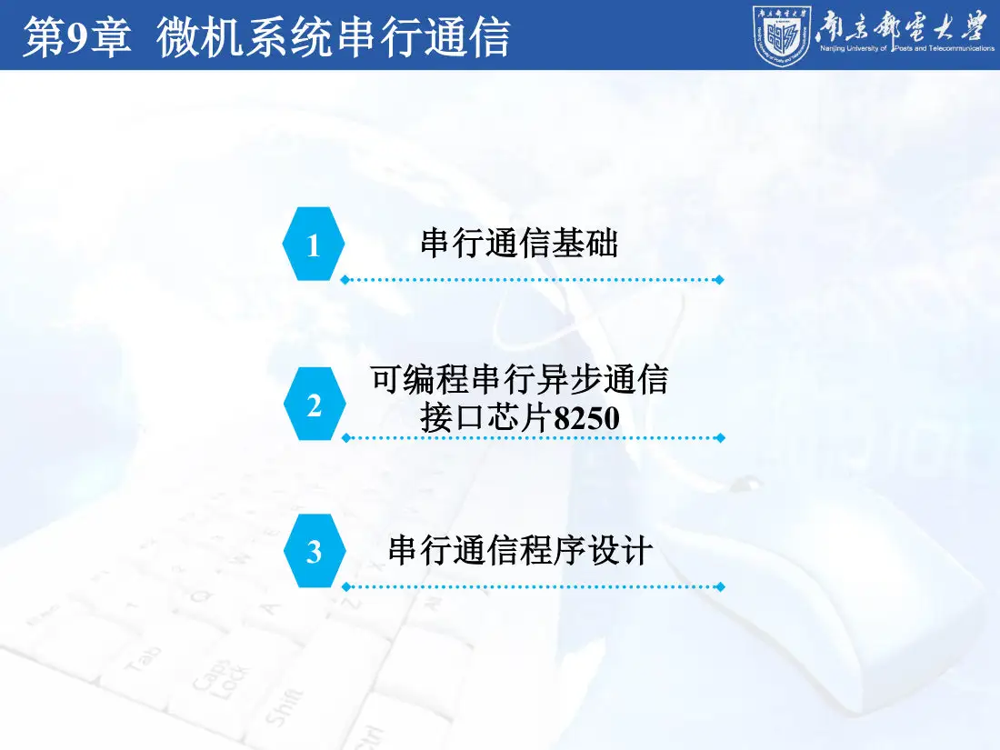

原文：

1 串行通信基础
2 可编程串行异步通信接口芯片8250
3 串行通信程序设计

第9章 微机系统串行通信

南立郵電大學 南京郵電大学 Naring Un Nanjing University of Posts and Telecommunications

### 一、计算机通信方式

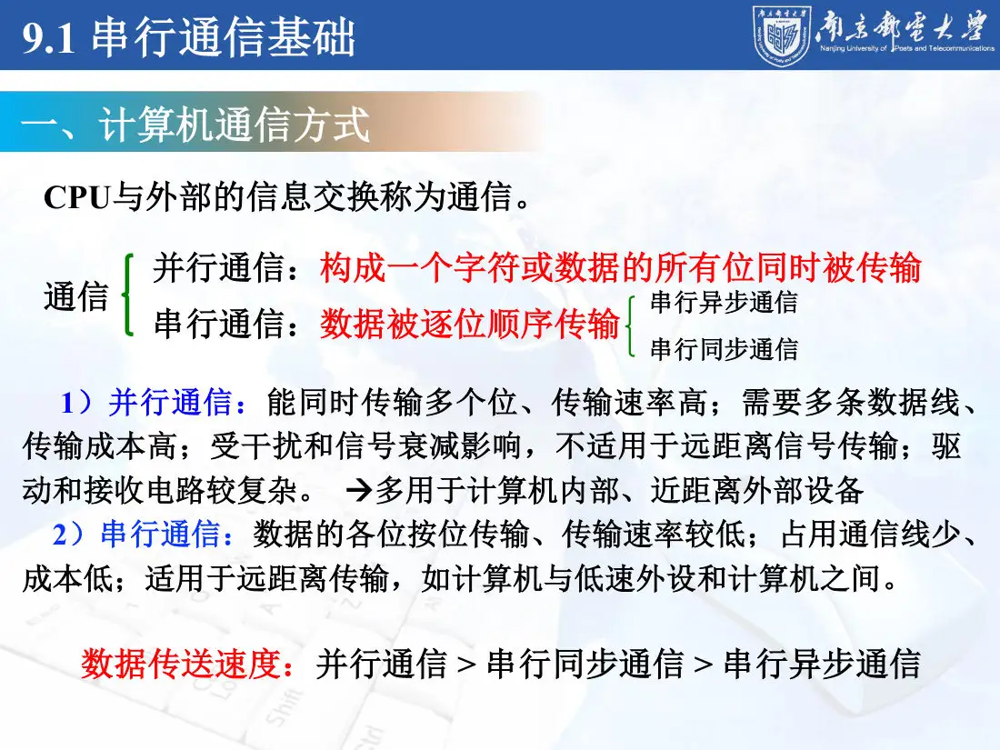

原文：

一、计算机通信方式

CPU与外部的信息交换称为通信。

并行通信：构成一个字符或数据的所有位同时被传输

通信

串行通信：数据被逐位顺序传输

串行异步通信

串行同步通信

1）并行通信：能同时传输多个位、传输速率高；需要多条数据线、传输成本高；受干扰和信号衰减影响，不适用于远距离信号传输；驱动和接收电路较复杂。 →多用于计算机内部、近距离外部设备

2）串行通信：数据的各位按位传输、传输速率较低；占用通信线少、成本低；适用于远距离传输，如计算机与低速外设和计算机之间。

数据传送速度：并行通信 > 串行同步通信 > 串行异步通信

9.1 串行通信基础

南立郵電大學 南京郵電大学 Nargng Ur GQ Nanjing University ofPosts and Telecommunication

### 一、计算机通信方式

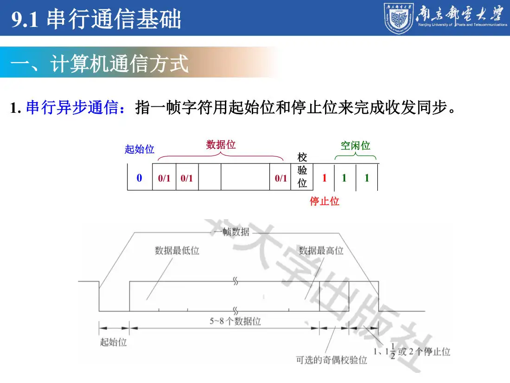

原文：

一、计算机通信方式

1. 串行异步通信：指一帧字符用起始位和停止位来完成收发同步。

9.1 串行通信基础

南立郵電大學 南京郵電大学 Nargng Ur GQ Nanjing University ofPosts and Telecommunication

### 一、计算机通信方式

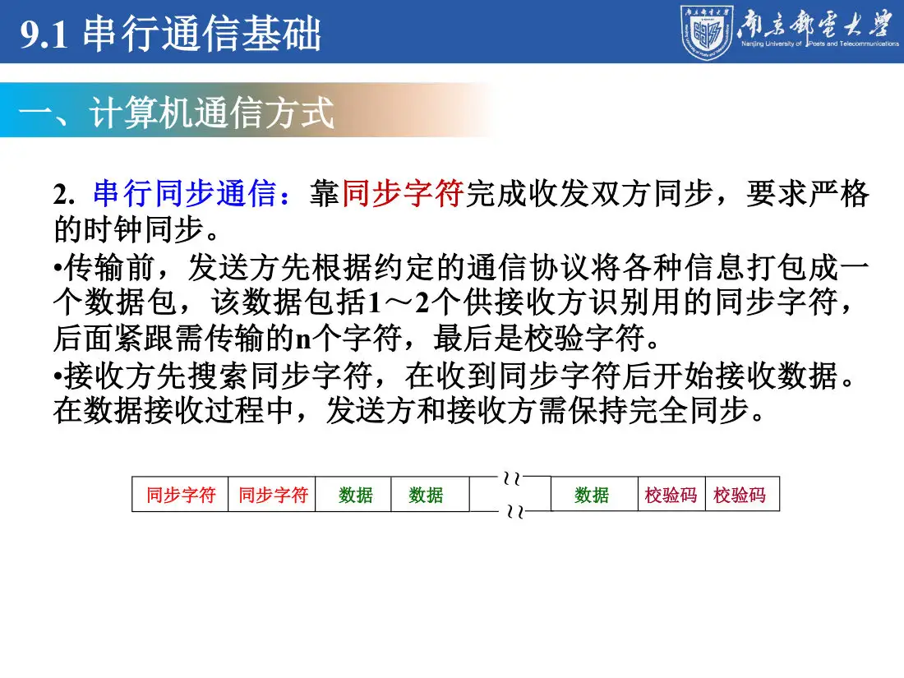

原文：

一、计算机通信方式

2. 串行同步通信：靠同步字符完成收发双方同步，要求严格的时钟同步。

•传输前，发送方先根据约定的通信协议将各种信息打包成一个数据包，该数据包括1～2个供接收方识别用的同步字符，后面紧跟需传输的n个字符，最后是校验字符。

•接收方先搜索同步字符，在收到同步字符后开始接收数据。在数据接收过程中，发送方和接收方需保持完全同步。

<table><tr><td>同步字符</td><td>同步字符</td><td>数据</td><td>数据</td><td></td><td>数据</td><td>校验码</td><td>校验码</td></tr></table>

9.1 串行通信基础

南立都電大学 南京郵電大学 Nanjing University of Posts and Telecommunications

### 一、计算机通信方式

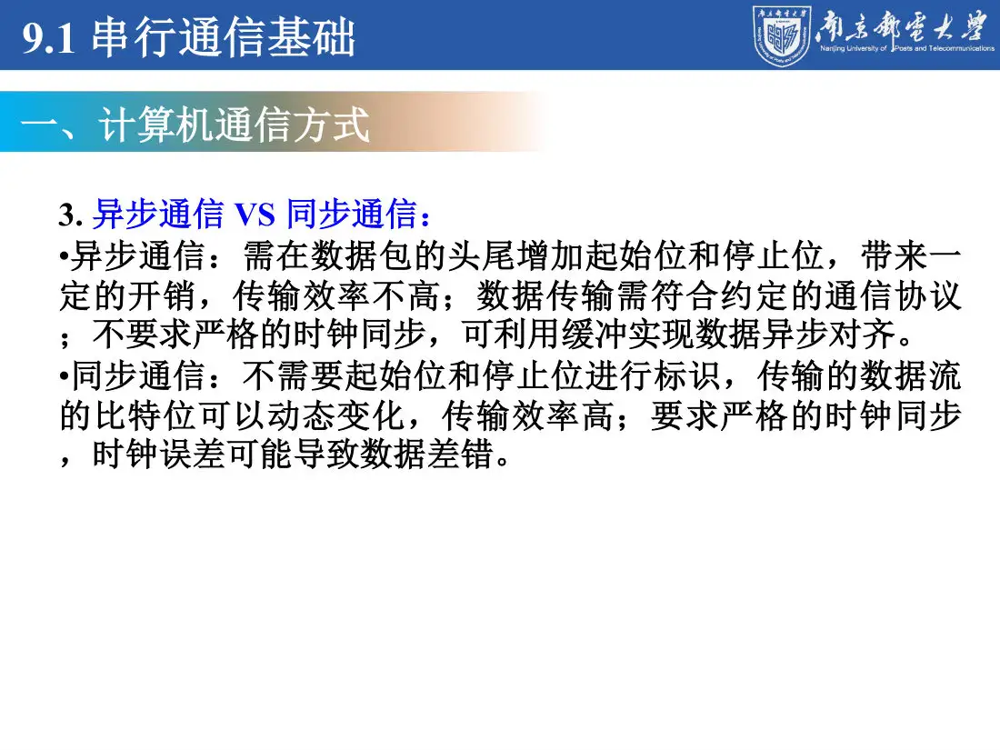

原文：

一、计算机通信方式

3. 异步通信VS 同步通信：

•异步通信：需在数据包的头尾增加起始位和停止位，带来一定的开销，传输效率不高；数据传输需符合约定的通信协议；不要求严格的时钟同步，可利用缓冲实现数据异步对齐。

•同步通信：不需要起始位和停止位进行标识，传输的数据流的比特位可以动态变化，传输效率高；要求严格的时钟同步，时钟误差可能导致数据差错。

9.1 串行通信基础

南立郵電大學 南京郵電大学 Nanjing University of Posts and Telecommunication

### 二、串行数据传输方式

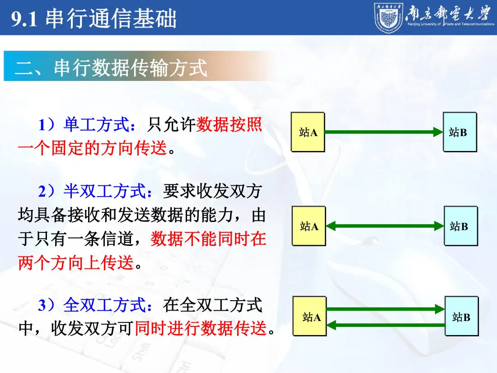

原文：

二、串行数据传输方式

1）单工方式：只允许数据按照一个固定的方向传送。

2）半双工方式：要求收发双方均具备接收和发送数据的能力，由于只有一条信道，数据不能同时在两个方向上传送。

3）全双工方式：在全双工方式中，收发双方可同时进行数据传送。

9.1 串行通信基础

南立郵電大學 南京郵電大学 Nargng Ur GQ Nanjing University ofPosts and Telecommunication

### 三、串行异步通信协议

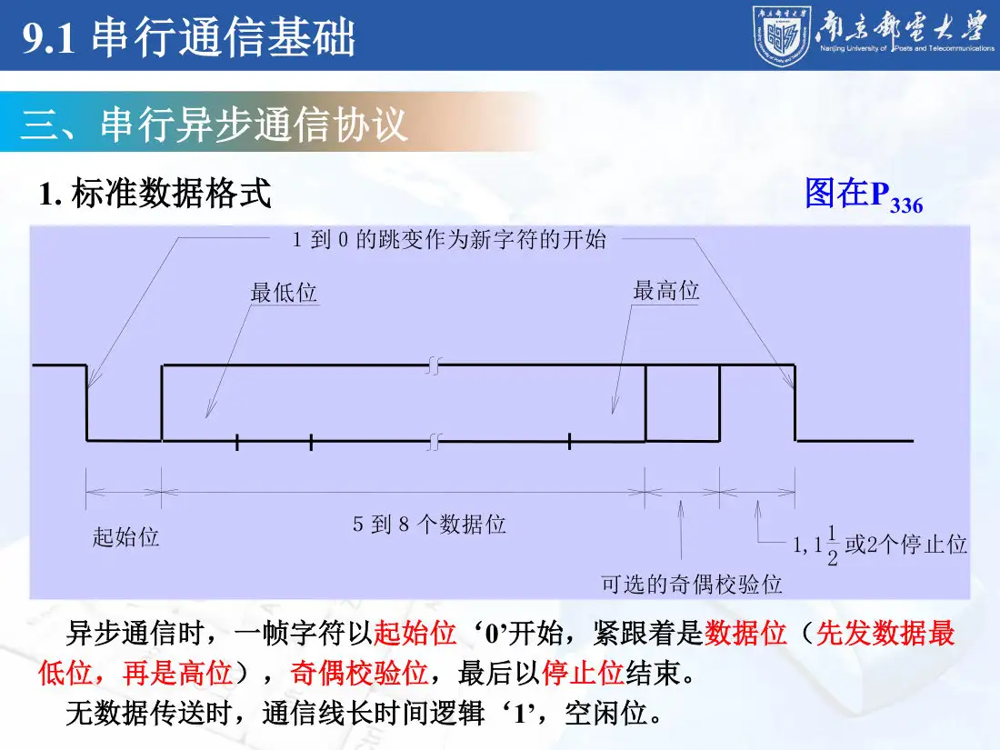

原文：

三、串行异步通信协议

1. 标准数据格式

图在P336

异步通信时，一帧字符以起始位‘0’开始，紧跟着是数据位（先发数据最低位，再是高位），奇偶校验位，最后以停止位结束。

无数据传送时，通信线长时间逻辑‘1’，空闲位。

9.1 串行通信基础

南立都電大学 南京郵電大学 Nanjing University of Posts and Telecommunication

### 三、串行异步通信协议

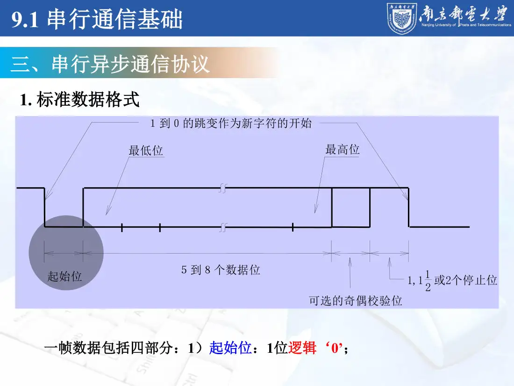

原文：

三、串行异步通信协议

1. 标准数据格式

一帧数据包括四部分：1）起始位：1位逻辑‘0’；

9.1 串行通信基础

南立郵電大學 南京郵電大学 Nargng Ur GQ Nanjing University ofPosts and Telecommunication

### 三、串行异步通信协议

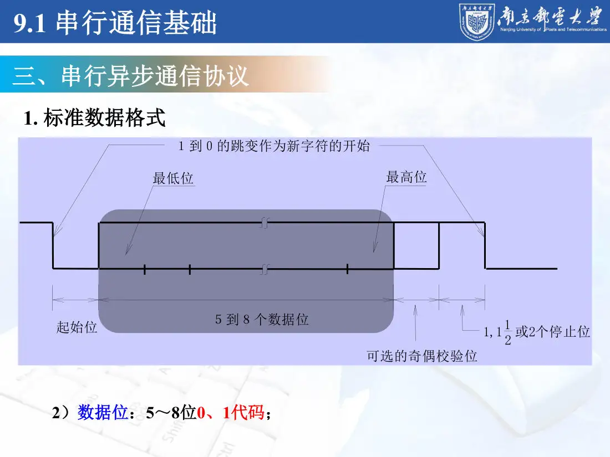

原文：

三、串行异步通信协议

1. 标准数据格式

2）数据位：5～8位0、1代码；

9.1 串行通信基础

南立郵電大學 南京郵電大学 Nargng Ur GQ Nanjing University ofPosts and Telecommunication

### 三、串行异步通信协议

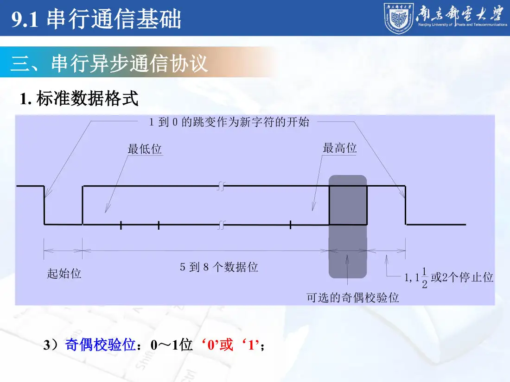

原文：

三、串行异步通信协议

1. 标准数据格式

3）奇偶校验位：0～1位‘0’或‘1’；

9.1 串行通信基础

南立郵電大學 南京郵電大学 Nargng Ur GQ Nanjing University ofPosts and Telecommunication

### 三、串行异步通信协议

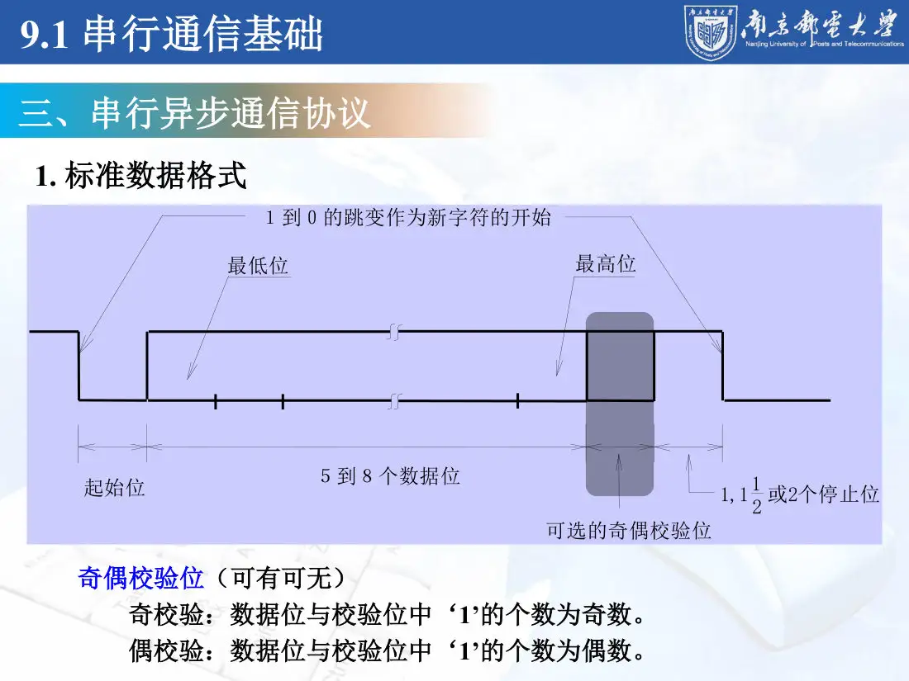

原文：

三、串行异步通信协议

1. 标准数据格式

奇偶校验位（可有可无）

奇校验：数据位与校验位中‘1’的个数为奇数。

偶校验：数据位与校验位中‘1’的个数为偶数。

9.1 串行通信基础

南立都電大学 南京郵電大学 Nanjing University of Posts and Telecommunication

### 三、串行异步通信协议

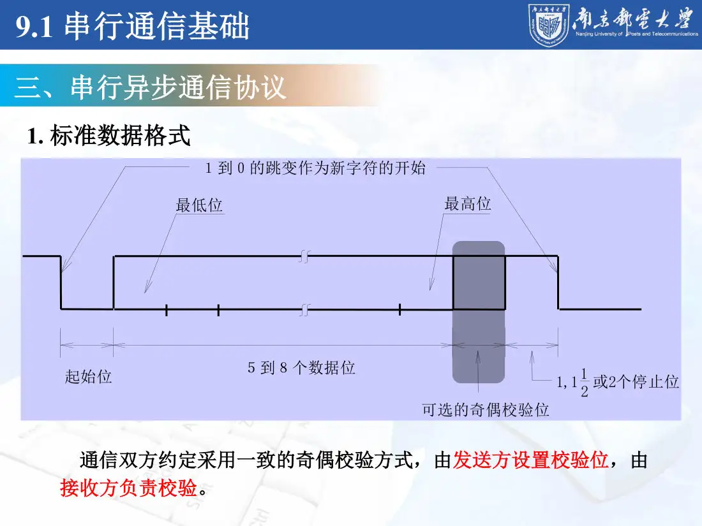

原文：

三、串行异步通信协议

1. 标准数据格式

通信双方约定采用一致的奇偶校验方式，由发送方设置校验位，由接收方负责校验。

9.1 串行通信基础

南立郵電大學 南京郵電大学 Nargng Ur GQ Nanjing University ofPosts and Telecommunication

### 三、串行异步通信协议

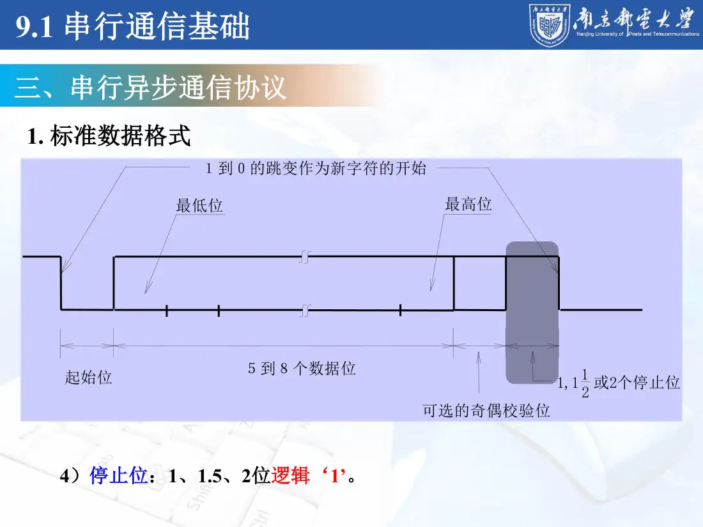

原文：

三、串行异步通信协议

1. 标准数据格式

4）停止位：1、1.5、2位逻辑‘1’。

9.1 串行通信基础

南立郵電大學 南京郵電大学 Nargng Ur GQ Nanjing University ofPosts and Telecommunication

### 例：传送一个字符“E”，7个数据位，奇校验，2个停止位。

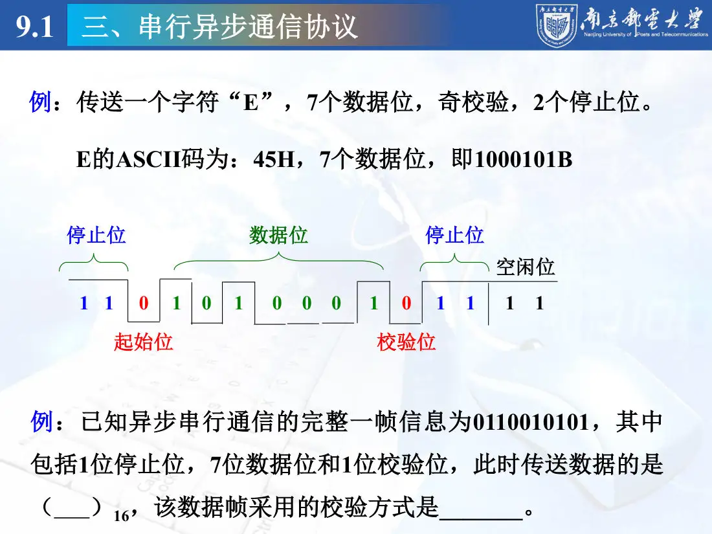

原文：

例：传送一个字符“E”，7个数据位，奇校验，2个停止位。

E的ASCII码为：45H，7个数据位，即1000101B

例：已知异步串行通信的完整一帧信息为0110010101，其中包括1位停止位，7位数据位和1位校验位，此时传送数据的是${ \bf 1 6 ^ { \circ } }$ 该数据帧采用的校验方式是

9.1 串行通信基础三、串行异步通信协议

南立都電大学 南京郵電大学 Nanjing University of Posts and Telecommunications

### 2.通信速率（传输速率） P338

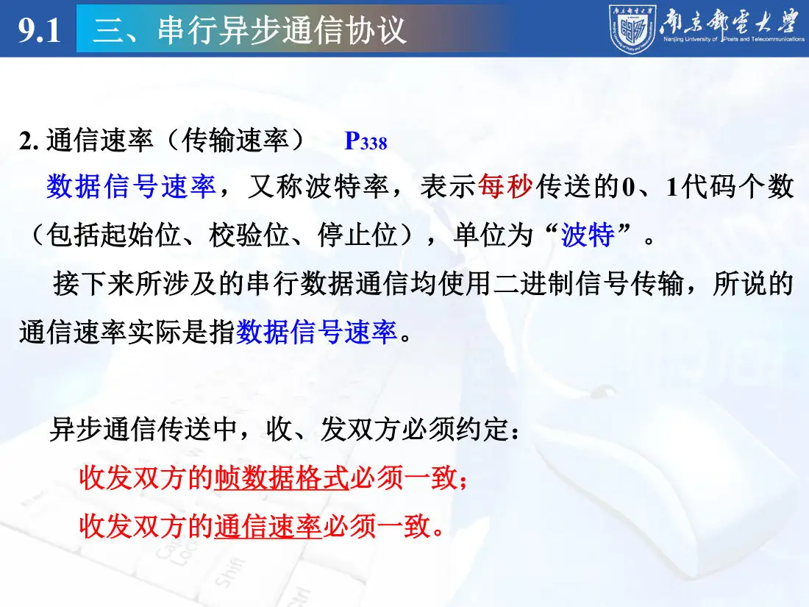

原文：

2.通信速率（传输速率） P338

数据信号速率，又称波特率，表示每秒传送的0、1代码个数（包括起始位、校验位、停止位），单位为“波特”。

接下来所涉及的串行数据通信均使用二进制信号传输，所说的通信速率实际是指数据信号速率。

异步通信传送中，收、发双方必须约定：

收发双方的帧数据格式必须一致；

收发双方的通信速率必须一致。

9.1 串行通信基础三、串行异步通信协议

南立都電大学 南京郵電大学 G Nanjing University of Posts and Telecommunication

### 随堂习题

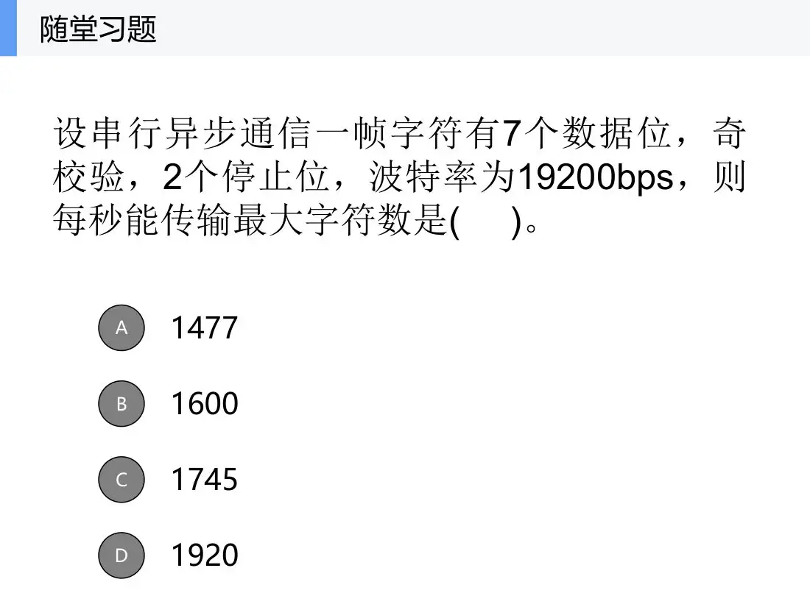

原文：

随堂习题

设串行异步通信一帧字符有7个数据位，奇校验，2个停止位，波特率为19200bps，则每秒能传输最大字符数是( )。A 1477B 160017451920

### 3. 串行通信接口标准— RS-232C标准

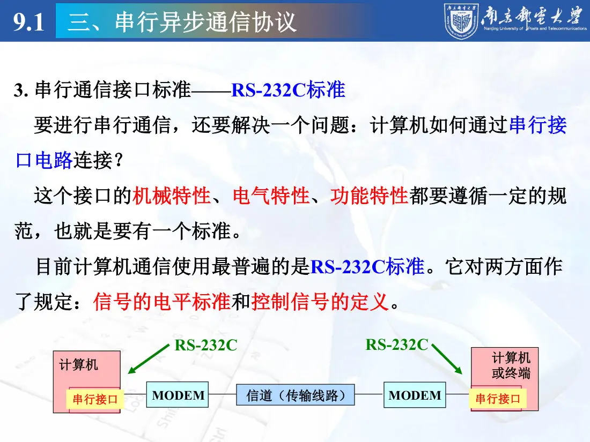

原文：

3. 串行通信接口标准— RS-232C标准

要进行串行通信，还要解决一个问题：计算机如何通过串行接口电路连接？

这个接口的机械特性、电气特性、功能特性都要遵循一定的规范，也就是要有一个标准。

目前计算机通信使用最普遍的是RS-232C标准。它对两方面作了规定：信号的电平标准和控制信号的定义。

9.1 串行通信基础三、串行异步通信协议

南立郵電大學 南京郵電大学 Nargng Ur GQ Nanjing University ofPosts and Telecommunication

### 1）控制信号的定义（机械特性）

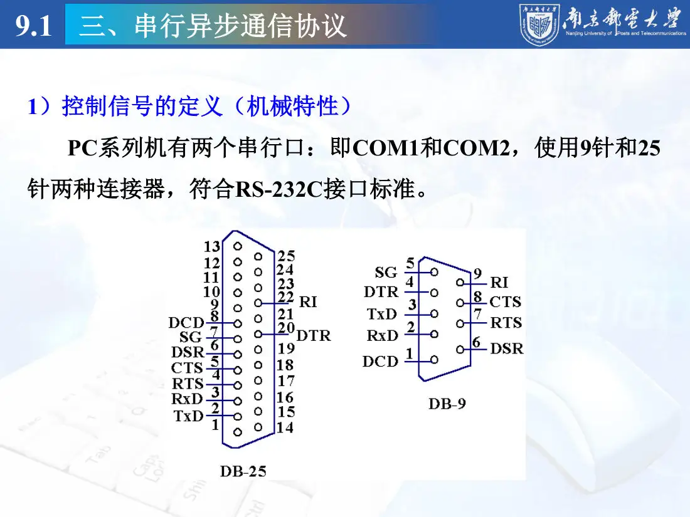

原文：

1）控制信号的定义（机械特性）

PC系列机有两个串行口：即COM1和COM2，使用9针和25针两种连接器，符合RS-232C接口标准。

$$
\begin{array}{c} \text {13} \\ \text {12} \\ \text {11} \\ \text {10} \\ \text {9} \\ \text {8} \\ \text {DCD} \\ \text {SG} \\ \text {DSR} \\ \text {CTS} \\ \text {RTS} \\ \text {RxD} \\ \text {TxD} \end{array} \begin{array}{c} \text {25} \\ \text {24} \\ \text {23} \\ \text {22} \\ \text {21} \\ \text {20} \\ \text {19} \\ \text {18} \\ \text {17} \\ \text {16} \\ \text {15} \\ \text {14} \end{array}
$$

$$
\begin{array}{c} \text {SG} \quad 5 \\ \text {DTR} \quad 4 \\ \text {TxD} \quad 3 \\ \text {RxD} \quad 2 \\ \text {DCD} \quad 1 \end{array} \begin{array}{c} \text {RI} \\ \text {CTS} \\ \text {RTS} \\ \text {DSR} \end{array}
$$

DB-9

DB-25

9.1 串行通信基础三、串行异步通信协议

南立郵電大學 南京郵電大学 Nargng Ur GQ Nanjing University ofPosts and Telecommunications

### DTR DTE准备就绪

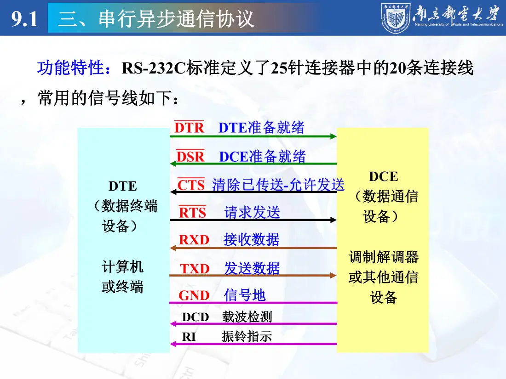

原文：

功能特性：RS-232C标准定义了25针连接器中的20条连接线，常用的信号线如下：

DTR DTE准备就绪

DSR DCE准备就绪

DTE（数据终端设备）

计算机

或终端

CTS 清除已传送-允许发送

RTS 请求发送

RXD 接收数据

TXD 发送数据

GND 信号地

DCD 载波检测

RI 振铃指示

DCE（数据通信设备）

调制解调器或其他通信设备

9.1 串行通信基础三、串行异步通信协议

南立都電大学 南京郵電大学 Nanjing University of Posts and Telecommunications

### 2）信号电平标准（电气特性）

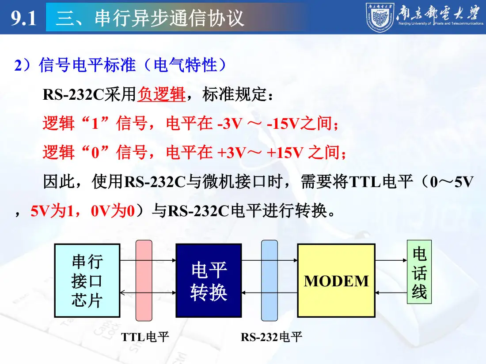

原文：

2）信号电平标准（电气特性）

RS-232C采用负逻辑，标准规定：

逻辑“1”信号，电平在 -3V ～ -15V之间；

逻辑“0”信号，电平在 +3V～ +15V 之间；

因此，使用RS-232C与微机接口时，需要将TTL电平（0～5V，5V为1，0V为0）与RS-232C电平进行转换。

9.1 串行通信基础三、串行异步通信协议

南立郵電大學 南京郵電大学 Nargng Ur GQ Nanjing University ofPosts and Telecommunications

### 可用现成的转换芯片（如MC1488、MC1489等）转换：

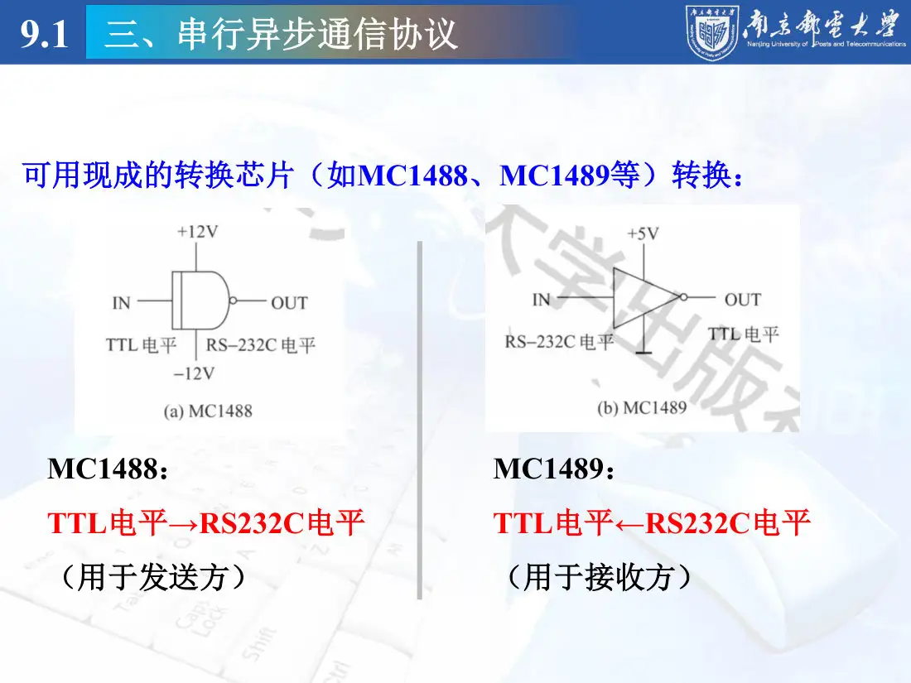

原文：

可用现成的转换芯片（如MC1488、MC1489等）转换：

MC1488：TTL电平→RS232C电平（用于发送方）

MC1489：TTL电平←RS232C电平（用于接收方）

9.1 串行通信基础三、串行异步通信协议

南立郵電大學 南京郵電大学 Nargng Ur GQ Nanjing University ofPosts and Telecommunication

### 在远距离数据通信时，MODEM可实现数字信号和模拟信号之间的转换。

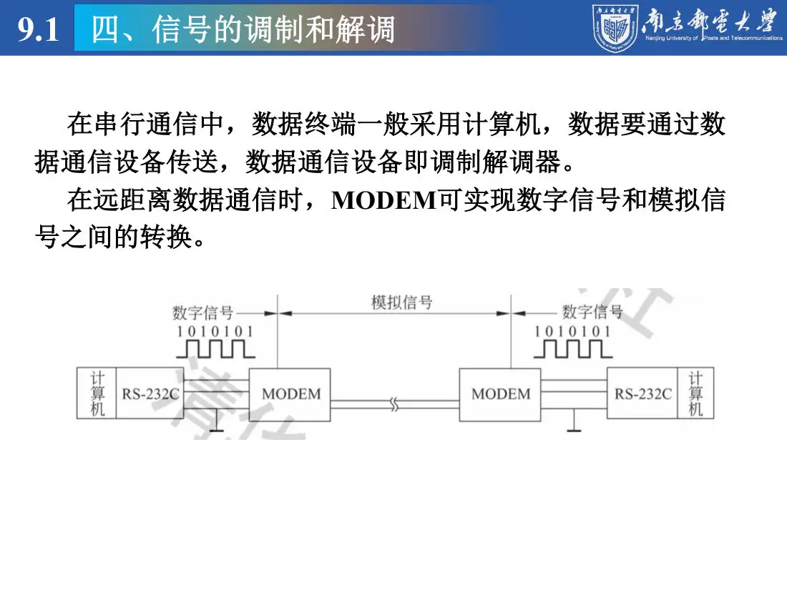

原文：

在串行通信中，数据终端一般采用计算机，数据要通过数据通信设备传送，数据通信设备即调制解调器。

在远距离数据通信时，MODEM可实现数字信号和模拟信号之间的转换。

9.1 串行通信基础四、信号的调制和解调

南立都電大学 南京郵電大学 G Nanjing University of Posts and Telecommunication

### 随堂习题

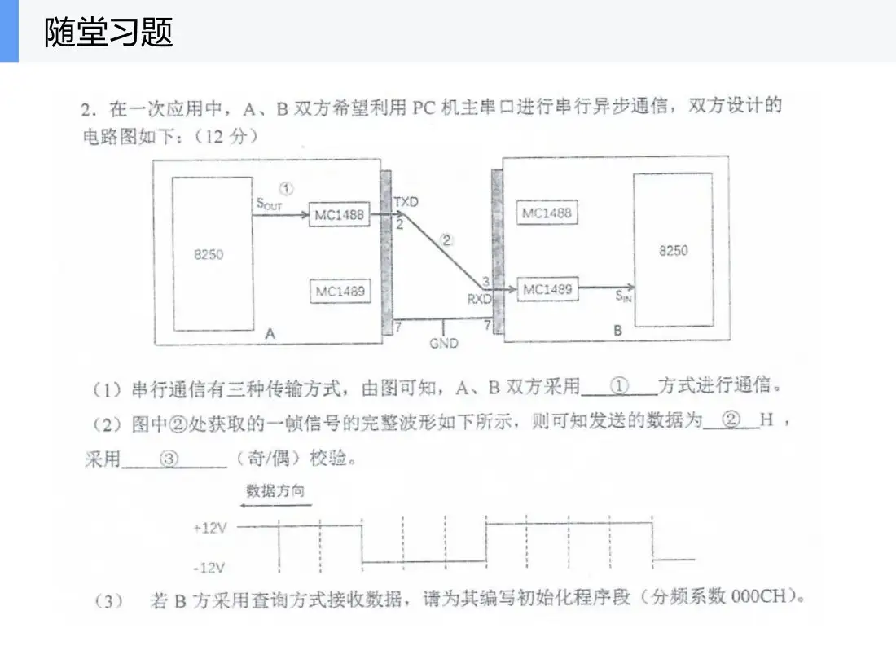

原文：

随堂习题

2. 在一次应用中，A、B双方希望利用PC机主串口进行串行异步通信，双方设计的

(3)若B方采用查询方式接收数据，请为其编写初始化程序段（分频系数000CH)。

### 1、串行通信基础：

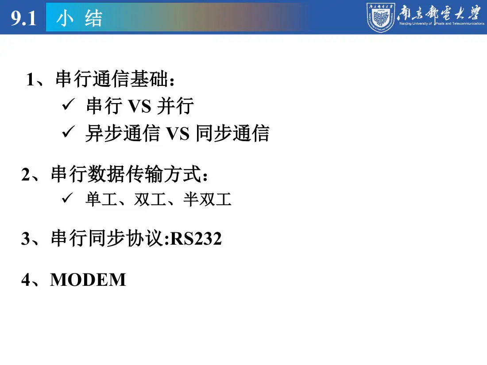

原文：

1、串行通信基础：

✓ 串行 VS 并行

✓ 异步通信 VS 同步通信

2、串行数据传输方式：

✓ 单工、双工、半双工

3、串行同步协议:RS232

4、MODEM

9.1 串行通小 结

南立都電大学 南京郵電大学 G Nanjing University of Posts and Telecommunication

### 2026/11/15

原文：

2026/11/15

### 1. 能实现串行数据 并行数据的变换，实现全双工异步通信；

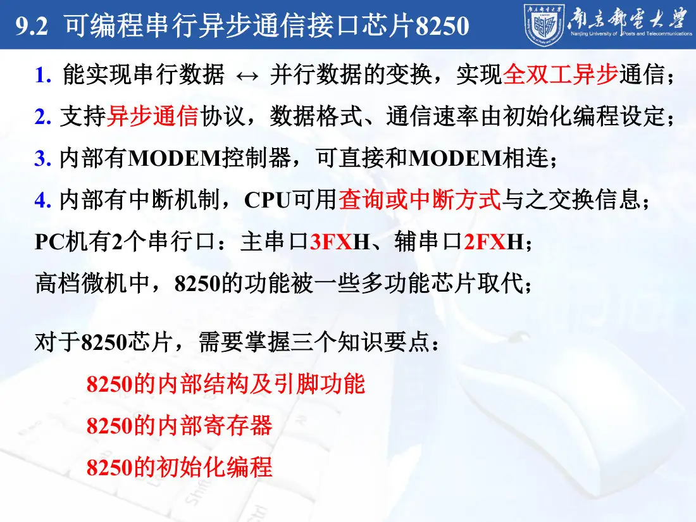

原文：

1. 能实现串行数据 并行数据的变换，实现全双工异步通信；

2. 支持异步通信协议，数据格式、通信速率由初始化编程设定；

3. 内部有MODEM控制器，可直接和MODEM相连；

4.内部有中断机制，CPU可用查询或中断方式与之交换信息；

PC机有2个串行口：主串口3FXH、辅串口2FXH；

高档微机中，8250的功能被一些多功能芯片取代；

对于8250芯片，需要掌握三个知识要点：

8250的内部结构及引脚功能

8250的内部寄存器

8250的初始化编程

9.1.2 串行通信基础可编程串行异步通信接口芯片8250

南立都電大学 南京郵電大学 Rarung Nanjing University ofPosts and Telecommunication

### 一、8250的内部结构及引脚功能

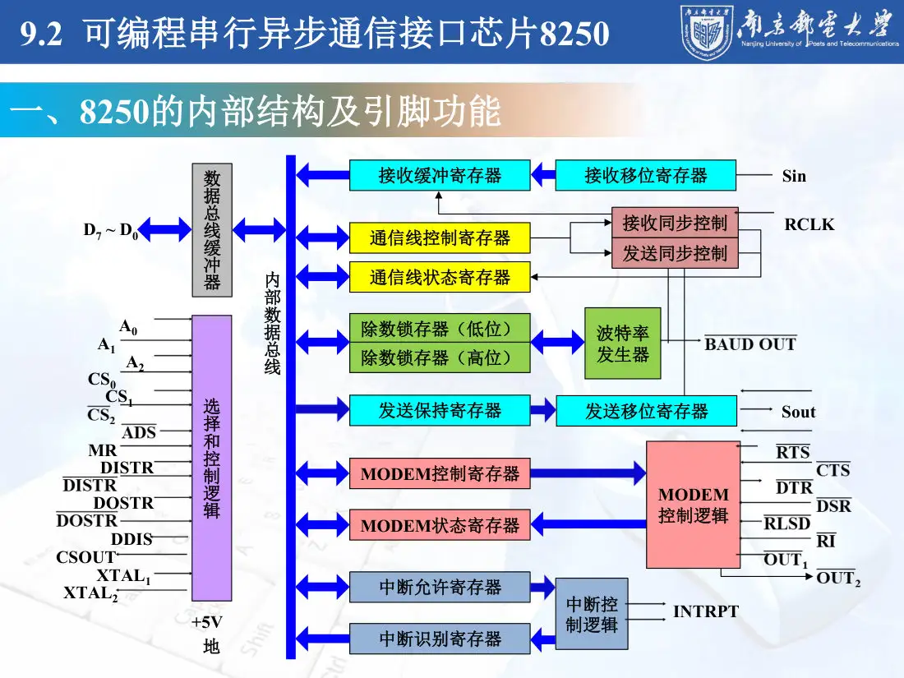

原文：

一、8250的内部结构及引脚功能

数

据

总

线

缓

冲

器内

部

数

据

总

线

+5V地

接收缓冲寄存器

通信线控制寄存器

通信线状态寄存器

除数锁存器（低位）除数锁存器（高位）

发送保持寄存器

MODEM控制寄存器

MODEM状态寄存器

中断允许寄存器

中断识别寄存器

接收移位寄存器

接收同步控制发送同步控制

波特率发生器

发送移位寄存器

MODEM控制逻辑

中断控制逻辑

9.1 串行通信基础9.2 可编程串行异步通信接口芯片8250

南立郵電大學 南京郵電大学 Naring Un Nanjing University of Posts and Telecommunications

### 主要功能模块：

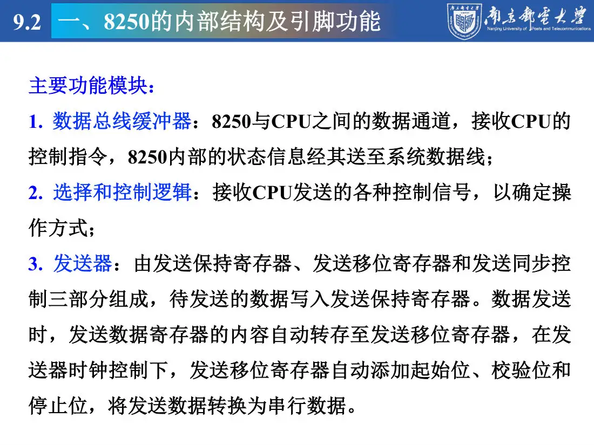

原文：

主要功能模块：

1. 数据总线缓冲器：8250与CPU之间的数据通道，接收CPU的控制指令，8250内部的状态信息经其送至系统数据线；

2. 选择和控制逻辑：接收CPU发送的各种控制信号，以确定操作方式；

3. 发送器：由发送保持寄存器、发送移位寄存器和发送同步控制三部分组成，待发送的数据写入发送保持寄存器。数据发送时，发送数据寄存器的内容自动转存至发送移位寄存器，在发送器时钟控制下，发送移位寄存器自动添加起始位、校验位和停止位，将发送数据转换为串行数据。

9.1 9.2 串行通信基础一、8250的内部结构及引脚功能

南立郵電大學 南京郵電大学 Nargng Ur GQ Nanjing University ofPosts and Telecommunication

### 主要功能模块：

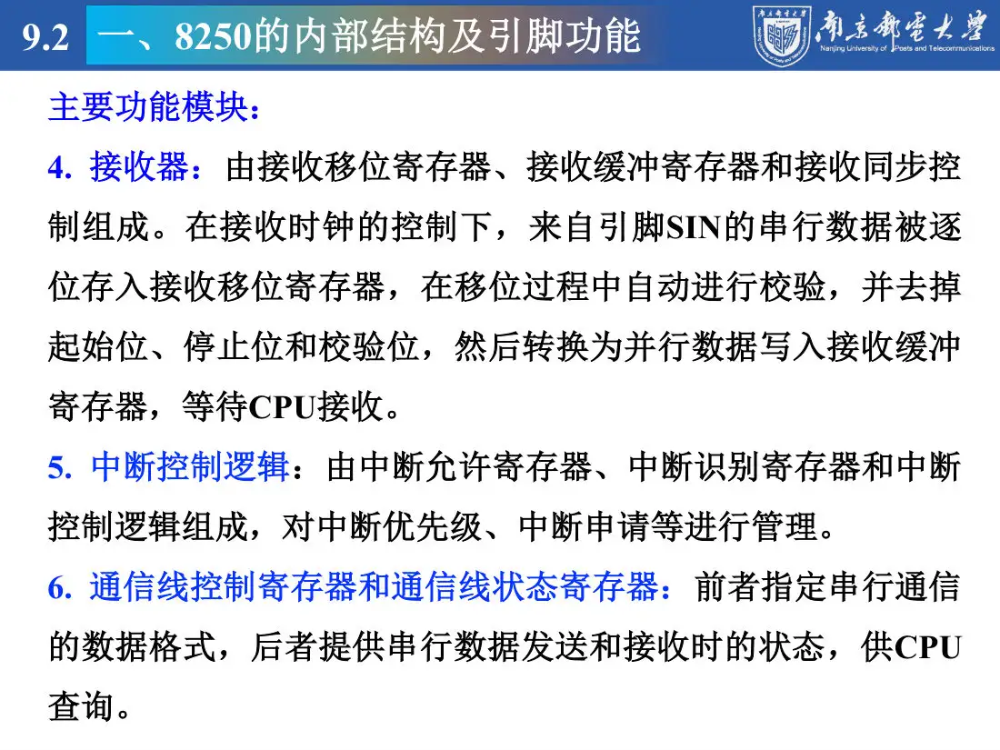

原文：

主要功能模块：

4. 接收器：由接收移位寄存器、接收缓冲寄存器和接收同步控制组成。在接收时钟的控制下，来自引脚SIN的串行数据被逐位存入接收移位寄存器，在移位过程中自动进行校验，并去掉起始位、停止位和校验位，然后转换为并行数据写入接收缓冲寄存器，等待CPU接收。

5. 中断控制逻辑：由中断允许寄存器、中断识别寄存器和中断控制逻辑组成，对中断优先级、中断申请等进行管理。

6. 通信线控制寄存器和通信线状态寄存器：前者指定串行通信的数据格式，后者提供串行数据发送和接收时的状态，供CPU查询。

9.1 9.2 串行通信基础一、8250的内部结构及引脚功能

南立都電大学 南京郵電大学 G Nanjing University of Posts and Telecommunication

### 主要功能模块：

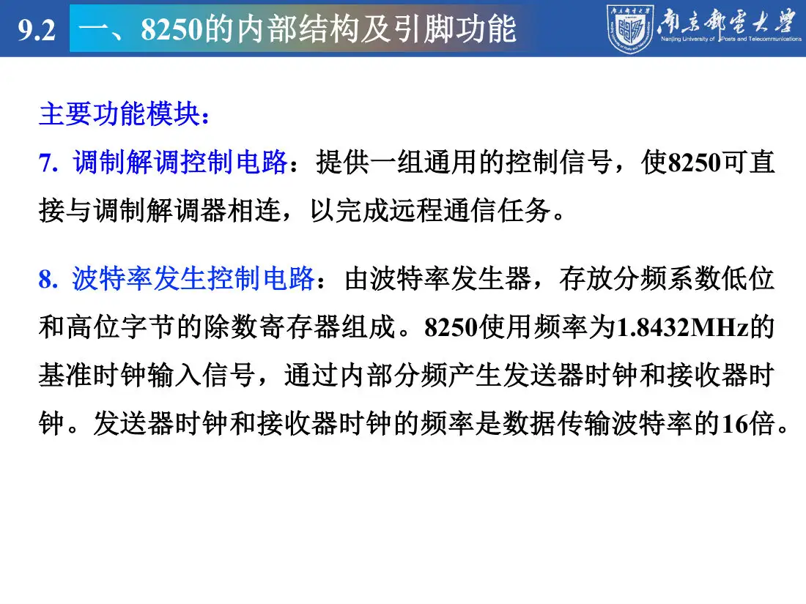

原文：

主要功能模块：

7. 调制解调控制电路：提供一组通用的控制信号，使8250可直接与调制解调器相连，以完成远程通信任务。

8. 波特率发生控制电路：由波特率发生器，存放分频系数低位和高位字节的除数寄存器组成。8250使用频率为1.8432MHz的基准时钟输入信号，通过内部分频产生发送器时钟和接收器时钟。发送器时钟和接收器时钟的频率是数据传输波特率的16倍。

9.1 9.2 串行通信基础一、8250的内部结构及引脚功能

南立都電大学 南京郵電大学 G Nanjing University of Posts and Telecommunication

### 8250简化的内部结构及功能

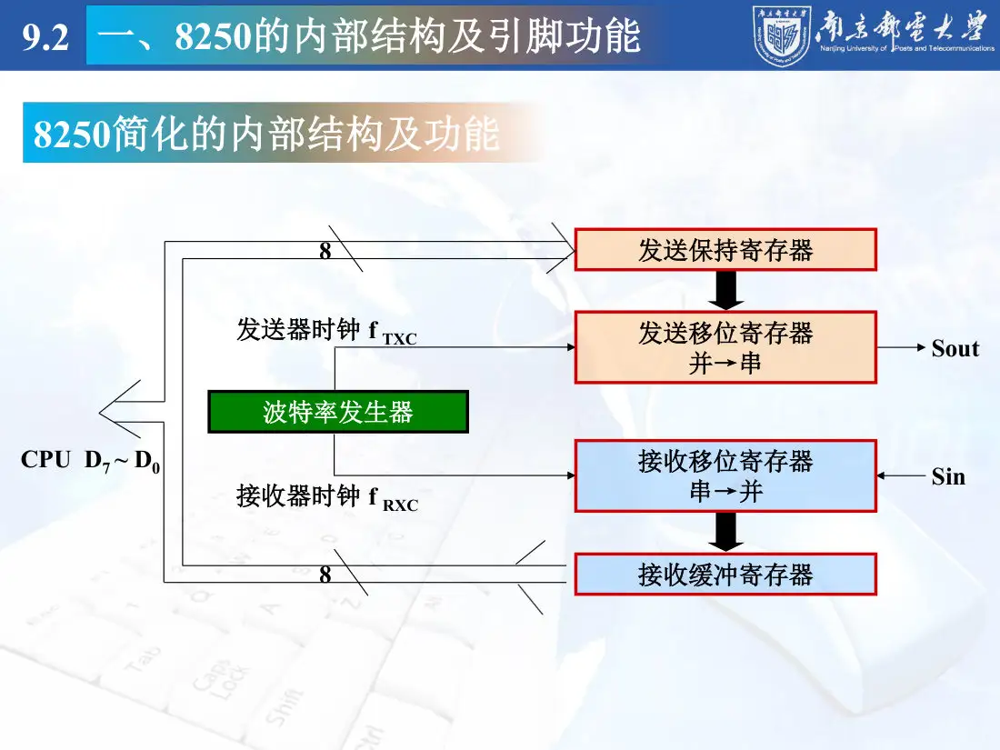

原文：

8250简化的内部结构及功能

9.1 9.2 串行通信基础一、8250的内部结构及引脚功能

南立郵電大學 南京郵電大学 Nargng Ur GQ Nanjing University ofPosts and Telecommunication

### 串行数据发送过程：

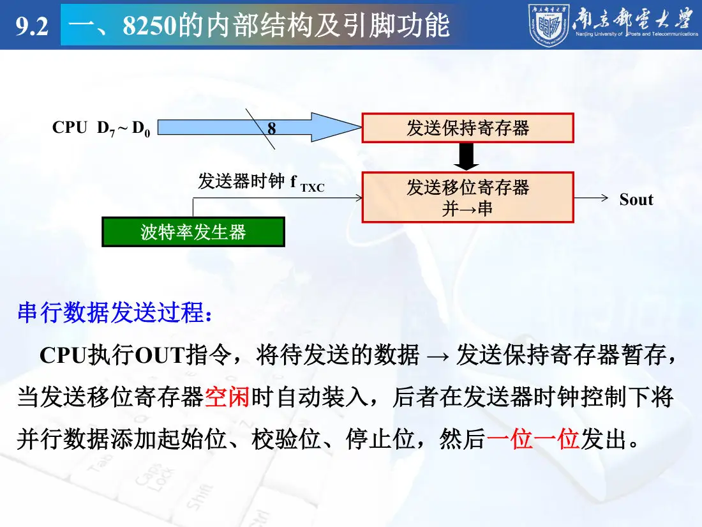

原文：

串行数据发送过程：

CPU执行OUT指令，将待发送的数据→ 发送保持寄存器暂存，当发送移位寄存器空闲时自动装入，后者在发送器时钟控制下将并行数据添加起始位、校验位、停止位，然后一位一位发出。

9.1 9.2 串行通信基础一、8250的内部结构及引脚功能

南立郵電大學 南京郵電大学 Nargng Ur GQ Nanjing University ofPosts and Telecommunication

### 波特率发生器

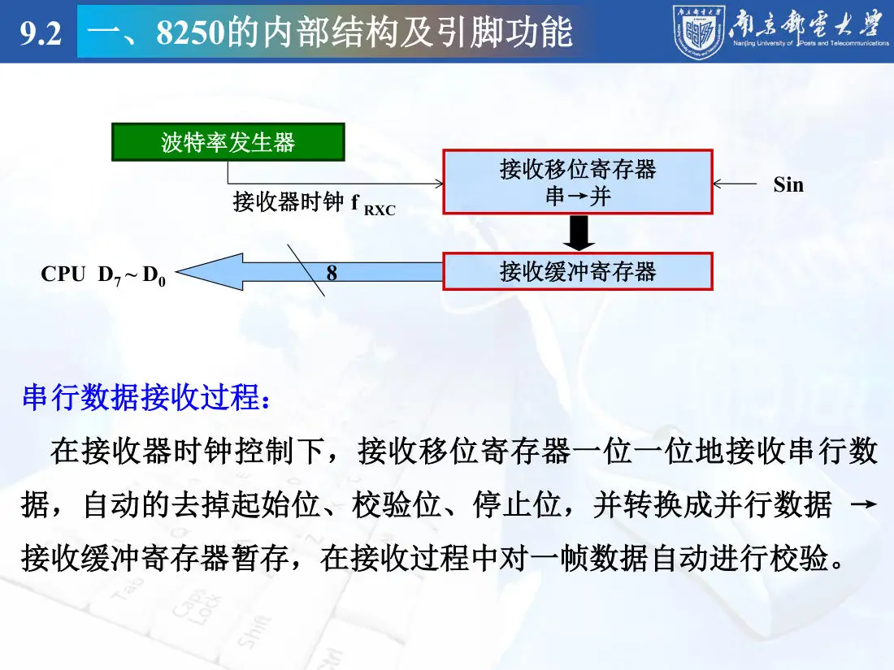

原文：

波特率发生器

串行数据接收过程：

在接收器时钟控制下，接收移位寄存器一位一位地接收串行数据，自动的去掉起始位、校验位、停止位，并转换成并行数据接收缓冲寄存器暂存，在接收过程中对一帧数据自动进行校验。

9.1 9.2 串行通信基础一、8250的内部结构及引脚功能

南立郵電大學 南京郵電大学 Nargng Ur GQ Nanjing University ofPosts and Telecommunication

### 8250的引脚功能

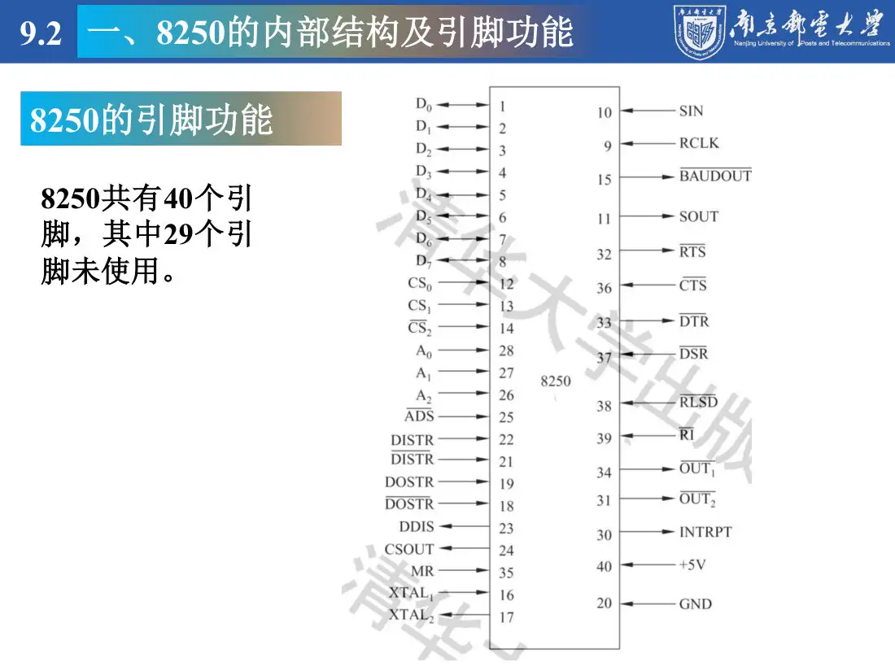

原文：

8250的引脚功能

8250共有40个引脚，其中29个引脚未使用。

9.1 9.2 串行通信基础一、8250的内部结构及引脚功能

南立郵電大學 南京郵電大学 Naring Un GG Nanjing University ofPosts and Telecommunication

### 8250的引脚功能

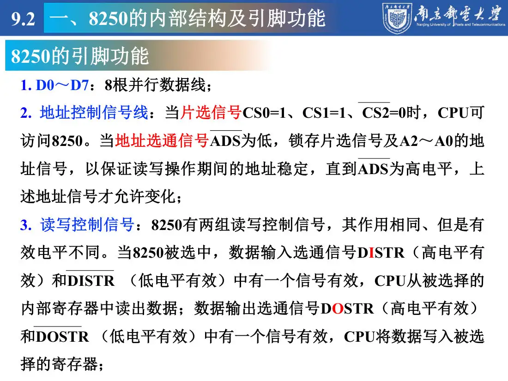

原文：

8250的引脚功能

1.D0～D7：8根并行数据线；

2. 地址控制信号线：当片选信号CS0=1、CS1=1、CS2=0时，CPU可访问8250。当地址选通信号ADS为低，锁存片选信号及A2～A0的地址信号，以保证读写操作期间的地址稳定，直到ADS为高电平，上述地址信号才允许变化；

3. 读写控制信号：8250有两组读写控制信号，其作用相同、但是有效电平不同。当8250被选中，数据输入选通信号DISTR（高电平有效）和DISTR （低电平有效）中有一个信号有效，CPU从被选择的内部寄存器中读出数据；数据输出选通信号DOSTR（高电平有效）和DOSTR （低电平有效）中有一个信号有效，CPU将数据写入被选择的寄存器；

9.1 9.2 串行通信基础一、8250的内部结构及引脚功能

南立郵電大學 南京郵電大学 Nargng Ur GQ Nanjing University ofPosts and Telecommunication

### 8250的引脚功能

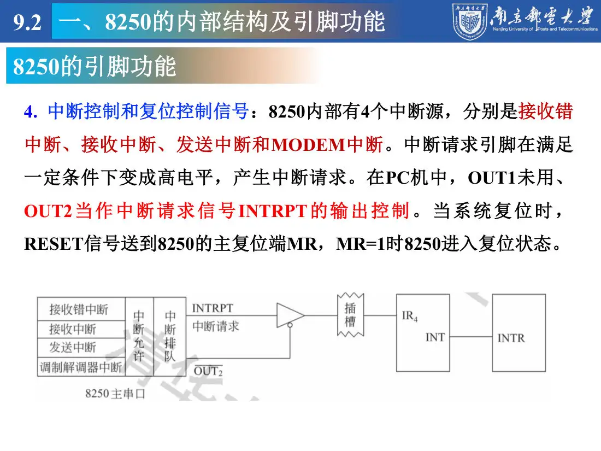

原文：

8250的引脚功能

4. 中断控制和复位控制信号：8250内部有4个中断源，分别是接收错中断、接收中断、发送中断和MODEM中断。中断请求引脚在满足一定条件下变成高电平，产生中断请求。在PC机中，OUT1未用、OUT2当作中断请求信号INTRPT的输出控制。当系统复位时，RESET信号送到8250的主复位端MR，MR=1时8250进入复位状态。

9.1 9.2 串行通信基础一、8250的内部结构及引脚功能

南立郵電大學 南京郵電大学 Nargng Ur GQ Nanjing University ofPosts and Telecommunication

### 8250的引脚功能

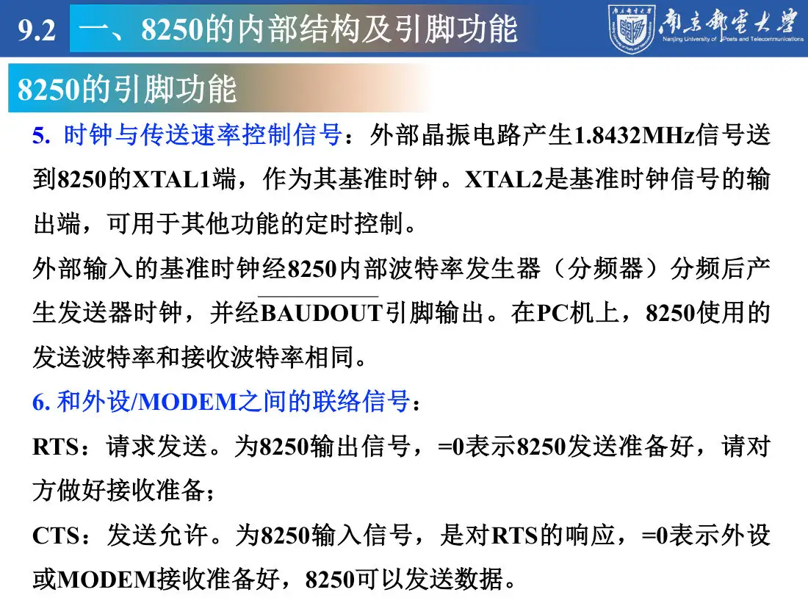

原文：

8250的引脚功能

5. 时钟与传送速率控制信号：外部晶振电路产生1.8432MHz信号送到8250的XTAL1端，作为其基准时钟。XTAL2是基准时钟信号的输出端，可用于其他功能的定时控制。

外部输入的基准时钟经8250内部波特率发生器（分频器）分频后产生发送器时钟，并经BAUDOUT引脚输出。在PC机上，8250使用的发送波特率和接收波特率相同。

6.和外设/MODEM之间的联络信号：

RTS：请求发送。为8250输出信号，=0表示8250发送准备好，请对方做好接收准备；

CTS：发送允许。为8250输入信号，是对RTS的响应，=0表示外设或MODEM接收准备好，8250可以发送数据。

9.1 9.2 串行通信基础一、8250的内部结构及引脚功能

南立都電大学 南京郵電大学 Rarung Nanjing University ofPosts and Telecommunication

### 8250的引脚功能

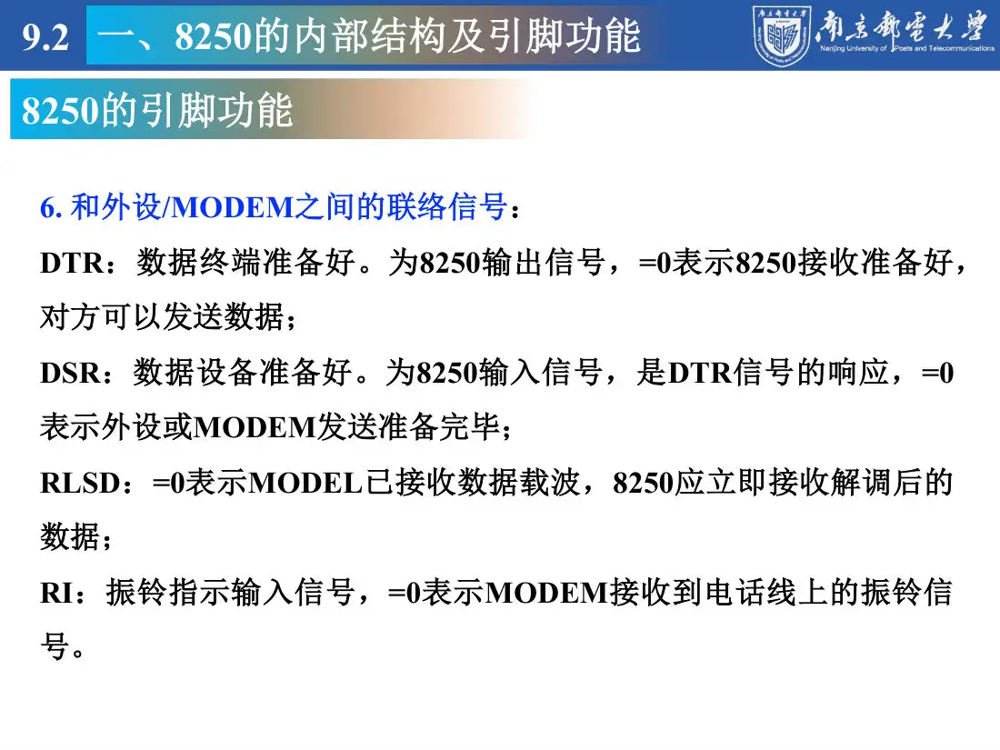

原文：

8250的引脚功能

6.和外设/MODEM之间的联络信号：

DTR：数据终端准备好。为8250输出信号，=0表示8250接收准备好，对方可以发送数据；

DSR：数据设备准备好。为8250输入信号，是DTR信号的响应，=0表示外设或MODEM发送准备完毕；

RLSD：=0表示MODEL已接收数据载波，8250应立即接收解调后的数据；

RI：振铃指示输入信号，=0表示MODEM接收到电话线上的振铃信号。

9.1 9.2 串行通信基础一、8250的内部结构及引脚功能

南立郵電大學 南京郵電大学 Nargng Ur GQ Nanjing University ofPosts and Telecommunication

### 二、8250的内部寄存器

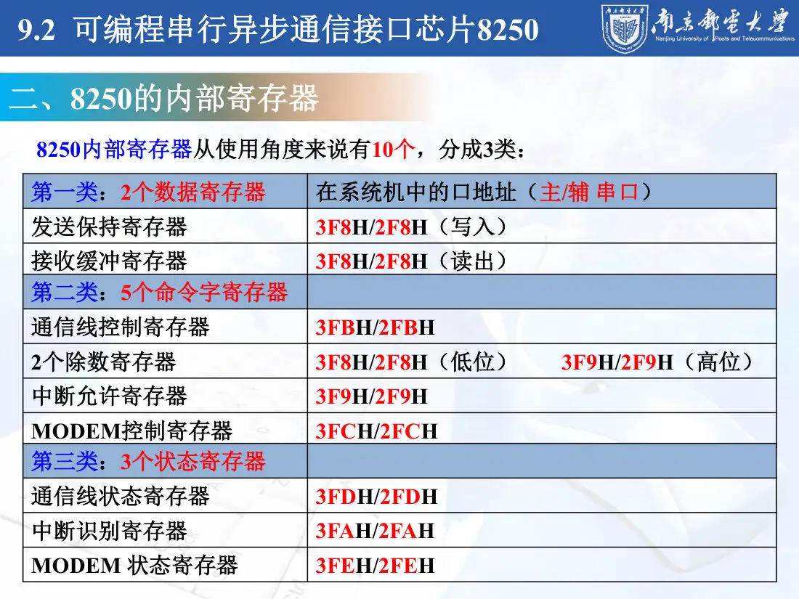

原文：

二、8250的内部寄存器

8250内部寄存器从使用角度来说有10个，分成3类：

<table><tr><td>第一类: 2个数据寄存器</td><td>在系统机中的口地址(主/辅串口)</td></tr><tr><td>发送保持寄存器</td><td>3F8H/2F8H(写入)</td></tr><tr><td>接收缓冲寄存器</td><td>3F8H/2F8H(读出)</td></tr><tr><td>第二类: 5个命令字寄存器</td><td></td></tr><tr><td>通信线控制寄存器</td><td>3FBH/2FBH</td></tr><tr><td>2个除数寄存器</td><td>3F8H/2F8H(低位) 3F9H/2F9H(高位)</td></tr><tr><td>中断允许寄存器</td><td>3F9H/2F9H</td></tr><tr><td>MODEM控制寄存器</td><td>3FCH/2FCH</td></tr><tr><td>第三类: 3个状态寄存器</td><td></td></tr><tr><td>通信线状态寄存器</td><td>3FDH/2FDH</td></tr><tr><td>中断识别寄存器</td><td>3FAH/2FAH</td></tr><tr><td>MODEM状态寄存器</td><td>3FEH/2FEH</td></tr></table>

9.1.2 串行通信基础可编程串行异步通信接口芯片8250

南立都電大学 南京郵電大学 Rarung Nanjing University ofPosts and Telecommunication

### 二、8250的内部寄存器

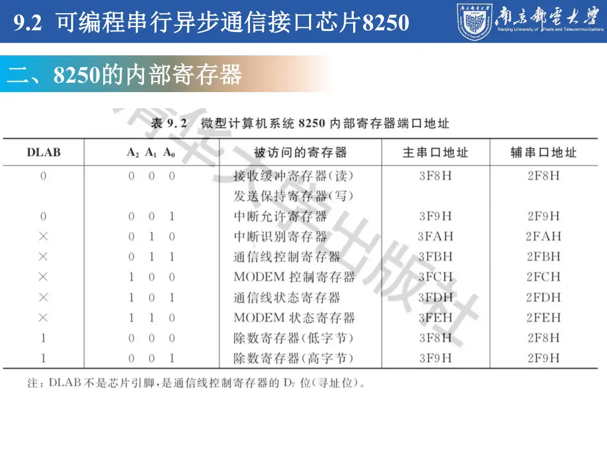

原文：

二、8250的内部寄存器

表9.2 微型计算机系统 8250内部寄存器端口地址
<table><tr><td>DLAB</td><td> $A_2$   $A_1$   $A_0$ </td><td>被访问的寄存器</td><td>主串口地址</td><td>辅串口地址</td></tr><tr><td rowspan="2">0</td><td rowspan="2">0 0 0</td><td>接收缓冲寄存器(读)</td><td rowspan="2">3F8H</td><td rowspan="2">2F8H</td></tr><tr><td>发送保持寄存器(写)</td></tr><tr><td>0</td><td>0 0 1</td><td>中断允许寄存器</td><td>3F9H</td><td>2F9H</td></tr><tr><td>×</td><td>0 1 0</td><td>中断识别寄存器</td><td>3FAH</td><td>2FAH</td></tr><tr><td>×</td><td>0 1 1</td><td>通信线控制寄存器</td><td>3FBH</td><td>2FBH</td></tr><tr><td>×</td><td>1 0 0</td><td>MODEM 控制寄存器</td><td>3FCH</td><td>2FCH</td></tr><tr><td>×</td><td>1 0 1</td><td>通信线状态寄存器</td><td>3FDH</td><td>2FDH</td></tr><tr><td>×</td><td>1 1 0</td><td>MODEM 状态寄存器</td><td>3FEH</td><td>2FEH</td></tr><tr><td>1</td><td>0 0 0</td><td>除数寄存器(低字节)</td><td>3F8H</td><td>2F8H</td></tr><tr><td>1</td><td>0 0 1</td><td>除数寄存器(高字节)</td><td>3F9H</td><td>2F9H</td></tr></table>
注：DLAB不是芯片引脚，是通信线控制寄存器的 $\mathrm { D } _ { 7 }$ 位(寻址位)。

9.1.2 串行通信基础可编程串行异步通信接口芯片8250

南立郵電大學 南京郵電大学 Nargng Ur GQ Nanjing University ofPosts and Telecommunication

### 1. 发送保持寄存器（3F8H/2F8H）

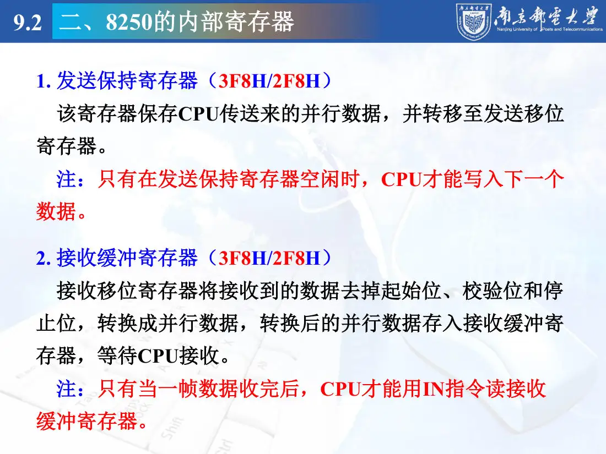

原文：

1. 发送保持寄存器（3F8H/2F8H）

该寄存器保存CPU传送来的并行数据，并转移至发送移位寄存器。

注：只有在发送保持寄存器空闲时，CPU才能写入下一个数据。

2. 接收缓冲寄存器（3F8H/2F8H）

接收移位寄存器将接收到的数据去掉起始位、校验位和停止位，转换成并行数据，转换后的并行数据存入接收缓冲寄存器，等待CPU接收。

注：只有当一帧数据收完后，CPU才能用IN指令读接收缓冲寄存器。

9.1 9.2 串行通信基础二、8250的内部寄存器

南立都電大学 南京郵電大学 Rarung Nanjing University ofPosts and Telecommunication

### 3. 通信线状态寄存器（3FDH/2FDH）

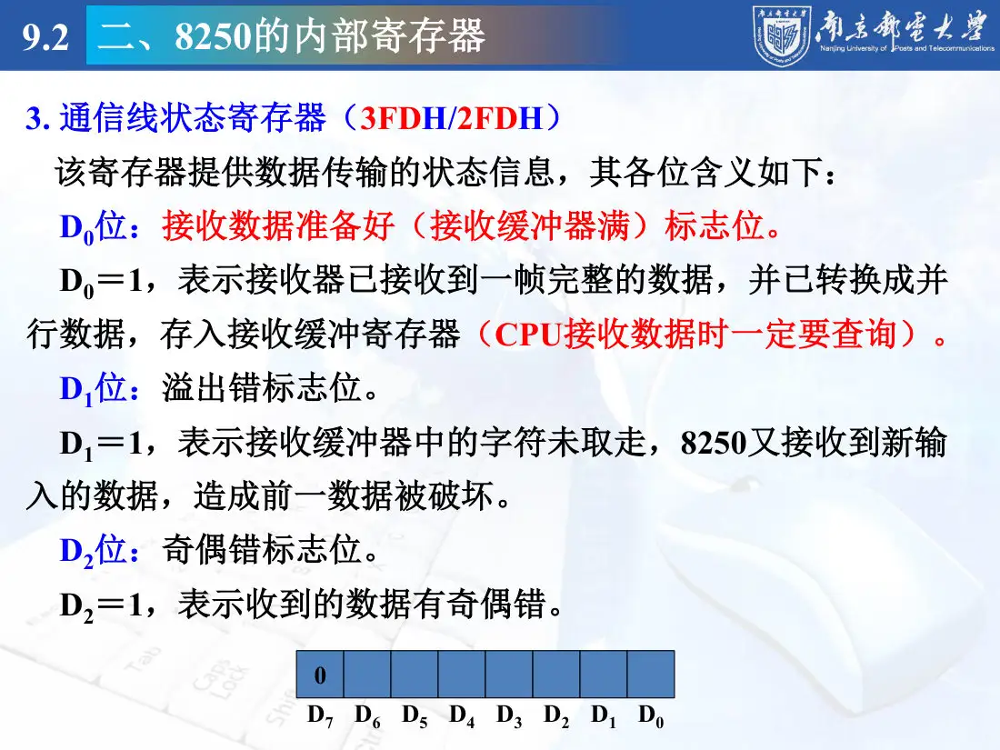

原文：

3. 通信线状态寄存器（3FDH/2FDH）

该寄存器提供数据传输的状态信息，其各位含义如下：

$\bf { D _ { 0 } }$ 位：接收数据准备好（接收缓冲器满）标志位。

$\mathbf { D _ { 0 } } \mathbf { = } \mathbf { 1 }$ ，表示接收器已接收到一帧完整的数据，并已转换成并行数据，存入接收缓冲寄存器（CPU接收数据时一定要查询）。$\mathbf { D _ { 1 } } \{ \ Y _ { \varepsilon } ^ { \bullet }$ ：溢出错标志位。

$\mathbf { D _ { 1 } } \mathbf { = } \mathbf { 1 }$ ，表示接收缓冲器中的字符未取走，8250又接收到新输入的数据，造成前一数据被破坏。

$D _ { 2 } \Rsh$ ：奇偶错标志位。

$\mathbf { D } _ { 2 } { = } 1$ ，表示收到的数据有奇偶错。

9.1 9.2 串行通信基础二、8250的内部寄存器

南立郵電大學 南京郵電大学 Naring Un GG Nanjing University ofPosts and Telecommunication

### ${ \bf D } _ { 3 }$ 位：接收格式错标志位。

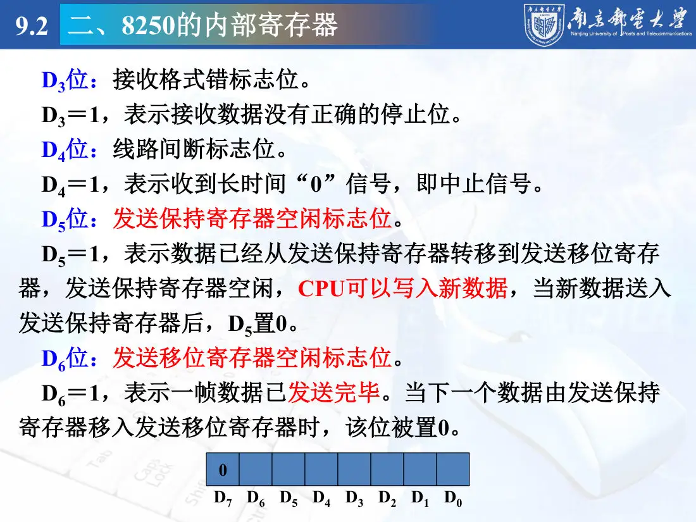

原文：

${ \bf D } _ { 3 }$ 位：接收格式错标志位。

$\mathbf { D } _ { 3 } { = } 1$ ，表示接收数据没有正确的停止位。

$D _ { 4 } \vert \frac { 1 } { \vert \vert }$ ：线路间断标志位。

$\bf { D } _ { 4 } = 1$ ，表示收到长时间 $^ { 6 6 } \mathbf { 0 } ^ { 9 9 }$ 信号，即中止信号。

$D _ { 5 } / \frac { 1 } { \vert { \cal L } \vert }$ ：发送保持寄存器空闲标志位。

$\bf { D } _ { 5 } { = } 1$ ，表示数据已经从发送保持寄存器转移到发送移位寄存器，发送保持寄存器空闲，CPU可以写入新数据，当新数据送入发送保持寄存器后， $\mathbf { D } _ { 5 }$ 置0。

D 位：发送移位寄存器空闲标志位。

$\mathbf { D _ { 6 } } \mathbf { = } \mathbf { 1 }$ ，表示一帧数据已发送完毕。当下一个数据由发送保持寄存器移入发送移位寄存器时，该位被置0。

9.1 9.2 串行通信基础二、8250的内部寄存器

南立郵電大學 南京郵電大学 Naring Un GG Nanjing University ofPosts and Telecommunication

### 9.1 9.2 串行通信基础二、8250的内部寄存器

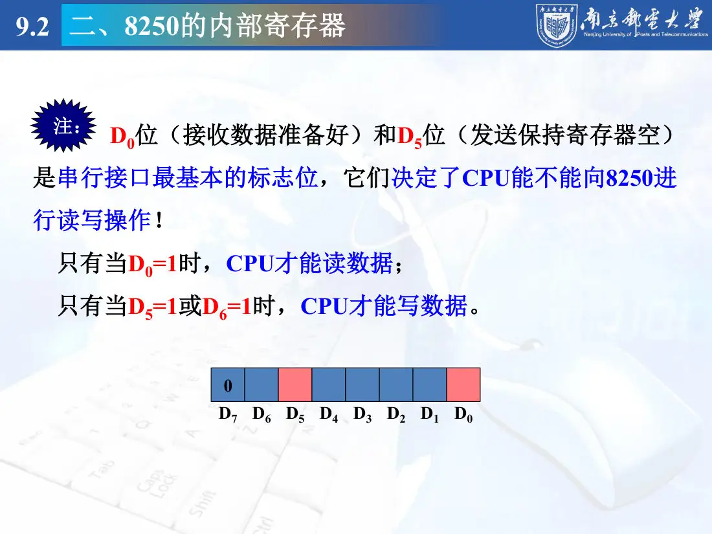

原文：

$\bf { D _ { 0 } }$ 位（接收数据准备好）和 ${ \bf D } _ { 5 }$ 位（发送保持寄存器空）是串行接口最基本的标志位，它们决定了CPU能不能向8250进行读写操作！

只有当 $\bf { D _ { 0 } } \mathrm { = } 1$ 时，CPU才能读数据；

只有当 $\bf { D } _ { 5 } { = } 1$ 或 ${ \bf D } _ { 6 } { = } 1$ 时，CPU才能写数据。

9.1 9.2 串行通信基础二、8250的内部寄存器

南立郵電大學 南京郵電大学 Naring Un GG Nanjing University ofPosts and Telecommunication

### 程序段示例

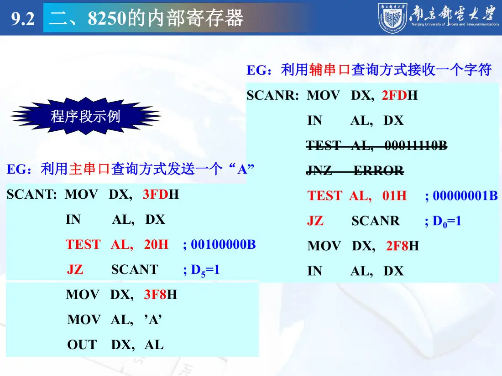

原文：

程序段示例

EG：利用主串口查询方式发送一个“A”

<table><tr><td rowspan="7">SCANT:</td><td>MOV</td><td>DX, 3FDH</td><td></td></tr><tr><td>IN</td><td>AL, DX</td><td></td></tr><tr><td>TEST</td><td>AL, 20H</td><td>; 00100000B</td></tr><tr><td>JZ</td><td>SCANT</td><td>; D5=1</td></tr><tr><td>MOV</td><td>DX, 3F8H</td><td></td></tr><tr><td>MOV</td><td>AL, &#x27;A&#x27;</td><td></td></tr><tr><td>OUT</td><td>DX, AL</td><td></td></tr></table>

EG：利用辅串口查询方式接收一个字符

SCANR: MOV DX, 2FDHIN AL,DXTESTAL,00011110B

JNZ ERROR

TEST AL, 01H ; 00000001B

JZ SCANR ; D₀=1

MOV DX, 2F8H

IN AL，DX

9.1 9.2 串行通信基础二、8250的内部寄存器

南立都電大学 南京郵電大学 Nanjing University of Posts and Telecommunications

### 执行下列操作后，通信线状态寄存器中相应位自动执行（P346）：

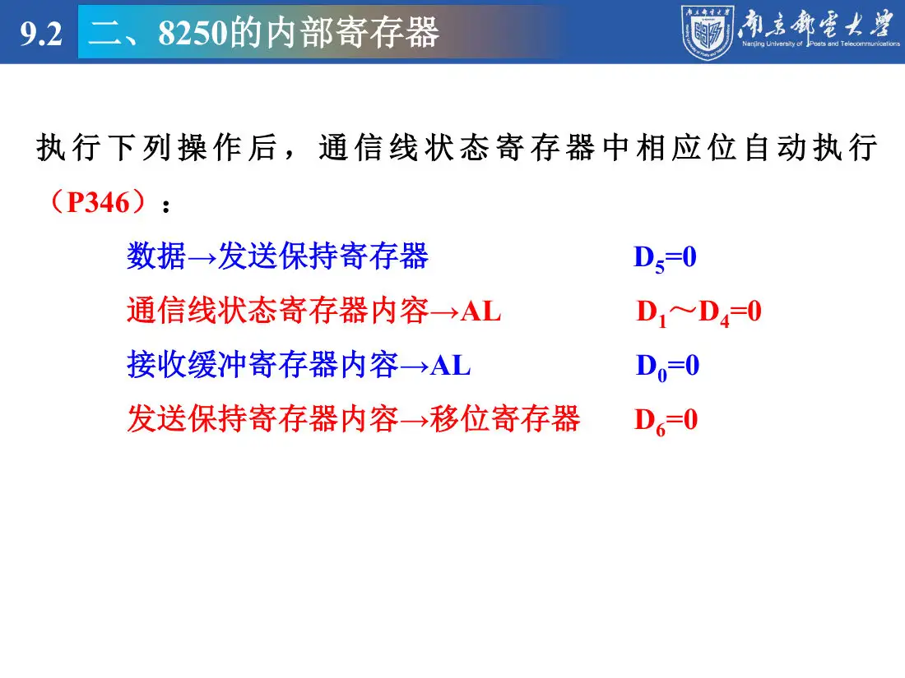

原文：

执行下列操作后，通信线状态寄存器中相应位自动执行（P346）：

数据→发送保持寄存器 D5=0

通信线状态寄存器内容→AL

$$
\mathrm{D} _ {1} \sim \mathrm{D} _ {4} = 0
$$

接收缓冲寄存器内容→AL

$$
\mathbf {D} _ {0} = \mathbf {0}
$$

发送保持寄存器内容→移位寄存器 $\bf { D } _ { 6 } { = } \bf { 0 }$

9.1 9.2 串行通信基础二、8250的内部寄存器

南立都電大学 南京郵電大学 G Nanjing University of Posts and Telecommunication

### 4. 中断允许寄存器（3F9H/2F9H）

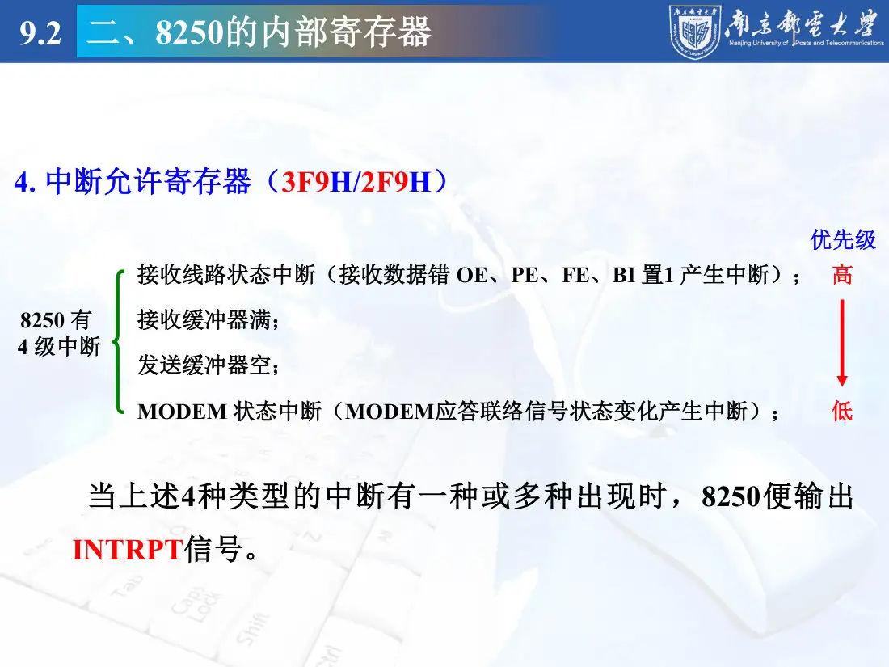

原文：

4. 中断允许寄存器（3F9H/2F9H）

优先级

接收线路状态中断（接收数据错 OE、PE、FE、BI 置1 产生中断）； 高接收缓冲器满；

8250 有4 级中断发送缓冲器空；

MODEM 状态中断（MODEM应答联络信号状态变化产生中断）； 低

当上述4种类型的中断有一种或多种出现时，8250便输出INTRPT信号。

9.1 9.2 串行通信基础二、8250的内部寄存器

南立郵電大學 南京郵電大学 Nargng Ur GQ Nanjing University ofPosts and Telecommunication

### 说明：通信线状态寄存器中的各位置1时，中断允许寄存器相应的中断允许位也为1，则：

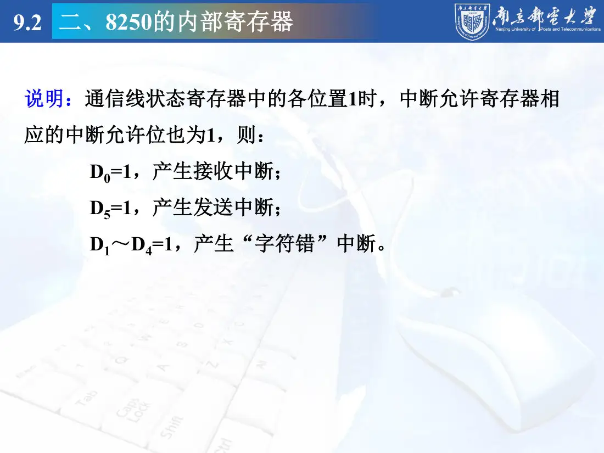

原文：

说明：通信线状态寄存器中的各位置1时，中断允许寄存器相应的中断允许位也为1，则：

$\bf { D _ { 0 } } \mathrm { = } \bf { 1 }$ ，产生接收中断；

${ \bf D } _ { 5 } { = } 1$ ，产生发送中断；

$\mathbf { D _ { 1 } } { \sim } \mathbf { D _ { 4 } } { = } \mathbf { 1 }$ ，产生“字符错”中断。

9.1 9.2 串行通信基础二、8250的内部寄存器

南立郵電大學 南京郵電大学 Naring Un GG Nanjing University ofPosts and Telecommunication

### 9.1 9.2 串行通信基础二、8250的内部寄存器

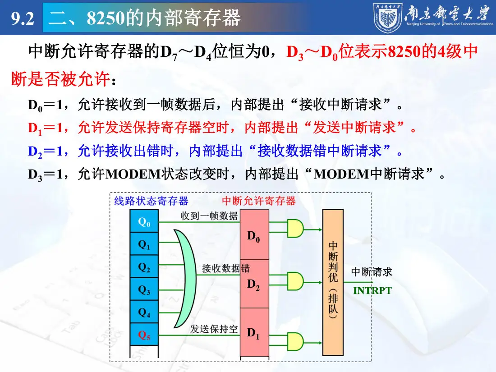

原文：

中断允许寄存器的 $\mathbf { D _ { 7 } } \{ \mathbf { \widetilde { D } _ { 4 } } \}$ 位恒为0， $\mathbf { D } _ { 3 } \sim \mathbf { D _ { 0 } }$ 位表示8250的4级中断是否被允许：

$\mathbf { D _ { 0 } } \mathbf { = } \mathbf { 1 }$ ，允许接收到一帧数据后，内部提出“接收中断请求”。

${ \bf D } _ { 1 } { = } 1$ ，允许发送保持寄存器空时，内部提出“发送中断请求”。

$\mathbf { D } _ { 2 } { = } 1$ ，允许接收出错时，内部提出“接收数据错中断请求”。

${ \bf D } _ { 3 } { = } 1$ ，允许MODEM状态改变时，内部提出“MODEM中断请求”。

9.1 9.2 串行通信基础二、8250的内部寄存器

南立都電大学 南京郵電大学 Rarung Nanjing University ofPosts and Telecommunication

### 5. 中断识别寄存器（3FAH/2FAH）

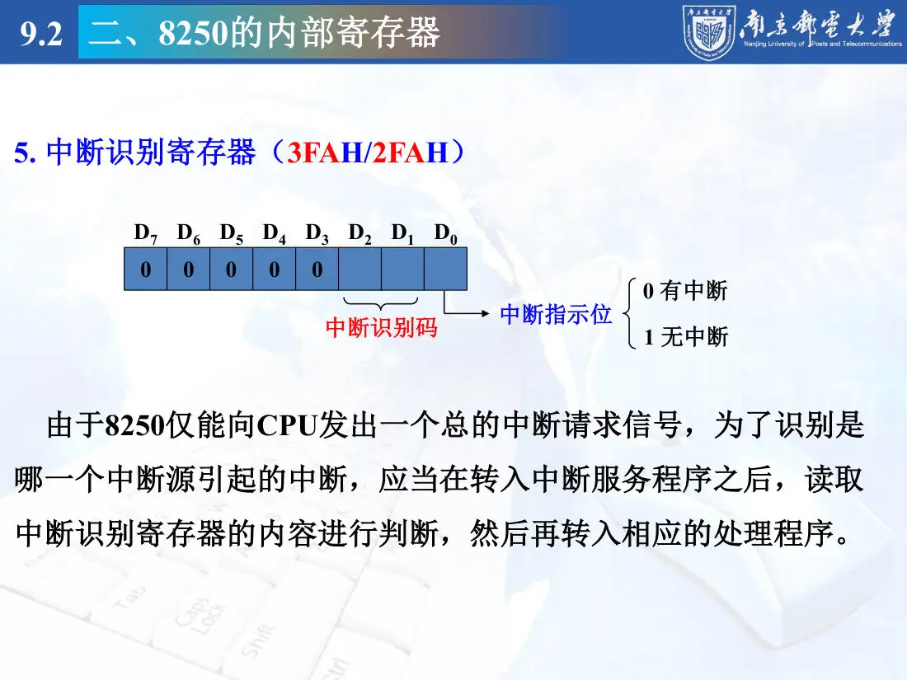

原文：

5. 中断识别寄存器（3FAH/2FAH）

由于8250仅能向CPU发出一个总的中断请求信号，为了识别是哪一个中断源引起的中断，应当在转入中断服务程序之后，读取中断识别寄存器的内容进行判断，然后再转入相应的处理程序。

9.1 9.2 串行通信基础二、8250的内部寄存器

南立郵電大學 南京郵電大学 Nargng Ur GQ Nanjing University ofPosts and Telecommunication

### 5. 中断识别寄存器（3FAH/2FAH）

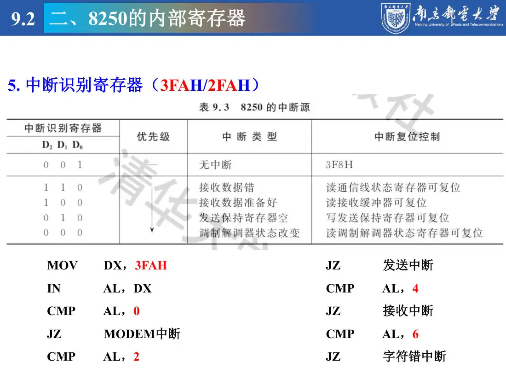

原文：

5. 中断识别寄存器（3FAH/2FAH）

表9.38250的中断源 
<table><tr><td colspan="2">中断识别寄存器</td><td rowspan="2">优先级</td><td rowspan="2">中断类型</td><td rowspan="2" colspan="2">中断复位控制</td></tr><tr><td> $D_2$ </td><td> $D_1$   $D_0$ </td></tr><tr><td>0</td><td>0 1</td><td>—</td><td>无中断</td><td colspan="2">3F8H</td></tr><tr><td>1</td><td>1 0</td><td rowspan="4">↓</td><td>接收数据错</td><td colspan="2">读通信线状态寄存器可复位</td></tr><tr><td>1</td><td>0 0</td><td>接收数据准备好</td><td colspan="2">读接收缓冲器可复位</td></tr><tr><td>0</td><td>1 0</td><td>发送保持寄存器空</td><td colspan="2">写发送保持寄存器可复位</td></tr><tr><td>0</td><td>0 0</td><td>调制解调器状态改变</td><td colspan="2">读调制解调器状态寄存器可复位</td></tr><tr><td colspan="4">MOV DX, 3FAH</td><td>JZ</td><td>发送中断</td></tr><tr><td colspan="4">IN AL, DX</td><td>CMP</td><td>AL, 4</td></tr><tr><td colspan="4">CMP AL, 0</td><td>JZ</td><td>接收中断</td></tr><tr><td colspan="4">JZ MODEM中断</td><td>CMP</td><td>AL, 6</td></tr><tr><td colspan="4">CMP AL, 2</td><td>JZ</td><td>字符错中断</td></tr></table>

9.1 9.2 串行通信基础二、8250的内部寄存器

南立都電大学 南京郵電大學 Rarung Nanjing University of Posts and Telecommunication

### 6. MODEM控制寄存器（3FCH/2FCH）

原文：

6. MODEM控制寄存器（3FCH/2FCH）

<table><tr><td> $D_{7}$ </td><td> $D_{6}$ </td><td> $D_{5}$ </td><td> $D_{4}$ </td><td> $D_{3}$ </td><td> $D_{2}$ </td><td> $D_{1}$ </td><td> $D_{0}$ </td></tr><tr><td>0</td><td>0</td><td>0</td><td></td><td></td><td></td><td></td><td></td></tr></table>

$\mathbf { D } _ { 7 } \sim \mathbf { D } _ { 5 }$ 位恒为0。

$\mathbf { D _ { 0 } } \{ \dot { \mathbf { \mu } } = \mathbf { 1 }$ ，使引脚 $\overline { { \mathbf { D } \mathbf { T } \mathbf { R } } } = \mathbf { 0 }$ ，从而使RS-232C引脚DTR为0。

$\mathbf { D } _ { 1 } \{ \dot { \mathbf { \mu } } = 1$ ，使引脚 $\mathbf { \overline { { { R T S } } } = 0 }$ ，从而使RS-232C引脚RTS为0。

$\mathbf { D } _ { 2 } \{ \dot { \mathbf { \mu } } \mathbf { \mu } = \mathbf { 1 }$ ，使引脚 $\mathbf { \overline { { O U T } } _ { 1 } } = \mathbf { 0 }$ ，系统机上没有使用。

$\mathbf D _ { 3 } \{ \dot { \mathbf { \mu } } \mathbf { \mu } = 1$ ，使引脚 $\overline { { \mathbf { O U T } } } _ { 2 } = \mathbf { 0 }$ ，8250能送出中断请求。

$\mathbf { D _ { 4 } }$ 位通常置0，设置8250工作在正常收/发方式；

若 $\mathbf { D _ { 4 } }$ 位置1，则8250工作在内部自环方式，即发送移位寄存器的输出在芯片内部被回送到接收移位寄存器的输入。

利用这个特点，可以编写程序测试8250的工作是否正常，而不需任何附加装置。

9.1 9.2 串行通信基础二、8250的内部寄存器

南志都電大学 南京郵電大学 G Nanjing University of Posts and Telecommunications

### 说明（1）8250的自发自收：

原文：

说明（1）8250的自发自收：

发送移位寄存器

Sout

接收移位寄存器

内环：自动

Sin

RS232C接口芯片

外环：人为

内环：自动将发送移位寄存器和接收移位寄存器短接。

外环：人为将RS-232C接口芯片端子2和端子3用线连接起来，属正常通信。

9.1 9.2 串行通信基础二、8250的内部寄存器

南立郵電大學 南京郵電大学 Nargng Ur GQ Nanjing University ofPosts and Telecommunication

### 说明（2）

原文：

说明（2）

$\mathbf { D _ { 0 } } , \mathbf { D _ { 1 } }$ 位直接控制RS232C的DTR和RTS引脚，向外部表明8250是否做好了收/发的准备。

9.1 9.2 串行通信基础二、8250的内部寄存器

南立郵電大學 南京郵電大学 Nargng Ur GQ Nanjing University ofPosts and Telecommunication

### 9.1 9.2 串行通信基础二、8250的内部寄存器

原文：

说明（3） $\overline { { \mathbf { O U T } } } _ { 1 }$ $\overline { { \mathbf { O U T } } } _ { 2 }$ 外接器件由硬件决定。

现状： $\overline { { \mathbf { O U T } } } _ { 1 }$ 空，在PC机中 $\overline { { \mathbf { O U T } } } _ { 1 }$ 引脚没有使用，因此初始化时 $\mathbf { D } _ { 2 } { = } \mathbf { 0 } / \mathbf { 1 }$ 皆可。

$\overline { { \mathbf { O U T } } } _ { 2 }$ 接线如下（以主串口为例）：

9.1 9.2 串行通信基础二、8250的内部寄存器

南立郵電大學 南京郵電大学 Nargng Ur GQ Nanjing University ofPosts and Telecommunication

### 说明（4）与8250之间采用中断方式交换信息，应采取以下措施：

原文：

说明（4）与8250之间采用中断方式交换信息，应采取以下措施：

1）中断允许寄存器相应位置1；

2）MODEM控制寄存器 $\mathbf { D } _ { 3 } { = } 1$ ，即 $\overline { { \mathbf { O U T } } } _ { 2 } { = } \mathbf { 0 }$ ，打通8250的中断请求通道；

3）8259A相应中断屏蔽位开放（主8259AIR3， $\mathbf { I R } _ { 4 } )$ 8259A

4）CPU处于开中断（STI）。 CPU

9.1 9.2 串行通信基础二、8250的内部寄存器

南立郵電大學 南京郵電大学 Nargng Ur GQ Nanjing University ofPosts and Telecommunication

### 功能：存放初始化时编程时写入的分频系数

原文：

7. 除数寄存器（16位寄存器，高8位3F9H/2F9H、低8位3F8H/2F8H）

功能：存放初始化时编程时写入的分频系数

8250内部的波特率发生器是软件控制的可编程的分频器。

$$
\frac {\mathrm{f} _ {\mathrm{osc}}}{\text {分频系数}} = 1 6 \times \text {通信速率}
$$

1.8432MHZ分频系数（即除数）=16通信速率

如果接收器时钟和发送器时钟相同，只需把8250芯片的引脚9（RCLK） 和引脚15（BAUDOUT）相连即可。

16被称为：波特率因子，可选1、16、64。

9.1 9.2 串行通信基础二、8250的内部寄存器

南立都電大学 南京郵電大学 Nanjing University of Posts and Telecommunications

### 9.1 9.2 串行通信基础二、8250的内部寄存器

原文：

除数寄存器存放分频系数，由高8位和低8位两个寄存器组成，分两次写入。8250 波特率与分频系数（除数锁存器中的值） 的关系： 除数 = 1843200 /（波特率\*16）

<table><tr><td>波特率</td><td>除数高8位</td><td>除数低8位</td></tr><tr><td>50</td><td>09H</td><td>00H</td></tr><tr><td>75</td><td>06H</td><td>00H</td></tr><tr><td>110</td><td>04H</td><td>17H</td></tr><tr><td>150</td><td>03H</td><td>00H</td></tr><tr><td>300</td><td>01H</td><td>80H</td></tr><tr><td>600</td><td>00H</td><td>C0H</td></tr><tr><td>1200</td><td>00H</td><td>60H</td></tr></table>

<table><tr><td>波特率</td><td>除数高8位</td><td>除数低8位</td></tr><tr><td>1800</td><td>00H</td><td>40H</td></tr><tr><td>2000</td><td>00H</td><td>3AH</td></tr><tr><td>2400</td><td>00H</td><td>30H</td></tr><tr><td>3600</td><td>00H</td><td>20H</td></tr><tr><td>4800</td><td>00H</td><td>18H</td></tr><tr><td>7200</td><td>00H</td><td>10H</td></tr><tr><td>9600</td><td>00H</td><td>0CH</td></tr></table>

除数寄存器的值必须在8250初始化时预置，因此需先设置通信线控制寄存器的最高位 $\mathbf { D } _ { 7 } / \mathbf { D } \mathbf { L A B } { = } \mathbf { 1 }$ ，然后分两次写入高/低八位除数寄存器。

9.1 9.2 串行通信基础二、8250的内部寄存器

南立都電大学 南京郵電大學 Rarung Nanjing University of Posts and Telecommunication

### 8. 通信线控制寄存器（3FBH/2FBH）

原文：

8. 通信线控制寄存器（3FBH/2FBH）

该寄存器主要用于指定串行异步通信的数据格式：

$$
\mathbf {D} _ {7}
$$

$$
\mathbf {D _ {6}}
$$

$$
\mathbf {D _ {5}}
$$

$$
\mathbf {D} _ {4}
$$

$$
\mathbf {D} _ {3}
$$

$$
\mathbf {D} _ {2}
$$

$$
\mathbf {D} _ {1}
$$

$$
\mathbf {D _ {0}}
$$

<table><tr><td>寻址位</td><td>中止位设置</td><td>校验位选择</td><td>停止位选择</td><td>数据位选择</td></tr><tr><td>1: 访问除数寄存器0: 访问合用端口地址的非除数寄存器</td><td>1: 输出长时间中止信号0: 正常通信</td><td>000: 没有校验位010: 没有校验位100: 没有校验位110: 没有校验位001: 设置奇校验011: 设置偶校验101: 校验位恒为111: 校验位恒为0</td><td>0: 1位1 (D1D0=00): 1.5位1 (D1D0≠00): 2位</td><td>00: 5位01: 6位10: 7位11: 8位</td></tr></table>

9.1 9.2 串行通信基础二、8250的内部寄存器

南立郵電大學 南京郵電大学 Nargng Ur GQ Nanjing University ofPosts and Telecommunication

### 问题：10个寄存器，仅3根端口地址线（A2～A0）。如何设置寻址位？

原文：

问题：10个寄存器，仅3根端口地址线（A2～A0）。如何设置寻址位？

$\mathbf { D } _ { 7 } { = } 1$ 表明后继写入合用端口的数据写入除数寄存器。

$\bf { D } _ { 7 } { = } 0$ 表明后继写入合用端口的数据写入非除数寄存器。

<table><tr><td>寄存器</td><td>合用口地址</td></tr><tr><td>除数寄存器高8位中断允许寄存器</td><td>3F9H/2F9H</td></tr><tr><td>除数寄存器低8位发送保持寄存器(写)接收缓冲寄存器(读)</td><td>3F8H/2F8H</td></tr></table>

MOV DX，3F9HOUT DX，AL写入哪个寄存器？

9.1 9.2 串行通信基础二、8250的内部寄存器

南立都電大学 南京郵電大学 Nanjing University of Posts and Telecommunications

### ∴N写入除数寄存器高8位

原文：

EG: MOV DX, 3FBH MOV AL, 80H ; 10000000B OUT DX, AL MOV DX, 3F9H MOV AL, N OUT DX, AL

∴N写入除数寄存器高8位

EG: MOV DX, 3FBH MOV AL, 01111111B OUT DX, AL MOV DX, 3F8H MOV AL, N OUT DX, AL

∴N写入发送保持寄存器

9.1 9.2 串行通信基础二、8250的内部寄存器

南立郵電大學 南京郵電大学 Nargng Ur GQ Nanjing University ofPosts and Telecommunication

### 9. MODEM状态寄存器（3FEH/2FEH）

原文：

9. MODEM状态寄存器（3FEH/2FEH）

该寄存器反映8250与通信设备（如MODEM）之间联络信号的当前状态以及这些信号的变化情况。

${ \bf D } _ { 7 } \sim { \bf D } _ { 4 }$ 记录了4个输入引脚的状态电平：

$\mathbf { D } _ { 7 } { = } \mathbf { 1 }$ 表示输入引脚 $\mathbf { \overline { { R L S D } } } = \mathbf { 0 }$ ，MODEM收到来自电话线的载波信号。

$\mathbf { D _ { 6 } } \mathbf { = } \mathbf { 1 }$ 表示输入引脚 $\mathbf { \overline { { { R I } } } = 0 }$ ，MODEM收到振铃信号。

$\bf { D } _ { 5 } { = } 1$ 表示输入引脚 $\overline { { \mathbf { D S R } } } = \mathbf { 0 }$ ，MODEM做好了发送准备，请8250准备接收。

$\bf { D _ { 4 } } \mathrm { = } \bf { 1 }$ 表示输入引脚 ${ \overline { { \mathbf { { C T S } } } } } \ = \mathbf { 0 }$ ，MODEM做好了接收准备，8250可以发送数据。

$\mathbf { D } _ { 3 } \sim \mathbf { D _ { 0 } }$ 记录了上一次读取该寄存器后，上述引脚是否发生过电平变化：

$\mathbf { D } _ { 3 } { = } 1$ 表示输入引脚RLSD有电平变化。 $\mathbf { D } _ { 2 } { = } 1$ 表示输入引脚R有电平变化。

$\mathbf { D _ { 1 } } \mathbf { = } \mathbf { 1 }$ 表示输入引脚DSR有电平变化。 $\bf { D _ { 0 } } \mathrm { = } \bf { 1 }$ 表示输入引脚CTS有电平变化。

9.1 9.2 串行通信基础二、8250的内部寄存器

南立郵電大學 南京郵電大学 Nargng Ur GQ Nanjing University ofPosts and Telecommunication

### 三、8250的初始化编程

原文：

三、8250的初始化编程

1. 直接对8250端口进行初始化编程步骤：

① 确定波特率，设置除数寄存器；

② 确定数据格式，设置通信线路控制寄存器；

③ 若使用中断方式，中断允许寄存器的相应位置1；查询方式，相应位置0；

④ 设置MODEM控制寄存器：

D =0：正常通信

D =1：内环自检

D =0：不允许送出中断信号

通常，该寄存器的值设置为03H使8250输出RTS、DTR两个MODEM控制信号，即使系统中不用这两个信号，这样的设置也不会带来问题。

9.1.2 串行通信基础可编程串行异步通信接口芯片8250

南立郵電大學 南京郵電大学 Nargng Ur GQ Nanjing University ofPosts and Telecommunication

### 例：编写子程序，对PC系列机主串口进行初始化，要求：

原文：

例：编写子程序，对PC系列机主串口进行初始化，要求：

① 通信速率=1200波特，一帧数据包括：8个数据位，1个停止位，无校验。

② 查询方式，完成内环自检。

分析：

1）通信速率 = 1200

分频系 $\ddot { \pmb { \mathfrak { X } } } \dot { \pmb { \mathfrak { X } } } = 1 . 8 4 3 2 \mathbf { M } / \ ( 1 6 \times 1 2 0 \mathbf { 0 } ) = \mathbf { 0 0 6 0 H }$ ，（也可查表得

2）帧数据结构控制字：$\mathbf { 0 0 0 0 0 0 0 1 1 B } = 0 3 \mathrm { H }$

3）中断允许控制字：0

4）MODEM控制字：$\mathbf { 0 0 0 1 0 0 0 0 } \mathbf { B } = 1 \mathbf { 0 } \mathbf { H }$

<table><tr><td>寻址位</td><td>中止位设置</td><td>校验位选择</td><td>停止位选择</td><td>数据位选择</td></tr><tr><td rowspan="2">1: 访问除数寄存器0: 访问合用端口地址的非除数寄存器</td><td rowspan="2">1: 输出长时间中止信号0: 正常通信</td><td rowspan="2">000: 没有校验位010: 没有校验位100: 没有校验位110: 没有校验位001: 设置奇校验011: 设置偶校验101: 校验位恒为111: 校验位恒为0</td><td>00: 5位01: 6位10: 7位11: 8位</td><td></td></tr><tr><td>0: 1位1 (D1D0=00): 1.5位1 (D1D0≠00): 2位</td><td></td></tr></table>

9.1 9.2 串行通信基础三、8250的初始化编程

南立都電大学 南京郵電大学 Nanjing University of Posts and Telecommunications

### I8250 PROC

原文：

I8250 PROC

MOV DX，3FBH

MOV AL，80H

OUT DX，AL

MOV DX，3F9H

寻址位=1

MOV AL，0

OUT DX，AL

MOV DX，3F8H

MOV AL，60H

OUT DX，AL

设置分

频系数

=0060H

MOV DX，3FBH

MOV AL，03H

OUT DX，AL

MOV DX，3F9H

MOV AL，0

OUT DX，AL

MOV DX，3FCH

MOV AL，10H

OUT DX，AL

定义一帧数据格式

RET

I8250 ENDP设置中断允许寄存器

设置MODEM控制寄存器，内环

9.1 9.2 串行通信基础三、8250的初始化编程

南立都電大学 南京郵電大学 NaringU Nanjing University of Posts and Telecommunications

### MOV DX, 3FBH ; 设置分频系数，通

原文：

例：要求以9600bps进行异步串行通信，每个字符 7 位数据位，2位停止位，奇校验，允许所有中断。

MOV DX, 3FBH ; 设置分频系数，通

MOV AL, 80H 讯线控制寄存器最高

MOV AL, 0

OUT DX, AL ; 除数高8位

MOV DX, 3F8H

MOV AL, 0CH

OUT DX, AL ; 除数低8位

MOV DX, 3FBH ；设置数据格式：

MOV AL, 00001110B

OUT DX, AL 停止位，奇校验

MOV DX, 3F9H ；设置中断允许

MOV AL, 0FH 寄存器：允许所

OUT DX, AL 有中断

MOV DX, 3FCH ; 设置MODEM

MOV AL, 0BH 控制器：使

OUT DX, AL OUT2、RTS、DTR有效，外环

9.1 9.2 串行通信基础三、8250的初始化编程

南立都電大学 南京郵電大学 Nanjing University of Posts and Telecommunications

### 随堂习题

原文：

随堂习题

2. 在一次应用中，A、B双方希望利用PC机主串口进行串行异步通信，双方设计的

(3)若B方采用查询方式接收数据，请为其编写初始化程序段（分频系数000CH)。

### 1、8250内部结构和引脚：

原文：

1、8250内部结构和引脚：

2、8250内部三类寄存器使用方法：

✓数据传输寄存器

✓工作方式寄存器

✓状态寄存器

3、8250初始化编程

总结

南立部電大学 南京郵電大学 Nanjing University of Posts and Telecommunications

### 2026/11/15

原文：

2026/11/15

### 1. BIOS通信软件

原文：

1. BIOS通信软件

BIOS通过INT 14H向用户提供了4个中断子程序，分别完成：串口初始化编程、发送数据、接收数据、测试通信线状态。

功能

入口参数

出口参数

1） $\mathbf { A H = 0 }$

$$
\mathbf {A L} = \text { 初始化参数 }
$$

AH = 通信线

初始化串口

$$
\mathbf {D X} = \text {串口号}
$$

路状态

$$
(0 \text {主} / 1 \text {辅})
$$

$$
\mathbf {A L} = \mathbf {M O D E M}
$$

状态

0号子功能的执行流程：

① 截取 $\mathbf { A L } _ { 7 } \sim \mathbf { A L } _ { 5 }$ 查表，取出相应波特率除数→除数寄存器。

② 截取 $\mathbf { A L _ { 4 } } { \sim } \mathbf { A L _ { 0 } }$ →通信线控制寄存器。

③ 0→中断允许寄存器。

AL中需设置的参数为：

波特率：

奇偶校验：

$$
0 0 0 = 1 1 0
$$

$$
\mathbf {0 0} = \text {无}
$$

代码长：

$$
0 0 1 = 1 5 0
$$

01=奇校验

$$
0 0 = 5 \text {位}
$$

$$
0 1 0 = 3 0 0
$$

$$
1 0 = \text {无}
$$

$$
0 1 = 6 \text {位}
$$

$$
0 1 1 = 6 0 0
$$

$$
1 0 = 7 \text {位}
$$

11=偶校验

$$
1 0 0 = 1 2 0 0
$$

$$
1 1 = 8 \mathrm{位}
$$

$$
1 0 1 = 2 4 0 0
$$

停止位：

$$
1 1 0 = 4 8 0 0
$$

$$
\mathbf {0} = \mathbf {1} \text {位}
$$

$$
1 1 1 = 9 6 0 0
$$

1=1.5位（代码长5位）=2位（代码长6-8位）

④ 取通信线状态寄存器内容→AH。

⑤ 取MODEM状态寄存器内容→AL。

⑥ 执行IRET返回。

9.1.3 串行通信基础行通信程序设计

南立都電大学 南京郵電大學 Rarung Nanjing University of Posts and Telecommunication

### 注 调用注意事项：

原文：

注 调用注意事项：

调用INT 14H的0号子功能初始化串行口，通信波特率只有8种选择，奇偶校验也只有3种选择。

从执行流程可以看出，使用0号功能初始化之后，8250的内部中断将被禁止，只能采用查询方式发送和接收数据。

如果在0号子功能初始化之后，再对中断允许寄存器和MODEM控制寄存器写入相应的命令字，仍然能使其工作在中断方式。

9.1.3 串行通信基础行通信程序设计

南立郵電大學 南京郵電大学 Naring Un GG Nanjing University ofPosts and Telecommunication

### 功能

原文：

功能

2）AH=1：发送一帧数据

入口参数

AL = 待发送数据

DX= 串口号（0主/1辅）

出口参数

${ \bf A } _ { 7 } = { \bf 1 }$ ：表示发送失败

$\mathbf { A H } _ { 7 } = \mathbf { 0 }$ ：表示发送成功

9.1.3 串行通信基础行通信程序设计 P353

南立都電大学 南京郵電大學 Rarung Nanjing University of Posts and Telecommunication

### 功能

原文：

功能

入口参数

3） $\mathbf { A H } { = } 2$ ：接收一帧数据 DX =串口号（0主/1辅）

出口参数

$\mathbf { A H } _ { 7 } \mathbf { : }$ 同上

$\mathbf { A H _ { 4 } } { \sim } \mathbf { A H _ { 1 } }$ ：接收数据的错误标志

AL = 接收到的数据

9.1.3 串行通信基础行通信程序设计

南立都電大学 南京郵電大学 Nargng o Nanjing University of Posts and Telecommunications

### 功能

原文：

功能

入口参数

4）AH=3：测试通信线状态

DX =串口号（0主/1辅）

AH = 通信线路状态

AL = MODEM状态

INT14H3号功能的执行流程：

出口参数

➢取通信状态寄存器内容 →AH

➢取MODEM状态寄存器内容 →AL

➢返回

9.1.3 串行通信基础行通信程序设计

南立都電大学 南京郵電大学 G Nanjing University of Posts and Telecommunication

### 一、串行通信的外部环境

原文：

一、串行通信的外部环境

使用BIOS通信软件，在发送和接收之前都要使用联络线与对端联络，只有联络畅通，才允许发送或接收数据。因此，当使用BIOS通信程序发送和接收数据时，必须具备相应的外部环境。所谓外部环境，就是RS-232C引脚的连接方式。

RS-232C怎样连线，与串口的通信方式（单工、半双工 or 全双工）有关，与编程时使用的编程手段（对端口直接操作 or 调用BIOS 1#、2#）有关。

9.1.3 串行通信基础行通信程序设计

南立郵電大學 南京郵電大学 Nargng Ur GQ Nanjing University ofPosts and Telecommunication

### 1. 外环自发自收

原文：

1. 外环自发自收

无联络线和有联络线：RTS/CTS、DTR/DSR

$$
\boxed { \begin{array}{c} 2 \\ 3 \end{array} } \xrightarrow {\text {TXD}} \boxed { \begin{array}{c} \text {RXD} \\ \text {RXD} \end{array} }
$$

$$
\begin{array}{c c} 2 & \text {TXD} \\ 3 & \text {RXD} \\ 4 & \overline {{\text {RTS}}} \\ 5 & \overline {{\text {CTS}}} \\ 2 0 & \overline {{\text {DTR}}} \\ 6 & \overline {{\text {DSR}}} \end{array}
$$

无联络线

适用：对端口直接操作编程。

有联络线

适用：对端口直接操作编程；调用BIOS通信软件；调用INT 21H的4#、3#（发/收）。

9.1 9.3 串行通信基础一、串行通信的外部环境

南立郵電大學 南京郵電大学 Nargng Ur GQ Nanjing University ofPosts and Telecommunication

### 2. 短距离（无MODEM）点-点全双工通信

原文：

2. 短距离（无MODEM）点-点全双工通信

无联络线：3线方式

适用：仅能对端口直接操作编程。

有联络线：7线方式

适用：对端口直接操作；调用BIOS通信软件；

调用INT 21H的4#、3#（发/收）——只能用主串口。

9.1 9.3 串行通信基础一、串行通信的外部环境

南立郵電大學 南京郵電大学 Nargng Ur GQ Nanjing University ofPosts and Telecommunication

### 3. 短距离单工通信

原文：

3. 短距离单工通信

有联络线：6线方式

适用：

无联络线：2线方式

适用：仅能对端口直接操作编程。

对端口直接操作；

调用BIOS通信软件；

调用INT21H的4#、3#（发/收）——只能用主串口。

注意：调用BIOS通信软件实现单工通信时，在初始化阶段应使发方的DTR=0，收方的$\overline { { \mathbf { R } \mathbf { T } \mathbf { S } } } = \overline { { \mathbf { D } \mathbf { T } \mathbf { R } } } = \mathbf { 0 }$

9.1 9.3 串行通信基础一、串行通信的外部环境

南立郵電大學 南京郵電大学 Naring Un GG Nanjing University ofPosts and Telecommunication

### 二、串行通信程序设计举例

原文：

二、串行通信程序设计举例

设计考虑：

① 题型：单端自发自收or 点—点通信（全双工、单工）；

② CPU与串口交换信息的方式：查询or 中断？

③编程手段：对端口直接编程or 调用BIOS通信软件；

④ 根据题目要求组织相应的外部环境（RS232连线）。

说明：

1）对端口直接操作发送和接收数据，程序中查询联络线，可以按“有联络线”方式接线；程序中不查询联络线，可以按“无联络线”方式接线。

2）BIOS通信软件是一个全双工的通信软件，发送和接收之前都要使用联络线与对端“握手”，只有联络畅通，才能发送或接收数据。

3）当8250设置为内环自检方式的时候，只能采用查询方式，而且只能采用对端口直接操作的编程手段，完成数据的发送和接收。

9.1.3 串行通信基础行通信程序设计

南立郵電大學 南京郵電大学 Nargng Ur GQ Nanjing University ofPosts and Telecommunication

### 分析：

原文：

例1：A、B两机利用主串口，查询方式，进行单工通信，A机发送电文“HELLO”至B机。

请为A机编写发送程序，要求：波特率=2400，奇校验，停止位1位，数据位7位，采用查询方式。

分析：

1）通信速率=2400，分频系数$\mathbf { - 1 . 8 4 3 2 M } \mathrm { ~ / ~ } \left( 1 6 ^ { * } 2 4 0 0 \right) \mathbf { \xi } = \mathbf { 0 0 } 3 0 \mathbf { H }$

2）帧数据结构命令字：00001010B

3）中断允许命令字 = 0

4）MODEM控制字00000011B = 03H

9.1 9.3 串行通信基础二、串行通信程序设计举例

南立都電大学 南京郵電大学 Nanjing University of Posts and Telecommunications

### 9.1 9.3 串行通信基础二、串行通信程序设计举例

原文：

<table><tr><td></td><td>CALL</td><td>I8250</td><td></td></tr><tr><td></td><td>LEA</td><td>BX,</td><td>BUF</td></tr><tr><td></td><td>MOV</td><td>CX,</td><td>LENS</td></tr><tr><td>SCAN:</td><td>MOV</td><td>DX,</td><td>3FDH</td></tr><tr><td></td><td>IN</td><td>AL,</td><td>DX</td></tr><tr><td></td><td>TEST</td><td>AL,</td><td>20H ; D5</td></tr><tr><td></td><td>JZ</td><td>SCAN</td><td></td></tr><tr><td></td><td>MOV</td><td>DX,</td><td>3F8H</td></tr><tr><td></td><td>MOV</td><td>AL,</td><td>[BX]</td></tr><tr><td></td><td>OUT</td><td>DX,</td><td>AL</td></tr><tr><td></td><td>INC</td><td>BX</td><td></td></tr><tr><td></td><td>LOOP</td><td>SCAN</td><td></td></tr></table>

<table><tr><td>NEXT:</td><td>MOV</td><td>DX, 3FDH</td></tr><tr><td></td><td>IN</td><td>AL, DX</td></tr><tr><td></td><td>TEST</td><td>AL, 40H ; D6</td></tr><tr><td></td><td>JZ</td><td>NEXT</td></tr><tr><td></td><td>MOV</td><td>AH, 4CH</td></tr><tr><td></td><td>INT</td><td>21H</td></tr></table>

9.1 9.3 串行通信基础二、串行通信程序设计举例

南立都電大学 南京郵電大学 Rarung Nanjing University of Posts and Telecommunications

### I8250 PROC

原文：

<table><tr><td>MOV</td><td>DX,</td><td>3FBH;分频</td></tr><tr><td>MOV</td><td>AL,</td><td>80H</td></tr><tr><td>OUT</td><td>DX,</td><td>AL</td></tr><tr><td>MOV</td><td>DX,</td><td>3F9H</td></tr><tr><td>MOV</td><td>AL,</td><td>0</td></tr><tr><td>OUT</td><td>DX,</td><td>AL</td></tr><tr><td>MOV</td><td>DX,</td><td>3F8H</td></tr><tr><td>MOV</td><td>AL,</td><td>30H</td></tr><tr><td>OUT</td><td>DX,</td><td>AL</td></tr></table>

I8250 PROC

MOV DX, 3FBH MOV AL, 00001010B OUT DX, AL MOV DX, 3F9H MOV AL, 0 OUT DX, AL MOV DX, 3FCH MOV AL, 03H OUT DX, AL RET I8250 ENDP CODE ENDS END BEG

串行通信基础二、串行通信程序设计举例

南立都電大学 南京郵電大学 Nanjing University ofPosts and Telecommunications

### 例2：要求甲乙两台微机之间通过RS-232C接口进行短距离的单工串行通信。

原文：

例2：要求甲乙两台微机之间通过RS-232C接口进行短距离的单工串行通信。

甲机作为发送端从主串口将一串字符逐个发送，乙机作为接收端在辅串口进行字符接收并显示在屏幕上，其中甲机发送字符串时以‘ETX’ 字符（ASCII码：03H）作为输入结束标志字符。

通信双方约定波特率为2400波特，数据位7位，停止位1位，奇校验，发送和接收均采用查询方式。

9.1 9.3 串行通信基础二、串行通信程序设计举例

南立郵電大學 南京郵電大学 Nargng Ur GQ Nanjing University ofPosts and Telecommunication

### ［设计思路

原文：

［设计思路

1）甲乙两台微机之间进行短距离的单工通信，因此采用直接访问8250端口寄存器的方式进行编程，程序运行前将甲机的主串口与乙机的辅串口进行点到点单工通信连接，不使用联络线。连线图如下所示。

甲机主串口

$$
\begin{array}{c c} \text {TXD} \\ 2 & 2 \\ 3 & 3 \\ 7 & 7 \end{array}
$$

乙机辅串口

2）一串字符经逐个发送，发送字符和接收字符均采用查询方式。发送前，先读取通信线状态寄存器，查询发送保持寄存器是否空；接收前先读取通信线状态寄存器，查询一帧数据是否收完。

3）通信速率2400波特，分频系数为0030H，一帧字符有7个数据位，1个停止位，奇校验，数据帧格式字为0AH。

9.1 9.3 串行通信基础二、串行通信程序设计举例

南立郵電大學 南京郵電大学 Nargng Ur GQ Nanjing University ofPosts and Telecommunication

### ［流程图］

原文：

［流程图］

9.1 9.3 串行通信基础二、串行通信程序设计举例

南立郵電大學 南京郵電大学 Nargng Ur GQ Nanjing University ofPosts and Telecommunication

### ［流程图］

原文：

［流程图］

9.1 9.3 串行通信基础二、串行通信程序设计举例

南立郵電大學 南京郵電大学 Nargng Ur GQ Nanjing University ofPosts and Telecommunications

### [程序清单1]甲机发送程序

原文：

[程序清单1]甲机发送程序

.586

DATA SEGMENT USE16

BUF DB ‘Hello’, 03H

LENS EQU \$-BUF

DATA ENDS

BEG: MOV AX, DATAMOV DS, AXCALL I8250 ; 主串口初始化LEA BX, BUFMOV CX, LENS

SCAN: MOV DX, 3FDH

CODE SEGMENT USE16 ASSUME CS:CODE, DS:DATA

IN AL, DX

TEST AL, 20H

; 发送保存寄存器是否为空？

JZ SCAN

MOV DX, 3F8H

MOV AL, [BX] ; 取字符

OUT DX, AL

; 送主串口数据寄存器

INC BX

LOOP SCAN

MOV AH, 4CH

INT 21H

9.1 9.3 串行通信基础二、串行通信程序设计举例

南立都電大学 南京郵電大学 Nanjing University of Posts and Telecommunications

### MOV DX, 3FBH MOV AL, 80H OUT DX, AL

原文：

MOV DX, 3FBH MOV AL, 80H OUT DX, AL

MOV DX, 3F9H MOV AL, OUT DX, AL MOV DX, 3F8H MOV AL, 30H OUT DX, AL

<table><tr><td>MOV</td><td>DX,</td><td>3FBH</td></tr><tr><td>MOV</td><td>AL,</td><td>0AH</td></tr><tr><td>OUT</td><td>DX,</td><td>AL</td></tr><tr><td>MOV</td><td>DX,</td><td>3F9H</td></tr><tr><td>MOV</td><td>AL,</td><td>0</td></tr><tr><td>OUT</td><td>DX,</td><td>AL</td></tr><tr><td>MOV</td><td>DX,</td><td>3FCH</td></tr><tr><td>MOV</td><td>AL,</td><td>0 ;查询</td></tr><tr><td>OUT</td><td>DX,</td><td>AL</td></tr><tr><td>RET</td><td></td><td></td></tr><tr><td>I8250</td><td>ENDP</td><td></td></tr><tr><td>CODE</td><td>ENDS</td><td></td></tr><tr><td></td><td></td><td>END BEG</td></tr></table>

9.1 9.3 串行通信基础二、串行通信程序设计举例

南立都電大学 南京郵電大学 NaringU Nanjing University ofPosts and Telecommunications

### [程序清单2] 乙机接收程序.586

原文：

<table><tr><td rowspan="15">SCAN:</td><td>MOV</td><td>DX, 2FDH</td></tr><tr><td>IN</td><td>AL, DX</td></tr><tr><td>TEST</td><td>AL, 01H</td></tr><tr><td></td><td>;一帧数据收完否?</td></tr><tr><td>JZ</td><td>SCAN</td></tr><tr><td>MOV</td><td>DX, 2F8H</td></tr><tr><td>IN</td><td>AL, DX</td></tr><tr><td>AND</td><td>AL, 01111111B</td></tr><tr><td>CMP</td><td>AL, 03H</td></tr><tr><td></td><td>;是结束标志字符?</td></tr><tr><td>JE</td><td>EXIT</td></tr><tr><td>MOV</td><td>DL, AL</td></tr><tr><td>MOV</td><td>AH, 02H</td></tr><tr><td>INT</td><td>21 ;显示字符</td></tr><tr><td>JMP</td><td>SCAN</td></tr><tr><td rowspan="2">EXIT:</td><td>MOV</td><td>AH, 4CH</td></tr><tr><td>INT</td><td>21H</td></tr></table>

[程序清单2] 乙机接收程序.586

DATA SEGMENT USE16

MESG DB ‘The received characters are’, ‘\$’

DATA ENDS

CODE SEGMENT USE16 ASSUME CS:CODE, DS:DATA

BEG: MOV AX, DATAMOV DS, AXCALL I8250 ; 辅串口初始化MOV AH, 9 ; 显示提示字符串MOV DX, OFFSET MESGINT 21H

9.1 9.3 串行通信基础二、串行通信程序设计举例

南立都電大学 南京郵電大学 NaringU Nanjing University of Posts and Telecommunications

### MOV DX, 2FBH MOV AL, 80H OUT DX, AL

原文：

MOV DX, 2FBH MOV AL, 80H OUT DX, AL

MOV DX, 2F9H MOV AL, 0 OUT DX, AL MOV DX, 2F8H MOV AL, 30H OUT DX, AL

9.1 9.3 串行通信基础二、串行通信程序设计举例

南立都電大学 南京郵電大学 NaringU Nanjing University ofPosts and Telecommunications

### 3）本例采用两种方法编程：

原文：

例3：对主串口进行外环自动测试，将下列测试电文10行，经主串口发出，通过外环短路线接收，显示在屏幕上，测试电文如下

：THE QUICK BROWN FOX JUMPS OVER LAZY DOG［设计思路］

1）在一条报路上，长时间的循环发送这条电文，接收方统计在一定时间内的差错率即可知道该报路的通信质量。

2）电文必须逐个字符发送，为了简化程序设计，发送字符和接收字符均采用查询方式。发送前，先读取通信线状态寄存器，查询发送保持寄存器是否为空；接收前先读取通信线状态寄存器，查询一帧数据是否接受完毕。

3）本例采用两种方法编程：

① 直接访问8250端口寄存器，程序运行前RS232连接器按图9.10(a)接线，没有使用联络线；P351

② 调用BIOS通信软件，程序运行前需按图9.10(b)接线，准备好自发自收的外部环境。 [程序清单] ②

9.1 9.3 串行通信基础二、串行通信程序设计举例

南立都電大学 南京郵電大學 Rarung Nanjing University of Posts and Telecommunication

### [程序清单]① 直接访问8250端口寄存器

原文：

[程序清单]① 直接访问8250端口寄存器

DATA SEGMENT

TEXT DB 'THE QUICK BROWN FOX JUMPS OVER LAZY DOG' DB 0DH, 0AH

LLL EQU \$-TEXT

ERROR DB 'COM1 BAD !', 0DH, 0AH, '\$'

DATA ENDS

CODE SEGMENT ASSUME CS:CODE, DS:DATA

BEG: MOV AX, DATAMOV DS, AXCALL I8250 ;主串口初始化MOV CH, 10 ;10行送CH

AGAIN: MOV CL, LLL ;电文长度送CL MOV BX, OFFSET TEXT

9.1 9.3 串行通信基础二、串行通信程序设计举例

南立都電大学 南京郵電大学 Nanjing University of Posts and Telecommunications

### 串行通信基础二、串行通信程序设计举例

原文：

<table><tr><td rowspan="5">TSCAN:</td><td>MOV</td><td>DX, 3FDH</td><td></td></tr><tr><td>IN</td><td>AL, DX</td><td></td></tr><tr><td>TEST</td><td>AL, 20H</td><td>;发送保持寄存器空?</td></tr><tr><td>JZ</td><td>TSCAN</td><td>;否</td></tr><tr><td>MOV</td><td>AL, [BX]</td><td>;取字符</td></tr><tr><td rowspan="3">SEND:</td><td>MOV</td><td>DX, 3F8H</td><td></td></tr><tr><td>OUT</td><td>DX, AL</td><td>;送主串口数据寄存器</td></tr><tr><td>MOV</td><td>SI, 0</td><td></td></tr><tr><td rowspan="7">RSCAN:</td><td>MOV</td><td>DX, 3FDH</td><td></td></tr><tr><td>IN</td><td>AL, DX</td><td></td></tr><tr><td>TEST</td><td>AL, 01H</td><td>;一帧数据收完否?</td></tr><tr><td>JNZ</td><td>REVEICE</td><td>;收完转,未收到循环等</td></tr><tr><td>DEC</td><td>SI</td><td></td></tr><tr><td>JNZ</td><td>RSCAN</td><td>;延时</td></tr><tr><td>JMP</td><td>DISPERR</td><td>;超时,转出错处理</td></tr><tr><td rowspan="3">REVEICE:</td><td>MOV</td><td>DX, 3F8H</td><td></td></tr><tr><td>IN</td><td>AL, DX</td><td>;读数据寄存器</td></tr><tr><td>AND</td><td>AL, 7FH</td><td></td></tr></table>

串行通信基础二、串行通信程序设计举例

南京郵電大学

### RETURN: MOV AH, 4CH INT 21H

原文：

DISP: MOV AH, 2 MOV DL, AL INT 21H INC BX DEC CL JNZ TSCAN DEC CH JNZ AGAIN JMP RETURN

DISPERR: MOV AH, 9 MOV DX, OFFSET ERROR INT 21H

RETURN: MOV AH, 4CH INT 21H

;屏幕显示字符

;字符计数

;行计数

;显示出错信息

;返回 DOS

9.1 9.3 串行通信基础二、串行通信程序设计举例

南立都電大学 南京郵電大学 Nanjing University of Posts and Telecommunications

### 9.1 9.3 串行通信基础二、串行通信程序设计举例

原文：

<table><tr><td>I8250</td><td>PROC</td><td></td><td></td></tr><tr><td></td><td>MOV</td><td>DX,</td><td>3FBH</td></tr><tr><td></td><td>MOV</td><td>AL,</td><td>80H</td></tr><tr><td></td><td>OUT</td><td>DX,</td><td>AL</td></tr><tr><td></td><td>MOV</td><td>DX,</td><td>3F9H</td></tr><tr><td></td><td>MOV</td><td>AL,</td><td>0</td></tr><tr><td></td><td>OUT</td><td>DX,</td><td>AL</td></tr><tr><td></td><td>MOV</td><td>DX,</td><td>3F8H</td></tr><tr><td></td><td>MOV</td><td>AL,</td><td>60H</td></tr><tr><td></td><td>OUT</td><td>DX,</td><td>AL</td></tr></table>

<table><tr><td>MOV</td><td>DX,</td><td>3FBH</td></tr><tr><td>MOV</td><td>AL,</td><td>03H</td></tr><tr><td>OUT</td><td>DX,</td><td>AL</td></tr><tr><td>MOV</td><td>DX,</td><td>3F9H</td></tr><tr><td>MOV</td><td>AL,</td><td>0</td></tr><tr><td>OUT</td><td>DX,</td><td>AL</td></tr><tr><td>MOV</td><td>DX,</td><td>3FCH</td></tr><tr><td>MOV</td><td>AL,</td><td>0</td></tr><tr><td>OUT</td><td>DX,</td><td>AL</td></tr><tr><td>RET</td><td></td><td></td></tr><tr><td>I8250</td><td>ENDP</td><td></td></tr><tr><td>CODE ENDS</td><td></td><td></td></tr><tr><td></td><td>END</td><td>BEG</td></tr></table>

9.1 9.3 串行通信基础二、串行通信程序设计举例

南立都電大学 南京郵電大学 NaringU Nanjing University of Posts and Telecommunications

### [程序清单] ② 调用BIOS通信软件

原文：

[程序清单] ② 调用BIOS通信软件

DATA SEGMENT

TEXT DB 'THE QUICK BROWN FOX JUMPS OVER LAZY DOG' DB 0DH,0AH

LLL EQU \$-TEXT

ERROR DB 'COM1 BAD !',0DH,0AH,'\$'

DATA ENDS

CODE SEGMENT ASSUME CS:CODE,DS:DATA

BEG: MOV AX, DATA MOV DS, AX CALL I8250 MOV CH, 10

;主串口初始化

;10行送CH

AGAIN: MOV CL, LLL ;电文长度送CL MOV BX, OFFSET TEXT

9.1 9.3 串行通信基础二、串行通信程序设计举例

南立都電大学 南京郵電大学 Nanjing University of Posts and Telecommunications

### SEND:

原文：

SEND:

AH=1：发送数据

MOV AL, [BX] ;取数据

MOV AH, 1

入口参数：

AL = 待发送数据

DX = 串口号（0/1）

MOV DX, 0

INT 14H

出口参数：

;发送数据

$\mathbf { A H } _ { 7 } = \mathbf { 1 } { \mathrm { : } }$ ：表示发送失败

TEST AH, 80H ;发送成功否 ?

$\mathbf { A H } _ { 7 } = \mathbf { 0 } { \mathrm { : } }$ 表示发送成功

JNZ DISPERR ;失败,转出错处理

RECEIVE: MOV AH, 2 MOV DX, 0

INT 14H

;接收一个数据

TEST AH, 80H ;接收成功否 ?

$\mathbf { A H } { = } 2$ 接收数据入口参数：

JNZ DISPERR ;失败,转出错处理

DX = 串口号（0/1）

AND AL, 7FH

出口参数：

$\mathbf { A H } _ { 7 } = \mathbf { 1 }$ ：表示发送失败

$\mathbf { A H } _ { 7 } = \mathbf { 0 }$ ：表示发送成功

AL = 接收到的数据

9.1 9.3 串行通信基础二、串行通信程序设计举例

南立都電大学 南京郵電大学 Nanjing University of Posts and Telecommunications

### 串行通信基础二、串行通信程序设计举例

原文：

<table><tr><td rowspan="9">DISP:</td><td>MOV</td><td>AH, 2</td><td></td></tr><tr><td>MOV</td><td>DL, AL</td><td></td></tr><tr><td>INT</td><td>21H</td><td>;送屏幕显示</td></tr><tr><td>INC</td><td>BX</td><td></td></tr><tr><td>DEC</td><td>CL</td><td>;计数</td></tr><tr><td>JNZ</td><td>SEND</td><td></td></tr><tr><td>DEC</td><td>CH</td><td>;行计数</td></tr><tr><td>JNZ</td><td>AGAIN</td><td></td></tr><tr><td>JMP</td><td>RETURN</td><td></td></tr><tr><td rowspan="3">DISPERR:</td><td>MOV</td><td>AH, 9</td><td></td></tr><tr><td>MOV</td><td>DX, OFFSET ERROR</td><td></td></tr><tr><td>INT</td><td>21H</td><td>;显示出错信息</td></tr><tr><td rowspan="2">RETURN:</td><td>MOV</td><td>AH, 4CH</td><td></td></tr><tr><td>INT</td><td>21H</td><td>;返回 DOS</td></tr></table>

串行通信基础二、串行通信程序设计举例

南立都電大学 南京郵電大学 Nanjing University of Posts and Telecommunications

### AH=0：初始化串口入口参数：AL = 初始化参数DX = 串口号（0/1）

原文：

AH=0：初始化串口入口参数：AL = 初始化参数DX = 串口号（0/1）

$$
\mathbf {D X}, \quad \mathbf {0}
$$

I8250 ENDP

CODE ENDS

END

BEG

AL中需设置的参数为：

波特率：

奇偶校验：

$$
0 0 0 = 1 1 0
$$

$$
\mathbf {0 0} = \text {无}
$$

$$
0 0 1 = 1 5 0
$$

$$
\mathbf {0 1} = \mathrm{奇校验}
$$

$$
0 1 0 = 3 0 0
$$

$$
0 0 = 5 \text {位}
$$

$$
1 0 = \mathrm{无}
$$

$$
\mathbf {0 1} = 6 \text {位}
$$

$$
0 1 1 = 6 0 0
$$

$$
1 1 = \mathrm{偶校验}
$$

$$
1 0 = 7 \text {位}
$$

$$
1 0 0 = 1 2 0 0
$$

$$
1 1 = 8 \mathrm{位}
$$

$$
1 0 1 = 2 4 0 0
$$

停止位：0=1位1=1.5位（代码长5位）=2位（代码长6-8位）

;波特率1200;无校验，8位数据

出口参数

AH = 通信线路状态

AL = MODEM状态

9.1 9.3 串行通信基础二、串行通信程序设计举例

南立都電大学 南京郵電大学 NaringU Nanjing University of Posts and Telecommunications

### 1. BIOS通信软件

原文：

1. BIOS通信软件

BIOS通过INT 14H向用户提供了4个中断子程序，分别完成：串口初始化编程、发送数据、接收数据、测试通信线状态。

2. 串行通信程序设计案例

设计考虑：

① 题型：单端自发自收 or 点—点通信（全双工、单工）；

② CPU与串口交换信息的方式：查询 or 中断？

③ 编程手段：对端口直接编程 or 调用BIOS通信软件；

④ 根据题目要求组织相应的外部环境（RS232连线）。

9.1 总 结串

南立都電大学 南京郵電大学 Nanjing University of Posts and Telecommunications
