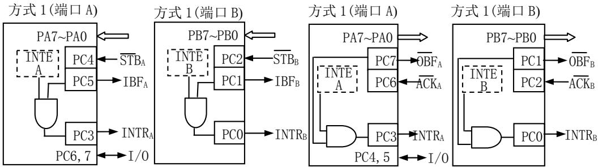

# 《微型计算机接口技术》考试附录（2021—2022学年第一学期、2020—2021学年第一学期）

原件经识别和整理；“参考解答”是我们补的。

## 附录：8254 控制字

系统机 8254 口地址 40H～43H

### 8254 的控制字

| D7 D6 | D5 D4 | D3 D2 D1 | D0 |
|---|---|---|---|
| 计数器选择 | 读/写方式选择 | 工作方式选择 | 数制选择 |

**(1) 计数器选择**：D7D6=00，表示选择 0 号计数器；D7D6=01，表示选择 1 号计数器；D7D6=10，表示选择 2 号计数器；D7D6=11，读出控制字的标志之一。

**(2) 读/写方式选择**：D5D4=00，表示锁存计数器的当前值，以便读出检查；D5D4=01，表示写入时只写低 8 位计数初值、高 8 位置 0，读出时只读出低 8 位的当前计数值；D5D4=10，表示写入时只写高 8 位计数初值、低 8 位置 0，读出时只读出高 8 位的当前计数值；D5D4=11，表示先读/写低 8 位计数值，后读/写高 8 位的当前计数值。

**(3) 工作方式选择**：D3D2D1=000，计数器工作在方式 0；D3D2D1=001，计数器工作在方式 1；D3D2D1=X10，计数器工作在方式 2；D3D2D1=X11，计数器工作在方式 3；D3D2D1=100，计数器工作在方式 4；D3D2D1=101，计数器工作在方式 5。

**(4) 数制选择**：D0=0，计数初值被认为是二进制数；D0=1，计数初值被认为是二-十进制数。

## 系统串行口命令字

参考解答：**结论**：该控制字为 `00110100B`，即选择 0 号计数器，先读/写低 8 位、后读/写高 8 位，工作于方式 2，采用二进制计数。

**推理过程**：

- **D7D6=00**：选择 0 号计数器。
- **D5D4=11**：读/写方式为“先低 8 位、后高 8 位”。
- **D3D2D1=010**：对应方式 2（`X10` 中 X 取 0）。
- **D0=0**：计数初值按二进制数处理。

因此控制字为：

$$
00\;11\;010\;0=00110100B=34H
$$

知识点：[最常用的I/O指令（IN、OUT的直接寻址与DX间址）](../../../topics/微机接口/io-zhiling.md)、[典型总线标准（ISA/AT总线、PCI总线引脚与特点）](../../../topics/微机接口/dianxing-zongxian.md)、[接口电路的作用和基本功能](../../../topics/微机接口/jiekou-gongneng.md)

### 通信线控制寄存器（3FB/2FB）

| D7 | D6 | D5 D4 D3 | D2 | D1 D0 |
|---|---|---|---|---|
| 寻址位 | 中止位设置 | 校验位设置 | 停止位设置 | 数据位选择 |

1. **寻址位**：D7=1，访问除数寄存器；D7=0，访问非除数寄存器。

2. **中止位**：D6=0，正常通信；D6=1，8250 输出长时间中止信号。

3. **校验位**：D5D4D3=XX0，没有校验位；D5D4D3=001，设置奇校验；D5D4D3=011，设置偶校验；D5D4D3=101，校验位恒为 1；D5D4D3=111，校验位恒为 0。

4. **停止位**：D2=0，1 位停止位；D2=1 且 D1D0=00，1.5 位停止位；D2=1 且 D1D0≠00，2 位停止位。

5. **数据位**：D1D0=00，5 位数据位；D1D0=01，6 位数据位；D1D0=10，7 位数据位；D1D0=11，8 位数据位。

参考解答：该寄存器为 **8250/16550 UART 的线路控制寄存器（LCR）**，用于配置串行通信的数据帧格式及除数寄存器访问权限。

### 关键位功能解析

- **D7（DLAB）**：作为除数锁存访问位，是访问波特率除数寄存器的“门控”信号。$D7=1$ 时地址映射切换至除数寄存器；$D7=0$ 时恢复为常规数据/状态寄存器访问。
- **D6（Break）**：中止控制位。$D6=1$ 强制 TXD 线保持逻辑低电平（Space），用于产生 Break 信号以唤醒或同步接收端；$D6=0$ 为正常数据传输模式。
- **D5-D3（Parity）**：校验方式编码。最低位 D3 为校验使能位（$0$=无校验，$1$=有校验）；D4 选择奇偶性（$0$=奇，$1$=偶）；D5 为附加控制位，用于设置固定校验值（Stick Parity）。
- **D2（Stop Bits）**：停止位长度选择。需注意其含义**依赖于数据位宽度**：仅当 $D1D0=00$（5位数据）且 $D2=1$ 时为 1.5 位停止位；其余情况 $D2=1$ 均为 2 位停止位。
- **D1-D0（Word Length）**：数据位长度编码，采用二进制自然序映射：$00 \to 5\text{bit}$，$01 \to 6\text{bit}$，$10 \to 7\text{bit}$，$11 \to 8\text{bit}$。

### 配置示例计算

若需配置 **8位数据、偶校验、1位停止位、正常通信、非除数寄存器访问**，则各位取值如下：

$$
\begin{aligned}
D7 &= 0 \quad (\text{非除数寄存器}) \\
D6 &= 0 \quad (\text{正常通信}) \\
D5D4D3 &= 011 \quad (\text{偶校验}) \\
D2 &= 0 \quad (\text{1位停止位}) \\
D1D0 &= 11 \quad (\text{8位数据})
\end{aligned}
$$

组合得二进制值 $0001\,1011_B = 1B_H$，即向端口 3FBH/2FBH 写入 **0x1B**。

知识点：[接口电路的作用和基本功能](../../../topics/微机接口/jiekou-gongneng.md)、[端口的概念与分类（数据端口、状态端口、控制端口）](../../../topics/微机接口/duankou-gainian.md)、[最常用的I/O指令（IN、OUT的直接寻址与DX间址）](../../../topics/微机接口/io-zhiling.md)

### 通信线状态寄存器（3FDH/2FDH）

- D7 位=0
- D6 位：发送移位寄存器忙闲标志位
- D5 位：发送保持寄存器忙闲标志位
- D4 位：线路间断标志位
- D3 位：帧错标志位
- D2 位：奇偶错标志位
- D1 位：溢出错标志位
- D0 位：接收数据准备好标志位

参考解答：结论：  
应查询 **D5 位**，地址为 **3FDH（或 2FDH）**，判断该位是否为 **1**。

推理过程：  
要向串口发送数据，CPU 写入的是发送保持寄存器（THR）。只有当发送保持寄存器为空时，CPU 才能写入新数据，否则会覆盖尚未发送的数据。  
题目中：  
- D6 表示发送移位寄存器忙闲  
- D5 表示发送保持寄存器忙闲  

发送保持寄存器空闲时，D5 状态应为“1”（或根据具体定义理解为可用）。因此发送前应读取线路状态寄存器，检查 D5 位。

计算/判断关键步骤：  
1. 读 3FDH 状态字；  
2. 取出 D5 位：  

$$
D5 = (status \gg 5) \& 1
$$
  
3. 若 D5 = 1，则可向发送保持寄存器写入数据；若 D5 = 0，则需等待。

选择题说明：  
- 选 D5：因为它直接对应发送保持寄存器状态，决定 CPU 能否写入下一个发送字节。  
- 不选 D6：D6 是移位寄存器状态，表示串行移位发送是否完成，不代表保持寄存器是否可接收新数据。  
- 不选 D0：D0 是接收数据准备好，与发送无关。  
- 不选 D4：D4 是线路间断标志，与发送流程无关。

知识点：[端口的概念与分类（数据端口、状态端口、控制端口）](../../../topics/微机接口/duankou-gainian.md)、[接口电路的作用和基本功能](../../../topics/微机接口/jiekou-gongneng.md)

### Modem 控制寄存器（3FCH/2FCH）

D7～D5 位=000。

- D4 位：0 表示正常收/发，1 表示内环方式
- D3 位：确定 OUT2 引脚的输出电平
- D2 位：确定 OUT1 引脚的输出电平
- D1 位：确定 RTS 引脚的输出电平
- D0 位：确定 DTR 引脚的输出电平

参考解答：Modem 控制寄存器（MCR）的 D4～D0 位分别用于设置内环测试模式及控制 OUT2、OUT1、RTS、DTR 四个输出引脚的电平状态。

- **D4=0**：选择正常收发模式；D4=1 时启用内部环回测试，用于故障诊断而非正常通信。
- **D3、D2**：直接映射到 $\overline{\text{OUT2}}$、$\overline{\text{OUT1}}$ 引脚电平，常用于中断允许或自定义握手信号。
- **D1、D0**：分别驱动 RTS、DTR 引脚，实现对 Modem 或外设的流控与就绪指示。
- **D7～D5 恒为 0**：该寄存器仅低 5 位有效，高 3 位保留未用，写入非零值无实际功能且可能被忽略。

知识点：[端口的概念与分类（数据端口、状态端口、控制端口）](../../../topics/微机接口/duankou-gainian.md)、[最常用的I/O指令（IN、OUT的直接寻址与DX间址）](../../../topics/微机接口/io-zhiling.md)、[接口电路的作用和基本功能](../../../topics/微机接口/jiekou-gongneng.md)

### 中断允许寄存器（3F9H/2F9H）

D7～D4 位=0000。

- D3 位：Modem 状态中断允许位
- D2 位：接收字符错中断允许位
- D1 位：发送数据中断允许位
- D0 位：接收数据中断允许位

参考解答：### 结论

若各中断源的“中断允许”条件如下，则对应设置位为：

| 中断类型 | 8250/16450 的允许位 | 允许条件 |
|---|---:|---|
| 接收数据就绪 | D0 | $D_0=1$ |
| 发送数据空 | D1 | $D_1=1$ |
| 接收字符错误 | D2 | $D_2=1$ |
| Modem 状态变化 | D3 | $D_3=1$ |

因此，中断允许寄存器的值由需要开放的中断源决定。例如：

- 只允许接收数据中断：  
  
$$
\mathrm{IER}=00000001_2=01H
$$

- 同时允许接收数据、发送数据和 Modem 状态中断：  
  
$$
\mathrm{IER}=00001011_2=0BH
$$

- 四个中断全部允许：  
  
$$
\mathrm{IER}=00001111_2=0FH
$$

### 推理与计算

8250/16450 的中断允许寄存器 IER 位于基地址的 $+1$ 处，因此串口基地址为 $3F8H$ 时，IER 端口地址为：

$$
3F8H+1=3F9H
$$

若题目采用 $2F8H$ 作为串口基地址，则 IER 端口地址为：

$$
2F8H+1=2F9H
$$

IER 的高四位没有定义，通常写为 $0$，故其值满足：

$$
\mathrm{IER}=0000b_3b_2b_1b_0{}_2
$$

其中各位为 $1$ 表示允许相应中断，为 $0$ 表示禁止相应中断。例如允许接收数据、接收字符错误和 Modem 状态中断，但禁止发送数据中断：

$$
b_3b_2b_1b_0=1011
$$

所以：

$$
\mathrm{IER}=00001011_2=0BH
$$

### 选择题判断方法

若选项称“D0 位允许接收数据中断、D1 位允许发送数据中断、D2 位允许接收字符错误中断、D3 位允许 Modem 状态中断”，则应选择该选项，因为这些位与 8250/16450 的 IER 功能定义一致。

其他选项若把 D0～D3 与上述中断功能互换，或把某一位说成“中断禁止位”，则不正确；IER 中各位为 $1$ 表示允许、为 $0$ 表示禁止。

知识点：[端口的概念与分类（数据端口、状态端口、控制端口）](../../../topics/微机接口/duankou-gainian.md)、[微机系统与I/O端口的信息交换方式（无条件、查询、中断、DMA）](../../../topics/微机接口/xinxi-jiaohuan.md)、[直接存储器存取（DMA）方式及其与中断方式的比较](../../../topics/微机接口/dma-fangshi.md)

### 除数寄存器高 8 位（3F9H/2F9H），低 8 位（3F8H/2F8H）

参考解答：结论：  
**除数寄存器高 8 位地址为 3F9H（或 2F9H），低 8 位地址为 3F8H（或 2F8H）。**

推理：  
在 PC 串口（如 COM1）中，波特率除数寄存器的访问需要先将线路控制寄存器（LCR，3FBH/2FBH）的最高位 DLAB 置 1。此时，端口 3F8H/2F8H 映射为除数寄存器低 8 位，3F9H/2F9H 映射为除数寄存器高 8 位。COM2 同理，基地址为 2F8H。

知识点：[端口的编址方式（统一编址与独立编址）](../../../topics/微机接口/duankou-bianzhi.md)、[端口的概念与分类（数据端口、状态端口、控制端口）](../../../topics/微机接口/duankou-gainian.md)、[接口电路的作用和基本功能](../../../topics/微机接口/jiekou-gongneng.md)

### 发送保持寄存器（接收缓冲寄存器地址同）（3F8H/2F8H）

## 8255

参考解答：# 8255 可编程并行接口芯片

## 一、8255 的基本结构与端口

8255 有 **3 个 8 位数据端口**：A 口、B 口、C 口，另有 1 个控制端口，共占 **4 个连续端口地址**。

| $A_1$ | $A_0$ | 选中端口 |
|---|---|---|
| 0 | 0 | A 口 |
| 0 | 1 | B 口 |
| 1 | 0 | C 口 |
| 1 | 1 | 控制口 |

C 口可分为高 4 位和低 4 位，分别受 A 组、B 组控制。

## 二、工作方式

- **方式 0**：基本输入/输出，A、B、C 口均可使用。
- **方式 1**：选通输入/输出，只有 A、B 口可使用，C 口部分引脚提供联络信号。
- **方式 2**：双向选通输入/输出，**只有 A 口支持**。

## 三、控制字

### 1. 方式选择控制字

最高位 $D_7=1$。

| 位 | 功能 |
|---|---|
| $D_7$ | 1，方式选择控制字标志 |
| $D_6D_5$ | A 组方式：00 为方式 0，01 为方式 1，1× 为方式 2 |
| $D_4$ | A 口方向：0 输出，1 输入 |
| $D_3$ | C 口高 4 位方向：0 输出，1 输入 |
| $D_2$ | B 组方式：0 为方式 0，1 为方式 1 |
| $D_1$ | B 口方向：0 输出，1 输入 |
| $D_0$ | C 口低 4 位方向：0 输出，1 输入 |

例如，A 口方式 0 输出，B 口方式 0 输入，C 口全部输出：

$$
1000\,0010B=82H
$$

初始化指令为：

```asm
MOV AL, 82H
OUT 控制口地址, AL
```

### 2. C 口按位置位/复位控制字

最高位 $D_7=0$，$D_3D_2D_1$ 选择 C 口位号，$D_0$ 决定置位或复位。

例如，将 $PC_3$ 置 1：

$$
D_7=0,\quad D_3D_2D_1=011,\quad D_0=1
$$

所以控制字为：

$$
0000\,0111B=07H
$$

注意：该控制字必须写入 **控制口**，不能直接写入 C 口；它只改变指定位，不影响 C 口其他位。

## 四、端口地址计算

若片选信号由高位地址译码产生，且 8255 的 $A_1、A_0$ 分别接系统地址线 $A_1、A_0$，则：

$$
\text{A 口地址}=\text{基址},\quad
\text{B 口地址}=\text{基址}+1
$$

$$
\text{C 口地址}=\text{基址}+2,\quad
\text{控制口地址}=\text{基址}+3
$$

若基址为 `60H`，则 A、B、C、控制口地址依次为 `60H、61H、62H、63H`。

## 五、常见考点结论

- 8255 有 **3 种工作方式、4 个端口地址**。
- A 口可工作于方式 0、1、2；B 口只能工作于方式 0、1；C 口通常工作于方式 0 或提供联络信号。
- 方式选择控制字和 C 口位控控制字都写入控制口，靠 **$D_7$** 区分。
- 8255 的并行数据传输通常需要 CPU 执行 `IN/OUT` 指令，不能把它等同于独立 DMA 控制器。

知识点：[接口电路的作用和基本功能](../../../topics/微机接口/jiekou-gongneng.md)、[端口的概念与分类（数据端口、状态端口、控制端口）](../../../topics/微机接口/duankou-gainian.md)、[最常用的I/O指令（IN、OUT的直接寻址与DX间址）](../../../topics/微机接口/io-zhiling.md)

### 8255A 方式选择控制字

1. D7 位=1，置方式标志。

2. A 组控制字：
   - D6D5=00，端口 A 方式 0；D6D5=01，端口 A 方式 1；D6D5=1X，端口 A 方式 2；
   - D4=1，端口 A 输入；D4=0，端口 A 输出；
   - D3=1，端口 C（PC4～PC7）输入；D3=0，端口 C（PC4～PC7）输出。

3. B 组控制字：
   - D2=0，端口 B 方式 0；D2=1，端口 B 方式 1；
   - D1=1，端口 B 输入；D1=0，端口 B 输出；
   - D0=1，端口 C（PC0～PC3）输入；D0=0，端口 C（PC0～PC3）输出。

参考解答：**结论**

8255A 方式选择控制字的格式为 8 位二进制数 $D_7 D_6 D_5 D_4 D_3 D_2 D_1 D_0$，其通用计算公式为：
$$ \text{Control Word} = (1 \ll 7) + (M_A \ll 5) + (I_A \ll 4) + (I_{CH} \ll 3) + (M_B \ll 2) + (I_B \ll 1) + I_{CL} $$
其中各变量取值依据题目给定的规则确定。该控制字用于初始化 8255A 的工作模式及端口输入/输出方向。

**推理与计算过程**

1.  **标志位设定 ($D_7$)**：
    根据规则 1，$D_7$ 必须为 **1**，以标识当前写入的是方式选择控制字而非端口 C 置位/复位控制字。

2.  **A 组配置 ($D_6 \sim D_3$)**：
    *   **端口 A 方式 ($D_6 D_5$)**：根据规则 2，若设为方式 0 则 $D_6 D_5 = 00$；方式 1 则 $01$；方式 2 则 $10$ 或 $11$（即 $1X$）。
    *   **端口 A 方向 ($D_4$)**：若端口 A 为输入，$D_4=1$；若为输出，$D_4=0$。
    *   **端口 C 高半部方向 ($D_3$)**：若 $PC_7 \sim PC_4$ 为输入，$D_3=1$；若为输出，$D_3=0$。

3.  **B 组配置 ($D_2 \sim D_0$)**：
    *   **端口 B 方式 ($D_2$)**：根据规则 3，若设为方式 0 则 $D_2=0$；若为方式 1 则 $D_2=1$。
    *   **端口 B 方向 ($D_1$)**：若端口 B 为输入，$D_1=1$；若为输出，$D_1=0$。
    *   **端口 C 低半部方向 ($D_0$)**：若 $PC_3 \sim PC_0$ 为输入，$D_0=1$；若为输出，$D_0=0$。

4.  **合成示例**：
    假设要求：端口 A 方式 0 输入，端口 B 方式 0 输出，端口 C 全部输出。
    *   $D_7 = 1$ (标志)
    *   $D_6 D_5 = 00$ (A 方式 0)
    *   $D_4 = 1$ (A 输入)
    *   $D_3 = 0$ (C 高输出)
    *   $D_2 = 0$ (B 方式 0)
    *   $D_1 = 0$ (B 输出)
    *   $D_0 = 0$ (C 低输出)
    *   二进制结果：$10010000_2$，十六进制：**90H**。

**关键点说明**

*   **为什么 $D_7$ 必须是 1**：这是 8255A 区分“方式选择控制字”和“端口 C 按位置位/复位控制字”的唯一硬件识别位。若 $D_7=0$，芯片将执行对端口 C 某一位的置位或复位操作，而非改变工作模式。
*   **方式 2 的特殊性**：当 $D_6 D_5 = 1X$ 时，端口 A 工作在双向总线方式 2，此时端口 B 只能工作在方式 0 或方式 1，且端口 C 的部分引脚被固定用作握手信号，不可随意定义为普通 I/O。

知识点：[接口电路的作用和基本功能](../../../topics/微机接口/jiekou-gongneng.md)、[端口的概念与分类（数据端口、状态端口、控制端口）](../../../topics/微机接口/duankou-gainian.md)、[最常用的I/O指令（IN、OUT的直接寻址与DX间址）](../../../topics/微机接口/io-zhiling.md)

### 8255A C 口按位置 0/置 1 控制字的格式

D7～D4 位=0000；D0=0，PCn 清 0；D0=1，PCn 置 1。

D3～D1 的取值：

| D3 D2 D1 | 设置的 PCn |
|---|---|
| 000 | PC0 |
| 001 | PC1 |
| 010 | PC2 |
| 011 | PC3 |
| 100 | PC4 |
| 101 | PC5 |
| 110 | PC6 |
| 111 | PC7 |



## 指令集

- **通用传送指令**：MOV，LEA，XCHG，XLAT
- **堆栈指令**：PUSH，POP，PUSHF，POPF，PUSHA，POPA
- **基本四则运算**：ADD，SUB，ADC，SBB，INC，DEC，NEG，MUL，IMUL，DIV，IDIV，CMP
- **无条件转移指令**：JMP
- **条件转移指令**：
  1. 按标志位的当前状态转移：JC，JNC，JZ，JNZ，JS，JNS，JP，JNP，JO，JNO
  2. 无符号数条件转移：JA，JNA，JC，JNC
  3. 有符号数条件转移：JG，JGE，JL，JLE
  4. 循环控制转移：LOOP
- **子程序调用和返回**：CALL，RET
- **中断调用和返回**：INT，IRET
- **逻辑运算指令**：NOT，AND，OR，XOR
- **移位指令**：SAL，SAR，SHL，SHR，RCL，RCR，ROL，ROR
- **测试与位测试指令**：TEST，BT
- **串操作指令**：(REP) MOVSB (W/D)，LODSB (W/D)，(REP) STOSB (W/D)，(REPE/REPNE) CMPSB (W/D)，(REPE/REPNE) SCASB (W/D)
- **处理机控制指令**：CLC，STC，CLD，STD，CLI，STI

参考解答：根据 8255A C 口按位置 0/置 1 控制字格式，各位功能可归纳如下：

结论
- **D7**：必须为 `0`。
- **D6～D4**：未使用，填 `0`。
- **D3～D1**：选择 PCn，对应关系为：

| D3 D2 D1 | 操作的引脚 |
|:---:|:---:|
| 000 | PC0 |
| 001 | PC1 |
| 010 | PC2 |
| 011 | PC3 |
| 100 | PC4 |
| 101 | PC5 |
| 110 | PC6 |
| 111 | PC7 |

- **D0**：`0` 表示清 0，`1` 表示置 1。

例如：
- 将 **PC3 置 1** 的控制字为：`0000 011 1B` = `07H`
- 将 **PC3 清 0** 的控制字为：`0000 011 0B` = `06H`
- 将 **PC5 置 1** 的控制字为：`0000 101 1B` = `0BH`
- 将 **PC5 清 0** 的控制字为：`0000 101 0B` = `0AH`

**为什么这样规定**：8255A 在写入方式控制字时，要求 D7 = 1；而在 C 口单独进行按位操作时，要求 D7 = 0，从而区分开两类控制字。

知识点：[微机系统与I/O端口的信息交换方式（无条件、查询、中断、DMA）](../../../topics/微机接口/xinxi-jiaohuan.md)、[最常用的I/O指令（IN、OUT的直接寻址与DX间址）](../../../topics/微机接口/io-zhiling.md)
