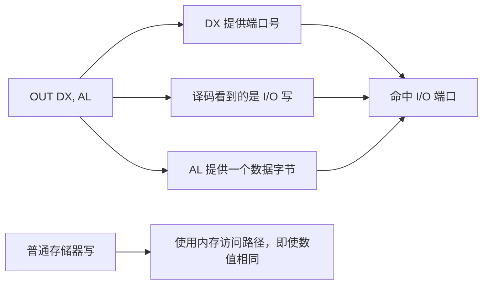

# 《微型计算机接口技术》随堂练习（第 8–9 节）

六道技术题在考三个不同的选择：**用什么地址空间选设备、由谁等到设备就绪、由谁把数据送过去**。原件第 7 题是学号姓名栏，不是技术题。以下按原题题号组织，补全第 1、2 题，核对原件其余答案。

## 先选地址空间，再解释端口

**参考解答（第 1 题）。** 在本课的硬件语境，端口是 CPU 可以通过地址及访问类型选中的接口寄存器或访问入口，不是机箱上的物理插孔。它可承载数据、状态或控制作用。两种编址方式是：

| 编址方式 | CPU 如何选到设备 | 同号的主存位置如何理解 |
| --- | --- | --- |
| 存储器映射 I/O（统一编址） | 访问分配给设备的内存地址区间；仍须遵守该寄存器允许的访问宽度和读写行为 | 这个区间已分配给设备，同一映射下不再把它解释成普通 RAM |
| 独立 I/O 编址 | 产生专门的 I/O 周期；传统 x86 用 IN、OUT 指令访问端口号 | 端口号和内存地址可数值相同，由不同类型的访问区分 |

编址描述到达哪一类空间，不承诺读写都含义相同。同一个接口可以令同号读返回状态、同号写送出数据；具体需要看芯片规则。参见[端口分类](../../../topics/微机接口/duankou-gainian.md)和[两种编址](../../../topics/微机接口/duankou-bianzhi.md)。

**参考解答（第 3 题，核对原件）。** 在题设的==交换数据的接口==里，必需的是数据通路，因此选“数据端口”。状态与控制是常见职责，却不一定各占一个独立端口：例如只写的输出锁存器可以接受一字节，没有单列可读的状态端口；设备始终可接受数据时也无需先查就绪。这不是“每一种现代硬件模块都必须有一个单独命名的 DATA 寄存器”的普遍定理。参见[接口功能](../../../topics/微机接口/jiekou-gongneng.md)。

**参考解答（第 5 题，核对原件 D）。** `OUT DX, AL` 把 AL 的一个字节写到 DX 中编号所对应的 I/O 端口，不写 DX，也不写主存。比如 DX 为 `0200H`、AL 为 `5AH` 时，`0200H` 来自地址寄存器，`5AH` 才是传送数据；是否有设备接收，以及设备把这个字节解释为什么，取决于译码和设备定义。这条指令不等价于对同号内存位置的写入。参见 [I/O 指令](../../../topics/微机接口/io-zhiling.md)。

> [!TIP]
> ==先看指令，再看寄存器。== 寄存器里有一个十六进制数，并不说明它是内存指针。OUT 决定这次是 I/O，DX 才在该语境中充当端口号。原件第 5 题有 36/96 人选“DX 所指的内存单元”，值得单独辨清。

## 通知者不等于搬运者

**参考解答（第 2、4 题）。** 课件的四类方式是无条件、查询、中断控制、DMA。第 4 题问哪一方式的数据传递不逐项经过 CPU，答案是 DMA；这不是说整个操作不需要 CPU 设置、协调或处理完成。两者的区别可按下表判断：

| 方式 | 谁确认何时可传 | 谁搬运这一笔数据 |
| --- | --- | --- |
| 无条件 | 先由外设特性或时序约定保证，程序不逐次查 | CPU |
| 查询 | CPU 读状态，再按结果决定 | CPU |
| 中断控制 | 外设或控制器提出请求 | CPU 的服务程序 |
| DMA | 控制器响应请求并取得所需的传送权限 | 控制器协调外设、内存及总线，CPU 不逐项搬运 |

**补充反例。** 一个设备先发送一次请求，服务程序进场后连续把 8 字节从设备搬进内存。因为搬运仍由 CPU 指令完成，这仍是中断方式，而不是“设备主动通知，所以是 DMA”。反过来，DMA 搬完以后再用一个完成中断通知 CPU，也不会把已经完成的数据传送变成 CPU 搬运。参见[交换方式](../../../topics/微机接口/xinxi-jiaohuan.md)与 [DMA](../../../topics/微机接口/dma-fangshi.md)。

**参考解答（第 6 题，核对原件）。** 按功能，系统总线有数据、地址和控制三类信号；填入地址总线与控制总线。用上面的写操作解释：地址说明送到谁、数据提供写入值、控制信号区分 I/O 写与其他周期。逻辑功能分组不保证物理引脚永不复用。参见[总线功能分类](../../../topics/微机接口/zongxian-gainian.md)。

> [!WARNING]
> 不要从“CPU 没等外设”推断“CPU 没搬数据”。中断解决的是何时启动服务，DMA 改变的是由谁完成传送。
