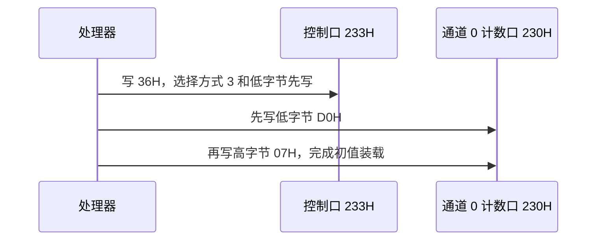

# 《微型计算机接口技术》随堂练习：8254 定时器/计数器初始化编程

CPU 把一个字节写进 8254 时，它究竟是“请用这种方式数”，还是“要从这个数开始”？8254 把两类写入分到不同地址。控制口决定选哪路、后面的字节如何装载；计数口才接收初值。把两者分开，才能知道同一个数字为什么既能表示控制字段，也可能只是某次写入的数据。

## 从三次写端口还原定时器设置

原件的技术填空给出 10 MHz 输入时钟：先向 `233H` 写二进制控制字 `00110110B`，接着把 `AX` 装入十进制 2000，先取 AL、再把 AH 移到 AL，将两个字节依次写到 `230H`。原件已填出结果；下面保留题意，重新核对每一项。末尾另有学号、姓名栏，不是第二道技术题。

**参考解答（逐字段核对原件填空）。** 计数器 **0**；计数口 **230H**；计数方式 **3**；**二进制**；计数初值 **2000**。

| 控制字字段 | 这次的值 | 对后续读写的约束 |
| --- | --- | --- |
| D7:D6 | `00` | 选通道 0 |
| D5:D4 | `11` | 两次 8 位写，先低字节、再高字节 |
| D3:D1 | `011` | 方式 3，产生周期性的方波 |
| D0 | `0` | 二进制计数，不把十六进制数位解释成压缩 BCD |

控制字指定的是**芯片内部通道**，读程序则确定**板上的 I/O 地址**。本程序的控制口是 `233H`，通道 0 写到 `230H`；不能从控制字的 `00` 直接推出任意板上的端口地址。由于这些地址超出 8 位立即端口号，程序通过 DX 来寻址；写出的数据仍在 AL。参见[地址译码](../../../topics/微机接口/dizhi-yima.md)、[端口编址](../../../topics/微机接口/duankou-bianzhi.md)及 [I/O 指令](../../../topics/微机接口/io-zhiling.md)。

> [!TIP]
> 看到==同一计数口连写两次==，先根据 D5:D4 判断两个传送有无固定次序，再拼成 16 位数。这里 $2000=7\times256+208$，所以寄存器 AX 的值是 `07D0H`，写入先 `D0H` 后 `07H`。两个字节都送 `230H`，不是分别写两个地址。

## 初值如何变为一个周期

**补充。** 如果 GATE 保持有效、计数器已进入方式 3 稳态，OUT 每经历 $N$ 个输入时钟才完成一个**完整**周期。若误把 2000 当成半周期，就会把周期算成两倍、把频率算成一半。这里 $f_{\mathrm{CLK}}=10\,\mathrm{MHz}$、$N=2000$，所以

$$
f_{\mathrm{OUT}}=\frac{f_{\mathrm{CLK}}}{N}=5\,\mathrm{kHz},
\qquad
T=\frac{N}{f_{\mathrm{CLK}}}=200\,\mu\mathrm{s}.
$$

初值为偶数，高、低各占 1000 个输入拍，也就是各 $100\,\mu\mathrm{s}$。对照变化：若初值改为 5，完整周期仍为 5 拍，但高、低分别为 3 拍和 2 拍，已经不是 50% 占空比。“方式 3”决定的是高低相间的计数规则，不保证奇数初值也能均分。若 GATE 没有保持有效，不能套用这里的连续分频结论。

> [!WARNING]
> ==能读出两个正确字节，不代表初值写对了。== 若错把 `07H` 先写，计数器将按低字节先收的约定拼成 `D007H`，即十进制 53255；虽然写的两个字节没变，输出周期却完全不同。
