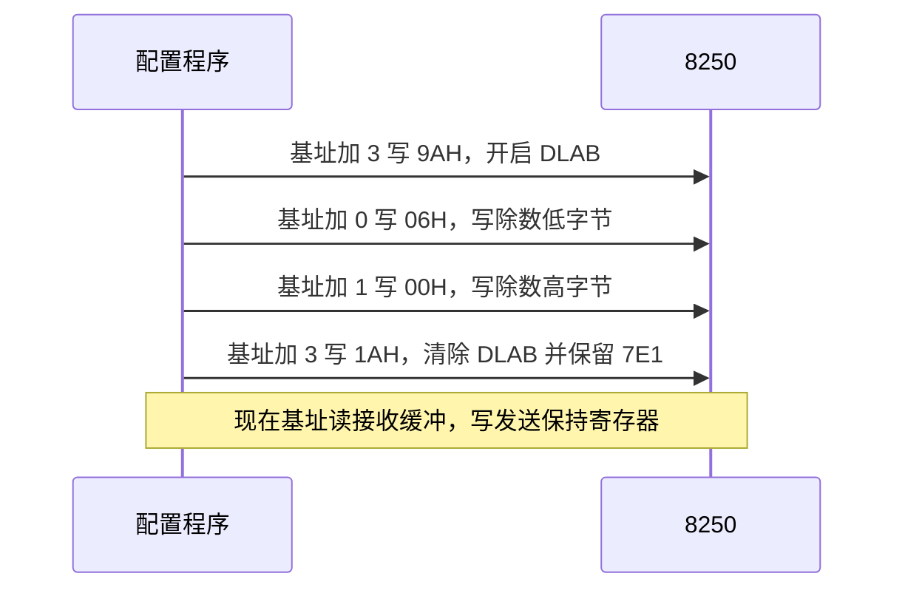

# 8250 串口复习：分频、帧格式与寄存器复用

历史复习资料第 9–12 页把串行帧和 8250 初始化放在同一题组。下面另设条件来拆开两项计算，再核对同一端口在不同寄存器选择下的含义。原题接线与波形不在解析文本中，不能凭此导读复原；文件名与扉页的学期也不一致。芯片行为按 [National Semiconductor INS8250/INS8250-B 数据手册](https://datasheets.pl/elementy_czynne/IC/INS/INS8250.pdf)核对。

## 一秒能发送多少个字符？

**补充。** 8250 的参考时钟为 1.8432 MHz，收发双方都选 19 200 波特、7E1（7 个数据位、偶校验、1 个停止位）。求分频整数、每帧的时间和无额外间隔时的最大帧率。若发送字符码 `45H`，在 UART 逻辑侧按时间先后列出一帧的各位。

**参考解答。** 异步串口没有随每帧送一根时钟线。接收端先识别起始位，再依本地时钟逐位取样，所以两端必须同意位速率和帧格式。对 8250，先由整数 $D$ 把参考时钟分成位速率的 16 倍，再按 16 个这样的时钟周期作为一位时间。在本题的二电平串行逻辑中，一位对应一个符号，因此位速率的数值等于波特率：

$$
D=\frac{1\,843\,200}{16\times 19\,200}=6.
$$

帧有 $1+7+1+1=10$ 位间隔，时间为 $10/19\,200=1/1\,920\ \mathrm{s}$，约 $0.521\ \mathrm{ms}$。无额外空闲时，每秒最多 1 920 帧。==题面给的是波特率，不是字符率==；字长是 7，不意味着一帧只用 7 位时间。

| UART 上的发送顺序 | 值 | 为什么 |
|---|---|---|
| 起始位 | 0 | 从空闲逻辑 1 开始新帧 |
| 7 个数据位 | 1、0、1、0、0、0、1 | `45H` 的最低位先发 |
| 偶校验位 | 1 | 数据位已有三个 1，补成四个 |
| 停止位 | 1 | 保持一个位时间后可接下一帧 |

> [!TIP]
> 如果改成 8N1，帧仍是 10 位时间，但增加的是一个数据位，不是保留原来的校验位。帧时间相同不代表两个端点可以混用这两种格式。表里的逻辑位也不直接等于 RS-232 接头上的电压高低。

字符的表示见 [ASCII 码](../../../topics/微机接口/ascii-ma.md)。

## 同一端口，怎么会写入不同的寄存器？

**补充。** 假设该 UART 基地址为 `3F8H`，在空闲状态配置上述分频和帧格式。为什么不能一直保持线路控制寄存器（LCR）的最高位 DLAB 为 1？

**参考解答。** 端口号决定一个地址译码结果，但在偏移 0 和 1 处，还要用 DLAB 选择寄存器。要设分频，先置位再写；要收发字符或配置接收中断，写完分频值就清零。

`1AH` 的位 1:0 为 `10`，选 7 个数据位；位 2 为 0，选 1 个停止位；位 3、4 为 1，启用偶校验；位 5 为 0，不启用固定校验位。把最高位置 1 便得到设置阶段的 `9AH`。

| DLAB | 偏移 0 | 偏移 1 |
|---|---|---|
| 1 | 分频除数低字节 DLL | 分频除数高字节 DLM |
| 0 | 读接收缓冲 RBR / 写发送保持寄存器 THR | 中断允许寄存器 IER |

> [!WARNING]
> 忘清 DLAB 就向 `3F8H` 写字符时，改的是除数低字节，不会发送该字符。==先追踪寄存器选择，再解释端口操作==。清掉 DLAB 也不等于启用中断；轮询还是中断通知是另外一项配置，不改变已经约定的串行帧格式。

参见[端口的概念与分类](../../../topics/微机接口/duankou-gainian.md)、[I/O 指令](../../../topics/微机接口/io-zhiling.md)与[接口的数据交换方式](../../../topics/微机接口/xinxi-jiaohuan.md)。
