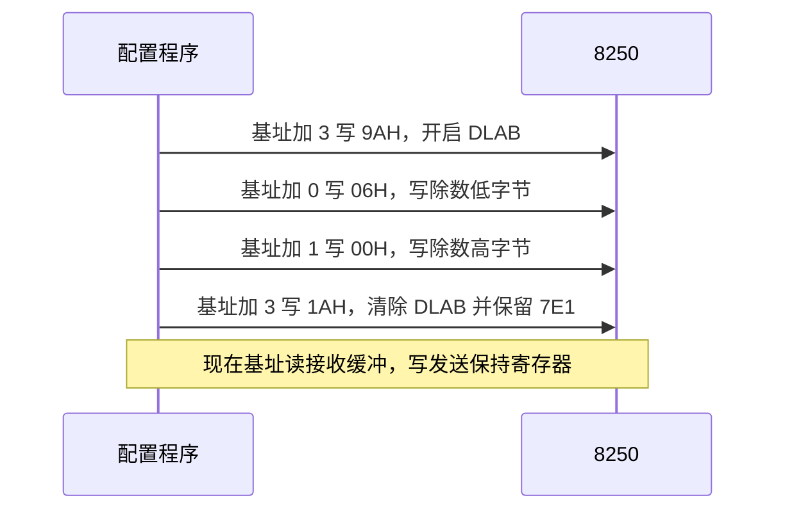
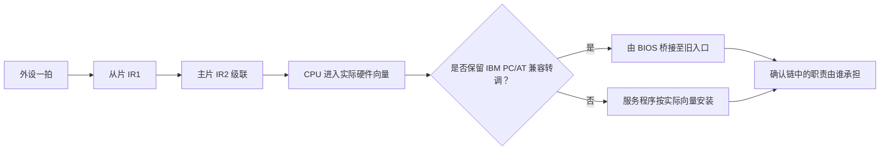

# 微机接口期末复习：从端口接线到中断响应

本页是历史复习资料的独立讲解，不转载课件文字、程序或原图。文件名与扉页的学期不一致，考试安排不适用于现行课程。下面用原件中可核对的少量参数说明旧例题的判据，用另设条件的练习探索边界。

## 8250：一秒能发送多少个字符？

**补充。** 8250 的参考时钟为 1.8432 MHz，收发双方都选 19 200 波特、7E1（7 个数据位、偶校验、1 个停止位）。求分频整数、每帧的时间和无额外间隔时的最大帧率。若发送字符码 `45H`，在 UART 逻辑侧按时间先后列出一帧的各位。

**参考解答。** 异步串口没有随每帧送一根时钟线。接收端先识别起始位，再依本地时钟逐位取样，所以两端必须同意位速率和帧格式。对 8250，先由整数 $D$ 把参考时钟分成位速率的 16 倍，再按 16 个这样的时钟周期作为一位时间。在本题的二电平串行逻辑中，一位对应一个符号，因此位速率的数值等于波特率：

$$
D=\frac{1\,843\,200}{16\times 19\,200}=6.
$$

帧有 $1+7+1+1=10$ 位间隔，时间为 $10/19\,200=1/1\,920\ \mathrm{s}$，约 $0.521\ \mathrm{ms}$。无额外空闲时，每秒最多 1 920 帧。==题面给的是波特率，不是字符率==；字长是 7，不意味着一帧只用 7 位时间。

| UART 上的发送顺序 | 值 | 为什么 |
|---|---|---|
| 起始位 | 0 | 从空闲逻辑 1 开始新帧 |
| 7 个数据位 | 1、0、1、0、0、0、1 | `45H` 的最低位先发 |
| 偶校验位 | 1 | 数据位已有三个 1，补成四个 |
| 停止位 | 1 | 保持一个位时间后可接下一帧 |

> [!TIP]
> 如果改成 8N1，帧仍是 10 位时间，但增加的是一个数据位，不是保留原来的校验位。帧时间相同不代表两个端点可以混用这两种格式。表里的逻辑位也不直接等于 RS-232 接头上的电压高低。

字符的表示见 [ASCII 码](../../../topics/微机接口/ascii-ma.md)。

## 同一端口，怎么会写入不同的寄存器？

**补充。** 假设该 UART 基地址为 `3F8H`，在空闲状态配置上述分频和帧格式。为什么不能一直保持线路控制寄存器（LCR）的最高位 DLAB 为 1？

**参考解答。** 端口号决定一个地址译码结果，但在偏移 0 和 1 处，还要用 DLAB 选择寄存器。要设分频，先置位再写；要收发字符或配置接收中断，写完分频值就清零。

`1AH` 的位 1:0 为 `10`，选 7 个数据位；位 2 为 0，选 1 个停止位；位 3、4 为 1，启用偶校验；位 5 为 0，不启用固定校验位。把最高位置 1 便得到设置阶段的 `9AH`。

| DLAB | 偏移 0 | 偏移 1 |
|---|---|---|
| 1 | 分频除数低字节 DLL | 分频除数高字节 DLM |
| 0 | 读接收缓冲 RBR / 写发送保持寄存器 THR | 中断允许寄存器 IER |

> [!WARNING]
> 忘清 DLAB 就向 `3F8H` 写字符时，改的是除数低字节，不会发送该字符。==先追踪寄存器选择，再解释端口操作==。清掉 DLAB 也不等于启用中断；轮询还是中断通知是另外一项配置，不改变已经约定的串行帧格式。

参见[端口的概念与分类](../../../topics/微机接口/duankou-gainian.md)、[I/O 指令](../../../topics/微机接口/io-zhiling.md)与[接口的数据交换方式](../../../topics/微机接口/xinxi-jiaohuan.md)。

### 接头上的波形不能直接按数字 0、1 读

**参考解答（历史资料第 9–12 页）。** 在两个 DB-25 DTE 之间做单工通信时，发送端 2 脚 TxD 接接收端 3 脚 RxD，两端信号地 7 脚接通；题目没要求硬件握手或回传，不能把两端发送线相连。按原图的 10 个格子，从起始位在正电压的一侧开始读：RS-232 数据线正电压为 0，负电压为 1。去掉头尾后先读最低有效位，七位数据依次是 0、1、1、0、0、0、1，合成 `46H`；校验位为 0，数据里的三个 1 保持奇数。不要把图中的传送方向箭头当成上升的时间坐标，否则会把逻辑 1 当成起始位。整帧时间 $10/4800=1/480\,\mathrm{s}$。在 1.8432 MHz 时钟下，除数 $1\,843\,200/(16\times4800)=24$，即 `0018H`。

**订正。** 原件第 12 页 `0AH` 的行末注释与控制字不符。按 [INS8250/INS8250-B 数据手册](https://datasheets.pl/elementy_czynne/IC/INS/INS8250.pdf) 解码，字长位 `10` 是 7 位，停止位选择 0 是 1 位，校验使能置位且偶校验选择清零是奇校验。因此控制字对应 7O1，不是注释描述的无校验 8 位。原例还使能接收数据中断并在典型 PC 适配器上打开 OUT2 门控；8250 的 IER 位和主控的屏蔽位各管一层，任一层挡住都不能交付中断，接收服务中还应处理线路状态及数据，不能只写初始化寄存器。若同时使能，线路状态中断优先于接收数据就绪中断，继而是发送保持寄存器空和调制解调器状态。若改为轮询，先按目标选择线路状态寄存器 LSR 的位：接收等位 0（数据就绪），再读 RBR；发送等位 5（发送保持寄存器空），再写 THR。位 5 不等于线上的整帧发送完毕：移位寄存器可能还在发送。

## 总线、存储与端口：先辨认每根线在选什么

地址线决定目标和片内位置，数据线承载读写值，控制线分辨读、写和其他总线动作。[总线分类](../../../topics/微机接口/zongxian-gainian.md)和[端口编址](../../../topics/微机接口/duankou-bianzhi.md)回答两个不同的问题：地址有几位，与这一地址来自存储空间还是 I/O 空间并不等价。8086 系列外设端口超过立即数能表示的 8 位地址时，改用 DX 送完整端口号，见 [I/O 指令](../../../topics/微机接口/io-zhiling.md)。

**参考解答（历史资料第 4 页）。** 用 `1K×8` 芯片拼 `4 KiB` 的 8 位存储器：位宽已经够用，增加的是地址数，不是并联凑位。每片用低 10 位索引片内，另有 2 位从 4 片中独选一片，因此需 4 片和 12 根块内地址线。如果这个存储器只是装在更宽的系统地址空间中的一小块，系统还要看更高位来选整个块。参见[存储器扩展](../../../topics/微机接口/cunchu-kuozhan.md)与[地址译码](../../../topics/微机接口/dizhi-yima.md)。

## 8255A：端口方向与交付方式是两件事

8255A 的 PA、PB、PC 都有 8 位，但 PC 的某些位在选通方式下会被握手占用。方式 0 是基本输入输出，方式 1 把数据与选通、缓冲状态、确认信号配在一起。方式 2 的双向握手只给 A 口，并不意味着 B 口也能设成方式 2。

**参考解答（历史资料第 6–8 页）。** 原件的 LED 图中，PA 通过同相驱动器单向控制灯，没有 `ACK` / `OBF` 信号线，所以图示端口用方式 0 输出即可。图中灯从正电源经限流支路接到驱动端，驱动端吸电流时亮，因此不能照搬“1 一定点亮”的假设。题目的后续小问另设有握手的方式 1 输出；此时 PA 的输出缓冲是否可再写取决于外设应答，不能把图中的方式 0 直接改控制字就算完成接线。方式字 `A0H` 选择 A 组方式 1、PA 输出；随后写单位置位/复位格式的 `0CH`，复位 PC6 对应的 A 口输出中断允许触发器，适用于由 CPU 查询而非由外设通知的设定。

另一个给定控制字 `97H` 应先认最高位为 1，属于方式配置。按位解得 A 组方式 0 输入、B 组方式 1 输入；若控制口是 `31BH`，按该例连续端口地址推回 PA 是 `318H`。后写的 `05H` 最高位为 0，选择 PC2 并置位，在 B 口方式 1 中改变的是内部中断允许，不是软件往外部选通信号线上驱动高电平。B 口选通输入在轮询路径检查 PC1 的 IBF，在中断路径以 PC0 的 INTR 通知 CPU；CPU 使能和实际接线还必须具备。两种路径都要读输入缓冲。核对[厂商 8255A 图 8、图 10](https://atta.szlcsc.com/upload/public/pdf/source/20241016/218EC54DF16C30D7667C0C377F0F65AD.pdf)及[接口数据交换](../../../topics/微机接口/xinxi-jiaohuan.md)。

> [!TIP]
> 需要持续闪烁又要接受键盘输入，通常把按时更新端口与前台检测退出分开。经典 BIOS 的 `INT 1CH` 是时钟中断服务例程转调的钩子，约每 55 ms 回调一次，不是 1 秒定时器。固定数 18 拍约 0.989 秒；若需较准的一秒节奏，按已知节拍累计余量，把相邻间隔摊为 18 或 19 拍。翻转一次只对应一次亮灭转换；若要求 1 秒内完整地亮再灭，应按所需占空比分别安排两次转换。退出恢复原向量；不要在回调里阻塞等键，不要把对硬件 IRQ 的确认再做一次。

## 8254：输入多少拍，输出才走一轮？

方式 2 适合要一个低脉冲作为周期标记的场合，低电平只维持一个输入拍；方式 3 用于需要近似方波的场合，输出每 $N$ 拍重复。方式 3 的 $N$ 为偶数时，高、低各 $N/2$ 拍；为奇数时分别为 $(N+1)/2$、$(N-1)/2$ 拍。先根据输出形状选模式，再换算初值。方式 2、3 刚写方式控制字和第一份完整计数初值时，GATE 保持高，下一 CLK 装载初值，随后推进计数。正在计数时只改初值，并不立即重启：方式 2 等当前周期末，方式 3 等当前半周期末；GATE 拉低禁计数且令 OUT 为高，随后 GATE 上升沿可使下一 CLK 重新装载。PC/AT 上计数器 0 向系统计时 IRQ0 供节拍，1 用于 DRAM 刷新时序，2 可配合扬声器；这些是系统接法，不是 8254 任一通道的固有角色。芯片共有三路独立计数器，每路 16 位，有六种方式。参见 [Intel 8254 手册](https://www.scs.stanford.edu/23wi-cs212/pintos/specs/8254.pdf) 与 [IBM PC/AT Technical Reference](https://www.bitsavers.org/pdf/ibm/pc/at/1502494_PC_AT_Technical_Reference_Mar84.pdf)。

**参考解答（历史资料第 4、15–16 页）。** 初值 `10H` 是十进制 $16$。以 1 kHz 时钟运行方式 3，高低各 8 拍，均为 $8/1000=1/125\,\mathrm{s}$。若把输入改为 8 MHz、目标输出定在 4 kHz，则 $N=8\times10^6/(4\times10^3)=2000=\mathrm{07D0H}$。计数器 0、先低后高、方式 3、二进制对应控制字 `36H`；题设地址中控制端是 `203H`，计数端是 `200H`，先写 `D0H`、再写 `07H`。每半周期为 $1000/(8\times10^6)=125\,\mu\mathrm s$，完整周期 $250\,\mu\mathrm s$。反写字节会使计数值变成 `D007H`，并不会只颠倒方波的高低。注意外扩实验板地址由题目给定，不是 PC/AT 主板固定端口。

## 中断：请求线、向量号和服务地址不能互换

遇到中断题，先判是处理器执行的软件中断还是设备拉起的硬件请求。后者才经中断控制器，其能否交给 CPU 还取决于该请求未被屏蔽、服务优先级允许、CPU 允许可屏蔽中断。CPU 按向量号查表而不是把向量号本身当成代码地址。服务后由 `IRET` 恢复保存的 IP、CS、FLAGS；对于由 8259 接受的硬件请求，若并非自动结束模式，则还须对正在服务的控制器发结束命令。CPU 的返回和 PIC 的结束是不同的动作。

**参考解答（历史资料第 4 页）。** 实模式一个向量占 4 字节，表项起于 `0000:0048H`，故类型号 $\mathrm{48H}/4=\mathrm{12H}$。按先偏移、后段且各自低字节在前读出 `IP=3800H`、`CS=5030H`，入口物理地址为 $\mathrm{50300H}+\mathrm{3800H}=\mathrm{53B00H}$。实模式 16 位栈帧中 `IRET` 弹出 3 个字，总共 6 字节。若请求直接来自主 PIC，普通非特定 EOI 命令 `20H` 写主片命令口 `20H`；若从片也有在服务位，就不能只告诉主片结束。参见[物理地址形成](../../../topics/微机接口/wuli-dizhi.md)、[堆栈](../../../topics/微机接口/duizhan-caozuo.md)、[BIOS 与 DOS 调用](../../../topics/微机接口/dos-bios-diaoyong.md)。

**参考解答（历史资料第 13–14 页）。** 原图的正脉冲进的是从片 IR1，级联出口接主片 IR2，所以解屏蔽时分别保留原掩码并清掉从片位 1 和主片位 2。先保存旧处理入口和掩码，并先装入口再放开请求；退出前先阻止回调，再恢复旧入口和原掩码。旧例设置 `0AH` 有特定 BIOS 前提：传统 IBM PC/AT 把 IRQ9 的硬件向量 `71H` 由 BIOS 转调到旧接口 `0AH`，这不是由“从片 IR1”直接算出的编号。在没有这层转调的环境下用实际 PIC 向量基址加 1；不要假定现代系统或自行改过向量基址的环境也会触发 `0AH`。

> [!WARNING]
> 直接处理从片 IRQ 的正常 EOI 顺序是从片后主片；沿用 BIOS 桥接时必须阅读其确认顺序，不得在两处都确认同一片。若要每次按压后显示一行，服务例程只累计待处理事件，把输出与键盘检测留在前台，避免从异步中断重入 DOS。键盘退出时恢复旧向量和屏蔽状态。
