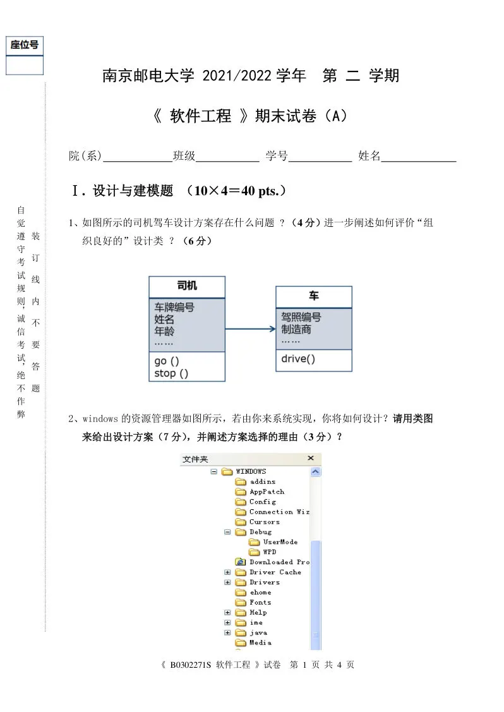
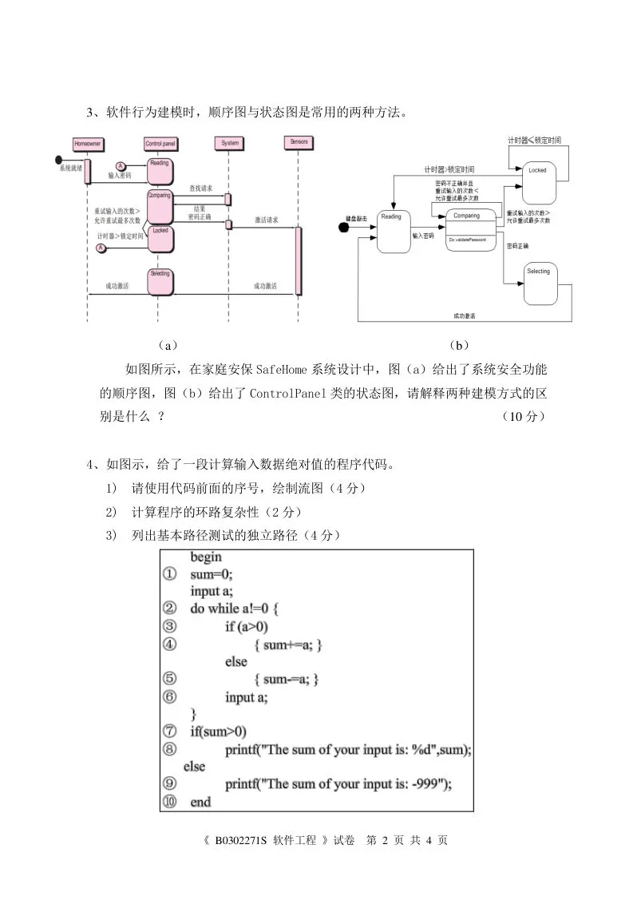
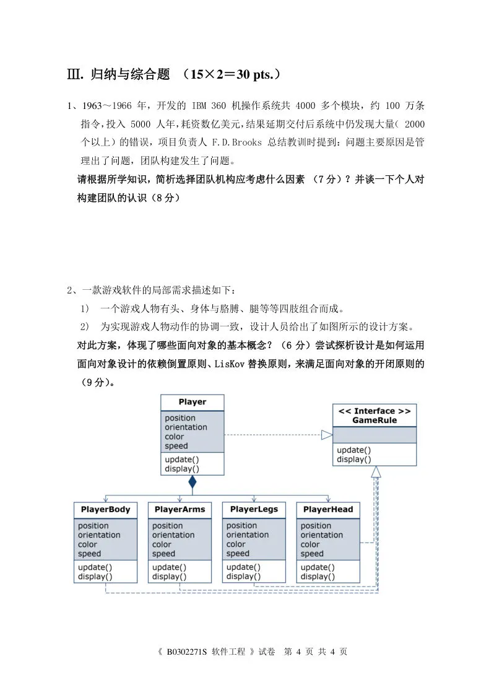

# 2021—2022 学年第二学期《软件工程》期末试卷（A卷）

原件经识别和整理；“参考解答”是我们补的。

# 2021—2022 学年第二学期《软件工程》期末试卷（A卷）

## 一、设计与建模题 （10×4＝40 pts.）

### 选择 1

题干：如图所示的司机驾车设计方案存在什么问题？（4分）进一步阐述如何评价“组织良好的”设计类？（6分）



答案：暂无。
知识点：[面向对象与设计类（OO and Design Classes）](../../../topics/软件工程/OO设计类.md)、[依赖倒置原则（Dependency Inversion Principle, DIP）](../../../topics/软件工程/依赖倒置.md)、[功能独立性（Functional Independence）](../../../topics/软件工程/功能独立性.md)

### 选择 2

题干：Windows 的资源管理器如图所示，若由你来系统实现，你将如何设计？请用类图来给出设计方案（7分），并阐述方案选择的理由（3分）？


答案：暂无。
知识点：[设计模式（Patterns）的名称与要素](../../../topics/软件工程/设计模式.md)

### 选择 3

题干：软件行为建模时，顺序图与状态图是常用的两种方法。




如图所示，在家庭安保 SafeHome 系统设计中，图（a）给出了系统安全功能的顺序图，图（b）给出了 ControlPanel 类的状态图，请解释两种建模方式的区别是什么？（10 分）

答案：暂无。
知识点：[行为建模（Behavioral Modeling）：状态图与顺序图](../../../topics/软件工程/行为建模.md)

### 选择 4

题干：如图示，给了一段计算输入数据绝对值的程序代码。

1) 请使用代码前面的序号，绘制流图（4分）
2) 计算程序的环路复杂性（2分）
3) 列出基本路径测试的独立路径（4分）

*(注：原题图片中应包含带编号的代码段，此处根据常见绝对值计算逻辑推断典型代码结构进行解答示例)*

假设代码如下（基于常见考题推测）：
```c
1 int abs(int x) {
2     int result;
3     if (x < 0)      // 节点 A
4         result = -x; // 节点 B
5     else            // 节点 C
6         result = x;  // 节点 D
7     return result;   // 节点 E
8 }
```

答案：暂无。
知识点：[控制结构测试（Control Structure Testing）：条件测试与循环测试](../../../topics/软件工程/控制结构测试.md)、[白盒测试（White-Box Testing）与基本路径测试（Basis Path Testing）](../../../topics/软件工程/白盒测试.md)、[单元测试（Unit Testing）的时机与内容（模块接口、局部数据结构、独立路径、出错处理、边界条件）](../../../topics/软件工程/单元测试.md)

### 简答 1

题干：项目开始时，为了导出需求，向客户和其他利益相关者提问了如下 3 个问题，请尝试分析每个问题的目标是什么（9分），对系统构建的方案选择有什么作用（6分）？

1) 成功的解决方案将带来什么样的经济效益？
2) 如何描述由成功的解决方案产生的“良好”输出的特征？
3) 你是回答问题的合适人选吗？

答案：暂无。
知识点：[需求工程（Requirements Engineering）的任务步骤](../../../topics/软件工程/需求工程任务.md)、[需求获取（Elicitation）与需求收集会议](../../../topics/软件工程/获取Elicitation.md)、[确认利益相关者（Stakeholders）与识别多种观点](../../../topics/软件工程/利益相关者.md)

### 简答 2

题干：软件工程的实施过程框架定了 5 个框架活动与 8 个普适性活动，每一项活动都有其专有的动作、任务和内涵。但软件工程不应该是教条的法则，不要求项目团队机械执行，可以根据项目要解决的问题、特点与团队文化等因素，进行适应性调整，请根据自己的理解，简单描述每一个框架活动的任务（6分），并谈一下不同项目的实施过程，应从哪些方面来调整（9分）。

答案：暂无。
知识点：[通用过程模型（A Generic Process Model）](../../../topics/软件工程/通用过程模型.md)

### 简答 3

题干：1963～1966 年，开发的 IBM 360 机操作系统共 4000 多个模块，约 100 万条指令，投入 5000 人年，耗资数亿美元，结果延期交付后系统中仍发现大量（2000个以上）的错误，项目负责人 F.D.Brooks 总结教训时提到：问题主要原因是管理出了问题，团队构建发生了问题。请根据所学知识，简析选择团队机构应考虑什么因素（7 分）？并谈一下个人对构建团队的认识（8分）

答案：暂无。
知识点：[项目管理的四个P（People, Product, Process, Project）](../../../topics/软件工程/四个P.md)、[软件团队（Software Teams）与团队领导（Team Leader）](../../../topics/软件工程/软件团队与领导.md)

### 简答 4

题干：一款游戏软件的局部需求描述如下：

1) 一个游戏人物有头、身体与胳膊、腿等等四肢组合而成。

2) 为实现游戏人物动作的协调一致，设计人员给出了如图所示的设计方案。对此方案，体现了哪些面向对象的基本概念？（6 分）尝试探析设计是如何运用面向对象设计的依赖倒置原则、Liskov 替换原则，来满足面向对象的开闭原则的（9分）。



答案：暂无。
知识点：[面向对象基本概念（类、对象、实例）](../../../topics/软件工程/OO基本概念.md)、[依赖倒置原则（Dependency Inversion Principle, DIP）在构件级设计中的应用](../../../topics/软件工程/依赖倒置原则DIP.md)、[开闭原则（Open-Closed Principle, OCP）与多态条件](../../../topics/软件工程/开闭原则OCP.md)、[Liskov替换原则（Liskov Substitution Principle, LSP）](../../../topics/软件工程/Liskov替换原则LSP.md)
