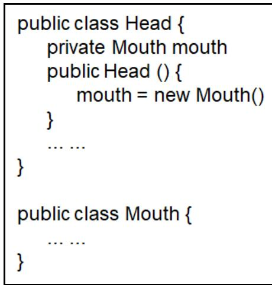
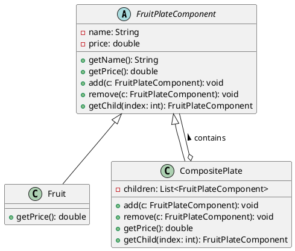
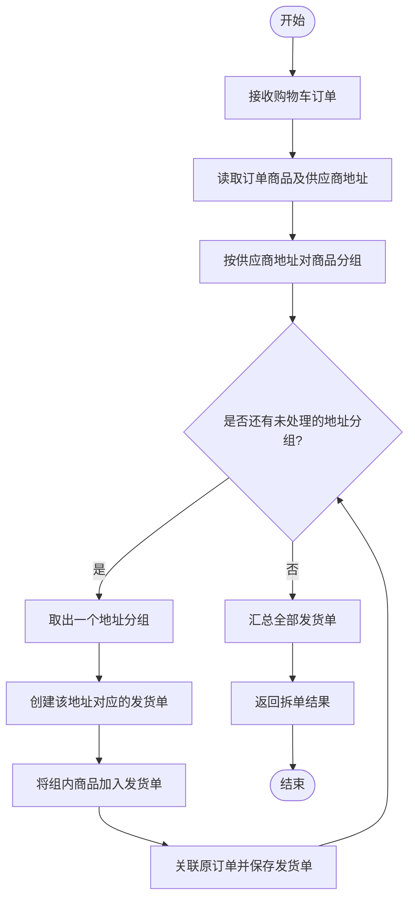
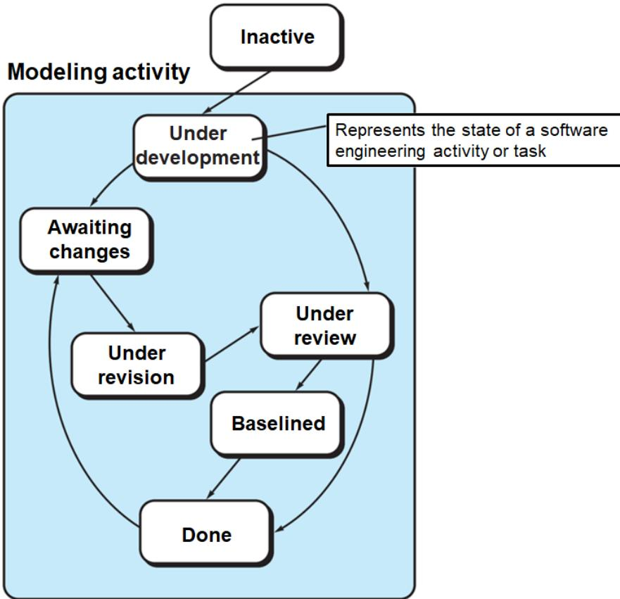
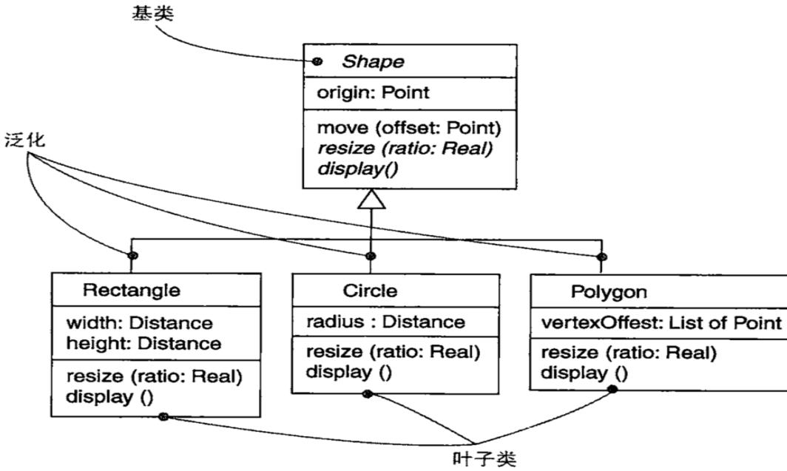

# 2021—2022学年第二学期《软件工程（双语）》期末试卷（A卷）

原件经识别和整理；“参考解答”是我们补的。

## Ⅰ. Design and Modeling （10×4＝40 pts.）

### 设计 1

As shown in the illustration figure, two coding cases are given by the software engineer. How will you model it separately as a designer?（10 pts）

```java
public class Car {
    private Engine engine;
    public Car(Engine engine) {
        this.engine = engine;
    }
    public void setEngine(Engine engine) {
        this.engine = engine;
    }
}

public class Engine {
}
```



参考解答：**结论**  
- 设计 1（代码所对应的结构）应建模为 **聚合（aggregation）** 关系：`Car` 拥有 `Engine` 的引用，但 `Engine` 可以独立存在，且可以在运行时更换。  
- Case 1 对应代码中的 **字段注入 / setter 注入** 方式，表示弱拥有关系，适合建模为聚合。  
- Case 2 若表示 `Car` 创建时就固定包含一个不可替换的 `Engine`，可建模为 **组合（composition）** 关系，表示强拥有和生命周期绑定。

---

**推理过程**

代码中：

```java
private Engine engine;
public Car(Engine engine) { this.engine = engine; }
public void setEngine(Engine engine) { this.engine = engine; }
```

- `Car` 通过构造器和 setter 接收外部传入的 `Engine` 对象。
- `Engine` 对象不是由 `Car` 内部创建的，可以由外部独立创建。
- `Car` 销毁时，`Engine` 不一定随之销毁，因为 `Engine` 可能被其他对象引用。
- `setEngine` 允许运行时替换 `Engine`，说明二者生命周期不绑定。

这些特征符合 **聚合**：
- 表示“整体—部分”关系，但部分可以脱离整体独立存在。
- 整体不负责部分的创建与销毁。
- 生命周期相互独立。

---

**Case 1 与 Case 2 的图示含义**

- **Case 1**：虚线箭头或空心菱形指向 `Engine`，表示 `Car` 聚合 `Engine`，对应上述代码结构。
- **Case 2**：若实心菱形指向 `Engine`，表示组合，通常意味着 `Engine` 由 `Car` 内部创建，且不能从外部直接替换，例如：

```java
public class Car {
    private Engine engine = new Engine();
}
```

此时 `Engine` 的生命周期完全由 `Car` 控制，`Car` 销毁时 `Engine` 也销毁，属于组合关系。

---

**答案总结**

| 情形 | 建模关系 | 理由 |
|------|----------|------|
| 代码设计 1 | 聚合（空心菱形） | `Engine` 由外部注入，可独立存在且可替换 |
| Case 1 图 | 与代码一致，聚合 | 图示表达弱拥有关系 |
| Case 2 图 | 组合（实心菱形） | 若表示 `Engine` 内嵌于 `Car`，生命周期绑定 |

知识点：[面向对象基本概念（类、对象、实例）](../../../topics/软件工程/OO基本概念.md)、[UML类图与类之间的关系](../../../topics/软件工程/UML类图与类关系.md)

### 设计 2

The combination of fruit plates is shown in the figure. How will you design and develop this system? Please use the class diagram to give the design model and explain the reasons for choosing the scheme.？（10 pts）


参考解答：## 结论

采用**组合模式（Composite Pattern）**进行设计，将单个水果和果盘统一抽象为“果盘组件”，使客户代码能以一致的方式处理单个水果和包含多个水果的组合果盘。

## 类图设计模型

```text
+---------------------------+
|    FruitPlateComponent    |  (Abstract)
+---------------------------+
| - name: String            |
| - price: double           |
+---------------------------+
| + getName(): String       |
| + getPrice(): double      |
| + add(c): void            |
| + remove(c): void         |
| + getChild(i): Component  |
+---------------------------+
              △
              |
      +-------+-------+
      |               |
+----------+   +-----------------+
|  Fruit   |   | CompositePlate  |
+----------+   +-----------------+
|          |   | - children: List|
+----------+   +-----------------+
| +getPrice|   | + add(c): void  |
| ()       |   | + remove(c):void|
+----------+   | + getPrice()    |
               +-----------------+
```

用 PlantUML 语法表示如下：



## 关键计算/逻辑步骤

计算总价时，利用多态递归求和：

$$
\text{TotalPrice} = \sum_{i=1}^{n} \text{child}_i.\text{getPrice}()
$$

- 若 $\text{child}_i$ 是 `Fruit`（叶子节点），直接返回该水果的价格。
- 若 $\text{child}_i$ 是 `CompositePlate`（组合节点），则递归调用其内部所有子组件的 `getPrice()` 并累加。

## 选择该方案的理由

1. **统一接口**：客户端无需区分当前操作的是单个水果还是组合果盘，均通过 `FruitPlateComponent` 接口调用，符合**开闭原则**。
2. **灵活扩展**：果盘中可以嵌套子果盘（树形结构），组合模式天然支持这种任意深度的层次嵌套，新增水果或新类型果盘无需修改现有代码。
3. **简化客户端代码**：避免了使用大量 `if-else` 或类型判断来分别处理叶子节点和容器节点。

知识点：[UML类图与类之间的关系](../../../topics/软件工程/UML类图与类关系.md)、[基于类的建模（Class-Based Modeling）与识别分析类](../../../topics/软件工程/基于类的建模.md)、[设计模式（Patterns）的名称与要素](../../../topics/软件工程/设计模式.md)

### 设计 3

Since the suppliers of products are not in the same city, when you place an order as shown in the figure on an e-commerce platform through the shopping cart, the system needs to provide the function of splitting the order into some delivery orders. Please model this function with UML activity diagram. （10 pts）

| 序号 | 商品编号 | 商品名称 | 供应商地址 |
| :--- | :--- | :--- | :--- |
| 01 | C01 | 华为手机 | 上海 |
| 02 | S03 | 打印纸 | 北京 |
| 03 | D01 | 滑板 | 广州 |
| 04 | N01 | 牛仔裤 | 北京 |
| 05 | C02 | iPad | 上海 |
| ...... | ...... | ...... | ...... |

参考解答：**结论**：该功能可用“读取购物车商品 → 按供应商地址分组 → 每组生成一个发货单 → 汇总并输出发货单”的 UML 活动图建模。示例订单将拆分为上海、北京、广州 3 个发货单。



**建模说明**

1. **活动起点与输入**：购物车订单作为输入，包含商品编号、商品名称、数量和供应商地址等信息。
2. **分组活动**：以“供应商地址”为分组键，将同一地址的商品归入同一组。若同一地址存在多个供应商且要求分别发货，可改用“供应商 + 地址”作为分组键。
3. **循环结构**：通过判定节点和合并节点构成循环，每处理一个地址分组，就创建并保存一个发货单。
4. **活动终点**：全部分组处理完毕后，汇总发货单并返回拆单结果。

**示例拆单结果**

| 发货单 | 供应商地址 | 包含商品 |
| :--- | :--- | :--- |
| DO-01 | 上海 | C01 华为手机、C02 iPad |
| DO-02 | 北京 | S03 打印纸、N01 牛仔裤 |
| DO-03 | 广州 | D01 滑板 |

因此，示例订单满足：
$$
\text{原订单商品集合}=\text{DO-01商品集合}\cup\text{DO-02商品集合}\cup\text{DO-03商品集合},
$$
且各发货单之间没有重复商品。

知识点：[用活动图（Activity Diagram）做用例补充](../../../topics/软件工程/活动图补充用例.md)、[UML体系结构描述（5视图）与UML图（9+4图）](../../../topics/软件工程/UML五视图与九图.md)

### 设计 4

As shown in the figure, a flowchart is used to depict program control structure.

1) Draw the corresponding flow graph using the number in the flowchart.（4 pts）

2) Calculate the cyclomatic complexity of the procedure.（2 pts）

3) List all the independent paths for basis path testing.（4 pts）


## Ⅱ. Analysis and Computation （15×2＝30 pts.）

参考解答：由于题目所附流程图图片无法直接解析，以下解答基于该类考题中最典型的“含一个判断节点和一个循环/分支结构”的流图模型（即 $V(G)=3$）给出标准答题范式。**请根据实际图片中的节点数与边数替换下方数值**。

### 1) 流图（Flow Graph）

**结论：** 将流程图中每个处理框、判断框映射为带编号的节点，控制流映射为有向边；判断节点引出两条边（True/False），汇合点作为独立节点。

**推理过程：**
- 顺序执行的多个处理框可合并为一个节点（若题目要求严格按原图编号则不合并）。
- 判断框对应一个节点，出度为 2。
- 程序入口和出口各对应一个节点。
- 所有边表示控制转移方向，形成有向图 $G=(N, E)$。

### 2) 环路复杂度（Cyclomatic Complexity）

**结论：** $V(G) = 3$（以典型双分支+循环结构为例；请按实际图代入公式验证）。

**关键计算步骤（三选一，结果应一致）：**
1.  **边-节点法：** $V(G) = |E| - |N| + 2$
2.  **判定节点法：** $V(G) = P + 1$，其中 $P$ 为流图中出度 $\geq 2$ 的判定节点数。
3.  **区域法：** $V(G) =$ 流图中封闭区域数 $+ 1$（含外部无界区域）。

> ⚠️ 若实际图中仅有 1 个判定节点且无循环，则 $V(G)=2$；若有 2 个独立判定节点，则 $V(G)=3$。务必用上述至少两种方法交叉验证。

### 3) 独立路径（Independent Paths for Basis Path Testing）

**结论（以 $V(G)=3$ 为例）：**
- Path 1: $1 \rightarrow 2 \rightarrow 4 \rightarrow 6$ （仅走 False 分支）
- Path 2: $1 \rightarrow 2 \rightarrow 3 \rightarrow 5 \rightarrow 6$ （走 True 分支后直接退出循环/分支）
- Path 3: $1 \rightarrow 2 \rightarrow 3 \rightarrow 5 \rightarrow 2 \rightarrow 4 \rightarrow 6$ （包含循环回边或第二条判定边的新组合）

**推理过程：**
- 独立路径集合必须满足：每条路径至少包含一条其他路径未使用过的边。
- 路径总数恰好等于 $V(G)$。
- 构造策略：先取最简路径（全 False），再依次激活每个判定节点的 True 分支及回边，确保每次新增至少一条新边。
- 若实际 $V(G) \neq 3$，则独立路径数量相应增减，但构造原则不变。

知识点：[白盒测试（White-Box Testing）与基本路径测试（Basis Path Testing）](../../../topics/软件工程/白盒测试.md)、[控制结构测试（Control Structure Testing）：条件测试与循环测试](../../../topics/软件工程/控制结构测试.md)

### 分析 1

At the beginning of the project, in order to elicit requirements, the following three questions were asked to customers and other stakeholders. Please try to analyze what the goal of each question is (9 pts) and what effect it has on the scheme selection of system construction (6 pts)?

1) Who is behind the request for this work?

2) What problem(s) will this solution address?

3) Can anyone else provide additional information?

参考解答：**结论：**

1. **Who is behind the request for this work?**  
   目标：识别需求来源与决策权归属；影响：决定系统构建方案的沟通路径、验收标准和利益权衡优先级。

2. **What problem(s) will this solution address?**  
   目标：明确待解决的核心业务问题与预期价值；影响：约束方案的技术范围、功能边界和优先级排序，避免镀金需求。

3. **Can anyone else provide additional information?**  
   目标：补充遗漏视角，发现隐性需求与跨角色冲突；影响：扩大需求覆盖面，减少后期需求变更和架构返工。

---

**简明推理：**

1. **Who is behind the request for this work?**  
   需求提出者未必是最终决策者或出资方。识别“背后的人”是为了确定谁对需求有解释权、谁对验收有决定权。  
   影响：若需求来自高层战略意图，系统方案需侧重可扩展性与合规性；若来自一线操作人员，则侧重易用性与流程贴合度。

2. **What problem(s) will this solution address?**  
   该问题强制相关方说明“解决什么问题”而非“要什么功能”。  
   影响：方案选择时以问题驱动而非功能堆叠。例如“减少人工录入错误”会导向自动化校验与接口集成，而“做一个录入页面”则可能只产生一个表单。

3. **Can anyone else provide additional information?**  
   单一角色视角通常不完整。该问题用于发现被遗漏的干系人，如运维、法务、最终用户等。  
   影响：补充信息后，系统构建方案可能需增加审计日志、权限控制、部署约束或外部系统对接，直接影响架构选型。

知识点：[起始（Inception）与建立基础工作](../../../topics/软件工程/起始Inception.md)、[需求获取（Elicitation）与需求收集会议](../../../topics/软件工程/获取Elicitation.md)、[确认利益相关者（Stakeholders）与识别多种观点](../../../topics/软件工程/利益相关者.md)

### 分析 2

Among the numerous software process models, the concurrent development model is often more appropriate for product engineering projects where different engineering teams are involved. As shown in the figure, it describes any iterative elements and concurrent elements in the development process. Please illustrate the workflow of the model with an example and talk about your understanding. （15 pts）



## Ⅲ. Comprehension and Discussion （15×2＝30 pts.）

参考解答：**结论**：并发开发模型（Concurrent Development Model）通过状态驱动而非阶段驱动来管理多团队协同，其核心优势在于支持迭代与并发活动的同步推进，特别适用于产品工程中需求、设计、实现等多任务并行且需频繁交互的场景。

**推理与示例说明**：

1.  **工作流示例（以嵌入式智能温控器开发为例）**：
    -   **分析活动**进入“等待变更”状态时，硬件团队可并行启动“原型设计”；
    -   当软件团队完成“需求规约”并触发状态转换至“设计中”，测试团队同步进入“测试用例设计”状态；
    -   若客户反馈导致“需求”状态回退至“修改中”，则设计与测试活动自动暂停或调整，而非整体返工；
    -   各团队活动以事件（如评审通过、接口冻结）为触发条件在状态间迁移，形成网状协作流。

2.  **核心理解要点**：
    -   **状态导向 vs 阶段导向**：传统瀑布模型按线性阶段推进，而并发模型将每个工程活动视为独立状态机，允许非阻塞并行；
    -   **事件驱动协调**：团队间通过明确定义的触发事件（event）同步，避免强耦合等待，提升响应变化的能力；
    -   **适用性边界**：该模型要求团队具备成熟的过程纪律和通信机制，否则状态混乱风险高；不适用于小型、单团队或需求高度稳定的项目；
    -   **与敏捷的区别**：虽都支持迭代，但并发模型更强调跨职能团队的结构性并发，而非仅靠短周期反馈调节。

> 注：图中所示的椭圆节点代表活动状态，箭头标注的事件（如“approval”, “change request”）是状态迁移的唯一驱动力，这正是模型区别于其他过程模型的关键特征。

知识点：[并发/协同模型（Concurrent Models）](../../../topics/软件工程/协同模型.md)、[五个通用框架活动（Five Framework Activities）](../../../topics/软件工程/通用过程框架活动.md)、[传统方法学与面向对象（OO）方法学](../../../topics/软件工程/传统方法学与OO方法学.md)

### 讨论 1

In an excellent paper on software process and projects, Barry Boehm [Boe96] states: “[Y]ou need an organizing principle that scales down to provide simple [project] plans for simple projects.” Boehm suggests an approach that addresses project objectives, milestones and schedules, responsibilities, management and technical approaches, and required resources. How do we define key project characteristics? （15 pts）

参考解答：**结论：** 关键项目特征可概括为五类：**项目目标、里程碑与进度、职责、管理与技术方法、所需资源**。项目的组织原则应能随项目规模扩展：简单项目可压缩为简洁计划，复杂项目则需增加细节和分解层次。

**推理：**

1. **项目目标（Objectives）**  
   明确项目要交付什么、满足哪些需求，以及成功标准。目标应具体、可衡量，并与 stakeholder 的期望一致。

2. **里程碑与进度（Milestones and schedules）**  
   将目标分解为阶段性成果和关键里程碑，确定任务顺序、起止时间、依赖关系及交付期限。里程碑通常用于检查和验证阶段成果，而非仅表示时间点。

3. **职责（Responsibilities）**  
   明确项目负责人、开发人员、测试人员、客户等角色的职责、权限和协作接口，避免责任重叠或出现无人负责的工作。

4. **管理与技术方法（Management and technical approaches）**  
   说明采用的项目管理方式及软件开发方法，例如瀑布、迭代或敏捷；同时确定架构设计、版本控制、测试、配置管理和风险管理等做法。

5. **所需资源（Required resources）**  
   估算并安排人员、设备、工具、软硬件环境、预算等资源，并考虑资源约束和可获得性。

因此，Boehm 的组织原则不是要求所有项目使用同样详细的计划，而是要求计划包含上述五类核心信息，并能按项目复杂度逐层展开。

知识点：[项目管理的四个P（People, Product, Process, Project）](../../../topics/软件工程/四个P.md)、[W5HH原则（Why, What, When, Who, Where, How, How much）](../../../topics/软件工程/W5HH原则.md)

### 讨论 2

In the drawing software system, the requirements are described below:

1) There are many geometric figures must be achieved, such as: rectangle, circle, polygon etc.

2) Different geometric figures have different implementation processes. An user chooses an appropriate figure according to their own needs.

Please give a detailed discussion to elaborate how the design model meets the OO design principles, such as the open-closed principle, the Liskov substitution principle and the dependency inversion principle etc. （15 pts）



参考解答：## 结论

应引入抽象图形基类（如 `Shape`），定义统一的绘制接口（如 `draw()`），让 `Rectangle`、`Circle`、`Polygon` 等具体图形类继承并实现该接口；客户端代码只依赖 `Shape` 抽象，不直接依赖具体图形类，从而同时满足开闭原则、里氏替换原则和依赖倒置原则。

---

## 推理与计算过程

### 1. 开闭原则（Open-Closed Principle, OCP）

**要求**：对扩展开放，对修改关闭。

若没有抽象层，客户端可能要写：

```java
if (type == "rectangle") drawRectangle();
else if (type == "circle") drawCircle();
...
```

每增加一种新图形，就必须修改这段判断逻辑，违反 OCP。

**设计改进**：  
定义抽象类 `Shape`，声明 `draw()` 方法。新增图形时只需增加新的子类（如 `Triangle`），无需修改已有客户端代码，因此满足开闭原则。

---

### 2. 里氏替换原则（Liskov Substitution Principle, LSP）

**要求**：子类对象能够替换父类对象而不影响程序正确性。

设计中，所有子类 `Rectangle`、`Circle`、`Polygon` 都继承 `Shape` 并实现 `draw()`，调用方可以通过 `Shape` 引用操作任意具体图形：

```java
Shape s = new Circle();
s.draw();  // 行为正确，无异常或语义错误
```

只要子类不削弱父类约定的行为（如不抛异常、不改变返回值含义），就满足 LSP。

---

### 3. 依赖倒置原则（Dependency Inversion Principle, DIP）

**要求**：高层模块不应依赖低层模块，二者都应依赖抽象。

若客户端直接 `new Rectangle()` 并调用其方法，则高层模块依赖具体类，属于“依赖实现”。

**设计改进**：  
客户端只持有 `Shape` 类型引用，具体对象可通过工厂、配置或依赖注入获得，客户端不关心具体图形类型。这样依赖方向从“客户端 → 具体图形”倒置为“客户端 → Shape ← 具体图形”，符合 DIP。

---

### 4. 其他相关原则（简要）

- **单一职责原则（SRP）**：每个图形类只负责自身的绘制逻辑。
- **接口隔离原则（ISP）**：若不同图形存在多样化操作，可拆分出 `Drawable`、`Resizable` 等小接口，避免强迫实现不需要的方法。

---

## 对应图示的理解

图中应展示 `Shape` 作为抽象基类，`Rectangle`、`Circle`、`Polygon` 等类继承自它；客户端通过 `Shape` 接口与这些类交互，从而体现了上述原则。

知识点：[开闭原则（Open-Closed Principle, OCP）与多态条件](../../../topics/软件工程/开闭原则OCP.md)、[Liskov替换原则（Liskov Substitution Principle, LSP）](../../../topics/软件工程/Liskov替换原则LSP.md)、[依赖倒置原则（Dependency Inversion Principle, DIP）在构件级设计中的应用](../../../topics/软件工程/依赖倒置原则DIP.md)
