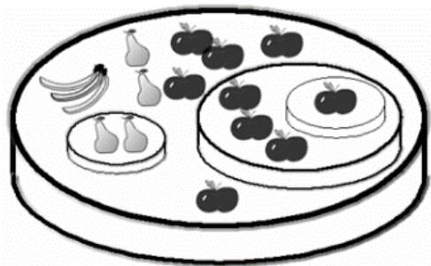
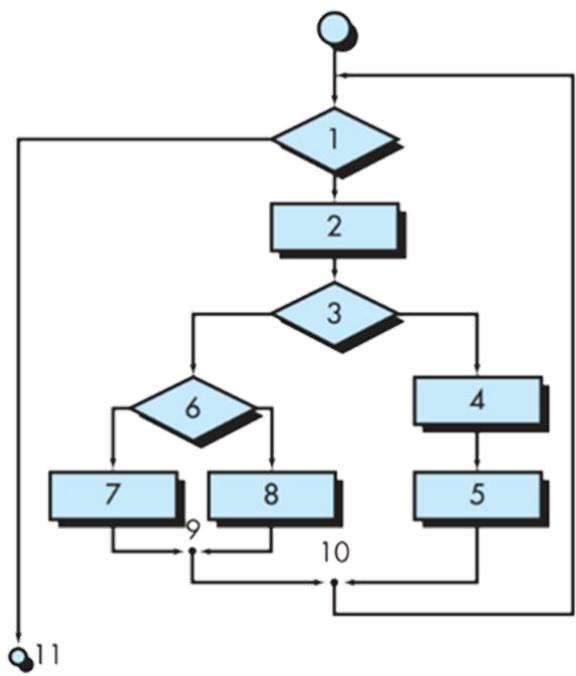

# 2021—2022学年第二学期《软件工程（双语）》期末试卷（A卷）

原件经识别和整理；“参考解答”是我们补的。

## Ⅰ. Design and Modeling （10×4＝40 pts.）

### 设计 1

As shown in the illustration figure, two coding cases are given by the software engineer. How will you model it separately as a designer?（10 pts）

```java
public class Car {
    private Engine engine;
    public Car(Engine engine) {
        this.engine = engine;
    }
    public void setEngine(Engine engine) {
        this.engine = engine;
    }
}

public class Engine {
}
```


知识点：[面向对象基本概念（类、对象、实例）](../../../topics/软件工程/OO基本概念.md)、[UML类图与类之间的关系](../../../topics/软件工程/UML类图与类关系.md)

### 设计 2

The combination of fruit plates is shown in the figure. How will you design and develop this system? Please use the class diagram to give the design model and explain the reasons for choosing the scheme.？（10 pts）



知识点：[UML类图与类之间的关系](../../../topics/软件工程/UML类图与类关系.md)、[基于类的建模（Class-Based Modeling）与识别分析类](../../../topics/软件工程/基于类的建模.md)、[设计模式（Patterns）的名称与要素](../../../topics/软件工程/设计模式.md)

### 设计 3

Since the suppliers of products are not in the same city, when you place an order as shown in the figure on an e-commerce platform through the shopping cart, the system needs to provide the function of splitting the order into some delivery orders. Please model this function with UML activity diagram. （10 pts）

| 序号 | 商品编号 | 商品名称 | 供应商地址 |
| :--- | :--- | :--- | :--- |
| 01 | C01 | 华为手机 | 上海 |
| 02 | S03 | 打印纸 | 北京 |
| 03 | D01 | 滑板 | 广州 |
| 04 | N01 | 牛仔裤 | 北京 |
| 05 | C02 | iPad | 上海 |
| ...... | ...... | ...... | ...... |

知识点：[用活动图（Activity Diagram）做用例补充](../../../topics/软件工程/活动图补充用例.md)、[UML体系结构描述（5视图）与UML图（9+4图）](../../../topics/软件工程/UML五视图与九图.md)

### 设计 4

As shown in the figure, a flowchart is used to depict program control structure.

1) Draw the corresponding flow graph using the number in the flowchart.（4 pts）

2) Calculate the cyclomatic complexity of the procedure.（2 pts）

3) List all the independent paths for basis path testing.（4 pts）



## Ⅱ. Analysis and Computation （15×2＝30 pts.）

知识点：[白盒测试（White-Box Testing）与基本路径测试（Basis Path Testing）](../../../topics/软件工程/白盒测试.md)、[控制结构测试（Control Structure Testing）：条件测试与循环测试](../../../topics/软件工程/控制结构测试.md)

### 分析 1

At the beginning of the project, in order to elicit requirements, the following three questions were asked to customers and other stakeholders. Please try to analyze what the goal of each question is (9 pts) and what effect it has on the scheme selection of system construction (6 pts)?

1) Who is behind the request for this work?

2) What problem(s) will this solution address?

3) Can anyone else provide additional information?

知识点：[起始（Inception）与建立基础工作](../../../topics/软件工程/起始Inception.md)、[需求获取（Elicitation）与需求收集会议](../../../topics/软件工程/获取Elicitation.md)、[确认利益相关者（Stakeholders）与识别多种观点](../../../topics/软件工程/利益相关者.md)

### 分析 2

Among the numerous software process models, the concurrent development model is often more appropriate for product engineering projects where different engineering teams are involved. As shown in the figure, it describes any iterative elements and concurrent elements in the development process. Please illustrate the workflow of the model with an example and talk about your understanding. （15 pts）


## Ⅲ. Comprehension and Discussion （15×2＝30 pts.）

知识点：[并发/协同模型（Concurrent Models）](../../../topics/软件工程/协同模型.md)、[五个通用框架活动（Five Framework Activities）](../../../topics/软件工程/通用过程框架活动.md)、[传统方法学与面向对象（OO）方法学](../../../topics/软件工程/传统方法学与OO方法学.md)

### 讨论 1

In an excellent paper on software process and projects, Barry Boehm [Boe96] states: “[Y]ou need an organizing principle that scales down to provide simple [project] plans for simple projects.” Boehm suggests an approach that addresses project objectives, milestones and schedules, responsibilities, management and technical approaches, and required resources. How do we define key project characteristics? （15 pts）

知识点：[项目管理的四个P（People, Product, Process, Project）](../../../topics/软件工程/四个P.md)、[W5HH原则（Why, What, When, Who, Where, How, How much）](../../../topics/软件工程/W5HH原则.md)

### 讨论 2

In the drawing software system, the requirements are described below:

1) There are many geometric figures must be achieved, such as: rectangle, circle, polygon etc.

2) Different geometric figures have different implementation processes. An user chooses an appropriate figure according to their own needs.

Please give a detailed discussion to elaborate how the design model meets the OO design principles, such as the open-closed principle, the Liskov substitution principle and the dependency inversion principle etc. （15 pts）


知识点：[开闭原则（Open-Closed Principle, OCP）与多态条件](../../../topics/软件工程/开闭原则OCP.md)、[Liskov替换原则（Liskov Substitution Principle, LSP）](../../../topics/软件工程/Liskov替换原则LSP.md)、[依赖倒置原则（Dependency Inversion Principle, DIP）在构件级设计中的应用](../../../topics/软件工程/依赖倒置原则DIP.md)
