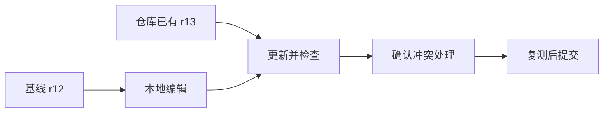

# SVN中文教程导读：工作副本、版本与锁

本页导读实验四参考资料中的《SVN 简明使用手册》（魏伟整理）。原件共 19 页，以早期 TortoiseSVN 和 AnkhSVN 界面举例，涉及检出、开发、图标和从 CVS 迁移。下文重写只与版本控制有关的机制，不复用旧客户端截图、历史服务器地址或项目文件；新界面应以 [TortoiseSVN 官方文档](https://tortoisesvn.net/docs/release/TortoiseSVN_en/index.html)为准。

## 先分清版本库、工作副本和普通文件夹

原件前几页展示从中央版本库检出项目。检出不是单纯复制一组文件：工作副本还保存版本控制所需的基线信息，允许对比本地内容与基线。若只需要一份材料，不准备继续版本控制，可选导出；若要确认自己检出了哪个仓库路径和版本，应查副本信息，不能凭文件夹名判断。见[工作模式](../../../topics/软件工程/SVN工作原理与模式.md)和[检出、更新与提交](../../../topics/软件工程/SVN检出更新提交.md)。

| 操作 | 改的是哪一侧 | 常见误判 |
| --- | --- | --- |
| 检出（Checkout） | 从版本库创建工作副本 | 不是“给旧文件夹自动补齐我想要的版本” |
| 更新（Update） | 吸收仓库已有变化到工作副本，可能与本地编辑合并 | 不发布本地修改，也不会自动确认冲突选哪边 |
| 添加（Add） | 在工作副本登记将要纳入的文件 | 登记后还未在版本库生成修订 |
| 提交（Commit） | 把选定变更写入版本库 | 未选文件和未登记文件不会仅因存在于同目录就上传 |
| 比较（Diff）／日志（Log） | 读差异或历史 | 看过两版不同，不代表已经回滚 |
| 撤销本地修改（Revert） | 丢弃选中的未提交工作副本变更 | 不擦掉仓库已提交的历史；这也不是浏览旧版本 |

## 遇到冲突，先认清你比较的是哪两个版本

**补充（自编）**：从修订 12 检出测试规范。甲在同一行增加超时限制，乙已把这一行的失败处理更新到修订 13。甲怎样保留两边有用的改动并留下可复核记录？

**参考解答**：先比较本地编辑相对基线的差异，再更新并检查合并结果。同一行出现冲突时，不以标记颜色或“取最新”代替业务判断；核对超时和失败处理是否都仍成立，解决冲突，运行相应测试，最后提交。若没有别的提交插入，服务器产生修订 14。日志能回答变更何时进入仓库，差异能解释文本改了哪里，测试才确认合并后行为。不要为查看旧内容先丢弃当前编辑。参看[冲突处理](../../../topics/软件工程/SVN冲突解决.md)。

> [!TIP]
> ==文件显示为已修改，不等于别人已经看见修改==。先看副本状态，再看仓库日志。资源管理器颜色只提示状态，绿色也不能保证版本库没有更新。

## 锁是协调编辑，不是每次提交的前置条件

**订正**：原文按某个旧项目的“先锁后改”流程展开，不代表所有 SVN 文件必须加锁。容易合并的文本通常可并行编辑；不易合并的二进制文件更适合事先协调。属性 `svn:needs-lock` 会让普通工作副本中的目标文件在未持锁时表现为只读，用来提示先申请锁，不应把这个提示当成服务器端通用访问控制。若工作副本已持锁，客户端通常会在成功提交时释放参与提交的锁，除非选了保留锁等选项；不能把“先手动解锁、再提交”写成固定顺序。查[官方锁与图标说明](https://tortoisesvn.net/docs/release/TortoiseSVN_en/help-onepage.html)，不要仅凭早期插件画面推断当前行为。

原件附录图标的用处在于提示正常、修改、冲突、待添加、缺失或已有锁等状态，这些不是彼此等价的条件。尤其看到加号要问==只是计划加入，还是已成功提交==；看不到某个图标时，应读状态信息，不把资源管理器是否显示覆盖图标当成版本库结论。见[版本控制](../../../topics/软件工程/版本控制.md)。

## 从 CVS 迁移前，决定要不要保留历史

原件后段是旧项目把当前文件放进新仓库的操作示例，不能用于证明历史版本已迁移。若只要当前快照，用独立的干净副本导入，不在唯一旧副本上删除任何元数据。若必须保留作者、时间、版本及分支标签，就要用符合团队要求的转换流程，在隔离的目标库核验文件、日志和标签，再安排切换。[Apache Subversion 的迁移说明](https://subversion.apache.org/faq#cvs2svn)将 CVS 历史转换单列。无论哪种做法，都应区分[基线与配置项](../../../topics/软件工程/基线与配置项.md)：文件传过去只是一个操作，可复核、受控的一组版本才是可用基线。
