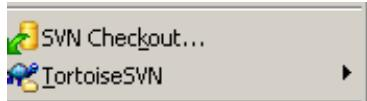
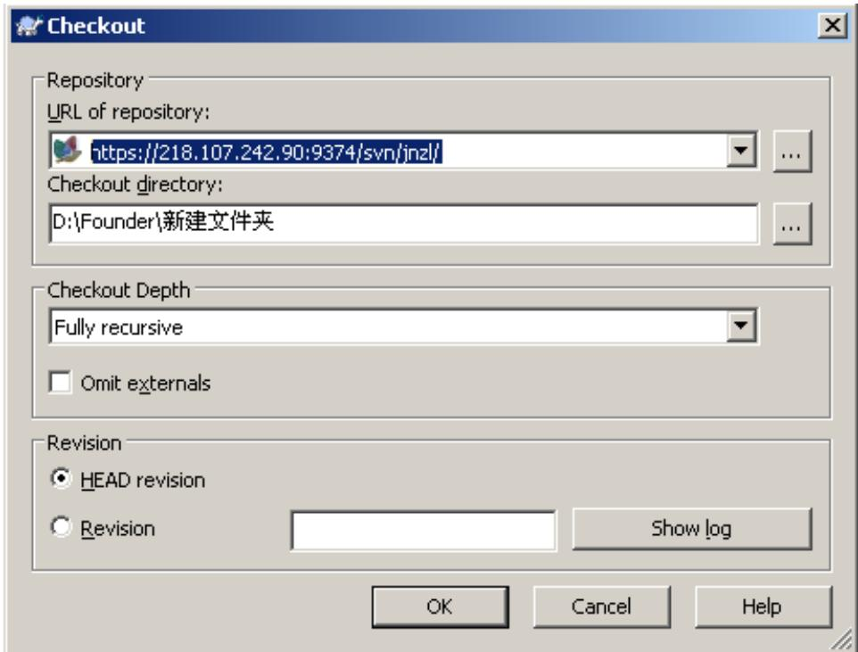
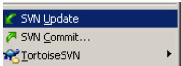
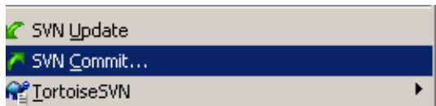
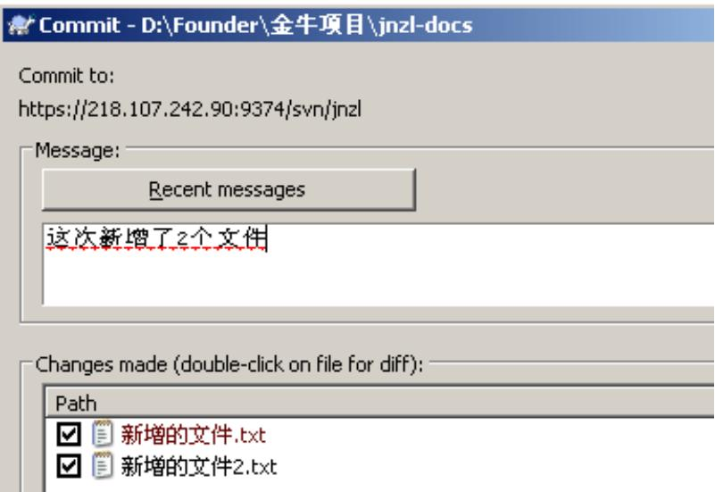
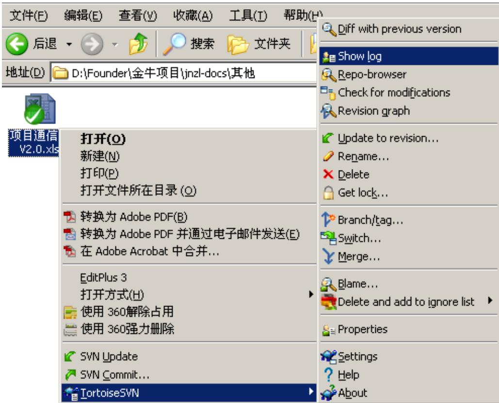
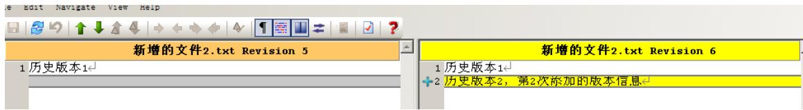
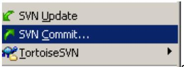

# 《软件工程（双语）》SVN客户端使用简要教程（实验4参考资料）

原件经识别和整理；“参考解答”是我们补的。

## 一、免安装浏览文件步骤

1. 打开浏览器，输入如下地址：`https://218.107.242.90:9374/svn/jnzl/`

   注：若浏览器出现安全警告提示，请略过此提示，继续进入即可。

2. 输入您的帐号和密码，即可登录进入 SVN 服务器。

   注：公共帐号为：jnzl/jnzl

3. 浏览你需要的文件，点击下载即可。

## 二、客户端安装步骤

1. 安装 SVN-Client 端程序。

   下载地址：`https://218.107.242.90:9374/svn/jnzl/tools/svn-client.msi`

   注：输入您的帐号和密码，即可进行登录下载。

2. 安装后，创建一个新目录，在新目录下点击右键，在弹出的菜单中选择 SVN Checkout，如下图所示：

   

3. 在弹出的窗口中，在 URL of repository 中输入 SVN 服务器的地址信息 `https://218.107.242.90:9374/svn/jnzl/`，如下图所示：

   

## 三、更新文件操作步骤

1. 在 SVN 目录下，点击右键，在弹出的菜单中选择 SVN Update，如下图：

   

2. 更新完毕后点击 OK 按钮即可完成更新。

## 四、修改文件操作步骤

1. 为了避免文件版本的冲突，在修改文件之前，一定要先进行文件更新操作。

2. 在目录中修改文件后，该文件的图标将发生变化，由绿色变成红色，如下图所示：

   

   

3. 在变红的文件上，点击右键，在弹出的菜单中选择：SVN Commit，如下图：

4. 在弹出的窗口中，输入本次修改的备注，如下图：

5. 输入完毕后，点击 OK 按钮即可。

## 五、新增文件步骤

1. 在目录下新建一个文件后，该文件图标即变为蓝色的问号样式，如下图：

   

2. 在目录的空白处，点击右键，在弹出的菜单中选择 SVN Commit，如下图：

   

3. 在弹出的窗口中，输入新增文件的备注信息，并在下面的文件列表框中勾选新增的文件名，点击 OK 按钮即可，如下图：

   

## 六、查看文件历史版本步骤

1. 在要查看的文件上点击右键，选择 TortoiseSVN，然后选择 Show log，如下图：

   

2. 在弹出的窗口列表中，可以看到历次修改的注释信息。双击列表中的历史版本文件，即可对比当前版本和历史版本的修改说明，如下图：

   

## 七、删除文件步骤

1. 在 SVN 目录下删除文件后，在空白处点击右键，弹出的菜单中选择 SVN Commit，如下图：

   

2. 在弹出的窗口中，输入删除文件的备注信息，并且在文件列表中勾选要删除的文件，然后点击 OK 按钮即可，如下图：
