# 《软件工程（双语）》TortoiseSVN使用教程（参考资料）

原件经识别和整理；“参考解答”是我们补的。

---
title: 软件工程（双语）TortoiseSVN使用教程（参考资料）第1部分
kind: 课件
course: 软件工程（双语）
term: 
source: dev.idv.tw (2009-04-24)
---

# 软件工程（双语）TortoiseSVN使用教程（参考资料）第1部分

本资料整理自 dev.idv.tw 于 2009-04-24 发布的 TortoiseSVN 使用简介，主要涵盖 SVN 概念、安装、仓库建立及工作目录配置等基础操作。

## 一、TortoiseSVN 使用简介

### 1. 安装及下载 client 端

1. 下载 Windows 端程序：http://tortoisesvn.net/downloads。一般而言，如果是 32-bit 的 Windows XP 应该使用 `TortoiseSVN-1.4.x.xxxx-win32-svn-1.4.x.msi` 这个档案。如果是 64-bit 的操作系统，则应该使用 `TortoiseSVN-1.4.x.xxxx-x64-svn-1.4.x.msi` 这个档案。
2. 执行下载回来的 TortoiseSVN 安装程序，就会进行 TortoiseSVN 的安装。正确安装后，应该进行一次的重开机，以确保 TortoiseSVN 的正确无误。
3. 安装成功后，在档案管理员内按下鼠标右键，应该可以看到如右图所示：


大部分的 TortoiseSVN 的操作都是透过档案管理员及鼠标右键就可以完成了。如果您之前使用过 TortoiseCVS，应该会对这种操作方式感到十分亲切。

### 2. 什么是 SVN (Subversion)?

有一个简单但不十分精确比喻：$SVN = \text{版本控制} + \text{备份服务器}$

简单的说，您可以把 SVN 当成您的备份服务器，更好的是，他可以帮您记住每次上传到这个服务器的档案内容。并且自动的赋予每次的变更一个版本。

通常，我们称用来存放上传档案的地方就做 Repository。用中文来说，有点像是档案仓库的意思。不过，通常我们还是使用 Repository 这个名词。基本上，第一次我们需要有一个新增(add)档案的动作，将想要备份的档案放到 Repository 上面。日后，当您有任何修改时，都可以上传到 Repository 上面，上传已经存在且修改过的档案就叫做 commit，也就是提交修改给 SVN server 的意思。针对每次的 commit，SVN server 都会赋予他一个新的版本。同时，也会把每次上传的时间记录下来。日后，因为某些因素，如果您需要从 Repository 下载曾经提交的档案。您可以直接选择取得最新的版本，也可以取得任何一个之前的版本。如果忘记了版本，还是可以靠记忆尝试取得某个日期的版本。

### 3. 为甚么要用 SVN?

1. **备份工作档案是十分重要的。** 您永远不知道计算机上的硬盘何时会坏掉。根据经验法则再加上摩菲定理，坏事情往往都发生在最重要的时刻。例如，要 release 东西的前一刻，硬盘完全坏掉，无法修复。所以，常常备份工作数据是非常重要的。大部分公司的 server 都会有专门的备份机制，甚至是异地备援。绝对比放在自己的计算机里头，或是随身碟上面来的安全。
2. **版本控管非常重要。** 您无法保证手头上最新版本永远都是对的。很多时候，在经过数天努力工作后，您才发现走错方向。需要将所有的修改回复到数天前版本。没有几个人能够完全记住自己修改过什么东西。如果没有做好版本控管，那么，最差的状况就是要全部重来。
3. **伙伴间的数据同步也是非常重要的。** 很多时候，除了您个人外，还有其它的伙伴也需要您的档案。怎么把最新的档案提供给伙伴呢？用 e-mail？根据经验，用 e-mail 是一个很差的办法。到了最后，根本就不知道哪一封 e-mail 才是新的。因为可能您最新的 e-mail 已经被当成垃圾信给丢了。别忘了，现在很多 e-mail 软件都有 anti-spam 的功能，说不定这些信件都被当成广告信给处理掉了。而且，您也应该知道一般档案如果放在 e-mail 内，档案大小会变得比较大（通常是原来的 4/3 倍以上）。如果每天更新一次，恐怕几天没收信的话，信箱就爆了！

如果没有一个好的办法，备份不同版本是很耗费硬盘空间的。例如：您有一个总共 $10\text{MB}$ 的目录，使用单纯的档案备份。如果有 10 个版本就会变成 $100\text{MB}$。20 个版本就有 $200\text{MB}$。如果，不想备份这么多版本，势必就是要减少备份的次数。拉长备份周期将会导致数据遗失的危险性增高。把旧的不需要的备份删除？根据经验，只要时间一拉长，您跟本就不知道一个月以前的版本是重要或者是不重要。

SVN 能帮我们解决上面的问题吗？答案是肯定的：

1. SVN Repository 可以是自己计算机上的一个目录，或者是随身碟（不建议这样用）。当然也可以是公司的服务器。
2. SVN 有很棒的版本控管机制。所有上传的版本都会帮您记录下来。日后您可以随时取得某一个时刻的版本。而且，也有版本分支及合并等好用的功能。
3. SVN 可以让不同的开发者存取同样的档案，并且利用 SVN Server 作为档案同步的机制。也就是说，您有档案更新时，无须将档案寄给您的开发成员。只需要告诉他新的版本已经在 SVN Server 上面，请他自己去 SVN Server 上面就可以取得最新版本。而且，SVN Server 也可以做到当您上传新版本后，自动发信给相关的成员。

[!NOTE]
SVN 的存放档案方式是采用差异备份的方式。也就是说，他只会备份有不同的地方。所以很省硬盘空间。此外，他也可以针对所谓的非文字文件进行差异备份。

### 4. 怎么样在 Windows 下面建立 SVN Repository？

假设您已经安装前面所提及的 TortoiseSVN 这套软件，现在我们先告诉您如何用自己的硬盘或是随身碟当作 SVN Repository 的存放地点。如果您只想知道如何存取一个已经建立好的 SVN Server 上面的 Repository，请直接跳过本节。

Repository 的地方是 E 槽。您需要先建立一个空的目录。以下面的例子而言，我们在 E 槽下面建立了一个名为 `svn_repo` 的目录。SVN 并没有限定 Repository 目录名称。您可以建立任何您自己喜欢的名称。但是，强烈建议勿使用非英文的档名(如中文或日文)。


透过您的档案管理员，在 `E:\svn_repo` 的 Icon 上面，按下鼠标右键后，选择 `TortoiseSVN -> Create repository here`。


接着，您会看到如下的一个窗口，这个窗口主要是问您，您希望使用的 Repository 数据库格式是 FSFS 还是 BDB。基本上，请选择 FSFS 就可以了。按下 OK 按钮后，您将可以看到下一个画面。


这就表示您的 SVN repository 已经成功的建立了。接下来就是要把您的档案备份进来。日后，只要需要使用这个 repository，我们就可以使用 `file:///E:/SVN_REPO` 表示它。SVN 就是透过这种 URL 的方式到如何与 Repository 取得联系。各种 URL 的格式如下：

| 协议类型 | 格式示例 |
| :--- | :--- |
| file | `file:///磁盘驱动器|/repository 所在目录/子目录` |
| http | `http://账号@服务器名称/repository 所在目录/子目录` |
| https | `https://账号@服务器名称/repository 所在目录/子目录` |
| svn+ssh | `svn+ssh://账号@服务器名称/repository 所在目录/子目录` |

其中，http 表示使用一般的超文字传输通讯协议。https 表示使用加密的超文字传输通讯协议。svn+ssh 表示透过 SSH 加密通讯的管道，进行存取。

### 5. 建立一个 Working 目录

所谓的 Working 目录其实就是您平常用来存放工作档案的地方。通常我们会等到自己的工作做的一个段落的时候再进行备份。所以我们平常都是在 Working 目录下面工作，等到适当时机在 commit 到 repository 中。举例来说，我们想在 D 盘下面建立一个名为 working 的目录。首先先把这个目录建立出来。


此时，这个目录应该为空的。

在档案管理员中按下右键后(您可以在 working 目录的 icon 上按，也可进入 working 目录后，在空白的地方按)，选择 SVN checkout。


接着您可以看到如下的画面：

```text
URL of repository: file:///E:/SVN REPO/
Checkout directory: D:\working
```


首先我们要填入的是 repository 的位置，对于 SVN 来说，repository 的位置都是 URL。由于我们前面已经在 E 槽建立一个 repository，因此，我们现在要在 URL of repository 这一栏填入 `file:///E:/svn_repo/`。

接着，稍微看一下 Checkout directory，这个字段应该要指向您的 working 目录。确认后，按下 OK 按钮，您应该可以看到如下的讯息窗口。


这样就表示动作完成。按下 OK 按钮后，再到您刚刚建立的目录下。您将会看到 working 目录下面多了一个名为 `.svn` 的目录(这个目录是隐藏的，如果您的档案管理员没有设定可以看到隐藏目录，您将无法看到它)。


SVN 会在您的工作目录下，以及其子目录下建立这个 `.svn` 的子目录。您不应该进去这个目录，尤其不应该更动这个目录下面的任何内容。否则会很可能会造成 SVN 无法正常运作。

由于，原来的 repository 是空的，所以我们现在的 working 目录也是空的。如果您现在 checkout 的是一个已经有内容的 repository，您将会看到 working 目录下面现在多了许多目录及档案。

如果您要在一个已经存在的 SVN Server 上面 checkout 出上面的档案，您只需要给定正确的 URL 以及 working 目录的名称。就可以取得指定的档案及目录了。

### 6. 新增档案及目录到 Repository 中

假设您前面的动作都无误。现在您开始开发一个新的程序。假设您开发的程序将放在前面建立的 working 目录下面的 `my_prj` 子目录。如下所示：


## 将档案加入 Repository

假设您已经编辑好档案，准备把他们放到 SVN 的 repository 中。您需要在 my_prj 目录的 icon 上面，按鼠标右键，并且选择 TortoiseSVN->Add：


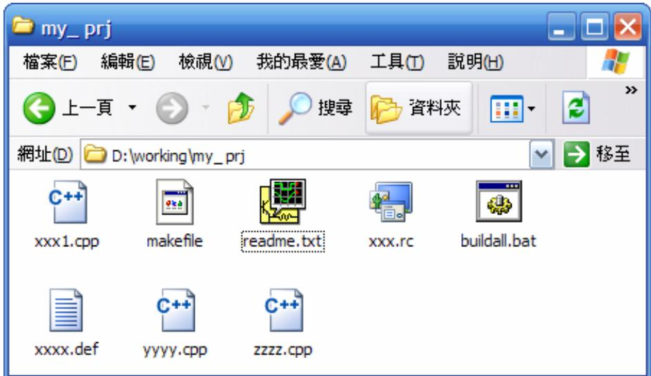

接着，TortoiseSVN 会把准备要加入的档案及目录显示给您看。打勾的就是等下要被加入到 Repository 中的。如果您有某些档案或是目录不想在这次加入，您可以让该项目不要被勾选。如此，它就不会被加入到 Repository 去。

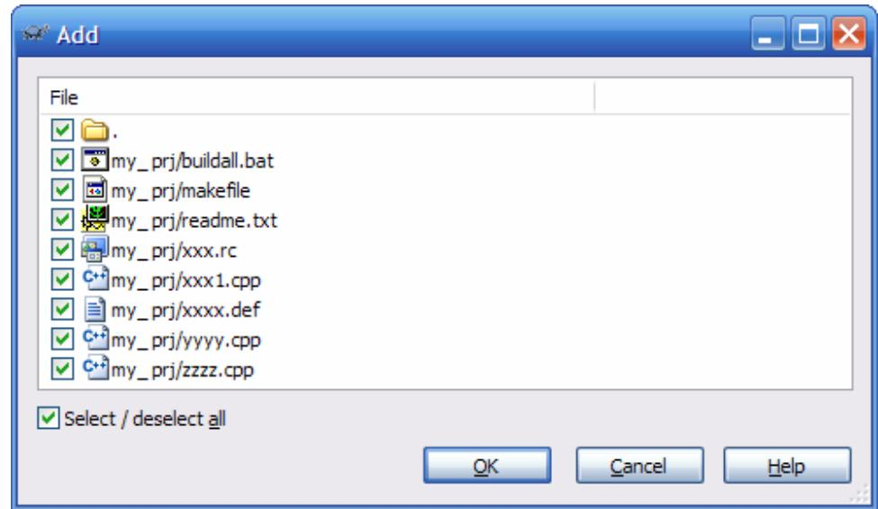

按下 OK 后，您将会看到如下的讯息窗口：

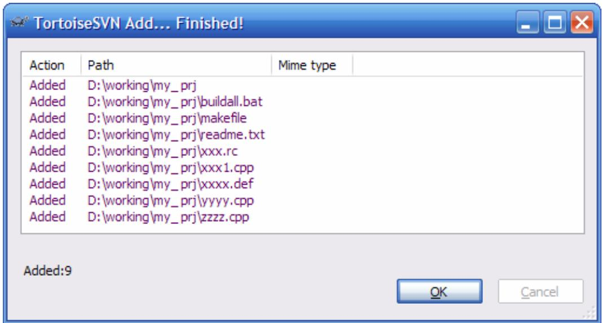

这样就表示成功了。有一点要注意的是，这个 Add 的动作并未真正的将档案放到 Repository 中，仅仅是告知 SVN 准备要在 Repository 中放入这些档案。此时，如果您透过档案管理员查看这些档案，应该会看到一个白色红底的惊叹号在档案 icon 的下方。

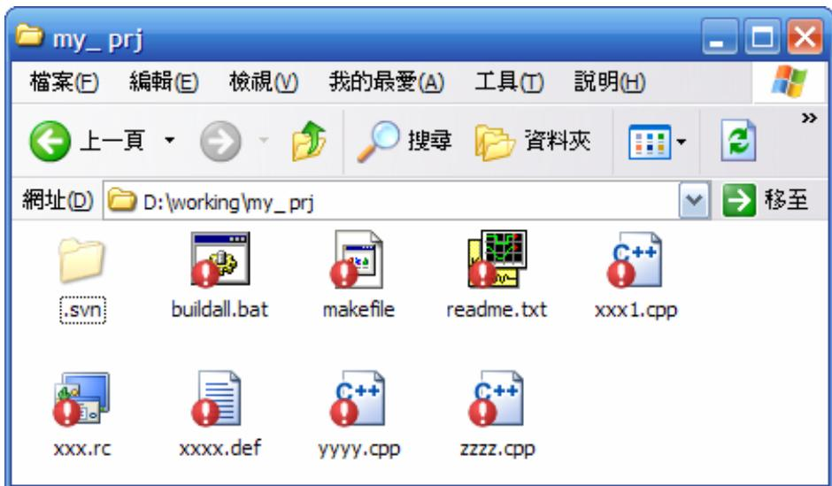

这是表示您的 working 目录中的档案与 Repository 中的档案还没有同步。现在我们要多一个 commit 的动作，让这些档案真正的放入到 Repository 中。您可以在 my_prj 目录的 icon 上或者是 my_prj 目录内的空白处按下鼠标右键，叫出如下的选单，并且选择 SVN commit。

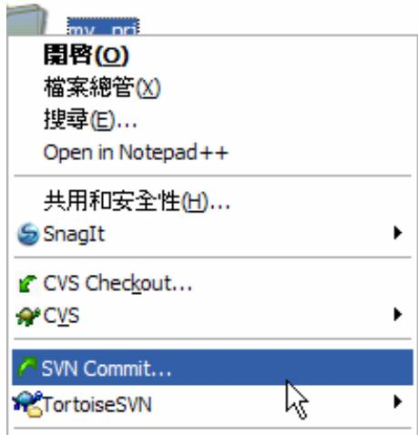

| File | Extension | Text status | Property status | Lock |
|---|---|---|---|---|
| | | added | | |
| buildall.bat | .bat | added | | |
| makefile | | added | | |
| readme.txt | .txt | added | | |
| xxx.rc | .rc | added | | |
| xxx1.cpp | .cpp | added | | |
| xxxx.def | .def | added | | |
| yyyy.cpp | .cpp | added | | |
| zzzz.cpp | .cpp | added | | |

紧接着，您将会看到如下的窗口出现：

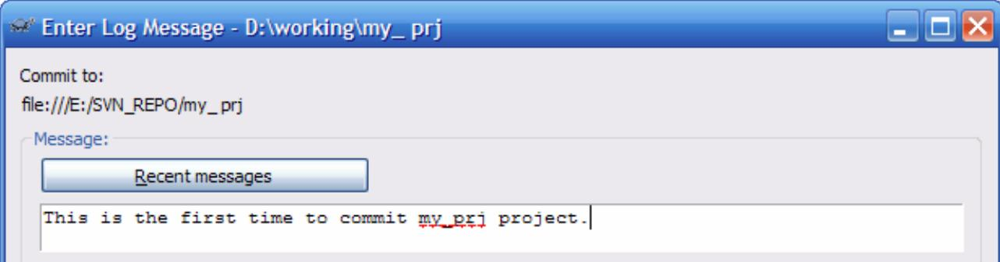

Changes made (double-click on file for diff):

在这个窗口中，下半部会列出一个清单，让您清楚的了解到哪些档案要被 commit 到 repository 中。同样的，如果您有档案不想在这个时候 commit 到 Repository，您可以取消选取的档案，这样他们就不会被 commit 到 Repository 中。

在档案列表的上方是 Message 栏，您可以在栏中输入本次 commit 的目的。这是十分重要的字段，当您 commit 的次数很多时，可以靠这个讯息知道版本与版本之间的差异。当您输入好 Message，按下 OK 之后，就可以看到如下的窗口出现，通知您已经将指定的档案送到 Repository 中。

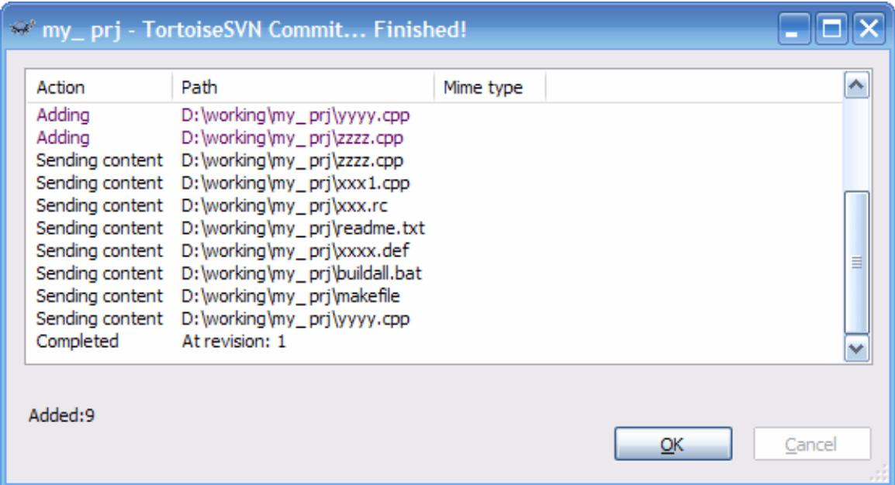

您可以到先前的 folder 中，确定是否所有的档案 icon 都有如下的绿色勾勾在上面，这样代表您的档案都正确无误的到 repository 中。

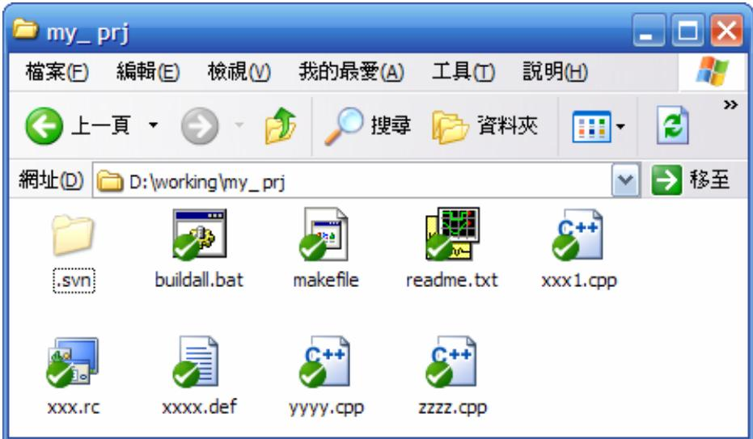

有时候，因为 Windows 本身的问题，您可能会看到有些 icon 没有变成绿色的勾勾。此时，多按 F5 几次，应该就可以解决这个问题。如果，仍然不行，表示您之前的 commit 动作真的有问题。请仔细检查之前的 commit 动作是否正确。

## 更新档案及目录

为何需要更新？由于版本控制系统多半都是由许多人共同使用。所以，同样的档案可能还有人会去进行编辑。为了确保您工作目录中的档案与 Repository 中的档案是同步的。建议您在编辑前都先进行更新的动作。在此，我们都先假设您已经将档案 check out 过一次。现在要说明的是如何在一个 check out 过的目录进行 update。在想要更新的档案或目录 icon 上面按下鼠标右键，并且选择 SVN Update。

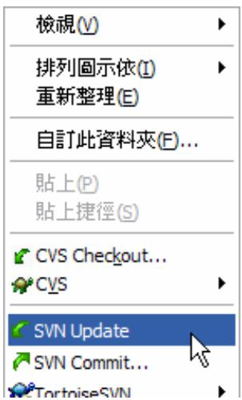

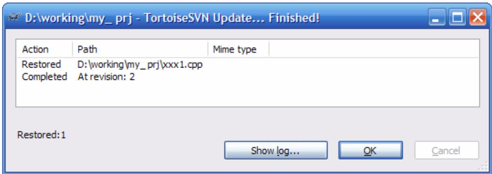

正常的状况下，您可以看到如上的窗口。在这个窗口中会显示有哪些文件更新了。如果没有看到档案更新的相关信息，这表示您的目录中的档案已经是最新的，所以无须进行更新。

## 更新至特定版本

有时我们需要回溯至特定的日期或是版本，这时就可以利用 SVN 的 Update to revision 的功能。在想要更新的档案或目录 icon 上面按下鼠标右键。并且选择 TortoiseSVN->Update to revision。


在这个 Update 窗口中，您可以选择更新到最新版本(HEAD)。也可以选择更新到某个指定的版本(Revision)。当然，您可能早就记不起来正确的版本号码。可能只隐约的记得大概在什么时间。没关系，按下 Show log 按钮，您就可以回顾历史了。

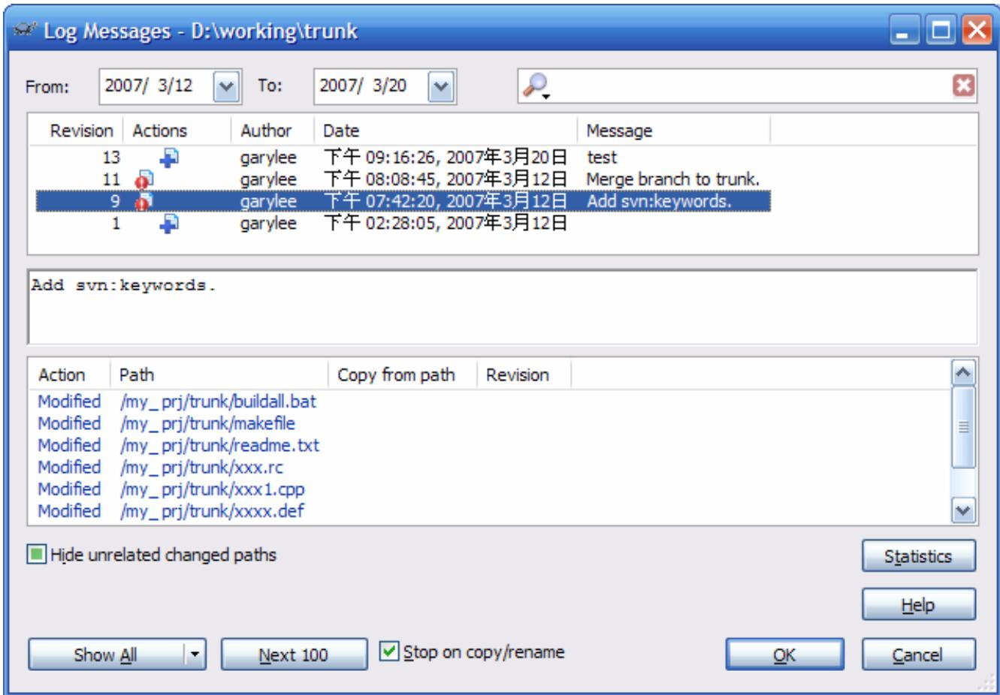

所有您曾经做过的动作，及其日期与对应的版本都会列在这个窗口上面，只要在你想要的版上面点一下，让他变成反白，然后按下 OK。这个版本就会自动填入 Update 窗口中的 Revision 字段中。您只要再按下一次 OK，这个版本就会被取出来到您的硬盘中。

### 复制档案及目录

很多时候您会希望有另外一个复制的目录来进行新的编修。等到确定这个分支的修改已经完毕了，再合并到原来的主要开发版本上。举例来说，我们目前在 working copy 下面有如下的目录及档案：

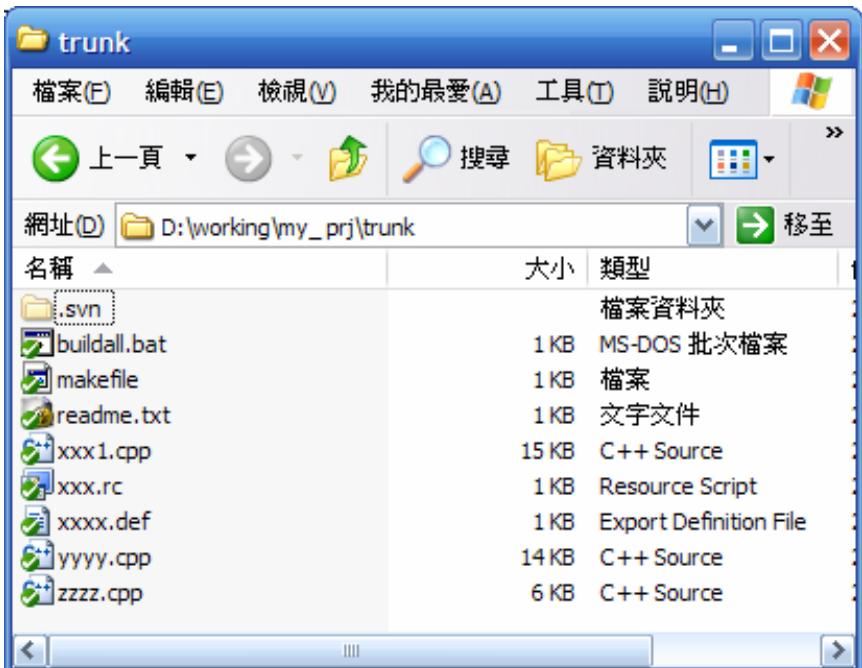

现在，我们要为 trunk 这个目录建立一个 branch。假设我们希望这个目录是在 `D:\working\my_prj\branch\my_new_branch_for_testing`。首先我们可以在 trunk 目录下面的空白处，或是直接在 trunk 的 icon 下面按下鼠标右键。

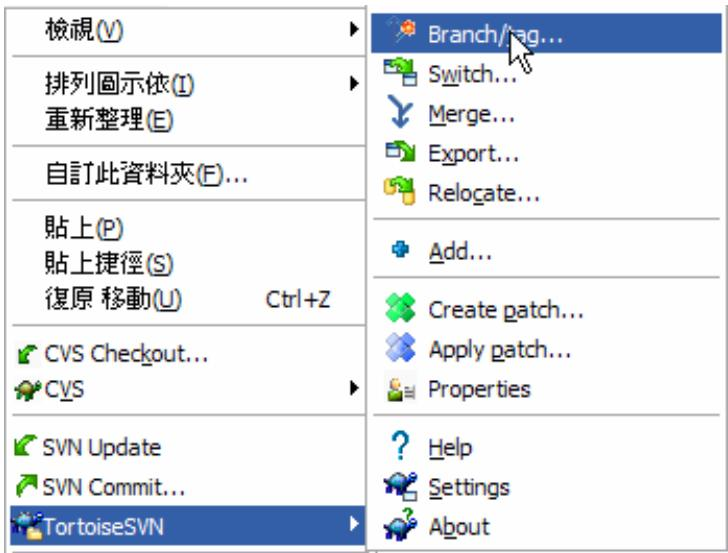

在选择 Branch/Tag…这个项目后，您将会看到如下的对话框出现。

**Copy (Branch / Tag)**

*   **From WC at URL:** `file:///D:/TMP/SVN_REPO/my_%20prj/trunk`
*   **To URL:** `file:///D:/TMP/SVN_REPO/my_prj/branch/my_new_branch_for_testing..`
*   **Revision:**
    *   HEAD revision in the repository
    *   Specific revision in repository
    *   Working copy
*   **Log message:** My new branch for testing only.

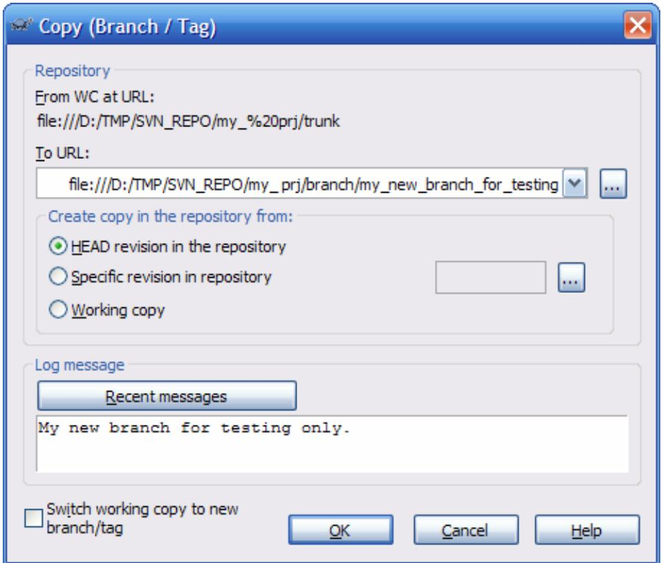

请先确认 From WC at URL: 中的目录是您要复制的来源目录。接着，在 To URL 中输入您要复制过去的路径。通常我们会将所有的 branch 集中在一个目录下面。以上面的例子来说，branch 档案都会集中在 branch 的子目录下面。在 To URL 中您只需要输入您要的目录即可。目录不存在时，会由 SVN 帮您建立。特别需要注意的是 SVN 因为斜线作为目录分隔字符，而非反斜线。

接着在 Log message 输入您此次 branch 的目的为何。按下 OK 就可以了。

如果成功，将可以看到下面的画面：

### TortoiseSVN Copy... Finished!

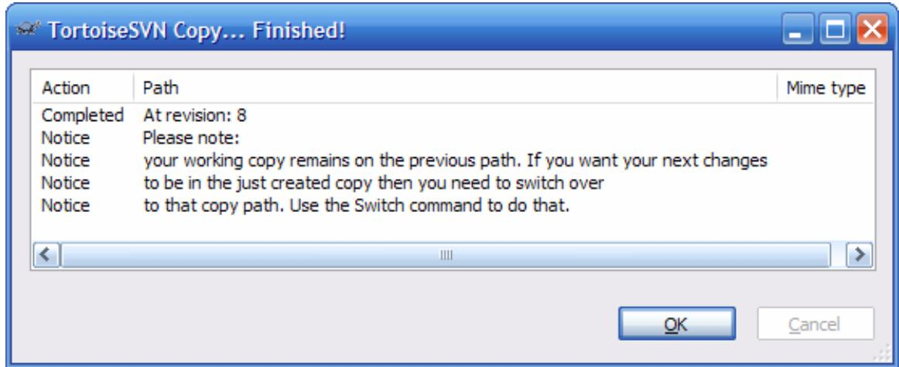

Mime type

Notice your working copy remains on the previous path. If you want your next changes Notice to be in the just created copy then you need to switch over Notice to that copy path. Use the Switch command to do that.

按下 OK 就可以关闭这个窗口了。如果您此时立刻去 working copy 的 branch子目录下面，您将会失望的发现在该目录下并没有刚刚指定的目录存在。这是因为您 workingcopy 的部份还是旧的，您只需要在 branch子目录下面进行 SVN update 就可以看到这个新增的目录了。新增的目录就与原来的目录无关了。您可以任意对他进行编辑，一直到您确认好所有在 branch下面该做的工作都完成后，您可以选择将这个 branch merge回原来的 trunk 目录，或者是保留它在 branch中。

要 merge回 trunk 目录中，方法很简单。以上面的例子来说，我们在 D:\working\my\_prj\trunk 目录空白处，按下鼠标右键，选择 Merge:


### 接着可以看到如下的画面：

Specify the revision range which you want to merge:

file:///D:/TMP/SVN\_REPO/my\_prj/branch/my\_new\_branch\_for\_testing

OHEAD Revision

Revision

Show log

Ignore ancestry

Use "From:"URL (revision range is selectable in the above log dialog)

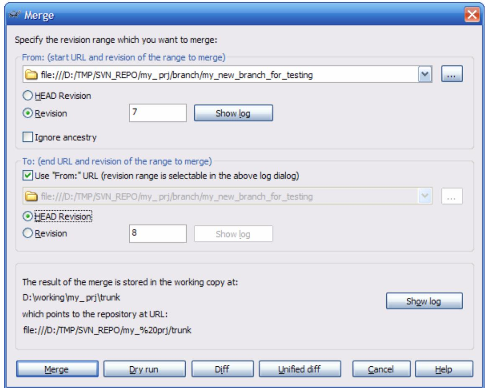

ORevision

HEAD Revision

8

The result of the merge is stored in the working copy at:

D:(workingmy\_prj\trunk

which points to the repository at URL:

Show log

file:///D:/TMP/SVN\_REPO/my\_%20prj/trunk

Merge

Dry run

Diff

Unified diff

Cancel

Help

这个画面主要分为三个部份，前面的 From: 与 To: 是要问您打算从 Branch中的哪个版本到哪个版本，merge回原来的trunk 目录中。因此，From 跟 To 的 URL 字段应当都是指定原来 branch 的目录下。剩下的就是指定要 merge的 revision范围。以上面的例子而言，我们从 Branch 的 Revision 7 开始 merge 到 Branch 下面的最新版本。您可以透过，Dry run按钮，试作一次 Merge。这个 merge只会显示一些讯息，不会真正的更新到 trunk 的目录去。只有按下 Merge按钮后，才会真正的将 branch的档案与 trunk 的档案合并起来。

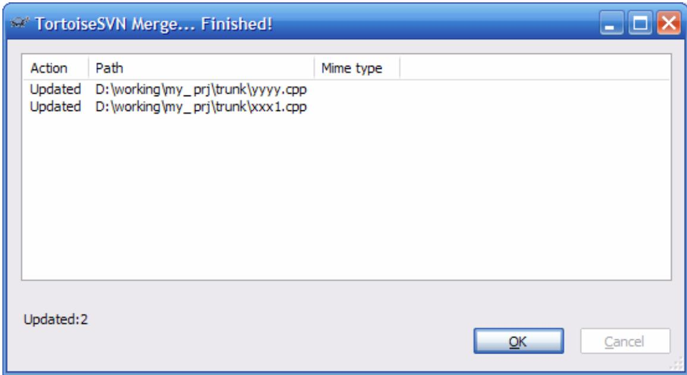

上面的讯息告诉我们在 trunk 目录下面的 yyyy.cpp及 xxx1.cpp 已经被更改过了。如果您在现在到 trunk 目录下，会看到这两个档案处于被修改的状态。

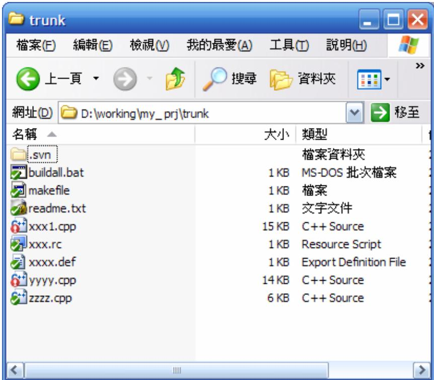

如果您确认这次的 merge没有问题，您可以直接使用 commit来将这两个被修改的档案 commit 回 SVN repository 上。如果有问题，您可以直接修改这两个档案，直到确认 ok 了，再行 commit。

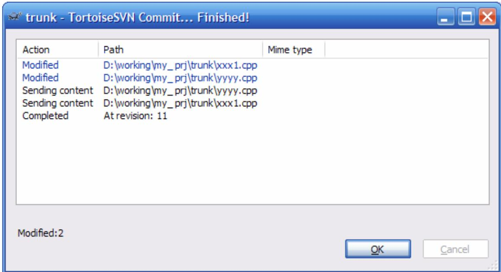

### 制作 Tag 或是 Release

所谓的 Tag 或是 Release就是一个特别的版本，因为这个版本可能有特别的意义。例如：这个版本是特别的 Milestone或是 release 给客户的版本。其实，Tag 与 Release 的作法与 Branch 完全相同。只是 Branch 可能会需要 merge 回原来的 trunk中，而 tag及 release大部分都不需要 merge回 trunk 中。举例来说，今天我们的 trunk 做了一版，这个版本被认定是软件的1.0 版。1.0 版对于开发来说是一个非常重要的里程碑。所以我们要特别为他做一个标记，亦即 Tag。假设，这个 1.0 版是要正式 release给客户或是相关 vendor，我们要可以为他做一个 Release 的标记。基本上，SVN 只有目录的概念，并没有什么Tag 的用法。所以您会看到再 SVN 的选单上面，Branch与 Tag是同一个项目。以这个 1.0 的例子来说，我们就是在 Trunk 上面，按下鼠标右键，选择 Branch/Tag 的项目：

## 快速参考

前面写了不少废话，主要是给完全没有版本控制观念的人看的。如果你想直接知道某个功能如何使用，请看下面的章节。

在后面的说明，皆以 d:\working 当作工作目录。您可以将他换成其它任何您想要的目录。

### 取得（Checkout）Repository

1. 开启档案管理员，进入 d:
2. 在档案管理员空白处按下鼠标右键，选择 SVN Checkout
3. 在 Checkout 对话框中，
   1. URL of repository：repository 的位置。
   2. Checkout directory：要存放 working copy 的地方。
4. 若 d:\working 目录不存在，SVN 会问您要不要建立这个目录，请选择 Yes。
5. 接着按下 OK，即可 checkout 该目录。

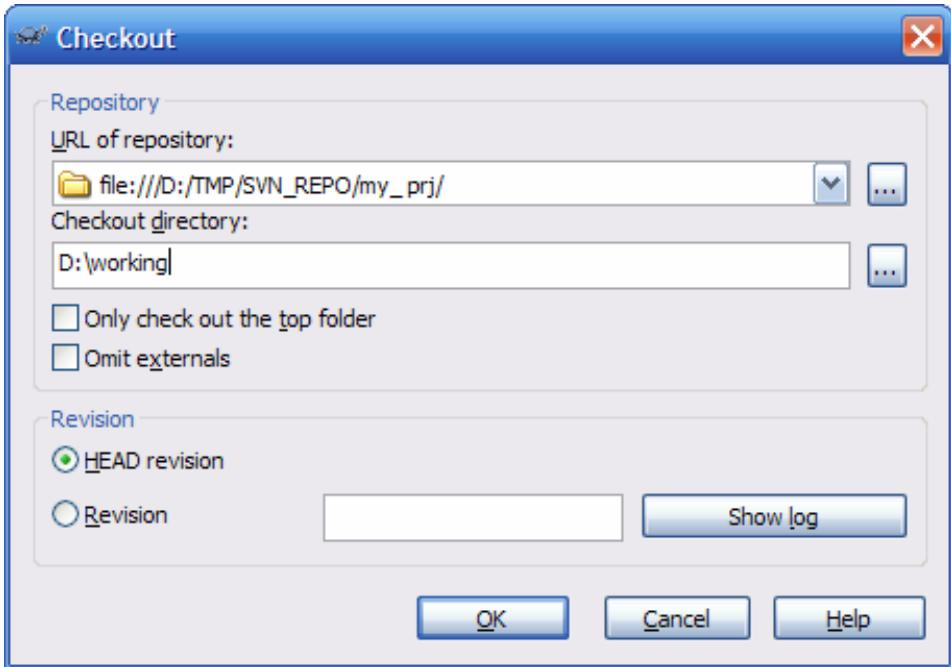

### 更新（Update）档案或目录

1. 在您要由 repository 更新至 working copy 的档案或是目录的 icon 上面按下鼠标右键。选择 SVN Update 即可。
2. 如果是要更新至特定的版本，则选择 TortoiseSVN->Update to revision。并且在 Update 对话框中的 Revision 字段输入您要的版本。也可以透过 Show Log 按钮来查看版本的信息。

### 新增（Add）档案或目录

1. 在尚不属于 repository 的档案或目录的 icon 上按下鼠标右键。选择 TortoiseSVN->Add。
2. 选取要新增的档案。
3. 按下 OK。

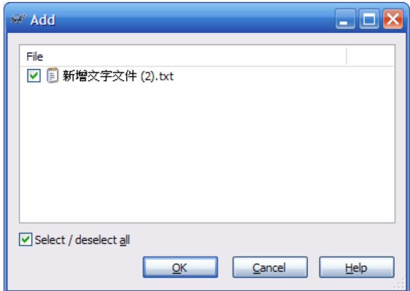

### 提交（Commit）修改过的档案或目录

1. 在修改过的档案，或是在整个目录的空白处按下鼠标右键。
2. 勾选真正要提交至 Repository 的档案或目录。
3. 输入本次提交的纪录讯息（Message）。这个讯息应该要清楚明了，但不应过份简单。以利日后版本追踪。
4. 按下 OK。

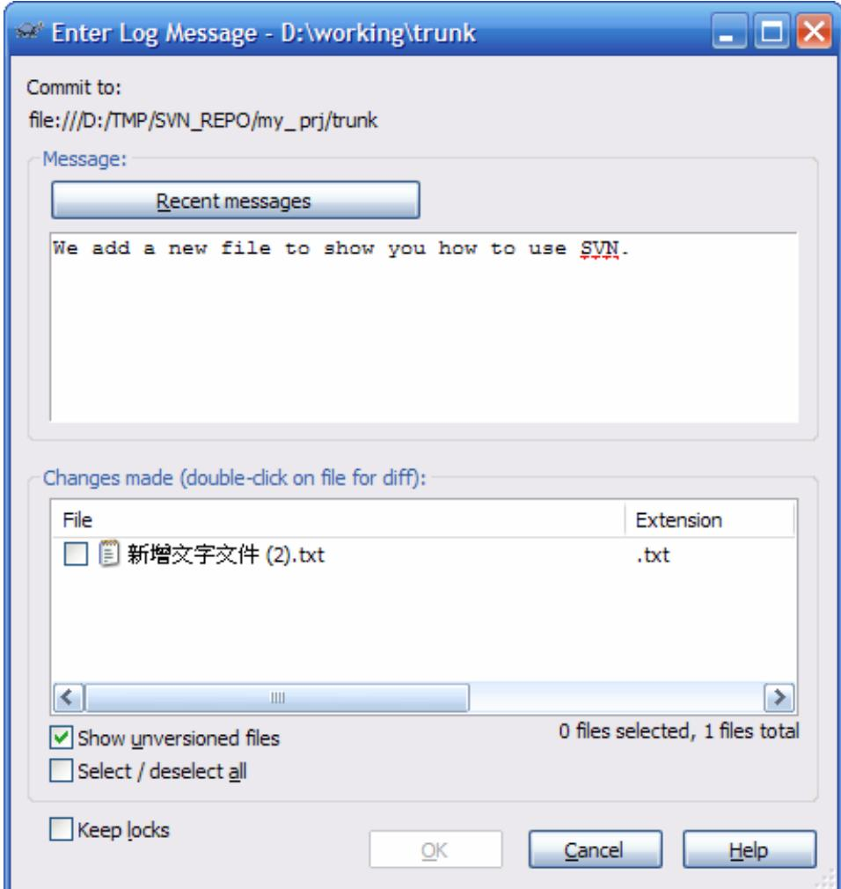

## Copy（Branch / Tag）

1. 确认您要处理的档案或目录已经是 Repository 中最新的版本。
2. 在要处理的目录或档案上按下鼠标右键，选择 TortoiseSVN → Branch/Tag。
3. 在 To URL 处输入您要的目的地。

- branch：要产生一个分支，以区别于 trunk 不同的开发。
- tag：要形成一个标记，表示重要的 milestone。
- release：表示一个已经正式的 release 的纪录。
- 其它：进行一个复制（copy）。

### Copy（Branch / Tag）对话框

From WC at URL：

```
file:///D:/TMP/SVN_REPO/my_prj/trunk
```

To URL：

```
file:///D:/TMP/SVN_REPO/my_prj/[tag|branch|release]/label
```

- HEAD revision in the repository
- Specific revision in repository
- Working copy

Log message：

```
Add some message here.
```

Recent messages

Switch working copy to new branch/tag
