# 《软件工程（双语）》UNIT-04 设计与体系结构（课件）

原件的每一页，下面附识别出的文字。

### UNIT 4

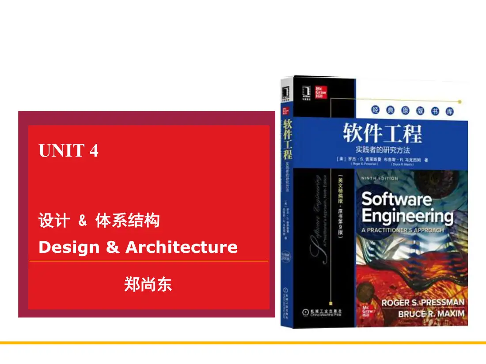

原文：

UNIT 4

设计 & 体系结构Design & Architecture

郑尚东

Software Engineering A PRACTITIONER'S APPROACH

### Design Principle & Concept

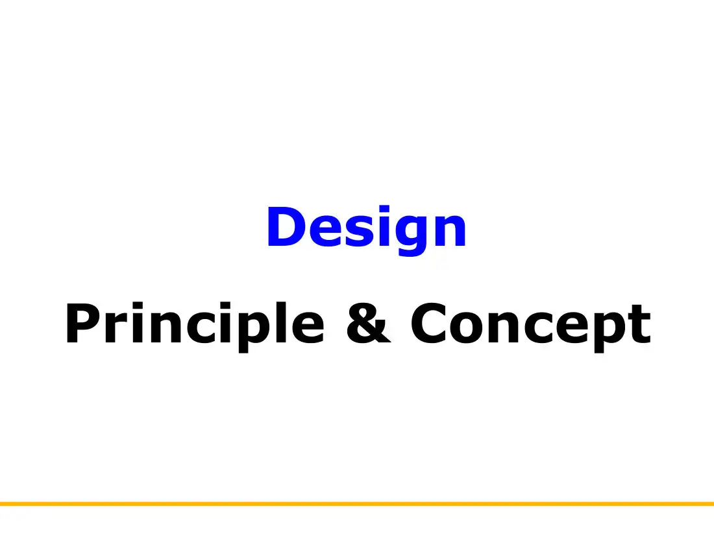

原文：

Design Principle & Concept

### Software design

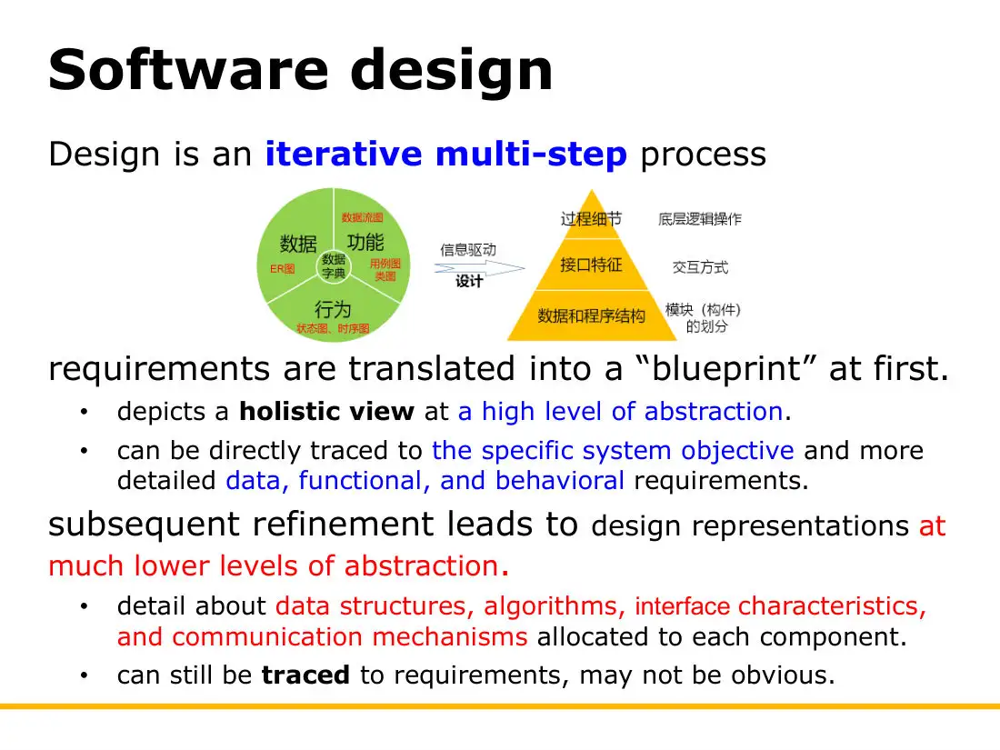

原文：

Software design

Design is an iterative multi-step process

requirements are translated into a “blueprint” at first.

• depicts a holistic view at a high level of abstraction.

can be directly traced to the specific system objective and more detailed data, functional, and behavioral requirements.

subsequent refinement leads to design representations at much lower levels of abstraction.

detail about data structures, algorithms, interface characteristics, and communication mechanisms allocated to each component.

• can still be traced to requirements, may not be obvious.

### thinking of design

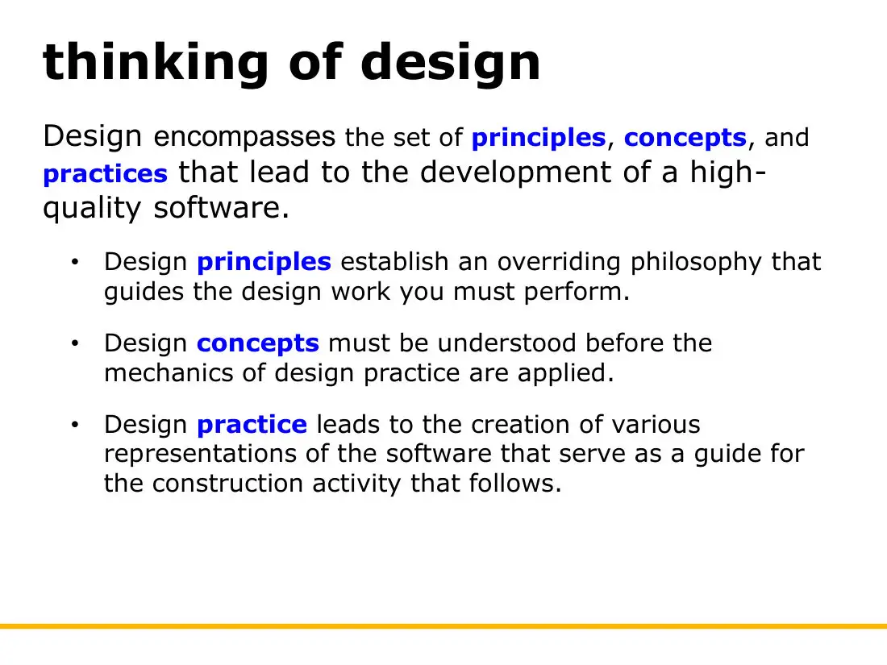

原文：

thinking of design

Design encompasses the set of principles, concepts, and practices that lead to the development of a highquality software.

Design principles establish an overriding philosophy that guides the design work you must perform.

• Design concepts must be understood before the mechanics of design practice are applied.

Design practice leads to the creation of various representations of the software that serve as a guide for the construction activity that follows.

### Design methods

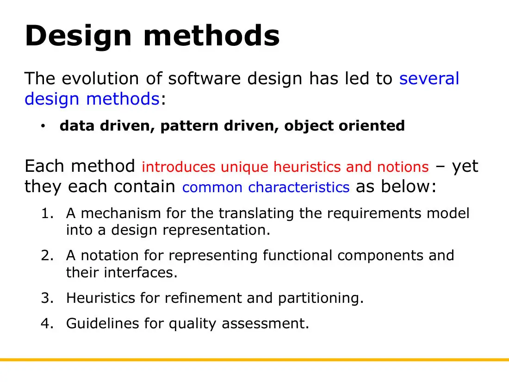

原文：

Design methods

The evolution of software design has led to several design methods:

• data driven, pattern driven, object oriented

Each method introduces unique heuristics and notions – yet they each contain common characteristics as below:

1. A mechanism for the translating the requirements model into a design representation.

2. A notation for representing functional components and their interfaces.

3. Heuristics for refinement and partitioning.

4. Guidelines for quality assessment.

### Design Modeling Principles

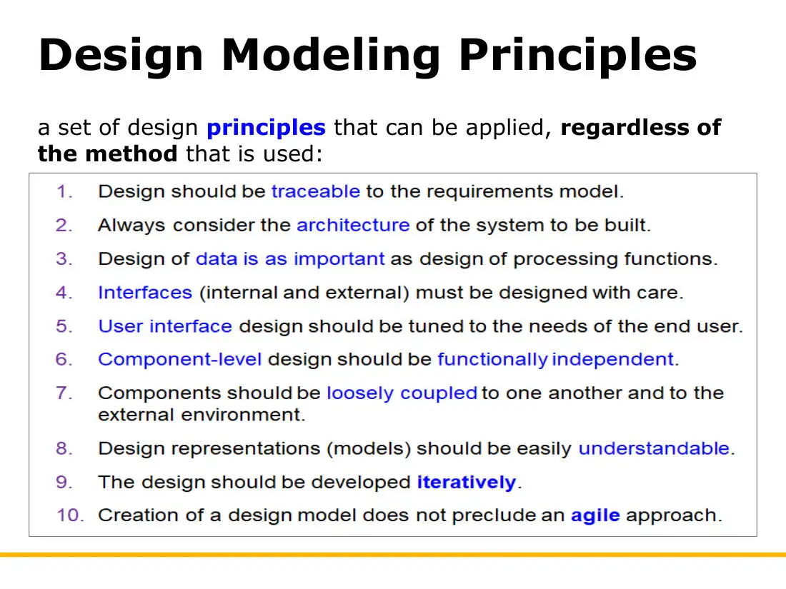

原文：

Design Modeling Principles

a set of design principles that can be applied, regardless of the method that is used:

1. Design should be traceable to the requirements model.

2. Always consider the architecture of the system to be built.

3. Design of data is as important as design of processing functions.

4.Interfaces (internal and external) must be designed with care.

5. User interface design should be tuned to the needs of the end user.

6. Component-level design should be functionally independent.

7. Components should be loosely coupled to one another and to the external environment.

8. Design representations (models) should be easily understandable.

9. The design should be developed iteratively.

10. Creation of a design model does not preclude an agile approach.

### strategy of design practice

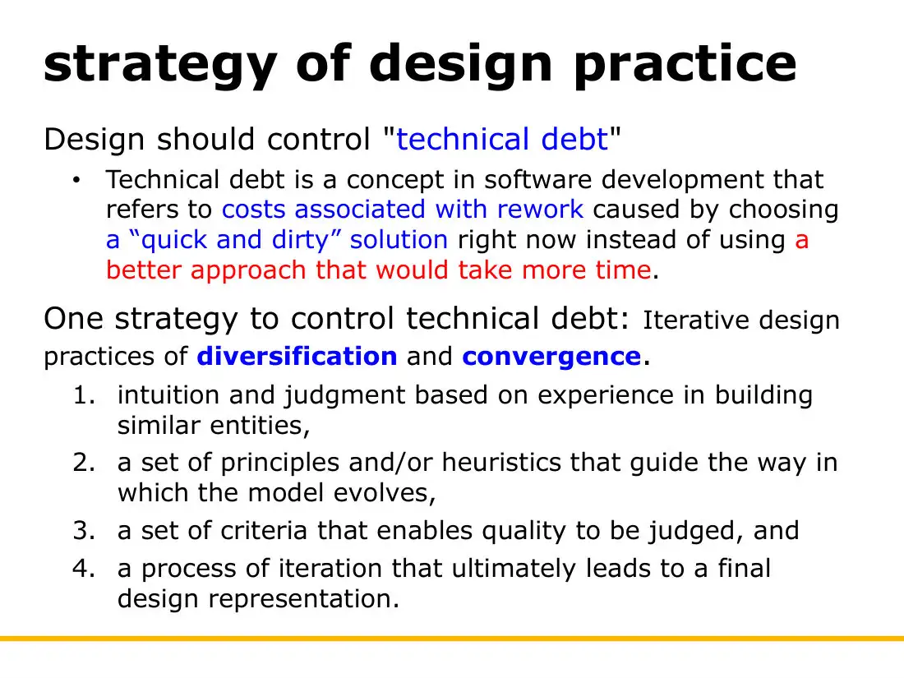

原文：

strategy of design practice

Design should control "technical debt"

Technical debt is a concept in software development that refers to costs associated with rework caused by choosing a “quick and dirty” solution right now instead of using a better approach that would take more time.

One strategy to control technical debt: Iterative design practices of diversification and convergence.

1. intuition and judgment based on experience in building similar entities,

2. a set of principles and/or heuristics that guide the way in which the model evolves,

3. a set of criteria that enables quality to be judged, and

4. a process of iteration that ultimately leads to a final design representation.

### Generic Task Set for Design

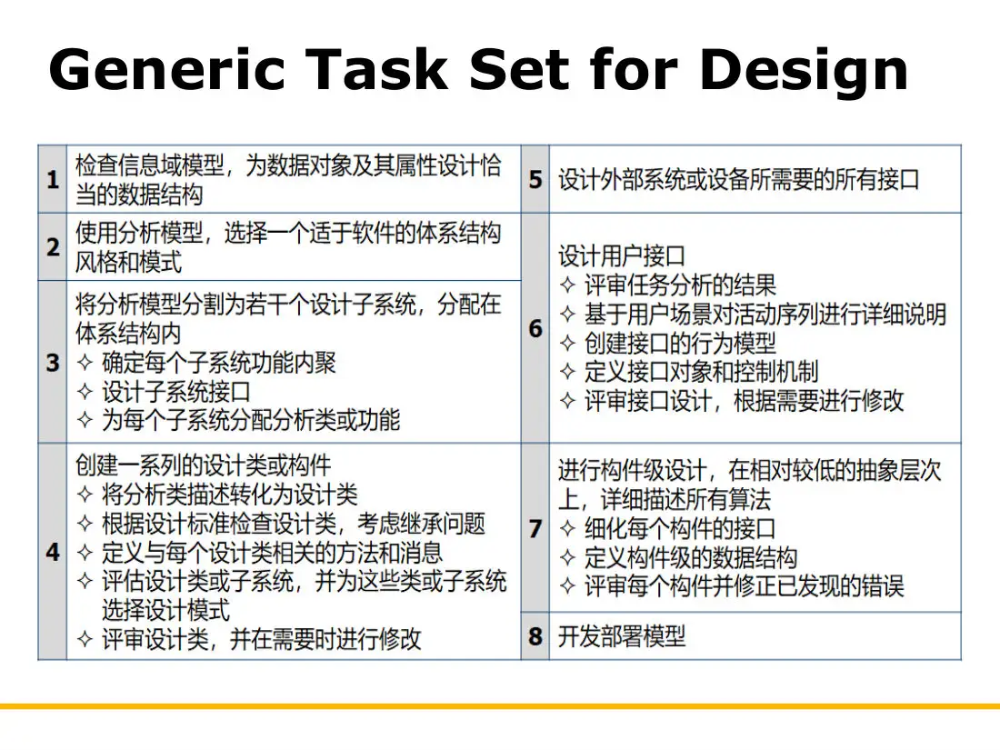

原文：

Generic Task Set for Design

<table><tr><td>1</td><td>检查信息域模型,为数据对象及其属性设计恰当的数据结构</td><td>5</td><td>设计外部系统或设备所需要的所有接口</td></tr><tr><td>2</td><td>使用分析模型,选择一个适于软件的体系结构风格和模式</td><td rowspan="2">6</td><td rowspan="2">设计用户接口✧评审任务分析的结果✧基于用户场景对活动序列进行详细说明✧创建接口的行为模型✧定义接口对象和控制机制✧评审接口设计,根据需要进行修改</td></tr><tr><td>3</td><td>将分析模型分割为若干个设计子系统,分配在体系结构内✧确定每个子系统功能内聚✧设计子系统接口✧为每个子系统分配分析类或功能</td></tr><tr><td rowspan="2">4</td><td rowspan="2">创建一系列的设计类或构件✧将分析类描述转化为设计类✧根据设计标准检查设计类,考虑继承问题✧定义与每个设计类相关的方法和消息✧评估设计类或子系统,并为这些类或子系统选择设计模式✧评审设计类,并在需要时进行修改</td><td>7</td><td>进行构件级设计,在相对较低的抽象层次上,详细描述所有算法✧细化每个构件的接口✧定义构件级的数据结构✧评审每个构件并修正已发现的错误</td></tr><tr><td>8</td><td>开发部署模型</td></tr></table>

### 体系结构元素

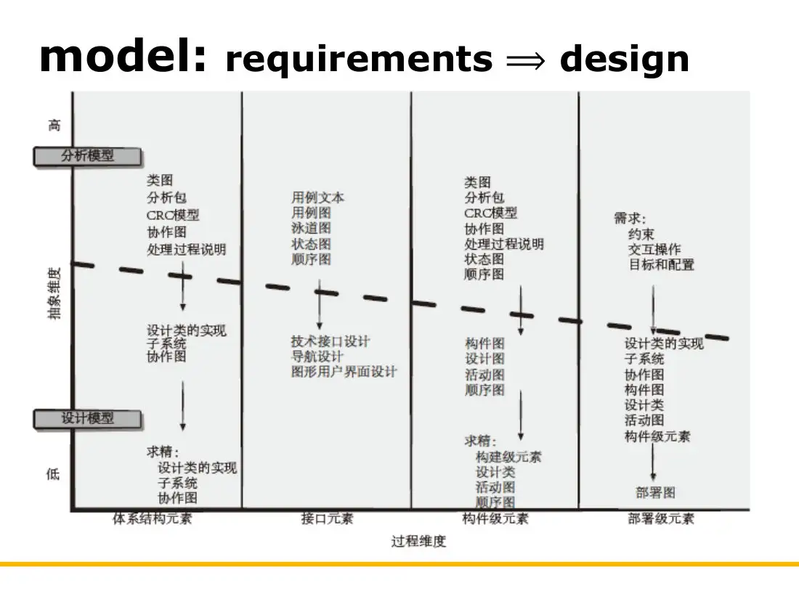

原文：

体系结构元素

model: requirements ⟹ design

### design modeling

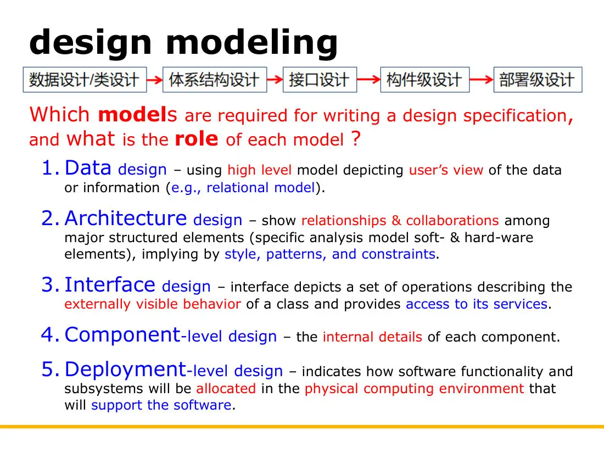

原文：

design modeling

数据设计/类设计

体系结构设计

接口设计

构件级设计

部署级设计

Which models are required for writing a design specification, and what is the role of each model ?

1. Data design – using high level model depicting user’s view of the data or information (e.g., relational model).

2. Architecture design – show relationships & collaborations among major structured elements (specific analysis model soft- & hard-ware elements), implying by style, patterns, and constraints.

3. Interface design – interface depicts a set of operations describing the externally visible behavior of a class and provides access to its services.

4. Component-level design – the internal details of each component.

5. Deployment-level design – indicates how software functionality and subsystems will be allocated in the physical computing environment that will support the software.

### Data Design Elements

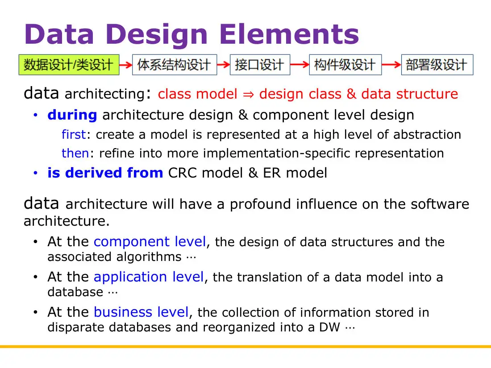

原文：

Data Design Elements

数据设计/类设计

体系结构设计

接口设计

构件级设计

部署级设计

data architecting: class model ⇒ design class & data structure

• during architecture design & component level design

first: create a model is represented at a high level of abstraction

then: refine into more implementation-specific representation

• is derived from CRC model & ER model

data architecture will have a profound influence on the software architecture.

• At the component level, the design of data structures and the associated algorithms ⋯

• At the application level, the translation of a data model into a database ⋯

• At the business level, the collection of information stored in disparate databases and reorganized into a DW ⋯

### Architectural Design Elements

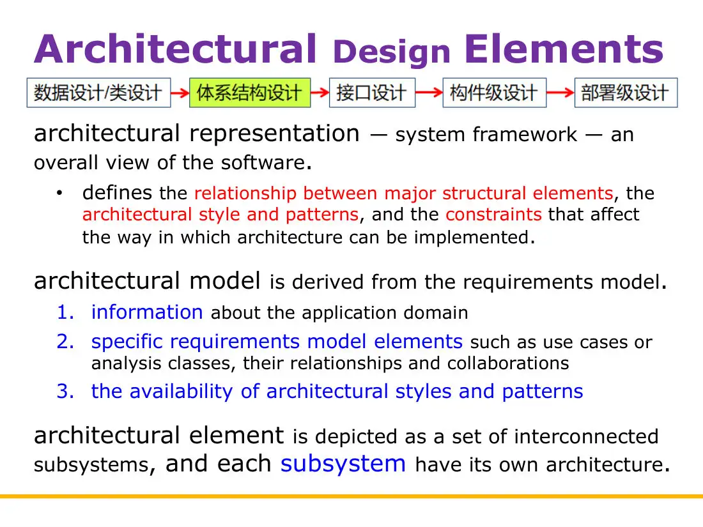

原文：

Architectural Design Elements

数据设计/类设计

体系结构设计

接口设计

构件级设计

部署级设计

architectural representation — system framework — an overall view of the software.

defines the relationship between major structural elements, the architectural style and patterns, and the constraints that affect the way in which architecture can be implemented.

architectural model is derived from the requirements model.

1. information about the application domain

2. specific requirements model elements such as use cases or analysis classes, their relationships and collaborations

3. the availability of architectural styles and patterns

architectural element is depicted as a set of interconnected subsystems, and each subsystem have its own architecture.

### Interface Design Elements

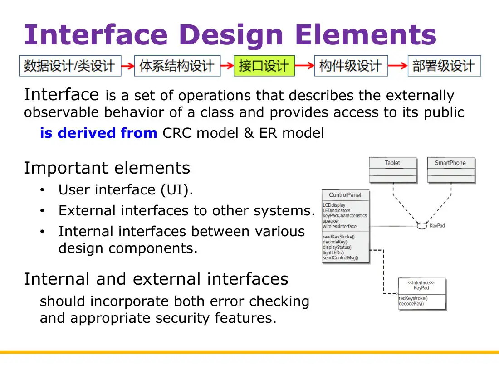

原文：

Interface Design Elements

数据设计/类设计

体系结构设计

接口设计

构件级设计

部署级设计

Interface is a set of operations that describes the externally observable behavior of a class and provides access to its public is derived from CRC model & ER model

Important elements

• User interface (UI).

• External interfaces to other systems.

• Internal interfaces between various design components.

Internal and external interfaces should incorporate both error checking and appropriate security features.

### Component-Level Design Elements

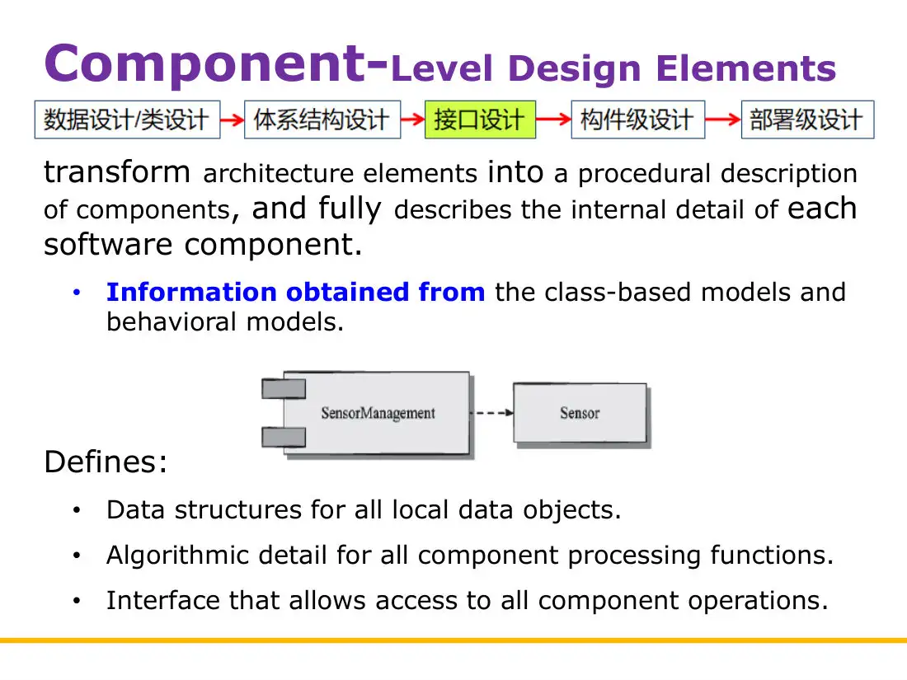

原文：

Component-Level Design Elements

体系结构设计

接口设计

构件级设计

部署级设计

transform architecture elements into a procedural description of components, and fully describes the internal detail of each software component.

Information obtained from the class-based models and behavioral models.

Defines:

• Data structures for all local data objects.

• Algorithmic detail for all component processing functions.

• Interface that allows access to all component operations.

### Deployment-Level Design Elements

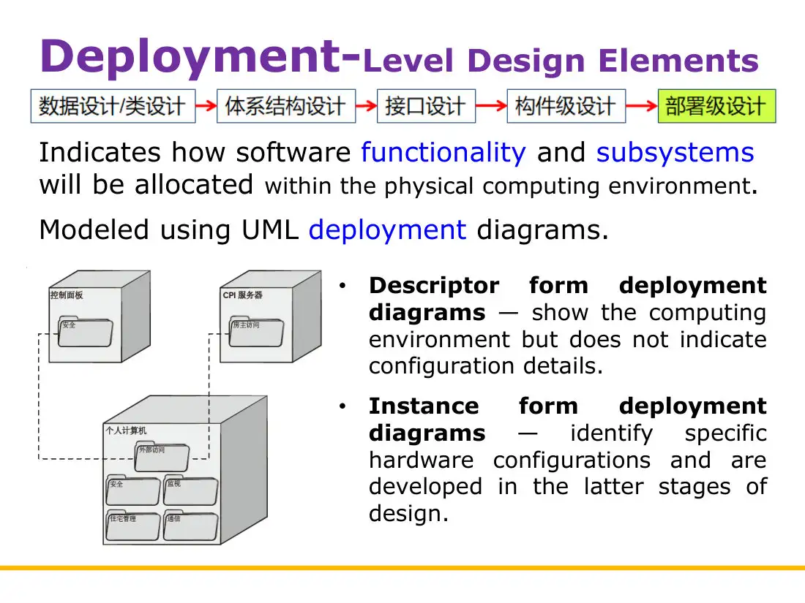

原文：

Deployment-Level Design Elements

数据设计/类设计

体系结构设计

接口设计

构件级设计

部署级设计

Indicates how software functionality and subsystems will be allocated within the physical computing environment.

Modeled using UML deployment diagrams.

Descriptor form deployment diagrams — show the computing environment but does not indicate configuration details.

Instance form deployment diagrams — identify specific hardware configurations and are developed in the latter stages of design.

### Models comparison

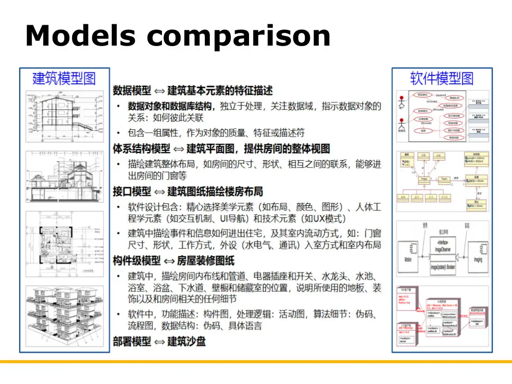

原文：

Models comparison

建筑模型图

数据模型↔建筑基本元素的特征描述

• 数据对象和数据库结构，独立于处理，关注数据域，指示数据对象的关系：如何彼此关联

• 包含一组属性，作为对象的质量、特征或描述符

体系结构模型↔建筑平面图，提供房间的整体视图

• 描绘建筑整体布局，如房间的尺寸、形状、相互之间的联系，能够进出房间的门窗等

接口模型↔建筑图纸描绘楼房布局

• 软件设计包含：精心选择美学元素（如布局、颜色、图形）、人体工程学元素（如交互机制、UI导航）和技术元素（如UX模式）

• 建筑中描绘事件和信息如何进出住宅，及其室内流动方式，如：门窗尺寸、形状，工作方式，外设（水电气、通讯）入室方式和室内布局

构件级模型↔房屋装修图纸

• 建筑中，描绘房间内布线和管道、电器插座和开关、水龙头、水池、浴室、浴盆、下水道、壁櫥和储藏室的位置，说明所使用的地板、装饰以及和房间相关的任何细节

部署模型↔建筑沙盘

• 软件中，功能描述：构件图，处理逻辑：活动图，算法细节：伪码、流程图，数据结构：伪码、具体语言

软件模型图

### why is design so important ?

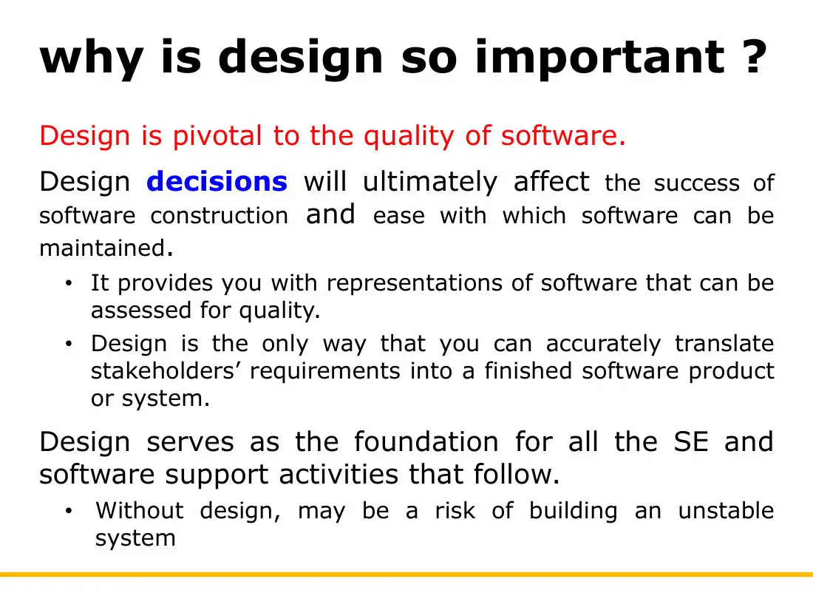

原文：

why is design so important ?

Design is pivotal to the quality of software.

Design decisions will ultimately affect the success of software construction and ease with which software can be maintained.

• It provides you with representations of software that can be assessed for quality.

• Design is the only way that you can accurately translate stakeholders’ requirements into a finished software product or system.

Design serves as the foundation for all the SE and software support activities that follow.

• Without design, may be a risk of building an unstable system

### design & quality

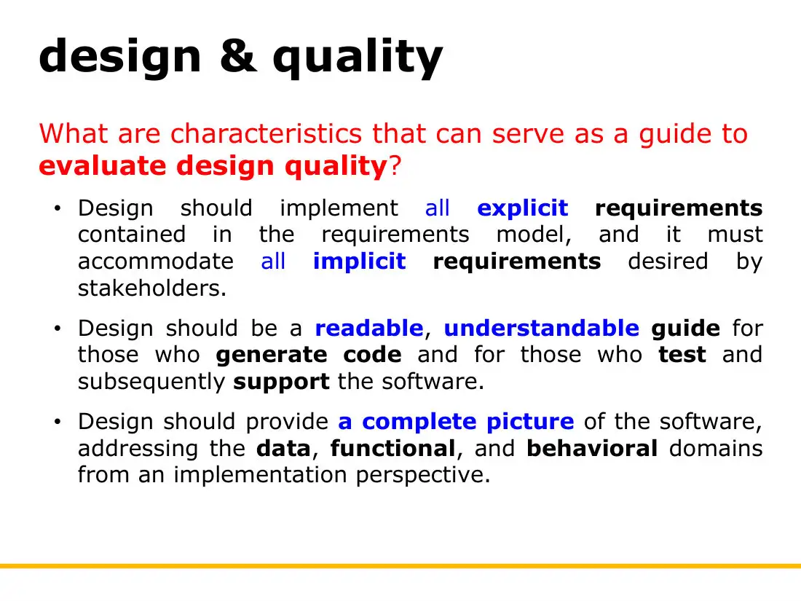

原文：

design & quality

What are characteristics that can serve as a guide to evaluate design quality?

Design should implement all explicit requirements contained in the requirements model, and it must accommodate all implicit requirements desired by stakeholders.

Design should be a readable, understandable guide for those who generate code and for those who test and subsequently support the software.

• Design should provide a complete picture of the software, addressing the data, functional, and behavioral domains from an implementation perspective.

### Quality Guidelines

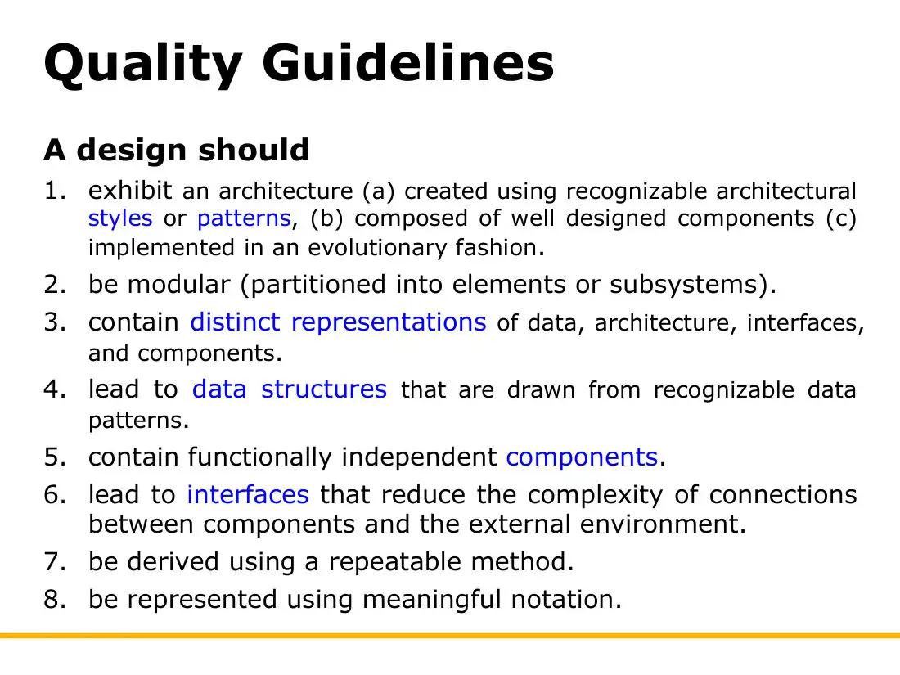

原文：

Quality Guidelines

A design should

1. exhibit an architecture (a) created using recognizable architectural styles or patterns, (b) composed of well designed components (c) implemented in an evolutionary fashion.

2. be modular (partitioned into elements or subsystems).

3. contain distinct representations of data, architecture, interfaces, and components.

4. lead to data structures that are drawn from recognizable data patterns.

5. contain functionally independent components.

6. lead to interfaces that reduce the complexity of connections between components and the external environment.

7. be derived using a repeatable method.

8. be represented using meaningful notation.

### Design Concepts

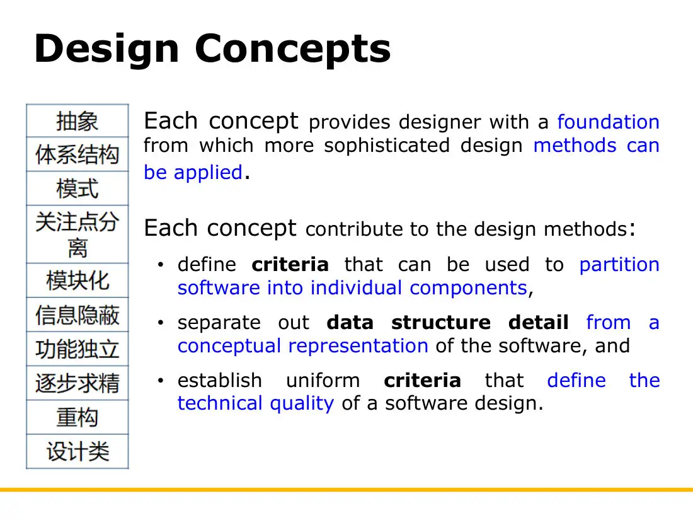

原文：

Design Concepts

抽象体系结构模式关注点分离模块化信息隐蔽功能独立逐步求精重构设计类

Each concept provides designer with a foundation from which more sophisticated design methods can be applied.

Each concept contribute to the design methods:

• define criteria that can be used to partition software into individual components,

separate out data structure detail from a conceptual representation of the software, and

• establish uniform criteria that define the technical quality of a software design.

### Abstraction

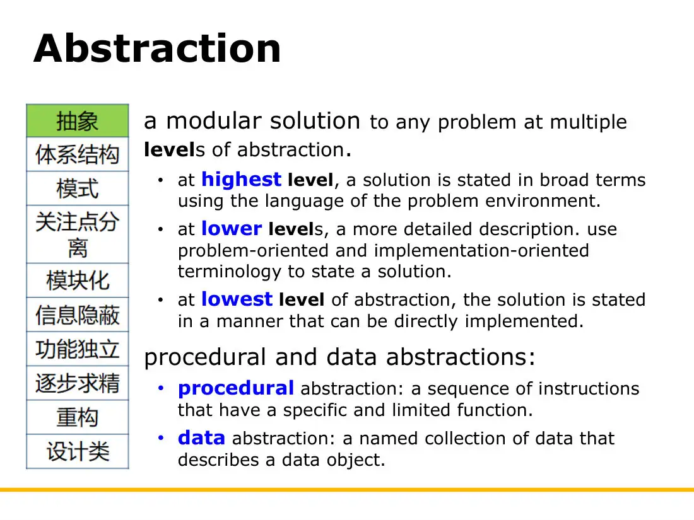

原文：

Abstraction

<table><tr><td>抽象</td><td rowspan="2">a modular solution to any problem at multiple levels of abstraction.</td></tr><tr><td>体系结构</td></tr><tr><td>模式</td><td>·at highest level, a solution is stated in broad terms using the language of the problem environment.</td></tr><tr><td>关注点分离</td><td>·at lower levels, a more detailed description. use problem-oriented and implementation-oriented terminology to state a solution.</td></tr><tr><td>模块化</td><td rowspan="2">·at lowest level of abstraction, the solution is stated in a manner that can be directly implemented.</td></tr><tr><td>信息隐蔽</td></tr><tr><td>功能独立</td><td>procedural and data abstractions:</td></tr><tr><td>逐步求精</td><td>· procedural abstraction: a sequence of instructions that have a specific and limited function.</td></tr><tr><td>重构</td><td rowspan="2">· data abstraction: a named collection of data that describes a data object.</td></tr><tr><td>设计类</td></tr></table>

### Abstraction

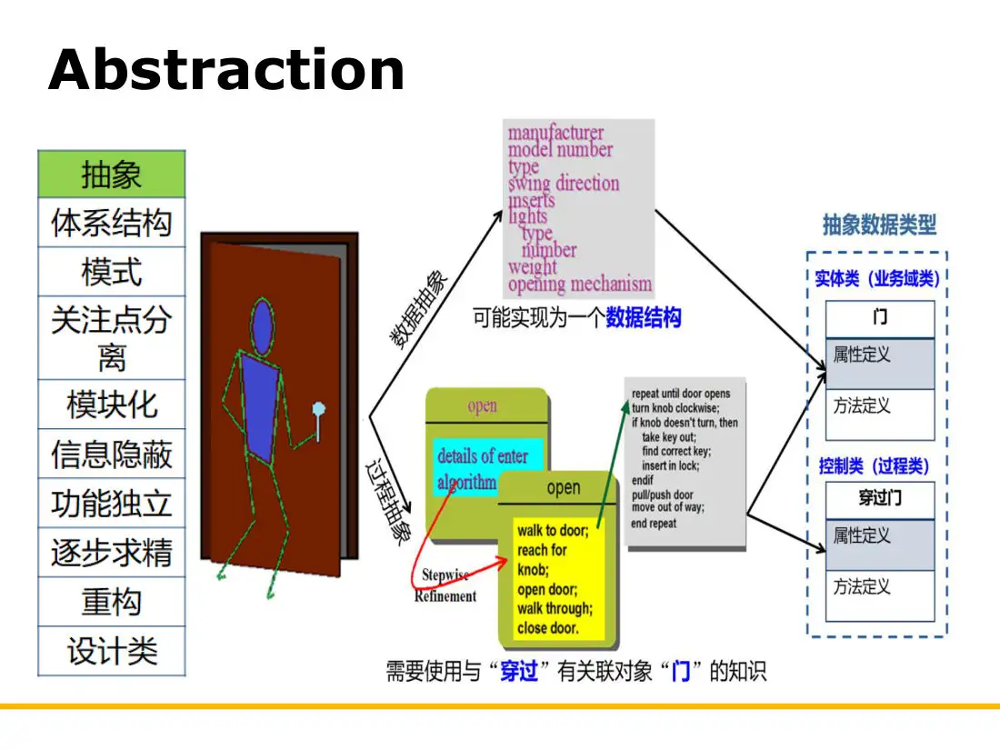

原文：

Abstraction

<table><tr><td>抽象</td></tr><tr><td>体系结构</td></tr><tr><td>模式</td></tr><tr><td>关注点分离</td></tr><tr><td>模块化</td></tr><tr><td>信息隐蔽</td></tr><tr><td>功能独立</td></tr><tr><td>逐步求精</td></tr><tr><td>重构</td></tr><tr><td>设计类</td></tr></table>

### Architecture

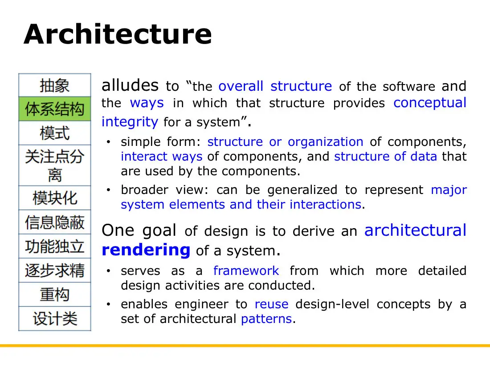

原文：

Architecture

抽象体系结构模式关注点分离模块化信息隐蔽功能独立逐步求精重构设计类

alludes to “the overall structure of the software and the ways in which that structure provides conceptual integrity for a system”.

• simple form: structure or organization of components, interact ways of components, and structure of data that are used by the components.

• broader view: can be generalized to represent major system elements and their interactions.

One goal of design is to derive an architectural rendering of a system.

• serves as a framework from which more detailed design activities are conducted.

• enables engineer to reuse design-level concepts by a set of architectural patterns.

### Architecture

原文：

Architecture

抽象体系结构模式关注点分离模块化信息隐蔽功能独立逐步求精重构设计类

alludes to “the overall structure of the software and the ways in which that structure provides conceptual integrity for a system”.

• simple form: structure or organization of components, interact ways of components, and structure of data that are used by the components.

• broader view: can be generalized to represent major system elements and their interactions.

One goal of design is to derive an architectural rendering of a system.

• serves as a framework from which more detailed design activities are conducted.

• enables engineer to reuse design-level concepts by a set of architectural patterns.

### Architecture

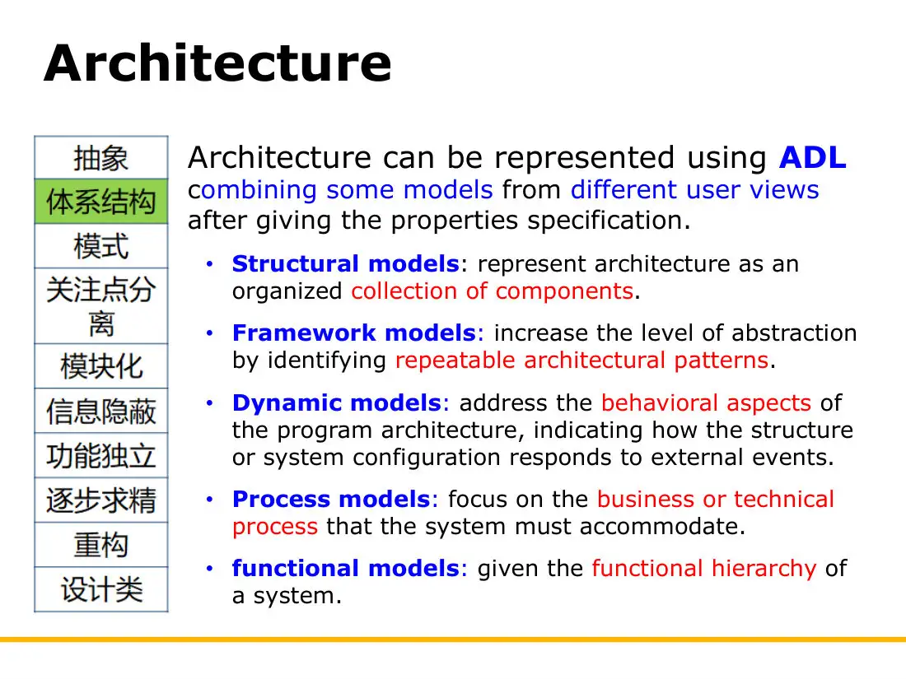

原文：

Architecture

Architecture can be represented using ADL combining some models from different user views after giving the properties specification.

• Structural models: represent architecture as an organized collection of components.

Framework models: increase the level of abstraction by identifying repeatable architectural patterns.

Dynamic models: address the behavioral aspects of the program architecture, indicating how the structure or system configuration responds to external events.

• Process models: focus on the business or technical process that the system must accommodate.

• functional models: given the functional hierarchy of a system.

### Patterns

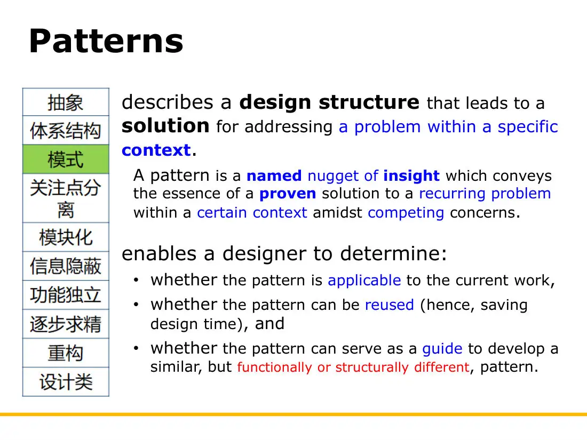

原文：

<table><tr><td>抽象</td><td rowspan="10">describes a design structure that leads to a solution for addressing a problem within a specific context.A pattern is a named nugget of insight which conveys the essence of a proven solution to a recurring problem within a certain context amidst competing concerns.</td></tr><tr><td>体系结构</td></tr><tr><td>模式</td></tr><tr><td>关注点分离</td></tr><tr><td>模块化</td></tr><tr><td>信息隐蔽</td></tr><tr><td>功能独立</td></tr><tr><td>逐步求精</td></tr><tr><td>重构</td></tr><tr><td>设计类</td></tr></table>

Patterns

### 设计概念：模式

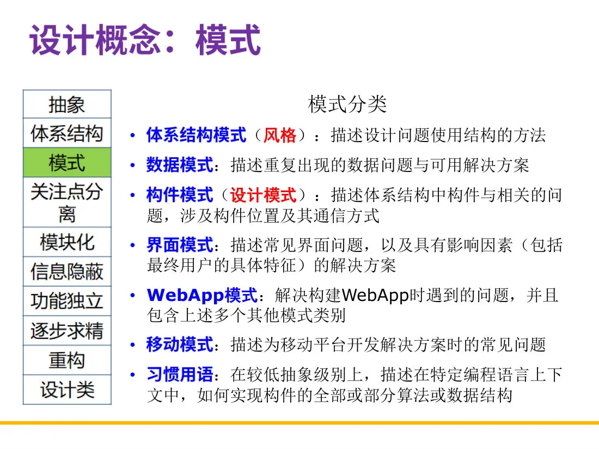

原文：

设计概念：模式

抽象体系结构模式关注点分离模块化信息隐蔽功能独立逐步求精重构设计类

模式分类

• 体系结构模式（风格）：描述设计问题使用结构的方法

• 数据模式：描述重复出现的数据问题与可用解决方案

• 构件模式（设计模式）：描述体系结构中构件与相关的问题，涉及构件位置及其通信方式

• 界面模式：描述常见界面问题，以及具有影响因素（包括最终用户的具体特征）的解决方案

• WebApp模式：解决构建WebApp时遇到的问题，并且包含上述多个其他模式类别

• 移动模式：描述为移动平台开发解决方案时的常见问题

• 习惯用语：在较低抽象级别上，描述在特定编程语言上下文中，如何实现构件的全部或部分算法或数据结构

### 设计概念：模式

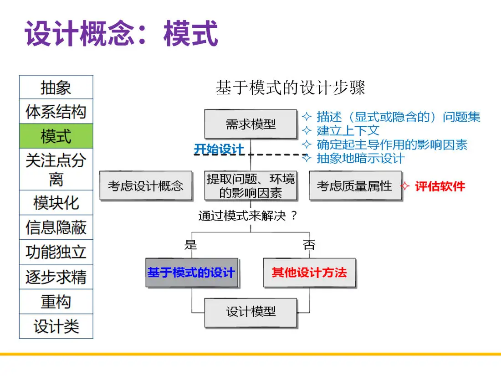

原文：

设计概念：模式

抽象

体系结构

模式

关注点分

离

模块化

信息隐蔽

功能独立

逐步求精

重构

设计类

基于模式的设计步骤

考虑设计概念

需求模型

开始设计

提取问题、环境的影响因素

通过模式来解决？

是

基于模式的设计

其他设计方法

设计模型

描述（显式或隐含的）问题集

建立上下文

确定起主导作用的影响因素

否

抽象地暗示设计

考虑质量属性

评估软件

### 设计概念：模式

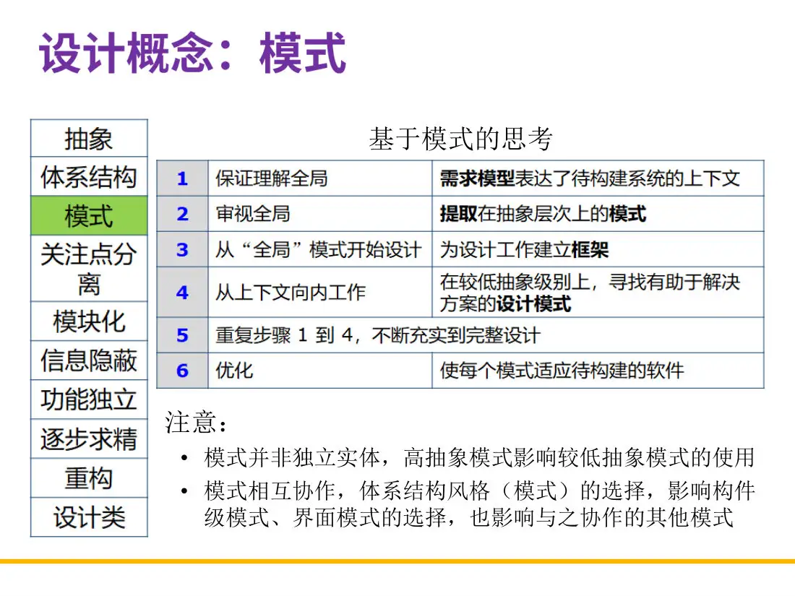

原文：

设计概念：模式

基于模式的思考
<table><tr><td>1</td><td>保证理解全局</td><td>需求模型表达了待构建系统的上下文</td></tr><tr><td>2</td><td>审视全局</td><td>提取在抽象层次上的模式</td></tr><tr><td>3</td><td>从“全局”模式开始设计</td><td>为设计工作建立框架</td></tr><tr><td>4</td><td>从上下文向内工作</td><td>在较低抽象级别上,寻找有助于解决方案的设计模式</td></tr><tr><td>5</td><td colspan="2">重复步骤1到4,不断充实到完整设计</td></tr><tr><td>6</td><td>优化</td><td>使每个模式适应待构建的软件</td></tr></table>
注意： • 模式并非独立实体，高抽象模式影响较低抽象模式的使用 • 模式相互协作，体系结构风格（模式）的选择，影响构件级模式、界面模式的选择，也影响与之协作的其他模式

### 设计概念：模式

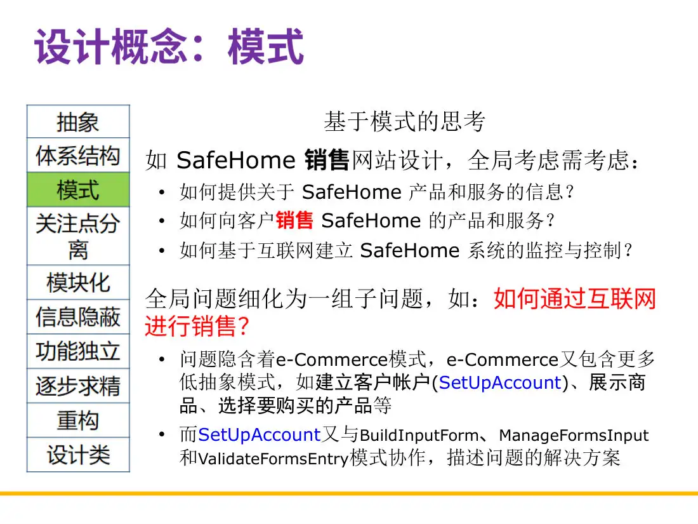

原文：

设计概念：模式

<table><tr><td>抽象</td><td>基于模式的思考</td></tr><tr><td>体系结构</td><td rowspan="3">如 SafeHome 销售网站设计,全局考虑需考虑:如何提供关于 SafeHome 产品和服务的信息?如何向客户销售 SafeHome 的产品和服务?如何基于互联网建立 SafeHome 系统的监控与控制?</td></tr><tr><td>模式</td></tr><tr><td>关注点分离</td></tr><tr><td>模块化</td><td rowspan="6">全局问题细化为一组子问题,如:如何通过互联网进行销售?问题隐含着e-Commerce模式,e-Commerce又包含更多低抽象模式,如建立客户帐户(SetUpAccount)、展示商品、选择要购买的产品等而SetUpAccount又与BuildInputForm、ManageFormsInput和ValidateFormsEntry模式协作,描述问题的解决方案</td></tr><tr><td>信息隐蔽</td></tr><tr><td>功能独立</td></tr><tr><td>逐步求精</td></tr><tr><td>重构</td></tr><tr><td>设计类</td></tr></table>

### 设计概念：模式

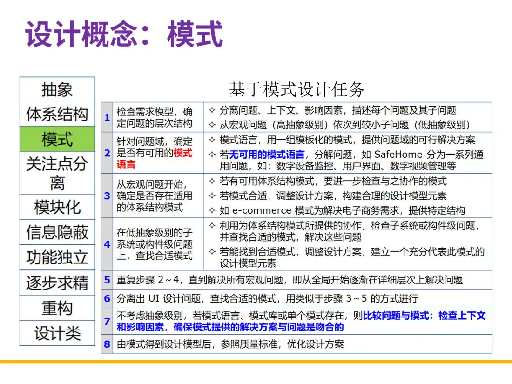

原文：

设计概念：模式

基于模式设计任务
<table><tr><td>抽象</td><td colspan="3">基于模式设计任务</td></tr><tr><td>体系结构</td><td rowspan="2">1</td><td rowspan="2">检查需求模型,确定问题的层次结构</td><td rowspan="2">分离问题、上下文、影响因素,描述每个问题及其子问题从宏观问题(高抽象级别)依次到较小子问题(低抽象级别)</td></tr><tr><td>模式</td></tr><tr><td>关注点分离</td><td>2</td><td>针对问题域,确定是否有可用的模式语言</td><td>模式语言,用一组模板化的模式,提供问题域的可行解决方案若无可用的模式语言,分解问题,如 SafeHome 分为一系列通用问题,如:数字设备监控、用户界面、数字视频管理等</td></tr><tr><td>模块化</td><td>3</td><td>从宏观问题开始,确定是否存在适用的体系结构模式</td><td>若有可用体系结构模式,要进一步检查与之协作的模式若模式合适,调整设计方案,构建合理的设计模型元素如 e-commerce 模式为解决电子商务需求,提供特定结构</td></tr><tr><td>信息隐蔽</td><td rowspan="2">4</td><td rowspan="2">在低抽象级别的子系统或构件级问题上,查找合适模式</td><td rowspan="2">利用为体系结构模式所提供的协作,检查子系统或构件级问题,并查找合适的模式,解决这些问题若能找到合适模式,调整设计方案,建立一个充分代表此模式的设计模型元素</td></tr><tr><td>功能独立</td></tr><tr><td>逐步求精</td><td>5</td><td colspan="2">重复步骤 2~4,直到解决所有宏观问题,即从全局开始逐渐在详细层次上解决问题</td></tr><tr><td>重构</td><td>6</td><td colspan="2">分离出 UI 设计问题,查找合适的模式,用类似于步骤 3~5 的方式进行</td></tr><tr><td rowspan="2">设计类</td><td>7</td><td colspan="2">不考虑抽象级别,若模式语言、模式库或单个模式存在,则比较问题与模式:检查上下文和影响因素,确保模式提供的解决方案与问题是吻合的</td></tr><tr><td>8</td><td colspan="2">由模式得到设计模型后,参照质量标准,优化设计方案</td></tr></table>

### 设计概念：模式

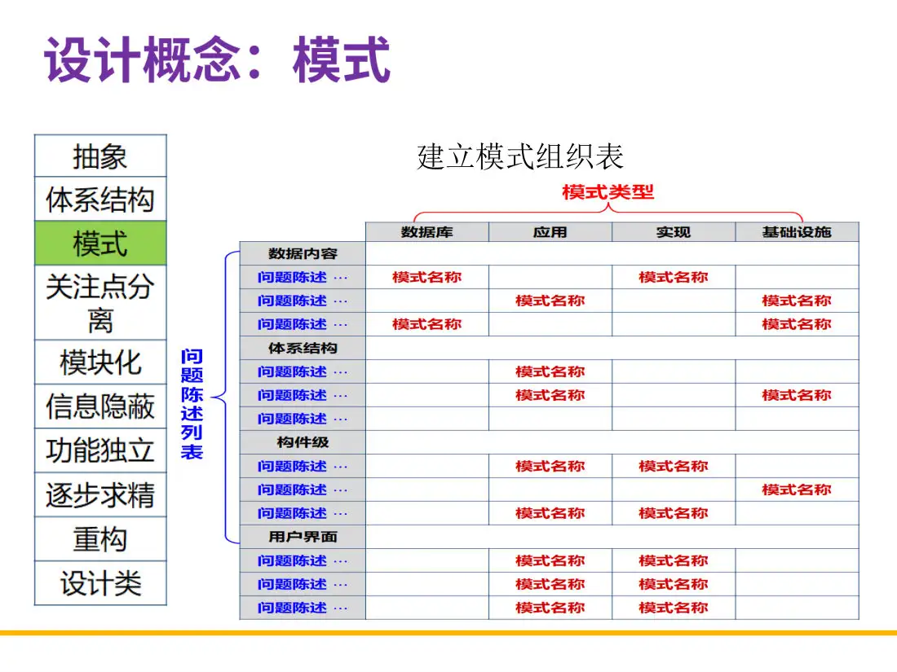

原文：

设计概念：模式

<table><tr><td>抽象</td></tr><tr><td>体系结构</td></tr><tr><td>模式</td></tr><tr><td>关注点分离</td></tr><tr><td>模块化</td></tr><tr><td>信息隐蔽</td></tr><tr><td>功能独立</td></tr><tr><td>逐步求精</td></tr><tr><td>重构</td></tr><tr><td>设计类</td></tr></table>

建立模式组织表

模式类型

<table><tr><td></td><td>数据库</td><td>应用</td><td>实现</td><td>基础设施</td></tr><tr><td>数据内容</td><td colspan="4"></td></tr><tr><td>问题陈述...</td><td>模式名称</td><td></td><td>模式名称</td><td></td></tr><tr><td>问题陈述...</td><td></td><td>模式名称</td><td></td><td>模式名称</td></tr><tr><td>问题陈述...</td><td>模式名称</td><td></td><td></td><td>模式名称</td></tr><tr><td>体系结构</td><td colspan="4"></td></tr><tr><td>问题陈述...</td><td></td><td>模式名称</td><td></td><td></td></tr><tr><td>问题陈述...</td><td></td><td>模式名称</td><td></td><td>模式名称</td></tr><tr><td>问题陈述...</td><td></td><td></td><td></td><td></td></tr><tr><td>构件级</td><td colspan="4"></td></tr><tr><td>问题陈述...</td><td></td><td>模式名称</td><td>模式名称</td><td></td></tr><tr><td>问题陈述...</td><td></td><td></td><td></td><td>模式名称</td></tr><tr><td>问题陈述...</td><td></td><td>模式名称</td><td>模式名称</td><td></td></tr><tr><td>用户界面</td><td colspan="4"></td></tr><tr><td>问题陈述...</td><td></td><td>模式名称</td><td>模式名称</td><td></td></tr><tr><td>问题陈述...</td><td></td><td>模式名称</td><td>模式名称</td><td></td></tr><tr><td>问题陈述...</td><td></td><td>模式名称</td><td>模式名称</td><td></td></tr></table>

### 设计概念：模式

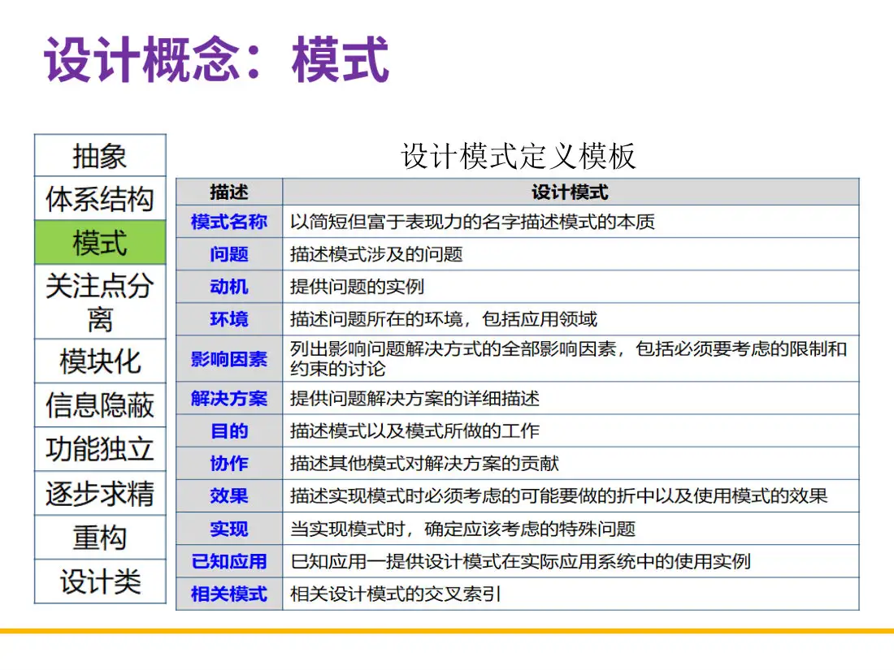

原文：

设计概念：模式

设计模式定义模板
<table><tr><td>描述</td><td>设计模式</td></tr><tr><td>模式名称</td><td>以简短但富于表现力的名字描述模式的本质</td></tr><tr><td>问题</td><td>描述模式涉及的问题</td></tr><tr><td>动机</td><td>提供问题的实例</td></tr><tr><td>环境</td><td>描述问题所在的环境,包括应用领域</td></tr><tr><td>影响因素</td><td>列出影响问题解决方式的全部影响因素,包括必须要考虑的限制和约束的讨论</td></tr><tr><td>解决方案</td><td>提供问题解决方案的详细描述</td></tr><tr><td>目的</td><td>描述模式以及模式所做的工作</td></tr><tr><td>协作</td><td>描述其他模式对解决方案的贡献</td></tr><tr><td>效果</td><td>描述实现模式时必须考虑的可能要做的折中以及使用模式的效果</td></tr><tr><td>实现</td><td>当实现模式时,确定应该考虑的特殊问题</td></tr><tr><td>已知应用</td><td>已知应用一提供设计模式在实际应用系统中的使用实例</td></tr><tr><td>相关模式</td><td>相关设计模式的交叉索引</td></tr></table>

### 设计概念：模式

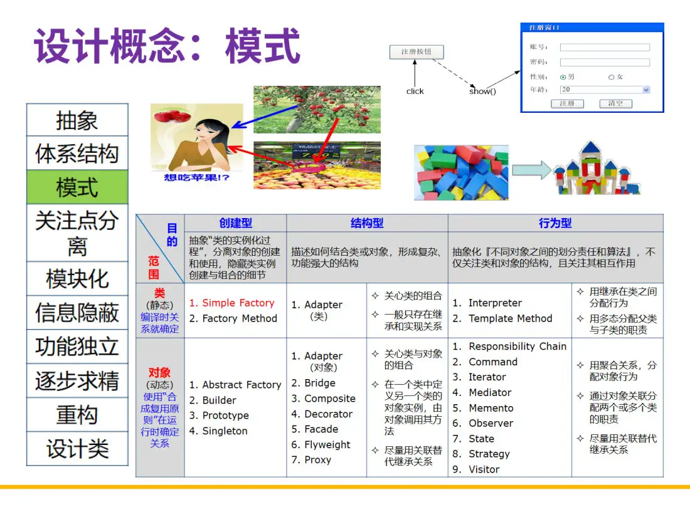

原文：

设计概念：模式

<table><tr><td>抽象</td></tr><tr><td>体系结构</td></tr><tr><td>模式</td></tr><tr><td>关注点分离</td></tr><tr><td>模块化</td></tr><tr><td>信息隐蔽</td></tr><tr><td>功能独立</td></tr><tr><td>逐步求精</td></tr><tr><td>重构</td></tr><tr><td>设计类</td></tr></table>

<table><tr><td rowspan="2">目的范围</td><td>创建型</td><td colspan="2">结构型</td><td colspan="2">行为型</td></tr><tr><td>抽象“类的实例化过程”,分离对象的创建和使用,隐藏类实例创建与组合的细节</td><td colspan="2">描述如何结合类或对象,形成复杂、功能强大的结构</td><td colspan="2">抽象化『不同对象之间的划分责任和算法』,不仅关注类和对象的结构,且关注其相互作用</td></tr><tr><td>类(静态)编译时关系就确定</td><td>1.Simple Factory2.Factory Method</td><td>1.Adapter(类)</td><td>关心类的组合一般只存在继承和实现关系</td><td>InterpreterTemplate Method</td><td>用继承在类之间分配行为用多态分配父类与子类的职责</td></tr><tr><td>对象(动态)使用“合成复用原则”在运行时确定关系</td><td>1.Abstract Factory2.Builder3.Prototype4.Singleton</td><td>1.Adapter(对象)2.Bridge3.Composite4.Decorator5.Facade6.Flyweight7.Proxy</td><td>关心类与对象的组合在一个类中定义另一个类的对象实例,由对象调用其方法尽量用关联替代继承关系</td><td>Responsibility ChainCommandIteratorMediatorMementoObserverStateStrategyVisitor</td><td>用聚合关系,分配对象行为通过对象关联分配两个或多个类的职责尽量用关联替代继承关系</td></tr></table>

### Separation of Concerns

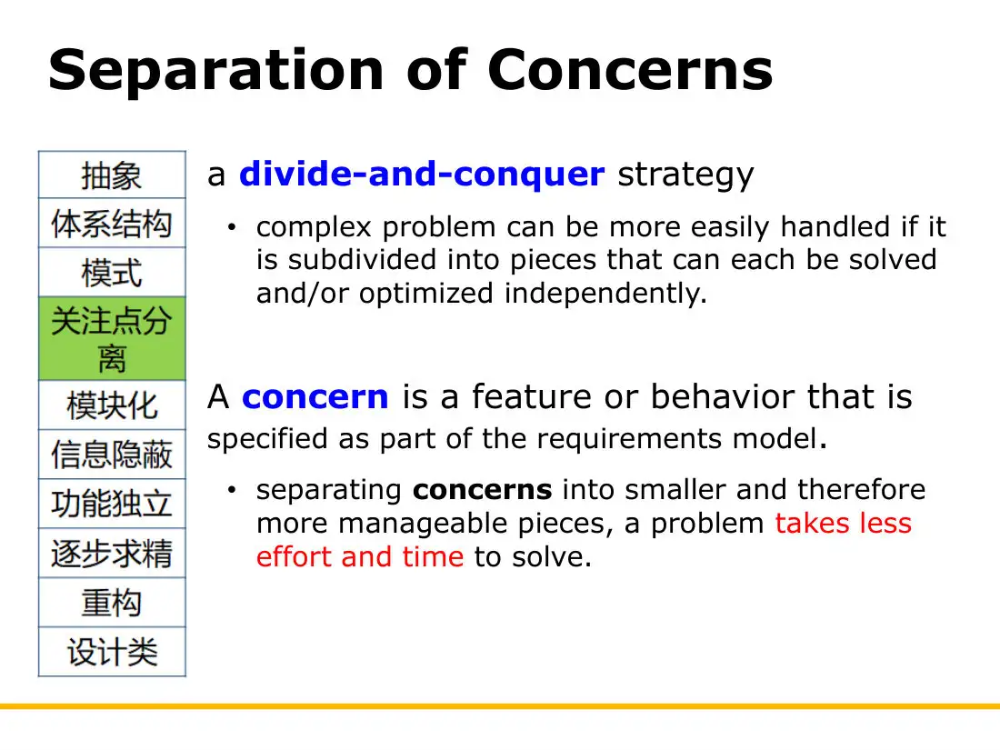

原文：

Separation of Concerns

a divide-and-conquer strategy

• complex problem can be more easily handled if it is subdivided into pieces that can each be solved and/or optimized independently.

A concern is a feature or behavior that is specified as part of the requirements model.

• separating concerns into smaller and therefore more manageable pieces, a problem takes less effort and time to solve.

### Modularity

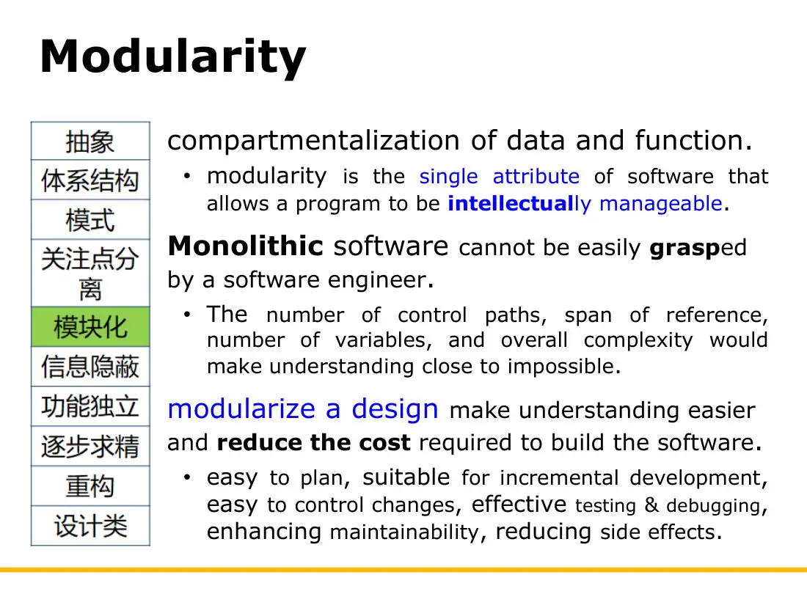

原文：

Modularity

compartmentalization of data and function.

modularity is the single attribute of software that allows a program to be intellectually manageable.

Monolithic software cannot be easily grasped by a software engineer.

The number of control paths, span of reference, number of variables, and overall complexity would make understanding close to impossible.

modularize a design make understanding easier and reduce the cost required to build the software.

• easy to plan, suitable for incremental development, easy to control changes, effective testing & debugging, enhancing maintainability, reducing side effects.

### Modularity

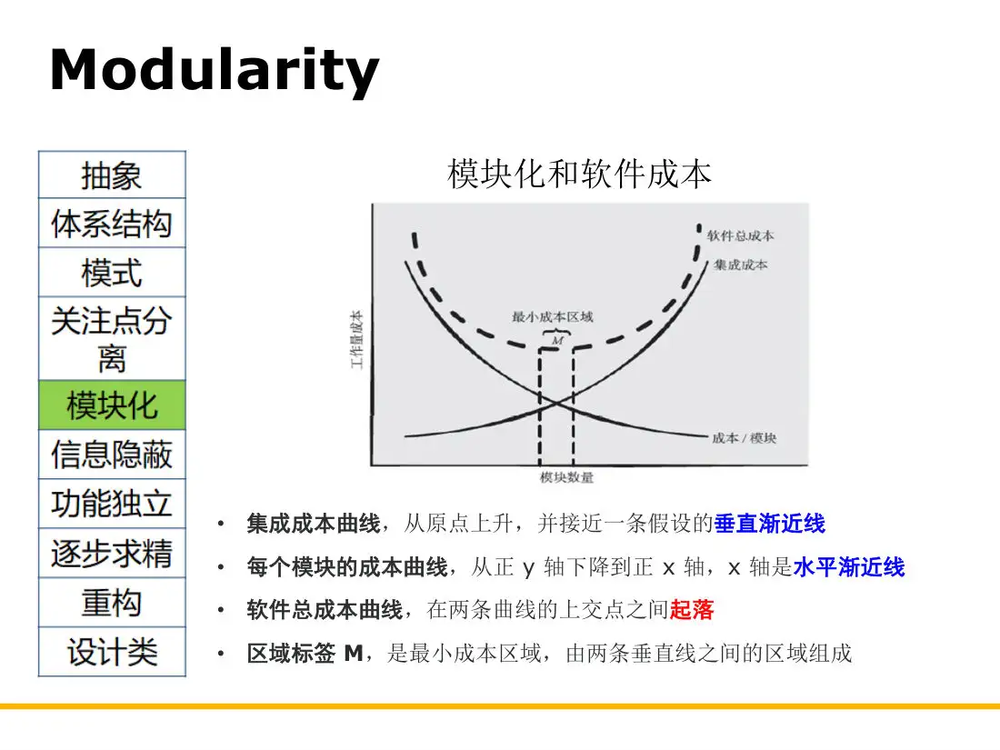

原文：

Modularity

<table><tr><td>抽象</td></tr><tr><td>体系结构</td></tr><tr><td>模式</td></tr><tr><td>关注点分离</td></tr><tr><td>模块化</td></tr><tr><td>信息隐蔽</td></tr><tr><td>功能独立</td></tr><tr><td>逐步求精</td></tr><tr><td>重构</td></tr><tr><td>设计类</td></tr></table>

• 集成成本曲线，从原点上升，并接近一条假设的垂直渐近线

• 每个模块的成本曲线，从正 y 轴下降到正 x 轴，x 轴是水平渐近线

• 软件总成本曲线，在两条曲线的上交点之间起落

• 区域标签 M，是最小成本区域，由两条垂直线之间的区域组成

### Information Hiding

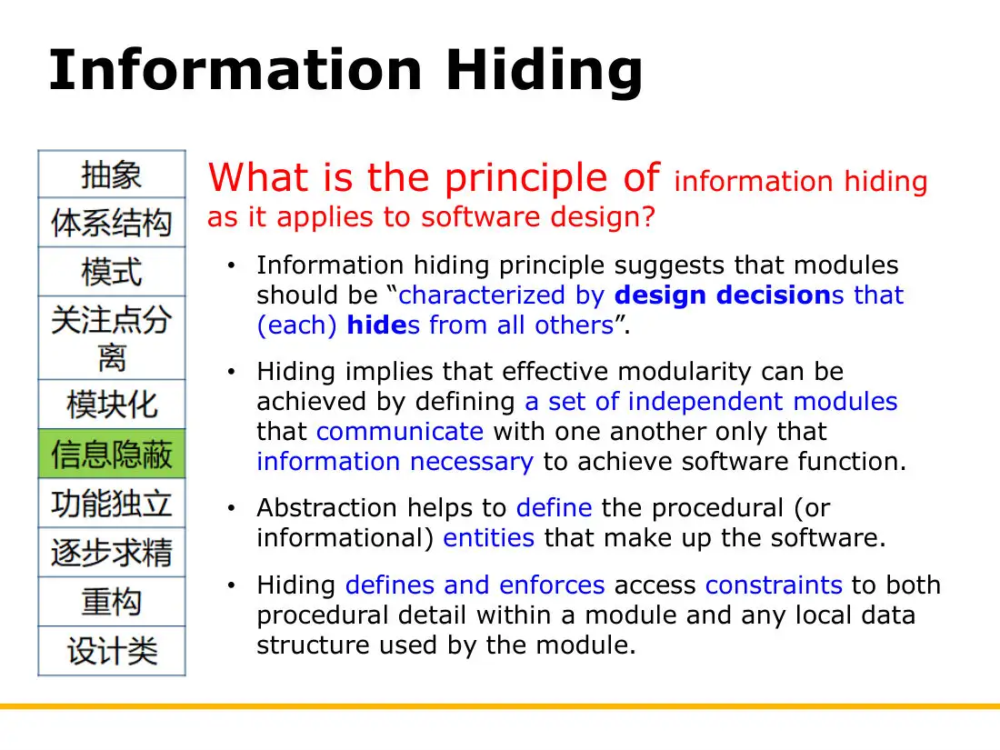

原文：

Information Hiding

抽象体系结构模式关注点分离模块化信息隐蔽功能独立逐步求精重构设计类

What is the principle of information hiding as it applies to software design?

• Information hiding principle suggests that modules should be “characterized by design decisions that (each) hides from all others”.

Hiding implies that effective modularity can be achieved by defining a set of independent modules that communicate with one another only that information necessary to achieve software function.

• Abstraction helps to define the procedural (or informational) entities that make up the software.

• Hiding defines and enforces access constraints to both procedural detail within a module and any local data structure used by the module.

### 设计概念：信息隐蔽

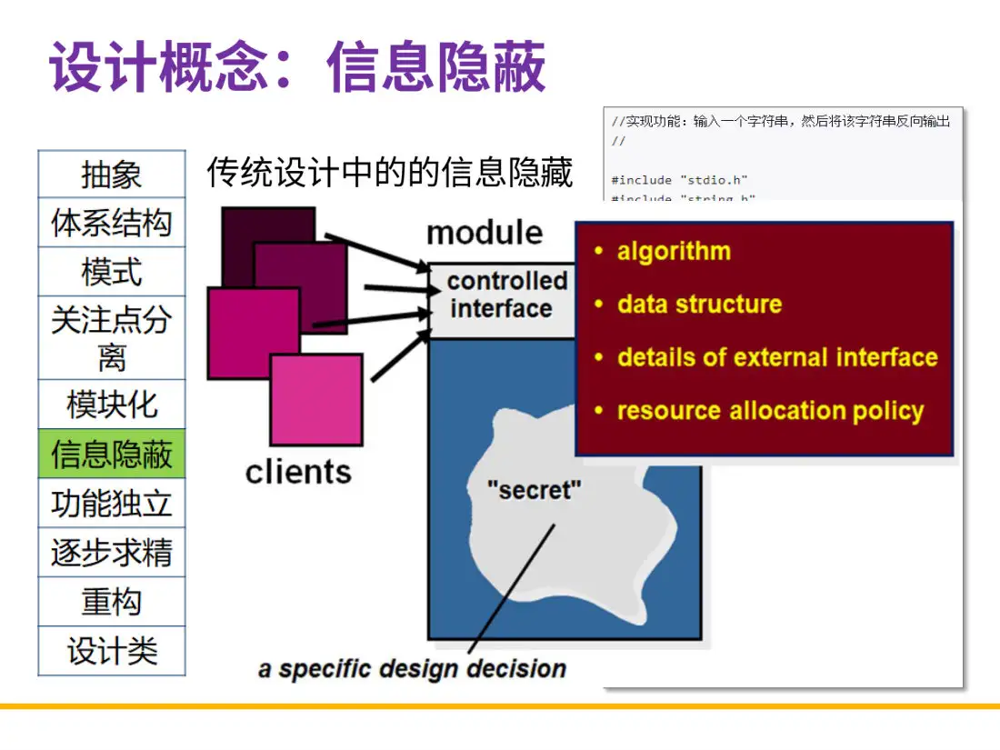

原文：

设计概念：信息隐蔽

抽象

传统设计中的的信息隐藏

体系结构

全局数据

模式

关注点分

//实现功能：输入一个字符串，然后将该字符串反向输出

离

信息隐蔽

模块化

功能独立

逐步求精

重构接口进行通：高品质设

设计类

a specific design decision

• algorithm

• data structure

• details of external interface

• resource allocation policy

### 设计概念：信息隐蔽

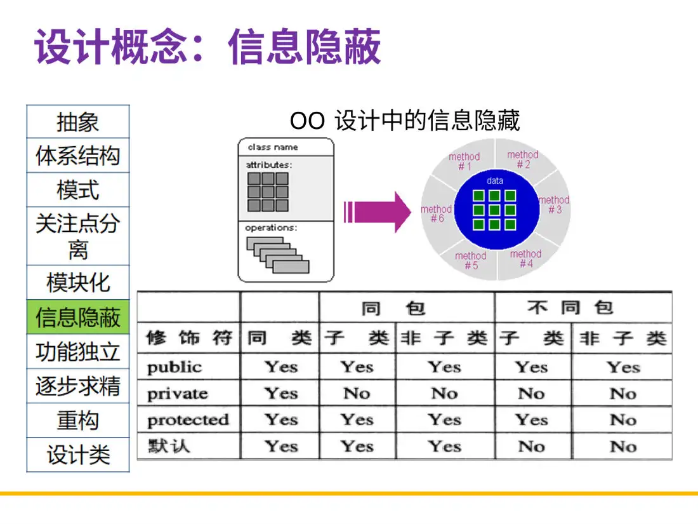

原文：

设计概念：信息隐蔽

<table><tr><td>抽象</td></tr><tr><td>体系结构</td></tr><tr><td>模式</td></tr><tr><td>关注点分离</td></tr><tr><td>模块化</td></tr><tr><td>信息隐蔽</td></tr><tr><td>功能独立</td></tr><tr><td>逐步求精</td></tr><tr><td>重构</td></tr><tr><td>设计类</td></tr></table>

OO 设计中的信息隐藏

<table><tr><td></td><td></td><td colspan="2">同包</td><td colspan="2">不同包</td></tr><tr><td>修饰符</td><td>同类</td><td>子类</td><td>非子类</td><td>子类</td><td>非子类</td></tr><tr><td>public</td><td>Yes</td><td>Yes</td><td>Yes</td><td>Yes</td><td>Yes</td></tr><tr><td>private</td><td>Yes</td><td>No</td><td>No</td><td>No</td><td>No</td></tr><tr><td>protected</td><td>Yes</td><td>Yes</td><td>Yes</td><td>Yes</td><td>No</td></tr><tr><td>默认</td><td>Yes</td><td>Yes</td><td>Yes</td><td>No</td><td>No</td></tr></table>

### Functional Independence

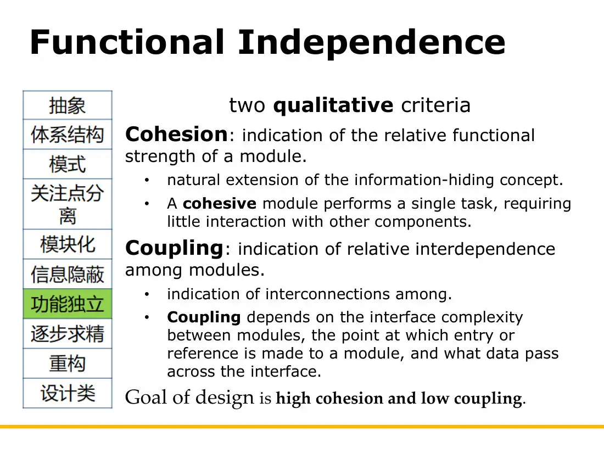

原文：

Functional Independence

<table><tr><td>抽象</td><td>two qualitative criteria</td></tr><tr><td>体系结构</td><td rowspan="3">Cohesion: indication of the relative functional strength of a module. natural extension of the information-hiding concept. A cohesive module performs a single task, requiring little interaction with other components.</td></tr><tr><td>模式</td></tr><tr><td>关注点分离</td></tr><tr><td>模块化</td><td rowspan="5">Coupling: indication of relative interdependence among modules. indication of interconnections among. Coupling depends on the interface complexity between modules, the point at which entry or reference is made to a module, and what data pass across the interface.</td></tr><tr><td>信息隐蔽</td></tr><tr><td>功能独立</td></tr><tr><td>逐步求精</td></tr><tr><td>重构</td></tr><tr><td>设计类</td><td>Goal of design is high cohesion and low coupling.</td></tr></table>

### Functional Independence

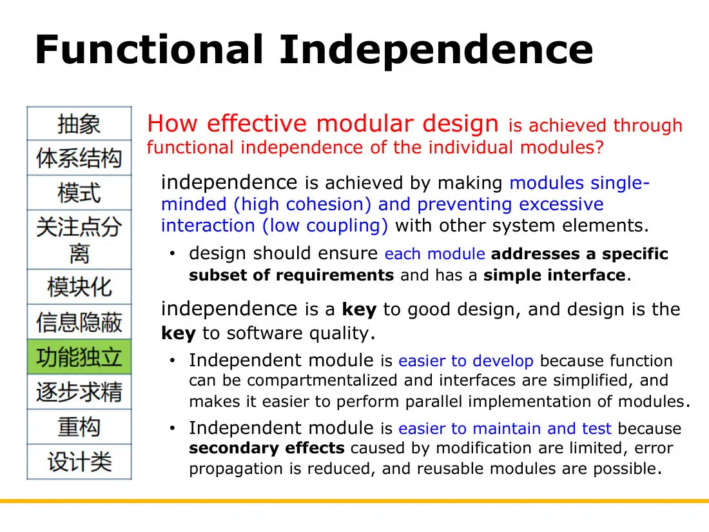

原文：

Functional Independence

How effective modular design is achieved through functional independence of the individual modules?

independence is achieved by making modules singleminded (high cohesion) and preventing excessive interaction (low coupling) with other system elements.

• design should ensure each module addresses a specific subset of requirements and has a simple interface.

independence is a key to good design, and design is the key to software quality.

• Independent module is easier to develop because function can be compartmentalized and interfaces are simplified, and makes it easier to perform parallel implementation of modules.

• Independent module is easier to maintain and test because secondary effects caused by modification are limited, error propagation is reduced, and reusable modules are possible.

### Stepwise refinement

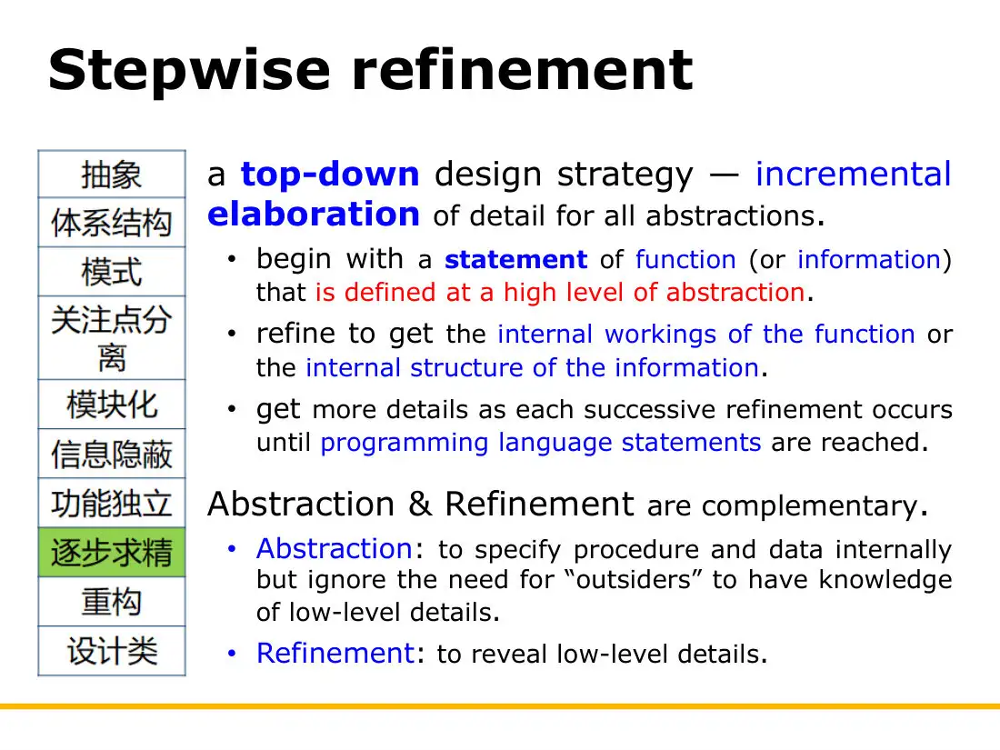

原文：

Stepwise refinement

a top-down design strategy — incremental elaboration of detail for all abstractions.

begin with a statement of function (or information) that is defined at a high level of abstraction.

refine to get the internal workings of the function or the internal structure of the information.

• get more details as each successive refinement occurs until programming language statements are reached.

Abstraction & Refinement are complementary.

Abstraction: to specify procedure and data internally but ignore the need for “outsiders” to have knowledge of low-level details.

• Refinement: to reveal low-level details.

### Stepwise refinement

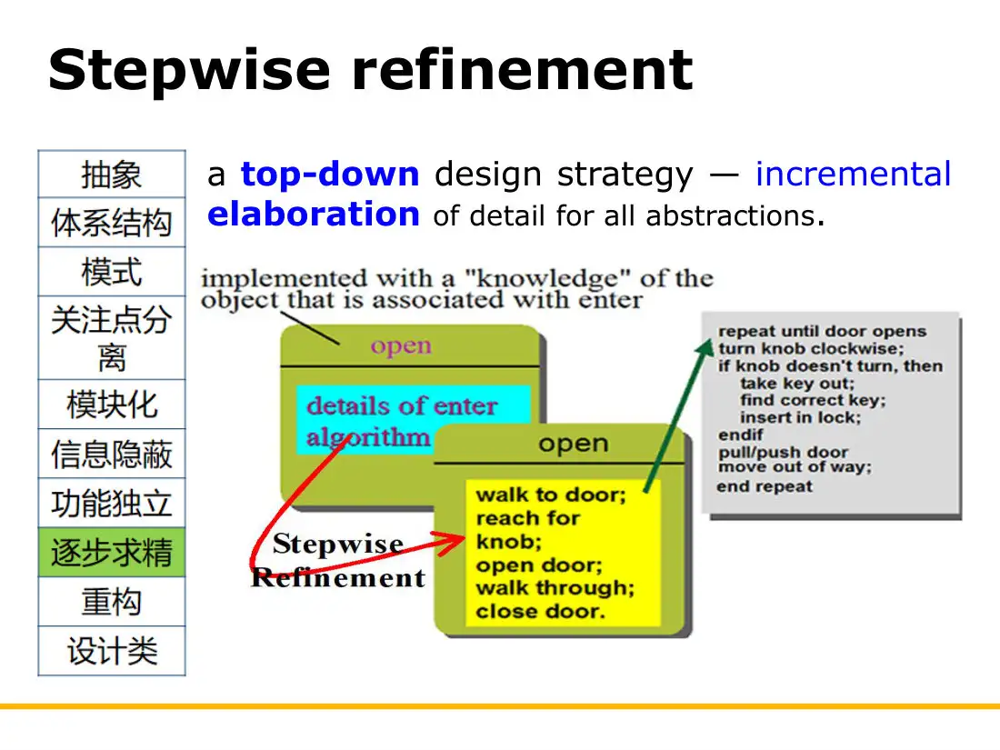

原文：

Stepwise refinement

a top-down design strategy — incremental elaboration of detail for all abstractions.

<table><tr><td>抽象</td></tr><tr><td>体系结构</td></tr><tr><td>模式</td></tr><tr><td>关注点分离</td></tr><tr><td>模块化</td></tr><tr><td>信息隐蔽</td></tr><tr><td>功能独立</td></tr><tr><td>逐步求精</td></tr><tr><td>重构</td></tr><tr><td>设计类</td></tr></table>

implemented with a "knowledge" of the object that is associated with enter

### Refactoring

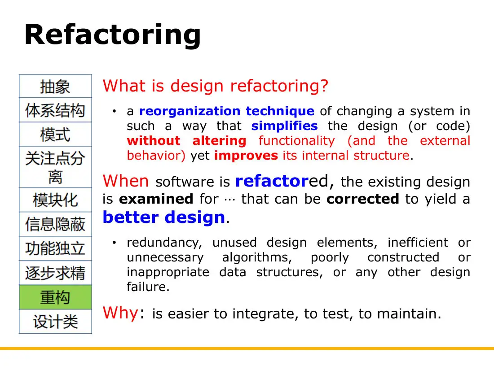

原文：

Refactoring

抽象体系结构模式关注点分离模块化信息隐蔽功能独立逐步求精重构设计类

What is design refactoring?

a reorganization technique of changing a system in such a way that simplifies the design (or code) without altering functionality (and the external behavior) yet improves its internal structure.

When software is refactored, the existing design is examined for ⋯ that can be corrected to yield a better design.

• redundancy, unused design elements, inefficient or unnecessary algorithms, poorly constructed or inappropriate data structures, or any other design failure.

Why: is easier to integrate, to test, to maintain.

### Design Classes

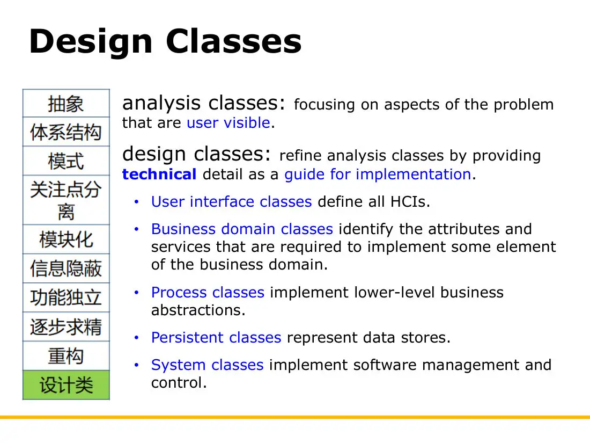

原文：

Design Classes

analysis classes: focusing on aspects of the problem that are user visible.

design classes: refine analysis classes by providing technical detail as a guide for implementation.

• User interface classes define all HCIs.

Business domain classes identify the attributes and services that are required to implement some element of the business domain.

• Process classes implement lower-level business abstractions.

• Persistent classes represent data stores.

• System classes implement software management and control.

### 设计概念：设计类

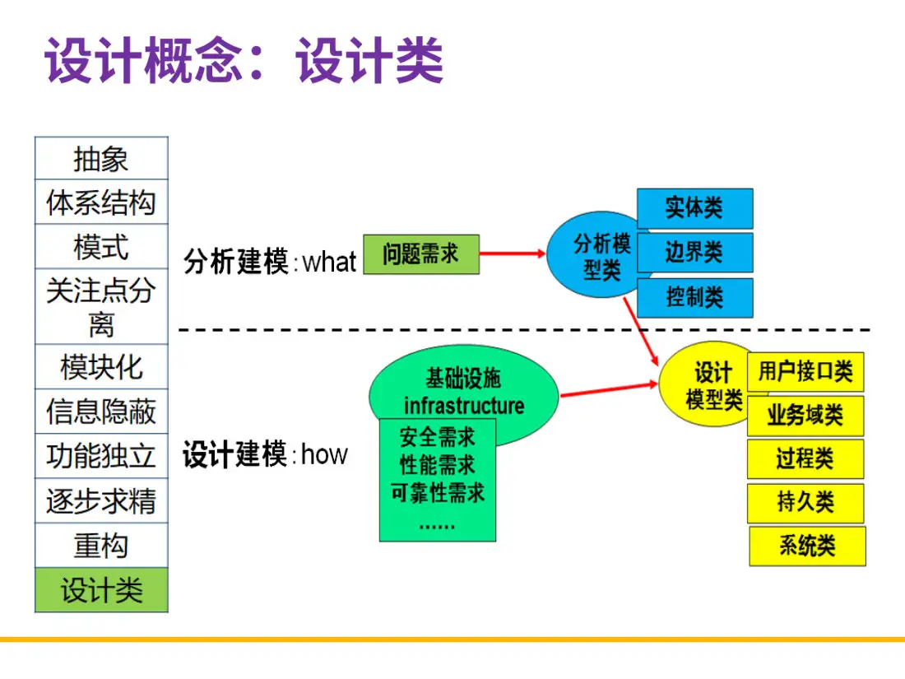

原文：

设计概念：设计类

### 设计概念：设计类

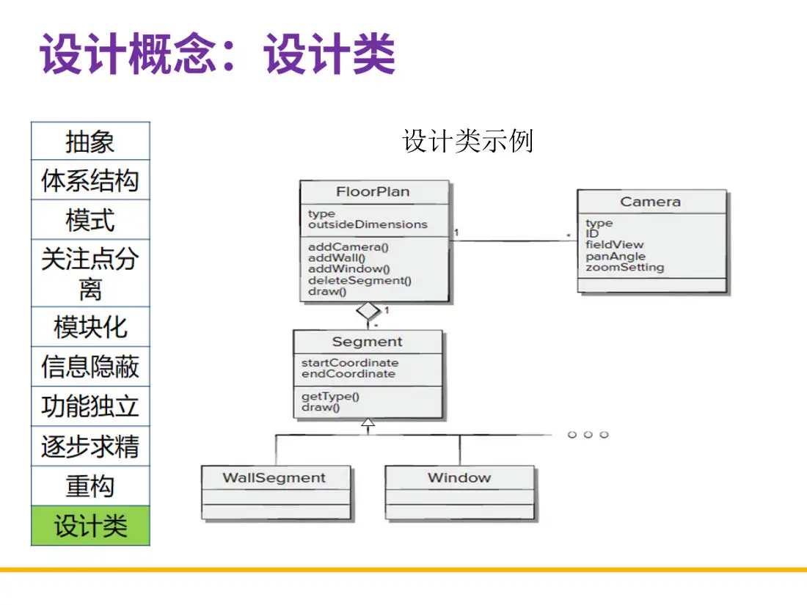

原文：

设计概念：设计类

<table><tr><td>抽象</td></tr><tr><td>体系结构</td></tr><tr><td>模式</td></tr><tr><td>关注点分离</td></tr><tr><td>模块化</td></tr><tr><td>信息隐蔽</td></tr><tr><td>功能独立</td></tr><tr><td>逐步求精</td></tr><tr><td>重构</td></tr><tr><td>设计类</td></tr></table>

设计类示例

### Design Classes

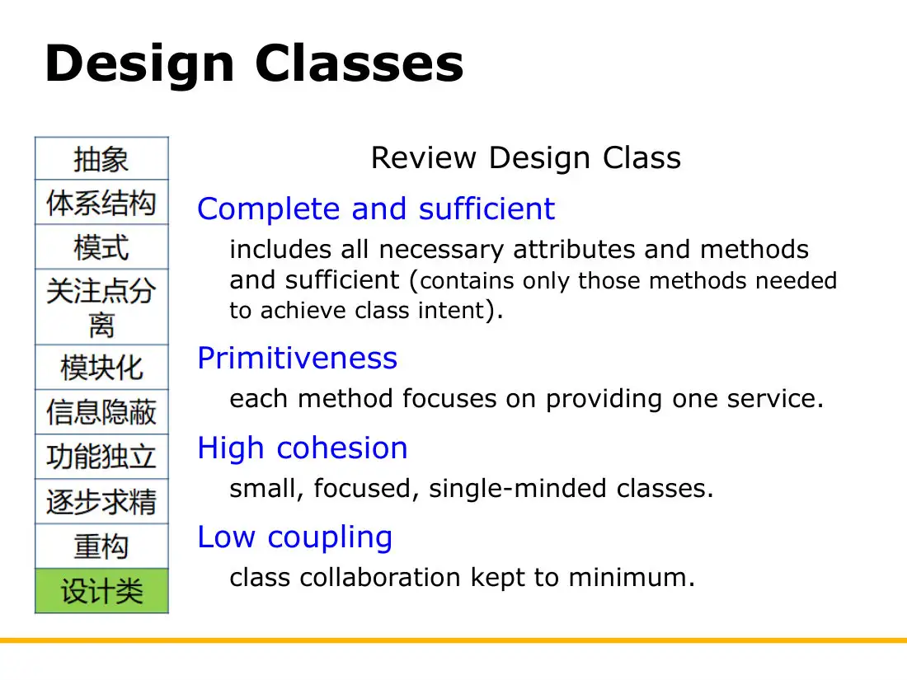

原文：

Design Classes

<table><tr><td>抽象</td><td>Review Design Class</td></tr><tr><td>体系结构</td><td rowspan="3">Complete and sufficientincludes all necessary attributes and methodsand sufficient (contains only those methods neededto achieve class intent).</td></tr><tr><td>模式</td></tr><tr><td>关注点分离</td></tr><tr><td>模块化</td><td rowspan="2">Primitivenesseach method focuses on providing one service.</td></tr><tr><td>信息隐蔽</td></tr><tr><td>功能独立</td><td rowspan="2">High cohesionsmall, focused, single-minded classes.</td></tr><tr><td>逐步求精</td></tr><tr><td>重构</td><td rowspan="2">Low couplingclass collaboration kept to minimum.</td></tr><tr><td>设计类</td></tr></table>

### Architecture Design

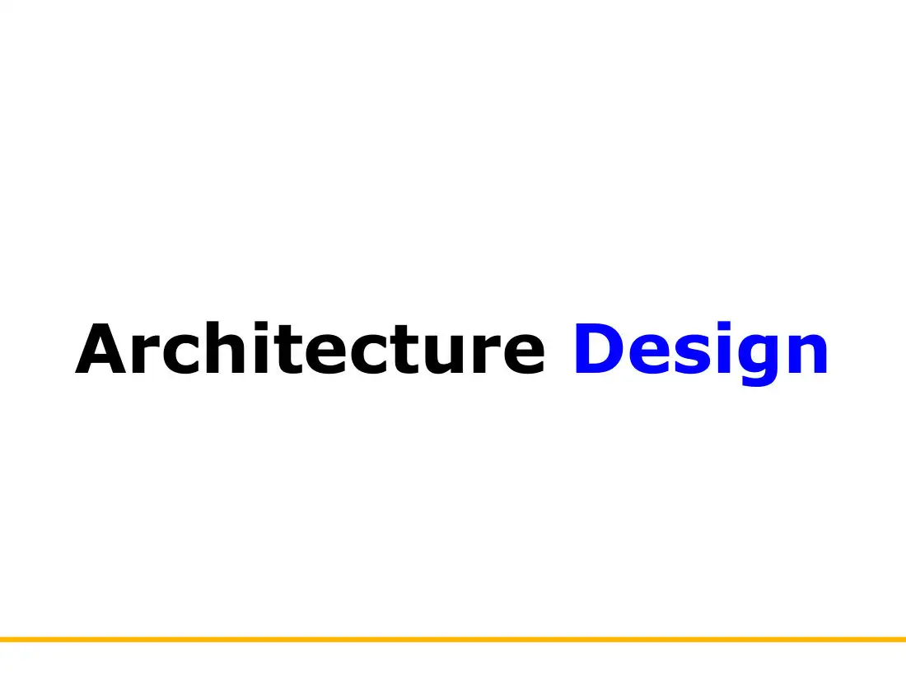

原文：

Architecture Design

### Info-driven architecture design

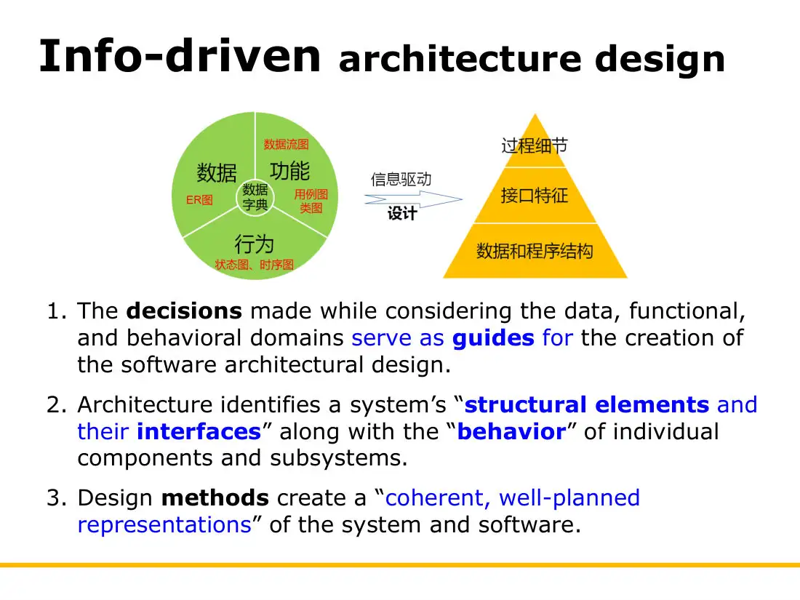

原文：

Info-driven architecture design

1. The decisions made while considering the data, functional, and behavioral domains serve as guides for the creation of the software architectural design.

2. Architecture identifies a system’s “structural elements and their interfaces” along with the “behavior” of individual components and subsystems.

3. Design methods create a “coherent, well-planned representations” of the system and software.

### Purpose of Architecture

原文：

Purpose of Architecture

Architecture is not the operational software, it is a representation that enables a software engineer to:

1. Analyze the effectiveness of the design in meeting its stated requirements,

2. Consider architectural alternatives at a stage when making design changes is still relatively easy, and

3. Reduce the risks associated with the construction of the software.

### Why is architecture important?

原文：

Why is architecture important?

three key reasons:

1. Architecture provides a representation that facilitates communication among all stakeholders.

2. Architecture highlights early design decisions that will have a profound impact on all SE work that follows, and plays an important role in the success of the system as a runnable entity.

3. Architecture constitutes a relatively small model (a set of abstractions) of how the system components are structured and work together.

### Architectural Descriptions

原文：

Architectural Descriptions

The IEEE Computer Society standard IEEE-Std-42010:2011(E), Systems and Software Engineering – Architecture Description.

describes the use of architecture viewpoints, architecture frameworks, and architecture description languages (ADLs) as a means of codifying the conventions and common practices for AD.

Tools: ACME, MetaH, Aesop, Rapide, ArTek, SADL, C2, UniCon, Darwin, Weaves, LILEANNA, Wright

AD展示系统的不同视图，编写架构文档的产品（模型）集

利益相关者不同，关注点不同，对体系结构的理解不同，每个视图都“从不同利益相关者的视角”表示系统

AD是利益相关者之间的交流语言，传递信息的工具，必须简洁易懂，利于确定系统边界

AD是权衡取舍体系结构属性的决策，考虑：系统目的，体系结构适用性，构建和部署系统的可行性(包括成本与性能)、风险和影响、可维护性和可演化性，利于项目经理确定项目资源和分配任务，影响任务执行顺序和团队构成

AD是记录构建体系结构解决方案的文档资料，利于软件构建，在设计师和维护者之间传递信息，为关注构件和设计复用的利益相关者提供支持

### Architecture Decision

原文：

Architecture Decision

Document each decision using a template

1. Determine information items needed for each decision.

2. Define links between each decision and appropriate requirements.

3. Provide mechanisms to change status when alternative decisions need to be evaluated.

4. Define prerequisite relationships among decisions to support traceability.

5. Link significant decisions to architectural views resulting from decisions.

6. Document and communicate all decisions as they are made.

### Decision Documentation

原文：

Decision Documentation

决策应被记录，利于理解和评审体系结构

<table><tr><td colspan="4">体系结构决策描述模板:缩略版</td></tr><tr><td>设计问题</td><td>✧ 决策标题:描述将要解决的体系结构设计问题</td><td>决策理由</td><td>✧ 决策状态:陈述选择该决策而非其他决策的理由</td></tr><tr><td>解决方案</td><td>✧ 决策信息:陈述所选择的解决设计问题的方法</td><td rowspan="2">决策结果</td><td rowspan="2">✧ 指出做出该决策的影响。这个决策方案对其他体系结构设计问题产生什么影响?这个决策方案是否对设计产生约束?</td></tr><tr><td rowspan="2">分类</td><td rowspan="2">✧ 指定设计问题和解决方案陈述的设计类别(如:数据设计、内容结构、构件结构、集成、简要说明)</td></tr><tr><td>相关决策</td><td>✧ 哪些其他记录的决策与该决策相关?</td></tr><tr><td rowspan="2">假设与约束</td><td rowspan="2">✧ 指出有助于制定决策的假设和任何有助于制定决策的环境约束(如:技术标准、可用的模式、项目相关问题)</td><td>相关关注点</td><td>✧ 哪些其他需求与该决策相关?</td></tr><tr><td>工作产品</td><td>✧ 指出该决策会在何处影响整个体系结构描述</td></tr><tr><td>候选方案</td><td>✧ 简要描述所考虑的体系结构设计候选方案,并描述为什么放弃这些方案</td><td>注释</td><td>✧ 参考可用来制定决策的其他团队的备忘录或文档</td></tr></table>

### Agility and Architecture

原文：

Agility and Architecture

How to use storyboarding technology in architectural design?

• Architect contributes architectural stories to the project and works with the product owner to prioritize the architectural stories with the business stories as “sprints” are planned.

• Architect works with Team during the sprint to ensure that the evolving software continues to show high architectural quality as defined by the NFRs.

• After the sprint is completed, Architect reviews the working prototype for quality before the team presents it to the stakeholders in a formal sprint review.

• Well-run projects make use of iterative work product delivery (including architectural documentation) with each sprint.

### Responsibility-driven architecture

原文：

Responsibility-driven architecture

RDA is a process that focuses on when, how, and who should make the architectural decisions on a project team.

• Architect focuses on how the team addresses stakeholder’s nontechnical concerns.

Agile teams usually are free to make system changes as new requirements emerge, while the architect carefully considers the important parts of the architecture to ensure that developers have consulted the appropriate stakeholders.

• Both concerns are satisfied by using a practice called progressive sign-off in which the evolving product is documented and approved as each successive prototype is completed.

• RDA process provides verifiable sign-off for regulators and auditors, without preventing the teams decision-making.

• At the end of the project, the team has a complete set of work products and the architecture has been reviewed for quality as it evolved.

### genres, styles & patterns

原文：

genres, styles & patterns

Architectural design model and the patterns contained within it are transferable.

• Architectural genres, styles, and patterns can be applied to the design of other systems and represent a set of abstractions that enable the engineers to describe architecture in predictable ways.

• Making good decisions while defining the architecture is critical to the success of a software product.

• The architecture sets the structure of the system and determines

### 建筑风格

原文：

建筑风格

北京四合院

文艺复兴

• 古典风格的圆柱、完美的几何设计巴洛克

• 线、装饰、壁画、雕塑 哥特式 32

• 玲珑、锋利、尖顶

• 玻璃窗画、圆雕浮雕殖民式中庭

• 壁炉、外观、门窗

### 建筑的体系结构描述

原文：

建筑的体系结构描述

面向不同用户的不同视图描述

### 类型、风格与模式

原文：

类型、风格与模式

### 类型、风格与模式

原文：

类型、风格与模式

<table><tr><td>对比</td><td>类型 (Genres)应用领域 &amp; 类别</td><td>风格、样式 (Style)关注整体</td><td>模式 (Pattern)关注局部</td></tr><tr><td>建筑</td><td>家用住宅、单元楼、办公楼、工厂厂房、仓库</td><td>2室1厅、北京四合院、殖民式中厅、歌特式、巴洛克、文艺复兴、古罗马</td><td>房间朝向、过道、门窗的位置、通风、强电弱电入户、上水下水实施</td></tr><tr><td>软件</td><td>AI、通信、设备、金融、游戏、工业、法律、医疗、军事、OS、运输等</td><td>星型结构(数据中心)、数据流体系结构、调用返回式体系结构、层次体系结构、OO体系结构</td><td>23 种设计模式组合模式、装饰模式、访问者模式、桥接模式、观察者模式......</td></tr></table>

• 每个风格都描述一种系统类别

• 风格是待建系统（建筑&软件）的模版（粗略框架，后续设计需补充细节：明确房屋最终大小，添加客户定制特征，确定建筑材料），指导设计者（建筑师&软件工程师）的工作

• 模式在特定上下文和一系列限制与约束下，针对特定应用问题提供体系结构解决方案，是体系结构设计的基础

### Architectural Styles

原文：

Architectural Styles

What are the elements that make up the software architectural style ?

Each style describes a system category that encompasses:

1. a set of components (e.g., a database, computational modules) that perform a function required by a system,

2. a set of connectors that enable “communication, coordination and cooperation” among components,

3. constraints that define how components can be integrated to form the system, and

4. semantic models that enable a designer to understand the overall properties of a system by analyzing the known properties of its constituent parts.

### 风格：以数据为中心的体系结构

原文：

风格：以数据为中心的体系结构

常见于：数据库应用系统、超文本系统、黑板（公告）系统

• 客户端软件访问中心存储库

• 数据存储库常是被动的，即客户端软件访问数据独立于数据变化和其他客户端软件的行为

• “黑板”是该风格的一个变种，当客户感兴趣的数据发生变化时，它通知相应的客户端软件（可用到观察者设计模式）

### 风格：数据流体系结构

原文：

风格：数据流体系结构

常见于：过滤器、管道、批处理

• 体系结构的每个矩形构件，被标记为过滤器

• 过滤器之间的连接箭头被标记为管道，从右到左读取数据流

### 风格：调用返回式体系结构

原文：

风格：调用返回式体系结构

主程序调用子程序，一种传统体系结构

• 描述体系的 4 个概念：扇入、扇出、深度、宽度

• 主程序与三个控制器子程序连接，每个控制器子程序分别与两个应用程序连接，这两个子程序又构成一个应用程序子程序

### 风格：OO体系结构

原文：

风格：OO体系结构

构件封装数据与操作数据的方法，通过消息传递实现构件协作

• 用户连接到一个安全登录，请求登录，并在登录时输入名称和密码

• 安全登录有一个内部循环，包括：显示、显示消息和显示登录

• 如果安全登录有效，用户将访问帐户数据库

• 在选择用户类型之后，用户访问系统

### 风格：分层体系结构

原文：

风格：分层体系结构

OO体系结构的另一种视角

• 四层：从内到外是核心层、工具层、应用层和用户接口层

• 外层是半圆形的

• 每一层都有用正方形表示的构件，从外层到内层，正方形的数量递减

### 风格：MVC 体系结构

原文：

风格：MVC 体系结构

Model-View-Controller

模型：包含所有应用的特定内容和处理逻辑

视图：包含所有接口特定功能，并显示用户所需内容和操作逻辑

控制器：管理对模型和视图的访问，并协调它们之间的数据流

### 风格：MVC 体系结构

原文：

风格：MVC 体系结构

Model-View-Controller

模型：包含所有应用的特定内容和处理逻辑

视图：包含所有接口特定功能，并显示用户所需内容和操作逻辑

控制器：管理对模型和视图的访问，并协调它们之间的数据流

浏览器向控制器发送用户请求或数据，或浏览器访问视图中的HTML数据

控制器管理用户请求，选择模型行为和选择视图响应

视图从模型中准备数据，请求模型更新，并显示控制器选择的视图

模型包括封装功能、封装内容对象、并合并所有的 WebApp 状态

控制器向视图发送一个视图选择，并向模型发送一个状态改变请求

视图从模型接收数据，并向模型发送更新请求

模型具有与外部数据有两个数据交换

### 体系设计中的风格选择

原文：

体系设计中的风格选择

一旦需求工程确定待构建系统的特征和约束，就设计、评审、选择最适合特征和约束的体系结构风格，或风格与模式的组合

选择一个合适的体系结构凤格可能很困难，现实应用中常依据问题框架，组合多个不同结构模型

### 体系设计中的风格选择

原文：

体系设计中的风格选择

MVC 可视为 2 种问题框架的结合

• “指令行为”框架：终端用户指令通过浏览器窗口发送给指令处理器

(控制器)

•“信息显示”框架：控制器负责对内容（模型）的访问，并指示信息渲染模型(视图),对内容进行转换使其显示在浏览器中

### 体系设计中的风格选择

原文：

体系设计中的风格选择

设计须解决跨越整个应用领域的问题

电子商务系统中：如何向不同客户提供不同商品？如何让客户轻松找到并购买商品？

设计模型，需解决问题的上下文

销售高尔夫装备与销售高价工业设备的两种电子商务应用，运行环境差异很大，一系列的限制和约束可能影响解决方案

在特定上下文和一系列限制与约束下，模式针对特定问题提供解决方案，是体系结构设计的基础

大多数应用具有特定领域或类别，有恰当的风格适于此类别，在这种风格之下，特定结构模式可用于解决一些常见问题

租户私砸承重墙致楼栋开裂，1.6亿赔款谁来出？

装修砸墙，常见，但一下砸没1.6个亿，真就谈得上“奇闻”了。

近日，哈尔滨一健身房老板因装修改造，私自将承重墙砸毁，导致楼栋墙体从3层开裂至21层，高楼被砸成危楼。

从网传视频中可以看到，装修的房子里，多面墙体被拆除，其中承重墙体的钢筋直接裸露在外。

### Organization & Refinement

原文：

Organization & Refinement

<table><tr><td>Control</td><td>Data</td></tr><tr><td>How is controlmanagedwithin the architecture?Does adistinctcontrol hierarchyexist, and if so, what is theroleof components within this control hierarchy?How do componentstransfercontrol within the system?How is controlsharedamong components?What is the controlotopology(i.e., thegeometricform that the control takes)?Is consolrsynchronized, or do components operate asynchronously?</td><td>How aredata communicatedbetween components?Is the flow of datacontinuous, or are data objects passed to the systemsporadically?What is themodeof data transfer (i.e., are data passed from one component to another or are data available globally to be shared among system components)?Do data components (e.g., a blackboard or repository) exist, and if so, what is theirrole?How do functional componentsinteractwith data components?Are data componentspassiveoractive(i.e., does the data component actively interact with other components in the system)?</td></tr><tr><td colspan="2">How dodataandcontrolinteract within the system?</td></tr></table>

### Architectural Considerations

原文：

Architectural Considerations

Economy

software is uncluttered and relies on abstraction to reduce unnecessary detail.

Visibility

Architectural decisions and their justifications should be obvious to software engineers who review.

Spacing

Separation of concerns in a design without introducing hidden dependencies.

Symmetry

Architectural symmetry implies that a system is consistent and balanced in its attributes.

Emergence

Emergent, self-organized behavior and control are key to creating scalable, efficient, and economic software architectures.

### Architectural Design

原文：

Architectural Design

<table><tr><td colspan="2">步骤</td></tr><tr><td>1</td><td>系统上下文表示</td></tr><tr><td>2</td><td>定义体系结构原型</td></tr><tr><td>3</td><td>细化体系结构为构件</td></tr><tr><td>4</td><td>描述系统实例</td></tr></table>

1. The software must be placed into context. define the external entities that the software interacts with and the nature of the interaction.

2. A set of archetypes should be identified. An archetype is an abstraction that represents one element of system behavior.

3. specifies the system structure by defining and refining components that implement each archetype. archetypes do not provide enough implementation detail.

4. iteratively until a complete architectural structure has been derived.

### Architectural Design

原文：

Architectural Design

<table><tr><td colspan="2">步骤</td></tr><tr><td>1</td><td>系统上下文表示</td></tr><tr><td>2</td><td>定义体系结构原型</td></tr><tr><td>3</td><td>细化体系结构为构件</td></tr><tr><td>4</td><td>描述系统实例</td></tr></table>

所有接口设计演化为一个有若干构件组成的单独子系统

### Architectural Design

原文：

Architectural Design

Some questions must be asked and answered as an engineer creates meaningful architectural diagrams.

<table><tr><td colspan="2">步骤</td></tr><tr><td>1</td><td>系统上下文表示</td></tr><tr><td>2</td><td>定义体系结构原型</td></tr><tr><td>3</td><td>细化体系结构为构件</td></tr><tr><td>4</td><td>描述系统实例</td></tr></table>

• Does the diagram show how the system responds to inputs or events ?

• What visualizations might be to help emphasize area of risks ?

• How can hidden patterns be made more obvious to other developers ?

• Can multi-viewpoints show the best way to refactor specific parts of the system ?

• Can design trade-offs be represented in a meaningful way ?

### architectural context diagram

原文：

architectural context diagram

ACD model the manner in which software interacts with entities external to its boundaries.

<table><tr><td colspan="2">步骤</td></tr><tr><td>1</td><td>系统上下文表示</td></tr><tr><td>2</td><td>定义体系结构原型</td></tr><tr><td>3</td><td>细化体系结构为构件</td></tr><tr><td>4</td><td>描述系统实例</td></tr></table>

An ACD for the SafeHome Security Functions

• specify details of each interface and all data that flow into and out of the target system.

### Defining Archetypes

原文：

Defining Archetypes

<table><tr><td colspan="2">步骤</td></tr><tr><td>1</td><td>系统上下文表示</td></tr><tr><td>2</td><td>定义体系结构原型</td></tr><tr><td>3</td><td>细化体系结构为构件</td></tr><tr><td>4</td><td>描述系统实例</td></tr></table>

What is an archetype ?

The target system architecture is composed of a relatively small set of archetypes.

• Archetype design is critical to the design of an architecture.

An archetype

• is a class or pattern that represents stable element with a core abstraction for the target system.

• may be instantiated iteratively many different ways based on the behavior of the system.

• can be derived by examining the analysis classes defined as part of the requirements model.

### Defining Archetypes

原文：

Defining Archetypes

SafeHome 安全功能的体系结构原型集

<table><tr><td colspan="2">步骤</td></tr><tr><td>1</td><td>系统上下文表示</td></tr><tr><td>2</td><td>定义体系结构原型</td></tr><tr><td>3</td><td>细化体系结构为构件</td></tr><tr><td>4</td><td>描述系统实例</td></tr></table>

### 步骤1系统上下文表示2定义体系结构原型3细化体系结构为构件4描述系统实例

原文：

Refining the Architecture into Components

As architecture is refined into components, the structure of the system begins to emerge.

<table><tr><td colspan="2">步骤</td></tr><tr><td>1</td><td>系统上下文表示</td></tr><tr><td>2</td><td>定义体系结构原型</td></tr><tr><td>3</td><td>细化体系结构为构件</td></tr><tr><td>4</td><td>描述系统实例</td></tr></table>

how are components chosen?

Analysis classes of the requirements model represent entities within the application (business) domain that must be addressed within the software architecture.

• Consider Infrastructure components that enable application components but have no business connection to the application domain.

• The interfaces depicted in ACD imply one or more specialized components (e.g., GUI) that process the data that flows across the interface.

### 构件图表示的 SafeHome 顶层体系结构

原文：

Refining the Architecture into Components

构件图表示的 SafeHome 顶层体系结构

<table><tr><td colspan="2">步骤</td></tr><tr><td>1</td><td>系统上下文表示</td></tr><tr><td>2</td><td>定义体系结构原型</td></tr><tr><td>3</td><td>细化体系结构为构件</td></tr><tr><td>4</td><td>描述系统实例</td></tr></table>

### Instantiations of the System

原文：

Instantiations of the System

<table><tr><td colspan="2">步骤</td></tr><tr><td>1</td><td>系统上下文表示</td></tr><tr><td>2</td><td>定义体系结构原型</td></tr><tr><td>3</td><td>细化体系结构为构件</td></tr><tr><td>4</td><td>描述系统实例</td></tr></table>

迭代细化至系统实例

### Tradeoff Analysis & Reviews

原文：

Tradeoff Analysis & Reviews

ATAM：Architecture Trade-off Analysis Method

SEI (Software Engineering Institute): an iterative evaluation for architectures

What is the purpose of architecture trade-off analysis?

• Design should result in a number of architectural alternatives that are each assessed to determine which is the most fit for the problem to be solved.

• ATAM is an iterative process for evaluating architectures using the NFRs assigned to the project.

Reviews

Formal technical reviews & Pattern-based Architectural Reviews

Conformance Checking

SACA: Static architecture-conformance analysis

### Architectural Tradeoff Analysis

原文：

Architectural Tradeoff Analysis

ATAM: an iterative evaluation for architectures

1. Collect scenarios.

2. Elicit requirements, constraints, environment description.

3. Describe the architectural styles/patterns that have been chosen to address the scenarios and requirements using one of these views: module, process, data flow.

4. Evaluate quality attributes by considering each one in isolation.

5. Identify the sensitivity of quality attributes to various architectural attributes for a specific architectural style.

6. Critique candidate architectures (developed in step 3) using the sensitivity analysis (conducted in step 5).

### Formal technical reviews

原文：

Formal technical reviews

Assess the ability of the architecture to meet the systems quality requirements and identify potential risks.

<table><tr><td>团队</td><td>涉及团队成员与专家,而非全部利益相关者体系结构创建,须考虑所有利益相关者的需求和观点,明智选择达成共识,所选方案最优✧架构师:关注系统非功能性需求的长期影响✧高级管理人员:通过业务目标评估体系结构✧项目管理人员:常被交付日期和预算这类短期考虑因素所束缚✧软件工程师:专注于自己的技术兴趣和功能交付</td></tr><tr><td>技术</td><td>基于经验的审查、原型评估和场景审查,以及检查表</td></tr><tr><td>时机</td><td>项目生命周期早期✧增加新构件时,需要重新评审✧普遍的存在问题:体系结构工作产品的丢失或不完整</td></tr></table>

### Pattern-based Architectural Reviews

原文：

Pattern-based Architectural Reviews

1. Identify and discuss the quality attributes by walking through the use cases.

2. Discuss a diagram of system’s architecture in relation to its requirements.

3. Identify the architecture patterns used and match the system’s structure to the patterns’ structure.

4. Use existing documentation and use cases to determine each pattern’s effect on quality attributes.

5. Identify all quality issues raised by architecture patterns used in the design.

6. Develop a short summary of issues uncovered during the meeting and make revisions to the walking skeleton.

### Conformance Checking

原文：

Conformance Checking

design ⟹ construction, software engineers must work to ensure that an implemented and evolving system conforms to its planned architecture.

• Many things cause deviations from a defined architecture and affect the quality of the system.

Static architecture-conformance analysis (SACA)

• assesses whether an implemented software system is consistent with its architectural model.

UML used to model architecture presents the static organization of system components and how the components interact.

• A project manager often use the architectural model to plan and allocate work tasks, as well as to assess implementation progress.

### Homework after class

原文：

Homework after class

1. What are characteristics that can serve as a guide to evaluate design quality?

2. How effective modular design is achieved through functional independence of the individual modules?

3. What is the principle of information hiding as it applies to software design?

4. What is design refactoring?

5. Which models are required for writing a software design specification, and what is the role of each model?

6. Why is architecture important?

7. How to use storyboarding technology in architectural design?

8. What are the elements that make up a software architectural style?

9. What is an archetype?

10. What is the purpose of architecture trade-off analysis?
